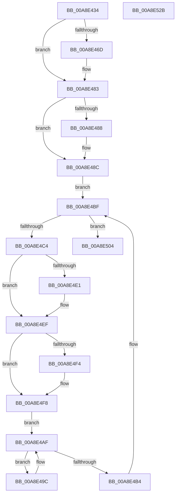

# SshpTracingRundownBlockerState

- RVA: `0x00A8E434`–`0x00A8E52C` (길이 `248` bytes)
- VA: `0x0000000140A8E434`
- 실행 섹션: `PAGE`
- PDB 이름 있음: `예`; PDB Function 태그: `아니요`
- unwind 정보 RVA: `0x0008FC44`
- 디코드: `63`개 명령, `248/248` bytes 표시
- 미해석 바이트: `0` (있으면 어셈블리에 `.byte`로 보존)

> 이 문서는 커널 이미지의 기계어와 PDB 기호를 분석해 생성했습니다. 4번과 5번은 함수 원형과 자료형을 바이너리 사용 방식에서 추정한 C 해석이며 원본 소스 복구 결과는 아닙니다.

## 1. Dependencies

- 직접 호출 지점: **7**; 고유 호출 대상: **4**
- 직접 호출자로 확인된 함수: **1**
- RIP 상대 이미지 참조: **4**

### Outgoing calls
- `0x00A8E459` → [KeAbPreAcquire](../../text/21/KeAbPreAcquire_function_00210230.md) (function, `0x00210230`)
- `0x00A8E47E` → [ExfAcquirePushLockExclusiveEx](../../text/20/ExfAcquirePushLockExclusiveEx_function_0020FC90.md) (function, `0x0020FC90`)
- `0x00A8E4A7` → [SshpTracingWriteBlockerStateRundown](../../text/49/SshpTracingWriteBlockerStateRundown_function_00491A20.md) (function, `0x00491A20`)
- `0x00A8E4B7` → [SSHSupportReleasePushLockExclusive](../../text/49/SSHSupportReleasePushLockExclusive_function_004954EC.md) (function, `0x004954EC`)
- `0x00A8E4D0` → [KeAbPreAcquire](../../text/21/KeAbPreAcquire_function_00210230.md) (function, `0x00210230`)
- `0x00A8E4EA` → [ExfAcquirePushLockExclusiveEx](../../text/20/ExfAcquirePushLockExclusiveEx_function_0020FC90.md) (function, `0x0020FC90`)
- `0x00A8E50B` → [SSHSupportReleasePushLockExclusive](../../text/49/SSHSupportReleasePushLockExclusive_function_004954EC.md) (function, `0x004954EC`)

### Direct callers
- [SshpEtwEnableCallback](SshpEtwEnableCallback_function_00A8E410.md) at `0x00A8E41F`

### Static image references
- `0x00A8E450` → RVA `0x00F07030` (`.data`; read)
- `0x00A8E45E` → RVA `0x00F07030` (`.data`; read/write)
- `0x00A8E48C` → RVA `0x00F07020` (`.data`; read)
- `0x00A8E4A0` → RVA `0x0001C020` (`.rdata`; read)

## 2. Other-region calls and transfers

- 다른 실행 섹션으로 향하는 call: **7**
  - `0x00A8E459` → [KeAbPreAcquire](../../text/21/KeAbPreAcquire_function_00210230.md) (`PAGE` → `.text`)
  - `0x00A8E47E` → [ExfAcquirePushLockExclusiveEx](../../text/20/ExfAcquirePushLockExclusiveEx_function_0020FC90.md) (`PAGE` → `.text`)
  - `0x00A8E4A7` → [SshpTracingWriteBlockerStateRundown](../../text/49/SshpTracingWriteBlockerStateRundown_function_00491A20.md) (`PAGE` → `.text`)
  - `0x00A8E4B7` → [SSHSupportReleasePushLockExclusive](../../text/49/SSHSupportReleasePushLockExclusive_function_004954EC.md) (`PAGE` → `.text`)
  - `0x00A8E4D0` → [KeAbPreAcquire](../../text/21/KeAbPreAcquire_function_00210230.md) (`PAGE` → `.text`)
  - `0x00A8E4EA` → [ExfAcquirePushLockExclusiveEx](../../text/20/ExfAcquirePushLockExclusiveEx_function_0020FC90.md) (`PAGE` → `.text`)
  - `0x00A8E50B` → [SSHSupportReleasePushLockExclusive](../../text/49/SSHSupportReleasePushLockExclusive_function_004954EC.md) (`PAGE` → `.text`)
- 별도 외부 분기/꼬리 이동을 확인하지 못했습니다.

## 3. Assembly (complete function range)

```asm
00A8E434  48 8B C4                        mov rax, rsp
00A8E437  48 89 58 08                     mov qword ptr [rax + 8], rbx
00A8E43B  48 89 68 10                     mov qword ptr [rax + 0x10], rbp
00A8E43F  48 89 70 18                     mov qword ptr [rax + 0x18], rsi
00A8E443  48 89 78 20                     mov qword ptr [rax + 0x20], rdi
00A8E447  41 57                           push r15
00A8E449  48 83 EC 20                     sub rsp, 0x20
00A8E44D  45 33 C0                        xor r8d, r8d
00A8E450  48 8D 0D D9 8B 47 00            lea rcx, [rip + 0x478bd9]
00A8E457  33 D2                           xor edx, edx
00A8E459  E8 D2 1D 78 FF                  call 0x140210230
00A8E45E  F0 48 0F BA 2D C8 8B 47 00 00   lock bts qword ptr [rip + 0x478bc8], 0
00A8E468  48 8B D8                        mov rbx, rax
00A8E46B  73 16                           jae 0x140a8e483
00A8E46D  4C 8D 05 BC 8B 47 00            lea r8, [rip + 0x478bbc]
00A8E474  48 8B D0                        mov rdx, rax
00A8E477  48 8D 0D B2 8B 47 00            lea rcx, [rip + 0x478bb2]
00A8E47E  E8 0D 18 78 FF                  call 0x14020fc90
00A8E483  48 85 DB                        test rbx, rbx
00A8E486  74 04                           je 0x140a8e48c
00A8E488  C6 43 0A 01                     mov byte ptr [rbx + 0xa], 1
00A8E48C  48 8B 1D 8D 8B 47 00            mov rbx, qword ptr [rip + 0x478b8d]
00A8E493  4C 8D 3D 86 8B 47 00            lea r15, [rip + 0x478b86]
00A8E49A  EB 23                           jmp 0x140a8e4bf
00A8E49C  48 8B 57 70                     mov rdx, qword ptr [rdi + 0x70]
00A8E4A0  48 8D 0D 79 DB 58 FF            lea rcx, [rip - 0xa72487]
00A8E4A7  E8 74 35 A0 FF                  call 0x140491a20
00A8E4AC  48 8B 3F                        mov rdi, qword ptr [rdi]
00A8E4AF  48 3B FE                        cmp rdi, rsi
00A8E4B2  75 E8                           jne 0x140a8e49c
00A8E4B4  48 8B CD                        mov rcx, rbp
00A8E4B7  E8 30 70 A0 FF                  call 0x1404954ec
00A8E4BC  48 8B 1B                        mov rbx, qword ptr [rbx]
00A8E4BF  49 3B DF                        cmp rbx, r15
00A8E4C2  74 40                           je 0x140a8e504
00A8E4C4  48 8D 6B 10                     lea rbp, [rbx + 0x10]
00A8E4C8  45 33 C0                        xor r8d, r8d
00A8E4CB  48 8B CD                        mov rcx, rbp
00A8E4CE  33 D2                           xor edx, edx
00A8E4D0  E8 5B 1D 78 FF                  call 0x140210230
00A8E4D5  F0 48 0F BA 6D 00 00            lock bts qword ptr [rbp], 0
00A8E4DC  48 8B F8                        mov rdi, rax
00A8E4DF  73 0E                           jae 0x140a8e4ef
00A8E4E1  4C 8B C5                        mov r8, rbp
00A8E4E4  48 8B D0                        mov rdx, rax
00A8E4E7  48 8B CD                        mov rcx, rbp
00A8E4EA  E8 A1 17 78 FF                  call 0x14020fc90
00A8E4EF  48 85 FF                        test rdi, rdi
00A8E4F2  74 04                           je 0x140a8e4f8
00A8E4F4  C6 47 0A 01                     mov byte ptr [rdi + 0xa], 1
00A8E4F8  48 8D B3 98 00 00 00            lea rsi, [rbx + 0x98]
00A8E4FF  48 8B 3E                        mov rdi, qword ptr [rsi]
00A8E502  EB AB                           jmp 0x140a8e4af
00A8E504  48 8D 0D 25 8B 47 00            lea rcx, [rip + 0x478b25]
00A8E50B  E8 DC 6F A0 FF                  call 0x1404954ec
00A8E510  48 8B 5C 24 30                  mov rbx, qword ptr [rsp + 0x30]
00A8E515  48 8B 6C 24 38                  mov rbp, qword ptr [rsp + 0x38]
00A8E51A  48 8B 74 24 40                  mov rsi, qword ptr [rsp + 0x40]
00A8E51F  48 8B 7C 24 48                  mov rdi, qword ptr [rsp + 0x48]
00A8E524  48 83 C4 20                     add rsp, 0x20
00A8E528  41 5F                           pop r15
00A8E52A  C3                              ret
00A8E52B  CC                              int3
```

## 4. C-style interpretation (structured pseudocode)

```c
__int64 __fastcall SshpTracingRundownBlockerState(__int64 a1, int a2, int a3)
{
    __int64 result;
    __int64 v_rsp;
    unsigned __int64 v_stack_p10;
    unsigned __int64 v_stack_p18;
    unsigned __int64 v_stack_p20;
    unsigned __int64 v_stack_p8;

    *(unsigned __int64 *)(v_rsp + 8) = v_rbx;
    *(unsigned __int64 *)(v_rsp + 16) = v_rbp;
    *(unsigned __int64 *)(v_rsp + 24) = v_rsi;
    *(unsigned __int64 *)(v_rsp + 32) = v_rdi;
    v_rsp = (v_rsp) - (32);
    a3 = 0;
    a2 = 0;
    result = KeAbPreAcquire(v_rip + 4688857, a2, a3, a4);
    if (!(condition_is_above_or_equal)) {
        a3 = v_rip + 4688828;
        a2 = result;
        a1 = v_rip + 4688818;
        result = ExfAcquirePushLockExclusiveEx(a1, a2, a3, a4);
    }
    if (result != 0) {
        *(unsigned __int8 *)(result + 10) = 1;
    }
    goto loc_00A8E4BF;
loc_00A8E49C:
    result = SshpTracingWriteBlockerStateRundown(v_rip - 10953863, *(unsigned __int64 *)(v_rdi + 112), a3, a4);
loc_00A8E4AF:
    if ((*(unsigned __int64 *)(v_rdi)) != v_rsi) goto loc_00A8E49C;
    result = SSHSupportReleasePushLockExclusive(v_rbp, *(unsigned __int64 *)(v_rdi + 112), a3, a4);
loc_00A8E4BF:
    if ((*(unsigned __int64 *)(*(unsigned __int64 *)(v_rip + 4688781))) == (v_rip + 4688774)) goto loc_00A8E504;
    a3 = 0;
    a2 = 0;
    result = KeAbPreAcquire(*(unsigned __int64 *)(*(unsigned __int64 *)(v_rip + 4688781)) + 16, a2, a3, a4);
    if (!(condition_is_above_or_equal)) {
        a3 = *(unsigned __int64 *)(*(unsigned __int64 *)(v_rip + 4688781)) + 16;
        a2 = result;
        a1 = *(unsigned __int64 *)(*(unsigned __int64 *)(v_rip + 4688781)) + 16;
        result = ExfAcquirePushLockExclusiveEx(a1, a2, a3, a4);
    }
    if (result != 0) {
        *(unsigned __int8 *)(result + 10) = 1;
    }
    goto loc_00A8E4AF;
loc_00A8E504:
    result = SSHSupportReleasePushLockExclusive(v_rip + 4688677, a2, a3, a4);
    v_rsp = (v_rsp) + (32);
    return result;
}
```

## 5. (Beta) C Style

```c
int64_t SshpTracingRundownBlockerState(int64_t Arg1, int32_t Arg2, int32_t Arg3)
{
    int64_t result;
    int64_t local_rsp;
    uint64_t v_stack_p10;
    uint64_t v_stack_p18;
    uint64_t v_stack_p20;
    uint64_t v_stack_p8;

    *(uint64_t *)(local_rsp + 0x8) = local_rbx;
    *(uint64_t *)(local_rsp + 0x10) = local_rbp;
    *(uint64_t *)(local_rsp + 0x18) = local_rsi;
    *(uint64_t *)(local_rsp + 0x20) = local_rdi;
    local_rsp = (local_rsp) - (32);
    Arg3 = 0;
    Arg2 = 0;
    result = KeAbPreAcquire(v_rip + 4688857, Arg2, Arg3, a4);
    if (!(condition_is_above_or_equal)) {
        Arg3 = v_rip + 4688828;
        Arg2 = result;
        Arg1 = v_rip + 4688818;
        result = ExfAcquirePushLockExclusiveEx(Arg1, Arg2, Arg3, a4);
    }
    if (result != 0) {
        *(uint8_t *)(result + 0xA) = 1;
    }
    goto loc_00A8E4BF;
loc_00A8E49C:
    result = SshpTracingWriteBlockerStateRundown(v_rip - 10953863, *(uint64_t *)(local_rdi + 0x70), Arg3, a4);
loc_00A8E4AF:
    if ((*(uint64_t *)(local_rdi)) != local_rsi) goto loc_00A8E49C;
    result = SSHSupportReleasePushLockExclusive(local_rbp, *(uint64_t *)(local_rdi + 0x70), Arg3, a4);
loc_00A8E4BF:
    if ((*(uint64_t *)(*(uint64_t *)(v_rip + 0x478B8D))) == (v_rip + 4688774)) goto loc_00A8E504;
    Arg3 = 0;
    Arg2 = 0;
    result = KeAbPreAcquire(*(uint64_t *)(*(uint64_t *)(v_rip + 0x478B8D)) + 16, Arg2, Arg3, a4);
    if (!(condition_is_above_or_equal)) {
        Arg3 = *(uint64_t *)(*(uint64_t *)(v_rip + 0x478B8D)) + 16;
        Arg2 = result;
        Arg1 = *(uint64_t *)(*(uint64_t *)(v_rip + 0x478B8D)) + 16;
        result = ExfAcquirePushLockExclusiveEx(Arg1, Arg2, Arg3, a4);
    }
    if (result != 0) {
        *(uint8_t *)(result + 0xA) = 1;
    }
    goto loc_00A8E4AF;
loc_00A8E504:
    result = SSHSupportReleasePushLockExclusive(v_rip + 4688677, Arg2, Arg3, a4);
    local_rsp = (local_rsp) + (32);
    return result;
}
```

## 6. Execution-region graph

[열기: 2D/3D 그래프와 함수 탐색 컨트롤 패널](../../../control-panel.html?section=page&rva=0x00A8E434&view=graph)

- 2D 그래프는 위에서 아래로 흐르고, 3D 그래프는 빈 공간을 드래그해 회전합니다. Shift+드래그는 이동, 휠은 확대·축소, 함수 노드 선택은 대상 보고서 이동입니다.

### Static fallback


