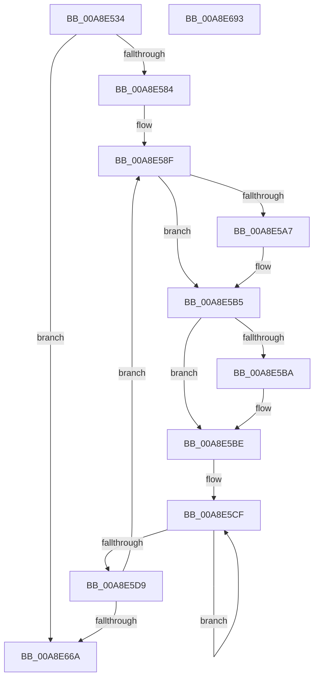

# SshpTracingRundownCollectionState

- RVA: `0x00A8E534`–`0x00A8E694` (길이 `352` bytes)
- VA: `0x0000000140A8E534`
- 실행 섹션: `PAGE`
- PDB 이름 있음: `예`; PDB Function 태그: `아니요`
- unwind 정보 RVA: `0x000B8A1C`
- 디코드: `86`개 명령, `352/352` bytes 표시
- 미해석 바이트: `0` (있으면 어셈블리에 `.byte`로 보존)

> 이 문서는 커널 이미지의 기계어와 PDB 기호를 분석해 생성했습니다. 4번과 5번은 함수 원형과 자료형을 바이너리 사용 방식에서 추정한 C 해석이며 원본 소스 복구 결과는 아닙니다.

## 1. Dependencies

- 직접 호출 지점: **7**; 고유 호출 대상: **7**
- 직접 호출자로 확인된 함수: **1**
- RIP 상대 이미지 참조: **3**

### Outgoing calls
- `0x00A8E577` → [SSHSupportEtwEventEnabled](../../text/39/SSHSupportEtwEventEnabled_function_00391484.md) (function, `0x00391484`)
- `0x00A8E597` → [KeAbPreAcquire](../../text/21/KeAbPreAcquire_function_00210230.md) (function, `0x00210230`)
- `0x00A8E5B0` → [ExfAcquirePushLockExclusiveEx](../../text/20/ExfAcquirePushLockExclusiveEx_function_0020FC90.md) (function, `0x0020FC90`)
- `0x00A8E5DC` → [SSHSupportQueryInterruptTime](../../text/4B/SSHSupportQueryInterruptTime_function_004BB458.md) (function, `0x004BB458`)
- `0x00A8E64F` → [SSHSupportEtwWrite](../../text/4A/SSHSupportEtwWrite_function_004ADF5C.md) (function, `0x004ADF5C`)
- `0x00A8E657` → [SSHSupportReleasePushLockExclusive](../../text/49/SSHSupportReleasePushLockExclusive_function_004954EC.md) (function, `0x004954EC`)
- `0x00A8E671` → [_security_check_cookie](../../text/6A/_security_check_cookie_function_006AC640.md) (function, `0x006AC640`)

### Direct callers
- [SshpEtwEnableCallback](SshpEtwEnableCallback_function_00A8E410.md) at `0x00A8E424`

### Static image references
- `0x00A8E553` → RVA `0x00E0A740` (`.data`; read)
- `0x00A8E564` → RVA `0x0001C030` (`.rdata`; read)
- `0x00A8E584` → RVA `0x00E08400` (`.data`; read)

## 2. Other-region calls and transfers

- 다른 실행 섹션으로 향하는 call: **7**
  - `0x00A8E577` → [SSHSupportEtwEventEnabled](../../text/39/SSHSupportEtwEventEnabled_function_00391484.md) (`PAGE` → `.text`)
  - `0x00A8E597` → [KeAbPreAcquire](../../text/21/KeAbPreAcquire_function_00210230.md) (`PAGE` → `.text`)
  - `0x00A8E5B0` → [ExfAcquirePushLockExclusiveEx](../../text/20/ExfAcquirePushLockExclusiveEx_function_0020FC90.md) (`PAGE` → `.text`)
  - `0x00A8E5DC` → [SSHSupportQueryInterruptTime](../../text/4B/SSHSupportQueryInterruptTime_function_004BB458.md) (`PAGE` → `.text`)
  - `0x00A8E64F` → [SSHSupportEtwWrite](../../text/4A/SSHSupportEtwWrite_function_004ADF5C.md) (`PAGE` → `.text`)
  - `0x00A8E657` → [SSHSupportReleasePushLockExclusive](../../text/49/SSHSupportReleasePushLockExclusive_function_004954EC.md) (`PAGE` → `.text`)
  - `0x00A8E671` → [_security_check_cookie](../../text/6A/_security_check_cookie_function_006AC640.md) (`PAGE` → `.text`)
- 별도 외부 분기/꼬리 이동을 확인하지 못했습니다.

## 3. Assembly (complete function range)

```asm
00A8E534  48 8B C4                        mov rax, rsp
00A8E537  48 89 58 08                     mov qword ptr [rax + 8], rbx
00A8E53B  48 89 70 10                     mov qword ptr [rax + 0x10], rsi
00A8E53F  48 89 78 18                     mov qword ptr [rax + 0x18], rdi
00A8E543  4C 89 70 20                     mov qword ptr [rax + 0x20], r14
00A8E547  55                              push rbp
00A8E548  48 8D 68 A1                     lea rbp, [rax - 0x5f]
00A8E54C  48 81 EC A0 00 00 00            sub rsp, 0xa0
00A8E553  48 8B 05 E6 C1 37 00            mov rax, qword ptr [rip + 0x37c1e6]
00A8E55A  48 33 C4                        xor rax, rsp
00A8E55D  48 89 45 47                     mov qword ptr [rbp + 0x47], rax
00A8E561  45 33 F6                        xor r14d, r14d
00A8E564  48 8D 15 C5 DA 58 FF            lea rdx, [rip - 0xa7253b]
00A8E56B  44 89 75 EB                     mov dword ptr [rbp - 0x15], r14d
00A8E56F  44 89 75 E7                     mov dword ptr [rbp - 0x19], r14d
00A8E573  4C 89 75 EF                     mov qword ptr [rbp - 0x11], r14
00A8E577  E8 08 2F 90 FF                  call 0x140391484
00A8E57C  84 C0                           test al, al
00A8E57E  0F 84 E6 00 00 00               je 0x140a8e66a
00A8E584  48 8D 1D 75 9E 37 00            lea rbx, [rip + 0x379e75]
00A8E58B  41 8D 76 09                     lea esi, [r14 + 9]
00A8E58F  45 33 C0                        xor r8d, r8d
00A8E592  33 D2                           xor edx, edx
00A8E594  48 8B CB                        mov rcx, rbx
00A8E597  E8 94 1C 78 FF                  call 0x140210230
00A8E59C  F0 48 0F BA 2B 00               lock bts qword ptr [rbx], 0
00A8E5A2  48 8B F8                        mov rdi, rax
00A8E5A5  73 0E                           jae 0x140a8e5b5
00A8E5A7  4C 8B C3                        mov r8, rbx
00A8E5AA  48 8B D0                        mov rdx, rax
00A8E5AD  48 8B CB                        mov rcx, rbx
00A8E5B0  E8 DB 16 78 FF                  call 0x14020fc90
00A8E5B5  48 85 FF                        test rdi, rdi
00A8E5B8  74 04                           je 0x140a8e5be
00A8E5BA  C6 47 0A 01                     mov byte ptr [rdi + 0xa], 1
00A8E5BE  8B 43 1C                        mov eax, dword ptr [rbx + 0x1c]
00A8E5C1  48 8B 4B 10                     mov rcx, qword ptr [rbx + 0x10]
00A8E5C5  83 E0 01                        and eax, 1
00A8E5C8  89 45 EB                        mov dword ptr [rbp - 0x15], eax
00A8E5CB  48 83 C8 FF                     or rax, 0xffffffffffffffff
00A8E5CF  48 FF C0                        inc rax
00A8E5D2  66 44 39 34 41                  cmp word ptr [rcx + rax*2], r14w
00A8E5D7  75 F6                           jne 0x140a8e5cf
00A8E5D9  89 45 E7                        mov dword ptr [rbp - 0x19], eax
00A8E5DC  E8 77 CE A2 FF                  call 0x1404bb458
00A8E5E1  48 89 45 EF                     mov qword ptr [rbp - 0x11], rax
00A8E5E5  48 8D 15 44 DA 58 FF            lea rdx, [rip - 0xa725bc]
00A8E5EC  48 8B 43 08                     mov rax, qword ptr [rbx + 8]
00A8E5F0  41 B9 05 00 00 00               mov r9d, 5
00A8E5F6  48 89 45 F7                     mov qword ptr [rbp - 9], rax
00A8E5FA  48 8D 45 EF                     lea rax, [rbp - 0x11]
00A8E5FE  48 89 45 07                     mov qword ptr [rbp + 7], rax
00A8E602  48 8D 45 EB                     lea rax, [rbp - 0x15]
00A8E606  48 89 45 17                     mov qword ptr [rbp + 0x17], rax
00A8E60A  48 8D 45 E7                     lea rax, [rbp - 0x19]
00A8E60E  48 89 45 27                     mov qword ptr [rbp + 0x27], rax
00A8E612  48 8B 43 10                     mov rax, qword ptr [rbx + 0x10]
00A8E616  48 89 45 37                     mov qword ptr [rbp + 0x37], rax
00A8E61A  8B 45 E7                        mov eax, dword ptr [rbp - 0x19]
00A8E61D  03 C0                           add eax, eax
00A8E61F  48 C7 45 FF 10 00 00 00         mov qword ptr [rbp - 1], 0x10
00A8E627  89 45 3F                        mov dword ptr [rbp + 0x3f], eax
00A8E62A  48 8D 45 F7                     lea rax, [rbp - 9]
00A8E62E  48 89 44 24 20                  mov qword ptr [rsp + 0x20], rax
00A8E633  48 C7 45 0F 08 00 00 00         mov qword ptr [rbp + 0xf], 8
00A8E63B  48 C7 45 1F 04 00 00 00         mov qword ptr [rbp + 0x1f], 4
00A8E643  48 C7 45 2F 04 00 00 00         mov qword ptr [rbp + 0x2f], 4
00A8E64B  44 89 75 43                     mov dword ptr [rbp + 0x43], r14d
00A8E64F  E8 08 F9 A1 FF                  call 0x1404adf5c
00A8E654  48 8B CB                        mov rcx, rbx
00A8E657  E8 90 6E A0 FF                  call 0x1404954ec
00A8E65C  48 83 C3 30                     add rbx, 0x30
00A8E660  48 83 EE 01                     sub rsi, 1
00A8E664  0F 85 25 FF FF FF               jne 0x140a8e58f
00A8E66A  48 8B 4D 47                     mov rcx, qword ptr [rbp + 0x47]
00A8E66E  48 33 CC                        xor rcx, rsp
00A8E671  E8 CA DF C1 FF                  call 0x1406ac640
00A8E676  4C 8D 9C 24 A0 00 00 00         lea r11, [rsp + 0xa0]
00A8E67E  49 8B 5B 10                     mov rbx, qword ptr [r11 + 0x10]
00A8E682  49 8B 73 18                     mov rsi, qword ptr [r11 + 0x18]
00A8E686  49 8B 7B 20                     mov rdi, qword ptr [r11 + 0x20]
00A8E68A  4D 8B 73 28                     mov r14, qword ptr [r11 + 0x28]
00A8E68E  49 8B E3                        mov rsp, r11
00A8E691  5D                              pop rbp
00A8E692  C3                              ret
00A8E693  CC                              int3
```

## 4. C-style interpretation (structured pseudocode)

```c
__int64 __fastcall SshpTracingRundownCollectionState(__int64 a1, __int64 a2, int a3)
{
    __int64 result;
    __int64 v_r14;
    __int64 v_rbx;
    __int64 v_rsi;
    __int64 v_rsp;
    unsigned __int64 v_stack_m8;
    unsigned __int64 v_stack_m88;

    *(unsigned __int64 *)(v_rsp + 8) = v_rbx;
    *(unsigned __int64 *)(v_rsp + 16) = v_rsi;
    *(unsigned __int64 *)(v_rsp + 24) = v_rdi;
    *(unsigned __int64 *)(v_rsp + 32) = v_r14;
    v_rsp = (v_rsp) - (160);
    result = (*(unsigned __int64 *)(v_rip + 3654118)) ^ (v_rsp);
    *(unsigned __int64 *)(v_rsp - 95 + 71) = result;
    v_r14 = 0;
    *(unsigned int *)(v_rsp - 95 - 21) = 0;
    *(unsigned int *)(v_rsp - 95 - 25) = 0;
    *(unsigned __int64 *)(v_rsp - 95 - 17) = 0;
    result = SSHSupportEtwEventEnabled(a1, v_rip - 10954043, a3, a4);
    if ((unsigned __int8)(result) == 0) goto loc_00A8E66A;
loc_00A8E58F:
    a3 = 0;
    a2 = 0;
    result = KeAbPreAcquire(v_rip + 3645045, a2, a3, a4);
    if (!(condition_is_above_or_equal)) {
        a3 = v_rip + 3645045;
        a2 = result;
        a1 = v_rip + 3645045;
        result = ExfAcquirePushLockExclusiveEx(a1, a2, a3, a4);
    }
    if (result != 0) {
        *(unsigned __int8 *)(result + 10) = 1;
    }
    result = (unsigned int)(((unsigned int)(*(unsigned int *)(v_rip + 3645045 + 28))) & (1));
    *(unsigned int *)(v_rsp - 95 - 21) = (unsigned int)(result);
    result = (result) | (-1);
loc_00A8E5CF:
    result = (result) + 1;
    if ((*(unsigned __int16 *)(*(unsigned __int64 *)(v_rip + 3645045 + 16) + result * 2)) != 0) goto loc_00A8E5CF;
    *(unsigned int *)(v_rsp - 95 - 25) = (unsigned int)(result);
    result = SSHSupportQueryInterruptTime(*(unsigned __int64 *)(v_rip + 3645045 + 16), a2, a3, a4);
    *(unsigned __int64 *)(v_rsp - 95 - 17) = result;
    *(unsigned __int64 *)(v_rsp - 95 - 9) = *(unsigned __int64 *)(v_rip + 3645045 + 8);
    *(unsigned __int64 *)(v_rsp - 95 + 7) = v_rsp - 95 - 17;
    *(unsigned __int64 *)(v_rsp - 95 + 23) = v_rsp - 95 - 21;
    *(unsigned __int64 *)(v_rsp - 95 + 39) = v_rsp - 95 - 25;
    *(unsigned __int64 *)(v_rsp - 95 + 55) = *(unsigned __int64 *)(v_rip + 3645045 + 16);
    result = (unsigned int)(((unsigned int)(*(unsigned int *)(v_rsp - 95 - 25))) + ((unsigned int)((unsigned int)(*(unsigned int *)(v_rsp - 95 - 25)))));
    *(unsigned __int64 *)(v_rsp - 95 - 1) = 16;
    *(unsigned int *)(v_rsp - 95 + 63) = (unsigned int)(result);
    v_stack_m88 = v_rsp - 95 - 9;
    *(unsigned __int64 *)(v_rsp - 95 + 15) = 8;
    *(unsigned __int64 *)(v_rsp - 95 + 31) = 4;
    *(unsigned __int64 *)(v_rsp - 95 + 47) = 4;
    *(unsigned int *)(v_rsp - 95 + 67) = 0;
    result = SSHSupportEtwWrite(*(unsigned __int64 *)(v_rip + 3645045 + 16), v_rip - 10954172, a3, 5);
    result = SSHSupportReleasePushLockExclusive(v_rip + 3645045, v_rip - 10954172, a3, 5);
    v_rbx = (v_rip + 3645045) + (48);
    v_rsi = (v_r14 + 9) - (1);
    if (condition_is_not_equal) goto loc_00A8E58F;
loc_00A8E66A:
    a1 = (*(unsigned __int64 *)(v_rsp - 95 + 71)) ^ (v_rsp);
    result = _security_check_cookie(a1, v_rip - 10954172, a3, 5);
    return result;
}
```

## 5. (Beta) C Style

```c
int64_t SshpTracingRundownCollectionState(int64_t Arg1, int64_t Arg2, int32_t Arg3)
{
    int64_t result;
    int64_t local_r14;
    int64_t local_rbx;
    int64_t local_rsi;
    int64_t local_rsp;
    uint64_t v_stack_m8;
    uint64_t v_stack_m88;

    *(uint64_t *)(local_rsp + 0x8) = local_rbx;
    *(uint64_t *)(local_rsp + 0x10) = local_rsi;
    *(uint64_t *)(local_rsp + 0x18) = local_rdi;
    *(uint64_t *)(local_rsp + 0x20) = local_r14;
    local_rsp = (local_rsp) - (160);
    result = (*(uint64_t *)(v_rip + 0x37C1E6)) ^ (local_rsp);
    *(uint64_t *)(local_rsp - 0x5F + 0x47) = result;
    local_r14 = 0;
    *(uint32_t *)(local_rsp - 0x5F - 0x15) = 0;
    *(uint32_t *)(local_rsp - 0x5F - 0x19) = 0;
    *(uint64_t *)(local_rsp - 0x5F - 0x11) = 0;
    result = SSHSupportEtwEventEnabled(Arg1, v_rip - 10954043, Arg3, a4);
    if ((uint8_t)(result) == 0) goto loc_00A8E66A;
loc_00A8E58F:
    Arg3 = 0;
    Arg2 = 0;
    result = KeAbPreAcquire(v_rip + 3645045, Arg2, Arg3, a4);
    if (!(condition_is_above_or_equal)) {
        Arg3 = v_rip + 3645045;
        Arg2 = result;
        Arg1 = v_rip + 3645045;
        result = ExfAcquirePushLockExclusiveEx(Arg1, Arg2, Arg3, a4);
    }
    if (result != 0) {
        *(uint8_t *)(result + 0xA) = 1;
    }
    result = (uint32_t)(((uint32_t)(*(uint32_t *)(v_rip + 0x379E75 + 0x1C))) & (1));
    *(uint32_t *)(local_rsp - 0x5F - 0x15) = (uint32_t)(result);
    result = (result) | (-1);
loc_00A8E5CF:
    result = (result) + 1;
    if ((*(uint16_t *)(*(uint64_t *)(v_rip + 0x379E75 + 0x10) + result * 2)) != 0) goto loc_00A8E5CF;
    *(uint32_t *)(local_rsp - 0x5F - 0x19) = (uint32_t)(result);
    result = SSHSupportQueryInterruptTime(*(uint64_t *)(v_rip + 0x379E75 + 0x10), Arg2, Arg3, a4);
    *(uint64_t *)(local_rsp - 0x5F - 0x11) = result;
    *(uint64_t *)(local_rsp - 0x5F - 0x9) = *(uint64_t *)(v_rip + 0x379E75 + 0x8);
    *(uint64_t *)(local_rsp - 0x5F + 0x7) = local_rsp - 95 - 17;
    *(uint64_t *)(local_rsp - 0x5F + 0x17) = local_rsp - 95 - 21;
    *(uint64_t *)(local_rsp - 0x5F + 0x27) = local_rsp - 95 - 25;
    *(uint64_t *)(local_rsp - 0x5F + 0x37) = *(uint64_t *)(v_rip + 0x379E75 + 0x10);
    result = (uint32_t)(((uint32_t)(*(uint32_t *)(local_rsp - 0x5F - 0x19))) + ((uint32_t)((uint32_t)(*(uint32_t *)(local_rsp - 0x5F - 0x19)))));
    *(uint64_t *)(local_rsp - 0x5F - 0x1) = 16;
    *(uint32_t *)(local_rsp - 0x5F + 0x3F) = (uint32_t)(result);
    v_stack_m88 = local_rsp - 95 - 9;
    *(uint64_t *)(local_rsp - 0x5F + 0xF) = 8;
    *(uint64_t *)(local_rsp - 0x5F + 0x1F) = 4;
    *(uint64_t *)(local_rsp - 0x5F + 0x2F) = 4;
    *(uint32_t *)(local_rsp - 0x5F + 0x43) = 0;
    result = SSHSupportEtwWrite(*(uint64_t *)(v_rip + 0x379E75 + 0x10), v_rip - 10954172, Arg3, 5);
    result = SSHSupportReleasePushLockExclusive(v_rip + 3645045, v_rip - 10954172, Arg3, 5);
    local_rbx = (v_rip + 3645045) + (48);
    local_rsi = (local_r14 + 9) - (1);
    if (condition_is_not_equal) goto loc_00A8E58F;
loc_00A8E66A:
    Arg1 = (*(uint64_t *)(local_rsp - 0x5F + 0x47)) ^ (local_rsp);
    result = _security_check_cookie(Arg1, v_rip - 10954172, Arg3, 5);
    return result;
}
```

## 6. Execution-region graph

[열기: 2D/3D 그래프와 함수 탐색 컨트롤 패널](../../../control-panel.html?section=page&rva=0x00A8E534&view=graph)

- 2D 그래프는 위에서 아래로 흐르고, 3D 그래프는 빈 공간을 드래그해 회전합니다. Shift+드래그는 이동, 휠은 확대·축소, 함수 노드 선택은 대상 보고서 이동입니다.

### Static fallback


