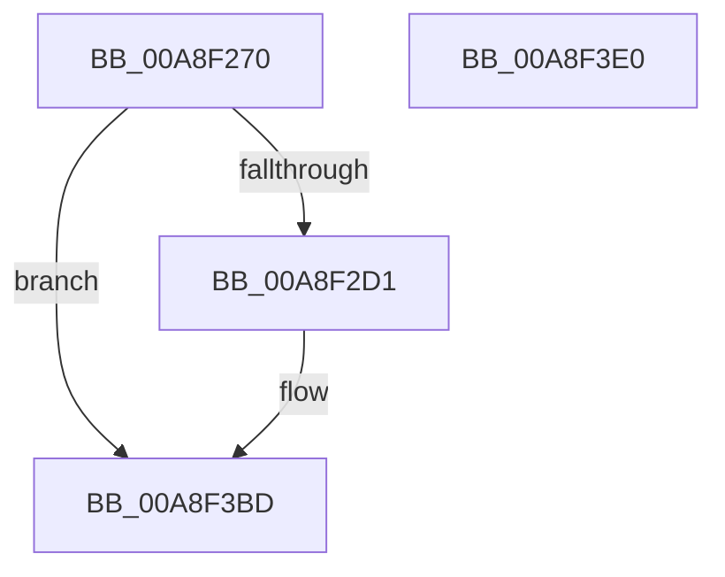

# sub_00A8F270

- RVA: `0x00A8F270`–`0x00A8F3E1` (길이 `369` bytes)
- VA: `0x0000000140A8F270`
- 실행 섹션: `PAGE`
- PDB 이름 있음: `아니요`; PDB Function 태그: `아니요`
- unwind 정보 RVA: `0x00060300`
- 디코드: `82`개 명령, `369/369` bytes 표시
- 미해석 바이트: `0` (있으면 어셈블리에 `.byte`로 보존)

> 이 문서는 커널 이미지의 기계어와 PDB 기호를 분석해 생성했습니다. 4번과 5번은 함수 원형과 자료형을 바이너리 사용 방식에서 추정한 C 해석이며 원본 소스 복구 결과는 아닙니다.

## 1. Dependencies

- 직접 호출 지점: **4**; 고유 호출 대상: **4**
- 직접 호출자로 확인된 함수: **1**
- RIP 상대 이미지 참조: **4**

### Outgoing calls
- `0x00A8F29F` → [ExAllocatePool2](../../poolcode/B8/ExAllocatePool2_function_00B820F0.md) (function, `0x00B820F0`)
- `0x00A8F2B3` → [PdcCloseEvent](../8D/PdcCloseEvent_function_008D2404.md) (function, `0x008D2404`)
- `0x00A8F2DC` → [memset](../../text/6C/memset_function_006C6C40.md) (function, `0x006C6C40`)
- `0x00A8F3C0` → [sub_008D40CC](../8D/Unknown_function_008D40CC.md) (function, `0x008D40CC`)

### Direct callers
- [sub_008D3CC4](../8D/Unknown_function_008D3CC4.md) at `0x008D3CCC`

### Static image references
- `0x00A8F2EF` → RVA `0x008D3F00` (`PAGE`; read)
- `0x00A8F32A` → RVA `0x00A62DD0` (`PAGE`; read)
- `0x00A8F338` → RVA `0x008D3F30` (`PAGE`; read)
- `0x00A8F369` → RVA `0x00A94C90` (`PAGE`; read)

## 2. Other-region calls and transfers

- 다른 실행 섹션으로 향하는 call: **2**
  - `0x00A8F29F` → [ExAllocatePool2](../../poolcode/B8/ExAllocatePool2_function_00B820F0.md) (`PAGE` → `POOLCODE`)
  - `0x00A8F2DC` → [memset](../../text/6C/memset_function_006C6C40.md) (`PAGE` → `.text`)
- 별도 외부 분기/꼬리 이동을 확인하지 못했습니다.

## 3. Assembly (complete function range)

```asm
00A8F270  48 89 5C 24 08                  mov qword ptr [rsp + 8], rbx
00A8F275  48 89 6C 24 10                  mov qword ptr [rsp + 0x10], rbp
00A8F27A  48 89 74 24 18                  mov qword ptr [rsp + 0x18], rsi
00A8F27F  57                              push rdi
00A8F280  41 56                           push r14
00A8F282  41 57                           push r15
00A8F284  48 83 EC 20                     sub rsp, 0x20
00A8F288  4C 8B F2                        mov r14, rdx
00A8F28B  48 8B E9                        mov rbp, rcx
00A8F28E  BA F0 00 00 00                  mov edx, 0xf0
00A8F293  41 B8 57 41 52 42               mov r8d, 0x42524157
00A8F299  45 33 FF                        xor r15d, r15d
00A8F29C  8D 4A 10                        lea ecx, [rdx + 0x10]
00A8F29F  E8 4C 2E 0F 00                  call 0x140b820f0
00A8F2A4  48 85 C0                        test rax, rax
00A8F2A7  41 8B FF                        mov edi, r15d
00A8F2AA  48 8B D8                        mov rbx, rax
00A8F2AD  48 0F 45 F8                     cmovne rdi, rax
00A8F2B1  33 C9                           xor ecx, ecx
00A8F2B3  E8 4C 31 E4 FF                  call 0x1408d2404
00A8F2B8  48 8B CB                        mov rcx, rbx
00A8F2BB  48 F7 D9                        neg rcx
00A8F2BE  1B F6                           sbb esi, esi
00A8F2C0  F7 D6                           not esi
00A8F2C2  81 E6 17 00 00 C0               and esi, 0xc0000017
00A8F2C8  48 85 DB                        test rbx, rbx
00A8F2CB  0F 84 EC 00 00 00               je 0x140a8f3bd
00A8F2D1  33 D2                           xor edx, edx
00A8F2D3  41 B8 F0 00 00 00               mov r8d, 0xf0
00A8F2D9  48 8B CF                        mov rcx, rdi
00A8F2DC  E8 5F 79 C3 FF                  call 0x1406c6c40
00A8F2E1  48 FF 87 E8 00 00 00            inc qword ptr [rdi + 0xe8]
00A8F2E8  41 8D 4F 0A                     lea ecx, [r15 + 0xa]
00A8F2EC  48 89 2F                        mov qword ptr [rdi], rbp
00A8F2EF  48 8D 05 0A 4C E4 FF            lea rax, [rip - 0x1bb3f6]
00A8F2F6  C7 47 38 3C 00 00 00            mov dword ptr [rdi + 0x38], 0x3c
00A8F2FD  41 8B F7                        mov esi, r15d
00A8F300  48 89 47 28                     mov qword ptr [rdi + 0x28], rax
00A8F304  48 8D 47 40                     lea rax, [rdi + 0x40]
00A8F308  48 C7 47 08 08 00 00 00         mov qword ptr [rdi + 8], 8
00A8F310  44 89 7F 10                     mov dword ptr [rdi + 0x10], r15d
00A8F314  4C 89 7F 18                     mov qword ptr [rdi + 0x18], r15
00A8F318  89 4F 20                        mov dword ptr [rdi + 0x20], ecx
00A8F31B  4C 89 7F 30                     mov qword ptr [rdi + 0x30], r15
00A8F31F  4C 89 7F 50                     mov qword ptr [rdi + 0x50], r15
00A8F323  48 89 40 08                     mov qword ptr [rax + 8], rax
00A8F327  48 89 00                        mov qword ptr [rax], rax
00A8F32A  48 8D 05 9F 3A FD FF            lea rax, [rip - 0x2c561]
00A8F331  48 89 87 D8 00 00 00            mov qword ptr [rdi + 0xd8], rax
00A8F338  48 8D 05 F1 4B E4 FF            lea rax, [rip - 0x1bb40f]
00A8F33F  48 C7 87 B8 00 00 00 08 00 00 00  mov qword ptr [rdi + 0xb8], 8
00A8F34A  44 89 BF C0 00 00 00            mov dword ptr [rdi + 0xc0], r15d
00A8F351  4C 89 BF C8 00 00 00            mov qword ptr [rdi + 0xc8], r15
00A8F358  89 8F D0 00 00 00               mov dword ptr [rdi + 0xd0], ecx
00A8F35E  4C 89 BF E0 00 00 00            mov qword ptr [rdi + 0xe0], r15
00A8F365  48 89 47 78                     mov qword ptr [rdi + 0x78], rax
00A8F369  48 8D 05 20 59 00 00            lea rax, [rip + 0x5920]
00A8F370  48 C7 47 58 08 00 00 00         mov qword ptr [rdi + 0x58], 8
00A8F378  44 89 7F 60                     mov dword ptr [rdi + 0x60], r15d
00A8F37C  4C 89 7F 68                     mov qword ptr [rdi + 0x68], r15
00A8F380  89 4F 70                        mov dword ptr [rdi + 0x70], ecx
00A8F383  4C 89 BF 80 00 00 00            mov qword ptr [rdi + 0x80], r15
00A8F38A  48 89 87 A8 00 00 00            mov qword ptr [rdi + 0xa8], rax
00A8F391  48 C7 87 88 00 00 00 08 00 00 00  mov qword ptr [rdi + 0x88], 8
00A8F39C  44 89 BF 90 00 00 00            mov dword ptr [rdi + 0x90], r15d
00A8F3A3  4C 89 BF 98 00 00 00            mov qword ptr [rdi + 0x98], r15
00A8F3AA  89 8F A0 00 00 00               mov dword ptr [rdi + 0xa0], ecx
00A8F3B0  4C 89 BF B0 00 00 00            mov qword ptr [rdi + 0xb0], r15
00A8F3B7  49 89 3E                        mov qword ptr [r14], rdi
00A8F3BA  41 8B FF                        mov edi, r15d
00A8F3BD  48 8B CF                        mov rcx, rdi
00A8F3C0  E8 07 4D E4 FF                  call 0x1408d40cc
00A8F3C5  48 8B 5C 24 40                  mov rbx, qword ptr [rsp + 0x40]
00A8F3CA  8B C6                           mov eax, esi
00A8F3CC  48 8B 74 24 50                  mov rsi, qword ptr [rsp + 0x50]
00A8F3D1  48 8B 6C 24 48                  mov rbp, qword ptr [rsp + 0x48]
00A8F3D6  48 83 C4 20                     add rsp, 0x20
00A8F3DA  41 5F                           pop r15
00A8F3DC  41 5E                           pop r14
00A8F3DE  5F                              pop rdi
00A8F3DF  C3                              ret
00A8F3E0  CC                              int3
```

## 4. C-style interpretation (structured pseudocode)

```c
__int64 __fastcall sub_00A8F270(__int64 a1, __int64 a2)
{
    __int64 result;
    __int64 v_r15;
    __int64 v_rdi;
    __int64 v_rsi;
    __int64 v_rsp;
    unsigned __int64 v_stack_p10;
    unsigned __int64 v_stack_p18;
    unsigned __int64 v_stack_p8;

    v_stack_p8 = v_rbx;
    v_stack_p10 = v_rbp;
    v_stack_p18 = v_rsi;
    v_rsp = (v_rsp) - (32);
    v_r15 = 0;
    result = ExAllocatePool2(240 + 16, 240, (unsigned int)(0x42524157ULL), a4);
    v_rdi = 0;
    if (result != 0) { v_rdi = result; }
    a1 = 0;
    result = PdcCloseEvent(a1, 240, (unsigned int)(0x42524157ULL), a4);
    a1 = -(result);
    v_rsi = (unsigned int)(~(v_rsi));
    v_rsi = (unsigned int)((v_rsi) & (0xC0000017ULL));
    if (result != 0) {
        a2 = 0;
        a3 = 240;
        a1 = v_rdi;
        result = memset(a1, a2, a3, a4);
        a1 = v_r15 + 10;
        *(unsigned __int64 *)(v_rdi) = a1;
        result = v_rip - 1815542;
        *(unsigned int *)(v_rdi + 56) = 60;
        v_rsi = 0;
        *(unsigned __int64 *)(v_rdi + 40) = result;
        result = v_rdi + 64;
        *(unsigned __int64 *)(v_rdi + 8) = 8;
        *(unsigned int *)(v_rdi + 16) = 0;
        *(unsigned __int64 *)(v_rdi + 24) = 0;
        *(unsigned int *)(v_rdi + 32) = (unsigned int)(a1);
        *(unsigned __int64 *)(v_rdi + 48) = 0;
        *(unsigned __int64 *)(v_rdi + 80) = 0;
        *(unsigned __int64 *)(result + 8) = result;
        *(unsigned __int64 *)(result) = result;
        result = v_rip - 181601;
        *(unsigned __int64 *)(v_rdi + 216) = result;
        result = v_rip - 1815567;
        *(unsigned __int64 *)(v_rdi + 184) = 8;
        *(unsigned int *)(v_rdi + 192) = 0;
        *(unsigned __int64 *)(v_rdi + 200) = 0;
        *(unsigned int *)(v_rdi + 208) = (unsigned int)(a1);
        *(unsigned __int64 *)(v_rdi + 224) = 0;
        *(unsigned __int64 *)(v_rdi + 120) = result;
        result = v_rip + 22816;
        *(unsigned __int64 *)(v_rdi + 88) = 8;
        *(unsigned int *)(v_rdi + 96) = 0;
        *(unsigned __int64 *)(v_rdi + 104) = 0;
        *(unsigned int *)(v_rdi + 112) = (unsigned int)(a1);
        *(unsigned __int64 *)(v_rdi + 128) = 0;
        *(unsigned __int64 *)(v_rdi + 168) = result;
        *(unsigned __int64 *)(v_rdi + 136) = 8;
        *(unsigned int *)(v_rdi + 144) = 0;
        *(unsigned __int64 *)(v_rdi + 152) = 0;
        *(unsigned int *)(v_rdi + 160) = (unsigned int)(a1);
        *(unsigned __int64 *)(v_rdi + 176) = 0;
        *(unsigned __int64 *)(a2) = v_rdi;
        v_rdi = 0;
    }
    result = sub_008D40CC(v_rdi, a2, a3, a4);
    v_rsp = (v_rsp) + (32);
    return (unsigned int)((unsigned int)(v_rsi));
}
```

## 5. (Beta) C Style

```c
int64_t sub_00A8F270(int64_t Arg1, void *Arg2)
{
    uint8_t *arg2 = (uint8_t *)Arg2;

    int64_t result;
    int64_t local_r15;
    int64_t local_rdi;
    int64_t local_rsi;
    int64_t local_rsp;
    uint64_t v_stack_p10;
    uint64_t v_stack_p18;
    uint64_t v_stack_p8;

    v_stack_p8 = local_rbx;
    v_stack_p10 = local_rbp;
    v_stack_p18 = local_rsi;
    local_rsp = (local_rsp) - (32);
    local_r15 = 0;
    result = ExAllocatePool2(240 + 16, 240, (uint32_t)(0x42524157ULL), a4);
    local_rdi = 0;
    if (result != 0) { local_rdi = result; }
    Arg1 = 0;
    result = PdcCloseEvent(Arg1, 240, (uint32_t)(0x42524157ULL), a4);
    Arg1 = -(result);
    local_rsi = (uint32_t)(~(local_rsi));
    local_rsi = (uint32_t)((local_rsi) & (0xC0000017ULL));
    if (result != 0) {
        Arg2 = 0;
        a3 = 240;
        Arg1 = local_rdi;
        result = memset(Arg1, Arg2, a3, a4);
        Arg1 = local_r15 + 10;
        *(uint64_t *)(local_rdi) = Arg1;
        result = v_rip - 1815542;
        *(uint32_t *)(local_rdi + 0x38) = 60;
        local_rsi = 0;
        *(uint64_t *)(local_rdi + 0x28) = result;
        result = local_rdi + 64;
        *(uint64_t *)(local_rdi + 0x8) = 8;
        *(uint32_t *)(local_rdi + 0x10) = 0;
        *(uint64_t *)(local_rdi + 0x18) = 0;
        *(uint32_t *)(local_rdi + 0x20) = (uint32_t)(Arg1);
        *(uint64_t *)(local_rdi + 0x30) = 0;
        *(uint64_t *)(local_rdi + 0x50) = 0;
        *(uint64_t *)(result + 0x8) = result;
        *(uint64_t *)(result) = result;
        result = v_rip - 181601;
        *(uint64_t *)(local_rdi + 0xD8) = result;
        result = v_rip - 1815567;
        *(uint64_t *)(local_rdi + 0xB8) = 8;
        *(uint32_t *)(local_rdi + 0xC0) = 0;
        *(uint64_t *)(local_rdi + 0xC8) = 0;
        *(uint32_t *)(local_rdi + 0xD0) = (uint32_t)(Arg1);
        *(uint64_t *)(local_rdi + 0xE0) = 0;
        *(uint64_t *)(local_rdi + 0x78) = result;
        result = v_rip + 22816;
        *(uint64_t *)(local_rdi + 0x58) = 8;
        *(uint32_t *)(local_rdi + 0x60) = 0;
        *(uint64_t *)(local_rdi + 0x68) = 0;
        *(uint32_t *)(local_rdi + 0x70) = (uint32_t)(Arg1);
        *(uint64_t *)(local_rdi + 0x80) = 0;
        *(uint64_t *)(local_rdi + 0xA8) = result;
        *(uint64_t *)(local_rdi + 0x88) = 8;
        *(uint32_t *)(local_rdi + 0x90) = 0;
        *(uint64_t *)(local_rdi + 0x98) = 0;
        *(uint32_t *)(local_rdi + 0xA0) = (uint32_t)(Arg1);
        *(uint64_t *)(local_rdi + 0xB0) = 0;
        *(uint64_t *)(arg2) = local_rdi;
        local_rdi = 0;
    }
    result = sub_008D40CC(local_rdi, Arg2, a3, a4);
    local_rsp = (local_rsp) + (32);
    return (uint32_t)((uint32_t)(local_rsi));
}
```

### 관측된 메모리 오프셋

구조체 형식이 확인되지 않은 접근은 인자 기준의 오프셋으로만 기록했습니다.

| 기준 인자 | 오프셋 표현 | 폭 (bit) | 접근 |
|---|---:|---:|---|
| `Arg2` | `+ 0x0` | `64` | `W` |

## 6. Execution-region graph

[열기: 2D/3D 그래프와 함수 탐색 컨트롤 패널](../../../control-panel.html?section=page&rva=0x00A8F270&view=graph)

- 2D 그래프는 위에서 아래로 흐르고, 3D 그래프는 빈 공간을 드래그해 회전합니다. Shift+드래그는 이동, 휠은 확대·축소, 함수 노드 선택은 대상 보고서 이동입니다.

### Static fallback


