# VrpPreLoadKey

- RVA: `0x00A8A43C`–`0x00A8A8C8` (길이 `1,164` bytes)
- VA: `0x0000000140A8A43C`
- 실행 섹션: `PAGE`
- PDB 이름 있음: `예`; PDB Function 태그: `예`
- unwind 정보 RVA: `0x000B8548`
- 디코드: `227`개 명령, `1,164/1,164` bytes 표시
- 미해석 바이트: `0` (있으면 어셈블리에 `.byte`로 보존)

> 이 문서는 커널 이미지의 기계어와 PDB 기호를 분석해 생성했습니다. 4번과 5번은 함수 원형과 자료형을 바이너리 사용 방식에서 추정한 C 해석이며 원본 소스 복구 결과는 아닙니다.

## 1. Dependencies

- 직접 호출 지점: **16**; 고유 호출 대상: **11**
- 직접 호출자로 확인된 함수: **1**
- RIP 상대 이미지 참조: **4**

### Outgoing calls
- `0x00A8A4F5` → [EtwActivityIdControl](../../text/41/EtwActivityIdControl_function_0041E720.md) (function, `0x0041E720`)
- `0x00A8A642` → [RtlEqualUnicodeString](../93/RtlEqualUnicodeString_function_00932A20.md) (function, `0x00932A20`)
- `0x00A8A67D` → [VrpBuildKeyPath](../93/VrpBuildKeyPath_function_00934650.md) (function, `0x00934650`)
- `0x00A8A757` → [_security_check_cookie](../../text/6A/_security_check_cookie_function_006AC640.md) (function, `0x006AC640`)
- `0x00A8A7A2` → [VrpDestroyNamespaceNode](../93/VrpDestroyNamespaceNode_function_00934A50.md) (function, `0x00934A50`)
- `0x00A8A810` → [tlgWriteTransfer_EtwWriteTransfer](../../text/42/tlgWriteTransfer_EtwWriteTransfer_function_004260E0.md) (function, `0x004260E0`)
- `0x00A8A845` → [VrpUnlockJobContextExclusive](../93/VrpUnlockJobContextExclusive_function_009354FC.md) (function, `0x009354FC`)
- `0x00A8A852` → [VrpFreeKeyContext](../9F/VrpFreeKeyContext_function_009FEED4.md) (function, `0x009FEED4`)
- `0x00A8A85E` → [ObCloseHandle](../8A/ObCloseHandle_function_008A1870.md) (function, `0x008A1870`)
- `0x00A8A86A` → [ObCloseHandle](../8A/ObCloseHandle_function_008A1870.md) (function, `0x008A1870`)
- `0x00A8A876` → [ObCloseHandle](../8A/ObCloseHandle_function_008A1870.md) (function, `0x008A1870`)
- `0x00A8A882` → [ObCloseHandle](../8A/ObCloseHandle_function_008A1870.md) (function, `0x008A1870`)
- `0x00A8A88E` → [ObCloseHandle](../8A/ObCloseHandle_function_008A1870.md) (function, `0x008A1870`)
- `0x00A8A898` → [ObfDereferenceObject](../../text/2F/ObfDereferenceObject_function_002F9350.md) (function, `0x002F9350`)
- `0x00A8A8AF` → [ExFreePoolWithTag](../../poolcode/B8/ExFreePoolWithTag_function_00B82870.md) (function, `0x00B82870`)
- `0x00A8A8BE` → [ExFreePoolWithTag](../../poolcode/B8/ExFreePoolWithTag_function_00B82870.md) (function, `0x00B82870`)

### Direct callers
- [VrpRegistryCallback](../86/VrpRegistryCallback_function_00867450.md) at `0x00867699`

### Static image references
- `0x00A8A457` → RVA `0x00E0A740` (`.data`; read)
- `0x00A8A580` → RVA `0x00E0A630` (`.data`; read)
- `0x00A8A633` → RVA `0x000021F0` (`.rdata`; read)
- `0x00A8A802` → RVA `0x0005AAAB` (`.rdata`; read)

## 2. Other-region calls and transfers

- 다른 실행 섹션으로 향하는 call: **6**
  - `0x00A8A4F5` → [EtwActivityIdControl](../../text/41/EtwActivityIdControl_function_0041E720.md) (`PAGE` → `.text`)
  - `0x00A8A757` → [_security_check_cookie](../../text/6A/_security_check_cookie_function_006AC640.md) (`PAGE` → `.text`)
  - `0x00A8A810` → [tlgWriteTransfer_EtwWriteTransfer](../../text/42/tlgWriteTransfer_EtwWriteTransfer_function_004260E0.md) (`PAGE` → `.text`)
  - `0x00A8A898` → [ObfDereferenceObject](../../text/2F/ObfDereferenceObject_function_002F9350.md) (`PAGE` → `.text`)
  - `0x00A8A8AF` → [ExFreePoolWithTag](../../poolcode/B8/ExFreePoolWithTag_function_00B82870.md) (`PAGE` → `POOLCODE`)
  - `0x00A8A8BE` → [ExFreePoolWithTag](../../poolcode/B8/ExFreePoolWithTag_function_00B82870.md) (`PAGE` → `POOLCODE`)
- call이 아닌 외부 분기/꼬리 이동: **4**
  - `0x00A8A649` → [sub_00B4588A + 0x88](../B4/Unknown_function_00B4588A.md) (`tail-transfer`)
  - `0x00A8A654` → [sub_00B4588A + 0x7E](../B4/Unknown_function_00B4588A.md) (`tail-transfer`)
  - `0x00A8A82F` → [sub_00B4588A](../B4/Unknown_function_00B4588A.md) (`tail-transfer`)
  - `0x00A8A83D` → [sub_00B4588A + 0x9](../B4/Unknown_function_00B4588A.md) (`tail-transfer`)

## 3. Assembly (complete function range)

```asm
00A8A43C  4C 8B DC                        mov r11, rsp
00A8A43F  49 89 5B 18                     mov qword ptr [r11 + 0x18], rbx
00A8A443  49 89 73 20                     mov qword ptr [r11 + 0x20], rsi
00A8A447  57                              push rdi
00A8A448  41 54                           push r12
00A8A44A  41 55                           push r13
00A8A44C  41 56                           push r14
00A8A44E  41 57                           push r15
00A8A450  48 81 EC 80 02 00 00            sub rsp, 0x280
00A8A457  48 8B 05 E2 02 38 00            mov rax, qword ptr [rip + 0x3802e2]
00A8A45E  48 33 C4                        xor rax, rsp
00A8A461  48 89 84 24 70 02 00 00         mov qword ptr [rsp + 0x270], rax
00A8A469  48 89 54 24 78                  mov qword ptr [rsp + 0x78], rdx
00A8A46E  48 8B F9                        mov rdi, rcx
00A8A471  48 89 8C 24 18 01 00 00         mov qword ptr [rsp + 0x118], rcx
00A8A479  48 89 94 24 30 01 00 00         mov qword ptr [rsp + 0x130], rdx
00A8A481  0F 57 C0                        xorps xmm0, xmm0
00A8A484  0F 11 84 24 80 00 00 00         movups xmmword ptr [rsp + 0x80], xmm0
00A8A48C  33 DB                           xor ebx, ebx
00A8A48E  49 C7 83 08 FE FF FF 00 00 4E 00  mov qword ptr [r11 - 0x1f8], 0x4e0000
00A8A499  0F 11 84 24 38 01 00 00         movups xmmword ptr [rsp + 0x138], xmm0
00A8A4A1  0F 11 84 24 48 01 00 00         movups xmmword ptr [rsp + 0x148], xmm0
00A8A4A9  0F 11 84 24 58 01 00 00         movups xmmword ptr [rsp + 0x158], xmm0
00A8A4B1  0F 11 84 24 98 00 00 00         movups xmmword ptr [rsp + 0x98], xmm0
00A8A4B9  0F 57 C9                        xorps xmm1, xmm1
00A8A4BC  0F 11 8C 24 68 01 00 00         movups xmmword ptr [rsp + 0x168], xmm1
00A8A4C4  0F 11 8C 24 78 01 00 00         movups xmmword ptr [rsp + 0x178], xmm1
00A8A4CC  0F 11 8C 24 88 01 00 00         movups xmmword ptr [rsp + 0x188], xmm1
00A8A4D4  0F 11 84 24 08 01 00 00         movups xmmword ptr [rsp + 0x108], xmm0
00A8A4DC  49 89 9B 18 FE FF FF            mov qword ptr [r11 - 0x1e8], rbx
00A8A4E3  0F 11 8C 24 98 01 00 00         movups xmmword ptr [rsp + 0x198], xmm1
00A8A4EB  49 8D 93 F0 FE FF FF            lea rdx, [r11 - 0x110]
00A8A4F2  8D 4B 03                        lea ecx, [rbx + 3]
00A8A4F5  E8 26 42 99 FF                  call 0x14041e720
00A8A4FA  4C 8B 37                        mov r14, qword ptr [rdi]
00A8A4FD  48 8D 84 24 20 02 00 00         lea rax, [rsp + 0x220]
00A8A505  48 89 84 24 B8 00 00 00         mov qword ptr [rsp + 0xb8], rax
00A8A50D  88 5C 24 70                     mov byte ptr [rsp + 0x70], bl
00A8A511  89 9C 24 90 00 00 00            mov dword ptr [rsp + 0x90], ebx
00A8A518  49 8B 4E 48                     mov rcx, qword ptr [r14 + 0x48]
00A8A51C  48 89 9C 24 D8 00 00 00         mov qword ptr [rsp + 0xd8], rbx
00A8A524  48 89 9C 24 E0 00 00 00         mov qword ptr [rsp + 0xe0], rbx
00A8A52C  48 89 9C 24 E8 00 00 00         mov qword ptr [rsp + 0xe8], rbx
00A8A534  48 89 9C 24 00 01 00 00         mov qword ptr [rsp + 0x100], rbx
00A8A53C  48 89 9C 24 28 01 00 00         mov qword ptr [rsp + 0x128], rbx
00A8A544  48 89 9C 24 20 01 00 00         mov qword ptr [rsp + 0x120], rbx
00A8A54C  44 8B EB                        mov r13d, ebx
00A8A54F  48 89 9C 24 D0 00 00 00         mov qword ptr [rsp + 0xd0], rbx
00A8A557  48 89 9C 24 F0 00 00 00         mov qword ptr [rsp + 0xf0], rbx
00A8A55F  48 89 9C 24 F8 00 00 00         mov qword ptr [rsp + 0xf8], rbx
00A8A567  49 8B 46 08                     mov rax, qword ptr [r14 + 8]
00A8A56B  48 85 C9                        test rcx, rcx
00A8A56E  0F 85 FA 00 00 00               jne 0x140a8a66e
00A8A574  0F 10 00                        movups xmm0, xmmword ptr [rax]
00A8A577  F3 0F 7F 84 24 80 00 00 00      movdqu xmmword ptr [rsp + 0x80], xmm0
00A8A580  83 3D A9 00 38 00 05            cmp dword ptr [rip + 0x3800a9], 5
00A8A587  0F 87 97 02 00 00               ja 0x140a8a824
00A8A58D  41 BC 02 00 00 00               mov r12d, 2
00A8A593  44 0F B7 D3                     movzx r10d, bx
00A8A597  66 89 9C 24 C0 00 00 00         mov word ptr [rsp + 0xc0], bx
00A8A59F  48 8B D3                        mov rdx, rbx
00A8A5A2  44 0F B7 84 24 80 00 00 00      movzx r8d, word ptr [rsp + 0x80]
00A8A5AB  4D 85 C0                        test r8, r8
00A8A5AE  74 16                           je 0x140a8a5c6
00A8A5B0  48 8B CB                        mov rcx, rbx
00A8A5B3  48 8B 84 24 88 00 00 00         mov rax, qword ptr [rsp + 0x88]
00A8A5BB  66 83 3C 08 5C                  cmp word ptr [rax + rcx], 0x5c
00A8A5C0  0F 84 93 00 00 00               je 0x140a8a659
00A8A5C6  4C 8D 0C 12                     lea r9, [rdx + rdx]
00A8A5CA  48 8B 8C 24 88 00 00 00         mov rcx, qword ptr [rsp + 0x88]
00A8A5D2  49 03 C9                        add rcx, r9
00A8A5D5  48 89 8C 24 C8 00 00 00         mov qword ptr [rsp + 0xc8], rcx
00A8A5DD  4D 3B C8                        cmp r9, r8
00A8A5E0  73 29                           jae 0x140a8a60b
00A8A5E2  48 8B 84 24 88 00 00 00         mov rax, qword ptr [rsp + 0x88]
00A8A5EA  66 42 83 3C 08 5C               cmp word ptr [rax + r9], 0x5c
00A8A5F0  74 10                           je 0x140a8a602
00A8A5F2  66 45 03 D4                     add r10w, r12w
00A8A5F6  48 FF C2                        inc rdx
00A8A5F9  4C 8D 0C 12                     lea r9, [rdx + rdx]
00A8A5FD  4D 3B C8                        cmp r9, r8
00A8A600  72 E0                           jb 0x140a8a5e2
00A8A602  66 44 89 94 24 C0 00 00 00      mov word ptr [rsp + 0xc0], r10w
00A8A60B  48 8D 0C 12                     lea rcx, [rdx + rdx]
00A8A60F  49 3B C8                        cmp rcx, r8
00A8A612  73 14                           jae 0x140a8a628
00A8A614  48 8B 84 24 88 00 00 00         mov rax, qword ptr [rsp + 0x88]
00A8A61C  66 83 3C 08 5C                  cmp word ptr [rax + rcx], 0x5c
00A8A621  75 05                           jne 0x140a8a628
00A8A623  48 FF C2                        inc rdx
00A8A626  EB E3                           jmp 0x140a8a60b
00A8A628  48 89 94 24 A8 00 00 00         mov qword ptr [rsp + 0xa8], rdx
00A8A630  41 B0 01                        mov r8b, 1
00A8A633  48 8D 15 B6 7B 57 FF            lea rdx, [rip - 0xa8844a]
00A8A63A  48 8D 8C 24 C0 00 00 00         lea rcx, [rsp + 0xc0]
00A8A642  E8 D9 83 EA FF                  call 0x140932a20
00A8A647  84 C0                           test al, al
00A8A649  0F 85 C3 B2 0B 00               jne 0x140b45912
00A8A64F  BF 22 00 00 C0                  mov edi, 0xc0000022
00A8A654  E9 AF B2 0B 00                  jmp 0x140b45908
00A8A659  48 FF C2                        inc rdx
00A8A65C  48 8D 0C 12                     lea rcx, [rdx + rdx]
00A8A660  49 3B C8                        cmp rcx, r8
00A8A663  0F 82 4A FF FF FF               jb 0x140a8a5b3
00A8A669  E9 58 FF FF FF                  jmp 0x140a8a5c6
00A8A66E  48 83 C1 10                     add rcx, 0x10
00A8A672  4C 8D 84 24 80 00 00 00         lea r8, [rsp + 0x80]
00A8A67A  48 8B D0                        mov rdx, rax
00A8A67D  E8 CE 9F EA FF                  call 0x140934650
00A8A682  8B F8                           mov edi, eax
00A8A684  85 C0                           test eax, eax
00A8A686  0F 89 8E 01 00 00               jns 0x140a8a81a
00A8A68C  41 BC 02 00 00 00               mov r12d, 2
00A8A692  BE 00 00 00 80                  mov esi, 0x80000000
00A8A697  8D 04 37                        lea eax, [rdi + rsi]
00A8A69A  85 C6                           test esi, eax
00A8A69C  0F 84 D8 00 00 00               je 0x140a8a77a
00A8A6A2  4C 8B 74 24 78                  mov r14, qword ptr [rsp + 0x78]
00A8A6A7  39 9C 24 90 00 00 00            cmp dword ptr [rsp + 0x90], ebx
00A8A6AE  0F 85 8E 01 00 00               jne 0x140a8a842
00A8A6B4  8D 04 37                        lea eax, [rdi + rsi]
00A8A6B7  85 C6                           test esi, eax
00A8A6B9  0F 84 ED 00 00 00               je 0x140a8a7ac
00A8A6BF  4D 85 ED                        test r13, r13
00A8A6C2  0F 85 87 01 00 00               jne 0x140a8a84f
00A8A6C8  48 8B 8C 24 E0 00 00 00         mov rcx, qword ptr [rsp + 0xe0]
00A8A6D0  48 85 C9                        test rcx, rcx
00A8A6D3  0F 85 83 01 00 00               jne 0x140a8a85c
00A8A6D9  48 8B 8C 24 E8 00 00 00         mov rcx, qword ptr [rsp + 0xe8]
00A8A6E1  48 85 C9                        test rcx, rcx
00A8A6E4  0F 85 7E 01 00 00               jne 0x140a8a868
00A8A6EA  48 8B 8C 24 F0 00 00 00         mov rcx, qword ptr [rsp + 0xf0]
00A8A6F2  48 85 C9                        test rcx, rcx
00A8A6F5  0F 85 79 01 00 00               jne 0x140a8a874
00A8A6FB  48 8B 8C 24 F8 00 00 00         mov rcx, qword ptr [rsp + 0xf8]
00A8A703  48 85 C9                        test rcx, rcx
00A8A706  0F 85 74 01 00 00               jne 0x140a8a880
00A8A70C  48 8B 8C 24 00 01 00 00         mov rcx, qword ptr [rsp + 0x100]
00A8A714  48 85 C9                        test rcx, rcx
00A8A717  0F 85 6F 01 00 00               jne 0x140a8a88c
00A8A71D  48 8B 8C 24 28 01 00 00         mov rcx, qword ptr [rsp + 0x128]
00A8A725  48 85 C9                        test rcx, rcx
00A8A728  0F 85 6A 01 00 00               jne 0x140a8a898
00A8A72E  80 7C 24 70 01                  cmp byte ptr [rsp + 0x70], 1
00A8A733  0F 84 69 01 00 00               je 0x140a8a8a2
00A8A739  48 8B 8C 24 A0 00 00 00         mov rcx, qword ptr [rsp + 0xa0]
00A8A741  48 85 C9                        test rcx, rcx
00A8A744  0F 85 6F 01 00 00               jne 0x140a8a8b9
00A8A74A  8B C7                           mov eax, edi
00A8A74C  48 8B 8C 24 70 02 00 00         mov rcx, qword ptr [rsp + 0x270]
00A8A754  48 33 CC                        xor rcx, rsp
00A8A757  E8 E4 1E C2 FF                  call 0x1406ac640
00A8A75C  4C 8D 9C 24 80 02 00 00         lea r11, [rsp + 0x280]
00A8A764  49 8B 5B 40                     mov rbx, qword ptr [r11 + 0x40]
00A8A768  49 8B 73 48                     mov rsi, qword ptr [r11 + 0x48]
00A8A76C  49 8B E3                        mov rsp, r11
00A8A76F  41 5F                           pop r15
00A8A771  41 5E                           pop r14
00A8A773  41 5D                           pop r13
00A8A775  41 5C                           pop r12
00A8A777  5F                              pop rdi
00A8A778  C3                              ret
00A8A779  CC                              int3
00A8A77A  81 FF 03 05 00 C0               cmp edi, 0xc0000503
00A8A780  0F 84 1C FF FF FF               je 0x140a8a6a2
00A8A786  4C 8B BC 24 D8 00 00 00         mov r15, qword ptr [rsp + 0xd8]
00A8A78E  4C 8B 74 24 78                  mov r14, qword ptr [rsp + 0x78]
00A8A793  4D 85 FF                        test r15, r15
00A8A796  0F 84 0B FF FF FF               je 0x140a8a6a7
00A8A79C  49 8B D7                        mov rdx, r15
00A8A79F  49 8B CE                        mov rcx, r14
00A8A7A2  E8 A9 A2 EA FF                  call 0x140934a50
00A8A7A7  E9 FB FE FF FF                  jmp 0x140a8a6a7
00A8A7AC  81 FF 03 05 00 C0               cmp edi, 0xc0000503
00A8A7B2  0F 84 07 FF FF FF               je 0x140a8a6bf
00A8A7B8  44 39 25 71 FE 37 00            cmp dword ptr [rip + 0x37fe71], r12d
00A8A7BF  0F 86 FA FE FF FF               jbe 0x140a8a6bf
00A8A7C5  89 7C 24 74                     mov dword ptr [rsp + 0x74], edi
00A8A7C9  48 8D 44 24 74                  lea rax, [rsp + 0x74]
00A8A7CE  48 89 84 24 D0 01 00 00         mov qword ptr [rsp + 0x1d0], rax
00A8A7D6  48 C7 84 24 D8 01 00 00 04 00 00 00  mov qword ptr [rsp + 0x1d8], 4
00A8A7E2  48 8D 84 24 B0 01 00 00         lea rax, [rsp + 0x1b0]
00A8A7EA  48 89 44 24 28                  mov qword ptr [rsp + 0x28], rax
00A8A7EF  C7 44 24 20 03 00 00 00         mov dword ptr [rsp + 0x20], 3
00A8A7F7  45 33 C9                        xor r9d, r9d
00A8A7FA  4C 8D 84 24 98 01 00 00         lea r8, [rsp + 0x198]
00A8A802  48 8D 15 A2 02 5D FF            lea rdx, [rip - 0xa2fd5e]
00A8A809  48 8D 0D 20 FE 37 00            lea rcx, [rip + 0x37fe20]
00A8A810  E8 CB B8 99 FF                  call 0x1404260e0
00A8A815  E9 A5 FE FF FF                  jmp 0x140a8a6bf
00A8A81A  C6 44 24 70 01                  mov byte ptr [rsp + 0x70], 1
00A8A81F  E9 5C FD FF FF                  jmp 0x140a8a580
00A8A824  48 8B 8C 24 88 00 00 00         mov rcx, qword ptr [rsp + 0x88]
00A8A82C  48 85 C9                        test rcx, rcx
00A8A82F  0F 84 55 B0 0B 00               je 0x140b4588a
00A8A835  0F B7 84 24 80 00 00 00         movzx eax, word ptr [rsp + 0x80]
00A8A83D  E9 51 B0 0B 00                  jmp 0x140b45893
00A8A842  49 8B CE                        mov rcx, r14
00A8A845  E8 B2 AC EA FF                  call 0x1409354fc
00A8A84A  E9 65 FE FF FF                  jmp 0x140a8a6b4
00A8A84F  49 8B CD                        mov rcx, r13
00A8A852  E8 7D 46 F7 FF                  call 0x1409feed4
00A8A857  E9 6C FE FF FF                  jmp 0x140a8a6c8
00A8A85C  33 D2                           xor edx, edx
00A8A85E  E8 0D 70 E1 FF                  call 0x1408a1870
00A8A863  E9 71 FE FF FF                  jmp 0x140a8a6d9
00A8A868  33 D2                           xor edx, edx
00A8A86A  E8 01 70 E1 FF                  call 0x1408a1870
00A8A86F  E9 76 FE FF FF                  jmp 0x140a8a6ea
00A8A874  33 D2                           xor edx, edx
00A8A876  E8 F5 6F E1 FF                  call 0x1408a1870
00A8A87B  E9 7B FE FF FF                  jmp 0x140a8a6fb
00A8A880  33 D2                           xor edx, edx
00A8A882  E8 E9 6F E1 FF                  call 0x1408a1870
00A8A887  E9 80 FE FF FF                  jmp 0x140a8a70c
00A8A88C  33 D2                           xor edx, edx
00A8A88E  E8 DD 6F E1 FF                  call 0x1408a1870
00A8A893  E9 85 FE FF FF                  jmp 0x140a8a71d
00A8A898  E8 B3 EA 86 FF                  call 0x1402f9350
00A8A89D  E9 8C FE FF FF                  jmp 0x140a8a72e
00A8A8A2  BA 56 52 65 67                  mov edx, 0x67655256
00A8A8A7  48 8B 8C 24 88 00 00 00         mov rcx, qword ptr [rsp + 0x88]
00A8A8AF  E8 BC 7F 0F 00                  call 0x140b82870
00A8A8B4  E9 80 FE FF FF                  jmp 0x140a8a739
00A8A8B9  BA 56 52 65 67                  mov edx, 0x67655256
00A8A8BE  E8 AD 7F 0F 00                  call 0x140b82870
00A8A8C3  E9 82 FE FF FF                  jmp 0x140a8a74a
```

## 4. C-style interpretation (structured pseudocode)

```c
__int64 __fastcall VrpPreLoadKey(__int64 a1, __int64 a2)
{
    __int64 result;
    __int64 v_r10;
    __int64 v_rbx;
    __int64 v_rsp;
    unsigned __int64 v_stack_m110;
    unsigned __int64 v_stack_m120;
    unsigned __int64 v_stack_m130;
    unsigned __int64 v_stack_m140;
    unsigned __int64 v_stack_m150;
    unsigned __int64 v_stack_m160;
    unsigned __int64 v_stack_m170;
    unsigned __int64 v_stack_m178;
    unsigned __int64 v_stack_m180;
    unsigned __int64 v_stack_m188;
    unsigned __int64 v_stack_m190;
    unsigned __int64 v_stack_m1A0;
    unsigned __int64 v_stack_m1A8;
    unsigned __int64 v_stack_m1B0;
    unsigned __int64 v_stack_m1B8;
    unsigned __int64 v_stack_m1C0;
    unsigned __int64 v_stack_m1C8;
    unsigned __int64 v_stack_m1D0;
    unsigned __int64 v_stack_m1D8;
    unsigned __int64 v_stack_m1E0;
    unsigned __int16 v_stack_m1E8;
    unsigned __int64 v_stack_m1F0;
    unsigned __int64 v_stack_m1F8;
    unsigned __int64 v_stack_m200;
    unsigned __int64 v_stack_m208;
    unsigned int v_stack_m20C;
    unsigned __int64 v_stack_m210;
    unsigned int v_stack_m218;
    unsigned __int64 v_stack_m220;
    unsigned __int64 v_stack_m228;
    unsigned __int64 v_stack_m230;
    unsigned __int8 v_stack_m238;
    unsigned __int64 v_stack_m258;
    unsigned int v_stack_m260;
    unsigned __int64 v_stack_m28;
    unsigned __int64 v_stack_m38;
    unsigned __int64 v_stack_m88;
    unsigned __int64 v_stack_mA8;
    unsigned __int64 v_stack_mB0;
    unsigned __int64 v_stack_mD0;
    unsigned __int64 v_stack_mE8;

    *(unsigned __int64 *)(v_rsp + 24) = v_rbx;
    *(unsigned __int64 *)(v_rsp + 32) = v_rsi;
    v_rsp = (v_rsp) - (640);
    result = (*(unsigned __int64 *)(v_rip + 3670754)) ^ (v_rsp);
    v_stack_m38 = result;
    v_stack_m230 = a2;
    v_stack_m190 = a1;
    v_stack_m178 = a2;
    v_stack_m228 = v_xmm0;
    v_rbx = 0;
    *(unsigned __int64 *)(v_rsp - 504) = 0x4E0000ULL;
    v_stack_m170 = v_xmm0;
    v_stack_m160 = v_xmm0;
    v_stack_m150 = v_xmm0;
    v_stack_m210 = v_xmm0;
    v_stack_m140 = v_xmm1;
    v_stack_m130 = v_xmm1;
    v_stack_m120 = v_xmm1;
    v_stack_m1A0 = v_xmm0;
    *(unsigned __int64 *)(v_rsp - 488) = 0;
    v_stack_m110 = v_xmm1;
    result = EtwActivityIdControl(v_rbx + 3, v_rsp - 272, a3, a4);
    v_stack_m1F0 = v_stack_m88;
    v_stack_m238 = 0;
    v_stack_m218 = 0;
    v_stack_m1D0 = 0;
    v_stack_m1C8 = 0;
    v_stack_m1C0 = 0;
    v_stack_m1A8 = 0;
    v_stack_m180 = 0;
    v_stack_m188 = 0;
    v_stack_m1D8 = 0;
    v_stack_m1B8 = 0;
    v_stack_m1B0 = 0;
    if (*(unsigned __int64 *)(*(unsigned __int64 *)(a1) + 72) != 0) goto loc_00A8A66E;
    v_stack_m228 = v_xmm0;
loc_00A8A580:
    if ((*(unsigned int *)(v_rip + 3670185)) > 5) goto loc_00A8A824;
    v_stack_m1E8 = 0;
    if (v_stack_m228 == 0) goto loc_00A8A5C6;
loc_00A8A5B3:
    if ((*(unsigned __int16 *)(v_stack_m220 + 0 * 1)) == 92) goto loc_00A8A659;
loc_00A8A5C6:
    a1 = (v_stack_m220) + (0 + 0 * 1);
    v_stack_m1E0 = a1;
    if ((0 + 0 * 1) >= v_stack_m228) goto loc_00A8A60B;
loc_00A8A5E2:
    if ((*(unsigned __int16 *)(v_stack_m220 + 0 + 0 * 1 * 1)) == 92) goto loc_00A8A602;
    v_r10 = (unsigned __int16)((0) + (2));
    a2 = (0) + 1;
    if ((a2 + a2 * 1) < v_stack_m228) goto loc_00A8A5E2;
loc_00A8A602:
    v_stack_m1E8 = (unsigned __int16)(v_r10);
loc_00A8A60B:
    if ((a2 + a2 * 1) >= v_stack_m228) goto loc_00A8A628;
    if ((*(unsigned __int16 *)(v_stack_m220 + a2 + a2 * 1 * 1)) != 92) goto loc_00A8A628;
    a2 = (a2) + 1;
    goto loc_00A8A60B;
loc_00A8A628:
    v_stack_m200 = a2;
    result = RtlEqualUnicodeString(v_stack_m1E8, v_rip - 11043914, 1, a2 + a2 * 1);
loc_00A8A659:
    a2 = (v_rip - 11043914) + 1;
    if ((a2 + a2 * 1) < 1) goto loc_00A8A5B3;
    goto loc_00A8A5C6;
loc_00A8A66E:
    a1 = (a2 + a2 * 1) + (16);
    result = VrpBuildKeyPath(a1, result, v_stack_m228, a2 + a2 * 1);
    if (!sign_flag) goto loc_00A8A81A;
    if ((((unsigned int)((unsigned int)(0x80000000ULL))) & ((unsigned int)((unsigned int)((unsigned int)(result)) + (unsigned int)(0x80000000ULL) * 1))) == 0) goto loc_00A8A77A;
loc_00A8A6A2:
loc_00A8A6A7:
    if (v_stack_m218 != 0) goto loc_00A8A842;
loc_00A8A6B4:
    if ((((unsigned int)((unsigned int)(0x80000000ULL))) & ((unsigned int)((unsigned int)((unsigned int)(result)) + (unsigned int)(0x80000000ULL) * 1))) == 0) goto loc_00A8A7AC;
loc_00A8A6BF:
    if (0 != 0) goto loc_00A8A84F;
loc_00A8A6C8:
    if (v_stack_m1C8 != 0) goto loc_00A8A85C;
loc_00A8A6D9:
    if (v_stack_m1C0 != 0) goto loc_00A8A868;
loc_00A8A6EA:
    if (v_stack_m1B8 != 0) goto loc_00A8A874;
loc_00A8A6FB:
    if (v_stack_m1B0 != 0) goto loc_00A8A880;
loc_00A8A70C:
    if (v_stack_m1A8 != 0) goto loc_00A8A88C;
loc_00A8A71D:
    if (v_stack_m180 != 0) goto loc_00A8A898;
loc_00A8A72E:
    if (v_stack_m238 == 1) goto loc_00A8A8A2;
loc_00A8A739:
    if (v_stack_m208 != 0) goto loc_00A8A8B9;
loc_00A8A74A:
    a1 = (v_stack_m38) ^ (v_rsp);
    result = _security_check_cookie(a1, result, v_stack_m228, a2 + a2 * 1);
    return result;
loc_00A8A77A:
    if (((unsigned int)((unsigned int)((unsigned int)(result)))) == 0xC0000503ULL) goto loc_00A8A6A2;
    if (v_stack_m1A8 == 0) goto loc_00A8A6A7;
    result = VrpDestroyNamespaceNode(v_stack_m208, v_stack_m1A8, v_stack_m228, a2 + a2 * 1);
    goto loc_00A8A6A7;
loc_00A8A7AC:
    if (((unsigned int)((unsigned int)((unsigned int)(result)))) == 0xC0000503ULL) goto loc_00A8A6BF;
    if ((*(unsigned int *)(v_rip + 3669617)) <= 2) goto loc_00A8A6BF;
    v_stack_m20C = (unsigned int)((unsigned int)((unsigned int)(result)));
    v_stack_mB0 = v_stack_m20C;
    v_stack_mA8 = 4;
    v_stack_m258 = v_stack_mD0;
    v_stack_m260 = 3;
    a4 = 0;
    result = tlgWriteTransfer_EtwWriteTransfer(v_rip + 3669536, v_rip - 10681694, v_stack_mE8, a4);
    goto loc_00A8A6BF;
loc_00A8A81A:
    v_stack_m210 = 1;
    goto loc_00A8A580;
loc_00A8A824:
loc_00A8A842:
    result = VrpUnlockJobContextExclusive(v_stack_m208, v_rip - 10681694, v_stack_mE8, a4);
    goto loc_00A8A6B4;
loc_00A8A84F:
    result = VrpFreeKeyContext(0, v_rip - 10681694, v_stack_mE8, a4);
    goto loc_00A8A6C8;
loc_00A8A85C:
    a2 = 0;
    result = ObCloseHandle(0, a2, v_stack_mE8, a4);
    goto loc_00A8A6D9;
loc_00A8A868:
    a2 = 0;
    result = ObCloseHandle(0, a2, v_stack_mE8, a4);
    goto loc_00A8A6EA;
loc_00A8A874:
    a2 = 0;
    result = ObCloseHandle(0, a2, v_stack_mE8, a4);
    goto loc_00A8A6FB;
loc_00A8A880:
    a2 = 0;
    result = ObCloseHandle(0, a2, v_stack_mE8, a4);
    goto loc_00A8A70C;
loc_00A8A88C:
    a2 = 0;
    result = ObCloseHandle(0, a2, v_stack_mE8, a4);
    goto loc_00A8A71D;
loc_00A8A898:
    result = ObfDereferenceObject(0, a2, v_stack_mE8, a4);
    goto loc_00A8A72E;
loc_00A8A8A2:
    result = ExFreePoolWithTag(v_stack_m1F8, (unsigned int)(0x67655256ULL), v_stack_mE8, a4);
    goto loc_00A8A739;
loc_00A8A8B9:
    result = ExFreePoolWithTag(v_stack_m1F8, (unsigned int)(0x67655256ULL), v_stack_mE8, a4);
    goto loc_00A8A74A;
}
```

## 5. (Beta) C Style

```c
int64_t VrpPreLoadKey(void *Arg1, int64_t Arg2)
{
    uint8_t *arg1 = (uint8_t *)Arg1;

    int64_t result;
    int64_t local_r10;
    int64_t local_rbx;
    int64_t local_rsp;
    uint64_t v_stack_m110;
    uint64_t v_stack_m120;
    uint64_t v_stack_m130;
    uint64_t v_stack_m140;
    uint64_t v_stack_m150;
    uint64_t v_stack_m160;
    uint64_t v_stack_m170;
    uint64_t v_stack_m178;
    uint64_t v_stack_m180;
    uint64_t v_stack_m188;
    uint64_t v_stack_m190;
    uint64_t v_stack_m1A0;
    uint64_t v_stack_m1A8;
    uint64_t v_stack_m1B0;
    uint64_t v_stack_m1B8;
    uint64_t v_stack_m1C0;
    uint64_t v_stack_m1C8;
    uint64_t v_stack_m1D0;
    uint64_t v_stack_m1D8;
    uint64_t v_stack_m1E0;
    uint16_t v_stack_m1E8;
    uint64_t v_stack_m1F0;
    uint64_t v_stack_m1F8;
    uint64_t v_stack_m200;
    uint64_t v_stack_m208;
    uint32_t v_stack_m20C;
    uint64_t v_stack_m210;
    uint32_t v_stack_m218;
    uint64_t v_stack_m220;
    uint64_t v_stack_m228;
    uint64_t v_stack_m230;
    uint8_t v_stack_m238;
    uint64_t v_stack_m258;
    uint32_t v_stack_m260;
    uint64_t v_stack_m28;
    uint64_t v_stack_m38;
    uint64_t v_stack_m88;
    uint64_t v_stack_mA8;
    uint64_t v_stack_mB0;
    uint64_t v_stack_mD0;
    uint64_t v_stack_mE8;

    *(uint64_t *)(local_rsp + 0x18) = local_rbx;
    *(uint64_t *)(local_rsp + 0x20) = local_rsi;
    local_rsp = (local_rsp) - (640);
    result = (*(uint64_t *)(v_rip + 0x3802E2)) ^ (local_rsp);
    v_stack_m38 = result;
    v_stack_m230 = Arg2;
    v_stack_m190 = Arg1;
    v_stack_m178 = Arg2;
    v_stack_m228 = v_xmm0;
    local_rbx = 0;
    *(uint64_t *)(local_rsp - 0x1F8) = 0x4E0000ULL;
    v_stack_m170 = v_xmm0;
    v_stack_m160 = v_xmm0;
    v_stack_m150 = v_xmm0;
    v_stack_m210 = v_xmm0;
    v_stack_m140 = v_xmm1;
    v_stack_m130 = v_xmm1;
    v_stack_m120 = v_xmm1;
    v_stack_m1A0 = v_xmm0;
    *(uint64_t *)(local_rsp - 0x1E8) = 0;
    v_stack_m110 = v_xmm1;
    result = EtwActivityIdControl(local_rbx + 3, local_rsp - 272, a3, a4);
    v_stack_m1F0 = v_stack_m88;
    v_stack_m238 = 0;
    v_stack_m218 = 0;
    v_stack_m1D0 = 0;
    v_stack_m1C8 = 0;
    v_stack_m1C0 = 0;
    v_stack_m1A8 = 0;
    v_stack_m180 = 0;
    v_stack_m188 = 0;
    v_stack_m1D8 = 0;
    v_stack_m1B8 = 0;
    v_stack_m1B0 = 0;
    if (*(uint64_t *)(*(uint64_t *)(arg1) + 0x48) != 0) goto loc_00A8A66E;
    v_stack_m228 = v_xmm0;
loc_00A8A580:
    if ((*(uint32_t *)(v_rip + 0x3800A9)) > 5) goto loc_00A8A824;
    v_stack_m1E8 = 0;
    if (v_stack_m228 == 0) goto loc_00A8A5C6;
loc_00A8A5B3:
    if ((*(uint16_t *)(v_stack_m220 + 0x0 * 1)) == 92) goto loc_00A8A659;
loc_00A8A5C6:
    Arg1 = (v_stack_m220) + (0 + 0 * 1);
    v_stack_m1E0 = Arg1;
    if ((0 + 0 * 1) >= v_stack_m228) goto loc_00A8A60B;
loc_00A8A5E2:
    if ((*(uint16_t *)(v_stack_m220 + 0x0 + 0x0 * 1 * 1)) == 92) goto loc_00A8A602;
    local_r10 = (uint16_t)((0) + (2));
    Arg2 = (0) + 1;
    if ((Arg2 + Arg2 * 1) < v_stack_m228) goto loc_00A8A5E2;
loc_00A8A602:
    v_stack_m1E8 = (uint16_t)(local_r10);
loc_00A8A60B:
    if ((Arg2 + Arg2 * 1) >= v_stack_m228) goto loc_00A8A628;
    if ((*(uint16_t *)(v_stack_m220 + Arg2 + Arg2 * 1 * 1)) != 92) goto loc_00A8A628;
    Arg2 = (Arg2) + 1;
    goto loc_00A8A60B;
loc_00A8A628:
    v_stack_m200 = Arg2;
    result = RtlEqualUnicodeString(v_stack_m1E8, v_rip - 11043914, 1, Arg2 + Arg2 * 1);
loc_00A8A659:
    Arg2 = (v_rip - 11043914) + 1;
    if ((Arg2 + Arg2 * 1) < 1) goto loc_00A8A5B3;
    goto loc_00A8A5C6;
loc_00A8A66E:
    Arg1 = (Arg2 + Arg2 * 1) + (16);
    result = VrpBuildKeyPath(Arg1, result, v_stack_m228, Arg2 + Arg2 * 1);
    if (!sign_flag) goto loc_00A8A81A;
    if ((((uint32_t)((uint32_t)(0x80000000ULL))) & ((uint32_t)((uint32_t)((uint32_t)(result)) + (uint32_t)(0x80000000ULL) * 1))) == 0) goto loc_00A8A77A;
loc_00A8A6A2:
loc_00A8A6A7:
    if (v_stack_m218 != 0) goto loc_00A8A842;
loc_00A8A6B4:
    if ((((uint32_t)((uint32_t)(0x80000000ULL))) & ((uint32_t)((uint32_t)((uint32_t)(result)) + (uint32_t)(0x80000000ULL) * 1))) == 0) goto loc_00A8A7AC;
loc_00A8A6BF:
    if (0 != 0) goto loc_00A8A84F;
loc_00A8A6C8:
    if (v_stack_m1C8 != 0) goto loc_00A8A85C;
loc_00A8A6D9:
    if (v_stack_m1C0 != 0) goto loc_00A8A868;
loc_00A8A6EA:
    if (v_stack_m1B8 != 0) goto loc_00A8A874;
loc_00A8A6FB:
    if (v_stack_m1B0 != 0) goto loc_00A8A880;
loc_00A8A70C:
    if (v_stack_m1A8 != 0) goto loc_00A8A88C;
loc_00A8A71D:
    if (v_stack_m180 != 0) goto loc_00A8A898;
loc_00A8A72E:
    if (v_stack_m238 == 1) goto loc_00A8A8A2;
loc_00A8A739:
    if (v_stack_m208 != 0) goto loc_00A8A8B9;
loc_00A8A74A:
    Arg1 = (v_stack_m38) ^ (local_rsp);
    result = _security_check_cookie(Arg1, result, v_stack_m228, Arg2 + Arg2 * 1);
    return result;
loc_00A8A77A:
    if (((uint32_t)((uint32_t)((uint32_t)(result)))) == 0xC0000503ULL) goto loc_00A8A6A2;
    if (v_stack_m1A8 == 0) goto loc_00A8A6A7;
    result = VrpDestroyNamespaceNode(v_stack_m208, v_stack_m1A8, v_stack_m228, Arg2 + Arg2 * 1);
    goto loc_00A8A6A7;
loc_00A8A7AC:
    if (((uint32_t)((uint32_t)((uint32_t)(result)))) == 0xC0000503ULL) goto loc_00A8A6BF;
    if ((*(uint32_t *)(v_rip + 0x37FE71)) <= 2) goto loc_00A8A6BF;
    v_stack_m20C = (uint32_t)((uint32_t)((uint32_t)(result)));
    v_stack_mB0 = v_stack_m20C;
    v_stack_mA8 = 4;
    v_stack_m258 = v_stack_mD0;
    v_stack_m260 = 3;
    a4 = 0;
    result = tlgWriteTransfer_EtwWriteTransfer(v_rip + 3669536, v_rip - 10681694, v_stack_mE8, a4);
    goto loc_00A8A6BF;
loc_00A8A81A:
    v_stack_m210 = 1;
    goto loc_00A8A580;
loc_00A8A824:
loc_00A8A842:
    result = VrpUnlockJobContextExclusive(v_stack_m208, v_rip - 10681694, v_stack_mE8, a4);
    goto loc_00A8A6B4;
loc_00A8A84F:
    result = VrpFreeKeyContext(0, v_rip - 10681694, v_stack_mE8, a4);
    goto loc_00A8A6C8;
loc_00A8A85C:
    Arg2 = 0;
    result = ObCloseHandle(0, Arg2, v_stack_mE8, a4);
    goto loc_00A8A6D9;
loc_00A8A868:
    Arg2 = 0;
    result = ObCloseHandle(0, Arg2, v_stack_mE8, a4);
    goto loc_00A8A6EA;
loc_00A8A874:
    Arg2 = 0;
    result = ObCloseHandle(0, Arg2, v_stack_mE8, a4);
    goto loc_00A8A6FB;
loc_00A8A880:
    Arg2 = 0;
    result = ObCloseHandle(0, Arg2, v_stack_mE8, a4);
    goto loc_00A8A70C;
loc_00A8A88C:
    Arg2 = 0;
    result = ObCloseHandle(0, Arg2, v_stack_mE8, a4);
    goto loc_00A8A71D;
loc_00A8A898:
    result = ObfDereferenceObject(0, Arg2, v_stack_mE8, a4);
    goto loc_00A8A72E;
loc_00A8A8A2:
    result = ExFreePoolWithTag(v_stack_m1F8, (uint32_t)(0x67655256ULL), v_stack_mE8, a4);
    goto loc_00A8A739;
loc_00A8A8B9:
    result = ExFreePoolWithTag(v_stack_m1F8, (uint32_t)(0x67655256ULL), v_stack_mE8, a4);
    goto loc_00A8A74A;
}
```

### 관측된 메모리 오프셋

구조체 형식이 확인되지 않은 접근은 인자 기준의 오프셋으로만 기록했습니다.

| 기준 인자 | 오프셋 표현 | 폭 (bit) | 접근 |
|---|---:|---:|---|
| `Arg1` | `+ 0x0` | `64` | `R` |

## 6. Execution-region graph

[열기: 2D/3D 그래프와 함수 탐색 컨트롤 패널](../../../control-panel.html?section=page&rva=0x00A8A43C&view=graph)

- 2D 그래프는 위에서 아래로 흐르고, 3D 그래프는 빈 공간을 드래그해 회전합니다. Shift+드래그는 이동, 휠은 확대·축소, 함수 노드 선택은 대상 보고서 이동입니다.

### Static fallback

```mermaid
flowchart TD
  bb_00A8A43C[BB_00A8A43C]
  bb_00A8A574[BB_00A8A574]
  bb_00A8A580[BB_00A8A580]
  bb_00A8A58D[BB_00A8A58D]
  bb_00A8A5B0[BB_00A8A5B0]
  bb_00A8A5B3[BB_00A8A5B3]
  bb_00A8A5C6[BB_00A8A5C6]
  bb_00A8A5E2[BB_00A8A5E2]
  bb_00A8A5F2[BB_00A8A5F2]
  bb_00A8A602[BB_00A8A602]
  bb_00A8A60B[BB_00A8A60B]
  bb_00A8A614[BB_00A8A614]
  bb_00A8A623[BB_00A8A623]
  bb_00A8A628[BB_00A8A628]
  bb_00A8A64F[BB_00A8A64F]
  bb_00A8A659[BB_00A8A659]
  bb_00A8A669[BB_00A8A669]
  bb_00A8A66E[BB_00A8A66E]
  bb_00A8A68C[BB_00A8A68C]
  bb_00A8A6A2[BB_00A8A6A2]
  bb_00A8A6A7[BB_00A8A6A7]
  bb_00A8A6B4[BB_00A8A6B4]
  bb_00A8A6BF[BB_00A8A6BF]
  bb_00A8A6C8[BB_00A8A6C8]
  bb_00A8A6D9[BB_00A8A6D9]
  bb_00A8A6EA[BB_00A8A6EA]
  bb_00A8A6FB[BB_00A8A6FB]
  bb_00A8A70C[BB_00A8A70C]
  bb_00A8A71D[BB_00A8A71D]
  bb_00A8A72E[BB_00A8A72E]
  bb_00A8A739[BB_00A8A739]
  bb_00A8A74A[BB_00A8A74A]
  bb_00A8A779[BB_00A8A779]
  bb_00A8A77A[BB_00A8A77A]
  bb_00A8A786[BB_00A8A786]
  bb_00A8A79C[BB_00A8A79C]
  bb_00A8A7AC[BB_00A8A7AC]
  bb_00A8A7B8[BB_00A8A7B8]
  bb_00A8A7C5[BB_00A8A7C5]
  bb_00A8A81A[BB_00A8A81A]
  bb_00A8A824[BB_00A8A824]
  bb_00A8A835[BB_00A8A835]
  bb_00A8A842[BB_00A8A842]
  bb_00A8A84F[BB_00A8A84F]
  bb_00A8A85C[BB_00A8A85C]
  bb_00A8A868[BB_00A8A868]
  bb_00A8A874[BB_00A8A874]
  bb_00A8A880[BB_00A8A880]
  bb_00A8A88C[BB_00A8A88C]
  bb_00A8A898[BB_00A8A898]
  bb_00A8A8A2[BB_00A8A8A2]
  bb_00A8A8B9[BB_00A8A8B9]
  bb_00A8A43C -->|branch| bb_00A8A66E
  bb_00A8A43C -->|fallthrough| bb_00A8A574
  bb_00A8A574 -->|flow| bb_00A8A580
  bb_00A8A580 -->|branch| bb_00A8A824
  bb_00A8A580 -->|fallthrough| bb_00A8A58D
  bb_00A8A58D -->|branch| bb_00A8A5C6
  bb_00A8A58D -->|fallthrough| bb_00A8A5B0
  bb_00A8A5B0 -->|flow| bb_00A8A5B3
  bb_00A8A5B3 -->|branch| bb_00A8A659
  bb_00A8A5B3 -->|fallthrough| bb_00A8A5C6
  bb_00A8A5C6 -->|branch| bb_00A8A60B
  bb_00A8A5C6 -->|fallthrough| bb_00A8A5E2
  bb_00A8A5E2 -->|branch| bb_00A8A602
  bb_00A8A5E2 -->|fallthrough| bb_00A8A5F2
  bb_00A8A5F2 -->|branch| bb_00A8A5E2
  bb_00A8A5F2 -->|fallthrough| bb_00A8A602
  bb_00A8A602 -->|flow| bb_00A8A60B
  bb_00A8A60B -->|branch| bb_00A8A628
  bb_00A8A60B -->|fallthrough| bb_00A8A614
  bb_00A8A614 -->|branch| bb_00A8A628
  bb_00A8A614 -->|fallthrough| bb_00A8A623
  bb_00A8A623 -->|branch| bb_00A8A60B
  bb_00A8A628 -->|fallthrough| bb_00A8A64F
  bb_00A8A659 -->|branch| bb_00A8A5B3
  bb_00A8A659 -->|fallthrough| bb_00A8A669
  bb_00A8A669 -->|branch| bb_00A8A5C6
  bb_00A8A66E -->|branch| bb_00A8A81A
  bb_00A8A66E -->|fallthrough| bb_00A8A68C
  bb_00A8A68C -->|branch| bb_00A8A77A
  bb_00A8A68C -->|fallthrough| bb_00A8A6A2
  bb_00A8A6A2 -->|flow| bb_00A8A6A7
  bb_00A8A6A7 -->|branch| bb_00A8A842
  bb_00A8A6A7 -->|fallthrough| bb_00A8A6B4
  bb_00A8A6B4 -->|branch| bb_00A8A7AC
  bb_00A8A6B4 -->|fallthrough| bb_00A8A6BF
  bb_00A8A6BF -->|branch| bb_00A8A84F
  bb_00A8A6BF -->|fallthrough| bb_00A8A6C8
  bb_00A8A6C8 -->|branch| bb_00A8A85C
  bb_00A8A6C8 -->|fallthrough| bb_00A8A6D9
  bb_00A8A6D9 -->|branch| bb_00A8A868
  bb_00A8A6D9 -->|fallthrough| bb_00A8A6EA
  bb_00A8A6EA -->|branch| bb_00A8A874
  bb_00A8A6EA -->|fallthrough| bb_00A8A6FB
  bb_00A8A6FB -->|branch| bb_00A8A880
  bb_00A8A6FB -->|fallthrough| bb_00A8A70C
  bb_00A8A70C -->|branch| bb_00A8A88C
  bb_00A8A70C -->|fallthrough| bb_00A8A71D
  bb_00A8A71D -->|branch| bb_00A8A898
  bb_00A8A71D -->|fallthrough| bb_00A8A72E
  bb_00A8A72E -->|branch| bb_00A8A8A2
  bb_00A8A72E -->|fallthrough| bb_00A8A739
  bb_00A8A739 -->|branch| bb_00A8A8B9
  bb_00A8A739 -->|fallthrough| bb_00A8A74A
  bb_00A8A779 -->|flow| bb_00A8A77A
  bb_00A8A77A -->|branch| bb_00A8A6A2
  bb_00A8A77A -->|fallthrough| bb_00A8A786
  bb_00A8A786 -->|branch| bb_00A8A6A7
  bb_00A8A786 -->|fallthrough| bb_00A8A79C
  bb_00A8A79C -->|branch| bb_00A8A6A7
  bb_00A8A7AC -->|branch| bb_00A8A6BF
  bb_00A8A7AC -->|fallthrough| bb_00A8A7B8
  bb_00A8A7B8 -->|branch| bb_00A8A6BF
  bb_00A8A7B8 -->|fallthrough| bb_00A8A7C5
  bb_00A8A7C5 -->|branch| bb_00A8A6BF
  bb_00A8A81A -->|branch| bb_00A8A580
  bb_00A8A824 -->|fallthrough| bb_00A8A835
  bb_00A8A842 -->|branch| bb_00A8A6B4
  bb_00A8A84F -->|branch| bb_00A8A6C8
  bb_00A8A85C -->|branch| bb_00A8A6D9
  bb_00A8A868 -->|branch| bb_00A8A6EA
  bb_00A8A874 -->|branch| bb_00A8A6FB
  bb_00A8A880 -->|branch| bb_00A8A70C
  bb_00A8A88C -->|branch| bb_00A8A71D
  bb_00A8A898 -->|branch| bb_00A8A72E
  bb_00A8A8A2 -->|branch| bb_00A8A739
  bb_00A8A8B9 -->|branch| bb_00A8A74A
```


