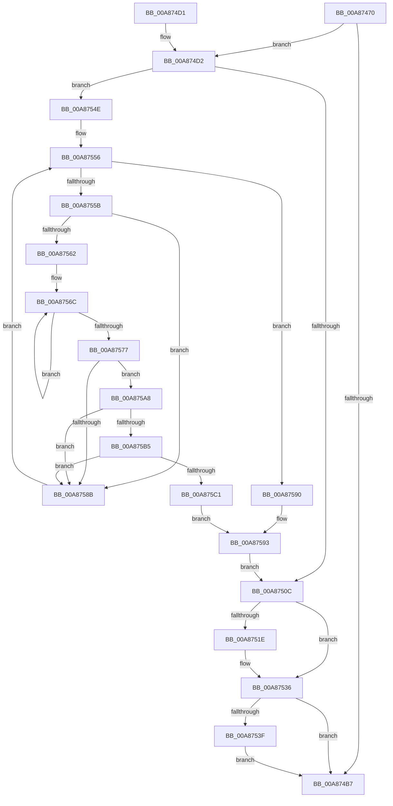

# WmipGetGuidObjectInstanceInfo

- RVA: `0x00A87470`–`0x00A875D0` (길이 `352` bytes)
- VA: `0x0000000140A87470`
- 실행 섹션: `PAGE`
- PDB 이름 있음: `예`; PDB Function 태그: `아니요`
- unwind 정보 RVA: `0x000B7DCC`
- 디코드: `105`개 명령, `352/352` bytes 표시
- 미해석 바이트: `0` (있으면 어셈블리에 `.byte`로 보존)

> 이 문서는 커널 이미지의 기계어와 PDB 기호를 분석해 생성했습니다. 4번과 5번은 함수 원형과 자료형을 바이너리 사용 방식에서 추정한 C 해석이며 원본 소스 복구 결과는 아닙니다.

## 1. Dependencies

- 직접 호출 지점: **5**; 고유 호출 대상: **5**
- 직접 호출자로 확인된 함수: **2**
- RIP 상대 이미지 참조: **1**

### Outgoing calls
- `0x00A874A9` → [IoGetDeviceInstanceName](../../text/4A/IoGetDeviceInstanceName_function_004AADA4.md) (function, `0x004AADA4`)
- `0x00A874FC` → [KeWaitForSingleObject](../../text/20/KeWaitForSingleObject_function_0020E6B0.md) (function, `0x0020E6B0`)
- `0x00A87515` → [KeReleaseMutex](../../text/39/KeReleaseMutex_function_00396810.md) (function, `0x00396810`)
- `0x00A87544` → [RtlFreeAnsiString](../9C/RtlFreeAnsiString_function_009C0800.md) (function, `0x009C0800`)
- `0x00A87582` → [wcsnicmp](../../text/50/wcsnicmp_function_005001C0.md) (function, `0x005001C0`)

### Direct callers
- [WmipTranslateFileHandle](../7B/WmipTranslateFileHandle_function_007B3DA4.md) at `0x007B3E2B`
- [IoWMIDeviceObjectToInstanceName](IoWMIDeviceObjectToInstanceName_function_00A873C0.md) at `0x00A87404`

### Static image references
- `0x00A874D8` → RVA `0x00EFFA60` (`.data`; read)

## 2. Other-region calls and transfers

- 다른 실행 섹션으로 향하는 call: **4**
  - `0x00A874A9` → [IoGetDeviceInstanceName](../../text/4A/IoGetDeviceInstanceName_function_004AADA4.md) (`PAGE` → `.text`)
  - `0x00A874FC` → [KeWaitForSingleObject](../../text/20/KeWaitForSingleObject_function_0020E6B0.md) (`PAGE` → `.text`)
  - `0x00A87515` → [KeReleaseMutex](../../text/39/KeReleaseMutex_function_00396810.md) (`PAGE` → `.text`)
  - `0x00A87582` → [wcsnicmp](../../text/50/wcsnicmp_function_005001C0.md) (`PAGE` → `.text`)
- 별도 외부 분기/꼬리 이동을 확인하지 못했습니다.

## 3. Assembly (complete function range)

```asm
00A87470  4C 8B DC                        mov r11, rsp
00A87473  49 89 5B 08                     mov qword ptr [r11 + 8], rbx
00A87477  4D 89 4B 20                     mov qword ptr [r11 + 0x20], r9
00A8747B  4D 89 43 18                     mov qword ptr [r11 + 0x18], r8
00A8747F  55                              push rbp
00A87480  56                              push rsi
00A87481  57                              push rdi
00A87482  41 54                           push r12
00A87484  41 55                           push r13
00A87486  41 56                           push r14
00A87488  41 57                           push r15
00A8748A  48 83 EC 40                     sub rsp, 0x40
00A8748E  48 8B C2                        mov rax, rdx
00A87491  48 8B F9                        mov rdi, rcx
00A87494  0F 57 C0                        xorps xmm0, xmm0
00A87497  49 8D 53 B8                     lea rdx, [r11 - 0x48]
00A8749B  48 8B C8                        mov rcx, rax
00A8749E  4D 8B F1                        mov r14, r9
00A874A1  49 8B E8                        mov rbp, r8
00A874A4  0F 11 44 24 30                  movups xmmword ptr [rsp + 0x30], xmm0
00A874A9  E8 F6 38 A2 FF                  call 0x1404aada4
00A874AE  45 33 ED                        xor r13d, r13d
00A874B1  8B D8                           mov ebx, eax
00A874B3  85 C0                           test eax, eax
00A874B5  79 1B                           jns 0x140a874d2
00A874B7  8B C3                           mov eax, ebx
00A874B9  48 8B 9C 24 80 00 00 00         mov rbx, qword ptr [rsp + 0x80]
00A874C1  48 83 C4 40                     add rsp, 0x40
00A874C5  41 5F                           pop r15
00A874C7  41 5E                           pop r14
00A874C9  41 5D                           pop r13
00A874CB  41 5C                           pop r12
00A874CD  5F                              pop rdi
00A874CE  5E                              pop rsi
00A874CF  5D                              pop rbp
00A874D0  C3                              ret
00A874D1  CC                              int3
00A874D2  44 0F B7 7C 24 30               movzx r15d, word ptr [rsp + 0x30]
00A874D8  48 8D 0D 81 85 47 00            lea rcx, [rip + 0x478581]
00A874DF  48 8B 7F 38                     mov rdi, qword ptr [rdi + 0x38]
00A874E3  45 33 C9                        xor r9d, r9d
00A874E6  45 33 C0                        xor r8d, r8d
00A874E9  66 41 D1 EF                     shr r15w, 1
00A874ED  33 D2                           xor edx, edx
00A874EF  4C 89 6C 24 20                  mov qword ptr [rsp + 0x20], r13
00A874F4  45 8B E5                        mov r12d, r13d
00A874F7  BB 96 02 00 C0                  mov ebx, 0xc0000296
00A874FC  E8 AF 71 78 FF                  call 0x14020e6b0
00A87501  48 8B 74 24 38                  mov rsi, qword ptr [rsp + 0x38]
00A87506  44 39 6F 24                     cmp dword ptr [rdi + 0x24], r13d
00A8750A  77 42                           ja 0x140a8754e
00A8750C  33 D2                           xor edx, edx
00A8750E  48 8D 0D 4B 85 47 00            lea rcx, [rip + 0x47854b]
00A87515  E8 F6 F2 90 FF                  call 0x140396810
00A8751A  85 DB                           test ebx, ebx
00A8751C  78 18                           js 0x140a87536
00A8751E  0F 10 44 24 30                  movups xmm0, xmmword ptr [rsp + 0x30]
00A87523  45 89 26                        mov dword ptr [r14], r12d
00A87526  49 8B F5                        mov rsi, r13
00A87529  4C 89 6C 24 38                  mov qword ptr [rsp + 0x38], r13
00A8752E  41 8B DD                        mov ebx, r13d
00A87531  F3 0F 7F 45 00                  movdqu xmmword ptr [rbp], xmm0
00A87536  48 85 F6                        test rsi, rsi
00A87539  0F 84 78 FF FF FF               je 0x140a874b7
00A8753F  48 8D 4C 24 30                  lea rcx, [rsp + 0x30]
00A87544  E8 B7 92 F3 FF                  call 0x1409c0800
00A87549  E9 69 FF FF FF                  jmp 0x140a874b7
00A8754E  4C 8D 6F 38                     lea r13, [rdi + 0x38]
00A87552  49 8B 7D 00                     mov rdi, qword ptr [r13]
00A87556  49 3B FD                        cmp rdi, r13
00A87559  74 35                           je 0x140a87590
00A8755B  8B 47 10                        mov eax, dword ptr [rdi + 0x10]
00A8755E  A8 01                           test al, 1
00A87560  74 29                           je 0x140a8758b
00A87562  4C 8B 77 58                     mov r14, qword ptr [rdi + 0x58]
00A87566  48 83 CD FF                     or rbp, 0xffffffffffffffff
00A8756A  33 C0                           xor eax, eax
00A8756C  48 FF C5                        inc rbp
00A8756F  66 41 39 44 6E 04               cmp word ptr [r14 + rbp*2 + 4], ax
00A87575  75 F5                           jne 0x140a8756c
00A87577  45 0F B7 C7                     movzx r8d, r15w
00A8757B  49 8D 4E 04                     lea rcx, [r14 + 4]
00A8757F  48 8B D6                        mov rdx, rsi
00A87582  E8 39 8C A7 FF                  call 0x1405001c0
00A87587  85 C0                           test eax, eax
00A87589  74 1D                           je 0x140a875a8
00A8758B  48 8B 3F                        mov rdi, qword ptr [rdi]
00A8758E  EB C6                           jmp 0x140a87556
00A87590  45 33 ED                        xor r13d, r13d
00A87593  48 8B AC 24 90 00 00 00         mov rbp, qword ptr [rsp + 0x90]
00A8759B  4C 8B B4 24 98 00 00 00         mov r14, qword ptr [rsp + 0x98]
00A875A3  E9 64 FF FF FF                  jmp 0x140a8750c
00A875A8  41 0F B7 CF                     movzx ecx, r15w
00A875AC  FF C1                           inc ecx
00A875AE  0F B7 C5                        movzx eax, bp
00A875B1  3B C1                           cmp eax, ecx
00A875B3  75 D6                           jne 0x140a8758b
00A875B5  0F B7 C5                        movzx eax, bp
00A875B8  66 41 83 7C 46 02 5F            cmp word ptr [r14 + rax*2 + 2], 0x5f
00A875BF  75 CA                           jne 0x140a8758b
00A875C1  48 8B 47 58                     mov rax, qword ptr [rdi + 0x58]
00A875C5  45 33 ED                        xor r13d, r13d
00A875C8  41 8B DD                        mov ebx, r13d
00A875CB  44 8B 20                        mov r12d, dword ptr [rax]
00A875CE  EB C3                           jmp 0x140a87593
```

## 4. C-style interpretation (structured pseudocode)

```c
__int64 __fastcall WmipGetGuidObjectInstanceInfo(__int64 a1, __int64 a2, __int64 a3, __int64 a4)
{
    __int64 result;
    __int64 v_r13;
    __int64 v_r15;
    __int64 v_rbp;
    __int64 v_rbx;
    __int64 v_rsi;
    __int64 v_rsp;
    unsigned __int64 v_stack_m48;
    unsigned __int64 v_stack_p20;
    unsigned __int16 v_stack_p30;
    unsigned __int64 v_stack_p38;
    unsigned __int64 v_stack_p8;
    unsigned __int64 v_stack_p90;
    unsigned __int64 v_stack_p98;

    *(unsigned __int64 *)(v_rsp + 8) = v_rbx;
    *(unsigned __int64 *)(v_rsp + 32) = a4;
    *(unsigned __int64 *)(v_rsp + 24) = a3;
    v_rsp = (v_rsp) - (64);
    v_stack_m48 = v_xmm0;
    result = IoGetDeviceInstanceName(a2, v_rsp - 72, a3, a4);
    v_r13 = 0;
    if (!sign_flag) goto loc_00A874D2;
loc_00A874B7:
    v_rsp = (v_rsp) + (64);
    return (unsigned int)((unsigned int)((unsigned int)((unsigned int)(result))));
loc_00A874D2:
    a4 = 0;
    a3 = 0;
    v_r15 = (unsigned __int16)((v_stack_p30) >> (1));
    a2 = 0;
    v_stack_p20 = 0;
    result = KeWaitForSingleObject(v_rip + 4687233, a2, a3, a4);
    if ((*(unsigned int *)(*(unsigned __int64 *)(a1 + 56) + 36)) > 0) goto loc_00A8754E;
loc_00A8750C:
    a2 = 0;
    result = KeReleaseMutex(v_rip + 4687179, a2, a3, a4);
    v_rbx = (unsigned int)(0xC0000296ULL);
    v_rsi = v_stack_p38;
    if (!(sign_flag)) {
        *(unsigned int *)(a4) = 0;
        v_rsi = 0;
        v_stack_p38 = 0;
        v_rbx = 0;
        *(unsigned __int64 *)(a3) = v_xmm0;
    }
    if (v_rsi == 0) goto loc_00A874B7;
    result = RtlFreeAnsiString(v_stack_p30, a2, a3, a4);
    goto loc_00A874B7;
loc_00A8754E:
loc_00A87556:
    if ((*(unsigned __int64 *)(*(unsigned __int64 *)(a1 + 56) + 56)) == (*(unsigned __int64 *)(a1 + 56) + 56)) goto loc_00A87590;
    if ((((unsigned __int8)((unsigned int)(*(unsigned int *)(*(unsigned __int64 *)(*(unsigned __int64 *)(a1 + 56) + 56) + 16)))) & (1)) == 0) goto loc_00A8758B;
    v_rbp = (a3) | (-1);
    result = 0;
loc_00A8756C:
    v_rbp = (v_rbp) + 1;
    if ((*(unsigned __int16 *)(*(unsigned __int64 *)(*(unsigned __int64 *)(*(unsigned __int64 *)(a1 + 56) + 56) + 88) + v_rbp * 2 + 4)) != 0) goto loc_00A8756C;
    result = wcsnicmp(*(unsigned __int64 *)(*(unsigned __int64 *)(*(unsigned __int64 *)(a1 + 56) + 56) + 88) + 4, v_rsi, (unsigned __int16)(v_r15), a4);
    if ((unsigned int)(result) == 0) goto loc_00A875A8;
loc_00A8758B:
    goto loc_00A87556;
loc_00A87590:
    v_r13 = 0;
loc_00A87593:
    goto loc_00A8750C;
loc_00A875A8:
    a1 = (unsigned int)(((unsigned __int16)(v_r15)) + 1);
    if (((unsigned int)((unsigned __int16)(v_stack_p90))) != ((unsigned int)(a1))) goto loc_00A8758B;
    if ((*(unsigned __int16 *)(v_stack_p98 + (unsigned __int16)(v_stack_p90) * 2 + 2)) != 95) goto loc_00A8758B;
    v_r13 = 0;
    goto loc_00A87593;
}
```

## 5. (Beta) C Style

```c
int64_t WmipGetGuidObjectInstanceInfo(void *Arg1, int64_t Arg2, int64_t Arg3, int64_t Arg4)
{
    uint8_t *arg1 = (uint8_t *)Arg1;

    int64_t result;
    int64_t local_r13;
    int64_t local_r15;
    int64_t local_rbp;
    int64_t local_rbx;
    int64_t local_rsi;
    int64_t local_rsp;
    uint64_t v_stack_m48;
    uint64_t v_stack_p20;
    uint16_t v_stack_p30;
    uint64_t v_stack_p38;
    uint64_t v_stack_p8;
    uint64_t v_stack_p90;
    uint64_t v_stack_p98;

    *(uint64_t *)(local_rsp + 0x8) = local_rbx;
    *(uint64_t *)(local_rsp + 0x20) = Arg4;
    *(uint64_t *)(local_rsp + 0x18) = Arg3;
    local_rsp = (local_rsp) - (64);
    v_stack_m48 = v_xmm0;
    result = IoGetDeviceInstanceName(Arg2, local_rsp - 72, Arg3, Arg4);
    local_r13 = 0;
    if (!sign_flag) goto loc_00A874D2;
loc_00A874B7:
    local_rsp = (local_rsp) + (64);
    return (uint32_t)((uint32_t)((uint32_t)((uint32_t)(result))));
loc_00A874D2:
    Arg4 = 0;
    Arg3 = 0;
    local_r15 = (uint16_t)((v_stack_p30) >> (1));
    Arg2 = 0;
    v_stack_p20 = 0;
    result = KeWaitForSingleObject(v_rip + 4687233, Arg2, Arg3, Arg4);
    if ((*(uint32_t *)(*(uint64_t *)(arg1 + 0x38) + 0x24)) > 0) goto loc_00A8754E;
loc_00A8750C:
    Arg2 = 0;
    result = KeReleaseMutex(v_rip + 4687179, Arg2, Arg3, Arg4);
    local_rbx = (uint32_t)(0xC0000296ULL);
    local_rsi = v_stack_p38;
    if (!(sign_flag)) {
        *(uint32_t *)(Arg4) = 0;
        local_rsi = 0;
        v_stack_p38 = 0;
        local_rbx = 0;
        *(uint64_t *)(Arg3) = v_xmm0;
    }
    if (local_rsi == 0) goto loc_00A874B7;
    result = RtlFreeAnsiString(v_stack_p30, Arg2, Arg3, Arg4);
    goto loc_00A874B7;
loc_00A8754E:
loc_00A87556:
    if ((*(uint64_t *)(*(uint64_t *)(arg1 + 0x38) + 0x38)) == (*(uint64_t *)(arg1 + 0x38) + 56)) goto loc_00A87590;
    if ((((uint8_t)((uint32_t)(*(uint32_t *)(*(uint64_t *)(*(uint64_t *)(arg1 + 0x38) + 0x38) + 0x10)))) & (1)) == 0) goto loc_00A8758B;
    local_rbp = (Arg3) | (-1);
    result = 0;
loc_00A8756C:
    local_rbp = (local_rbp) + 1;
    if ((*(uint16_t *)(*(uint64_t *)(*(uint64_t *)(*(uint64_t *)(arg1 + 0x38) + 0x38) + 0x58) + local_rbp * 2 + 0x4)) != 0) goto loc_00A8756C;
    result = wcsnicmp(*(uint64_t *)(*(uint64_t *)(*(uint64_t *)(arg1 + 0x38) + 0x38) + 0x58) + 4, local_rsi, (uint16_t)(local_r15), Arg4);
    if ((uint32_t)(result) == 0) goto loc_00A875A8;
loc_00A8758B:
    goto loc_00A87556;
loc_00A87590:
    local_r13 = 0;
loc_00A87593:
    goto loc_00A8750C;
loc_00A875A8:
    Arg1 = (uint32_t)(((uint16_t)(local_r15)) + 1);
    if (((uint32_t)((uint16_t)(v_stack_p90))) != ((uint32_t)(Arg1))) goto loc_00A8758B;
    if ((*(uint16_t *)(v_stack_p98 + (uint16_t)(v_stack_p90) * 2 + 0x2)) != 95) goto loc_00A8758B;
    local_r13 = 0;
    goto loc_00A87593;
}
```

### 관측된 메모리 오프셋

구조체 형식이 확인되지 않은 접근은 인자 기준의 오프셋으로만 기록했습니다.

| 기준 인자 | 오프셋 표현 | 폭 (bit) | 접근 |
|---|---:|---:|---|
| `Arg1` | `+ 0x38` | `64` | `R` |

## 6. Execution-region graph

[열기: 2D/3D 그래프와 함수 탐색 컨트롤 패널](../../../control-panel.html?section=page&rva=0x00A87470&view=graph)

- 2D 그래프는 위에서 아래로 흐르고, 3D 그래프는 빈 공간을 드래그해 회전합니다. Shift+드래그는 이동, 휠은 확대·축소, 함수 노드 선택은 대상 보고서 이동입니다.

### Static fallback


