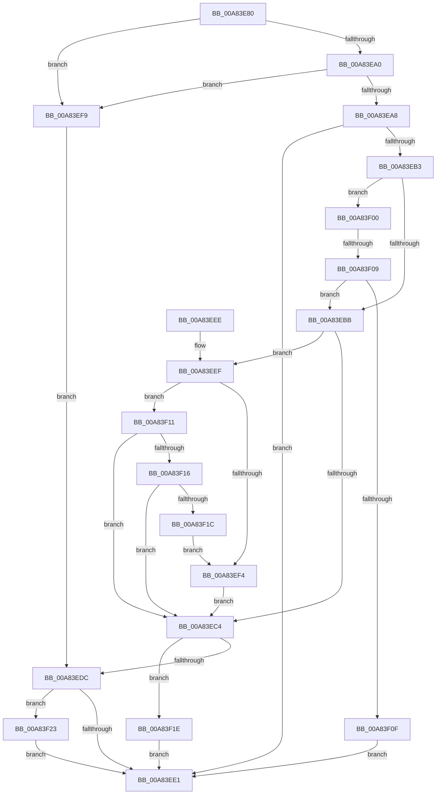

# _CmGetDeviceRegKeySecurityDescriptor

- RVA: `0x00A83E80`–`0x00A83F2C` (길이 `172` bytes)
- VA: `0x0000000140A83E80`
- 실행 섹션: `PAGE`
- PDB 이름 있음: `예`; PDB Function 태그: `예`
- unwind 정보 RVA: `0x00074B1C`
- 디코드: `57`개 명령, `172/172` bytes 표시
- 미해석 바이트: `0` (있으면 어셈블리에 `.byte`로 보존)

> 이 문서는 커널 이미지의 기계어와 PDB 기호를 분석해 생성했습니다. 4번과 5번은 함수 원형과 자료형을 바이너리 사용 방식에서 추정한 C 해석이며 원본 소스 복구 결과는 아닙니다.

## 1. Dependencies

- 직접 호출 지점: **2**; 고유 호출 대상: **2**
- 직접 호출자로 확인된 함수: **1**
- RIP 상대 이미지 참조: **0**

### Outgoing calls
- `0x00A83ECC` → [_CmGetRegKeySecurityDescriptor](_CmGetRegKeySecurityDescriptor_function_00A83F34.md) (function, `0x00A83F34`)
- `0x00A83F25` → [ExFreePoolWithTag](../../poolcode/B8/ExFreePoolWithTag_function_00B82870.md) (function, `0x00B82870`)

### Direct callers
- [sub_008EE966](../8E/Unknown_function_008EE966.md) at `0x008EE9C1`

### Static image references
- 디코드된 RIP-relative 메모리 참조가 없습니다.

## 2. Other-region calls and transfers

- 다른 실행 섹션으로 향하는 call: **1**
  - `0x00A83F25` → [ExFreePoolWithTag](../../poolcode/B8/ExFreePoolWithTag_function_00B82870.md) (`PAGE` → `POOLCODE`)
- call이 아닌 외부 분기/꼬리 이동: **1**
  - `0x00A83F03` → [sub_00B44028](../B4/Unknown_function_00B44028.md) (`tail-transfer`)

## 3. Assembly (complete function range)

```asm
00A83E80  48 89 5C 24 08                  mov qword ptr [rsp + 8], rbx
00A83E85  57                              push rdi
00A83E86  48 83 EC 20                     sub rsp, 0x20
00A83E8A  49 8B F8                        mov rdi, r8
00A83E8D  4C 8B C9                        mov r9, rcx
00A83E90  33 C9                           xor ecx, ecx
00A83E92  45 32 C0                        xor r8b, r8b
00A83E95  33 DB                           xor ebx, ebx
00A83E97  48 89 4C 24 48                  mov qword ptr [rsp + 0x48], rcx
00A83E9C  85 D2                           test edx, edx
00A83E9E  74 59                           je 0x140a83ef9
00A83EA0  F7 C2 E8 FC FF FF               test edx, 0xfffffce8
00A83EA6  75 51                           jne 0x140a83ef9
00A83EA8  48 21 0F                        and qword ptr [rdi], rcx
00A83EAB  F7 C2 00 0F 00 00               test edx, 0xf00
00A83EB1  75 2E                           jne 0x140a83ee1
00A83EB3  0F B6 CA                        movzx ecx, dl
00A83EB6  83 F9 11                        cmp ecx, 0x11
00A83EB9  75 45                           jne 0x140a83f00
00A83EBB  41 81 39 00 00 00 0A            cmp dword ptr [r9], 0xa000000
00A83EC2  73 2B                           jae 0x140a83eef
00A83EC4  48 8D 54 24 48                  lea rdx, [rsp + 0x48]
00A83EC9  41 8A C8                        mov cl, r8b
00A83ECC  E8 63 00 00 00                  call 0x140a83f34
00A83ED1  48 8B 4C 24 48                  mov rcx, qword ptr [rsp + 0x48]
00A83ED6  8B D8                           mov ebx, eax
00A83ED8  85 C0                           test eax, eax
00A83EDA  79 42                           jns 0x140a83f1e
00A83EDC  48 85 C9                        test rcx, rcx
00A83EDF  75 42                           jne 0x140a83f23
00A83EE1  8B C3                           mov eax, ebx
00A83EE3  48 8B 5C 24 30                  mov rbx, qword ptr [rsp + 0x30]
00A83EE8  48 83 C4 20                     add rsp, 0x20
00A83EEC  5F                              pop rdi
00A83EED  C3                              ret
00A83EEE  CC                              int3
00A83EEF  83 F9 11                        cmp ecx, 0x11
00A83EF2  75 1D                           jne 0x140a83f11
00A83EF4  41 B0 01                        mov r8b, 1
00A83EF7  EB CB                           jmp 0x140a83ec4
00A83EF9  BB 0D 00 00 C0                  mov ebx, 0xc000000d
00A83EFE  EB DC                           jmp 0x140a83edc
00A83F00  83 F9 12                        cmp ecx, 0x12
00A83F03  0F 85 1F 01 0C 00               jne 0x140b44028
00A83F09  41 38 59 04                     cmp byte ptr [r9 + 4], bl
00A83F0D  75 AC                           jne 0x140a83ebb
00A83F0F  EB D0                           jmp 0x140a83ee1
00A83F11  83 F9 12                        cmp ecx, 0x12
00A83F14  75 AE                           jne 0x140a83ec4
00A83F16  41 38 59 04                     cmp byte ptr [r9 + 4], bl
00A83F1A  74 A8                           je 0x140a83ec4
00A83F1C  EB D6                           jmp 0x140a83ef4
00A83F1E  48 89 0F                        mov qword ptr [rdi], rcx
00A83F21  EB BE                           jmp 0x140a83ee1
00A83F23  33 D2                           xor edx, edx
00A83F25  E8 46 E9 0F 00                  call 0x140b82870
00A83F2A  EB B5                           jmp 0x140a83ee1
```

## 4. C-style interpretation (structured pseudocode)

```c
__int64 __fastcall _CmGetDeviceRegKeySecurityDescriptor(__int64 a1, int a2, __int64 a3)
{
    __int64 result;
    __int64 v_rbx;
    __int64 v_rsp;
    unsigned __int64 v_stack_p20;
    unsigned __int64 v_stack_p8;

    v_stack_p8 = v_rbx;
    v_rsp = (v_rsp) - (32);
    a1 = 0;
    a3 = 0;
    v_rbx = 0;
    v_stack_p20 = 0;
    if (a2 == 0) goto loc_00A83EF9;
    if (((a2) & (0xFFFFFCE8ULL)) != 0) goto loc_00A83EF9;
    if (((a2) & (0xF00ULL)) != 0) goto loc_00A83EE1;
    if (((unsigned int)((unsigned __int8)(a2))) != 17) goto loc_00A83F00;
loc_00A83EBB:
    if ((*(unsigned int *)(a1)) >= 0xA000000ULL) goto loc_00A83EEF;
loc_00A83EC4:
    result = _CmGetRegKeySecurityDescriptor(0, v_stack_p20, a3, a1);
    if (!sign_flag) goto loc_00A83F1E;
loc_00A83EDC:
    if (v_stack_p20 != 0) goto loc_00A83F23;
loc_00A83EE1:
    v_rsp = (v_rsp) + (32);
    return (unsigned int)((unsigned int)((unsigned int)((unsigned int)(result))));
loc_00A83EEF:
    if (((unsigned int)(v_stack_p20)) != 17) goto loc_00A83F11;
loc_00A83EF4:
    goto loc_00A83EC4;
loc_00A83EF9:
    goto loc_00A83EDC;
loc_00A83F00:
    if ((*(unsigned __int8 *)(a1 + 4)) != ((unsigned __int8)((unsigned int)(0xC000000DULL)))) goto loc_00A83EBB;
    goto loc_00A83EE1;
loc_00A83F11:
    if (((unsigned int)(v_stack_p20)) != 18) goto loc_00A83EC4;
    if ((*(unsigned __int8 *)(a1 + 4)) == ((unsigned __int8)((unsigned int)(0xC000000DULL)))) goto loc_00A83EC4;
    goto loc_00A83EF4;
loc_00A83F1E:
    *(unsigned __int64 *)(a3) = v_stack_p20;
    goto loc_00A83EE1;
loc_00A83F23:
    a2 = 0;
    result = ExFreePoolWithTag(v_stack_p20, a2, 1, a1);
    goto loc_00A83EE1;
}
```

## 5. (Beta) C Style

```c
int64_t _CmGetDeviceRegKeySecurityDescriptor(void *Arg1, int32_t Arg2, void *Arg3)
{
    uint8_t *arg1 = (uint8_t *)Arg1;
    uint8_t *arg3 = (uint8_t *)Arg3;

    int64_t result;
    int64_t local_rbx;
    int64_t local_rsp;
    uint64_t v_stack_p20;
    uint64_t v_stack_p8;

    v_stack_p8 = local_rbx;
    local_rsp = (local_rsp) - (32);
    Arg1 = 0;
    Arg3 = 0;
    local_rbx = 0;
    v_stack_p20 = 0;
    if (Arg2 == 0) goto loc_00A83EF9;
    if (((Arg2) & (0xFFFFFCE8ULL)) != 0) goto loc_00A83EF9;
    if (((Arg2) & (0xF00ULL)) != 0) goto loc_00A83EE1;
    if (((uint32_t)((uint8_t)(Arg2))) != 17) goto loc_00A83F00;
loc_00A83EBB:
    if ((*(uint32_t *)(arg1)) >= 0xA000000ULL) goto loc_00A83EEF;
loc_00A83EC4:
    result = _CmGetRegKeySecurityDescriptor(0, v_stack_p20, Arg3, Arg1);
    if (!sign_flag) goto loc_00A83F1E;
loc_00A83EDC:
    if (v_stack_p20 != 0) goto loc_00A83F23;
loc_00A83EE1:
    local_rsp = (local_rsp) + (32);
    return (uint32_t)((uint32_t)((uint32_t)((uint32_t)(result))));
loc_00A83EEF:
    if (((uint32_t)(v_stack_p20)) != 17) goto loc_00A83F11;
loc_00A83EF4:
    goto loc_00A83EC4;
loc_00A83EF9:
    goto loc_00A83EDC;
loc_00A83F00:
    if ((*(uint8_t *)(arg1 + 0x4)) != ((uint8_t)((uint32_t)(0xC000000DULL)))) goto loc_00A83EBB;
    goto loc_00A83EE1;
loc_00A83F11:
    if (((uint32_t)(v_stack_p20)) != 18) goto loc_00A83EC4;
    if ((*(uint8_t *)(arg1 + 0x4)) == ((uint8_t)((uint32_t)(0xC000000DULL)))) goto loc_00A83EC4;
    goto loc_00A83EF4;
loc_00A83F1E:
    *(uint64_t *)(arg3) = v_stack_p20;
    goto loc_00A83EE1;
loc_00A83F23:
    Arg2 = 0;
    result = ExFreePoolWithTag(v_stack_p20, Arg2, 1, Arg1);
    goto loc_00A83EE1;
}
```

### 관측된 메모리 오프셋

구조체 형식이 확인되지 않은 접근은 인자 기준의 오프셋으로만 기록했습니다.

| 기준 인자 | 오프셋 표현 | 폭 (bit) | 접근 |
|---|---:|---:|---|
| `Arg1` | `+ 0x0` | `32` | `R` |
| `Arg1` | `+ 0x4` | `8` | `R` |
| `Arg3` | `+ 0x0` | `64` | `R/W` |
| `Arg3` | `+ 0x0` | `64` | `W` |

## 6. Execution-region graph

[열기: 2D/3D 그래프와 함수 탐색 컨트롤 패널](../../../control-panel.html?section=page&rva=0x00A83E80&view=graph)

- 2D 그래프는 위에서 아래로 흐르고, 3D 그래프는 빈 공간을 드래그해 회전합니다. Shift+드래그는 이동, 휠은 확대·축소, 함수 노드 선택은 대상 보고서 이동입니다.

### Static fallback


