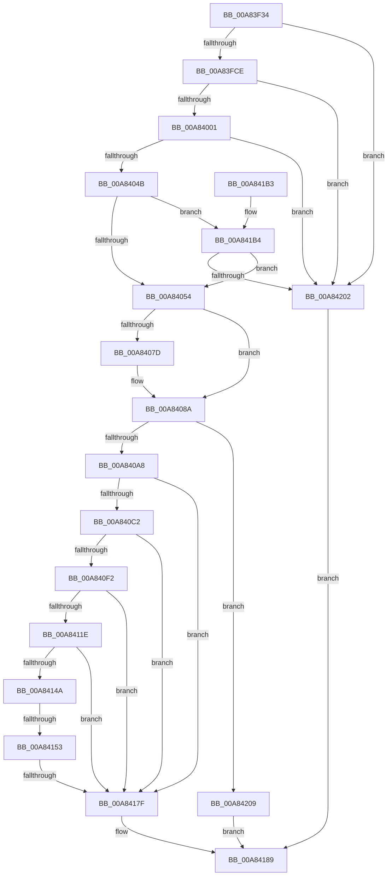

# _CmGetRegKeySecurityDescriptor

- RVA: `0x00A83F34`–`0x00A84213` (길이 `735` bytes)
- VA: `0x0000000140A83F34`
- 실행 섹션: `PAGE`
- PDB 이름 있음: `예`; PDB Function 태그: `예`
- unwind 정보 RVA: `0x000B75A8`
- 디코드: `189`개 명령, `735/735` bytes 표시
- 미해석 바이트: `0` (있으면 어셈블리에 `.byte`로 보존)

> 이 문서는 커널 이미지의 기계어와 PDB 기호를 분석해 생성했습니다. 4번과 5번은 함수 원형과 자료형을 바이너리 사용 방식에서 추정한 C 해석이며 원본 소스 복구 결과는 아닙니다.

## 1. Dependencies

- 직접 호출 지점: **22**; 고유 호출 대상: **8**
- 직접 호출자로 확인된 함수: **2**
- RIP 상대 이미지 참조: **1**

### Outgoing calls
- `0x00A83FB2` → [RtlSubAuthoritySid](../../text/45/RtlSubAuthoritySid_function_00456D10.md) (function, `0x00456D10`)
- `0x00A83FC1` → [RtlValidSid](../92/RtlValidSid_function_00929710.md) (function, `0x00929710`)
- `0x00A83FE8` → [RtlSubAuthoritySid](../../text/45/RtlSubAuthoritySid_function_00456D10.md) (function, `0x00456D10`)
- `0x00A83FF4` → [RtlValidSid](../92/RtlValidSid_function_00929710.md) (function, `0x00929710`)
- `0x00A8401B` → [RtlSubAuthoritySid](../../text/45/RtlSubAuthoritySid_function_00456D10.md) (function, `0x00456D10`)
- `0x00A8402F` → [RtlSubAuthoritySid](../../text/45/RtlSubAuthoritySid_function_00456D10.md) (function, `0x00456D10`)
- `0x00A8403E` → [RtlValidSid](../92/RtlValidSid_function_00929710.md) (function, `0x00929710`)
- `0x00A84058` → [RtlLengthSid](../../text/45/RtlLengthSid_function_0045D270.md) (function, `0x0045D270`)
- `0x00A84063` → [RtlLengthSid](../../text/45/RtlLengthSid_function_0045D270.md) (function, `0x0045D270`)
- `0x00A8406E` → [RtlLengthSid](../../text/45/RtlLengthSid_function_0045D270.md) (function, `0x0045D270`)
- `0x00A84080` → [RtlLengthSid](../../text/45/RtlLengthSid_function_0045D270.md) (function, `0x0045D270`)
- `0x00A84097` → [ExAllocatePool2](../../poolcode/B8/ExAllocatePool2_function_00B820F0.md) (function, `0x00B820F0`)
- `0x00A840B3` → [RtlCreateAcl](../91/RtlCreateAcl_function_00916F00.md) (function, `0x00916F00`)
- `0x00A840E3` → [RtlpAddKnownAce](../92/RtlpAddKnownAce_function_00929A20.md) (function, `0x00929A20`)
- `0x00A84113` → [RtlpAddKnownAce](../92/RtlpAddKnownAce_function_00929A20.md) (function, `0x00929A20`)
- `0x00A8413F` → [RtlpAddKnownAce](../92/RtlpAddKnownAce_function_00929A20.md) (function, `0x00929A20`)
- `0x00A84170` → [RtlpAddKnownAce](../92/RtlpAddKnownAce_function_00929A20.md) (function, `0x00929A20`)
- `0x00A84184` → [ExFreePoolWithTag](../../poolcode/B8/ExFreePoolWithTag_function_00B82870.md) (function, `0x00B82870`)
- `0x00A84192` → [_security_check_cookie](../../text/6A/_security_check_cookie_function_006AC640.md) (function, `0x006AC640`)
- `0x00A841D2` → [RtlSubAuthoritySid](../../text/45/RtlSubAuthoritySid_function_00456D10.md) (function, `0x00456D10`)
- `0x00A841E6` → [RtlSubAuthoritySid](../../text/45/RtlSubAuthoritySid_function_00456D10.md) (function, `0x00456D10`)
- `0x00A841F5` → [RtlValidSid](../92/RtlValidSid_function_00929710.md) (function, `0x00929710`)

### Direct callers
- [_CmGetDeviceRegKeySecurityDescriptor](_CmGetDeviceRegKeySecurityDescriptor_function_00A83E80.md) at `0x00A83ECC`
- [CmGetDeviceInterfaceRegKeySecurityDescriptor](../A9/CmGetDeviceInterfaceRegKeySecurityDescriptor_function_00A9EAC0.md) at `0x00A9EB3F`

### Static image references
- `0x00A83F52` → RVA `0x00E0A740` (`.data`; read)

## 2. Other-region calls and transfers

- 다른 실행 섹션으로 향하는 call: **13**
  - `0x00A83FB2` → [RtlSubAuthoritySid](../../text/45/RtlSubAuthoritySid_function_00456D10.md) (`PAGE` → `.text`)
  - `0x00A83FE8` → [RtlSubAuthoritySid](../../text/45/RtlSubAuthoritySid_function_00456D10.md) (`PAGE` → `.text`)
  - `0x00A8401B` → [RtlSubAuthoritySid](../../text/45/RtlSubAuthoritySid_function_00456D10.md) (`PAGE` → `.text`)
  - `0x00A8402F` → [RtlSubAuthoritySid](../../text/45/RtlSubAuthoritySid_function_00456D10.md) (`PAGE` → `.text`)
  - `0x00A84058` → [RtlLengthSid](../../text/45/RtlLengthSid_function_0045D270.md) (`PAGE` → `.text`)
  - `0x00A84063` → [RtlLengthSid](../../text/45/RtlLengthSid_function_0045D270.md) (`PAGE` → `.text`)
  - `0x00A8406E` → [RtlLengthSid](../../text/45/RtlLengthSid_function_0045D270.md) (`PAGE` → `.text`)
  - `0x00A84080` → [RtlLengthSid](../../text/45/RtlLengthSid_function_0045D270.md) (`PAGE` → `.text`)
  - `0x00A84097` → [ExAllocatePool2](../../poolcode/B8/ExAllocatePool2_function_00B820F0.md) (`PAGE` → `POOLCODE`)
  - `0x00A84184` → [ExFreePoolWithTag](../../poolcode/B8/ExFreePoolWithTag_function_00B82870.md) (`PAGE` → `POOLCODE`)
  - `0x00A84192` → [_security_check_cookie](../../text/6A/_security_check_cookie_function_006AC640.md) (`PAGE` → `.text`)
  - `0x00A841D2` → [RtlSubAuthoritySid](../../text/45/RtlSubAuthoritySid_function_00456D10.md) (`PAGE` → `.text`)
  - `0x00A841E6` → [RtlSubAuthoritySid](../../text/45/RtlSubAuthoritySid_function_00456D10.md) (`PAGE` → `.text`)
- call이 아닌 외부 분기/꼬리 이동: **2**
  - `0x00A8414D` → [sub_00B4403A](../B4/Unknown_function_00B4403A.md) (`tail-transfer`)
  - `0x00A84179` → [sub_00B4403A](../B4/Unknown_function_00B4403A.md) (`tail-transfer`)

## 3. Assembly (complete function range)

```asm
00A83F34  48 89 5C 24 08                  mov qword ptr [rsp + 8], rbx
00A83F39  48 89 74 24 18                  mov qword ptr [rsp + 0x18], rsi
00A83F3E  55                              push rbp
00A83F3F  57                              push rdi
00A83F40  41 54                           push r12
00A83F42  41 56                           push r14
00A83F44  41 57                           push r15
00A83F46  48 8D 6C 24 C9                  lea rbp, [rsp - 0x37]
00A83F4B  48 81 EC B0 00 00 00            sub rsp, 0xb0
00A83F52  48 8B 05 E7 67 38 00            mov rax, qword ptr [rip + 0x3867e7]
00A83F59  48 33 C4                        xor rax, rsp
00A83F5C  48 89 45 2F                     mov qword ptr [rbp + 0x2f], rax
00A83F60  45 33 E4                        xor r12d, r12d
00A83F63  66 C7 45 C3 00 05               mov word ptr [rbp - 0x3d], 0x500
00A83F69  0F 57 C0                        xorps xmm0, xmm0
00A83F6C  4C 89 22                        mov qword ptr [rdx], r12
00A83F6F  4C 8B FA                        mov r15, rdx
00A83F72  44 89 65 BF                     mov dword ptr [rbp - 0x41], r12d
00A83F76  40 8A F9                        mov dil, cl
00A83F79  44 89 65 B7                     mov dword ptr [rbp - 0x49], r12d
00A83F7D  33 C0                           xor eax, eax
00A83F7F  66 C7 45 BB 00 01               mov word ptr [rbp - 0x45], 0x100
00A83F85  33 D2                           xor edx, edx
00A83F87  44 89 65 C7                     mov dword ptr [rbp - 0x39], r12d
00A83F8B  48 8D 4D F7                     lea rcx, [rbp - 9]
00A83F8F  66 C7 45 CB 00 0F               mov word ptr [rbp - 0x35], 0xf00
00A83F95  45 8B F4                        mov r14d, r12d
00A83F98  48 89 45 EF                     mov qword ptr [rbp - 0x11], rax
00A83F9C  0F 11 45 CF                     movups xmmword ptr [rbp - 0x31], xmm0
00A83FA0  C7 45 F7 01 01 00 00            mov dword ptr [rbp - 9], 0x101
00A83FA7  0F 11 45 DF                     movups xmmword ptr [rbp - 0x21], xmm0
00A83FAB  C7 45 FB 00 00 00 05            mov dword ptr [rbp - 5], 0x5000000
00A83FB2  E8 59 2D 9D FF                  call 0x140456d10
00A83FB7  48 8D 4D F7                     lea rcx, [rbp - 9]
00A83FBB  C7 00 12 00 00 00               mov dword ptr [rax], 0x12
00A83FC1  E8 4A 57 EA FF                  call 0x140929710
00A83FC6  84 C0                           test al, al
00A83FC8  0F 84 34 02 00 00               je 0x140a84202
00A83FCE  41 8B C4                        mov eax, r12d
00A83FD1  66 C7 45 13 01 01               mov word ptr [rbp + 0x13], 0x101
00A83FD7  89 45 15                        mov dword ptr [rbp + 0x15], eax
00A83FDA  48 8D 4D 13                     lea rcx, [rbp + 0x13]
00A83FDE  0F B7 45 BB                     movzx eax, word ptr [rbp - 0x45]
00A83FE2  33 D2                           xor edx, edx
00A83FE4  66 89 45 19                     mov word ptr [rbp + 0x19], ax
00A83FE8  E8 23 2D 9D FF                  call 0x140456d10
00A83FED  48 8D 4D 13                     lea rcx, [rbp + 0x13]
00A83FF1  44 89 20                        mov dword ptr [rax], r12d
00A83FF4  E8 17 57 EA FF                  call 0x140929710
00A83FF9  84 C0                           test al, al
00A83FFB  0F 84 01 02 00 00               je 0x140a84202
00A84001  41 8B C4                        mov eax, r12d
00A84004  66 C7 45 03 01 02               mov word ptr [rbp + 3], 0x201
00A8400A  89 45 05                        mov dword ptr [rbp + 5], eax
00A8400D  48 8D 4D 03                     lea rcx, [rbp + 3]
00A84011  0F B7 45 C3                     movzx eax, word ptr [rbp - 0x3d]
00A84015  33 D2                           xor edx, edx
00A84017  66 89 45 09                     mov word ptr [rbp + 9], ax
00A8401B  E8 F0 2C 9D FF                  call 0x140456d10
00A84020  41 8D 54 24 01                  lea edx, [r12 + 1]
00A84025  48 8D 4D 03                     lea rcx, [rbp + 3]
00A84029  C7 00 20 00 00 00               mov dword ptr [rax], 0x20
00A8402F  E8 DC 2C 9D FF                  call 0x140456d10
00A84034  48 8D 4D 03                     lea rcx, [rbp + 3]
00A84038  C7 00 20 02 00 00               mov dword ptr [rax], 0x220
00A8403E  E8 CD 56 EA FF                  call 0x140929710
00A84043  84 C0                           test al, al
00A84045  0F 84 B7 01 00 00               je 0x140a84202
00A8404B  40 84 FF                        test dil, dil
00A8404E  0F 85 60 01 00 00               jne 0x140a841b4
00A84054  48 8D 4D 03                     lea rcx, [rbp + 3]
00A84058  E8 13 92 9D FF                  call 0x14045d270
00A8405D  48 8D 4D 13                     lea rcx, [rbp + 0x13]
00A84061  8B D8                           mov ebx, eax
00A84063  E8 08 92 9D FF                  call 0x14045d270
00A84068  48 8D 4D F7                     lea rcx, [rbp - 9]
00A8406C  03 D8                           add ebx, eax
00A8406E  E8 FD 91 9D FF                  call 0x14045d270
00A84073  83 C3 20                        add ebx, 0x20
00A84076  03 D8                           add ebx, eax
00A84078  40 84 FF                        test dil, dil
00A8407B  74 0D                           je 0x140a8408a
00A8407D  49 8B CE                        mov rcx, r14
00A84080  E8 EB 91 9D FF                  call 0x14045d270
00A84085  83 C3 08                        add ebx, 8
00A84088  03 D8                           add ebx, eax
00A8408A  8B D3                           mov edx, ebx
00A8408C  B9 00 01 00 00                  mov ecx, 0x100
00A84091  41 B8 50 4E 50 52               mov r8d, 0x52504e50
00A84097  E8 54 E0 0F 00                  call 0x140b820f0
00A8409C  48 8B F0                        mov rsi, rax
00A8409F  48 85 C0                        test rax, rax
00A840A2  0F 84 61 01 00 00               je 0x140a84209
00A840A8  41 B8 02 00 00 00               mov r8d, 2
00A840AE  8B D3                           mov edx, ebx
00A840B0  48 8B C8                        mov rcx, rax
00A840B3  E8 48 2E E9 FF                  call 0x140916f00
00A840B8  8B D8                           mov ebx, eax
00A840BA  85 C0                           test eax, eax
00A840BC  0F 88 BD 00 00 00               js 0x140a8417f
00A840C2  48 8D 45 F7                     lea rax, [rbp - 9]
00A840C6  44 88 64 24 28                  mov byte ptr [rsp + 0x28], r12b
00A840CB  48 89 44 24 20                  mov qword ptr [rsp + 0x20], rax
00A840D0  41 B9 3F 00 0F 00               mov r9d, 0xf003f
00A840D6  B8 02 00 00 00                  mov eax, 2
00A840DB  48 8B CE                        mov rcx, rsi
00A840DE  44 8B C0                        mov r8d, eax
00A840E1  8B D0                           mov edx, eax
00A840E3  E8 38 59 EA FF                  call 0x140929a20
00A840E8  8B D8                           mov ebx, eax
00A840EA  85 C0                           test eax, eax
00A840EC  0F 88 8D 00 00 00               js 0x140a8417f
00A840F2  48 8D 45 13                     lea rax, [rbp + 0x13]
00A840F6  44 88 64 24 28                  mov byte ptr [rsp + 0x28], r12b
00A840FB  48 89 44 24 20                  mov qword ptr [rsp + 0x20], rax
00A84100  41 B9 19 00 02 00               mov r9d, 0x20019
00A84106  B8 02 00 00 00                  mov eax, 2
00A8410B  48 8B CE                        mov rcx, rsi
00A8410E  44 8B C0                        mov r8d, eax
00A84111  8B D0                           mov edx, eax
00A84113  E8 08 59 EA FF                  call 0x140929a20
00A84118  8B D8                           mov ebx, eax
00A8411A  85 C0                           test eax, eax
00A8411C  78 61                           js 0x140a8417f
00A8411E  48 8D 45 03                     lea rax, [rbp + 3]
00A84122  44 88 64 24 28                  mov byte ptr [rsp + 0x28], r12b
00A84127  48 89 44 24 20                  mov qword ptr [rsp + 0x20], rax
00A8412C  41 B9 3F 00 0F 00               mov r9d, 0xf003f
00A84132  B8 02 00 00 00                  mov eax, 2
00A84137  48 8B CE                        mov rcx, rsi
00A8413A  44 8B C0                        mov r8d, eax
00A8413D  8B D0                           mov edx, eax
00A8413F  E8 DC 58 EA FF                  call 0x140929a20
00A84144  8B D8                           mov ebx, eax
00A84146  85 C0                           test eax, eax
00A84148  78 35                           js 0x140a8417f
00A8414A  40 84 FF                        test dil, dil
00A8414D  0F 84 E7 FE 0B 00               je 0x140b4403a
00A84153  B8 02 00 00 00                  mov eax, 2
00A84158  44 88 64 24 28                  mov byte ptr [rsp + 0x28], r12b
00A8415D  44 8B C0                        mov r8d, eax
00A84160  4C 89 74 24 20                  mov qword ptr [rsp + 0x20], r14
00A84165  8B D0                           mov edx, eax
00A84167  41 B9 19 00 02 00               mov r9d, 0x20019
00A8416D  48 8B CE                        mov rcx, rsi
00A84170  E8 AB 58 EA FF                  call 0x140929a20
00A84175  8B D8                           mov ebx, eax
00A84177  85 C0                           test eax, eax
00A84179  0F 89 BB FE 0B 00               jns 0x140b4403a
00A8417F  33 D2                           xor edx, edx
00A84181  48 8B CE                        mov rcx, rsi
00A84184  E8 E7 E6 0F 00                  call 0x140b82870
00A84189  8B C3                           mov eax, ebx
00A8418B  48 8B 4D 2F                     mov rcx, qword ptr [rbp + 0x2f]
00A8418F  48 33 CC                        xor rcx, rsp
00A84192  E8 A9 84 C2 FF                  call 0x1406ac640
00A84197  4C 8D 9C 24 B0 00 00 00         lea r11, [rsp + 0xb0]
00A8419F  49 8B 5B 30                     mov rbx, qword ptr [r11 + 0x30]
00A841A3  49 8B 73 40                     mov rsi, qword ptr [r11 + 0x40]
00A841A7  49 8B E3                        mov rsp, r11
00A841AA  41 5F                           pop r15
00A841AC  41 5E                           pop r14
00A841AE  41 5C                           pop r12
00A841B0  5F                              pop rdi
00A841B1  5D                              pop rbp
00A841B2  C3                              ret
00A841B3  CC                              int3
00A841B4  8B 45 C7                        mov eax, dword ptr [rbp - 0x39]
00A841B7  48 8D 4D 1F                     lea rcx, [rbp + 0x1f]
00A841BB  89 45 21                        mov dword ptr [rbp + 0x21], eax
00A841BE  4C 8D 75 1F                     lea r14, [rbp + 0x1f]
00A841C2  0F B7 45 CB                     movzx eax, word ptr [rbp - 0x35]
00A841C6  33 D2                           xor edx, edx
00A841C8  66 89 45 25                     mov word ptr [rbp + 0x25], ax
00A841CC  66 C7 45 1F 01 02               mov word ptr [rbp + 0x1f], 0x201
00A841D2  E8 39 2B 9D FF                  call 0x140456d10
00A841D7  BA 01 00 00 00                  mov edx, 1
00A841DC  48 8D 4D 1F                     lea rcx, [rbp + 0x1f]
00A841E0  C7 00 02 00 00 00               mov dword ptr [rax], 2
00A841E6  E8 25 2B 9D FF                  call 0x140456d10
00A841EB  48 8D 4D 1F                     lea rcx, [rbp + 0x1f]
00A841EF  C7 00 01 00 00 00               mov dword ptr [rax], 1
00A841F5  E8 16 55 EA FF                  call 0x140929710
00A841FA  84 C0                           test al, al
00A841FC  0F 85 52 FE FF FF               jne 0x140a84054
00A84202  BB 3E 00 00 C0                  mov ebx, 0xc000003e
00A84207  EB 80                           jmp 0x140a84189
00A84209  BB 17 00 00 C0                  mov ebx, 0xc0000017
00A8420E  E9 76 FF FF FF                  jmp 0x140a84189
```

## 4. C-style interpretation (structured pseudocode)

```c
__int64 __fastcall _CmGetRegKeySecurityDescriptor(unsigned __int8 a1, __int64 a2)
{
    __int64 result;
    __int64 v_r12;
    __int64 v_rbx;
    __int64 v_rsp;
    unsigned __int64 v_stack_m28;
    unsigned __int64 v_stack_m30;
    unsigned __int16 v_stack_m3A;
    unsigned int v_stack_m3E;
    unsigned __int64 v_stack_m40;
    unsigned __int16 v_stack_m46;
    unsigned int v_stack_m4A;
    unsigned __int16 v_stack_m4C;
    unsigned __int16 v_stack_m56;
    unsigned int v_stack_m5A;
    unsigned __int16 v_stack_m5C;
    unsigned __int64 v_stack_m5F;
    unsigned int v_stack_m64;
    unsigned __int64 v_stack_m68;
    unsigned __int64 v_stack_m70;
    unsigned __int64 v_stack_m80;
    unsigned __int64 v_stack_m90;
    unsigned __int16 v_stack_m94;
    unsigned int v_stack_m98;
    unsigned __int16 v_stack_m9C;
    unsigned int v_stack_mA0;
    unsigned __int16 v_stack_mA4;
    unsigned int v_stack_mA8;
    unsigned __int8 v_stack_mB0;
    unsigned __int64 v_stack_mB8;
    unsigned __int64 v_stack_p18;
    unsigned __int64 v_stack_p8;

    v_stack_p8 = v_rbx;
    v_stack_p18 = v_rsi;
    v_rsp = (v_rsp) - (176);
    result = (*(unsigned __int64 *)(v_rip + 3696615)) ^ (v_rsp);
    v_stack_m30 = result;
    v_r12 = 0;
    v_stack_m9C = 0x500ULL;
    *(unsigned __int64 *)(a2) = 0;
    v_stack_mA0 = 0;
    v_stack_mA8 = 0;
    result = 0;
    v_stack_mA4 = 256;
    a2 = 0;
    v_stack_m98 = 0;
    v_stack_m94 = 0xF00ULL;
    v_stack_m70 = 0;
    v_stack_m90 = v_xmm0;
    v_stack_m68 = 257;
    v_stack_m80 = v_xmm0;
    v_stack_m64 = 0x5000000ULL;
    result = RtlSubAuthoritySid(v_stack_m68, a2, a3, a4);
    *(unsigned int *)(result) = 18;
    result = RtlValidSid(v_stack_m68, a2, a3, a4);
    if ((unsigned __int8)(result) == 0) goto loc_00A84202;
    v_stack_m4C = 257;
    v_stack_m4A = 0;
    a2 = 0;
    v_stack_m46 = (unsigned __int16)(v_stack_mA4);
    result = RtlSubAuthoritySid(v_stack_m4C, a2, a3, a4);
    *(unsigned int *)(result) = 0;
    result = RtlValidSid(v_stack_m4C, a2, a3, a4);
    if ((unsigned __int8)(result) == 0) goto loc_00A84202;
    v_stack_m5C = 513;
    v_stack_m5A = 0;
    a2 = 0;
    v_stack_m56 = (unsigned __int16)(v_stack_m9C);
    result = RtlSubAuthoritySid(v_stack_m5C, a2, a3, a4);
    *(unsigned int *)(result) = 32;
    result = RtlSubAuthoritySid(v_stack_m5C, v_r12 + 1, a3, a4);
    *(unsigned int *)(result) = 544;
    result = RtlValidSid(v_stack_m5C, v_r12 + 1, a3, a4);
    if ((unsigned __int8)(result) == 0) goto loc_00A84202;
    if (a1 != 0) goto loc_00A841B4;
loc_00A84054:
    result = RtlLengthSid(v_stack_m5C, v_r12 + 1, a3, a4);
    result = RtlLengthSid(v_stack_m4C, v_r12 + 1, a3, a4);
    v_rbx = (unsigned int)(((unsigned int)((unsigned int)(result))) + ((unsigned int)(result)));
    result = RtlLengthSid(v_stack_m68, v_r12 + 1, a3, a4);
    v_rbx = (unsigned int)((v_rbx) + (32));
    v_rbx = (unsigned int)((v_rbx) + ((unsigned int)(result)));
    if (a1 != 0) {
        a1 = 0;
        result = RtlLengthSid(a1, v_r12 + 1, a3, a4);
        v_rbx = (unsigned int)((v_rbx) + (8));
        v_rbx = (unsigned int)((v_rbx) + ((unsigned int)(result)));
    }
    result = ExAllocatePool2(256, (unsigned int)((unsigned int)(v_rbx)), (unsigned int)(0x52504E50ULL), a4);
    if (result == 0) goto loc_00A84209;
    result = RtlCreateAcl(result, (unsigned int)((unsigned int)(v_rbx)), 2, a4);
    if (sign_flag) goto loc_00A8417F;
    v_stack_mB0 = 0;
    v_stack_mB8 = v_stack_m68;
    result = RtlpAddKnownAce(result, 2, 2, (unsigned int)(0xF003FULL));
    if (sign_flag) goto loc_00A8417F;
    v_stack_mB0 = 0;
    v_stack_mB8 = v_stack_m4C;
    result = RtlpAddKnownAce(result, 2, 2, (unsigned int)(0x20019ULL));
    if (sign_flag) goto loc_00A8417F;
    v_stack_mB0 = 0;
    v_stack_mB8 = v_stack_m5C;
    result = RtlpAddKnownAce(result, 2, 2, (unsigned int)(0xF003FULL));
    if (sign_flag) goto loc_00A8417F;
    v_stack_mB0 = 0;
    v_stack_mB8 = 0;
    result = RtlpAddKnownAce(result, 2, 2, (unsigned int)(0x20019ULL));
loc_00A8417F:
    a2 = 0;
    result = ExFreePoolWithTag(result, a2, 2, (unsigned int)(0x20019ULL));
loc_00A84189:
    a1 = (v_stack_m30) ^ (v_rsp);
    result = _security_check_cookie(a1, a2, 2, (unsigned int)(0x20019ULL));
    return result;
loc_00A841B4:
    v_stack_m3E = (unsigned int)((unsigned int)(v_stack_m98));
    a2 = 0;
    v_stack_m3A = (unsigned __int16)(v_stack_m94);
    v_stack_m40 = 513;
    result = RtlSubAuthoritySid(v_stack_m40, a2, 2, (unsigned int)(0x20019ULL));
    *(unsigned int *)(result) = 2;
    result = RtlSubAuthoritySid(v_stack_m40, 1, 2, (unsigned int)(0x20019ULL));
    *(unsigned int *)(result) = 1;
    result = RtlValidSid(v_stack_m40, 1, 2, (unsigned int)(0x20019ULL));
    if ((unsigned __int8)(result) != 0) goto loc_00A84054;
loc_00A84202:
    goto loc_00A84189;
loc_00A84209:
    goto loc_00A84189;
}
```

## 5. (Beta) C Style

```c
int64_t _CmGetRegKeySecurityDescriptor(uint8_t Arg1, void *Arg2)
{
    uint8_t *arg2 = (uint8_t *)Arg2;

    int64_t result;
    int64_t local_r12;
    int64_t local_rbx;
    int64_t local_rsp;
    uint64_t v_stack_m28;
    uint64_t v_stack_m30;
    uint16_t v_stack_m3A;
    uint32_t v_stack_m3E;
    uint64_t v_stack_m40;
    uint16_t v_stack_m46;
    uint32_t v_stack_m4A;
    uint16_t v_stack_m4C;
    uint16_t v_stack_m56;
    uint32_t v_stack_m5A;
    uint16_t v_stack_m5C;
    uint64_t v_stack_m5F;
    uint32_t v_stack_m64;
    uint64_t v_stack_m68;
    uint64_t v_stack_m70;
    uint64_t v_stack_m80;
    uint64_t v_stack_m90;
    uint16_t v_stack_m94;
    uint32_t v_stack_m98;
    uint16_t v_stack_m9C;
    uint32_t v_stack_mA0;
    uint16_t v_stack_mA4;
    uint32_t v_stack_mA8;
    uint8_t v_stack_mB0;
    uint64_t v_stack_mB8;
    uint64_t v_stack_p18;
    uint64_t v_stack_p8;

    v_stack_p8 = local_rbx;
    v_stack_p18 = local_rsi;
    local_rsp = (local_rsp) - (176);
    result = (*(uint64_t *)(v_rip + 0x3867E7)) ^ (local_rsp);
    v_stack_m30 = result;
    local_r12 = 0;
    v_stack_m9C = 0x500ULL;
    *(uint64_t *)(arg2) = 0;
    v_stack_mA0 = 0;
    v_stack_mA8 = 0;
    result = 0;
    v_stack_mA4 = 256;
    Arg2 = 0;
    v_stack_m98 = 0;
    v_stack_m94 = 0xF00ULL;
    v_stack_m70 = 0;
    v_stack_m90 = v_xmm0;
    v_stack_m68 = 257;
    v_stack_m80 = v_xmm0;
    v_stack_m64 = 0x5000000ULL;
    result = RtlSubAuthoritySid(v_stack_m68, Arg2, a3, a4);
    *(uint32_t *)(result) = 18;
    result = RtlValidSid(v_stack_m68, Arg2, a3, a4);
    if ((uint8_t)(result) == 0) goto loc_00A84202;
    v_stack_m4C = 257;
    v_stack_m4A = 0;
    Arg2 = 0;
    v_stack_m46 = (uint16_t)(v_stack_mA4);
    result = RtlSubAuthoritySid(v_stack_m4C, Arg2, a3, a4);
    *(uint32_t *)(result) = 0;
    result = RtlValidSid(v_stack_m4C, Arg2, a3, a4);
    if ((uint8_t)(result) == 0) goto loc_00A84202;
    v_stack_m5C = 513;
    v_stack_m5A = 0;
    Arg2 = 0;
    v_stack_m56 = (uint16_t)(v_stack_m9C);
    result = RtlSubAuthoritySid(v_stack_m5C, Arg2, a3, a4);
    *(uint32_t *)(result) = 32;
    result = RtlSubAuthoritySid(v_stack_m5C, local_r12 + 1, a3, a4);
    *(uint32_t *)(result) = 544;
    result = RtlValidSid(v_stack_m5C, local_r12 + 1, a3, a4);
    if ((uint8_t)(result) == 0) goto loc_00A84202;
    if (Arg1 != 0) goto loc_00A841B4;
loc_00A84054:
    result = RtlLengthSid(v_stack_m5C, local_r12 + 1, a3, a4);
    result = RtlLengthSid(v_stack_m4C, local_r12 + 1, a3, a4);
    local_rbx = (uint32_t)(((uint32_t)((uint32_t)(result))) + ((uint32_t)(result)));
    result = RtlLengthSid(v_stack_m68, local_r12 + 1, a3, a4);
    local_rbx = (uint32_t)((local_rbx) + (32));
    local_rbx = (uint32_t)((local_rbx) + ((uint32_t)(result)));
    if (Arg1 != 0) {
        Arg1 = 0;
        result = RtlLengthSid(Arg1, local_r12 + 1, a3, a4);
        local_rbx = (uint32_t)((local_rbx) + (8));
        local_rbx = (uint32_t)((local_rbx) + ((uint32_t)(result)));
    }
    result = ExAllocatePool2(256, (uint32_t)((uint32_t)(local_rbx)), (uint32_t)(0x52504E50ULL), a4);
    if (result == 0) goto loc_00A84209;
    result = RtlCreateAcl(result, (uint32_t)((uint32_t)(local_rbx)), 2, a4);
    if (sign_flag) goto loc_00A8417F;
    v_stack_mB0 = 0;
    v_stack_mB8 = v_stack_m68;
    result = RtlpAddKnownAce(result, 2, 2, (uint32_t)(0xF003FULL));
    if (sign_flag) goto loc_00A8417F;
    v_stack_mB0 = 0;
    v_stack_mB8 = v_stack_m4C;
    result = RtlpAddKnownAce(result, 2, 2, (uint32_t)(0x20019ULL));
    if (sign_flag) goto loc_00A8417F;
    v_stack_mB0 = 0;
    v_stack_mB8 = v_stack_m5C;
    result = RtlpAddKnownAce(result, 2, 2, (uint32_t)(0xF003FULL));
    if (sign_flag) goto loc_00A8417F;
    v_stack_mB0 = 0;
    v_stack_mB8 = 0;
    result = RtlpAddKnownAce(result, 2, 2, (uint32_t)(0x20019ULL));
loc_00A8417F:
    Arg2 = 0;
    result = ExFreePoolWithTag(result, Arg2, 2, (uint32_t)(0x20019ULL));
loc_00A84189:
    Arg1 = (v_stack_m30) ^ (local_rsp);
    result = _security_check_cookie(Arg1, Arg2, 2, (uint32_t)(0x20019ULL));
    return result;
loc_00A841B4:
    v_stack_m3E = (uint32_t)((uint32_t)(v_stack_m98));
    Arg2 = 0;
    v_stack_m3A = (uint16_t)(v_stack_m94);
    v_stack_m40 = 513;
    result = RtlSubAuthoritySid(v_stack_m40, Arg2, 2, (uint32_t)(0x20019ULL));
    *(uint32_t *)(result) = 2;
    result = RtlSubAuthoritySid(v_stack_m40, 1, 2, (uint32_t)(0x20019ULL));
    *(uint32_t *)(result) = 1;
    result = RtlValidSid(v_stack_m40, 1, 2, (uint32_t)(0x20019ULL));
    if ((uint8_t)(result) != 0) goto loc_00A84054;
loc_00A84202:
    goto loc_00A84189;
loc_00A84209:
    goto loc_00A84189;
}
```

### 관측된 메모리 오프셋

구조체 형식이 확인되지 않은 접근은 인자 기준의 오프셋으로만 기록했습니다.

| 기준 인자 | 오프셋 표현 | 폭 (bit) | 접근 |
|---|---:|---:|---|
| `Arg2` | `+ 0x0` | `64` | `W` |

## 6. Execution-region graph

[열기: 2D/3D 그래프와 함수 탐색 컨트롤 패널](../../../control-panel.html?section=page&rva=0x00A83F34&view=graph)

- 2D 그래프는 위에서 아래로 흐르고, 3D 그래프는 빈 공간을 드래그해 회전합니다. Shift+드래그는 이동, 휠은 확대·축소, 함수 노드 선택은 대상 보고서 이동입니다.

### Static fallback


