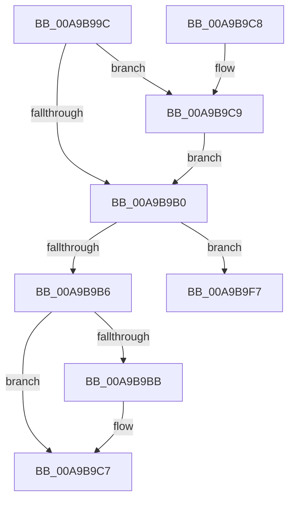

# AlpcpFreeBitmap

- RVA: `0x00A9B99C`–`0x00A9BA03` (길이 `103` bytes)
- VA: `0x0000000140A9B99C`
- 실행 섹션: `PAGE`
- PDB 이름 있음: `예`; PDB Function 태그: `예`
- unwind 정보 RVA: `0x000DB714`
- 디코드: `34`개 명령, `103/103` bytes 표시
- 미해석 바이트: `0` (있으면 어셈블리에 `.byte`로 보존)

> 이 문서는 커널 이미지의 기계어와 PDB 기호를 분석해 생성했습니다. 4번과 5번은 함수 원형과 자료형을 바이너리 사용 방식에서 추정한 C 해석이며 원본 소스 복구 결과는 아닙니다.

## 1. Dependencies

- 직접 호출 지점: **0**; 고유 호출 대상: **0**
- 직접 호출자로 확인된 함수: **1**
- RIP 상대 이미지 참조: **0**

### Outgoing calls
- 직접 디코드된 call 명령이 없습니다.

### Direct callers
- [sub_009CB23E](../9C/Unknown_function_009CB23E.md) at `0x009CB2B8`

### Static image references
- 디코드된 RIP-relative 메모리 참조가 없습니다.

## 2. Other-region calls and transfers

- 다른 실행 섹션으로 향하는 call: **0**
- call이 아닌 외부 분기/꼬리 이동: **1**
  - `0x00A9B9FE` → `0x00B4849A` (`tail-transfer`)

## 3. Assembly (complete function range)

```asm
00A9B99C  41 8B C0                        mov eax, r8d
00A9B99F  48 C1 E8 05                     shr rax, 5
00A9B9A3  45 8B D0                        mov r10d, r8d
00A9B9A6  4C 8D 04 81                     lea r8, [rcx + rax*4]
00A9B9AA  41 83 E2 1F                     and r10d, 0x1f
00A9B9AE  77 19                           ja 0x140a9b9c9
00A9B9B0  41 83 F9 20                     cmp r9d, 0x20
00A9B9B4  73 41                           jae 0x140a9b9f7
00A9B9B6  45 85 C9                        test r9d, r9d
00A9B9B9  74 0C                           je 0x140a9b9c7
00A9B9BB  41 8B C9                        mov ecx, r9d
00A9B9BE  83 C8 FF                        or eax, 0xffffffff
00A9B9C1  D3 E0                           shl eax, cl
00A9B9C3  F0 41 21 00                     lock and dword ptr [r8], eax
00A9B9C7  C3                              ret
00A9B9C8  CC                              int3
00A9B9C9  BA 20 00 00 00                  mov edx, 0x20
00A9B9CE  B8 01 00 00 00                  mov eax, 1
00A9B9D3  41 2B D2                        sub edx, r10d
00A9B9D6  44 3B CA                        cmp r9d, edx
00A9B9D9  41 0F 42 D1                     cmovb edx, r9d
00A9B9DD  8B CA                           mov ecx, edx
00A9B9DF  D3 E0                           shl eax, cl
00A9B9E1  41 8B CA                        mov ecx, r10d
00A9B9E4  FF C8                           dec eax
00A9B9E6  D3 E0                           shl eax, cl
00A9B9E8  F7 D0                           not eax
00A9B9EA  F0 41 21 00                     lock and dword ptr [r8], eax
00A9B9EE  44 2B CA                        sub r9d, edx
00A9B9F1  49 83 C0 04                     add r8, 4
00A9B9F5  EB B9                           jmp 0x140a9b9b0
00A9B9F7  41 8B C1                        mov eax, r9d
00A9B9FA  48 C1 E8 05                     shr rax, 5
00A9B9FE  E9 97 CA 0A 00                  jmp 0x140b4849a
```

## 4. C-style interpretation (structured pseudocode)

```c
__int64 __fastcall AlpcpFreeBitmap(__int64 a1, __int64 a2, int a3, int a4)
{
    __int64 result;
    __int64 v_r10;

    result = ((unsigned int)(a3)) >> (5);
    v_r10 = (unsigned int)(((unsigned int)(a3)) & (31));
    if (condition_is_above) goto loc_00A9B9C9;
loc_00A9B9B0:
    if (a4 >= 32) goto loc_00A9B9F7;
    if (a4 != 0) {
        a1 = a4;
        result = (unsigned int)((result) | (0xFFFFFFFFULL));
        result = (unsigned int)((result) << ((unsigned __int8)(a1)));
    }
    return result;
loc_00A9B9C9:
    a2 = (unsigned int)((32) - ((unsigned int)(v_r10)));
    if (a4 < ((unsigned int)(a2))) { a2 = a4; }
    result = (unsigned int)((1) << ((unsigned __int8)((unsigned int)((unsigned int)(a2)))));
    result = (unsigned int)((result) - 1);
    result = (unsigned int)((result) << ((unsigned __int8)((unsigned int)((unsigned int)(v_r10)))));
    result = (unsigned int)(~(result));
    a4 = (unsigned int)((a4) - ((unsigned int)(a2)));
    a3 = (a1 + result * 4) + (4);
    goto loc_00A9B9B0;
loc_00A9B9F7:
    result = ((unsigned int)(a4)) >> (5);
}
```

## 5. (Beta) C Style

```c
int64_t AlpcpFreeBitmap(void *Arg1, int64_t Arg2, int32_t Arg3, int32_t Arg4)
{
    uint8_t *arg1 = (uint8_t *)Arg1;

    int64_t result;
    int64_t local_r10;

    result = ((uint32_t)(Arg3)) >> (5);
    local_r10 = (uint32_t)(((uint32_t)(Arg3)) & (31));
    if (condition_is_above) goto loc_00A9B9C9;
loc_00A9B9B0:
    if (Arg4 >= 32) goto loc_00A9B9F7;
    if (Arg4 != 0) {
        Arg1 = Arg4;
        result = (uint32_t)((result) | (0xFFFFFFFFULL));
        result = (uint32_t)((result) << ((uint8_t)(Arg1)));
    }
    return result;
loc_00A9B9C9:
    Arg2 = (uint32_t)((32) - ((uint32_t)(local_r10)));
    if (Arg4 < ((uint32_t)(Arg2))) { Arg2 = Arg4; }
    result = (uint32_t)((1) << ((uint8_t)((uint32_t)((uint32_t)(Arg2)))));
    result = (uint32_t)((result) - 1);
    result = (uint32_t)((result) << ((uint8_t)((uint32_t)((uint32_t)(local_r10)))));
    result = (uint32_t)(~(result));
    Arg4 = (uint32_t)((Arg4) - ((uint32_t)(Arg2)));
    Arg3 = (Arg1 + result * 4) + (4);
    goto loc_00A9B9B0;
loc_00A9B9F7:
    result = ((uint32_t)(Arg4)) >> (5);
}
```

### 관측된 메모리 오프셋

구조체 형식이 확인되지 않은 접근은 인자 기준의 오프셋으로만 기록했습니다.

| 기준 인자 | 오프셋 표현 | 폭 (bit) | 접근 |
|---|---:|---:|---|
| `Arg1` | `+ 0x0` | `32` | `R/W` |
| `Arg1` | `+ 0x0 + rax*4` | `64` | `R` |

## 6. Execution-region graph

[열기: 2D/3D 그래프와 함수 탐색 컨트롤 패널](../../../control-panel.html?section=page&rva=0x00A9B99C&view=graph)

- 2D 그래프는 위에서 아래로 흐르고, 3D 그래프는 빈 공간을 드래그해 회전합니다. Shift+드래그는 이동, 휠은 확대·축소, 함수 노드 선택은 대상 보고서 이동입니다.

### Static fallback


