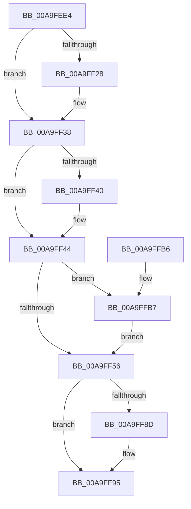

# AlpcpMapLegacyPortRemoteView

- RVA: `0x00A9FEE4`–`0x00A9FFE4` (길이 `256` bytes)
- VA: `0x0000000140A9FEE4`
- 실행 섹션: `PAGE`
- PDB 이름 있음: `예`; PDB Function 태그: `아니요`
- unwind 정보 RVA: `0x000BAAC4`
- 디코드: `75`개 명령, `256/256` bytes 표시
- 미해석 바이트: `0` (있으면 어셈블리에 `.byte`로 보존)

> 이 문서는 커널 이미지의 기계어와 PDB 기호를 분석해 생성했습니다. 4번과 5번은 함수 원형과 자료형을 바이너리 사용 방식에서 추정한 C 해석이며 원본 소스 복구 결과는 아닙니다.

## 1. Dependencies

- 직접 호출 지점: **10**; 고유 호출 대상: **10**
- 직접 호출자로 확인된 함수: **1**
- RIP 상대 이미지 참조: **0**

### Outgoing calls
- `0x00A9FF13` → [KeAbPreAcquire](../../text/21/KeAbPreAcquire_function_00210230.md) (function, `0x00210230`)
- `0x00A9FF33` → [ExfAcquirePushLockSharedEx](../../text/21/ExfAcquirePushLockSharedEx_function_0021044C.md) (function, `0x0021044C`)
- `0x00A9FF48` → [AlpcpLockForCachedReferenceBlob](../88/AlpcpLockForCachedReferenceBlob_function_0088A8B0.md) (function, `0x0088A8B0`)
- `0x00A9FF7E` → [AlpcpUnlockBlob](../88/AlpcpUnlockBlob_function_0088B990.md) (function, `0x0088B990`)
- `0x00A9FF90` → [ExfReleasePushLockShared](../../text/26/ExfReleasePushLockShared_function_00263440.md) (function, `0x00263440`)
- `0x00A9FF98` → [KeAbPostRelease](../../text/2E/KeAbPostRelease_function_002E1600.md) (function, `0x002E1600`)
- `0x00A9FFBA` → [AlpcpRemoveResourcePort](../88/AlpcpRemoveResourcePort_function_0088836C.md) (function, `0x0088836C`)
- `0x00A9FFC3` → [ObfDereferenceObject](../../text/2F/ObfDereferenceObject_function_002F9350.md) (function, `0x002F9350`)
- `0x00A9FFCB` → [ObfReferenceObject](../../text/20/ObfReferenceObject_function_0020FA20.md) (function, `0x0020FA20`)
- `0x00A9FFDA` → [AlpcpInsertResourcePort](../88/AlpcpInsertResourcePort_function_008898DC.md) (function, `0x008898DC`)

### Direct callers
- [AlpcpAcceptConnectPort](../A3/AlpcpAcceptConnectPort_function_00A34290.md) at `0x00A34A86`
- [AlpcpAcceptConnectPort](../A3/AlpcpAcceptConnectPort_function_00A34290.md) at `0x00A34AEF`

### Static image references
- 디코드된 RIP-relative 메모리 참조가 없습니다.

## 2. Other-region calls and transfers

- 다른 실행 섹션으로 향하는 call: **6**
  - `0x00A9FF13` → [KeAbPreAcquire](../../text/21/KeAbPreAcquire_function_00210230.md) (`PAGE` → `.text`)
  - `0x00A9FF33` → [ExfAcquirePushLockSharedEx](../../text/21/ExfAcquirePushLockSharedEx_function_0021044C.md) (`PAGE` → `.text`)
  - `0x00A9FF90` → [ExfReleasePushLockShared](../../text/26/ExfReleasePushLockShared_function_00263440.md) (`PAGE` → `.text`)
  - `0x00A9FF98` → [KeAbPostRelease](../../text/2E/KeAbPostRelease_function_002E1600.md) (`PAGE` → `.text`)
  - `0x00A9FFC3` → [ObfDereferenceObject](../../text/2F/ObfDereferenceObject_function_002F9350.md) (`PAGE` → `.text`)
  - `0x00A9FFCB` → [ObfReferenceObject](../../text/20/ObfReferenceObject_function_0020FA20.md) (`PAGE` → `.text`)
- 별도 외부 분기/꼬리 이동을 확인하지 못했습니다.

## 3. Assembly (complete function range)

```asm
00A9FEE4  48 89 5C 24 10                  mov qword ptr [rsp + 0x10], rbx
00A9FEE9  48 89 6C 24 18                  mov qword ptr [rsp + 0x18], rbp
00A9FEEE  56                              push rsi
00A9FEEF  57                              push rdi
00A9FEF0  41 54                           push r12
00A9FEF2  41 56                           push r14
00A9FEF4  41 57                           push r15
00A9FEF6  48 83 EC 20                     sub rsp, 0x20
00A9FEFA  48 8B 7A 28                     mov rdi, qword ptr [rdx + 0x28]
00A9FEFE  48 8D 99 60 01 00 00            lea rbx, [rcx + 0x160]
00A9FF05  4D 8B F0                        mov r14, r8
00A9FF08  48 8B E9                        mov rbp, rcx
00A9FF0B  48 8B CB                        mov rcx, rbx
00A9FF0E  45 33 C0                        xor r8d, r8d
00A9FF11  33 D2                           xor edx, edx
00A9FF13  E8 18 03 77 FF                  call 0x140210230
00A9FF18  48 8B F0                        mov rsi, rax
00A9FF1B  33 C0                           xor eax, eax
00A9FF1D  44 8D 60 11                     lea r12d, [rax + 0x11]
00A9FF21  F0 4C 0F B1 23                  lock cmpxchg qword ptr [rbx], r12
00A9FF26  74 10                           je 0x140a9ff38
00A9FF28  4C 8B CB                        mov r9, rbx
00A9FF2B  4C 8B C6                        mov r8, rsi
00A9FF2E  33 D2                           xor edx, edx
00A9FF30  48 8B CB                        mov rcx, rbx
00A9FF33  E8 14 05 77 FF                  call 0x14021044c
00A9FF38  45 33 FF                        xor r15d, r15d
00A9FF3B  48 85 F6                        test rsi, rsi
00A9FF3E  74 04                           je 0x140a9ff44
00A9FF40  C6 46 0A 01                     mov byte ptr [rsi + 0xa], 1
00A9FF44  48 8B 4F 10                     mov rcx, qword ptr [rdi + 0x10]
00A9FF48  E8 63 A9 DE FF                  call 0x14088a8b0
00A9FF4D  48 8B 4F 18                     mov rcx, qword ptr [rdi + 0x18]
00A9FF51  48 3B E9                        cmp rbp, rcx
00A9FF54  75 61                           jne 0x140a9ffb7
00A9FF56  33 C9                           xor ecx, ecx
00A9FF58  0F 57 C0                        xorps xmm0, xmm0
00A9FF5B  41 0F 11 06                     movups xmmword ptr [r14], xmm0
00A9FF5F  49 89 4E 10                     mov qword ptr [r14 + 0x10], rcx
00A9FF63  41 C7 06 18 00 00 00            mov dword ptr [r14], 0x18
00A9FF6A  48 8B 4F 28                     mov rcx, qword ptr [rdi + 0x28]
00A9FF6E  49 89 4E 10                     mov qword ptr [r14 + 0x10], rcx
00A9FF72  48 8B 4F 30                     mov rcx, qword ptr [rdi + 0x30]
00A9FF76  49 89 4E 08                     mov qword ptr [r14 + 8], rcx
00A9FF7A  48 8B 4F 10                     mov rcx, qword ptr [rdi + 0x10]
00A9FF7E  E8 0D BA DE FF                  call 0x14088b990
00A9FF83  49 8B C4                        mov rax, r12
00A9FF86  F0 4C 0F B1 3B                  lock cmpxchg qword ptr [rbx], r15
00A9FF8B  74 08                           je 0x140a9ff95
00A9FF8D  48 8B CB                        mov rcx, rbx
00A9FF90  E8 AB 34 7C FF                  call 0x140263440
00A9FF95  48 8B CB                        mov rcx, rbx
00A9FF98  E8 63 16 84 FF                  call 0x1402e1600
00A9FF9D  48 8B 5C 24 58                  mov rbx, qword ptr [rsp + 0x58]
00A9FFA2  33 C0                           xor eax, eax
00A9FFA4  48 8B 6C 24 60                  mov rbp, qword ptr [rsp + 0x60]
00A9FFA9  48 83 C4 20                     add rsp, 0x20
00A9FFAD  41 5F                           pop r15
00A9FFAF  41 5E                           pop r14
00A9FFB1  41 5C                           pop r12
00A9FFB3  5F                              pop rdi
00A9FFB4  5E                              pop rsi
00A9FFB5  C3                              ret
00A9FFB6  CC                              int3
00A9FFB7  48 8B D7                        mov rdx, rdi
00A9FFBA  E8 AD 83 DE FF                  call 0x14088836c
00A9FFBF  48 8B 4F 18                     mov rcx, qword ptr [rdi + 0x18]
00A9FFC3  E8 88 93 85 FF                  call 0x1402f9350
00A9FFC8  48 8B CD                        mov rcx, rbp
00A9FFCB  E8 50 FA 76 FF                  call 0x14020fa20
00A9FFD0  48 8B D7                        mov rdx, rdi
00A9FFD3  48 89 6F 18                     mov qword ptr [rdi + 0x18], rbp
00A9FFD7  48 8B CD                        mov rcx, rbp
00A9FFDA  E8 FD 98 DE FF                  call 0x1408898dc
00A9FFDF  E9 72 FF FF FF                  jmp 0x140a9ff56
```

## 4. C-style interpretation (structured pseudocode)

```c
__int64 __fastcall AlpcpMapLegacyPortRemoteView(__int64 a1, __int64 a2, __int64 a3)
{
    __int64 result;
    __int64 v_r15;
    __int64 v_rsp;
    unsigned __int64 v_stack_p10;
    unsigned __int64 v_stack_p18;

    v_stack_p10 = v_rbx;
    v_stack_p18 = v_rbp;
    v_rsp = (v_rsp) - (32);
    a3 = 0;
    a2 = 0;
    result = KeAbPreAcquire(a1 + 352, a2, a3, a4);
    result = 0;
    if (!(condition_is_equal)) {
        a4 = a1 + 352;
        a3 = 0;
        a2 = 0;
        a1 = a1 + 352;
        result = ExfAcquirePushLockSharedEx(a1, a2, a3, a4);
    }
    v_r15 = 0;
    if (result != 0) {
        *(unsigned __int8 *)(result + 10) = 1;
    }
    result = AlpcpLockForCachedReferenceBlob(*(unsigned __int64 *)(*(unsigned __int64 *)(a2 + 40) + 16), a2, a3, a4);
    if (a1 != (*(unsigned __int64 *)(*(unsigned __int64 *)(a2 + 40) + 24))) goto loc_00A9FFB7;
loc_00A9FF56:
    a1 = 0;
    *(unsigned __int64 *)(a3) = v_xmm0;
    *(unsigned __int64 *)(a3 + 16) = 0;
    *(unsigned int *)(a3) = 24;
    *(unsigned __int64 *)(a3 + 16) = *(unsigned __int64 *)(*(unsigned __int64 *)(a2 + 40) + 40);
    *(unsigned __int64 *)(a3 + 8) = *(unsigned __int64 *)(*(unsigned __int64 *)(a2 + 40) + 48);
    result = AlpcpUnlockBlob(*(unsigned __int64 *)(*(unsigned __int64 *)(a2 + 40) + 16), a2, a3, a4);
    result = result + 17;
    if (!(condition_is_equal)) {
        a1 = a1 + 352;
        result = ExfReleasePushLockShared(a1, a2, a3, a4);
    }
    result = KeAbPostRelease(a1 + 352, a2, a3, a4);
    result = 0;
    v_rsp = (v_rsp) + (32);
    return result;
loc_00A9FFB7:
    result = AlpcpRemoveResourcePort(a1 + 352, *(unsigned __int64 *)(a2 + 40), a3, a4);
    result = ObfDereferenceObject(*(unsigned __int64 *)(*(unsigned __int64 *)(a2 + 40) + 24), *(unsigned __int64 *)(a2 + 40), a3, a4);
    result = ObfReferenceObject(v_stack_p18, *(unsigned __int64 *)(a2 + 40), a3, a4);
    *(unsigned __int64 *)(*(unsigned __int64 *)(a2 + 40) + 24) = v_stack_p18;
    result = AlpcpInsertResourcePort(v_stack_p18, *(unsigned __int64 *)(a2 + 40), a3, a4);
    goto loc_00A9FF56;
}
```

## 5. (Beta) C Style

```c
int64_t AlpcpMapLegacyPortRemoteView(void *Arg1, void *Arg2, void *Arg3)
{
    uint8_t *arg1 = (uint8_t *)Arg1;
    uint8_t *arg2 = (uint8_t *)Arg2;
    uint8_t *arg3 = (uint8_t *)Arg3;

    int64_t result;
    int64_t local_r15;
    int64_t local_rsp;
    uint64_t v_stack_p10;
    uint64_t v_stack_p18;

    v_stack_p10 = local_rbx;
    v_stack_p18 = local_rbp;
    local_rsp = (local_rsp) - (32);
    Arg3 = 0;
    Arg2 = 0;
    result = KeAbPreAcquire(Arg1 + 352, Arg2, Arg3, a4);
    result = 0;
    if (!(condition_is_equal)) {
        a4 = Arg1 + 352;
        Arg3 = 0;
        Arg2 = 0;
        Arg1 = Arg1 + 352;
        result = ExfAcquirePushLockSharedEx(Arg1, Arg2, Arg3, a4);
    }
    local_r15 = 0;
    if (result != 0) {
        *(uint8_t *)(result + 0xA) = 1;
    }
    result = AlpcpLockForCachedReferenceBlob(*(uint64_t *)(*(uint64_t *)(arg2 + 0x28) + 0x10), Arg2, Arg3, a4);
    if (Arg1 != (*(uint64_t *)(*(uint64_t *)(arg2 + 0x28) + 0x18))) goto loc_00A9FFB7;
loc_00A9FF56:
    Arg1 = 0;
    *(uint64_t *)(arg3) = v_xmm0;
    *(uint64_t *)(arg3 + 0x10) = 0;
    *(uint32_t *)(arg3) = 24;
    *(uint64_t *)(arg3 + 0x10) = *(uint64_t *)(*(uint64_t *)(arg2 + 0x28) + 0x28);
    *(uint64_t *)(arg3 + 0x8) = *(uint64_t *)(*(uint64_t *)(arg2 + 0x28) + 0x30);
    result = AlpcpUnlockBlob(*(uint64_t *)(*(uint64_t *)(arg2 + 0x28) + 0x10), Arg2, Arg3, a4);
    result = result + 17;
    if (!(condition_is_equal)) {
        Arg1 = Arg1 + 352;
        result = ExfReleasePushLockShared(Arg1, Arg2, Arg3, a4);
    }
    result = KeAbPostRelease(Arg1 + 352, Arg2, Arg3, a4);
    result = 0;
    local_rsp = (local_rsp) + (32);
    return result;
loc_00A9FFB7:
    result = AlpcpRemoveResourcePort(Arg1 + 352, *(uint64_t *)(arg2 + 0x28), Arg3, a4);
    result = ObfDereferenceObject(*(uint64_t *)(*(uint64_t *)(arg2 + 0x28) + 0x18), *(uint64_t *)(arg2 + 0x28), Arg3, a4);
    result = ObfReferenceObject(v_stack_p18, *(uint64_t *)(arg2 + 0x28), Arg3, a4);
    *(uint64_t *)(*(uint64_t *)(arg2 + 0x28) + 0x18) = v_stack_p18;
    result = AlpcpInsertResourcePort(v_stack_p18, *(uint64_t *)(arg2 + 0x28), Arg3, a4);
    goto loc_00A9FF56;
}
```

### 관측된 메모리 오프셋

구조체 형식이 확인되지 않은 접근은 인자 기준의 오프셋으로만 기록했습니다.

| 기준 인자 | 오프셋 표현 | 폭 (bit) | 접근 |
|---|---:|---:|---|
| `Arg1` | `+ 0x0` | `64` | `R` |
| `Arg1` | `+ 0x160` | `64` | `R` |
| `Arg2` | `+ 0x28` | `64` | `R` |
| `Arg3` | `+ 0x0` | `32` | `W` |
| `Arg3` | `+ 0x0` | `128` | `R` |
| `Arg3` | `+ 0x8` | `64` | `W` |
| `Arg3` | `+ 0x10` | `64` | `W` |

## 6. Execution-region graph

[열기: 2D/3D 그래프와 함수 탐색 컨트롤 패널](../../../control-panel.html?section=page&rva=0x00A9FEE4&view=graph)

- 2D 그래프는 위에서 아래로 흐르고, 3D 그래프는 빈 공간을 드래그해 회전합니다. Shift+드래그는 이동, 휠은 확대·축소, 함수 노드 선택은 대상 보고서 이동입니다.

### Static fallback


