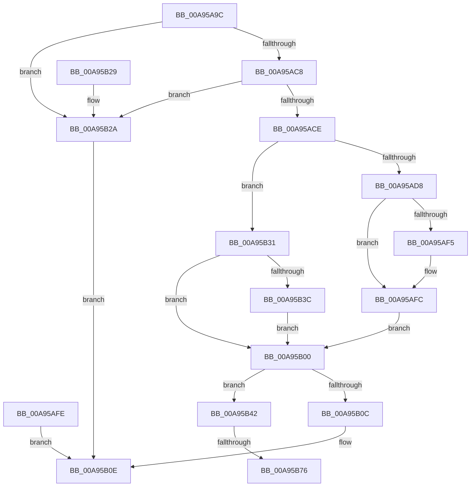

# AlpcpWaitForPortReferences

- RVA: `0x00A95A9C`–`0x00A95B8A` (길이 `238` bytes)
- VA: `0x0000000140A95A9C`
- 실행 섹션: `PAGE`
- PDB 이름 있음: `예`; PDB Function 태그: `예`
- unwind 정보 RVA: `0x000B98E4`
- 디코드: `66`개 명령, `238/238` bytes 표시
- 미해석 바이트: `0` (있으면 어셈블리에 `.byte`로 보존)

> 이 문서는 커널 이미지의 기계어와 PDB 기호를 분석해 생성했습니다. 4번과 5번은 함수 원형과 자료형을 바이너리 사용 방식에서 추정한 C 해석이며 원본 소스 복구 결과는 아닙니다.

## 1. Dependencies

- 직접 호출 지점: **3**; 고유 호출 대상: **3**
- 직접 호출자로 확인된 함수: **1**
- RIP 상대 이미지 참조: **0**

### Outgoing calls
- `0x00A95B4E` → [KeInitializeEvent](../../text/40/KeInitializeEvent_function_0040DD10.md) (function, `0x0040DD10`)
- `0x00A95B62` → [KeAbPreAcquire](../../text/21/KeAbPreAcquire_function_00210230.md) (function, `0x00210230`)
- `0x00A95B7F` → [ExfAcquirePushLockExclusiveEx](../../text/20/ExfAcquirePushLockExclusiveEx_function_0020FC90.md) (function, `0x0020FC90`)

### Direct callers
- [NtAlpcQueryInformation](../8E/NtAlpcQueryInformation_function_008E7200.md) at `0x008E73CE`

### Static image references
- 디코드된 RIP-relative 메모리 참조가 없습니다.

## 2. Other-region calls and transfers

- 다른 실행 섹션으로 향하는 call: **3**
  - `0x00A95B4E` → [KeInitializeEvent](../../text/40/KeInitializeEvent_function_0040DD10.md) (`PAGE` → `.text`)
  - `0x00A95B62` → [KeAbPreAcquire](../../text/21/KeAbPreAcquire_function_00210230.md) (`PAGE` → `.text`)
  - `0x00A95B7F` → [ExfAcquirePushLockExclusiveEx](../../text/20/ExfAcquirePushLockExclusiveEx_function_0020FC90.md) (`PAGE` → `.text`)
- call이 아닌 외부 분기/꼬리 이동: **2**
  - `0x00A95B70` → [sub_00B47726](../B4/Unknown_function_00B47726.md) (`tail-transfer`)
  - `0x00A95B85` → [sub_00B47726](../B4/Unknown_function_00B47726.md) (`tail-transfer`)

## 3. Assembly (complete function range)

```asm
00A95A9C  48 8B C4                        mov rax, rsp
00A95A9F  48 89 58 08                     mov qword ptr [rax + 8], rbx
00A95AA3  48 89 70 10                     mov qword ptr [rax + 0x10], rsi
00A95AA7  48 89 78 18                     mov qword ptr [rax + 0x18], rdi
00A95AAB  4C 89 70 20                     mov qword ptr [rax + 0x20], r14
00A95AAF  41 57                           push r15
00A95AB1  48 83 EC 50                     sub rsp, 0x50
00A95AB5  4C 8B F1                        mov r14, rcx
00A95AB8  0F 57 C0                        xorps xmm0, xmm0
00A95ABB  0F 11 40 D8                     movups xmmword ptr [rax - 0x28], xmm0
00A95ABF  0F 11 40 E8                     movups xmmword ptr [rax - 0x18], xmm0
00A95AC3  48 85 C9                        test rcx, rcx
00A95AC6  74 62                           je 0x140a95b2a
00A95AC8  41 83 F8 04                     cmp r8d, 4
00A95ACC  75 5C                           jne 0x140a95b2a
00A95ACE  80 BC 24 80 00 00 00 00         cmp byte ptr [rsp + 0x80], 0
00A95AD6  74 59                           je 0x140a95b31
00A95AD8  48 B8 00 00 FF FF FF 7F 00 00   movabs rax, 0x7fffffff0000
00A95AE2  48 3B D0                        cmp rdx, rax
00A95AE5  48 0F 42 C2                     cmovb rax, rdx
00A95AE9  90                              nop
00A95AEA  8B 00                           mov eax, dword ptr [rax]
00A95AEC  89 44 24 48                     mov dword ptr [rsp + 0x48], eax
00A95AF0  4D 85 C9                        test r9, r9
00A95AF3  74 07                           je 0x140a95afc
00A95AF5  41 C7 01 00 00 00 00            mov dword ptr [r9], 0
00A95AFC  EB 02                           jmp 0x140a95b00
00A95AFE  EB 0E                           jmp 0x140a95b0e
00A95B00  8B 81 94 01 00 00               mov eax, dword ptr [rcx + 0x194]
00A95B06  3B 44 24 48                     cmp eax, dword ptr [rsp + 0x48]
00A95B0A  75 36                           jne 0x140a95b42
00A95B0C  33 C0                           xor eax, eax
00A95B0E  48 8B 5C 24 60                  mov rbx, qword ptr [rsp + 0x60]
00A95B13  48 8B 74 24 68                  mov rsi, qword ptr [rsp + 0x68]
00A95B18  48 8B 7C 24 70                  mov rdi, qword ptr [rsp + 0x70]
00A95B1D  4C 8B 74 24 78                  mov r14, qword ptr [rsp + 0x78]
00A95B22  48 83 C4 50                     add rsp, 0x50
00A95B26  41 5F                           pop r15
00A95B28  C3                              ret
00A95B29  CC                              int3
00A95B2A  B8 0D 00 00 C0                  mov eax, 0xc000000d
00A95B2F  EB DD                           jmp 0x140a95b0e
00A95B31  8B 02                           mov eax, dword ptr [rdx]
00A95B33  89 44 24 48                     mov dword ptr [rsp + 0x48], eax
00A95B37  4D 85 C9                        test r9, r9
00A95B3A  74 C4                           je 0x140a95b00
00A95B3C  41 83 21 00                     and dword ptr [r9], 0
00A95B40  EB BE                           jmp 0x140a95b00
00A95B42  45 33 C0                        xor r8d, r8d
00A95B45  41 8D 50 01                     lea edx, [r8 + 1]
00A95B49  48 8D 4C 24 30                  lea rcx, [rsp + 0x30]
00A95B4E  E8 BD 81 97 FF                  call 0x14040dd10
00A95B53  49 8D BE 60 01 00 00            lea rdi, [r14 + 0x160]
00A95B5A  45 33 C0                        xor r8d, r8d
00A95B5D  33 D2                           xor edx, edx
00A95B5F  48 8B CF                        mov rcx, rdi
00A95B62  E8 C9 A6 77 FF                  call 0x140210230
00A95B67  48 8B D8                        mov rbx, rax
00A95B6A  F0 48 0F BA 2F 00               lock bts qword ptr [rdi], 0
00A95B70  0F 83 B0 1B 0B 00               jae 0x140b47726
00A95B76  4C 8B C7                        mov r8, rdi
00A95B79  48 8B D0                        mov rdx, rax
00A95B7C  48 8B CF                        mov rcx, rdi
00A95B7F  E8 0C A1 77 FF                  call 0x14020fc90
00A95B84  90                              nop
00A95B85  E9 9C 1B 0B 00                  jmp 0x140b47726
```

## 4. C-style interpretation (structured pseudocode)

```c
__int64 __fastcall AlpcpWaitForPortReferences(__int64 a1, __int64 a2, int a3, __int64 a4, unsigned __int8 a5)
{
    __int64 result;
    __int64 v_rsp;
    unsigned int v_stack_m10;
    unsigned __int64 v_stack_p10;
    unsigned __int64 v_stack_p18;
    unsigned __int64 v_stack_p20;
    unsigned __int64 v_stack_p30;
    unsigned int v_stack_p48;
    unsigned __int64 v_stack_p8;

    *(unsigned __int64 *)(v_rsp + 8) = v_rbx;
    *(unsigned __int64 *)(v_rsp + 16) = v_rsi;
    *(unsigned __int64 *)(v_rsp + 24) = v_rdi;
    *(unsigned __int64 *)(v_rsp + 32) = v_r14;
    v_rsp = (v_rsp) - (80);
    *(unsigned __int64 *)(v_rsp - 40) = v_xmm0;
    *(unsigned __int64 *)(v_rsp - 24) = v_xmm0;
    if (a1 == 0) goto loc_00A95B2A;
    if (a3 != 4) goto loc_00A95B2A;
    if (a5 == 0) goto loc_00A95B31;
    result = v_rsp;
    if (a2 < v_rsp) { result = a2; }
    v_stack_m10 = (unsigned int)((unsigned int)(*(unsigned int *)(result)));
    if (a4 != 0) {
        *(unsigned int *)(a4) = 0;
    }
    goto loc_00A95B00;
loc_00A95B00:
    if (((unsigned int)((unsigned int)(*(unsigned int *)(a1 + 404)))) != v_stack_m10) goto loc_00A95B42;
    result = 0;
loc_00A95B0E:
    v_rsp = (v_rsp) + (80);
    return result;
loc_00A95B2A:
    goto loc_00A95B0E;
loc_00A95B31:
    v_stack_p48 = (unsigned int)((unsigned int)(*(unsigned int *)(a2)));
    if (a4 == 0) goto loc_00A95B00;
    goto loc_00A95B00;
loc_00A95B42:
    a3 = 0;
    result = KeInitializeEvent(v_stack_p30, a3 + 1, a3, a4);
    a3 = 0;
    a2 = 0;
    result = KeAbPreAcquire(v_stack_p20 + 352, a2, a3, a4);
    result = ExfAcquirePushLockExclusiveEx(v_stack_p20 + 352, result, v_stack_p20 + 352, a4);
}
```

## 5. (Beta) C Style

```c
int64_t AlpcpWaitForPortReferences(void *Arg1, void *Arg2, int32_t Arg3, int64_t Arg4, uint8_t Arg5)
{
    uint8_t *arg1 = (uint8_t *)Arg1;
    uint8_t *arg2 = (uint8_t *)Arg2;

    int64_t result;
    int64_t local_rsp;
    uint32_t v_stack_m10;
    uint64_t v_stack_p10;
    uint64_t v_stack_p18;
    uint64_t v_stack_p20;
    uint64_t v_stack_p30;
    uint32_t v_stack_p48;
    uint64_t v_stack_p8;

    *(uint64_t *)(local_rsp + 0x8) = local_rbx;
    *(uint64_t *)(local_rsp + 0x10) = local_rsi;
    *(uint64_t *)(local_rsp + 0x18) = local_rdi;
    *(uint64_t *)(local_rsp + 0x20) = local_r14;
    local_rsp = (local_rsp) - (80);
    *(uint64_t *)(local_rsp - 0x28) = v_xmm0;
    *(uint64_t *)(local_rsp - 0x18) = v_xmm0;
    if (Arg1 == NULL) goto loc_00A95B2A;
    if (Arg3 != 4) goto loc_00A95B2A;
    if (Arg5 == 0) goto loc_00A95B31;
    result = local_rsp;
    if (Arg2 < local_rsp) { result = Arg2; }
    v_stack_m10 = (uint32_t)((uint32_t)(*(uint32_t *)(result)));
    if (Arg4 != 0) {
        *(uint32_t *)(Arg4) = 0;
    }
    goto loc_00A95B00;
loc_00A95B00:
    if (((uint32_t)((uint32_t)(*(uint32_t *)(arg1 + 0x194)))) != v_stack_m10) goto loc_00A95B42;
    result = 0;
loc_00A95B0E:
    local_rsp = (local_rsp) + (80);
    return result;
loc_00A95B2A:
    goto loc_00A95B0E;
loc_00A95B31:
    v_stack_p48 = (uint32_t)((uint32_t)(*(uint32_t *)(arg2)));
    if (Arg4 == 0) goto loc_00A95B00;
    goto loc_00A95B00;
loc_00A95B42:
    Arg3 = 0;
    result = KeInitializeEvent(v_stack_p30, Arg3 + 1, Arg3, Arg4);
    Arg3 = 0;
    Arg2 = 0;
    result = KeAbPreAcquire(v_stack_p20 + 352, Arg2, Arg3, Arg4);
    result = ExfAcquirePushLockExclusiveEx(v_stack_p20 + 352, result, v_stack_p20 + 352, Arg4);
}
```

### 관측된 메모리 오프셋

구조체 형식이 확인되지 않은 접근은 인자 기준의 오프셋으로만 기록했습니다.

| 기준 인자 | 오프셋 표현 | 폭 (bit) | 접근 |
|---|---:|---:|---|
| `Arg1` | `+ 0x0` | `64` | `R/W` |
| `Arg1` | `+ 0x160` | `64` | `R` |
| `Arg2` | `+ 0x0` | `32` | `R` |

## 6. Execution-region graph

[열기: 2D/3D 그래프와 함수 탐색 컨트롤 패널](../../../control-panel.html?section=page&rva=0x00A95A9C&view=graph)

- 2D 그래프는 위에서 아래로 흐르고, 3D 그래프는 빈 공간을 드래그해 회전합니다. Shift+드래그는 이동, 휠은 확대·축소, 함수 노드 선택은 대상 보고서 이동입니다.

### Static fallback


