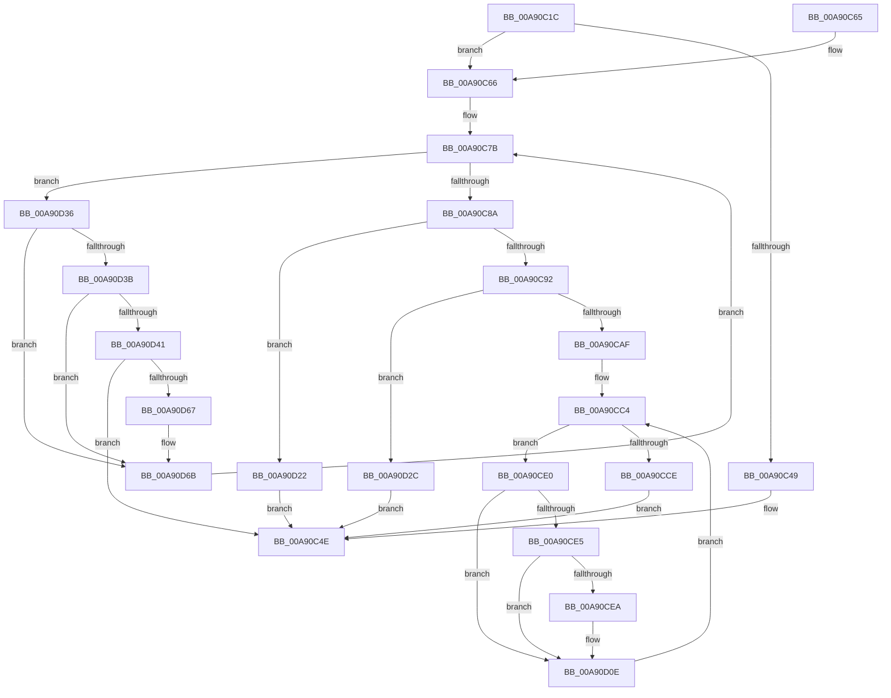

# BiGetFilePathFromEfiPath

- RVA: `0x00A90C1C`–`0x00A90D84` (길이 `360` bytes)
- VA: `0x0000000140A90C1C`
- 실행 섹션: `PAGE`
- PDB 이름 있음: `예`; PDB Function 태그: `아니요`
- unwind 정보 RVA: `0x000B8F68`
- 디코드: `110`개 명령, `360/360` bytes 표시
- 미해석 바이트: `0` (있으면 어셈블리에 `.byte`로 보존)

> 이 문서는 커널 이미지의 기계어와 PDB 기호를 분석해 생성했습니다. 4번과 5번은 함수 원형과 자료형을 바이너리 사용 방식에서 추정한 C 해석이며 원본 소스 복구 결과는 아닙니다.

## 1. Dependencies

- 직접 호출 지점: **3**; 고유 호출 대상: **3**
- 직접 호출자로 확인된 함수: **2**
- RIP 상대 이미지 참조: **0**

### Outgoing calls
- `0x00A90CA2` → [ExAllocatePool2](../../poolcode/B8/ExAllocatePool2_function_00B820F0.md) (function, `0x00B820F0`)
- `0x00A90D04` → [memcpy](../../text/6C/memcpy_function_006C6840.md) (function, `0x006C6840`)
- `0x00A90D5A` → [RtlULongSub](../../text/4A/RtlULongSub_function_004A1DA8.md) (function, `0x004A1DA8`)

### Direct callers
- [BiUpdateBcdObject](../82/BiUpdateBcdObject_function_008270D0.md) at `0x008272F9`
- [BiCreateMergedBootEntry](../A3/BiCreateMergedBootEntry_function_00A3CE7C.md) at `0x00A3D0DF`

### Static image references
- 디코드된 RIP-relative 메모리 참조가 없습니다.

## 2. Other-region calls and transfers

- 다른 실행 섹션으로 향하는 call: **3**
  - `0x00A90CA2` → [ExAllocatePool2](../../poolcode/B8/ExAllocatePool2_function_00B820F0.md) (`PAGE` → `POOLCODE`)
  - `0x00A90D04` → [memcpy](../../text/6C/memcpy_function_006C6840.md) (`PAGE` → `.text`)
  - `0x00A90D5A` → [RtlULongSub](../../text/4A/RtlULongSub_function_004A1DA8.md) (`PAGE` → `.text`)
- 별도 외부 분기/꼬리 이동을 확인하지 못했습니다.

## 3. Assembly (complete function range)

```asm
00A90C1C  48 89 5C 24 10                  mov qword ptr [rsp + 0x10], rbx
00A90C21  48 89 6C 24 18                  mov qword ptr [rsp + 0x18], rbp
00A90C26  56                              push rsi
00A90C27  57                              push rdi
00A90C28  41 54                           push r12
00A90C2A  41 56                           push r14
00A90C2C  41 57                           push r15
00A90C2E  48 83 EC 20                     sub rsp, 0x20
00A90C32  8A 01                           mov al, byte ptr [rcx]
00A90C34  33 FF                           xor edi, edi
00A90C36  24 7F                           and al, 0x7f
00A90C38  89 7C 24 50                     mov dword ptr [rsp + 0x50], edi
00A90C3C  4D 8B F8                        mov r15, r8
00A90C3F  4C 8B E2                        mov r12, rdx
00A90C42  48 8B D9                        mov rbx, rcx
00A90C45  3C 7F                           cmp al, 0x7f
00A90C47  75 1D                           jne 0x140a90c66
00A90C49  B8 3A 00 00 C0                  mov eax, 0xc000003a
00A90C4E  48 8B 5C 24 58                  mov rbx, qword ptr [rsp + 0x58]
00A90C53  48 8B 6C 24 60                  mov rbp, qword ptr [rsp + 0x60]
00A90C58  48 83 C4 20                     add rsp, 0x20
00A90C5C  41 5F                           pop r15
00A90C5E  41 5E                           pop r14
00A90C60  41 5C                           pop r12
00A90C62  5F                              pop rdi
00A90C63  5E                              pop rsi
00A90C64  C3                              ret
00A90C65  CC                              int3
00A90C66  44 0F B6 51 03                  movzx r10d, byte ptr [rcx + 3]
00A90C6B  8B F7                           mov esi, edi
00A90C6D  0F B6 41 02                     movzx eax, byte ptr [rcx + 2]
00A90C71  49 C1 E2 08                     shl r10, 8
00A90C75  4C 0B D0                        or r10, rax
00A90C78  4C 03 D3                        add r10, rbx
00A90C7B  41 8A 0A                        mov cl, byte ptr [r10]
00A90C7E  8A C1                           mov al, cl
00A90C80  24 7F                           and al, 0x7f
00A90C82  3C 7F                           cmp al, 0x7f
00A90C84  0F 85 AC 00 00 00               jne 0x140a90d36
00A90C8A  85 F6                           test esi, esi
00A90C8C  0F 84 90 00 00 00               je 0x140a90d22
00A90C92  83 C6 02                        add esi, 2
00A90C95  B9 02 01 00 00                  mov ecx, 0x102
00A90C9A  8B D6                           mov edx, esi
00A90C9C  41 B8 42 43 44 4B               mov r8d, 0x4b444342
00A90CA2  E8 49 14 0F 00                  call 0x140b820f0
00A90CA7  48 8B E8                        mov rbp, rax
00A90CAA  48 85 C0                        test rax, rax
00A90CAD  74 7D                           je 0x140a90d2c
00A90CAF  0F B6 7B 03                     movzx edi, byte ptr [rbx + 3]
00A90CB3  4C 8B F0                        mov r14, rax
00A90CB6  0F B6 43 02                     movzx eax, byte ptr [rbx + 2]
00A90CBA  48 C1 E7 08                     shl rdi, 8
00A90CBE  48 0B F8                        or rdi, rax
00A90CC1  48 03 FB                        add rdi, rbx
00A90CC4  8A 0F                           mov cl, byte ptr [rdi]
00A90CC6  8A C1                           mov al, cl
00A90CC8  24 7F                           and al, 0x7f
00A90CCA  3C 7F                           cmp al, 0x7f
00A90CCC  75 12                           jne 0x140a90ce0
00A90CCE  33 C0                           xor eax, eax
00A90CD0  49 89 2C 24                     mov qword ptr [r12], rbp
00A90CD4  66 41 89 06                     mov word ptr [r14], ax
00A90CD8  41 89 37                        mov dword ptr [r15], esi
00A90CDB  E9 6E FF FF FF                  jmp 0x140a90c4e
00A90CE0  80 F9 04                        cmp cl, 4
00A90CE3  75 29                           jne 0x140a90d0e
00A90CE5  38 4F 01                        cmp byte ptr [rdi + 1], cl
00A90CE8  75 24                           jne 0x140a90d0e
00A90CEA  0F B6 5F 03                     movzx ebx, byte ptr [rdi + 3]
00A90CEE  48 8D 57 04                     lea rdx, [rdi + 4]
00A90CF2  0F B6 47 02                     movzx eax, byte ptr [rdi + 2]
00A90CF6  49 8B CE                        mov rcx, r14
00A90CF9  C1 E3 08                        shl ebx, 8
00A90CFC  0B D8                           or ebx, eax
00A90CFE  83 C3 FC                        add ebx, -4
00A90D01  44 8B C3                        mov r8d, ebx
00A90D04  E8 37 5B C3 FF                  call 0x1406c6840
00A90D09  8B C3                           mov eax, ebx
00A90D0B  4C 03 F0                        add r14, rax
00A90D0E  0F B6 4F 03                     movzx ecx, byte ptr [rdi + 3]
00A90D12  0F B6 47 02                     movzx eax, byte ptr [rdi + 2]
00A90D16  48 C1 E1 08                     shl rcx, 8
00A90D1A  48 0B C8                        or rcx, rax
00A90D1D  48 03 F9                        add rdi, rcx
00A90D20  EB A2                           jmp 0x140a90cc4
00A90D22  B8 25 02 00 C0                  mov eax, 0xc0000225
00A90D27  E9 22 FF FF FF                  jmp 0x140a90c4e
00A90D2C  B8 9A 00 00 C0                  mov eax, 0xc000009a
00A90D31  E9 18 FF FF FF                  jmp 0x140a90c4e
00A90D36  80 F9 04                        cmp cl, 4
00A90D39  75 30                           jne 0x140a90d6b
00A90D3B  41 38 4A 01                     cmp byte ptr [r10 + 1], cl
00A90D3F  75 2A                           jne 0x140a90d6b
00A90D41  41 0F B6 42 02                  movzx eax, byte ptr [r10 + 2]
00A90D46  4C 8D 44 24 50                  lea r8, [rsp + 0x50]
00A90D4B  41 0F B6 4A 03                  movzx ecx, byte ptr [r10 + 3]
00A90D50  BA 04 00 00 00                  mov edx, 4
00A90D55  C1 E1 08                        shl ecx, 8
00A90D58  0B C8                           or ecx, eax
00A90D5A  E8 49 10 A1 FF                  call 0x1404a1da8
00A90D5F  85 C0                           test eax, eax
00A90D61  0F 88 E7 FE FF FF               js 0x140a90c4e
00A90D67  03 74 24 50                     add esi, dword ptr [rsp + 0x50]
00A90D6B  41 0F B6 4A 03                  movzx ecx, byte ptr [r10 + 3]
00A90D70  41 0F B6 42 02                  movzx eax, byte ptr [r10 + 2]
00A90D75  48 C1 E1 08                     shl rcx, 8
00A90D79  48 0B C8                        or rcx, rax
00A90D7C  4C 03 D1                        add r10, rcx
00A90D7F  E9 F7 FE FF FF                  jmp 0x140a90c7b
```

## 4. C-style interpretation (structured pseudocode)

```c
__int64 __fastcall BiGetFilePathFromEfiPath(__int64 a1, __int64 a2, __int64 a3)
{
    __int64 result;
    __int64 v_r10;
    __int64 v_r14;
    __int64 v_rbx;
    __int64 v_rdi;
    __int64 v_rsi;
    __int64 v_rsp;
    unsigned __int64 v_stack_p10;
    unsigned __int64 v_stack_p18;
    unsigned __int64 v_stack_p50;
    unsigned int v_stack_p8;

    v_stack_p10 = v_rbx;
    v_stack_p18 = v_rbp;
    v_rsp = (v_rsp) - (32);
    v_rdi = 0;
    result = (unsigned __int8)((*(unsigned __int8 *)(a1)) & (127));
    v_stack_p8 = 0;
    if (((unsigned __int8)(result)) != 127) goto loc_00A90C66;
loc_00A90C4E:
    v_rsp = (v_rsp) + (32);
    return (unsigned int)(0xC000003AULL);
loc_00A90C66:
    v_r10 = (*(unsigned __int8 *)(a1 + 3)) << (8);
    v_r10 = (v_r10) | (*(unsigned __int8 *)(a1 + 2));
    v_r10 = (v_r10) + (v_stack_p10);
loc_00A90C7B:
    result = (unsigned __int8)(((unsigned __int8)(*(unsigned __int8 *)(v_r10))) & (127));
    if (((unsigned __int8)(result)) != 127) goto loc_00A90D36;
    if (0 == 0) goto loc_00A90D22;
    v_rsi = (unsigned int)((0) + (2));
    result = ExAllocatePool2(258, (unsigned int)((unsigned int)(v_rsi)), (unsigned int)(0x4B444342ULL), a4);
    if (result == 0) goto loc_00A90D2C;
    v_rdi = (*(unsigned __int8 *)(v_stack_p10 + 3)) << (8);
    v_rdi = (v_rdi) | (*(unsigned __int8 *)(v_stack_p10 + 2));
    v_rdi = (v_rdi) + (v_stack_p10);
loc_00A90CC4:
    result = (unsigned __int8)(((unsigned __int8)(*(unsigned __int8 *)(v_rdi))) & (127));
    if (((unsigned __int8)(result)) != 127) goto loc_00A90CE0;
    result = 0;
    *(unsigned __int64 *)(a2) = 0;
    *(unsigned __int16 *)(result) = 0;
    *(unsigned int *)(a3) = (unsigned int)(v_rsi);
    goto loc_00A90C4E;
loc_00A90CE0:
    if (((unsigned __int8)(*(unsigned __int8 *)(v_rdi))) != 4) goto loc_00A90D0E;
    v_rbx = v_stack_p10;
    v_r14 = result;
    if ((*(unsigned __int8 *)(v_rdi + 1)) == ((unsigned __int8)(*(unsigned __int8 *)(v_rdi)))) {
        v_rbx = *(unsigned __int8 *)(v_rdi + 3);
        a2 = v_rdi + 4;
        result = *(unsigned __int8 *)(v_rdi + 2);
        a1 = result;
        v_rbx = (unsigned int)((v_rbx) << (8));
        v_rbx = (unsigned int)((v_rbx) | ((unsigned int)(result)));
        v_rbx = (unsigned int)((v_rbx) + (-4));
        a3 = (unsigned int)(v_rbx);
        result = memcpy(a1, a2, a3, a4);
        result = (unsigned int)(v_rbx);
        v_r14 = (result) + (result);
    }
    a1 = (*(unsigned __int8 *)(v_rdi + 3)) << (8);
    a1 = (a1) | (*(unsigned __int8 *)(v_rdi + 2));
    v_rdi = (v_rdi) + (a1);
    goto loc_00A90CC4;
loc_00A90D22:
    goto loc_00A90C4E;
loc_00A90D2C:
    goto loc_00A90C4E;
loc_00A90D36:
    if (((unsigned __int8)(a1)) != 4) goto loc_00A90D6B;
    if ((*(unsigned __int8 *)(v_r10 + 1)) != ((unsigned __int8)(a1))) goto loc_00A90D6B;
    a1 = (unsigned int)((*(unsigned __int8 *)(v_r10 + 3)) << (8));
    a1 = (unsigned int)((a1) | ((unsigned int)(*(unsigned __int8 *)(v_r10 + 2))));
    result = RtlULongSub(a1, 4, v_stack_p50, a4);
    if (sign_flag) goto loc_00A90C4E;
    v_rsi = (unsigned int)((v_rsi) + (v_stack_p50));
loc_00A90D6B:
    a1 = (*(unsigned __int8 *)(v_r10 + 3)) << (8);
    a1 = (a1) | (*(unsigned __int8 *)(v_r10 + 2));
    v_r10 = (v_r10) + (a1);
    goto loc_00A90C7B;
}
```

## 5. (Beta) C Style

```c
int64_t BiGetFilePathFromEfiPath(void *Arg1, void *Arg2, void *Arg3)
{
    uint8_t *arg1 = (uint8_t *)Arg1;
    uint8_t *arg2 = (uint8_t *)Arg2;
    uint8_t *arg3 = (uint8_t *)Arg3;

    int64_t result;
    int64_t local_r10;
    int64_t local_r14;
    int64_t local_rbx;
    int64_t local_rdi;
    int64_t local_rsi;
    int64_t local_rsp;
    uint64_t v_stack_p10;
    uint64_t v_stack_p18;
    uint64_t v_stack_p50;
    uint32_t v_stack_p8;

    v_stack_p10 = local_rbx;
    v_stack_p18 = local_rbp;
    local_rsp = (local_rsp) - (32);
    local_rdi = 0;
    result = (uint8_t)((*(uint8_t *)(arg1)) & (127));
    v_stack_p8 = 0;
    if (((uint8_t)(result)) != 127) goto loc_00A90C66;
loc_00A90C4E:
    local_rsp = (local_rsp) + (32);
    return (uint32_t)(0xC000003AULL);
loc_00A90C66:
    local_r10 = (*(uint8_t *)(arg1 + 0x3)) << (8);
    local_r10 = (local_r10) | (*(uint8_t *)(arg1 + 0x2));
    local_r10 = (local_r10) + (v_stack_p10);
loc_00A90C7B:
    result = (uint8_t)(((uint8_t)(*(uint8_t *)(local_r10))) & (127));
    if (((uint8_t)(result)) != 127) goto loc_00A90D36;
    if (0 == 0) goto loc_00A90D22;
    local_rsi = (uint32_t)((0) + (2));
    result = ExAllocatePool2(258, (uint32_t)((uint32_t)(local_rsi)), (uint32_t)(0x4B444342ULL), a4);
    if (result == 0) goto loc_00A90D2C;
    local_rdi = (*(uint8_t *)(v_stack_p10 + 0x3)) << (8);
    local_rdi = (local_rdi) | (*(uint8_t *)(v_stack_p10 + 0x2));
    local_rdi = (local_rdi) + (v_stack_p10);
loc_00A90CC4:
    result = (uint8_t)(((uint8_t)(*(uint8_t *)(local_rdi))) & (127));
    if (((uint8_t)(result)) != 127) goto loc_00A90CE0;
    result = 0;
    *(uint64_t *)(arg2) = 0;
    *(uint16_t *)(result) = 0;
    *(uint32_t *)(arg3) = (uint32_t)(local_rsi);
    goto loc_00A90C4E;
loc_00A90CE0:
    if (((uint8_t)(*(uint8_t *)(local_rdi))) != 4) goto loc_00A90D0E;
    local_rbx = v_stack_p10;
    local_r14 = result;
    if ((*(uint8_t *)(local_rdi + 0x1)) == ((uint8_t)(*(uint8_t *)(local_rdi)))) {
        local_rbx = *(uint8_t *)(local_rdi + 0x3);
        Arg2 = local_rdi + 4;
        result = *(uint8_t *)(local_rdi + 0x2);
        Arg1 = result;
        local_rbx = (uint32_t)((local_rbx) << (8));
        local_rbx = (uint32_t)((local_rbx) | ((uint32_t)(result)));
        local_rbx = (uint32_t)((local_rbx) + (-4));
        Arg3 = (uint32_t)(local_rbx);
        result = memcpy(Arg1, Arg2, Arg3, a4);
        result = (uint32_t)(local_rbx);
        local_r14 = (result) + (result);
    }
    Arg1 = (*(uint8_t *)(local_rdi + 0x3)) << (8);
    Arg1 = (Arg1) | (*(uint8_t *)(local_rdi + 0x2));
    local_rdi = (local_rdi) + (Arg1);
    goto loc_00A90CC4;
loc_00A90D22:
    goto loc_00A90C4E;
loc_00A90D2C:
    goto loc_00A90C4E;
loc_00A90D36:
    if (((uint8_t)(Arg1)) != 4) goto loc_00A90D6B;
    if ((*(uint8_t *)(local_r10 + 0x1)) != ((uint8_t)(Arg1))) goto loc_00A90D6B;
    Arg1 = (uint32_t)((*(uint8_t *)(local_r10 + 0x3)) << (8));
    Arg1 = (uint32_t)((Arg1) | ((uint32_t)(*(uint8_t *)(local_r10 + 0x2))));
    result = RtlULongSub(Arg1, 4, v_stack_p50, a4);
    if (sign_flag) goto loc_00A90C4E;
    local_rsi = (uint32_t)((local_rsi) + (v_stack_p50));
loc_00A90D6B:
    Arg1 = (*(uint8_t *)(local_r10 + 0x3)) << (8);
    Arg1 = (Arg1) | (*(uint8_t *)(local_r10 + 0x2));
    local_r10 = (local_r10) + (Arg1);
    goto loc_00A90C7B;
}
```

### 관측된 메모리 오프셋

구조체 형식이 확인되지 않은 접근은 인자 기준의 오프셋으로만 기록했습니다.

| 기준 인자 | 오프셋 표현 | 폭 (bit) | 접근 |
|---|---:|---:|---|
| `Arg1` | `+ 0x0` | `8` | `R` |
| `Arg1` | `+ 0x2` | `8` | `R` |
| `Arg1` | `+ 0x3` | `8` | `R` |
| `Arg2` | `+ 0x0` | `64` | `W` |
| `Arg3` | `+ 0x0` | `32` | `W` |

## 6. Execution-region graph

[열기: 2D/3D 그래프와 함수 탐색 컨트롤 패널](../../../control-panel.html?section=page&rva=0x00A90C1C&view=graph)

- 2D 그래프는 위에서 아래로 흐르고, 3D 그래프는 빈 공간을 드래그해 회전합니다. Shift+드래그는 이동, 휠은 확대·축소, 함수 노드 선택은 대상 보고서 이동입니다.

### Static fallback


