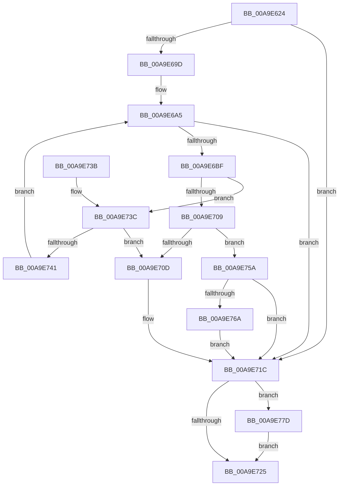

# BiGetPartitionVhdFilePathFromUnicodeString

- RVA: `0x00A9E624`–`0x00A9E784` (길이 `352` bytes)
- VA: `0x0000000140A9E624`
- 실행 섹션: `PAGE`
- PDB 이름 있음: `예`; PDB Function 태그: `아니요`
- unwind 정보 RVA: `0x000BA8E0`
- 디코드: `90`개 명령, `352/352` bytes 표시
- 미해석 바이트: `0` (있으면 어셈블리에 `.byte`로 보존)

> 이 문서는 커널 이미지의 기계어와 PDB 기호를 분석해 생성했습니다. 4번과 5번은 함수 원형과 자료형을 바이너리 사용 방식에서 추정한 C 해석이며 원본 소스 복구 결과는 아닙니다.

## 1. Dependencies

- 직접 호출 지점: **8**; 고유 호출 대상: **6**
- 직접 호출자로 확인된 함수: **1**
- RIP 상대 이미지 참조: **0**

### Outgoing calls
- `0x00A9E694` → [ZwOpenFile](../../text/6A/ZwOpenFile_function_006AD730.md) (function, `0x006AD730`)
- `0x00A9E6B2` → [ExAllocatePool2](../../poolcode/B8/ExAllocatePool2_function_00B820F0.md) (function, `0x00B820F0`)
- `0x00A9E6FD` → [ZwDeviceIoControlFile](../../text/6A/ZwDeviceIoControlFile_function_006AD1B0.md) (function, `0x006AD1B0`)
- `0x00A9E715` → [ExFreePoolWithTag](../../poolcode/B8/ExFreePoolWithTag_function_00B82870.md) (function, `0x00B82870`)
- `0x00A9E74B` → [ExFreePoolWithTag](../../poolcode/B8/ExFreePoolWithTag_function_00B82870.md) (function, `0x00B82870`)
- `0x00A9E761` → [BiTranslateSymbolicLinkFile](../82/BiTranslateSymbolicLinkFile_function_00825C2C.md) (function, `0x00825C2C`)
- `0x00A9E772` → [ExFreePoolWithTag](../../poolcode/B8/ExFreePoolWithTag_function_00B82870.md) (function, `0x00B82870`)
- `0x00A9E77D` → [ZwClose](../../text/6A/ZwClose_function_006AD2B0.md) (function, `0x006AD2B0`)

### Direct callers
- [BiGetPartitionVhdFilePath](BiGetPartitionVhdFilePath_function_00A9E5F4.md) at `0x00A9E612`

### Static image references
- 디코드된 RIP-relative 메모리 참조가 없습니다.

## 2. Other-region calls and transfers

- 다른 실행 섹션으로 향하는 call: **7**
  - `0x00A9E694` → [ZwOpenFile](../../text/6A/ZwOpenFile_function_006AD730.md) (`PAGE` → `.text`)
  - `0x00A9E6B2` → [ExAllocatePool2](../../poolcode/B8/ExAllocatePool2_function_00B820F0.md) (`PAGE` → `POOLCODE`)
  - `0x00A9E6FD` → [ZwDeviceIoControlFile](../../text/6A/ZwDeviceIoControlFile_function_006AD1B0.md) (`PAGE` → `.text`)
  - `0x00A9E715` → [ExFreePoolWithTag](../../poolcode/B8/ExFreePoolWithTag_function_00B82870.md) (`PAGE` → `POOLCODE`)
  - `0x00A9E74B` → [ExFreePoolWithTag](../../poolcode/B8/ExFreePoolWithTag_function_00B82870.md) (`PAGE` → `POOLCODE`)
  - `0x00A9E772` → [ExFreePoolWithTag](../../poolcode/B8/ExFreePoolWithTag_function_00B82870.md) (`PAGE` → `POOLCODE`)
  - `0x00A9E77D` → [ZwClose](../../text/6A/ZwClose_function_006AD2B0.md) (`PAGE` → `.text`)
- 별도 외부 분기/꼬리 이동을 확인하지 못했습니다.

## 3. Assembly (complete function range)

```asm
00A9E624  48 89 5C 24 20                  mov qword ptr [rsp + 0x20], rbx
00A9E629  55                              push rbp
00A9E62A  56                              push rsi
00A9E62B  57                              push rdi
00A9E62C  48 8D 6C 24 B9                  lea rbp, [rsp - 0x47]
00A9E631  48 81 EC 90 00 00 00            sub rsp, 0x90
00A9E638  83 65 33 00                     and dword ptr [rbp + 0x33], 0
00A9E63C  4C 8D 4D 07                     lea r9, [rbp + 7]
00A9E640  83 65 67 00                     and dword ptr [rbp + 0x67], 0
00A9E644  4C 8D 45 17                     lea r8, [rbp + 0x17]
00A9E648  48 83 65 77 00                  and qword ptr [rbp + 0x77], 0
00A9E64D  0F 57 C0                        xorps xmm0, xmm0
00A9E650  48 83 65 6F 00                  and qword ptr [rbp + 0x6f], 0
00A9E655  33 DB                           xor ebx, ebx
00A9E657  48 21 5D 1F                     and qword ptr [rbp + 0x1f], rbx
00A9E65B  BA 00 00 10 C0                  mov edx, 0xc0100000
00A9E660  48 89 4D 27                     mov qword ptr [rbp + 0x27], rcx
00A9E664  48 8D 4D 6F                     lea rcx, [rbp + 0x6f]
00A9E668  48 C7 45 17 30 00 00 00         mov qword ptr [rbp + 0x17], 0x30
00A9E670  83 65 1B 00                     and dword ptr [rbp + 0x1b], 0
00A9E674  C7 44 24 28 20 00 00 00         mov dword ptr [rsp + 0x28], 0x20
00A9E67C  0F 11 45 07                     movups xmmword ptr [rbp + 7], xmm0
00A9E680  C7 45 2F 40 02 00 00            mov dword ptr [rbp + 0x2f], 0x240
00A9E687  F3 0F 7F 45 37                  movdqu xmmword ptr [rbp + 0x37], xmm0
00A9E68C  C7 44 24 20 03 00 00 00         mov dword ptr [rsp + 0x20], 3
00A9E694  E8 97 F0 C0 FF                  call 0x1406ad730
00A9E699  85 C0                           test eax, eax
00A9E69B  78 7F                           js 0x140a9e71c
00A9E69D  BF 08 02 00 00                  mov edi, 0x208
00A9E6A2  8D 73 01                        lea esi, [rbx + 1]
00A9E6A5  8B D7                           mov edx, edi
00A9E6A7  B9 02 01 00 00                  mov ecx, 0x102
00A9E6AC  41 B8 42 43 44 4B               mov r8d, 0x4b444342
00A9E6B2  E8 39 3A 0E 00                  call 0x140b820f0
00A9E6B7  48 8B D8                        mov rbx, rax
00A9E6BA  48 85 C0                        test rax, rax
00A9E6BD  74 5D                           je 0x140a9e71c
00A9E6BF  48 8B 4D 6F                     mov rcx, qword ptr [rbp + 0x6f]
00A9E6C3  45 33 C9                        xor r9d, r9d
00A9E6C6  89 7C 24 48                     mov dword ptr [rsp + 0x48], edi
00A9E6CA  45 33 C0                        xor r8d, r8d
00A9E6CD  48 89 44 24 40                  mov qword ptr [rsp + 0x40], rax
00A9E6D2  33 D2                           xor edx, edx
00A9E6D4  C7 44 24 38 04 00 00 00         mov dword ptr [rsp + 0x38], 4
00A9E6DC  48 8D 45 67                     lea rax, [rbp + 0x67]
00A9E6E0  48 89 44 24 30                  mov qword ptr [rsp + 0x30], rax
00A9E6E5  48 8D 45 07                     lea rax, [rbp + 7]
00A9E6E9  C7 44 24 28 28 59 2D 00         mov dword ptr [rsp + 0x28], 0x2d5928
00A9E6F1  48 89 44 24 20                  mov qword ptr [rsp + 0x20], rax
00A9E6F6  C7 45 67 01 00 00 00            mov dword ptr [rbp + 0x67], 1
00A9E6FD  E8 AE EA C0 FF                  call 0x1406ad1b0
00A9E702  3D 23 00 00 C0                  cmp eax, 0xc0000023
00A9E707  74 33                           je 0x140a9e73c
00A9E709  85 C0                           test eax, eax
00A9E70B  79 4D                           jns 0x140a9e75a
00A9E70D  BA 42 43 44 4B                  mov edx, 0x4b444342
00A9E712  48 8B CB                        mov rcx, rbx
00A9E715  E8 56 41 0E 00                  call 0x140b82870
00A9E71A  33 DB                           xor ebx, ebx
00A9E71C  48 8B 4D 6F                     mov rcx, qword ptr [rbp + 0x6f]
00A9E720  48 85 C9                        test rcx, rcx
00A9E723  75 58                           jne 0x140a9e77d
00A9E725  48 8B C3                        mov rax, rbx
00A9E728  48 8B 9C 24 C8 00 00 00         mov rbx, qword ptr [rsp + 0xc8]
00A9E730  48 81 C4 90 00 00 00            add rsp, 0x90
00A9E737  5F                              pop rdi
00A9E738  5E                              pop rsi
00A9E739  5D                              pop rbp
00A9E73A  C3                              ret
00A9E73B  CC                              int3
00A9E73C  83 FE 01                        cmp esi, 1
00A9E73F  75 CC                           jne 0x140a9e70d
00A9E741  8B 3B                           mov edi, dword ptr [rbx]
00A9E743  BA 42 43 44 4B                  mov edx, 0x4b444342
00A9E748  48 8B CB                        mov rcx, rbx
00A9E74B  E8 20 41 0E 00                  call 0x140b82870
00A9E750  BE 02 00 00 00                  mov esi, 2
00A9E755  E9 4B FF FF FF                  jmp 0x140a9e6a5
00A9E75A  48 8D 55 77                     lea rdx, [rbp + 0x77]
00A9E75E  48 8B CB                        mov rcx, rbx
00A9E761  E8 C6 74 D8 FF                  call 0x140825c2c
00A9E766  85 C0                           test eax, eax
00A9E768  78 B2                           js 0x140a9e71c
00A9E76A  BA 42 43 44 4B                  mov edx, 0x4b444342
00A9E76F  48 8B CB                        mov rcx, rbx
00A9E772  E8 F9 40 0E 00                  call 0x140b82870
00A9E777  48 8B 5D 77                     mov rbx, qword ptr [rbp + 0x77]
00A9E77B  EB 9F                           jmp 0x140a9e71c
00A9E77D  E8 2E EB C0 FF                  call 0x1406ad2b0
00A9E782  EB A1                           jmp 0x140a9e725
```

## 4. C-style interpretation (structured pseudocode)

```c
__int64 __fastcall BiGetPartitionVhdFilePathFromUnicodeString(__int64 a1)
{
    __int64 result;
    __int64 v_rbx;
    __int64 v_rsp;
    unsigned __int64 v_stack_m28;
    unsigned int v_stack_m2C;
    unsigned int v_stack_m30;
    unsigned __int64 v_stack_m38;
    unsigned __int64 v_stack_m40;
    unsigned int v_stack_m44;
    unsigned __int64 v_stack_m48;
    unsigned __int64 v_stack_m58;
    unsigned __int64 v_stack_m5F;
    unsigned int v_stack_m60;
    unsigned __int64 v_stack_m68;
    unsigned int v_stack_m70;
    unsigned __int64 v_stack_m78;
    unsigned int v_stack_m80;
    unsigned int v_stack_m88;
    unsigned __int64 v_stack_p10;
    unsigned __int64 v_stack_p18;
    unsigned __int64 v_stack_p20;
    unsigned int v_stack_p8;

    v_stack_p20 = v_rbx;
    v_rsp = (v_rsp) - (144);
    v_rbx = 0;
    v_stack_m38 = a1;
    v_stack_m48 = 48;
    v_stack_m80 = 32;
    v_stack_m58 = v_xmm0;
    v_stack_m30 = 576;
    v_stack_m28 = v_xmm0;
    v_stack_m88 = 3;
    result = ZwOpenFile(v_stack_p10, (unsigned int)(0xC0100000ULL), v_stack_m48, v_stack_m58);
    if (sign_flag) goto loc_00A9E71C;
loc_00A9E6A5:
    result = ExAllocatePool2(258, 520, (unsigned int)(0x4B444342ULL), v_stack_m58);
    if (result == 0) goto loc_00A9E71C;
    a4 = 0;
    v_stack_m60 = 520;
    a3 = 0;
    v_stack_m68 = result;
    a2 = 0;
    v_stack_m70 = 4;
    v_stack_m78 = v_stack_p8;
    v_stack_m80 = 0x2D5928ULL;
    v_stack_m88 = v_stack_m58;
    v_stack_p8 = 1;
    result = ZwDeviceIoControlFile(v_stack_p10, a2, a3, a4);
    if (((unsigned int)(result)) == 0xC0000023ULL) goto loc_00A9E73C;
    if (!sign_flag) goto loc_00A9E75A;
loc_00A9E70D:
    result = ExFreePoolWithTag(result, (unsigned int)(0x4B444342ULL), a3, a4);
    v_rbx = 0;
loc_00A9E71C:
    if (v_stack_p10 != 0) goto loc_00A9E77D;
loc_00A9E725:
    v_rsp = (v_rsp) + (144);
    return 0;
loc_00A9E73C:
    if (((unsigned int)(v_rbx + 1)) != 1) goto loc_00A9E70D;
    result = ExFreePoolWithTag(v_stack_p20, (unsigned int)(0x4B444342ULL), a3, a4);
    goto loc_00A9E6A5;
loc_00A9E75A:
    result = BiTranslateSymbolicLinkFile(v_stack_p20, v_stack_p18, a3, a4);
    if (sign_flag) goto loc_00A9E71C;
    result = ExFreePoolWithTag(v_stack_p20, (unsigned int)(0x4B444342ULL), a3, a4);
    goto loc_00A9E71C;
loc_00A9E77D:
    result = ZwClose(v_stack_p20, (unsigned int)(0x4B444342ULL), a3, a4);
    goto loc_00A9E725;
}
```

## 5. (Beta) C Style

```c
int64_t BiGetPartitionVhdFilePathFromUnicodeString(int64_t Arg1)
{
    int64_t result;
    int64_t local_rbx;
    int64_t local_rsp;
    uint64_t v_stack_m28;
    uint32_t v_stack_m2C;
    uint32_t v_stack_m30;
    uint64_t v_stack_m38;
    uint64_t v_stack_m40;
    uint32_t v_stack_m44;
    uint64_t v_stack_m48;
    uint64_t v_stack_m58;
    uint64_t v_stack_m5F;
    uint32_t v_stack_m60;
    uint64_t v_stack_m68;
    uint32_t v_stack_m70;
    uint64_t v_stack_m78;
    uint32_t v_stack_m80;
    uint32_t v_stack_m88;
    uint64_t v_stack_p10;
    uint64_t v_stack_p18;
    uint64_t v_stack_p20;
    uint32_t v_stack_p8;

    v_stack_p20 = local_rbx;
    local_rsp = (local_rsp) - (144);
    local_rbx = 0;
    v_stack_m38 = Arg1;
    v_stack_m48 = 48;
    v_stack_m80 = 32;
    v_stack_m58 = v_xmm0;
    v_stack_m30 = 576;
    v_stack_m28 = v_xmm0;
    v_stack_m88 = 3;
    result = ZwOpenFile(v_stack_p10, (uint32_t)(0xC0100000ULL), v_stack_m48, v_stack_m58);
    if (sign_flag) goto loc_00A9E71C;
loc_00A9E6A5:
    result = ExAllocatePool2(258, 520, (uint32_t)(0x4B444342ULL), v_stack_m58);
    if (result == 0) goto loc_00A9E71C;
    a4 = 0;
    v_stack_m60 = 520;
    a3 = 0;
    v_stack_m68 = result;
    a2 = 0;
    v_stack_m70 = 4;
    v_stack_m78 = v_stack_p8;
    v_stack_m80 = 0x2D5928ULL;
    v_stack_m88 = v_stack_m58;
    v_stack_p8 = 1;
    result = ZwDeviceIoControlFile(v_stack_p10, a2, a3, a4);
    if (((uint32_t)(result)) == 0xC0000023ULL) goto loc_00A9E73C;
    if (!sign_flag) goto loc_00A9E75A;
loc_00A9E70D:
    result = ExFreePoolWithTag(result, (uint32_t)(0x4B444342ULL), a3, a4);
    local_rbx = 0;
loc_00A9E71C:
    if (v_stack_p10 != 0) goto loc_00A9E77D;
loc_00A9E725:
    local_rsp = (local_rsp) + (144);
    return 0;
loc_00A9E73C:
    if (((uint32_t)(local_rbx + 1)) != 1) goto loc_00A9E70D;
    result = ExFreePoolWithTag(v_stack_p20, (uint32_t)(0x4B444342ULL), a3, a4);
    goto loc_00A9E6A5;
loc_00A9E75A:
    result = BiTranslateSymbolicLinkFile(v_stack_p20, v_stack_p18, a3, a4);
    if (sign_flag) goto loc_00A9E71C;
    result = ExFreePoolWithTag(v_stack_p20, (uint32_t)(0x4B444342ULL), a3, a4);
    goto loc_00A9E71C;
loc_00A9E77D:
    result = ZwClose(v_stack_p20, (uint32_t)(0x4B444342ULL), a3, a4);
    goto loc_00A9E725;
}
```

## 6. Execution-region graph

[열기: 2D/3D 그래프와 함수 탐색 컨트롤 패널](../../../control-panel.html?section=page&rva=0x00A9E624&view=graph)

- 2D 그래프는 위에서 아래로 흐르고, 3D 그래프는 빈 공간을 드래그해 회전합니다. Shift+드래그는 이동, 휠은 확대·축소, 함수 노드 선택은 대상 보고서 이동입니다.

### Static fallback


