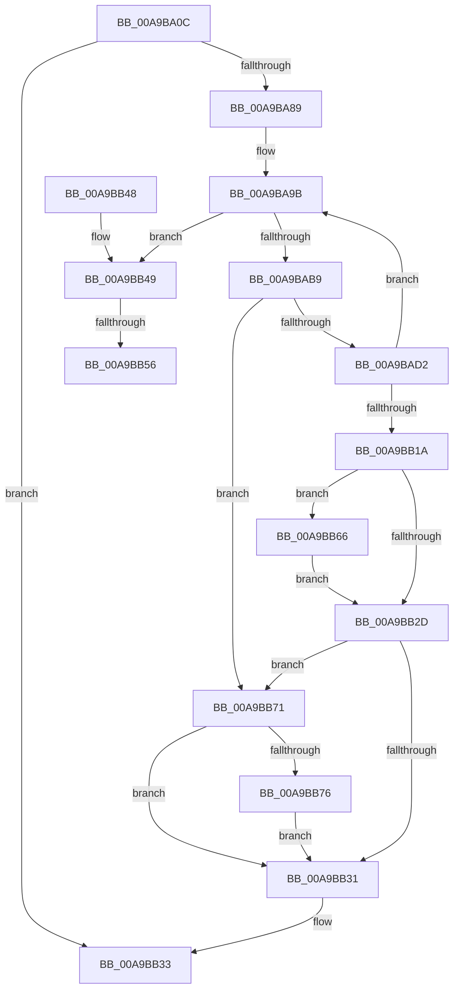

# BiTranslateSymbolicLink

- RVA: `0x00A9BA0C`–`0x00A9BB85` (길이 `377` bytes)
- VA: `0x0000000140A9BA0C`
- 실행 섹션: `PAGE`
- PDB 이름 있음: `예`; PDB Function 태그: `예`
- unwind 정보 RVA: `0x000BA494`
- 디코드: `101`개 명령, `377/377` bytes 표시
- 미해석 바이트: `0` (있으면 어셈블리에 `.byte`로 보존)

> 이 문서는 커널 이미지의 기계어와 PDB 기호를 분석해 생성했습니다. 4번과 5번은 함수 원형과 자료형을 바이너리 사용 방식에서 추정한 C 해석이며 원본 소스 복구 결과는 아닙니다.

## 1. Dependencies

- 직접 호출 지점: **9**; 고유 호출 대상: **5**
- 직접 호출자로 확인된 함수: **2**
- RIP 상대 이미지 참조: **0**

### Outgoing calls
- `0x00A9BA49` → [RtlInitUnicodeString](../../text/42/RtlInitUnicodeString_function_0042A780.md) (function, `0x0042A780`)
- `0x00A9BA7C` → [ZwOpenSymbolicLinkObject](../../text/6A/ZwOpenSymbolicLinkObject_function_006AF7F0.md) (function, `0x006AF7F0`)
- `0x00A9BA8F` → [RtlInitUnicodeString](../../text/42/RtlInitUnicodeString_function_0042A780.md) (function, `0x0042A780`)
- `0x00A9BAA7` → [ZwQuerySymbolicLinkObject](../../text/6A/ZwQuerySymbolicLinkObject_function_006AFE50.md) (function, `0x006AFE50`)
- `0x00A9BABD` → [ZwClose](../../text/6A/ZwClose_function_006AD2B0.md) (function, `0x006AD2B0`)
- `0x00A9BB11` → [ZwOpenSymbolicLinkObject](../../text/6A/ZwOpenSymbolicLinkObject_function_006AF7F0.md) (function, `0x006AF7F0`)
- `0x00A9BB5B` → [ExFreePoolWithTag](../../poolcode/B8/ExFreePoolWithTag_function_00B82870.md) (function, `0x00B82870`)
- `0x00A9BB66` → [ZwClose](../../text/6A/ZwClose_function_006AD2B0.md) (function, `0x006AD2B0`)
- `0x00A9BB7E` → [ExFreePoolWithTag](../../poolcode/B8/ExFreePoolWithTag_function_00B82870.md) (function, `0x00B82870`)

### Direct callers
- [BiGetNtPartitionPath](../82/BiGetNtPartitionPath_function_0082546C.md) at `0x00825946`
- [BiTranslateSymbolicLinkFile](../82/BiTranslateSymbolicLinkFile_function_00825C2C.md) at `0x00825CA0`

### Static image references
- 디코드된 RIP-relative 메모리 참조가 없습니다.

## 2. Other-region calls and transfers

- 다른 실행 섹션으로 향하는 call: **9**
  - `0x00A9BA49` → [RtlInitUnicodeString](../../text/42/RtlInitUnicodeString_function_0042A780.md) (`PAGE` → `.text`)
  - `0x00A9BA7C` → [ZwOpenSymbolicLinkObject](../../text/6A/ZwOpenSymbolicLinkObject_function_006AF7F0.md) (`PAGE` → `.text`)
  - `0x00A9BA8F` → [RtlInitUnicodeString](../../text/42/RtlInitUnicodeString_function_0042A780.md) (`PAGE` → `.text`)
  - `0x00A9BAA7` → [ZwQuerySymbolicLinkObject](../../text/6A/ZwQuerySymbolicLinkObject_function_006AFE50.md) (`PAGE` → `.text`)
  - `0x00A9BABD` → [ZwClose](../../text/6A/ZwClose_function_006AD2B0.md) (`PAGE` → `.text`)
  - `0x00A9BB11` → [ZwOpenSymbolicLinkObject](../../text/6A/ZwOpenSymbolicLinkObject_function_006AF7F0.md) (`PAGE` → `.text`)
  - `0x00A9BB5B` → [ExFreePoolWithTag](../../poolcode/B8/ExFreePoolWithTag_function_00B82870.md) (`PAGE` → `POOLCODE`)
  - `0x00A9BB66` → [ZwClose](../../text/6A/ZwClose_function_006AD2B0.md) (`PAGE` → `.text`)
  - `0x00A9BB7E` → [ExFreePoolWithTag](../../poolcode/B8/ExFreePoolWithTag_function_00B82870.md) (`PAGE` → `POOLCODE`)
- call이 아닌 외부 분기/꼬리 이동: **2**
  - `0x00A9BB50` → [sub_00B484B2](../B4/Unknown_function_00B484B2.md) (`tail-transfer`)
  - `0x00A9BB61` → [sub_00B484B2](../B4/Unknown_function_00B484B2.md) (`tail-transfer`)

## 3. Assembly (complete function range)

```asm
00A9BA0C  48 89 5C 24 08                  mov qword ptr [rsp + 8], rbx
00A9BA11  48 89 74 24 10                  mov qword ptr [rsp + 0x10], rsi
00A9BA16  55                              push rbp
00A9BA17  57                              push rdi
00A9BA18  41 56                           push r14
00A9BA1A  48 8B EC                        mov rbp, rsp
00A9BA1D  48 83 EC 70                     sub rsp, 0x70
00A9BA21  45 33 F6                        xor r14d, r14d
00A9BA24  48 8B F2                        mov rsi, rdx
00A9BA27  48 8B D1                        mov rdx, rcx
00A9BA2A  44 89 75 D4                     mov dword ptr [rbp - 0x2c], r14d
00A9BA2E  0F 57 C0                        xorps xmm0, xmm0
00A9BA31  44 89 75 EC                     mov dword ptr [rbp - 0x14], r14d
00A9BA35  48 8D 4D C0                     lea rcx, [rbp - 0x40]
00A9BA39  4C 89 75 B0                     mov qword ptr [rbp - 0x50], r14
00A9BA3D  0F 11 45 C0                     movups xmmword ptr [rbp - 0x40], xmm0
00A9BA41  4C 89 75 38                     mov qword ptr [rbp + 0x38], r14
00A9BA45  4C 89 75 B8                     mov qword ptr [rbp - 0x48], r14
00A9BA49  E8 32 ED 98 FF                  call 0x14042a780
00A9BA4E  48 8D 45 C0                     lea rax, [rbp - 0x40]
00A9BA52  C7 45 D0 30 00 00 00            mov dword ptr [rbp - 0x30], 0x30
00A9BA59  0F 57 C0                        xorps xmm0, xmm0
00A9BA5C  48 89 45 E0                     mov qword ptr [rbp - 0x20], rax
00A9BA60  4C 8D 45 D0                     lea r8, [rbp - 0x30]
00A9BA64  4C 89 75 D8                     mov qword ptr [rbp - 0x28], r14
00A9BA68  41 8D 56 01                     lea edx, [r14 + 1]
00A9BA6C  C7 45 E8 40 02 00 00            mov dword ptr [rbp - 0x18], 0x240
00A9BA73  48 8D 4D 38                     lea rcx, [rbp + 0x38]
00A9BA77  F3 0F 7F 45 F0                  movdqu xmmword ptr [rbp - 0x10], xmm0
00A9BA7C  E8 6F 3D C1 FF                  call 0x1406af7f0
00A9BA81  85 C0                           test eax, eax
00A9BA83  0F 88 AA 00 00 00               js 0x140a9bb33
00A9BA89  33 D2                           xor edx, edx
00A9BA8B  48 8D 4D B0                     lea rcx, [rbp - 0x50]
00A9BA8F  E8 EC EC 98 FF                  call 0x14042a780
00A9BA94  41 8B FE                        mov edi, r14d
00A9BA97  44 89 75 30                     mov dword ptr [rbp + 0x30], r14d
00A9BA9B  48 8B 4D 38                     mov rcx, qword ptr [rbp + 0x38]
00A9BA9F  4C 8D 45 30                     lea r8, [rbp + 0x30]
00A9BAA3  48 8D 55 B0                     lea rdx, [rbp - 0x50]
00A9BAA7  E8 A4 43 C1 FF                  call 0x1406afe50
00A9BAAC  8B D8                           mov ebx, eax
00A9BAAE  3D 23 00 00 C0                  cmp eax, 0xc0000023
00A9BAB3  0F 84 90 00 00 00               je 0x140a9bb49
00A9BAB9  48 8B 4D 38                     mov rcx, qword ptr [rbp + 0x38]
00A9BABD  E8 EE 17 C1 FF                  call 0x1406ad2b0
00A9BAC2  48 8B 45 B8                     mov rax, qword ptr [rbp - 0x48]
00A9BAC6  4C 89 75 38                     mov qword ptr [rbp + 0x38], r14
00A9BACA  85 DB                           test ebx, ebx
00A9BACC  0F 88 9F 00 00 00               js 0x140a9bb71
00A9BAD2  0F B7 4D B0                     movzx ecx, word ptr [rbp - 0x50]
00A9BAD6  4C 8D 45 D0                     lea r8, [rbp - 0x30]
00A9BADA  48 D1 E9                        shr rcx, 1
00A9BADD  0F 57 C0                        xorps xmm0, xmm0
00A9BAE0  BA 01 00 00 00                  mov edx, 1
00A9BAE5  66 44 89 34 48                  mov word ptr [rax + rcx*2], r14w
00A9BAEA  48 8D 45 B0                     lea rax, [rbp - 0x50]
00A9BAEE  48 8D 4D 38                     lea rcx, [rbp + 0x38]
00A9BAF2  48 89 45 E0                     mov qword ptr [rbp - 0x20], rax
00A9BAF6  66 89 7D B2                     mov word ptr [rbp - 0x4e], di
00A9BAFA  C7 45 D0 30 00 00 00            mov dword ptr [rbp - 0x30], 0x30
00A9BB01  4C 89 75 D8                     mov qword ptr [rbp - 0x28], r14
00A9BB05  C7 45 E8 40 02 00 00            mov dword ptr [rbp - 0x18], 0x240
00A9BB0C  F3 0F 7F 45 F0                  movdqu xmmword ptr [rbp - 0x10], xmm0
00A9BB11  E8 DA 3C C1 FF                  call 0x1406af7f0
00A9BB16  85 C0                           test eax, eax
00A9BB18  79 81                           jns 0x140a9ba9b
00A9BB1A  48 8B 45 B8                     mov rax, qword ptr [rbp - 0x48]
00A9BB1E  41 8B DE                        mov ebx, r14d
00A9BB21  48 89 06                        mov qword ptr [rsi], rax
00A9BB24  48 8B 4D 38                     mov rcx, qword ptr [rbp + 0x38]
00A9BB28  48 85 C9                        test rcx, rcx
00A9BB2B  75 39                           jne 0x140a9bb66
00A9BB2D  85 DB                           test ebx, ebx
00A9BB2F  78 40                           js 0x140a9bb71
00A9BB31  8B C3                           mov eax, ebx
00A9BB33  4C 8D 5C 24 70                  lea r11, [rsp + 0x70]
00A9BB38  49 8B 5B 20                     mov rbx, qword ptr [r11 + 0x20]
00A9BB3C  49 8B 73 28                     mov rsi, qword ptr [r11 + 0x28]
00A9BB40  49 8B E3                        mov rsp, r11
00A9BB43  41 5E                           pop r14
00A9BB45  5F                              pop rdi
00A9BB46  5D                              pop rbp
00A9BB47  C3                              ret
00A9BB48  CC                              int3
00A9BB49  48 8B 4D B8                     mov rcx, qword ptr [rbp - 0x48]
00A9BB4D  48 85 C9                        test rcx, rcx
00A9BB50  0F 84 5C C9 0A 00               je 0x140b484b2
00A9BB56  BA 42 43 44 4B                  mov edx, 0x4b444342
00A9BB5B  E8 10 6D 0E 00                  call 0x140b82870
00A9BB60  90                              nop
00A9BB61  E9 4C C9 0A 00                  jmp 0x140b484b2
00A9BB66  E8 45 17 C1 FF                  call 0x1406ad2b0
00A9BB6B  48 8B 45 B8                     mov rax, qword ptr [rbp - 0x48]
00A9BB6F  EB BC                           jmp 0x140a9bb2d
00A9BB71  48 85 C0                        test rax, rax
00A9BB74  74 BB                           je 0x140a9bb31
00A9BB76  BA 42 43 44 4B                  mov edx, 0x4b444342
00A9BB7B  48 8B C8                        mov rcx, rax
00A9BB7E  E8 ED 6C 0E 00                  call 0x140b82870
00A9BB83  EB AC                           jmp 0x140a9bb31
```

## 4. C-style interpretation (structured pseudocode)

```c
__int64 __fastcall BiTranslateSymbolicLink(__int64 a1, __int64 a2)
{
    __int64 result;
    __int64 v_r14;
    __int64 v_rsp;
    unsigned __int64 v_stack_m18;
    unsigned __int64 v_stack_m28;
    unsigned int v_stack_m2C;
    unsigned int v_stack_m30;
    unsigned __int64 v_stack_m38;
    unsigned __int64 v_stack_m40;
    unsigned int v_stack_m44;
    unsigned int v_stack_m48;
    unsigned __int64 v_stack_m58;
    unsigned __int64 v_stack_m60;
    unsigned __int16 v_stack_m66;
    unsigned __int64 v_stack_m68;
    unsigned __int64 v_stack_p10;
    unsigned int v_stack_p18;
    unsigned __int64 v_stack_p20;
    unsigned __int64 v_stack_p8;

    v_stack_p8 = v_rbx;
    v_stack_p10 = v_rsi;
    v_rsp = (v_rsp) - (112);
    v_r14 = 0;
    v_stack_m44 = 0;
    v_stack_m2C = 0;
    v_stack_m68 = 0;
    v_stack_m58 = v_xmm0;
    v_stack_p20 = 0;
    v_stack_m60 = 0;
    result = RtlInitUnicodeString(v_stack_m58, a1, a3, a4);
    v_stack_m48 = 48;
    v_stack_m38 = v_stack_m58;
    v_stack_m40 = 0;
    v_stack_m30 = 576;
    v_stack_m28 = v_xmm0;
    result = ZwOpenSymbolicLinkObject(v_stack_p20, v_r14 + 1, v_stack_m48, a4);
    if (sign_flag) goto loc_00A9BB33;
    a2 = 0;
    result = RtlInitUnicodeString(v_stack_m68, a2, v_stack_m48, a4);
    v_stack_p18 = 0;
loc_00A9BA9B:
    result = ZwQuerySymbolicLinkObject(v_stack_p20, v_stack_m68, v_stack_p18, a4);
    if (((unsigned int)(result)) == 0xC0000023ULL) goto loc_00A9BB49;
    result = ZwClose(v_stack_p20, v_stack_m68, v_stack_p18, a4);
    v_stack_p20 = 0;
    if (sign_flag) goto loc_00A9BB71;
    a1 = (v_stack_m68) >> (1);
    *(unsigned __int16 *)(v_stack_m60 + a1 * 2) = 0;
    v_stack_m38 = v_stack_m68;
    v_stack_m66 = 0;
    v_stack_m48 = 48;
    v_stack_m40 = 0;
    v_stack_m30 = 576;
    v_stack_m28 = v_xmm0;
    result = ZwOpenSymbolicLinkObject(v_stack_p20, 1, v_stack_m48, a4);
    if (!sign_flag) goto loc_00A9BA9B;
    *(unsigned __int64 *)(a2) = v_stack_m60;
    if (v_stack_p20 != 0) goto loc_00A9BB66;
loc_00A9BB2D:
    if (sign_flag) goto loc_00A9BB71;
loc_00A9BB31:
loc_00A9BB33:
    return 0;
loc_00A9BB49:
    result = ExFreePoolWithTag(v_stack_m60, (unsigned int)(0x4B444342ULL), v_stack_m48, a4);
loc_00A9BB66:
    result = ZwClose(v_stack_m60, (unsigned int)(0x4B444342ULL), v_stack_m48, a4);
    goto loc_00A9BB2D;
loc_00A9BB71:
    if (v_stack_m60 == 0) goto loc_00A9BB31;
    result = ExFreePoolWithTag(v_stack_m60, (unsigned int)(0x4B444342ULL), v_stack_m48, a4);
    goto loc_00A9BB31;
}
```

## 5. (Beta) C Style

```c
int64_t BiTranslateSymbolicLink(int64_t Arg1, void *Arg2)
{
    uint8_t *arg2 = (uint8_t *)Arg2;

    int64_t result;
    int64_t local_r14;
    int64_t local_rsp;
    uint64_t v_stack_m18;
    uint64_t v_stack_m28;
    uint32_t v_stack_m2C;
    uint32_t v_stack_m30;
    uint64_t v_stack_m38;
    uint64_t v_stack_m40;
    uint32_t v_stack_m44;
    uint32_t v_stack_m48;
    uint64_t v_stack_m58;
    uint64_t v_stack_m60;
    uint16_t v_stack_m66;
    uint64_t v_stack_m68;
    uint64_t v_stack_p10;
    uint32_t v_stack_p18;
    uint64_t v_stack_p20;
    uint64_t v_stack_p8;

    v_stack_p8 = local_rbx;
    v_stack_p10 = local_rsi;
    local_rsp = (local_rsp) - (112);
    local_r14 = 0;
    v_stack_m44 = 0;
    v_stack_m2C = 0;
    v_stack_m68 = 0;
    v_stack_m58 = v_xmm0;
    v_stack_p20 = 0;
    v_stack_m60 = 0;
    result = RtlInitUnicodeString(v_stack_m58, Arg1, a3, a4);
    v_stack_m48 = 48;
    v_stack_m38 = v_stack_m58;
    v_stack_m40 = 0;
    v_stack_m30 = 576;
    v_stack_m28 = v_xmm0;
    result = ZwOpenSymbolicLinkObject(v_stack_p20, local_r14 + 1, v_stack_m48, a4);
    if (sign_flag) goto loc_00A9BB33;
    Arg2 = 0;
    result = RtlInitUnicodeString(v_stack_m68, Arg2, v_stack_m48, a4);
    v_stack_p18 = 0;
loc_00A9BA9B:
    result = ZwQuerySymbolicLinkObject(v_stack_p20, v_stack_m68, v_stack_p18, a4);
    if (((uint32_t)(result)) == 0xC0000023ULL) goto loc_00A9BB49;
    result = ZwClose(v_stack_p20, v_stack_m68, v_stack_p18, a4);
    v_stack_p20 = 0;
    if (sign_flag) goto loc_00A9BB71;
    Arg1 = (v_stack_m68) >> (1);
    *(uint16_t *)(v_stack_m60 + Arg1 * 2) = 0;
    v_stack_m38 = v_stack_m68;
    v_stack_m66 = 0;
    v_stack_m48 = 48;
    v_stack_m40 = 0;
    v_stack_m30 = 576;
    v_stack_m28 = v_xmm0;
    result = ZwOpenSymbolicLinkObject(v_stack_p20, 1, v_stack_m48, a4);
    if (!sign_flag) goto loc_00A9BA9B;
    *(uint64_t *)(arg2) = v_stack_m60;
    if (v_stack_p20 != 0) goto loc_00A9BB66;
loc_00A9BB2D:
    if (sign_flag) goto loc_00A9BB71;
loc_00A9BB31:
loc_00A9BB33:
    return 0;
loc_00A9BB49:
    result = ExFreePoolWithTag(v_stack_m60, (uint32_t)(0x4B444342ULL), v_stack_m48, a4);
loc_00A9BB66:
    result = ZwClose(v_stack_m60, (uint32_t)(0x4B444342ULL), v_stack_m48, a4);
    goto loc_00A9BB2D;
loc_00A9BB71:
    if (v_stack_m60 == 0) goto loc_00A9BB31;
    result = ExFreePoolWithTag(v_stack_m60, (uint32_t)(0x4B444342ULL), v_stack_m48, a4);
    goto loc_00A9BB31;
}
```

### 관측된 메모리 오프셋

구조체 형식이 확인되지 않은 접근은 인자 기준의 오프셋으로만 기록했습니다.

| 기준 인자 | 오프셋 표현 | 폭 (bit) | 접근 |
|---|---:|---:|---|
| `Arg2` | `+ 0x0` | `64` | `W` |

## 6. Execution-region graph

[열기: 2D/3D 그래프와 함수 탐색 컨트롤 패널](../../../control-panel.html?section=page&rva=0x00A9BA0C&view=graph)

- 2D 그래프는 위에서 아래로 흐르고, 3D 그래프는 빈 공간을 드래그해 회전합니다. Shift+드래그는 이동, 휠은 확대·축소, 함수 노드 선택은 대상 보고서 이동입니다.

### Static fallback


