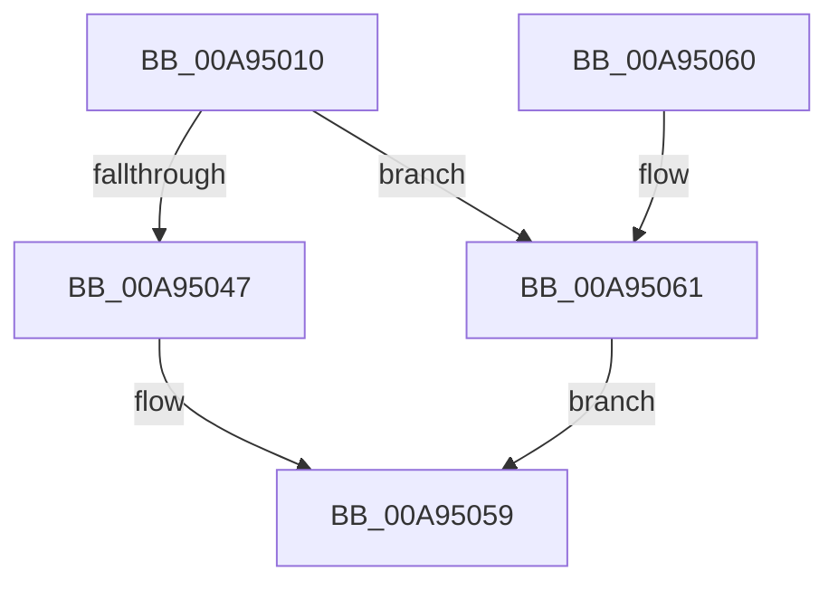

# CcPartitionTelemetryCallback

- RVA: `0x00A95010`–`0x00A950BA` (길이 `170` bytes)
- VA: `0x0000000140A95010`
- 실행 섹션: `PAGE`
- PDB 이름 있음: `예`; PDB Function 태그: `아니요`
- unwind 정보 RVA: `0x000B54C8`
- 디코드: `34`개 명령, `170/170` bytes 표시
- 미해석 바이트: `0` (있으면 어셈블리에 `.byte`로 보존)

> 이 문서는 커널 이미지의 기계어와 PDB 기호를 분석해 생성했습니다. 4번과 5번은 함수 원형과 자료형을 바이너리 사용 방식에서 추정한 C 해석이며 원본 소스 복구 결과는 아닙니다.

## 1. Dependencies

- 직접 호출 지점: **4**; 고유 호출 대상: **4**
- 직접 호출자로 확인된 함수: **0**
- RIP 상대 이미지 참조: **11**

### Outgoing calls
- `0x00A95022` → [MmGetAvailablePagesForPartitionObject](../../text/49/MmGetAvailablePagesForPartitionObject_function_00498698.md) (function, `0x00498698`)
- `0x00A95032` → [MmGetNumberOfPhysicalPagesForPartitionObject](../../text/4C/MmGetNumberOfPhysicalPagesForPartitionObject_function_004C23A0.md) (function, `0x004C23A0`)
- `0x00A95054` → [CcForEachPrivateVolumeCacheMap](../../text/38/CcForEachPrivateVolumeCacheMap_function_0038967C.md) (function, `0x0038967C`)
- `0x00A950B3` → [CcGetActiveWorkerCountInPartition](../../text/3C/CcGetActiveWorkerCountInPartition_function_003CF044.md) (function, `0x003CF044`)

### Direct callers
- 이 함수 시작 RVA로 연결되는 직접 call은 확인되지 않았습니다. 간접 호출은 완전히 역산할 수 없습니다.

### Static image references
- `0x00A95014` → RVA `0x00F8F2E8` (`.data`; read/write)
- `0x00A95027` → RVA `0x00F8F308` (`.data`; read/write)
- `0x00A95037` → RVA `0x00F8F310` (`.data`; read/write)
- `0x00A9503E` → RVA `0x00E65B88` (`.data`; read)
- `0x00A9504A` → RVA `0x00A78FF0` (`CcPrivateVolumeCacheMapTelemetryCallback`; read)
- `0x00A95068` → RVA `0x00F8F320` (`.data`; read)
- `0x00A9506F` → RVA `0x00F8F2F8` (`.data`; read/write)
- `0x00A9507F` → RVA `0x00F8F300` (`.data`; read/write)
- `0x00A9508D` → RVA `0x00F8F318` (`.data`; read/write)
- `0x00A9509B` → RVA `0x00F8F328` (`.data`; read/write)
- `0x00A950A9` → RVA `0x00F8F330` (`.data`; read/write)

## 2. Other-region calls and transfers

- 다른 실행 섹션으로 향하는 call: **4**
  - `0x00A95022` → [MmGetAvailablePagesForPartitionObject](../../text/49/MmGetAvailablePagesForPartitionObject_function_00498698.md) (`PAGE` → `.text`)
  - `0x00A95032` → [MmGetNumberOfPhysicalPagesForPartitionObject](../../text/4C/MmGetNumberOfPhysicalPagesForPartitionObject_function_004C23A0.md) (`PAGE` → `.text`)
  - `0x00A95054` → [CcForEachPrivateVolumeCacheMap](../../text/38/CcForEachPrivateVolumeCacheMap_function_0038967C.md) (`PAGE` → `.text`)
  - `0x00A950B3` → [CcGetActiveWorkerCountInPartition](../../text/3C/CcGetActiveWorkerCountInPartition_function_003CF044.md) (`PAGE` → `.text`)
- 별도 외부 분기/꼬리 이동을 확인하지 못했습니다.

## 3. Assembly (complete function range)

```asm
00A95010  48 83 EC 28                     sub rsp, 0x28
00A95014  48 FF 05 CD A2 4F 00            inc qword ptr [rip + 0x4fa2cd]
00A9501B  4C 8B C9                        mov r9, rcx
00A9501E  48 8B 49 08                     mov rcx, qword ptr [rcx + 8]
00A95022  E8 71 36 A0 FF                  call 0x140498698
00A95027  48 01 05 DA A2 4F 00            add qword ptr [rip + 0x4fa2da], rax
00A9502E  49 8B 49 08                     mov rcx, qword ptr [r9 + 8]
00A95032  E8 69 D3 A2 FF                  call 0x1404c23a0
00A95037  48 01 05 D2 A2 4F 00            add qword ptr [rip + 0x4fa2d2], rax
00A9503E  80 3D 43 0B 3D 00 00            cmp byte ptr [rip + 0x3d0b43], 0
00A95045  74 1A                           je 0x140a95061
00A95047  45 33 C0                        xor r8d, r8d
00A9504A  48 8D 15 9F 3F FE FF            lea rdx, [rip - 0x1c061]
00A95051  49 8B C9                        mov rcx, r9
00A95054  E8 23 46 8F FF                  call 0x14038967c
00A95059  B0 01                           mov al, 1
00A9505B  48 83 C4 28                     add rsp, 0x28
00A9505F  C3                              ret
00A95060  CC                              int3
00A95061  41 8B 81 D0 03 00 00            mov eax, dword ptr [r9 + 0x3d0]
00A95068  4C 8D 05 B1 A2 4F 00            lea r8, [rip + 0x4fa2b1]
00A9506F  48 01 05 82 A2 4F 00            add qword ptr [rip + 0x4fa282], rax
00A95076  33 D2                           xor edx, edx
00A95078  49 8B 89 20 04 00 00            mov rcx, qword ptr [r9 + 0x420]
00A9507F  48 01 0D 7A A2 4F 00            add qword ptr [rip + 0x4fa27a], rcx
00A95086  41 8B 89 48 03 00 00            mov ecx, dword ptr [r9 + 0x348]
00A9508D  48 01 0D 84 A2 4F 00            add qword ptr [rip + 0x4fa284], rcx
00A95094  49 8B 89 78 04 00 00            mov rcx, qword ptr [r9 + 0x478]
00A9509B  48 01 0D 86 A2 4F 00            add qword ptr [rip + 0x4fa286], rcx
00A950A2  49 8B 89 80 04 00 00            mov rcx, qword ptr [r9 + 0x480]
00A950A9  48 01 0D 80 A2 4F 00            add qword ptr [rip + 0x4fa280], rcx
00A950B0  49 8B C9                        mov rcx, r9
00A950B3  E8 8C 9F 93 FF                  call 0x1403cf044
00A950B8  EB 9F                           jmp 0x140a95059
```

## 4. C-style interpretation (structured pseudocode)

```c
__int64 __fastcall CcPartitionTelemetryCallback(__int64 a1, __int64 a2, int a3)
{
    __int64 result;
    __int64 v_rsp;

    v_rsp = (v_rsp) - (40);
    result = MmGetAvailablePagesForPartitionObject(*(unsigned __int64 *)(a1 + 8), a2, a3, a1);
    result = MmGetNumberOfPhysicalPagesForPartitionObject(*(unsigned __int64 *)(a1 + 8), a2, a3, a1);
    if ((*(unsigned __int8 *)(v_rip + 4000579)) == 0) goto loc_00A95061;
    a3 = 0;
    result = CcForEachPrivateVolumeCacheMap(a1, v_rip - 114785, a3, a1);
loc_00A95059:
    v_rsp = (v_rsp) + (40);
    return 1;
loc_00A95061:
    a2 = 0;
    result = CcGetActiveWorkerCountInPartition(a1, a2, v_rip + 5218993, a1);
    goto loc_00A95059;
}
```

## 5. (Beta) C Style

```c
int64_t CcPartitionTelemetryCallback(void *Arg1, int64_t Arg2, int32_t Arg3)
{
    uint8_t *arg1 = (uint8_t *)Arg1;

    int64_t result;
    int64_t local_rsp;

    local_rsp = (local_rsp) - (40);
    result = MmGetAvailablePagesForPartitionObject(*(uint64_t *)(arg1 + 0x8), Arg2, Arg3, Arg1);
    result = MmGetNumberOfPhysicalPagesForPartitionObject(*(uint64_t *)(arg1 + 0x8), Arg2, Arg3, Arg1);
    if ((*(uint8_t *)(v_rip + 0x3D0B43)) == 0) goto loc_00A95061;
    Arg3 = 0;
    result = CcForEachPrivateVolumeCacheMap(Arg1, v_rip - 114785, Arg3, Arg1);
loc_00A95059:
    local_rsp = (local_rsp) + (40);
    return 1;
loc_00A95061:
    Arg2 = 0;
    result = CcGetActiveWorkerCountInPartition(Arg1, Arg2, v_rip + 5218993, Arg1);
    goto loc_00A95059;
}
```

### 관측된 메모리 오프셋

구조체 형식이 확인되지 않은 접근은 인자 기준의 오프셋으로만 기록했습니다.

| 기준 인자 | 오프셋 표현 | 폭 (bit) | 접근 |
|---|---:|---:|---|
| `Arg1` | `+ 0x8` | `64` | `R` |

## 6. Execution-region graph

[열기: 2D/3D 그래프와 함수 탐색 컨트롤 패널](../../../control-panel.html?section=page&rva=0x00A95010&view=graph)

- 2D 그래프는 위에서 아래로 흐르고, 3D 그래프는 빈 공간을 드래그해 회전합니다. Shift+드래그는 이동, 휠은 확대·축소, 함수 노드 선택은 대상 보고서 이동입니다.

### Static fallback


