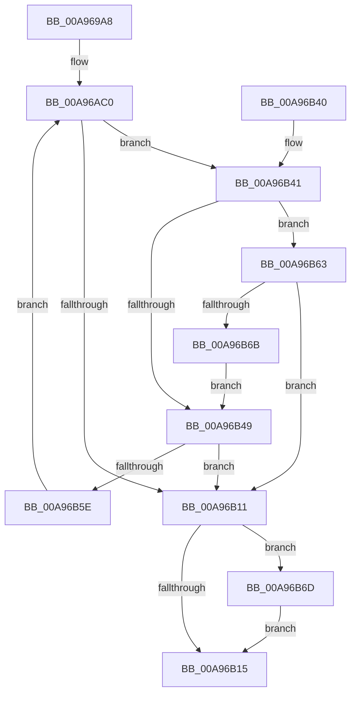

# CmFcpConnectToAlpcServer

- RVA: `0x00A969A8`–`0x00A96B77` (길이 `463` bytes)
- VA: `0x0000000140A969A8`
- 실행 섹션: `PAGE`
- PDB 이름 있음: `예`; PDB Function 태그: `아니요`
- unwind 정보 RVA: `0x000B9C0C`
- 디코드: `113`개 명령, `463/463` bytes 표시
- 미해석 바이트: `0` (있으면 어셈블리에 `.byte`로 보존)

> 이 문서는 커널 이미지의 기계어와 PDB 기호를 분석해 생성했습니다. 4번과 5번은 함수 원형과 자료형을 바이너리 사용 방식에서 추정한 C 해석이며 원본 소스 복구 결과는 아닙니다.

## 1. Dependencies

- 직접 호출 지점: **5**; 고유 호출 대상: **5**
- 직접 호출자로 확인된 함수: **1**
- RIP 상대 이미지 참조: **2**

### Outgoing calls
- `0x00A96A0A` → [RtlInitUnicodeString](../../text/42/RtlInitUnicodeString_function_0042A780.md) (function, `0x0042A780`)
- `0x00A96A72` → [AlpcMaxAllowedMessageLength](../../text/49/AlpcMaxAllowedMessageLength_function_00495B00.md) (function, `0x00495B00`)
- `0x00A96B05` → [ZwAlpcConnectPortEx](../../text/6A/ZwAlpcConnectPortEx_function_006AE050.md) (function, `0x006AE050`)
- `0x00A96B1E` → [_security_check_cookie](../../text/6A/_security_check_cookie_function_006AC640.md) (function, `0x006AC640`)
- `0x00A96B54` → [KeDelayExecutionThread](../../text/20/KeDelayExecutionThread_function_00209550.md) (function, `0x00209550`)

### Direct callers
- [CmFcpManagerPublishFeatureUsageDataBuffers](CmFcpManagerPublishFeatureUsageDataBuffers_function_00A9677C.md) at `0x00A967CC`
- [CmFcpManagerPublishFeatureUsageDataBuffers](CmFcpManagerPublishFeatureUsageDataBuffers_function_00A9677C.md) at `0x00A96833`

### Static image references
- `0x00A969C8` → RVA `0x00E0A740` (`.data`; read)
- `0x00A969EA` → RVA `0x00B09C80` (` ?? ::NNGAKEGL::`string'`; read)

## 2. Other-region calls and transfers

- 다른 실행 섹션으로 향하는 call: **5**
  - `0x00A96A0A` → [RtlInitUnicodeString](../../text/42/RtlInitUnicodeString_function_0042A780.md) (`PAGE` → `.text`)
  - `0x00A96A72` → [AlpcMaxAllowedMessageLength](../../text/49/AlpcMaxAllowedMessageLength_function_00495B00.md) (`PAGE` → `.text`)
  - `0x00A96B05` → [ZwAlpcConnectPortEx](../../text/6A/ZwAlpcConnectPortEx_function_006AE050.md) (`PAGE` → `.text`)
  - `0x00A96B1E` → [_security_check_cookie](../../text/6A/_security_check_cookie_function_006AC640.md) (`PAGE` → `.text`)
  - `0x00A96B54` → [KeDelayExecutionThread](../../text/20/KeDelayExecutionThread_function_00209550.md) (`PAGE` → `.text`)
- 별도 외부 분기/꼬리 이동을 확인하지 못했습니다.

## 3. Assembly (complete function range)

```asm
00A969A8  48 89 5C 24 10                  mov qword ptr [rsp + 0x10], rbx
00A969AD  48 89 74 24 18                  mov qword ptr [rsp + 0x18], rsi
00A969B2  48 89 7C 24 20                  mov qword ptr [rsp + 0x20], rdi
00A969B7  55                              push rbp
00A969B8  41 56                           push r14
00A969BA  41 57                           push r15
00A969BC  48 8D 6C 24 80                  lea rbp, [rsp - 0x80]
00A969C1  48 81 EC 80 01 00 00            sub rsp, 0x180
00A969C8  48 8B 05 71 3D 37 00            mov rax, qword ptr [rip + 0x373d71]
00A969CF  48 33 C4                        xor rax, rsp
00A969D2  48 89 45 70                     mov qword ptr [rbp + 0x70], rax
00A969D6  45 33 FF                        xor r15d, r15d
00A969D9  44 8A F2                        mov r14b, dl
00A969DC  48 8B F1                        mov rsi, rcx
00A969DF  44 89 7D C4                     mov dword ptr [rbp - 0x3c], r15d
00A969E3  0F 57 C0                        xorps xmm0, xmm0
00A969E6  44 89 7D DC                     mov dword ptr [rbp - 0x24], r15d
00A969EA  48 8D 15 8F 32 07 00            lea rdx, [rip + 0x7328f]
00A969F1  44 89 7D 94                     mov dword ptr [rbp - 0x6c], r15d
00A969F5  48 8D 4D 80                     lea rcx, [rbp - 0x80]
00A969F9  44 89 7D AC                     mov dword ptr [rbp - 0x54], r15d
00A969FD  0F 11 45 80                     movups xmmword ptr [rbp - 0x80], xmm0
00A96A01  66 44 89 7D 2E                  mov word ptr [rbp + 0x2e], r15w
00A96A06  44 89 7D 64                     mov dword ptr [rbp + 0x64], r15d
00A96A0A  E8 71 3D 99 FF                  call 0x14042a780
00A96A0F  0F 57 C0                        xorps xmm0, xmm0
00A96A12  4C 89 7C 24 60                  mov qword ptr [rsp + 0x60], r15
00A96A17  41 8D 57 30                     lea edx, [r15 + 0x30]
00A96A1B  48 C7 44 24 68 80 0F 05 FD      mov qword ptr [rsp + 0x68], 0xfffffffffd050f80
00A96A24  B9 00 02 00 00                  mov ecx, 0x200
00A96A29  89 55 C0                        mov dword ptr [rbp - 0x40], edx
00A96A2C  48 8D 45 80                     lea rax, [rbp - 0x80]
00A96A30  89 4D D8                        mov dword ptr [rbp - 0x28], ecx
00A96A33  0F 11 45 F0                     movups xmmword ptr [rbp - 0x10], xmm0
00A96A37  48 89 45 D0                     mov qword ptr [rbp - 0x30], rax
00A96A3B  41 8B FF                        mov edi, r15d
00A96A3E  0F 11 45 00                     movups xmmword ptr [rbp], xmm0
00A96A42  89 55 90                        mov dword ptr [rbp - 0x70], edx
00A96A45  0F 11 45 10                     movups xmmword ptr [rbp + 0x10], xmm0
00A96A49  89 4D A8                        mov dword ptr [rbp - 0x58], ecx
00A96A4C  F3 0F 7F 45 E0                  movdqu xmmword ptr [rbp - 0x20], xmm0
00A96A51  48 C7 44 24 78 80 69 67 FF      mov qword ptr [rsp + 0x78], 0xffffffffff676980
00A96A5A  F3 0F 7F 45 B0                  movdqu xmmword ptr [rbp - 0x50], xmm0
00A96A5F  4C 89 7D C8                     mov qword ptr [rbp - 0x38], r15
00A96A63  4C 89 7D 98                     mov qword ptr [rbp - 0x68], r15
00A96A67  4C 89 7D A0                     mov qword ptr [rbp - 0x60], r15
00A96A6B  C7 45 20 00 00 12 00            mov dword ptr [rbp + 0x20], 0x120000
00A96A72  E8 89 F0 9F FF                  call 0x140495b00
00A96A77  48 89 45 30                     mov qword ptr [rbp + 0x30], rax
00A96A7B  B8 FF FF FF FF                  mov eax, 0xffffffff
00A96A80  48 89 45 40                     mov qword ptr [rbp + 0x40], rax
00A96A84  48 89 45 48                     mov qword ptr [rbp + 0x48], rax
00A96A88  48 89 45 58                     mov qword ptr [rbp + 0x58], rax
00A96A8C  48 89 45 50                     mov qword ptr [rbp + 0x50], rax
00A96A90  8D 42 D8                        lea eax, [rdx - 0x28]
00A96A93  66 89 45 F0                     mov word ptr [rbp - 0x10], ax
00A96A97  44 89 7D 60                     mov dword ptr [rbp + 0x60], r15d
00A96A9B  4C 89 7D 38                     mov qword ptr [rbp + 0x38], r15
00A96A9F  48 C7 45 24 0C 00 00 00         mov qword ptr [rbp + 0x24], 0xc
00A96AA7  66 C7 45 2C 01 00               mov word ptr [rbp + 0x2c], 1
00A96AAD  C7 45 F2 30 00 00 80            mov dword ptr [rbp - 0xe], 0x80000030
00A96AB4  C7 45 18 01 00 00 00            mov dword ptr [rbp + 0x18], 1
00A96ABB  48 89 54 24 70                  mov qword ptr [rsp + 0x70], rdx
00A96AC0  48 8D 44 24 68                  lea rax, [rsp + 0x68]
00A96AC5  48 89 44 24 50                  mov qword ptr [rsp + 0x50], rax
00A96ACA  4C 8D 4D 20                     lea r9, [rbp + 0x20]
00A96ACE  4C 89 7C 24 48                  mov qword ptr [rsp + 0x48], r15
00A96AD3  48 8D 44 24 70                  lea rax, [rsp + 0x70]
00A96AD8  4C 89 7C 24 40                  mov qword ptr [rsp + 0x40], r15
00A96ADD  4C 8D 45 90                     lea r8, [rbp - 0x70]
00A96AE1  48 89 44 24 38                  mov qword ptr [rsp + 0x38], rax
00A96AE6  48 8D 55 C0                     lea rdx, [rbp - 0x40]
00A96AEA  48 8D 45 F0                     lea rax, [rbp - 0x10]
00A96AEE  48 89 44 24 30                  mov qword ptr [rsp + 0x30], rax
00A96AF3  48 8D 4C 24 60                  lea rcx, [rsp + 0x60]
00A96AF8  4C 89 7C 24 28                  mov qword ptr [rsp + 0x28], r15
00A96AFD  C7 44 24 20 00 00 02 00         mov dword ptr [rsp + 0x20], 0x20000
00A96B05  E8 46 75 C1 FF                  call 0x1406ae050
00A96B0A  8B D8                           mov ebx, eax
00A96B0C  45 84 F6                        test r14b, r14b
00A96B0F  75 30                           jne 0x140a96b41
00A96B11  85 DB                           test ebx, ebx
00A96B13  79 58                           jns 0x140a96b6d
00A96B15  8B C3                           mov eax, ebx
00A96B17  48 8B 4D 70                     mov rcx, qword ptr [rbp + 0x70]
00A96B1B  48 33 CC                        xor rcx, rsp
00A96B1E  E8 1D 5B C1 FF                  call 0x1406ac640
00A96B23  4C 8D 9C 24 80 01 00 00         lea r11, [rsp + 0x180]
00A96B2B  49 8B 5B 28                     mov rbx, qword ptr [r11 + 0x28]
00A96B2F  49 8B 73 30                     mov rsi, qword ptr [r11 + 0x30]
00A96B33  49 8B 7B 38                     mov rdi, qword ptr [r11 + 0x38]
00A96B37  49 8B E3                        mov rsp, r11
00A96B3A  41 5F                           pop r15
00A96B3C  41 5E                           pop r14
00A96B3E  5D                              pop rbp
00A96B3F  C3                              ret
00A96B40  CC                              int3
00A96B41  81 FB 34 00 00 C0               cmp ebx, 0xc0000034
00A96B47  75 1A                           jne 0x140a96b63
00A96B49  4C 8D 44 24 78                  lea r8, [rsp + 0x78]
00A96B4E  33 D2                           xor edx, edx
00A96B50  33 C9                           xor ecx, ecx
00A96B52  FF C7                           inc edi
00A96B54  E8 F7 29 77 FF                  call 0x140209550
00A96B59  83 FF 0A                        cmp edi, 0xa
00A96B5C  73 B3                           jae 0x140a96b11
00A96B5E  E9 5D FF FF FF                  jmp 0x140a96ac0
00A96B63  81 FB 01 07 00 C0               cmp ebx, 0xc0000701
00A96B69  75 A6                           jne 0x140a96b11
00A96B6B  EB DC                           jmp 0x140a96b49
00A96B6D  48 8B 44 24 60                  mov rax, qword ptr [rsp + 0x60]
00A96B72  48 89 06                        mov qword ptr [rsi], rax
00A96B75  EB 9E                           jmp 0x140a96b15
```

## 4. C-style interpretation (structured pseudocode)

```c
__int64 __fastcall CmFcpConnectToAlpcServer(__int64 a1, unsigned __int8 a2)
{
    __int64 result;
    __int64 v_r15;
    __int64 v_rdi;
    __int64 v_rsp;
    unsigned __int64 v_stack_m100;
    unsigned int v_stack_m104;
    unsigned int v_stack_m108;
    unsigned __int64 v_stack_m118;
    unsigned __int64 v_stack_m120;
    unsigned __int64 v_stack_m128;
    unsigned __int64 v_stack_m130;
    unsigned __int64 v_stack_m138;
    unsigned __int64 v_stack_m148;
    unsigned __int64 v_stack_m150;
    unsigned __int64 v_stack_m158;
    unsigned __int64 v_stack_m160;
    unsigned __int64 v_stack_m168;
    unsigned __int64 v_stack_m170;
    unsigned int v_stack_m178;
    unsigned __int64 v_stack_m18;
    unsigned __int64 v_stack_m28;
    unsigned int v_stack_m34;
    unsigned int v_stack_m38;
    unsigned __int64 v_stack_m40;
    unsigned __int64 v_stack_m48;
    unsigned __int64 v_stack_m50;
    unsigned __int64 v_stack_m58;
    unsigned __int64 v_stack_m60;
    unsigned __int64 v_stack_m68;
    unsigned __int16 v_stack_m6A;
    unsigned __int16 v_stack_m6C;
    unsigned __int64 v_stack_m74;
    unsigned int v_stack_m78;
    unsigned int v_stack_m80;
    unsigned __int64 v_stack_m88;
    unsigned __int64 v_stack_m98;
    unsigned int v_stack_mA6;
    unsigned __int64 v_stack_mA8;
    unsigned __int64 v_stack_mB8;
    unsigned int v_stack_mBC;
    unsigned int v_stack_mC0;
    unsigned __int64 v_stack_mC8;
    unsigned __int64 v_stack_mD0;
    unsigned int v_stack_mD4;
    unsigned int v_stack_mD8;
    unsigned __int64 v_stack_mE8;
    unsigned int v_stack_mEC;
    unsigned int v_stack_mF0;
    unsigned __int64 v_stack_mF8;
    unsigned __int64 v_stack_p10;
    unsigned __int64 v_stack_p18;
    unsigned __int64 v_stack_p20;

    v_stack_p10 = v_rbx;
    v_stack_p18 = v_rsi;
    v_stack_p20 = v_rdi;
    v_rsp = (v_rsp) - (384);
    result = (*(unsigned __int64 *)(v_rip + 3620209)) ^ (v_rsp);
    v_stack_m28 = result;
    v_r15 = 0;
    v_stack_mD4 = 0;
    v_stack_mBC = 0;
    v_stack_m104 = 0;
    v_stack_mEC = 0;
    v_stack_m118 = v_xmm0;
    v_stack_m6A = 0;
    v_stack_m34 = 0;
    result = RtlInitUnicodeString(v_stack_m118, v_rip + 471695, a3, a4);
    v_stack_m138 = 0;
    v_stack_m130 = 0xFFFFFFFFFD050F80ULL;
    v_stack_mD8 = (unsigned int)(v_r15 + 48);
    v_stack_mC0 = 512;
    v_stack_mA8 = v_xmm0;
    v_stack_mC8 = v_stack_m118;
    v_stack_m98 = v_xmm0;
    v_stack_m108 = (unsigned int)(v_r15 + 48);
    v_stack_m88 = v_xmm0;
    v_stack_mF0 = 512;
    v_stack_mB8 = v_xmm0;
    v_stack_m120 = 0xFFFFFFFFFF676980ULL;
    v_stack_mE8 = v_xmm0;
    v_stack_mD0 = 0;
    v_stack_m100 = 0;
    v_stack_mF8 = 0;
    v_stack_m78 = 0x120000ULL;
    result = AlpcMaxAllowedMessageLength(512, v_r15 + 48, a3, a4);
    v_stack_m68 = result;
    v_stack_m58 = (unsigned int)(0xFFFFFFFFULL);
    v_stack_m50 = (unsigned int)(0xFFFFFFFFULL);
    v_stack_m40 = (unsigned int)(0xFFFFFFFFULL);
    v_stack_m48 = (unsigned int)(0xFFFFFFFFULL);
    v_stack_mA8 = (unsigned __int16)(v_r15 + 48 - 40);
    v_stack_m38 = 0;
    v_stack_m60 = 0;
    v_stack_m74 = 12;
    v_stack_m6C = 1;
    v_stack_mA6 = 0x80000030ULL;
    v_stack_m80 = 1;
    v_stack_m128 = v_r15 + 48;
loc_00A96AC0:
    v_stack_m148 = v_stack_m130;
    v_stack_m150 = 0;
    v_stack_m158 = 0;
    v_stack_m160 = v_stack_m128;
    v_stack_m168 = v_stack_mA8;
    v_stack_m170 = 0;
    v_stack_m178 = 0x20000ULL;
    result = ZwAlpcConnectPortEx(v_stack_m138, v_stack_mD8, v_stack_m108, v_stack_m78);
    if (a2 != 0) goto loc_00A96B41;
loc_00A96B11:
    if (!sign_flag) goto loc_00A96B6D;
loc_00A96B15:
    a1 = (v_stack_m28) ^ (v_rsp);
    result = _security_check_cookie(a1, v_stack_mD8, v_stack_m108, v_stack_m78);
    return result;
loc_00A96B41:
    if (((unsigned int)(*(unsigned __int64 *)(v_stack_m18 + 40))) != 0xC0000034ULL) goto loc_00A96B63;
loc_00A96B49:
    a2 = 0;
    a1 = 0;
    v_rdi = (unsigned int)((*(unsigned __int64 *)(v_stack_m18 + 56)) + 1);
    result = KeDelayExecutionThread(a1, a2, v_stack_m108, v_stack_m78);
    if (((unsigned int)(v_rdi)) >= 10) goto loc_00A96B11;
    goto loc_00A96AC0;
loc_00A96B63:
    if (((unsigned int)(*(unsigned __int64 *)(v_stack_m18 + 40))) != 0xC0000701ULL) goto loc_00A96B11;
    goto loc_00A96B49;
loc_00A96B6D:
    *(unsigned __int64 *)(*(unsigned __int64 *)(v_stack_m18 + 48)) = v_stack_m120;
    goto loc_00A96B15;
}
```

## 5. (Beta) C Style

```c
int64_t CmFcpConnectToAlpcServer(void *Arg1, uint8_t Arg2)
{
    uint8_t *arg1 = (uint8_t *)Arg1;

    int64_t result;
    int64_t local_r15;
    int64_t local_rdi;
    int64_t local_rsp;
    uint64_t v_stack_m100;
    uint32_t v_stack_m104;
    uint32_t v_stack_m108;
    uint64_t v_stack_m118;
    uint64_t v_stack_m120;
    uint64_t v_stack_m128;
    uint64_t v_stack_m130;
    uint64_t v_stack_m138;
    uint64_t v_stack_m148;
    uint64_t v_stack_m150;
    uint64_t v_stack_m158;
    uint64_t v_stack_m160;
    uint64_t v_stack_m168;
    uint64_t v_stack_m170;
    uint32_t v_stack_m178;
    uint64_t v_stack_m18;
    uint64_t v_stack_m28;
    uint32_t v_stack_m34;
    uint32_t v_stack_m38;
    uint64_t v_stack_m40;
    uint64_t v_stack_m48;
    uint64_t v_stack_m50;
    uint64_t v_stack_m58;
    uint64_t v_stack_m60;
    uint64_t v_stack_m68;
    uint16_t v_stack_m6A;
    uint16_t v_stack_m6C;
    uint64_t v_stack_m74;
    uint32_t v_stack_m78;
    uint32_t v_stack_m80;
    uint64_t v_stack_m88;
    uint64_t v_stack_m98;
    uint32_t v_stack_mA6;
    uint64_t v_stack_mA8;
    uint64_t v_stack_mB8;
    uint32_t v_stack_mBC;
    uint32_t v_stack_mC0;
    uint64_t v_stack_mC8;
    uint64_t v_stack_mD0;
    uint32_t v_stack_mD4;
    uint32_t v_stack_mD8;
    uint64_t v_stack_mE8;
    uint32_t v_stack_mEC;
    uint32_t v_stack_mF0;
    uint64_t v_stack_mF8;
    uint64_t v_stack_p10;
    uint64_t v_stack_p18;
    uint64_t v_stack_p20;

    v_stack_p10 = local_rbx;
    v_stack_p18 = local_rsi;
    v_stack_p20 = local_rdi;
    local_rsp = (local_rsp) - (384);
    result = (*(uint64_t *)(v_rip + 0x373D71)) ^ (local_rsp);
    v_stack_m28 = result;
    local_r15 = 0;
    v_stack_mD4 = 0;
    v_stack_mBC = 0;
    v_stack_m104 = 0;
    v_stack_mEC = 0;
    v_stack_m118 = v_xmm0;
    v_stack_m6A = 0;
    v_stack_m34 = 0;
    result = RtlInitUnicodeString(v_stack_m118, v_rip + 471695, a3, a4);
    v_stack_m138 = 0;
    v_stack_m130 = 0xFFFFFFFFFD050F80ULL;
    v_stack_mD8 = (uint32_t)(local_r15 + 48);
    v_stack_mC0 = 512;
    v_stack_mA8 = v_xmm0;
    v_stack_mC8 = v_stack_m118;
    v_stack_m98 = v_xmm0;
    v_stack_m108 = (uint32_t)(local_r15 + 48);
    v_stack_m88 = v_xmm0;
    v_stack_mF0 = 512;
    v_stack_mB8 = v_xmm0;
    v_stack_m120 = 0xFFFFFFFFFF676980ULL;
    v_stack_mE8 = v_xmm0;
    v_stack_mD0 = 0;
    v_stack_m100 = 0;
    v_stack_mF8 = 0;
    v_stack_m78 = 0x120000ULL;
    result = AlpcMaxAllowedMessageLength(512, local_r15 + 48, a3, a4);
    v_stack_m68 = result;
    v_stack_m58 = (uint32_t)(0xFFFFFFFFULL);
    v_stack_m50 = (uint32_t)(0xFFFFFFFFULL);
    v_stack_m40 = (uint32_t)(0xFFFFFFFFULL);
    v_stack_m48 = (uint32_t)(0xFFFFFFFFULL);
    v_stack_mA8 = (uint16_t)(local_r15 + 48 - 40);
    v_stack_m38 = 0;
    v_stack_m60 = 0;
    v_stack_m74 = 12;
    v_stack_m6C = 1;
    v_stack_mA6 = 0x80000030ULL;
    v_stack_m80 = 1;
    v_stack_m128 = local_r15 + 48;
loc_00A96AC0:
    v_stack_m148 = v_stack_m130;
    v_stack_m150 = 0;
    v_stack_m158 = 0;
    v_stack_m160 = v_stack_m128;
    v_stack_m168 = v_stack_mA8;
    v_stack_m170 = 0;
    v_stack_m178 = 0x20000ULL;
    result = ZwAlpcConnectPortEx(v_stack_m138, v_stack_mD8, v_stack_m108, v_stack_m78);
    if (Arg2 != 0) goto loc_00A96B41;
loc_00A96B11:
    if (!sign_flag) goto loc_00A96B6D;
loc_00A96B15:
    Arg1 = (v_stack_m28) ^ (local_rsp);
    result = _security_check_cookie(Arg1, v_stack_mD8, v_stack_m108, v_stack_m78);
    return result;
loc_00A96B41:
    if (((uint32_t)(*(uint64_t *)(v_stack_m18 + 0x28))) != 0xC0000034ULL) goto loc_00A96B63;
loc_00A96B49:
    Arg2 = 0;
    Arg1 = 0;
    local_rdi = (uint32_t)((*(uint64_t *)(v_stack_m18 + 0x38)) + 1);
    result = KeDelayExecutionThread(Arg1, Arg2, v_stack_m108, v_stack_m78);
    if (((uint32_t)(local_rdi)) >= 10) goto loc_00A96B11;
    goto loc_00A96AC0;
loc_00A96B63:
    if (((uint32_t)(*(uint64_t *)(v_stack_m18 + 0x28))) != 0xC0000701ULL) goto loc_00A96B11;
    goto loc_00A96B49;
loc_00A96B6D:
    *(uint64_t *)(*(uint64_t *)(v_stack_m18 + 0x30)) = v_stack_m120;
    goto loc_00A96B15;
}
```

### 관측된 메모리 오프셋

구조체 형식이 확인되지 않은 접근은 인자 기준의 오프셋으로만 기록했습니다.

| 기준 인자 | 오프셋 표현 | 폭 (bit) | 접근 |
|---|---:|---:|---|
| `Arg1` | `+ 0x0` | `64` | `W` |

## 6. Execution-region graph

[열기: 2D/3D 그래프와 함수 탐색 컨트롤 패널](../../../control-panel.html?section=page&rva=0x00A969A8&view=graph)

- 2D 그래프는 위에서 아래로 흐르고, 3D 그래프는 빈 공간을 드래그해 회전합니다. Shift+드래그는 이동, 휠은 확대·축소, 함수 노드 선택은 대상 보고서 이동입니다.

### Static fallback


