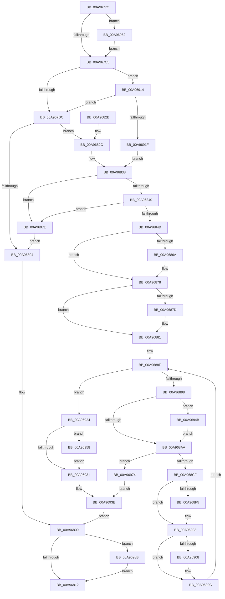

# CmFcpManagerPublishFeatureUsageDataBuffers

- RVA: `0x00A9677C`–`0x00A969A2` (길이 `550` bytes)
- VA: `0x0000000140A9677C`
- 실행 섹션: `PAGE`
- PDB 이름 있음: `예`; PDB Function 태그: `아니요`
- unwind 정보 RVA: `0x000B9BF0`
- 디코드: `141`개 명령, `550/550` bytes 표시
- 미해석 바이트: `0` (있으면 어셈블리에 `.byte`로 보존)

> 이 문서는 커널 이미지의 기계어와 PDB 기호를 분석해 생성했습니다. 4번과 5번은 함수 원형과 자료형을 바이너리 사용 방식에서 추정한 C 해석이며 원본 소스 복구 결과는 아닙니다.

## 1. Dependencies

- 직접 호출 지점: **19**; 고유 호출 대상: **13**
- 직접 호출자로 확인된 함수: **1**
- RIP 상대 이미지 참조: **1**

### Outgoing calls
- `0x00A967B0` → [KeWaitForSingleObject](../../text/20/KeWaitForSingleObject_function_0020E6B0.md) (function, `0x0020E6B0`)
- `0x00A967CC` → [CmFcpConnectToAlpcServer](CmFcpConnectToAlpcServer_function_00A969A8.md) (function, `0x00A969A8`)
- `0x00A967FB` → [ZwUpdateWnfStateData](../../text/6B/ZwUpdateWnfStateData_function_006B0D10.md) (function, `0x006B0D10`)
- `0x00A96833` → [CmFcpConnectToAlpcServer](CmFcpConnectToAlpcServer_function_00A969A8.md) (function, `0x00A969A8`)
- `0x00A9685A` → [KeAbPreAcquire](../../text/21/KeAbPreAcquire_function_00210230.md) (function, `0x00210230`)
- `0x00A96873` → [ExfAcquirePushLockExclusiveEx](../../text/20/ExfAcquirePushLockExclusiveEx_function_0020FC90.md) (function, `0x0020FC90`)
- `0x00A968AD` → [KeAbPostRelease](../../text/2E/KeAbPostRelease_function_002E1600.md) (function, `0x002E1600`)
- `0x00A968C2` → [CmFcpSendFeatureUsageReportAlpcMessage](../../text/4C/CmFcpSendFeatureUsageReportAlpcMessage_function_004CD2CC.md) (function, `0x004CD2CC`)
- `0x00A968E5` → [KeAbPreAcquire](../../text/21/KeAbPreAcquire_function_00210230.md) (function, `0x00210230`)
- `0x00A968FE` → [ExfAcquirePushLockExclusiveEx](../../text/20/ExfAcquirePushLockExclusiveEx_function_0020FC90.md) (function, `0x0020FC90`)
- `0x00A96934` → [KeAbPostRelease](../../text/2E/KeAbPostRelease_function_002E1600.md) (function, `0x002E1600`)
- `0x00A96941` → [CmFcpManagerOnFeatureUsageDataTransferComplete](../6F/CmFcpManagerOnFeatureUsageDataTransferComplete_function_006FF830.md) (function, `0x006FF830`)
- `0x00A9694E` → [ExfTryToWakePushLock](../../text/26/ExfTryToWakePushLock_function_00265DD0.md) (function, `0x00265DD0`)
- `0x00A9695B` → [ExfTryToWakePushLock](../../text/26/ExfTryToWakePushLock_function_00265DD0.md) (function, `0x00265DD0`)
- `0x00A96962` → [ExUnsubscribeWnfStateChange](../A7/ExUnsubscribeWnfStateChange_function_00A7BE50.md) (function, `0x00A7BE50`)
- `0x00A96977` → [CmFcpManagerArmFeatureUsageProviderPublishTimer](../../text/66/CmFcpManagerArmFeatureUsageProviderPublishTimer_function_0066B280.md) (function, `0x0066B280`)
- `0x00A96981` → [CmFcpManagerArmFeatureUsageProviderPublishTimer](../../text/66/CmFcpManagerArmFeatureUsageProviderPublishTimer_function_0066B280.md) (function, `0x0066B280`)
- `0x00A96990` → [ZwAlpcDisconnectPort](../../text/6A/ZwAlpcDisconnectPort_function_006AE190.md) (function, `0x006AE190`)
- `0x00A96998` → [ZwClose](../../text/6A/ZwClose_function_006AD2B0.md) (function, `0x006AD2B0`)

### Direct callers
- [CmFcpManagerPublishFeatureUsageDataBuffersWorker](../7F/CmFcpManagerPublishFeatureUsageDataBuffersWorker_function_007F5530.md) at `0x007F5537`

### Static image references
- `0x00A967E1` → RVA `0x0001C3A8` (`.rdata`; read)

## 2. Other-region calls and transfers

- 다른 실행 섹션으로 향하는 call: **15**
  - `0x00A967B0` → [KeWaitForSingleObject](../../text/20/KeWaitForSingleObject_function_0020E6B0.md) (`PAGE` → `.text`)
  - `0x00A967FB` → [ZwUpdateWnfStateData](../../text/6B/ZwUpdateWnfStateData_function_006B0D10.md) (`PAGE` → `.text`)
  - `0x00A9685A` → [KeAbPreAcquire](../../text/21/KeAbPreAcquire_function_00210230.md) (`PAGE` → `.text`)
  - `0x00A96873` → [ExfAcquirePushLockExclusiveEx](../../text/20/ExfAcquirePushLockExclusiveEx_function_0020FC90.md) (`PAGE` → `.text`)
  - `0x00A968AD` → [KeAbPostRelease](../../text/2E/KeAbPostRelease_function_002E1600.md) (`PAGE` → `.text`)
  - `0x00A968C2` → [CmFcpSendFeatureUsageReportAlpcMessage](../../text/4C/CmFcpSendFeatureUsageReportAlpcMessage_function_004CD2CC.md) (`PAGE` → `.text`)
  - `0x00A968E5` → [KeAbPreAcquire](../../text/21/KeAbPreAcquire_function_00210230.md) (`PAGE` → `.text`)
  - `0x00A968FE` → [ExfAcquirePushLockExclusiveEx](../../text/20/ExfAcquirePushLockExclusiveEx_function_0020FC90.md) (`PAGE` → `.text`)
  - `0x00A96934` → [KeAbPostRelease](../../text/2E/KeAbPostRelease_function_002E1600.md) (`PAGE` → `.text`)
  - `0x00A9694E` → [ExfTryToWakePushLock](../../text/26/ExfTryToWakePushLock_function_00265DD0.md) (`PAGE` → `.text`)
  - `0x00A9695B` → [ExfTryToWakePushLock](../../text/26/ExfTryToWakePushLock_function_00265DD0.md) (`PAGE` → `.text`)
  - `0x00A96977` → [CmFcpManagerArmFeatureUsageProviderPublishTimer](../../text/66/CmFcpManagerArmFeatureUsageProviderPublishTimer_function_0066B280.md) (`PAGE` → `.text`)
  - `0x00A96981` → [CmFcpManagerArmFeatureUsageProviderPublishTimer](../../text/66/CmFcpManagerArmFeatureUsageProviderPublishTimer_function_0066B280.md) (`PAGE` → `.text`)
  - `0x00A96990` → [ZwAlpcDisconnectPort](../../text/6A/ZwAlpcDisconnectPort_function_006AE190.md) (`PAGE` → `.text`)
  - `0x00A96998` → [ZwClose](../../text/6A/ZwClose_function_006AD2B0.md) (`PAGE` → `.text`)
- 별도 외부 분기/꼬리 이동을 확인하지 못했습니다.

## 3. Assembly (complete function range)

```asm
00A9677C  48 8B C4                        mov rax, rsp
00A9677F  48 89 58 10                     mov qword ptr [rax + 0x10], rbx
00A96783  48 89 68 18                     mov qword ptr [rax + 0x18], rbp
00A96787  48 89 70 20                     mov qword ptr [rax + 0x20], rsi
00A9678B  57                              push rdi
00A9678C  41 56                           push r14
00A9678E  41 57                           push r15
00A96790  48 83 EC 40                     sub rsp, 0x40
00A96794  48 83 60 08 00                  and qword ptr [rax + 8], 0
00A96799  48 8B E9                        mov rbp, rcx
00A9679C  48 83 60 C8 00                  and qword ptr [rax - 0x38], 0
00A967A1  48 81 C1 40 07 00 00            add rcx, 0x740
00A967A8  45 33 C9                        xor r9d, r9d
00A967AB  45 33 C0                        xor r8d, r8d
00A967AE  33 D2                           xor edx, edx
00A967B0  E8 FB 7E 77 FF                  call 0x14020e6b0
00A967B5  48 8B 8D 38 07 00 00            mov rcx, qword ptr [rbp + 0x738]
00A967BC  48 85 C9                        test rcx, rcx
00A967BF  0F 85 9D 01 00 00               jne 0x140a96962
00A967C5  33 D2                           xor edx, edx
00A967C7  48 8D 4C 24 60                  lea rcx, [rsp + 0x60]
00A967CC  E8 D7 01 00 00                  call 0x140a969a8
00A967D1  3D 34 00 00 C0                  cmp eax, 0xc0000034
00A967D6  0F 85 38 01 00 00               jne 0x140a96914
00A967DC  83 64 24 30 00                  and dword ptr [rsp + 0x30], 0
00A967E1  48 8D 0D C0 5B 58 FF            lea rcx, [rip - 0xa7a440]
00A967E8  83 64 24 28 00                  and dword ptr [rsp + 0x28], 0
00A967ED  45 33 C9                        xor r9d, r9d
00A967F0  48 83 64 24 20 00               and qword ptr [rsp + 0x20], 0
00A967F6  45 33 C0                        xor r8d, r8d
00A967F9  33 D2                           xor edx, edx
00A967FB  E8 10 A5 C1 FF                  call 0x1406b0d10
00A96800  85 C0                           test eax, eax
00A96802  79 28                           jns 0x140a9682c
00A96804  48 8B 74 24 60                  mov rsi, qword ptr [rsp + 0x60]
00A96809  48 85 F6                        test rsi, rsi
00A9680C  0F 85 79 01 00 00               jne 0x140a9698b
00A96812  48 8B 5C 24 68                  mov rbx, qword ptr [rsp + 0x68]
00A96817  48 8B 6C 24 70                  mov rbp, qword ptr [rsp + 0x70]
00A9681C  48 8B 74 24 78                  mov rsi, qword ptr [rsp + 0x78]
00A96821  48 83 C4 40                     add rsp, 0x40
00A96825  41 5F                           pop r15
00A96827  41 5E                           pop r14
00A96829  5F                              pop rdi
00A9682A  C3                              ret
00A9682B  CC                              int3
00A9682C  B2 01                           mov dl, 1
00A9682E  48 8D 4C 24 60                  lea rcx, [rsp + 0x60]
00A96833  E8 70 01 00 00                  call 0x140a969a8
00A96838  85 C0                           test eax, eax
00A9683A  0F 88 3E 01 00 00               js 0x140a9697e
00A96840  3D 02 01 00 00                  cmp eax, 0x102
00A96845  0F 84 33 01 00 00               je 0x140a9697e
00A9684B  48 8D BD D8 05 00 00            lea rdi, [rbp + 0x5d8]
00A96852  45 33 C0                        xor r8d, r8d
00A96855  48 8B CF                        mov rcx, rdi
00A96858  33 D2                           xor edx, edx
00A9685A  E8 D1 99 77 FF                  call 0x140210230
00A9685F  F0 48 0F BA 2F 00               lock bts qword ptr [rdi], 0
00A96865  48 8B D8                        mov rbx, rax
00A96868  73 0E                           jae 0x140a96878
00A9686A  4C 8B C7                        mov r8, rdi
00A9686D  48 8B D0                        mov rdx, rax
00A96870  48 8B CF                        mov rcx, rdi
00A96873  E8 18 94 77 FF                  call 0x14020fc90
00A96878  48 85 DB                        test rbx, rbx
00A9687B  74 04                           je 0x140a96881
00A9687D  C6 43 0A 01                     mov byte ptr [rbx + 0xa], 1
00A96881  4C 8D BD B0 05 00 00            lea r15, [rbp + 0x5b0]
00A96888  48 83 CB FF                     or rbx, 0xffffffffffffffff
00A9688C  4D 8B 37                        mov r14, qword ptr [r15]
00A9688F  4D 3B F7                        cmp r14, r15
00A96892  0F 84 8C 00 00 00               je 0x140a96924
00A96898  48 8B C3                        mov rax, rbx
00A9689B  F0 48 0F C1 07                  lock xadd qword ptr [rdi], rax
00A968A0  24 06                           and al, 6
00A968A2  3C 02                           cmp al, 2
00A968A4  0F 84 A1 00 00 00               je 0x140a9694b
00A968AA  48 8B CF                        mov rcx, rdi
00A968AD  E8 4E AD 84 FF                  call 0x1402e1600
00A968B2  48 8B 74 24 60                  mov rsi, qword ptr [rsp + 0x60]
00A968B7  49 8D 56 20                     lea rdx, [r14 + 0x20]
00A968BB  45 8B 46 10                     mov r8d, dword ptr [r14 + 0x10]
00A968BF  48 8B CE                        mov rcx, rsi
00A968C2  E8 05 6A A3 FF                  call 0x1404cd2cc
00A968C7  85 C0                           test eax, eax
00A968C9  0F 88 A5 00 00 00               js 0x140a96974
00A968CF  41 8B 46 18                     mov eax, dword ptr [r14 + 0x18]
00A968D3  45 33 C0                        xor r8d, r8d
00A968D6  83 E0 FA                        and eax, 0xfffffffa
00A968D9  33 D2                           xor edx, edx
00A968DB  83 C8 02                        or eax, 2
00A968DE  48 8B CF                        mov rcx, rdi
00A968E1  41 89 46 18                     mov dword ptr [r14 + 0x18], eax
00A968E5  E8 46 99 77 FF                  call 0x140210230
00A968EA  F0 48 0F BA 2F 00               lock bts qword ptr [rdi], 0
00A968F0  48 8B F0                        mov rsi, rax
00A968F3  73 0E                           jae 0x140a96903
00A968F5  4C 8B C7                        mov r8, rdi
00A968F8  48 8B D0                        mov rdx, rax
00A968FB  48 8B CF                        mov rcx, rdi
00A968FE  E8 8D 93 77 FF                  call 0x14020fc90
00A96903  48 85 F6                        test rsi, rsi
00A96906  74 04                           je 0x140a9690c
00A96908  C6 46 0A 01                     mov byte ptr [rsi + 0xa], 1
00A9690C  4D 8B 36                        mov r14, qword ptr [r14]
00A9690F  E9 7B FF FF FF                  jmp 0x140a9688f
00A96914  3D 01 07 00 C0                  cmp eax, 0xc0000701
00A96919  0F 84 BD FE FF FF               je 0x140a967dc
00A9691F  E9 14 FF FF FF                  jmp 0x140a96838
00A96924  F0 48 0F C1 1F                  lock xadd qword ptr [rdi], rbx
00A96929  80 E3 06                        and bl, 6
00A9692C  80 FB 02                        cmp bl, 2
00A9692F  74 27                           je 0x140a96958
00A96931  48 8B CF                        mov rcx, rdi
00A96934  E8 C7 AC 84 FF                  call 0x1402e1600
00A96939  48 8B 74 24 60                  mov rsi, qword ptr [rsp + 0x60]
00A9693E  48 8B CD                        mov rcx, rbp
00A96941  E8 EA 8E C6 FF                  call 0x1406ff830
00A96946  E9 BE FE FF FF                  jmp 0x140a96809
00A9694B  48 8B CF                        mov rcx, rdi
00A9694E  E8 7D F4 7C FF                  call 0x140265dd0
00A96953  E9 52 FF FF FF                  jmp 0x140a968aa
00A96958  48 8B CF                        mov rcx, rdi
00A9695B  E8 70 F4 7C FF                  call 0x140265dd0
00A96960  EB CF                           jmp 0x140a96931
00A96962  E8 E9 54 FE FF                  call 0x140a7be50
00A96967  48 83 A5 38 07 00 00 00         and qword ptr [rbp + 0x738], 0
00A9696F  E9 51 FE FF FF                  jmp 0x140a967c5
00A96974  48 8B CD                        mov rcx, rbp
00A96977  E8 04 49 BD FF                  call 0x14066b280
00A9697C  EB C0                           jmp 0x140a9693e
00A9697E  48 8B CD                        mov rcx, rbp
00A96981  E8 FA 48 BD FF                  call 0x14066b280
00A96986  E9 79 FE FF FF                  jmp 0x140a96804
00A9698B  33 D2                           xor edx, edx
00A9698D  48 8B CE                        mov rcx, rsi
00A96990  E8 FB 77 C1 FF                  call 0x1406ae190
00A96995  48 8B CE                        mov rcx, rsi
00A96998  E8 13 69 C1 FF                  call 0x1406ad2b0
00A9699D  E9 70 FE FF FF                  jmp 0x140a96812
```

## 4. C-style interpretation (structured pseudocode)

```c
__int64 __fastcall CmFcpManagerPublishFeatureUsageDataBuffers(__int64 a1, int a2, int a3, int a4)
{
    __int64 result;
    __int64 v_rbx;
    __int64 v_rsp;
    unsigned int v_stack_m28;
    unsigned int v_stack_m30;
    unsigned __int64 v_stack_m38;
    unsigned __int64 v_stack_p10;
    unsigned __int64 v_stack_p18;
    unsigned __int64 v_stack_p20;
    unsigned __int64 v_stack_p60;
    unsigned __int64 v_stack_p8;

    *(unsigned __int64 *)(v_rsp + 16) = v_rbx;
    *(unsigned __int64 *)(v_rsp + 24) = v_rbp;
    *(unsigned __int64 *)(v_rsp + 32) = v_rsi;
    v_rsp = (v_rsp) - (64);
    a1 = (a1) + (0x740ULL);
    a4 = 0;
    a3 = 0;
    a2 = 0;
    result = KeWaitForSingleObject(a1, a2, a3, a4);
    if (*(unsigned __int64 *)(a1 + 1848) != 0) goto loc_00A96962;
loc_00A967C5:
    a2 = 0;
    result = CmFcpConnectToAlpcServer(v_stack_p8, a2, a3, a4);
    if (((unsigned int)(result)) != 0xC0000034ULL) goto loc_00A96914;
loc_00A967DC:
    a4 = 0;
    a3 = 0;
    a2 = 0;
    result = ZwUpdateWnfStateData(v_rip - 10986560, a2, a3, a4);
    if (!sign_flag) goto loc_00A9682C;
loc_00A96804:
loc_00A96809:
    if (v_stack_p8 != 0) goto loc_00A9698B;
loc_00A96812:
    v_rsp = (v_rsp) + (64);
    return result;
loc_00A9682C:
    result = CmFcpConnectToAlpcServer(v_stack_p60, 1, a3, a4);
loc_00A96838:
    if (sign_flag) goto loc_00A9697E;
    if (((unsigned int)(result)) == 258) goto loc_00A9697E;
    a3 = 0;
    a2 = 0;
    result = KeAbPreAcquire(v_stack_p18 + 1496, a2, a3, a4);
    if (!(condition_is_above_or_equal)) {
        a3 = v_stack_p18 + 1496;
        a2 = result;
        a1 = v_stack_p18 + 1496;
        result = ExfAcquirePushLockExclusiveEx(a1, a2, a3, a4);
    }
    if (result != 0) {
        *(unsigned __int8 *)(result + 10) = 1;
    }
    v_rbx = (result) | (-1);
loc_00A9688F:
    if ((*(unsigned __int64 *)(v_stack_p18 + 1456)) == (v_stack_p18 + 1456)) goto loc_00A96924;
    result = (unsigned __int8)((v_rbx) & (6));
    if (((unsigned __int8)(result)) == 2) goto loc_00A9694B;
loc_00A968AA:
    result = KeAbPostRelease(v_stack_p18 + 1496, a2, a3, a4);
    result = CmFcpSendFeatureUsageReportAlpcMessage(v_stack_p60, *(unsigned __int64 *)(v_stack_p18 + 1456) + 32, (unsigned int)(*(unsigned int *)(*(unsigned __int64 *)(v_stack_p18 + 1456) + 16)), a4);
    if (sign_flag) goto loc_00A96974;
    a3 = 0;
    result = (unsigned int)(((unsigned int)(*(unsigned int *)(*(unsigned __int64 *)(v_stack_p18 + 1456) + 24))) & (0xFFFFFFFAULL));
    a2 = 0;
    result = (unsigned int)((result) | (2));
    *(unsigned int *)(*(unsigned __int64 *)(v_stack_p18 + 1456) + 24) = (unsigned int)(result);
    result = KeAbPreAcquire(v_stack_p18 + 1496, a2, a3, a4);
    if (!(condition_is_above_or_equal)) {
        a3 = v_stack_p18 + 1496;
        a2 = result;
        a1 = v_stack_p18 + 1496;
        result = ExfAcquirePushLockExclusiveEx(a1, a2, a3, a4);
    }
    if (result != 0) {
        *(unsigned __int8 *)(result + 10) = 1;
    }
    goto loc_00A9688F;
loc_00A96914:
    if (((unsigned int)(result)) == 0xC0000701ULL) goto loc_00A967DC;
    goto loc_00A96838;
loc_00A96924:
    v_rbx = (unsigned __int8)((v_rbx) & (6));
    if (((unsigned __int8)(v_rbx)) == 2) goto loc_00A96958;
loc_00A96931:
    result = KeAbPostRelease(v_stack_p18 + 1496, a2, a3, a4);
loc_00A9693E:
    result = CmFcpManagerOnFeatureUsageDataTransferComplete(v_stack_p18, a2, a3, a4);
    goto loc_00A96809;
loc_00A9694B:
    result = ExfTryToWakePushLock(v_stack_p18 + 1496, a2, a3, a4);
    goto loc_00A968AA;
loc_00A96958:
    result = ExfTryToWakePushLock(v_stack_p18 + 1496, a2, a3, a4);
    goto loc_00A96931;
loc_00A96962:
    result = ExUnsubscribeWnfStateChange(v_stack_p18 + 1496, a2, a3, a4);
    goto loc_00A967C5;
loc_00A96974:
    result = CmFcpManagerArmFeatureUsageProviderPublishTimer(v_stack_p18, a2, a3, a4);
    goto loc_00A9693E;
loc_00A9697E:
    result = CmFcpManagerArmFeatureUsageProviderPublishTimer(v_stack_p18, a2, a3, a4);
    goto loc_00A96804;
loc_00A9698B:
    a2 = 0;
    result = ZwAlpcDisconnectPort(v_stack_p60, a2, a3, a4);
    result = ZwClose(v_stack_p60, a2, a3, a4);
    goto loc_00A96812;
}
```

## 5. (Beta) C Style

```c
int64_t CmFcpManagerPublishFeatureUsageDataBuffers(void *Arg1, int32_t Arg2, int32_t Arg3, int32_t Arg4)
{
    uint8_t *arg1 = (uint8_t *)Arg1;

    int64_t result;
    int64_t local_rbx;
    int64_t local_rsp;
    uint32_t v_stack_m28;
    uint32_t v_stack_m30;
    uint64_t v_stack_m38;
    uint64_t v_stack_p10;
    uint64_t v_stack_p18;
    uint64_t v_stack_p20;
    uint64_t v_stack_p60;
    uint64_t v_stack_p8;

    *(uint64_t *)(local_rsp + 0x10) = local_rbx;
    *(uint64_t *)(local_rsp + 0x18) = local_rbp;
    *(uint64_t *)(local_rsp + 0x20) = local_rsi;
    local_rsp = (local_rsp) - (64);
    Arg1 = (Arg1) + (0x740ULL);
    Arg4 = 0;
    Arg3 = 0;
    Arg2 = 0;
    result = KeWaitForSingleObject(Arg1, Arg2, Arg3, Arg4);
    if (*(uint64_t *)(arg1 + 0x738) != 0) goto loc_00A96962;
loc_00A967C5:
    Arg2 = 0;
    result = CmFcpConnectToAlpcServer(v_stack_p8, Arg2, Arg3, Arg4);
    if (((uint32_t)(result)) != 0xC0000034ULL) goto loc_00A96914;
loc_00A967DC:
    Arg4 = 0;
    Arg3 = 0;
    Arg2 = 0;
    result = ZwUpdateWnfStateData(v_rip - 10986560, Arg2, Arg3, Arg4);
    if (!sign_flag) goto loc_00A9682C;
loc_00A96804:
loc_00A96809:
    if (v_stack_p8 != 0) goto loc_00A9698B;
loc_00A96812:
    local_rsp = (local_rsp) + (64);
    return result;
loc_00A9682C:
    result = CmFcpConnectToAlpcServer(v_stack_p60, 1, Arg3, Arg4);
loc_00A96838:
    if (sign_flag) goto loc_00A9697E;
    if (((uint32_t)(result)) == 258) goto loc_00A9697E;
    Arg3 = 0;
    Arg2 = 0;
    result = KeAbPreAcquire(v_stack_p18 + 1496, Arg2, Arg3, Arg4);
    if (!(condition_is_above_or_equal)) {
        Arg3 = v_stack_p18 + 1496;
        Arg2 = result;
        Arg1 = v_stack_p18 + 1496;
        result = ExfAcquirePushLockExclusiveEx(Arg1, Arg2, Arg3, Arg4);
    }
    if (result != 0) {
        *(uint8_t *)(result + 0xA) = 1;
    }
    local_rbx = (result) | (-1);
loc_00A9688F:
    if ((*(uint64_t *)(v_stack_p18 + 0x5B0)) == (v_stack_p18 + 1456)) goto loc_00A96924;
    result = (uint8_t)((local_rbx) & (6));
    if (((uint8_t)(result)) == 2) goto loc_00A9694B;
loc_00A968AA:
    result = KeAbPostRelease(v_stack_p18 + 1496, Arg2, Arg3, Arg4);
    result = CmFcpSendFeatureUsageReportAlpcMessage(v_stack_p60, *(uint64_t *)(v_stack_p18 + 0x5B0) + 32, (uint32_t)(*(uint32_t *)(*(uint64_t *)(v_stack_p18 + 0x5B0) + 0x10)), Arg4);
    if (sign_flag) goto loc_00A96974;
    Arg3 = 0;
    result = (uint32_t)(((uint32_t)(*(uint32_t *)(*(uint64_t *)(v_stack_p18 + 0x5B0) + 0x18))) & (0xFFFFFFFAULL));
    Arg2 = 0;
    result = (uint32_t)((result) | (2));
    *(uint32_t *)(*(uint64_t *)(v_stack_p18 + 0x5B0) + 0x18) = (uint32_t)(result);
    result = KeAbPreAcquire(v_stack_p18 + 1496, Arg2, Arg3, Arg4);
    if (!(condition_is_above_or_equal)) {
        Arg3 = v_stack_p18 + 1496;
        Arg2 = result;
        Arg1 = v_stack_p18 + 1496;
        result = ExfAcquirePushLockExclusiveEx(Arg1, Arg2, Arg3, Arg4);
    }
    if (result != 0) {
        *(uint8_t *)(result + 0xA) = 1;
    }
    goto loc_00A9688F;
loc_00A96914:
    if (((uint32_t)(result)) == 0xC0000701ULL) goto loc_00A967DC;
    goto loc_00A96838;
loc_00A96924:
    local_rbx = (uint8_t)((local_rbx) & (6));
    if (((uint8_t)(local_rbx)) == 2) goto loc_00A96958;
loc_00A96931:
    result = KeAbPostRelease(v_stack_p18 + 1496, Arg2, Arg3, Arg4);
loc_00A9693E:
    result = CmFcpManagerOnFeatureUsageDataTransferComplete(v_stack_p18, Arg2, Arg3, Arg4);
    goto loc_00A96809;
loc_00A9694B:
    result = ExfTryToWakePushLock(v_stack_p18 + 1496, Arg2, Arg3, Arg4);
    goto loc_00A968AA;
loc_00A96958:
    result = ExfTryToWakePushLock(v_stack_p18 + 1496, Arg2, Arg3, Arg4);
    goto loc_00A96931;
loc_00A96962:
    result = ExUnsubscribeWnfStateChange(v_stack_p18 + 1496, Arg2, Arg3, Arg4);
    goto loc_00A967C5;
loc_00A96974:
    result = CmFcpManagerArmFeatureUsageProviderPublishTimer(v_stack_p18, Arg2, Arg3, Arg4);
    goto loc_00A9693E;
loc_00A9697E:
    result = CmFcpManagerArmFeatureUsageProviderPublishTimer(v_stack_p18, Arg2, Arg3, Arg4);
    goto loc_00A96804;
loc_00A9698B:
    Arg2 = 0;
    result = ZwAlpcDisconnectPort(v_stack_p60, Arg2, Arg3, Arg4);
    result = ZwClose(v_stack_p60, Arg2, Arg3, Arg4);
    goto loc_00A96812;
}
```

### 관측된 메모리 오프셋

구조체 형식이 확인되지 않은 접근은 인자 기준의 오프셋으로만 기록했습니다.

| 기준 인자 | 오프셋 표현 | 폭 (bit) | 접근 |
|---|---:|---:|---|
| `Arg1` | `+ 0x0` | `64` | `R` |
| `Arg1` | `+ 0x0` | `64` | `R/W` |
| `Arg1` | `+ 0x5B0` | `64` | `R` |
| `Arg1` | `+ 0x5D8` | `64` | `R` |
| `Arg1` | `+ 0x738` | `64` | `R` |
| `Arg1` | `+ 0x738` | `64` | `R/W` |

## 6. Execution-region graph

[열기: 2D/3D 그래프와 함수 탐색 컨트롤 패널](../../../control-panel.html?section=page&rva=0x00A9677C&view=graph)

- 2D 그래프는 위에서 아래로 흐르고, 3D 그래프는 빈 공간을 드래그해 회전합니다. Shift+드래그는 이동, 휠은 확대·축소, 함수 노드 선택은 대상 보고서 이동입니다.

### Static fallback


