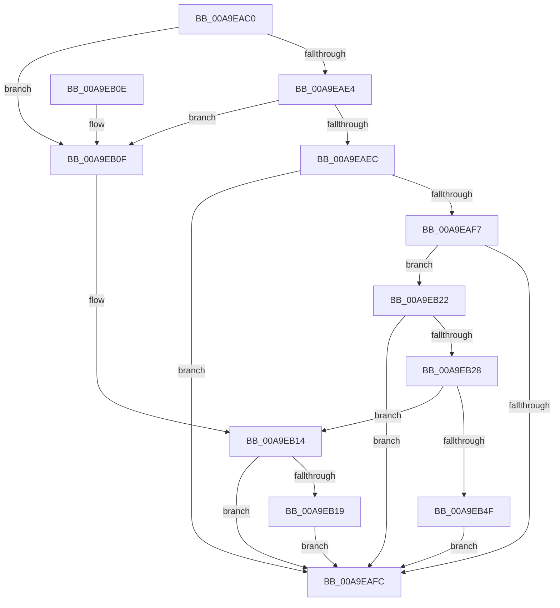

# CmGetDeviceInterfaceRegKeySecurityDescriptor

- RVA: `0x00A9EAC0`–`0x00A9EB54` (길이 `148` bytes)
- VA: `0x0000000140A9EAC0`
- 실행 섹션: `PAGE`
- PDB 이름 있음: `예`; PDB Function 태그: `아니요`
- unwind 정보 RVA: `0x00083254`
- 디코드: `46`개 명령, `148/148` bytes 표시
- 미해석 바이트: `0` (있으면 어셈블리에 `.byte`로 보존)

> 이 문서는 커널 이미지의 기계어와 PDB 기호를 분석해 생성했습니다. 4번과 5번은 함수 원형과 자료형을 바이너리 사용 방식에서 추정한 C 해석이며 원본 소스 복구 결과는 아닙니다.

## 1. Dependencies

- 직접 호출 지점: **2**; 고유 호출 대상: **2**
- 직접 호출자로 확인된 함수: **1**
- RIP 상대 이미지 참조: **0**

### Outgoing calls
- `0x00A9EB1B` → [ExFreePoolWithTag](../../poolcode/B8/ExFreePoolWithTag_function_00B82870.md) (function, `0x00B82870`)
- `0x00A9EB3F` → [_CmGetRegKeySecurityDescriptor](../A8/_CmGetRegKeySecurityDescriptor_function_00A83F34.md) (function, `0x00A83F34`)

### Direct callers
- [_CmOpenDeviceInterfaceRegKeyWorker](../8F/_CmOpenDeviceInterfaceRegKeyWorker_function_008F2B48.md) at `0x008F304F`

### Static image references
- 디코드된 RIP-relative 메모리 참조가 없습니다.

## 2. Other-region calls and transfers

- 다른 실행 섹션으로 향하는 call: **1**
  - `0x00A9EB1B` → [ExFreePoolWithTag](../../poolcode/B8/ExFreePoolWithTag_function_00B82870.md) (`PAGE` → `POOLCODE`)
- 별도 외부 분기/꼬리 이동을 확인하지 못했습니다.

## 3. Assembly (complete function range)

```asm
00A9EAC0  48 89 5C 24 08                  mov qword ptr [rsp + 8], rbx
00A9EAC5  48 89 74 24 10                  mov qword ptr [rsp + 0x10], rsi
00A9EACA  57                              push rdi
00A9EACB  48 83 EC 20                     sub rsp, 0x20
00A9EACF  33 F6                           xor esi, esi
00A9EAD1  48 8B C1                        mov rax, rcx
00A9EAD4  8B CE                           mov ecx, esi
00A9EAD6  49 8B F8                        mov rdi, r8
00A9EAD9  48 89 4C 24 48                  mov qword ptr [rsp + 0x48], rcx
00A9EADE  8B DE                           mov ebx, esi
00A9EAE0  85 D2                           test edx, edx
00A9EAE2  74 2B                           je 0x140a9eb0f
00A9EAE4  F7 C2 CC FC FF FF               test edx, 0xfffffccc
00A9EAEA  75 23                           jne 0x140a9eb0f
00A9EAEC  49 89 30                        mov qword ptr [r8], rsi
00A9EAEF  F7 C2 00 0F 00 00               test edx, 0xf00
00A9EAF5  75 05                           jne 0x140a9eafc
00A9EAF7  80 FA 32                        cmp dl, 0x32
00A9EAFA  74 26                           je 0x140a9eb22
00A9EAFC  48 8B 74 24 38                  mov rsi, qword ptr [rsp + 0x38]
00A9EB01  8B C3                           mov eax, ebx
00A9EB03  48 8B 5C 24 30                  mov rbx, qword ptr [rsp + 0x30]
00A9EB08  48 83 C4 20                     add rsp, 0x20
00A9EB0C  5F                              pop rdi
00A9EB0D  C3                              ret
00A9EB0E  CC                              int3
00A9EB0F  BB 0D 00 00 C0                  mov ebx, 0xc000000d
00A9EB14  48 85 C9                        test rcx, rcx
00A9EB17  74 E3                           je 0x140a9eafc
00A9EB19  33 D2                           xor edx, edx
00A9EB1B  E8 50 3D 0E 00                  call 0x140b82870
00A9EB20  EB DA                           jmp 0x140a9eafc
00A9EB22  40 38 70 04                     cmp byte ptr [rax + 4], sil
00A9EB26  74 D4                           je 0x140a9eafc
00A9EB28  81 38 00 00 00 0A               cmp dword ptr [rax], 0xa000000
00A9EB2E  BA 01 00 00 00                  mov edx, 1
00A9EB33  40 0F B6 CE                     movzx ecx, sil
00A9EB37  0F 43 CA                        cmovae ecx, edx
00A9EB3A  48 8D 54 24 48                  lea rdx, [rsp + 0x48]
00A9EB3F  E8 F0 53 FE FF                  call 0x140a83f34
00A9EB44  48 8B 4C 24 48                  mov rcx, qword ptr [rsp + 0x48]
00A9EB49  8B D8                           mov ebx, eax
00A9EB4B  85 C0                           test eax, eax
00A9EB4D  78 C5                           js 0x140a9eb14
00A9EB4F  48 89 0F                        mov qword ptr [rdi], rcx
00A9EB52  EB A8                           jmp 0x140a9eafc
```

## 4. C-style interpretation (structured pseudocode)

```c
__int64 __fastcall CmGetDeviceInterfaceRegKeySecurityDescriptor(__int64 a1, int a2, __int64 a3)
{
    __int64 result;
    __int64 v_rsi;
    __int64 v_rsp;
    unsigned __int64 v_stack_p10;
    unsigned __int64 v_stack_p20;
    unsigned __int64 v_stack_p48;
    unsigned __int64 v_stack_p8;

    v_stack_p8 = v_rbx;
    v_stack_p10 = v_rsi;
    v_rsp = (v_rsp) - (32);
    v_rsi = 0;
    v_stack_p20 = 0;
    if (a2 == 0) goto loc_00A9EB0F;
    if (((a2) & (0xFFFFFCCCULL)) != 0) goto loc_00A9EB0F;
    *(unsigned __int64 *)(a3) = 0;
    if (((a2) & (0xF00ULL)) != 0) goto loc_00A9EAFC;
    if (((unsigned __int8)(a2)) == 50) goto loc_00A9EB22;
loc_00A9EAFC:
    v_rsp = (v_rsp) + (32);
    return 0;
loc_00A9EB0F:
loc_00A9EB14:
    if (0 == 0) goto loc_00A9EAFC;
    a2 = 0;
    result = ExFreePoolWithTag(0, a2, a3, a4);
    goto loc_00A9EAFC;
loc_00A9EB22:
    if ((*(unsigned __int8 *)(result + 4)) == ((unsigned __int8)(v_stack_p10))) goto loc_00A9EAFC;
    a1 = (unsigned __int8)(v_stack_p10);
    if ((*(unsigned int *)(result)) >= 0xA000000ULL) { a1 = 1; }
    result = _CmGetRegKeySecurityDescriptor(a1, v_stack_p48, a3, a4);
    if (sign_flag) goto loc_00A9EB14;
    *(unsigned __int64 *)(a3) = v_stack_p48;
    goto loc_00A9EAFC;
}
```

## 5. (Beta) C Style

```c
int64_t CmGetDeviceInterfaceRegKeySecurityDescriptor(void *Arg1, int32_t Arg2, void *Arg3)
{
    uint8_t *arg1 = (uint8_t *)Arg1;
    uint8_t *arg3 = (uint8_t *)Arg3;

    int64_t result;
    int64_t local_rsi;
    int64_t local_rsp;
    uint64_t v_stack_p10;
    uint64_t v_stack_p20;
    uint64_t v_stack_p48;
    uint64_t v_stack_p8;

    v_stack_p8 = local_rbx;
    v_stack_p10 = local_rsi;
    local_rsp = (local_rsp) - (32);
    local_rsi = 0;
    v_stack_p20 = 0;
    if (Arg2 == 0) goto loc_00A9EB0F;
    if (((Arg2) & (0xFFFFFCCCULL)) != 0) goto loc_00A9EB0F;
    *(uint64_t *)(arg3) = 0;
    if (((Arg2) & (0xF00ULL)) != 0) goto loc_00A9EAFC;
    if (((uint8_t)(Arg2)) == 50) goto loc_00A9EB22;
loc_00A9EAFC:
    local_rsp = (local_rsp) + (32);
    return 0;
loc_00A9EB0F:
loc_00A9EB14:
    if (0 == 0) goto loc_00A9EAFC;
    Arg2 = 0;
    result = ExFreePoolWithTag(0, Arg2, Arg3, a4);
    goto loc_00A9EAFC;
loc_00A9EB22:
    if ((*(uint8_t *)(result + 0x4)) == ((uint8_t)(v_stack_p10))) goto loc_00A9EAFC;
    Arg1 = (uint8_t)(v_stack_p10);
    if ((*(uint32_t *)(result)) >= 0xA000000ULL) { Arg1 = 1; }
    result = _CmGetRegKeySecurityDescriptor(Arg1, v_stack_p48, Arg3, a4);
    if (sign_flag) goto loc_00A9EB14;
    *(uint64_t *)(arg3) = v_stack_p48;
    goto loc_00A9EAFC;
}
```

### 관측된 메모리 오프셋

구조체 형식이 확인되지 않은 접근은 인자 기준의 오프셋으로만 기록했습니다.

| 기준 인자 | 오프셋 표현 | 폭 (bit) | 접근 |
|---|---:|---:|---|
| `Arg1` | `+ 0x0` | `32` | `R` |
| `Arg1` | `+ 0x4` | `8` | `R` |
| `Arg3` | `+ 0x0` | `64` | `W` |

## 6. Execution-region graph

[열기: 2D/3D 그래프와 함수 탐색 컨트롤 패널](../../../control-panel.html?section=page&rva=0x00A9EAC0&view=graph)

- 2D 그래프는 위에서 아래로 흐르고, 3D 그래프는 빈 공간을 드래그해 회전합니다. Shift+드래그는 이동, 휠은 확대·축소, 함수 노드 선택은 대상 보고서 이동입니다.

### Static fallback


