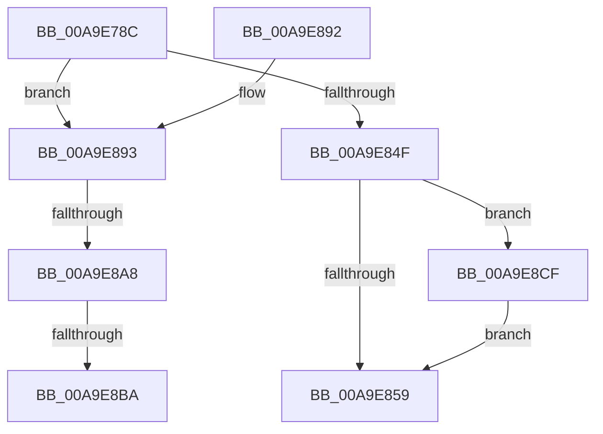

# CmpResolveHiveLoadConflict

- RVA: `0x00A9E78C`–`0x00A9E8D9` (길이 `333` bytes)
- VA: `0x0000000140A9E78C`
- 실행 섹션: `PAGE`
- PDB 이름 있음: `예`; PDB Function 태그: `예`
- unwind 정보 RVA: `0x000BA8F8`
- 디코드: `83`개 명령, `333/333` bytes 표시
- 미해석 바이트: `0` (있으면 어셈블리에 `.byte`로 보존)

> 이 문서는 커널 이미지의 기계어와 PDB 기호를 분석해 생성했습니다. 4번과 5번은 함수 원형과 자료형을 바이너리 사용 방식에서 추정한 C 해석이며 원본 소스 복구 결과는 아닙니다.

## 1. Dependencies

- 직접 호출 지점: **9**; 고유 호출 대상: **9**
- 직접 호출자로 확인된 함수: **2**
- RIP 상대 이미지 참조: **2**

### Outgoing calls
- `0x00A9E7F8` → [memset](../../text/6C/memset_function_006C6C40.md) (function, `0x006C6C40`)
- `0x00A9E811` → [CmpInitializeParseContext](../87/CmpInitializeParseContext_function_008767F0.md) (function, `0x008767F0`)
- `0x00A9E841` → [ObReferenceObjectByNameEx](../8B/ObReferenceObjectByNameEx_function_008BD524.md) (function, `0x008BD524`)
- `0x00A9E860` → [CmpCleanupParseContext](../87/CmpCleanupParseContext_function_00876910.md) (function, `0x00876910`)
- `0x00A9E872` → [_security_check_cookie](../../text/6A/_security_check_cookie_function_006AC640.md) (function, `0x006AC640`)
- `0x00A9E893` → [LOCK_HIVE_LOAD](../9B/LOCK_HIVE_LOAD_function_009B2300.md) (function, `0x009B2300`)
- `0x00A9E89A` → [CmpLockRegistryFreezeAware](../9B/CmpLockRegistryFreezeAware_function_009B4AE4.md) (function, `0x009B4AE4`)
- `0x00A9E8AD` → [CmpIsKeyDeletedForKeyBody](../../pagecmrc/BC/CmpIsKeyDeletedForKeyBody_function_00BC9480.md) (function, `0x00BC9480`)
- `0x00A9E8D2` → [ObfDereferenceObject](../../text/2F/ObfDereferenceObject_function_002F9350.md) (function, `0x002F9350`)

### Direct callers
- [CmLoadKey](../87/CmLoadKey_function_008787CC.md) at `0x00878F59`
- [sub_00B17DB0](../B1/Unknown_function_00B17DB0.md) at `0x00B17E3F`

### Static image references
- `0x00A9E7A3` → RVA `0x00E0A740` (`.data`; read)
- `0x00A9E816` → RVA `0x00FC6AC0` (`ALMOSTRO`; read)

## 2. Other-region calls and transfers

- 다른 실행 섹션으로 향하는 call: **4**
  - `0x00A9E7F8` → [memset](../../text/6C/memset_function_006C6C40.md) (`PAGE` → `.text`)
  - `0x00A9E872` → [_security_check_cookie](../../text/6A/_security_check_cookie_function_006AC640.md) (`PAGE` → `.text`)
  - `0x00A9E8AD` → [CmpIsKeyDeletedForKeyBody](../../pagecmrc/BC/CmpIsKeyDeletedForKeyBody_function_00BC9480.md) (`PAGE` → `PAGECMRC`)
  - `0x00A9E8D2` → [ObfDereferenceObject](../../text/2F/ObfDereferenceObject_function_002F9350.md) (`PAGE` → `.text`)
- call이 아닌 외부 분기/꼬리 이동: **3**
  - `0x00A9E8A2` → [sub_00B49062 + 0x2A](../B4/Unknown_function_00B49062.md) (`tail-transfer`)
  - `0x00A9E8B4` → [sub_00B49062](../B4/Unknown_function_00B49062.md) (`tail-transfer`)
  - `0x00A9E8CA` → [sub_00B49062 + 0x14C](../B4/Unknown_function_00B49062.md) (`tail-transfer`)

## 3. Assembly (complete function range)

```asm
00A9E78C  48 89 5C 24 10                  mov qword ptr [rsp + 0x10], rbx
00A9E791  55                              push rbp
00A9E792  56                              push rsi
00A9E793  57                              push rdi
00A9E794  41 54                           push r12
00A9E796  41 55                           push r13
00A9E798  41 56                           push r14
00A9E79A  41 57                           push r15
00A9E79C  48 81 EC 40 02 00 00            sub rsp, 0x240
00A9E7A3  48 8B 05 96 BF 36 00            mov rax, qword ptr [rip + 0x36bf96]
00A9E7AA  48 33 C4                        xor rax, rsp
00A9E7AD  48 89 84 24 30 02 00 00         mov qword ptr [rsp + 0x230], rax
00A9E7B5  48 8B 84 24 B8 02 00 00         mov rax, qword ptr [rsp + 0x2b8]
00A9E7BD  45 8B F0                        mov r14d, r8d
00A9E7C0  4C 8B A4 24 A0 02 00 00         mov r12, qword ptr [rsp + 0x2a0]
00A9E7C8  4C 8B EA                        mov r13, rdx
00A9E7CB  48 8B AC 24 A8 02 00 00         mov rbp, qword ptr [rsp + 0x2a8]
00A9E7D3  48 8B D9                        mov rbx, rcx
00A9E7D6  48 89 44 24 50                  mov qword ptr [rsp + 0x50], rax
00A9E7DB  48 8D 4C 24 60                  lea rcx, [rsp + 0x60]
00A9E7E0  48 8B 84 24 C0 02 00 00         mov rax, qword ptr [rsp + 0x2c0]
00A9E7E8  33 D2                           xor edx, edx
00A9E7EA  41 B8 D0 01 00 00               mov r8d, 0x1d0
00A9E7F0  48 89 44 24 58                  mov qword ptr [rsp + 0x58], rax
00A9E7F5  49 8B F9                        mov rdi, r9
00A9E7F8  E8 43 84 C2 FF                  call 0x1406c6c40
00A9E7FD  33 F6                           xor esi, esi
00A9E7FF  48 8D 4C 24 60                  lea rcx, [rsp + 0x60]
00A9E804  48 89 74 24 48                  mov qword ptr [rsp + 0x48], rsi
00A9E809  44 8B FE                        mov r15d, esi
00A9E80C  48 89 74 24 40                  mov qword ptr [rsp + 0x40], rsi
00A9E811  E8 DA 7F DD FF                  call 0x1408767f0
00A9E816  4C 8B 0D A3 82 52 00            mov r9, qword ptr [rip + 0x5282a3]
00A9E81D  48 8D 44 24 40                  lea rax, [rsp + 0x40]
00A9E822  48 89 44 24 30                  mov qword ptr [rsp + 0x30], rax
00A9E827  33 D2                           xor edx, edx
00A9E829  48 8D 44 24 60                  lea rax, [rsp + 0x60]
00A9E82E  41 B8 19 00 02 00               mov r8d, 0x20019
00A9E834  48 89 44 24 28                  mov qword ptr [rsp + 0x28], rax
00A9E839  48 8B CB                        mov rcx, rbx
00A9E83C  40 88 74 24 20                  mov byte ptr [rsp + 0x20], sil
00A9E841  E8 DE EC E1 FF                  call 0x1408bd524
00A9E846  48 8B 74 24 40                  mov rsi, qword ptr [rsp + 0x40]
00A9E84B  85 C0                           test eax, eax
00A9E84D  79 44                           jns 0x140a9e893
00A9E84F  BB 25 02 00 C0                  mov ebx, 0xc0000225
00A9E854  48 85 F6                        test rsi, rsi
00A9E857  75 76                           jne 0x140a9e8cf
00A9E859  33 D2                           xor edx, edx
00A9E85B  48 8D 4C 24 60                  lea rcx, [rsp + 0x60]
00A9E860  E8 AB 80 DD FF                  call 0x140876910
00A9E865  8B C3                           mov eax, ebx
00A9E867  48 8B 8C 24 30 02 00 00         mov rcx, qword ptr [rsp + 0x230]
00A9E86F  48 33 CC                        xor rcx, rsp
00A9E872  E8 C9 DD C0 FF                  call 0x1406ac640
00A9E877  48 8B 9C 24 88 02 00 00         mov rbx, qword ptr [rsp + 0x288]
00A9E87F  48 81 C4 40 02 00 00            add rsp, 0x240
00A9E886  41 5F                           pop r15
00A9E888  41 5E                           pop r14
00A9E88A  41 5D                           pop r13
00A9E88C  41 5C                           pop r12
00A9E88E  5F                              pop rdi
00A9E88F  5E                              pop rsi
00A9E890  5D                              pop rbp
00A9E891  C3                              ret
00A9E892  CC                              int3
00A9E893  E8 68 3A F1 FF                  call 0x1409b2300
00A9E898  B1 01                           mov cl, 1
00A9E89A  E8 45 62 F1 FF                  call 0x1409b4ae4
00A9E89F  48 85 FF                        test rdi, rdi
00A9E8A2  0F 84 E4 A7 0A 00               je 0x140b4908c
00A9E8A8  33 D2                           xor edx, edx
00A9E8AA  48 8B CF                        mov rcx, rdi
00A9E8AD  E8 CE AB 12 00                  call 0x140bc9480
00A9E8B2  84 C0                           test al, al
00A9E8B4  0F 84 A8 A7 0A 00               je 0x140b49062
00A9E8BA  BB 7C 01 00 C0                  mov ebx, 0xc000017c
00A9E8BF  C7 44 24 20 10 00 00 00         mov dword ptr [rsp + 0x20], 0x10
00A9E8C7  44 8B CB                        mov r9d, ebx
00A9E8CA  E9 DF A8 0A 00                  jmp 0x140b491ae
00A9E8CF  48 8B CE                        mov rcx, rsi
00A9E8D2  E8 79 AA 85 FF                  call 0x1402f9350
00A9E8D7  EB 80                           jmp 0x140a9e859
```

## 4. C-style interpretation (structured pseudocode)

```c
__int64 __fastcall CmpResolveHiveLoadConflict(__int64 a1, __int64 a2, int a3, __int64 a4, __int64 a5, __int64 a6, __int64 a7, __int64 a8, __int64 a9)
{
    __int64 result;
    __int64 v_rsi;
    __int64 v_rsp;
    unsigned __int64 v_stack_m218;
    unsigned __int64 v_stack_m220;
    unsigned __int64 v_stack_m228;
    unsigned __int64 v_stack_m230;
    unsigned __int64 v_stack_m238;
    unsigned __int64 v_stack_m248;
    unsigned __int64 v_stack_m250;
    unsigned __int8 v_stack_m258;
    unsigned __int64 v_stack_m48;
    unsigned __int64 v_stack_p10;
    unsigned int v_stack_p20;

    v_stack_p10 = v_rbx;
    v_rsp = (v_rsp) - (576);
    result = (*(unsigned __int64 *)(v_rip + 3587990)) ^ (v_rsp);
    v_stack_m48 = result;
    v_stack_m228 = a8;
    a2 = 0;
    v_stack_m220 = a9;
    result = memset(v_stack_m218, a2, 464, a4);
    v_rsi = 0;
    v_stack_m230 = 0;
    v_stack_m238 = 0;
    result = CmpInitializeParseContext(v_stack_m218, a2, 464, a4);
    v_stack_m248 = v_stack_m238;
    a2 = 0;
    v_stack_m250 = v_stack_m218;
    v_stack_m258 = 0;
    result = ObReferenceObjectByNameEx(a1, a2, (unsigned int)(0x20019ULL), *(unsigned __int64 *)(v_rip + 5407395));
    if (!sign_flag) goto loc_00A9E893;
    if (v_stack_m238 != 0) goto loc_00A9E8CF;
loc_00A9E859:
    a2 = 0;
    result = CmpCleanupParseContext(v_stack_m218, a2, (unsigned int)(0x20019ULL), *(unsigned __int64 *)(v_rip + 5407395));
    a1 = (v_stack_m48) ^ (v_rsp);
    result = _security_check_cookie(a1, a2, (unsigned int)(0x20019ULL), *(unsigned __int64 *)(v_rip + 5407395));
    v_rsp = (v_rsp) + (576);
    return result;
loc_00A9E893:
    result = LOCK_HIVE_LOAD(a1, a2, (unsigned int)(0x20019ULL), *(unsigned __int64 *)(v_rip + 5407395));
    result = CmpLockRegistryFreezeAware(1, a2, (unsigned int)(0x20019ULL), *(unsigned __int64 *)(v_rip + 5407395));
    a2 = 0;
    result = CmpIsKeyDeletedForKeyBody(a4, a2, (unsigned int)(0x20019ULL), *(unsigned __int64 *)(v_rip + 5407395));
    v_stack_p20 = 16;
loc_00A9E8CF:
    result = ObfDereferenceObject(v_stack_m238, a2, (unsigned int)(0x20019ULL), (unsigned int)((unsigned int)((unsigned int)(0xC000017CULL))));
    goto loc_00A9E859;
}
```

## 5. (Beta) C Style

```c
int64_t CmpResolveHiveLoadConflict(int64_t Arg1, int64_t Arg2, int32_t Arg3, int64_t Arg4, int64_t Arg5, int64_t Arg6, uint64_t Arg7, int64_t Arg8, int64_t Arg9)
{
    int64_t result;
    int64_t local_rsi;
    int64_t local_rsp;
    uint64_t v_stack_m218;
    uint64_t v_stack_m220;
    uint64_t v_stack_m228;
    uint64_t v_stack_m230;
    uint64_t v_stack_m238;
    uint64_t v_stack_m248;
    uint64_t v_stack_m250;
    uint8_t v_stack_m258;
    uint64_t v_stack_m48;
    uint64_t v_stack_p10;
    uint32_t v_stack_p20;

    v_stack_p10 = local_rbx;
    local_rsp = (local_rsp) - (576);
    result = (*(uint64_t *)(v_rip + 0x36BF96)) ^ (local_rsp);
    v_stack_m48 = result;
    v_stack_m228 = Arg8;
    Arg2 = 0;
    v_stack_m220 = Arg9;
    result = memset(v_stack_m218, Arg2, 464, Arg4);
    local_rsi = 0;
    v_stack_m230 = 0;
    v_stack_m238 = 0;
    result = CmpInitializeParseContext(v_stack_m218, Arg2, 464, Arg4);
    v_stack_m248 = v_stack_m238;
    Arg2 = 0;
    v_stack_m250 = v_stack_m218;
    v_stack_m258 = 0;
    result = ObReferenceObjectByNameEx(Arg1, Arg2, (uint32_t)(0x20019ULL), *(uint64_t *)(v_rip + 0x5282A3));
    if (!sign_flag) goto loc_00A9E893;
    if (v_stack_m238 != 0) goto loc_00A9E8CF;
loc_00A9E859:
    Arg2 = 0;
    result = CmpCleanupParseContext(v_stack_m218, Arg2, (uint32_t)(0x20019ULL), *(uint64_t *)(v_rip + 0x5282A3));
    Arg1 = (v_stack_m48) ^ (local_rsp);
    result = _security_check_cookie(Arg1, Arg2, (uint32_t)(0x20019ULL), *(uint64_t *)(v_rip + 0x5282A3));
    local_rsp = (local_rsp) + (576);
    return result;
loc_00A9E893:
    result = LOCK_HIVE_LOAD(Arg1, Arg2, (uint32_t)(0x20019ULL), *(uint64_t *)(v_rip + 0x5282A3));
    result = CmpLockRegistryFreezeAware(1, Arg2, (uint32_t)(0x20019ULL), *(uint64_t *)(v_rip + 0x5282A3));
    Arg2 = 0;
    result = CmpIsKeyDeletedForKeyBody(Arg4, Arg2, (uint32_t)(0x20019ULL), *(uint64_t *)(v_rip + 0x5282A3));
    v_stack_p20 = 16;
loc_00A9E8CF:
    result = ObfDereferenceObject(v_stack_m238, Arg2, (uint32_t)(0x20019ULL), (uint32_t)((uint32_t)((uint32_t)(0xC000017CULL))));
    goto loc_00A9E859;
}
```

## 6. Execution-region graph

[열기: 2D/3D 그래프와 함수 탐색 컨트롤 패널](../../../control-panel.html?section=page&rva=0x00A9E78C&view=graph)

- 2D 그래프는 위에서 아래로 흐르고, 3D 그래프는 빈 공간을 드래그해 회전합니다. Shift+드래그는 이동, 휠은 확대·축소, 함수 노드 선택은 대상 보고서 이동입니다.

### Static fallback


