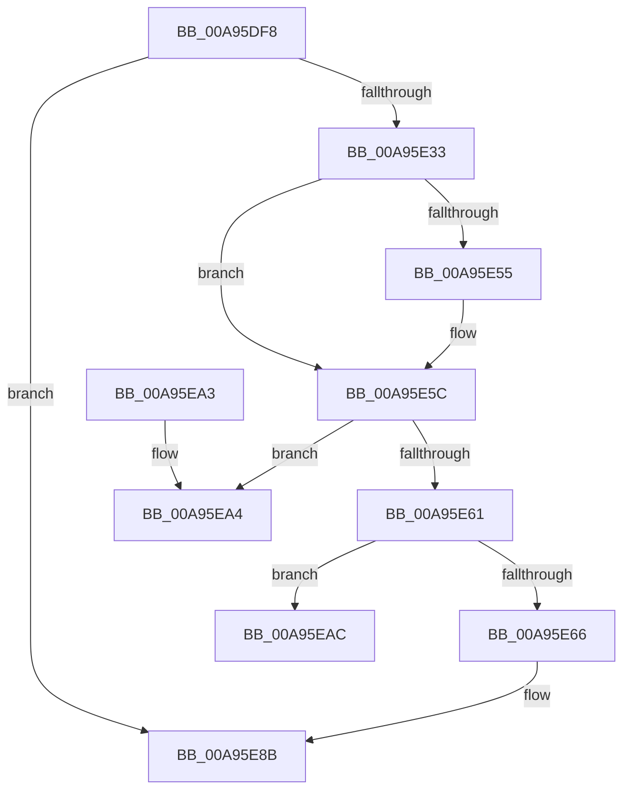

# CmpTransAllocateTrans

- RVA: `0x00A95DF8`–`0x00A95EBC` (길이 `196` bytes)
- VA: `0x0000000140A95DF8`
- 실행 섹션: `PAGE`
- PDB 이름 있음: `예`; PDB Function 태그: `예`
- unwind 정보 RVA: `0x000ABA64`
- 디코드: `52`개 명령, `196/196` bytes 표시
- 미해석 바이트: `0` (있으면 어셈블리에 `.byte`로 보존)

> 이 문서는 커널 이미지의 기계어와 PDB 기호를 분석해 생성했습니다. 4번과 5번은 함수 원형과 자료형을 바이너리 사용 방식에서 추정한 C 해석이며 원본 소스 복구 결과는 아닙니다.

## 1. Dependencies

- 직접 호출 지점: **2**; 고유 호출 대상: **2**
- 직접 호출자로 확인된 함수: **2**
- RIP 상대 이미지 참조: **1**

### Outgoing calls
- `0x00A95E26` → [ExAllocatePool2](../../poolcode/B8/ExAllocatePool2_function_00B820F0.md) (function, `0x00B820F0`)
- `0x00A95E86` → [CmpBindHiveToTrans](../87/CmpBindHiveToTrans_function_00874B80.md) (function, `0x00874B80`)

### Direct callers
- [CmpTransSearchAddLightWeightTrans](../87/CmpTransSearchAddLightWeightTrans_function_00873494.md) at `0x0087352E`
- [CmpTransSearchAddTrans](../87/CmpTransSearchAddTrans_function_008743FC.md) at `0x008745D3`

### Static image references
- `0x00A95E37` → RVA `0x000108B8` (`.rdata`; read)

## 2. Other-region calls and transfers

- 다른 실행 섹션으로 향하는 call: **1**
  - `0x00A95E26` → [ExAllocatePool2](../../poolcode/B8/ExAllocatePool2_function_00B820F0.md) (`PAGE` → `POOLCODE`)
- call이 아닌 외부 분기/꼬리 이동: **2**
  - `0x00A95EA7` → [sub_00B47878](../B4/Unknown_function_00B47878.md) (`tail-transfer`)
  - `0x00A95EB7` → [sub_00B47878](../B4/Unknown_function_00B47878.md) (`tail-transfer`)

## 3. Assembly (complete function range)

```asm
00A95DF8  48 89 5C 24 08                  mov qword ptr [rsp + 8], rbx
00A95DFD  48 89 6C 24 10                  mov qword ptr [rsp + 0x10], rbp
00A95E02  48 89 74 24 18                  mov qword ptr [rsp + 0x18], rsi
00A95E07  57                              push rdi
00A95E08  48 83 EC 20                     sub rsp, 0x20
00A95E0C  48 8B FA                        mov rdi, rdx
00A95E0F  49 8B E8                        mov rbp, r8
00A95E12  BA B8 00 00 00                  mov edx, 0xb8
00A95E17  48 8B D9                        mov rbx, rcx
00A95E1A  41 B8 43 4D 54 72               mov r8d, 0x72544d43
00A95E20  49 8B F1                        mov rsi, r9
00A95E23  8D 4A 48                        lea ecx, [rdx + 0x48]
00A95E26  E8 C5 C2 0E 00                  call 0x140b820f0
00A95E2B  48 8B D0                        mov rdx, rax
00A95E2E  48 85 C0                        test rax, rax
00A95E31  74 58                           je 0x140a95e8b
00A95E33  48 89 58 38                     mov qword ptr [rax + 0x38], rbx
00A95E37  4C 8B 0D 7A AA 57 FF            mov r9, qword ptr [rip - 0xa85586]
00A95E3E  4C 89 48 68                     mov qword ptr [rax + 0x68], r9
00A95E42  C7 40 30 08 00 00 00            mov dword ptr [rax + 0x30], 8
00A95E49  48 89 68 40                     mov qword ptr [rax + 0x40], rbp
00A95E4D  48 8B C3                        mov rax, rbx
00A95E50  83 E0 01                        and eax, 1
00A95E53  74 07                           je 0x140a95e5c
00A95E55  C7 42 30 88 00 00 00            mov dword ptr [rdx + 0x30], 0x88
00A95E5C  48 85 FF                        test rdi, rdi
00A95E5F  75 43                           jne 0x140a95ea4
00A95E61  48 85 C0                        test rax, rax
00A95E64  74 46                           je 0x140a95eac
00A95E66  48 89 52 08                     mov qword ptr [rdx + 8], rdx
00A95E6A  48 8D 42 10                     lea rax, [rdx + 0x10]
00A95E6E  48 89 12                        mov qword ptr [rdx], rdx
00A95E71  48 8B CE                        mov rcx, rsi
00A95E74  48 89 40 08                     mov qword ptr [rax + 8], rax
00A95E78  48 89 00                        mov qword ptr [rax], rax
00A95E7B  48 8D 42 20                     lea rax, [rdx + 0x20]
00A95E7F  48 89 40 08                     mov qword ptr [rax + 8], rax
00A95E83  48 89 00                        mov qword ptr [rax], rax
00A95E86  E8 F5 EC DD FF                  call 0x140874b80
00A95E8B  48 8B 5C 24 30                  mov rbx, qword ptr [rsp + 0x30]
00A95E90  48 8B C2                        mov rax, rdx
00A95E93  48 8B 6C 24 38                  mov rbp, qword ptr [rsp + 0x38]
00A95E98  48 8B 74 24 40                  mov rsi, qword ptr [rsp + 0x40]
00A95E9D  48 83 C4 20                     add rsp, 0x20
00A95EA1  5F                              pop rdi
00A95EA2  C3                              ret
00A95EA3  CC                              int3
00A95EA4  0F 10 07                        movups xmm0, xmmword ptr [rdi]
00A95EA7  E9 CC 19 0B 00                  jmp 0x140b47878
00A95EAC  48 83 E3 FE                     and rbx, 0xfffffffffffffffe
00A95EB0  0F 10 83 B0 00 00 00            movups xmm0, xmmword ptr [rbx + 0xb0]
00A95EB7  E9 BC 19 0B 00                  jmp 0x140b47878
```

## 4. C-style interpretation (structured pseudocode)

```c
__int64 __fastcall CmpTransAllocateTrans(__int64 a1, __int64 a2, __int64 a3, __int64 a4)
{
    __int64 result;
    __int64 v_rbx;
    __int64 v_rsp;
    unsigned __int64 v_stack_p10;
    unsigned __int64 v_stack_p18;
    unsigned __int64 v_stack_p8;

    v_stack_p8 = v_rbx;
    v_stack_p10 = v_rbp;
    v_stack_p18 = v_rsi;
    v_rsp = (v_rsp) - (32);
    result = ExAllocatePool2(184 + 72, 184, (unsigned int)(0x72544D43ULL), a4);
    if (result == 0) goto loc_00A95E8B;
    *(unsigned __int64 *)(result + 56) = a1;
    *(unsigned __int64 *)(result + 104) = *(unsigned __int64 *)(v_rip - 11031942);
    *(unsigned int *)(result + 48) = 8;
    *(unsigned __int64 *)(result + 64) = a3;
    result = (unsigned int)((a1) & (1));
    if (!(condition_is_equal)) {
        *(unsigned int *)(result + 48) = 136;
    }
    if (a2 != 0) goto loc_00A95EA4;
    if (result == 0) goto loc_00A95EAC;
    *(unsigned __int64 *)(result + 8) = result;
    *(unsigned __int64 *)(result) = result;
    *(unsigned __int64 *)(result + 16 + 8) = result + 16;
    *(unsigned __int64 *)(result + 16) = result + 16;
    *(unsigned __int64 *)(result + 32 + 8) = result + 32;
    *(unsigned __int64 *)(result + 32) = result + 32;
    result = CmpBindHiveToTrans(a4, result, (unsigned int)(0x72544D43ULL), *(unsigned __int64 *)(v_rip - 11031942));
loc_00A95E8B:
    v_rsp = (v_rsp) + (32);
    return result;
loc_00A95EA4:
loc_00A95EAC:
    v_rbx = (v_stack_p8) & (-2);
}
```

## 5. (Beta) C Style

```c
int64_t CmpTransAllocateTrans(void *Arg1, int64_t Arg2, int64_t Arg3, int64_t Arg4)
{
    uint8_t *arg1 = (uint8_t *)Arg1;

    int64_t result;
    int64_t local_rbx;
    int64_t local_rsp;
    uint64_t v_stack_p10;
    uint64_t v_stack_p18;
    uint64_t v_stack_p8;

    v_stack_p8 = local_rbx;
    v_stack_p10 = local_rbp;
    v_stack_p18 = local_rsi;
    local_rsp = (local_rsp) - (32);
    result = ExAllocatePool2(184 + 72, 184, (uint32_t)(0x72544D43ULL), Arg4);
    if (result == 0) goto loc_00A95E8B;
    *(void **)(result + 0x38) = Arg1;
    *(uint64_t *)(result + 0x68) = *(uint64_t *)(v_rip - 0xA85586);
    *(uint32_t *)(result + 0x30) = 8;
    *(uint64_t *)(result + 0x40) = Arg3;
    result = (uint32_t)((Arg1) & (1));
    if (!(condition_is_equal)) {
        *(uint32_t *)(result + 0x30) = 136;
    }
    if (Arg2 != 0) goto loc_00A95EA4;
    if (result == 0) goto loc_00A95EAC;
    *(uint64_t *)(result + 0x8) = result;
    *(uint64_t *)(result) = result;
    *(uint64_t *)(result + 0x10 + 0x8) = result + 16;
    *(uint64_t *)(result + 0x10) = result + 16;
    *(uint64_t *)(result + 0x20 + 0x8) = result + 32;
    *(uint64_t *)(result + 0x20) = result + 32;
    result = CmpBindHiveToTrans(Arg4, result, (uint32_t)(0x72544D43ULL), *(uint64_t *)(v_rip - 0xA85586));
loc_00A95E8B:
    local_rsp = (local_rsp) + (32);
    return result;
loc_00A95EA4:
loc_00A95EAC:
    local_rbx = (v_stack_p8) & (-2);
}
```

### 관측된 메모리 오프셋

구조체 형식이 확인되지 않은 접근은 인자 기준의 오프셋으로만 기록했습니다.

| 기준 인자 | 오프셋 표현 | 폭 (bit) | 접근 |
|---|---:|---:|---|
| `Arg1` | `+ 0xB0` | `128` | `R` |

## 6. Execution-region graph

[열기: 2D/3D 그래프와 함수 탐색 컨트롤 패널](../../../control-panel.html?section=page&rva=0x00A95DF8&view=graph)

- 2D 그래프는 위에서 아래로 흐르고, 3D 그래프는 빈 공간을 드래그해 회전합니다. Shift+드래그는 이동, 휠은 확대·축소, 함수 노드 선택은 대상 보고서 이동입니다.

### Static fallback


