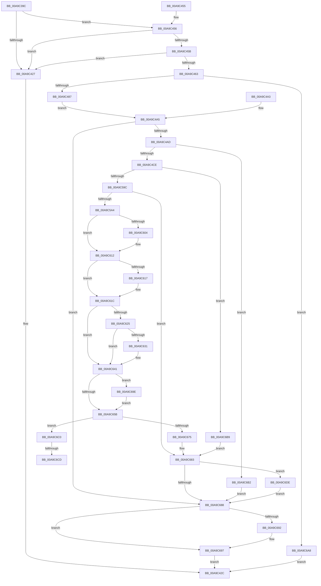

# DbgkRegisterErrorPort

- RVA: `0x00A9C39C`–`0x00A9C6EA` (길이 `846` bytes)
- VA: `0x0000000140A9C39C`
- 실행 섹션: `PAGE`
- PDB 이름 있음: `예`; PDB Function 태그: `예`
- unwind 정보 RVA: `0x000BA5D4`
- 디코드: `189`개 명령, `846/846` bytes 표시
- 미해석 바이트: `0` (있으면 어셈블리에 `.byte`로 보존)

> 이 문서는 커널 이미지의 기계어와 PDB 기호를 분석해 생성했습니다. 4번과 5번은 함수 원형과 자료형을 바이너리 사용 방식에서 추정한 C 해석이며 원본 소스 복구 결과는 아닙니다.

## 1. Dependencies

- 직접 호출 지점: **18**; 고유 호출 대상: **17**
- 직접 호출자로 확인된 함수: **1**
- RIP 상대 이미지 참조: **2**

### Outgoing calls
- `0x00A9C41E` → [memset](../../text/6C/memset_function_006C6C40.md) (function, `0x006C6C40`)
- `0x00A9C437` → [_security_check_cookie](../../text/6A/_security_check_cookie_function_006AC640.md) (function, `0x006AC640`)
- `0x00A9C474` → [ExAllocatePool2](../../poolcode/B8/ExAllocatePool2_function_00B820F0.md) (function, `0x00B820F0`)
- `0x00A9C49C` → [memcpy](../../text/6C/memcpy_function_006C6840.md) (function, `0x006C6840`)
- `0x00A9C4BD` → [ExAllocatePool2](../../poolcode/B8/ExAllocatePool2_function_00B820F0.md) (function, `0x00B820F0`)
- `0x00A9C58A` → [ZwAlpcConnectPort](../../text/6A/ZwAlpcConnectPort_function_006AE030.md) (function, `0x006AE030`)
- `0x00A9C5C8` → [PsGetProcessServerSilo](../../text/44/PsGetProcessServerSilo_function_0044BEE0.md) (function, `0x0044BEE0`)
- `0x00A9C5D3` → [PsGetServerSiloGlobals](../../text/22/PsGetServerSiloGlobals_function_002250A0.md) (function, `0x002250A0`)
- `0x00A9C5F4` → [KeAbPreAcquire](../../text/21/KeAbPreAcquire_function_00210230.md) (function, `0x00210230`)
- `0x00A9C60D` → [ExfAcquirePushLockExclusiveEx](../../text/20/ExfAcquirePushLockExclusiveEx_function_0020FC90.md) (function, `0x0020FC90`)
- `0x00A9C628` → [PsIsHostSilo](../../text/44/PsIsHostSilo_function_00443B30.md) (function, `0x00443B30`)
- `0x00A9C65E` → [KeAbPostRelease](../../text/2E/KeAbPostRelease_function_002E1600.md) (function, `0x002E1600`)
- `0x00A9C666` → [KiLeaveCriticalRegionUnsafe](../../text/25/KiLeaveCriticalRegionUnsafe_function_0025F010.md) (function, `0x0025F010`)
- `0x00A9C67E` → [KeSetEvent](../../text/33/KeSetEvent_function_0033F310.md) (function, `0x0033F310`)
- `0x00A9C692` → [ExFreePool](../../poolcode/B8/ExFreePool_function_00B82850.md) (function, `0x00B82850`)
- `0x00A9C6A1` → [ExfTryToWakePushLock](../../text/26/ExfTryToWakePushLock_function_00265DD0.md) (function, `0x00265DD0`)
- `0x00A9C6D3` → [ZwAlpcDisconnectPort](../../text/6A/ZwAlpcDisconnectPort_function_006AE190.md) (function, `0x006AE190`)
- `0x00A9C6E3` → [ExFreePoolWithTag](../../poolcode/B8/ExFreePoolWithTag_function_00B82870.md) (function, `0x00B82870`)

### Direct callers
- [NtSetSystemInformation](../AF/NtSetSystemInformation_function_00AF4A60.md) at `0x00AF5722`

### Static image references
- `0x00A9C3B3` → RVA `0x00E0A740` (`.data`; read)
- `0x00A9C631` → RVA `0x00FC5008` (`ALMOSTRO`; read)

## 2. Other-region calls and transfers

- 다른 실행 섹션으로 향하는 call: **18**
  - `0x00A9C41E` → [memset](../../text/6C/memset_function_006C6C40.md) (`PAGE` → `.text`)
  - `0x00A9C437` → [_security_check_cookie](../../text/6A/_security_check_cookie_function_006AC640.md) (`PAGE` → `.text`)
  - `0x00A9C474` → [ExAllocatePool2](../../poolcode/B8/ExAllocatePool2_function_00B820F0.md) (`PAGE` → `POOLCODE`)
  - `0x00A9C49C` → [memcpy](../../text/6C/memcpy_function_006C6840.md) (`PAGE` → `.text`)
  - `0x00A9C4BD` → [ExAllocatePool2](../../poolcode/B8/ExAllocatePool2_function_00B820F0.md) (`PAGE` → `POOLCODE`)
  - `0x00A9C58A` → [ZwAlpcConnectPort](../../text/6A/ZwAlpcConnectPort_function_006AE030.md) (`PAGE` → `.text`)
  - `0x00A9C5C8` → [PsGetProcessServerSilo](../../text/44/PsGetProcessServerSilo_function_0044BEE0.md) (`PAGE` → `.text`)
  - `0x00A9C5D3` → [PsGetServerSiloGlobals](../../text/22/PsGetServerSiloGlobals_function_002250A0.md) (`PAGE` → `.text`)
  - `0x00A9C5F4` → [KeAbPreAcquire](../../text/21/KeAbPreAcquire_function_00210230.md) (`PAGE` → `.text`)
  - `0x00A9C60D` → [ExfAcquirePushLockExclusiveEx](../../text/20/ExfAcquirePushLockExclusiveEx_function_0020FC90.md) (`PAGE` → `.text`)
  - `0x00A9C628` → [PsIsHostSilo](../../text/44/PsIsHostSilo_function_00443B30.md) (`PAGE` → `.text`)
  - `0x00A9C65E` → [KeAbPostRelease](../../text/2E/KeAbPostRelease_function_002E1600.md) (`PAGE` → `.text`)
  - `0x00A9C666` → [KiLeaveCriticalRegionUnsafe](../../text/25/KiLeaveCriticalRegionUnsafe_function_0025F010.md) (`PAGE` → `.text`)
  - `0x00A9C67E` → [KeSetEvent](../../text/33/KeSetEvent_function_0033F310.md) (`PAGE` → `.text`)
  - `0x00A9C692` → [ExFreePool](../../poolcode/B8/ExFreePool_function_00B82850.md) (`PAGE` → `POOLCODE`)
  - `0x00A9C6A1` → [ExfTryToWakePushLock](../../text/26/ExfTryToWakePushLock_function_00265DD0.md) (`PAGE` → `.text`)
  - `0x00A9C6D3` → [ZwAlpcDisconnectPort](../../text/6A/ZwAlpcDisconnectPort_function_006AE190.md) (`PAGE` → `.text`)
  - `0x00A9C6E3` → [ExFreePoolWithTag](../../poolcode/B8/ExFreePoolWithTag_function_00B82870.md) (`PAGE` → `POOLCODE`)
- call이 아닌 외부 분기/꼬리 이동: **2**
  - `0x00A9C6C7` → [sub_00B488AA](../B4/Unknown_function_00B488AA.md) (`tail-transfer`)
  - `0x00A9C6D9` → [sub_00B488AA](../B4/Unknown_function_00B488AA.md) (`tail-transfer`)

## 3. Assembly (complete function range)

```asm
00A9C39C  4C 8B DC                        mov r11, rsp
00A9C39F  49 89 5B 18                     mov qword ptr [r11 + 0x18], rbx
00A9C3A3  56                              push rsi
00A9C3A4  41 54                           push r12
00A9C3A6  41 55                           push r13
00A9C3A8  41 56                           push r14
00A9C3AA  41 57                           push r15
00A9C3AC  48 81 EC 40 01 00 00            sub rsp, 0x140
00A9C3B3  48 8B 05 86 E3 36 00            mov rax, qword ptr [rip + 0x36e386]
00A9C3BA  48 33 C4                        xor rax, rsp
00A9C3BD  48 89 84 24 30 01 00 00         mov qword ptr [rsp + 0x130], rax
00A9C3C5  8B DA                           mov ebx, edx
00A9C3C7  4C 8B F1                        mov r14, rcx
00A9C3CA  0F 57 C0                        xorps xmm0, xmm0
00A9C3CD  0F 11 44 24 68                  movups xmmword ptr [rsp + 0x68], xmm0
00A9C3D2  0F 57 C9                        xorps xmm1, xmm1
00A9C3D5  33 C0                           xor eax, eax
00A9C3D7  0F 11 8C 24 B0 00 00 00         movups xmmword ptr [rsp + 0xb0], xmm1
00A9C3DF  0F 11 8C 24 C0 00 00 00         movups xmmword ptr [rsp + 0xc0], xmm1
00A9C3E7  49 89 83 68 FF FF FF            mov qword ptr [r11 - 0x98], rax
00A9C3EE  48 21 44 24 60                  and qword ptr [rsp + 0x60], rax
00A9C3F3  0F 11 84 24 80 00 00 00         movups xmmword ptr [rsp + 0x80], xmm0
00A9C3FB  0F 11 84 24 90 00 00 00         movups xmmword ptr [rsp + 0x90], xmm0
00A9C403  49 89 83 38 FF FF FF            mov qword ptr [r11 - 0xc8], rax
00A9C40A  89 84 24 A8 00 00 00            mov dword ptr [rsp + 0xa8], eax
00A9C411  33 D2                           xor edx, edx
00A9C413  44 8D 40 48                     lea r8d, [rax + 0x48]
00A9C417  49 8D 8B 78 FF FF FF            lea rcx, [r11 - 0x88]
00A9C41E  E8 1D A8 C2 FF                  call 0x1406c6c40
00A9C423  85 DB                           test ebx, ebx
00A9C425  75 2F                           jne 0x140a9c456
00A9C427  B8 0D 00 00 C0                  mov eax, 0xc000000d
00A9C42C  48 8B 8C 24 30 01 00 00         mov rcx, qword ptr [rsp + 0x130]
00A9C434  48 33 CC                        xor rcx, rsp
00A9C437  E8 04 02 C1 FF                  call 0x1406ac640
00A9C43C  48 8B 9C 24 80 01 00 00         mov rbx, qword ptr [rsp + 0x180]
00A9C444  48 81 C4 40 01 00 00            add rsp, 0x140
00A9C44B  41 5F                           pop r15
00A9C44D  41 5E                           pop r14
00A9C44F  41 5D                           pop r13
00A9C451  41 5C                           pop r12
00A9C453  5E                              pop rsi
00A9C454  C3                              ret
00A9C455  CC                              int3
00A9C456  F6 C3 01                        test bl, 1
00A9C459  75 CC                           jne 0x140a9c427
00A9C45B  81 FB FF FF 00 00               cmp ebx, 0xffff
00A9C461  77 C4                           ja 0x140a9c427
00A9C463  48 8B F3                        mov rsi, rbx
00A9C466  41 B8 44 62 67 50               mov r8d, 0x50676244
00A9C46C  48 8B D3                        mov rdx, rbx
00A9C46F  B9 01 01 00 00                  mov ecx, 0x101
00A9C474  E8 77 5C 0E 00                  call 0x140b820f0
00A9C479  48 89 44 24 70                  mov qword ptr [rsp + 0x70], rax
00A9C47E  48 85 C0                        test rax, rax
00A9C481  0F 84 21 02 00 00               je 0x140a9c6a8
00A9C487  66 89 5C 24 6A                  mov word ptr [rsp + 0x6a], bx
00A9C48C  66 89 5C 24 68                  mov word ptr [rsp + 0x68], bx
00A9C491  33 DB                           xor ebx, ebx
00A9C493  4C 8B C6                        mov r8, rsi
00A9C496  49 8B D6                        mov rdx, r14
00A9C499  48 8B C8                        mov rcx, rax
00A9C49C  E8 9F A3 C2 FF                  call 0x1406c6840
00A9C4A1  EB 02                           jmp 0x140a9c4a5
00A9C4A3  8B D8                           mov ebx, eax
00A9C4A5  85 DB                           test ebx, ebx
00A9C4A7  0F 88 DB 01 00 00               js 0x140a9c688
00A9C4AD  BA 10 00 00 00                  mov edx, 0x10
00A9C4B2  B9 01 01 00 00                  mov ecx, 0x101
00A9C4B7  41 B8 44 62 67 50               mov r8d, 0x50676244
00A9C4BD  E8 2E 5C 0E 00                  call 0x140b820f0
00A9C4C2  4C 8B F8                        mov r15, rax
00A9C4C5  48 85 C0                        test rax, rax
00A9C4C8  0F 84 E4 01 00 00               je 0x140a9c6b2
00A9C4CE  C7 84 24 B2 00 00 00 28 00 00 80  mov dword ptr [rsp + 0xb2], 0x80000028
00A9C4D9  B8 28 00 00 00                  mov eax, 0x28
00A9C4DE  48 89 44 24 60                  mov qword ptr [rsp + 0x60], rax
00A9C4E3  48 C7 84 24 F0 00 00 00 10 01 00 00  mov qword ptr [rsp + 0xf0], 0x110
00A9C4EF  48 C7 84 24 00 01 00 00 00 22 00 00  mov qword ptr [rsp + 0x100], 0x2200
00A9C4FB  C7 84 24 E0 00 00 00 00 00 10 00  mov dword ptr [rsp + 0xe0], 0x100000
00A9C506  C7 84 24 80 00 00 00 30 00 00 00  mov dword ptr [rsp + 0x80], 0x30
00A9C511  48 83 A4 24 88 00 00 00 00      and qword ptr [rsp + 0x88], 0
00A9C51A  C7 84 24 98 00 00 00 00 02 00 00  mov dword ptr [rsp + 0x98], 0x200
00A9C525  48 83 A4 24 90 00 00 00 00      and qword ptr [rsp + 0x90], 0
00A9C52E  0F 57 C0                        xorps xmm0, xmm0
00A9C531  F3 0F 7F 84 24 A0 00 00 00      movdqu xmmword ptr [rsp + 0xa0], xmm0
00A9C53A  49 8D 4F 08                     lea rcx, [r15 + 8]
00A9C53E  48 83 64 24 50 00               and qword ptr [rsp + 0x50], 0
00A9C544  48 83 64 24 48 00               and qword ptr [rsp + 0x48], 0
00A9C54A  48 83 64 24 40 00               and qword ptr [rsp + 0x40], 0
00A9C550  48 8D 44 24 60                  lea rax, [rsp + 0x60]
00A9C555  48 89 44 24 38                  mov qword ptr [rsp + 0x38], rax
00A9C55A  48 8D 84 24 B0 00 00 00         lea rax, [rsp + 0xb0]
00A9C562  48 89 44 24 30                  mov qword ptr [rsp + 0x30], rax
00A9C567  48 83 64 24 28 00               and qword ptr [rsp + 0x28], 0
00A9C56D  C7 44 24 20 00 00 12 00         mov dword ptr [rsp + 0x20], 0x120000
00A9C575  4C 8D 8C 24 E0 00 00 00         lea r9, [rsp + 0xe0]
00A9C57D  4C 8D 84 24 80 00 00 00         lea r8, [rsp + 0x80]
00A9C585  48 8D 54 24 68                  lea rdx, [rsp + 0x68]
00A9C58A  E8 A1 1A C1 FF                  call 0x1406ae030
00A9C58F  8B D8                           mov ebx, eax
00A9C591  3D C0 00 00 00                  cmp eax, 0xc0
00A9C596  0F 84 1D 01 00 00               je 0x140a9c6b9
00A9C59C  85 C0                           test eax, eax
00A9C59E  0F 88 DF 00 00 00               js 0x140a9c683
00A9C5A4  65 4C 8B 2C 25 88 01 00 00      mov r13, qword ptr gs:[0x188]
00A9C5AD  41 C7 07 01 00 00 00            mov dword ptr [r15], 1
00A9C5B4  41 83 67 04 00                  and dword ptr [r15 + 4], 0
00A9C5B9  49 8B 85 B8 00 00 00            mov rax, qword ptr [r13 + 0xb8]
00A9C5C0  48 89 44 24 78                  mov qword ptr [rsp + 0x78], rax
00A9C5C5  48 8B C8                        mov rcx, rax
00A9C5C8  E8 13 F9 9A FF                  call 0x14044bee0
00A9C5CD  4C 8B E0                        mov r12, rax
00A9C5D0  48 8B C8                        mov rcx, rax
00A9C5D3  E8 C8 8A 78 FF                  call 0x1402250a0
00A9C5D8  48 8D B0 A8 03 00 00            lea rsi, [rax + 0x3a8]
00A9C5DF  48 83 CB FF                     or rbx, 0xffffffffffffffff
00A9C5E3  66 41 01 9D E4 01 00 00         add word ptr [r13 + 0x1e4], bx
00A9C5EB  90                              nop
00A9C5EC  45 33 C0                        xor r8d, r8d
00A9C5EF  33 D2                           xor edx, edx
00A9C5F1  48 8B CE                        mov rcx, rsi
00A9C5F4  E8 37 3C 77 FF                  call 0x140210230
00A9C5F9  4C 8B F0                        mov r14, rax
00A9C5FC  F0 48 0F BA 2E 00               lock bts qword ptr [rsi], 0
00A9C602  73 0E                           jae 0x140a9c612
00A9C604  4C 8B C6                        mov r8, rsi
00A9C607  48 8B D0                        mov rdx, rax
00A9C60A  48 8B CE                        mov rcx, rsi
00A9C60D  E8 7E 36 77 FF                  call 0x14020fc90
00A9C612  4D 85 F6                        test r14, r14
00A9C615  74 05                           je 0x140a9c61c
00A9C617  41 C6 46 0A 01                  mov byte ptr [r14 + 0xa], 1
00A9C61C  4C 8B 76 08                     mov r14, qword ptr [rsi + 8]
00A9C620  4D 85 F6                        test r14, r14
00A9C623  75 1C                           jne 0x140a9c641
00A9C625  49 8B CC                        mov rcx, r12
00A9C628  E8 03 75 9A FF                  call 0x140443b30
00A9C62D  84 C0                           test al, al
00A9C62F  74 10                           je 0x140a9c641
00A9C631  48 8B 05 D0 89 52 00            mov rax, qword ptr [rip + 0x5289d0]
00A9C638  F0 0F BA A8 F0 02 00 00 00      lock bts dword ptr [rax + 0x2f0], 0
00A9C641  4C 89 7E 08                     mov qword ptr [rsi + 8], r15
00A9C645  48 8B 44 24 78                  mov rax, qword ptr [rsp + 0x78]
00A9C64A  48 89 46 10                     mov qword ptr [rsi + 0x10], rax
00A9C64E  F0 48 0F C1 1E                  lock xadd qword ptr [rsi], rbx
00A9C653  80 E3 06                        and bl, 6
00A9C656  80 FB 02                        cmp bl, 2
00A9C659  74 43                           je 0x140a9c69e
00A9C65B  48 8B CE                        mov rcx, rsi
00A9C65E  E8 9D 4F 84 FF                  call 0x1402e1600
00A9C663  49 8B CD                        mov rcx, r13
00A9C666  E8 A5 29 7C FF                  call 0x14025f010
00A9C66B  33 DB                           xor ebx, ebx
00A9C66D  45 33 FF                        xor r15d, r15d
00A9C670  4D 85 F6                        test r14, r14
00A9C673  75 4B                           jne 0x140a9c6c0
00A9C675  45 33 C0                        xor r8d, r8d
00A9C678  33 D2                           xor edx, edx
00A9C67A  48 8B 4E 18                     mov rcx, qword ptr [rsi + 0x18]
00A9C67E  E8 8D 2C 8A FF                  call 0x14033f310
00A9C683  4D 85 FF                        test r15, r15
00A9C686  75 56                           jne 0x140a9c6de
00A9C688  48 8B 4C 24 70                  mov rcx, qword ptr [rsp + 0x70]
00A9C68D  48 85 C9                        test rcx, rcx
00A9C690  74 05                           je 0x140a9c697
00A9C692  E8 B9 61 0E 00                  call 0x140b82850
00A9C697  8B C3                           mov eax, ebx
00A9C699  E9 8E FD FF FF                  jmp 0x140a9c42c
00A9C69E  48 8B CE                        mov rcx, rsi
00A9C6A1  E8 2A 97 7C FF                  call 0x140265dd0
00A9C6A6  EB B3                           jmp 0x140a9c65b
00A9C6A8  B8 9A 00 00 C0                  mov eax, 0xc000009a
00A9C6AD  E9 7A FD FF FF                  jmp 0x140a9c42c
00A9C6B2  BB 9A 00 00 C0                  mov ebx, 0xc000009a
00A9C6B7  EB CF                           jmp 0x140a9c688
00A9C6B9  BB 4B 00 00 C0                  mov ebx, 0xc000004b
00A9C6BE  EB C3                           jmp 0x140a9c683
00A9C6C0  F0 41 0F BA 6E 04 00            lock bts dword ptr [r14 + 4], 0
00A9C6C7  0F 82 DD C1 0A 00               jb 0x140b488aa
00A9C6CD  33 D2                           xor edx, edx
00A9C6CF  49 8B 4E 08                     mov rcx, qword ptr [r14 + 8]
00A9C6D3  E8 B8 1A C1 FF                  call 0x1406ae190
00A9C6D8  90                              nop
00A9C6D9  E9 CC C1 0A 00                  jmp 0x140b488aa
00A9C6DE  33 D2                           xor edx, edx
00A9C6E0  49 8B CF                        mov rcx, r15
00A9C6E3  E8 88 61 0E 00                  call 0x140b82870
00A9C6E8  EB 9E                           jmp 0x140a9c688
```

## 4. C-style interpretation (structured pseudocode)

```c
__int64 __fastcall DbgkRegisterErrorPort(__int64 a1, int a2)
{
    __int64 result;
    __int64 v_r15;
    __int64 v_rbx;
    __int64 v_rsp;
    unsigned __int64 v_stack_m100;
    unsigned __int64 v_stack_m108;
    unsigned __int64 v_stack_m38;
    unsigned __int64 v_stack_mA8;
    unsigned __int64 v_stack_mB8;
    unsigned int v_stack_mC0;
    unsigned __int64 v_stack_mD8;
    unsigned __int64 v_stack_mE8;
    unsigned __int64 v_stack_p100;
    unsigned __int64 v_stack_p18;
    unsigned int v_stack_p20;
    unsigned __int64 v_stack_p28;
    unsigned __int64 v_stack_p30;
    unsigned __int64 v_stack_p38;
    unsigned __int64 v_stack_p40;
    unsigned __int64 v_stack_p48;
    unsigned __int64 v_stack_p50;
    unsigned __int64 v_stack_p60;
    unsigned __int16 v_stack_p68;
    unsigned __int16 v_stack_p6A;
    unsigned __int64 v_stack_p70;
    unsigned __int64 v_stack_p78;
    unsigned int v_stack_p80;
    unsigned __int64 v_stack_p88;
    unsigned __int64 v_stack_p90;
    unsigned int v_stack_p98;
    unsigned __int64 v_stack_pA0;
    unsigned __int64 v_stack_pB0;
    unsigned int v_stack_pB2;
    unsigned int v_stack_pE0;
    unsigned __int64 v_stack_pF0;

    *(unsigned __int64 *)(v_rsp + 24) = v_rbx;
    v_rsp = (v_rsp) - (320);
    result = (*(unsigned __int64 *)(v_rip + 3597190)) ^ (v_rsp);
    v_stack_m38 = result;
    v_stack_m100 = v_xmm0;
    result = 0;
    v_stack_mB8 = v_xmm1;
    v_stack_mA8 = v_xmm1;
    *(unsigned __int64 *)(v_rsp - 152) = 0;
    v_stack_mE8 = v_xmm0;
    v_stack_mD8 = v_xmm0;
    *(unsigned __int64 *)(v_rsp - 200) = 0;
    v_stack_mC0 = 0;
    a2 = 0;
    result = memset(v_rsp - 136, a2, result + 72, a4);
    if ((unsigned int)((unsigned int)(a2)) != 0) goto loc_00A9C456;
loc_00A9C427:
loc_00A9C42C:
    a1 = (v_stack_m38) ^ (v_rsp);
    result = _security_check_cookie(a1, a2, result + 72, a4);
    v_rsp = (v_rsp) + (320);
    return result;
loc_00A9C456:
    if ((((unsigned __int8)(v_stack_p18)) & (1)) != 0) goto loc_00A9C427;
    if (((unsigned int)(v_stack_p18)) > 0xFFFFULL) goto loc_00A9C427;
    result = ExAllocatePool2(257, v_stack_p18, (unsigned int)(0x50676244ULL), a4);
    v_stack_p70 = result;
    if (result == 0) goto loc_00A9C6A8;
    v_stack_p6A = (unsigned __int16)(v_stack_p18);
    v_stack_p68 = (unsigned __int16)(v_stack_p18);
    v_rbx = 0;
    result = memcpy(result, a1, v_stack_p18, a4);
    goto loc_00A9C4A5;
loc_00A9C4A5:
    if (sign_flag) goto loc_00A9C688;
    result = ExAllocatePool2(257, 16, (unsigned int)(0x50676244ULL), a4);
    if (result == 0) goto loc_00A9C6B2;
    v_stack_pB2 = 0x80000028ULL;
    v_stack_p60 = 40;
    v_stack_pF0 = 272;
    v_stack_p100 = 0x2200ULL;
    v_stack_pE0 = 0x100000ULL;
    v_stack_p80 = 48;
    v_stack_p98 = 512;
    v_stack_pA0 = v_xmm0;
    v_stack_p38 = v_stack_p60;
    v_stack_p30 = v_stack_pB0;
    v_stack_p20 = 0x120000ULL;
    result = ZwAlpcConnectPort(result + 8, v_stack_p68, v_stack_p80, v_stack_pE0);
    if (((unsigned int)(result)) == 192) goto loc_00A9C6B9;
    if (sign_flag) goto loc_00A9C683;
    *(unsigned int *)(result) = 1;
    v_stack_p78 = *(unsigned __int64 *)(*(unsigned __int64 *)(gs_base + (0 + 392)) + 184);
    result = PsGetProcessServerSilo(*(unsigned __int64 *)(*(unsigned __int64 *)(gs_base + (0 + 392)) + 184), v_stack_p68, v_stack_p80, v_stack_pE0);
    result = PsGetServerSiloGlobals(result, v_stack_p68, v_stack_p80, v_stack_pE0);
    v_rbx = ((unsigned int)((unsigned int)(result))) | (-1);
    a3 = 0;
    a2 = 0;
    result = KeAbPreAcquire(result + 936, a2, a3, v_stack_pE0);
    if (!(condition_is_above_or_equal)) {
        a3 = result + 936;
        a2 = result;
        a1 = result + 936;
        result = ExfAcquirePushLockExclusiveEx(a1, a2, a3, v_stack_pE0);
    }
    if (result != 0) {
        *(unsigned __int8 *)(result + 10) = 1;
    }
    if (*(unsigned __int64 *)(result + 936 + 8) != 0) goto loc_00A9C641;
    result = PsIsHostSilo(result, a2, a3, v_stack_pE0);
    if ((unsigned __int8)(result) != 0) {
        result = *(unsigned __int64 *)(v_rip + 5409232);
    }
    *(unsigned __int64 *)(result + 936 + 8) = result;
    *(unsigned __int64 *)(result + 936 + 16) = v_stack_p78;
    v_rbx = (unsigned __int8)((v_rbx) & (6));
    if (((unsigned __int8)(v_rbx)) == 2) goto loc_00A9C69E;
loc_00A9C65B:
    result = KeAbPostRelease(result + 936, a2, a3, v_stack_pE0);
    result = KiLeaveCriticalRegionUnsafe(*(unsigned __int64 *)(gs_base + (0 + 392)), a2, a3, v_stack_pE0);
    v_rbx = 0;
    v_r15 = 0;
    if (*(unsigned __int64 *)(result + 936 + 8) != 0) goto loc_00A9C6C0;
    a3 = 0;
    a2 = 0;
    result = KeSetEvent(*(unsigned __int64 *)(result + 936 + 24), a2, a3, v_stack_pE0);
loc_00A9C683:
    if (0 != 0) goto loc_00A9C6DE;
loc_00A9C688:
    if (v_stack_p70 != 0) {
        result = ExFreePool(v_stack_p70, a2, a3, v_stack_pE0);
    }
    goto loc_00A9C42C;
loc_00A9C69E:
    result = ExfTryToWakePushLock(result + 936, a2, a3, v_stack_pE0);
    goto loc_00A9C65B;
loc_00A9C6A8:
    goto loc_00A9C42C;
loc_00A9C6B2:
    goto loc_00A9C688;
loc_00A9C6B9:
    goto loc_00A9C683;
loc_00A9C6C0:
    a2 = 0;
    result = ZwAlpcDisconnectPort(*(unsigned __int64 *)(*(unsigned __int64 *)(result + 936 + 8) + 8), a2, a3, v_stack_pE0);
loc_00A9C6DE:
    a2 = 0;
    result = ExFreePoolWithTag(0, a2, a3, v_stack_pE0);
    goto loc_00A9C688;
}
```

## 5. (Beta) C Style

```c
int64_t DbgkRegisterErrorPort(int64_t Arg1, int32_t Arg2)
{
    int64_t result;
    int64_t local_r15;
    int64_t local_rbx;
    int64_t local_rsp;
    uint64_t v_stack_m100;
    uint64_t v_stack_m108;
    uint64_t v_stack_m38;
    uint64_t v_stack_mA8;
    uint64_t v_stack_mB8;
    uint32_t v_stack_mC0;
    uint64_t v_stack_mD8;
    uint64_t v_stack_mE8;
    uint64_t v_stack_p100;
    uint64_t v_stack_p18;
    uint32_t v_stack_p20;
    uint64_t v_stack_p28;
    uint64_t v_stack_p30;
    uint64_t v_stack_p38;
    uint64_t v_stack_p40;
    uint64_t v_stack_p48;
    uint64_t v_stack_p50;
    uint64_t v_stack_p60;
    uint16_t v_stack_p68;
    uint16_t v_stack_p6A;
    uint64_t v_stack_p70;
    uint64_t v_stack_p78;
    uint32_t v_stack_p80;
    uint64_t v_stack_p88;
    uint64_t v_stack_p90;
    uint32_t v_stack_p98;
    uint64_t v_stack_pA0;
    uint64_t v_stack_pB0;
    uint32_t v_stack_pB2;
    uint32_t v_stack_pE0;
    uint64_t v_stack_pF0;

    *(uint64_t *)(local_rsp + 0x18) = local_rbx;
    local_rsp = (local_rsp) - (320);
    result = (*(uint64_t *)(v_rip + 0x36E386)) ^ (local_rsp);
    v_stack_m38 = result;
    v_stack_m100 = v_xmm0;
    result = 0;
    v_stack_mB8 = v_xmm1;
    v_stack_mA8 = v_xmm1;
    *(uint64_t *)(local_rsp - 0x98) = 0;
    v_stack_mE8 = v_xmm0;
    v_stack_mD8 = v_xmm0;
    *(uint64_t *)(local_rsp - 0xC8) = 0;
    v_stack_mC0 = 0;
    Arg2 = 0;
    result = memset(local_rsp - 136, Arg2, result + 72, a4);
    if ((uint32_t)((uint32_t)(Arg2)) != 0) goto loc_00A9C456;
loc_00A9C427:
loc_00A9C42C:
    Arg1 = (v_stack_m38) ^ (local_rsp);
    result = _security_check_cookie(Arg1, Arg2, result + 72, a4);
    local_rsp = (local_rsp) + (320);
    return result;
loc_00A9C456:
    if ((((uint8_t)(v_stack_p18)) & (1)) != 0) goto loc_00A9C427;
    if (((uint32_t)(v_stack_p18)) > 0xFFFFULL) goto loc_00A9C427;
    result = ExAllocatePool2(257, v_stack_p18, (uint32_t)(0x50676244ULL), a4);
    v_stack_p70 = result;
    if (result == 0) goto loc_00A9C6A8;
    v_stack_p6A = (uint16_t)(v_stack_p18);
    v_stack_p68 = (uint16_t)(v_stack_p18);
    local_rbx = 0;
    result = memcpy(result, Arg1, v_stack_p18, a4);
    goto loc_00A9C4A5;
loc_00A9C4A5:
    if (sign_flag) goto loc_00A9C688;
    result = ExAllocatePool2(257, 16, (uint32_t)(0x50676244ULL), a4);
    if (result == 0) goto loc_00A9C6B2;
    v_stack_pB2 = 0x80000028ULL;
    v_stack_p60 = 40;
    v_stack_pF0 = 272;
    v_stack_p100 = 0x2200ULL;
    v_stack_pE0 = 0x100000ULL;
    v_stack_p80 = 48;
    v_stack_p98 = 512;
    v_stack_pA0 = v_xmm0;
    v_stack_p38 = v_stack_p60;
    v_stack_p30 = v_stack_pB0;
    v_stack_p20 = 0x120000ULL;
    result = ZwAlpcConnectPort(result + 8, v_stack_p68, v_stack_p80, v_stack_pE0);
    if (((uint32_t)(result)) == 192) goto loc_00A9C6B9;
    if (sign_flag) goto loc_00A9C683;
    *(uint32_t *)(result) = 1;
    v_stack_p78 = *(uint64_t *)(*(uint64_t *)(gs_base + (0 + 0x188)) + 0xB8);
    result = PsGetProcessServerSilo(*(uint64_t *)(*(uint64_t *)(gs_base + (0 + 0x188)) + 0xB8), v_stack_p68, v_stack_p80, v_stack_pE0);
    result = PsGetServerSiloGlobals(result, v_stack_p68, v_stack_p80, v_stack_pE0);
    local_rbx = ((uint32_t)((uint32_t)(result))) | (-1);
    a3 = 0;
    Arg2 = 0;
    result = KeAbPreAcquire(result + 936, Arg2, a3, v_stack_pE0);
    if (!(condition_is_above_or_equal)) {
        a3 = result + 936;
        Arg2 = result;
        Arg1 = result + 936;
        result = ExfAcquirePushLockExclusiveEx(Arg1, Arg2, a3, v_stack_pE0);
    }
    if (result != 0) {
        *(uint8_t *)(result + 0xA) = 1;
    }
    if (*(uint64_t *)(result + 0x3A8 + 0x8) != 0) goto loc_00A9C641;
    result = PsIsHostSilo(result, Arg2, a3, v_stack_pE0);
    if ((uint8_t)(result) != 0) {
        result = *(uint64_t *)(v_rip + 0x5289D0);
    }
    *(uint64_t *)(result + 0x3A8 + 0x8) = result;
    *(uint64_t *)(result + 0x3A8 + 0x10) = v_stack_p78;
    local_rbx = (uint8_t)((local_rbx) & (6));
    if (((uint8_t)(local_rbx)) == 2) goto loc_00A9C69E;
loc_00A9C65B:
    result = KeAbPostRelease(result + 936, Arg2, a3, v_stack_pE0);
    result = KiLeaveCriticalRegionUnsafe(*(uint64_t *)(gs_base + (0 + 0x188)), Arg2, a3, v_stack_pE0);
    local_rbx = 0;
    local_r15 = 0;
    if (*(uint64_t *)(result + 0x3A8 + 0x8) != 0) goto loc_00A9C6C0;
    a3 = 0;
    Arg2 = 0;
    result = KeSetEvent(*(uint64_t *)(result + 0x3A8 + 0x18), Arg2, a3, v_stack_pE0);
loc_00A9C683:
    if (0 != 0) goto loc_00A9C6DE;
loc_00A9C688:
    if (v_stack_p70 != 0) {
        result = ExFreePool(v_stack_p70, Arg2, a3, v_stack_pE0);
    }
    goto loc_00A9C42C;
loc_00A9C69E:
    result = ExfTryToWakePushLock(result + 936, Arg2, a3, v_stack_pE0);
    goto loc_00A9C65B;
loc_00A9C6A8:
    goto loc_00A9C42C;
loc_00A9C6B2:
    goto loc_00A9C688;
loc_00A9C6B9:
    goto loc_00A9C683;
loc_00A9C6C0:
    Arg2 = 0;
    result = ZwAlpcDisconnectPort(*(uint64_t *)(*(uint64_t *)(result + 0x3A8 + 0x8) + 0x8), Arg2, a3, v_stack_pE0);
loc_00A9C6DE:
    Arg2 = 0;
    result = ExFreePoolWithTag(0, Arg2, a3, v_stack_pE0);
    goto loc_00A9C688;
}
```

## 6. Execution-region graph

[열기: 2D/3D 그래프와 함수 탐색 컨트롤 패널](../../../control-panel.html?section=page&rva=0x00A9C39C&view=graph)

- 2D 그래프는 위에서 아래로 흐르고, 3D 그래프는 빈 공간을 드래그해 회전합니다. Shift+드래그는 이동, 휠은 확대·축소, 함수 노드 선택은 대상 보고서 이동입니다.

### Static fallback


