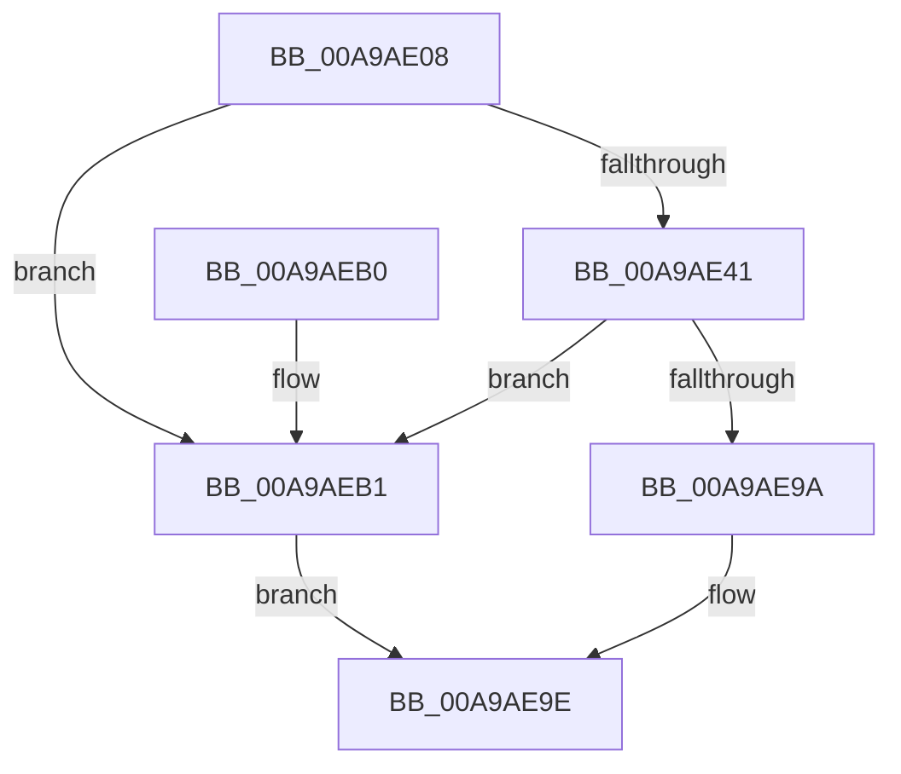

# DbgkpSectionToFileHandle

- RVA: `0x00A9AE08`–`0x00A9AEB5` (길이 `173` bytes)
- VA: `0x0000000140A9AE08`
- 실행 섹션: `PAGE`
- PDB 이름 있음: `예`; PDB Function 태그: `아니요`
- unwind 정보 RVA: `0x000BA300`
- 디코드: `47`개 명령, `173/173` bytes 표시
- 미해석 바이트: `0` (있으면 어셈블리에 `.byte`로 보존)

> 이 문서는 커널 이미지의 기계어와 PDB 기호를 분석해 생성했습니다. 4번과 5번은 함수 원형과 자료형을 바이너리 사용 방식에서 추정한 C 해석이며 원본 소스 복구 결과는 아닙니다.

## 1. Dependencies

- 직접 호출 지점: **3**; 고유 호출 대상: **3**
- 직접 호출자로 확인된 함수: **3**
- RIP 상대 이미지 참조: **0**

### Outgoing calls
- `0x00A9AE38` → [MmGetFileNameForSection](MmGetFileNameForSection_function_00A9AEBC.md) (function, `0x00A9AEBC`)
- `0x00A9AE85` → [ZwOpenFile](../../text/6A/ZwOpenFile_function_006AD730.md) (function, `0x006AD730`)
- `0x00A9AE91` → [ExFreePoolWithTag](../../poolcode/B8/ExFreePoolWithTag_function_00B82870.md) (function, `0x00B82870`)

### Direct callers
- [DbgkMapViewOfSection](../89/DbgkMapViewOfSection_function_00897460.md) at `0x00897535`
- [DbgkpPostFakeThreadMessages](../A1/DbgkpPostFakeThreadMessages_function_00A108CC.md) at `0x00A10B97`
- [sub_00B1BA80](../B1/Unknown_function_00B1BA80.md) at `0x00B1BA9A`

### Static image references
- 디코드된 RIP-relative 메모리 참조가 없습니다.

## 2. Other-region calls and transfers

- 다른 실행 섹션으로 향하는 call: **2**
  - `0x00A9AE85` → [ZwOpenFile](../../text/6A/ZwOpenFile_function_006AD730.md) (`PAGE` → `.text`)
  - `0x00A9AE91` → [ExFreePoolWithTag](../../poolcode/B8/ExFreePoolWithTag_function_00B82870.md) (`PAGE` → `POOLCODE`)
- 별도 외부 분기/꼬리 이동을 확인하지 못했습니다.

## 3. Assembly (complete function range)

```asm
00A9AE08  48 89 5C 24 08                  mov qword ptr [rsp + 8], rbx
00A9AE0D  48 89 7C 24 20                  mov qword ptr [rsp + 0x20], rdi
00A9AE12  55                              push rbp
00A9AE13  48 8B EC                        mov rbp, rsp
00A9AE16  48 83 EC 70                     sub rsp, 0x70
00A9AE1A  33 C0                           xor eax, eax
00A9AE1C  48 8D 55 18                     lea rdx, [rbp + 0x18]
00A9AE20  21 45 EC                        and dword ptr [rbp - 0x14], eax
00A9AE23  0F 57 C0                        xorps xmm0, xmm0
00A9AE26  48 21 45 20                     and qword ptr [rbp + 0x20], rax
00A9AE2A  48 21 45 18                     and qword ptr [rbp + 0x18], rax
00A9AE2E  89 45 D4                        mov dword ptr [rbp - 0x2c], eax
00A9AE31  21 45 D4                        and dword ptr [rbp - 0x2c], eax
00A9AE34  0F 11 45 C0                     movups xmmword ptr [rbp - 0x40], xmm0
00A9AE38  E8 7F 00 00 00                  call 0x140a9aebc
00A9AE3D  85 C0                           test eax, eax
00A9AE3F  78 70                           js 0x140a9aeb1
00A9AE41  48 8B 7D 18                     mov rdi, qword ptr [rbp + 0x18]
00A9AE45  4C 8D 4D C0                     lea r9, [rbp - 0x40]
00A9AE49  48 83 65 D8 00                  and qword ptr [rbp - 0x28], 0
00A9AE4E  4C 8D 45 D0                     lea r8, [rbp - 0x30]
00A9AE52  0F 57 C0                        xorps xmm0, xmm0
00A9AE55  C7 44 24 28 20 00 00 00         mov dword ptr [rsp + 0x28], 0x20
00A9AE5D  BA 00 00 10 80                  mov edx, 0x80100000
00A9AE62  48 89 7D E0                     mov qword ptr [rbp - 0x20], rdi
00A9AE66  48 8D 4D 20                     lea rcx, [rbp + 0x20]
00A9AE6A  C7 45 D0 30 00 00 00            mov dword ptr [rbp - 0x30], 0x30
00A9AE71  F3 0F 7F 45 F0                  movdqu xmmword ptr [rbp - 0x10], xmm0
00A9AE76  C7 45 E8 40 06 00 00            mov dword ptr [rbp - 0x18], 0x640
00A9AE7D  C7 44 24 20 07 00 00 00         mov dword ptr [rsp + 0x20], 7
00A9AE85  E8 A6 28 C1 FF                  call 0x1406ad730
00A9AE8A  33 D2                           xor edx, edx
00A9AE8C  48 8B CF                        mov rcx, rdi
00A9AE8F  8B D8                           mov ebx, eax
00A9AE91  E8 DA 79 0E 00                  call 0x140b82870
00A9AE96  85 DB                           test ebx, ebx
00A9AE98  78 17                           js 0x140a9aeb1
00A9AE9A  48 8B 45 20                     mov rax, qword ptr [rbp + 0x20]
00A9AE9E  4C 8D 5C 24 70                  lea r11, [rsp + 0x70]
00A9AEA3  49 8B 5B 10                     mov rbx, qword ptr [r11 + 0x10]
00A9AEA7  49 8B 7B 28                     mov rdi, qword ptr [r11 + 0x28]
00A9AEAB  49 8B E3                        mov rsp, r11
00A9AEAE  5D                              pop rbp
00A9AEAF  C3                              ret
00A9AEB0  CC                              int3
00A9AEB1  33 C0                           xor eax, eax
00A9AEB3  EB E9                           jmp 0x140a9ae9e
```

## 4. C-style interpretation (structured pseudocode)

```c
__int64 __fastcall DbgkpSectionToFileHandle(void)
{
    __int64 result;
    __int64 v_rsp;
    unsigned __int64 v_stack_m18;
    unsigned int v_stack_m1C;
    unsigned int v_stack_m20;
    unsigned __int64 v_stack_m28;
    unsigned __int64 v_stack_m30;
    unsigned int v_stack_m34;
    unsigned __int64 v_stack_m38;
    unsigned __int64 v_stack_m48;
    unsigned int v_stack_m50;
    unsigned int v_stack_m58;
    unsigned __int64 v_stack_m8;
    unsigned __int64 v_stack_p10;
    unsigned __int64 v_stack_p18;
    unsigned __int64 v_stack_p20;
    unsigned __int64 v_stack_p8;

    v_stack_p8 = v_rbx;
    v_stack_p20 = v_rdi;
    v_rsp = (v_rsp) - (112);
    result = 0;
    v_stack_m34 = 0;
    v_stack_m48 = v_xmm0;
    result = MmGetFileNameForSection(a1, v_stack_p10, a3, a4);
    if (sign_flag) goto loc_00A9AEB1;
    v_stack_m50 = 32;
    v_stack_m28 = v_stack_p10;
    v_stack_m38 = 48;
    v_stack_m18 = v_xmm0;
    v_stack_m20 = 0x640ULL;
    v_stack_m58 = 7;
    result = ZwOpenFile(v_stack_p18, (unsigned int)(0x80100000ULL), v_stack_m38, v_stack_m48);
    a2 = 0;
    result = ExFreePoolWithTag(v_stack_p10, a2, v_stack_m38, v_stack_m48);
    if (sign_flag) goto loc_00A9AEB1;
loc_00A9AE9E:
    return v_stack_p18;
loc_00A9AEB1:
    result = 0;
    goto loc_00A9AE9E;
}
```

## 5. (Beta) C Style

```c
void DbgkpSectionToFileHandle(void)
{
    int64_t result;
    int64_t local_rsp;
    uint64_t v_stack_m18;
    uint32_t v_stack_m1C;
    uint32_t v_stack_m20;
    uint64_t v_stack_m28;
    uint64_t v_stack_m30;
    uint32_t v_stack_m34;
    uint64_t v_stack_m38;
    uint64_t v_stack_m48;
    uint32_t v_stack_m50;
    uint32_t v_stack_m58;
    uint64_t v_stack_m8;
    uint64_t v_stack_p10;
    uint64_t v_stack_p18;
    uint64_t v_stack_p20;
    uint64_t v_stack_p8;

    v_stack_p8 = local_rbx;
    v_stack_p20 = local_rdi;
    local_rsp = (local_rsp) - (112);
    result = 0;
    v_stack_m34 = 0;
    v_stack_m48 = v_xmm0;
    result = MmGetFileNameForSection(a1, v_stack_p10, a3, a4);
    if (sign_flag) goto loc_00A9AEB1;
    v_stack_m50 = 32;
    v_stack_m28 = v_stack_p10;
    v_stack_m38 = 48;
    v_stack_m18 = v_xmm0;
    v_stack_m20 = 0x640ULL;
    v_stack_m58 = 7;
    result = ZwOpenFile(v_stack_p18, (uint32_t)(0x80100000ULL), v_stack_m38, v_stack_m48);
    a2 = 0;
    result = ExFreePoolWithTag(v_stack_p10, a2, v_stack_m38, v_stack_m48);
    if (sign_flag) goto loc_00A9AEB1;
loc_00A9AE9E:
    return v_stack_p18;
loc_00A9AEB1:
    result = 0;
    goto loc_00A9AE9E;
}
```

## 6. Execution-region graph

[열기: 2D/3D 그래프와 함수 탐색 컨트롤 패널](../../../control-panel.html?section=page&rva=0x00A9AE08&view=graph)

- 2D 그래프는 위에서 아래로 흐르고, 3D 그래프는 빈 공간을 드래그해 회전합니다. Shift+드래그는 이동, 휠은 확대·축소, 함수 노드 선택은 대상 보고서 이동입니다.

### Static fallback


