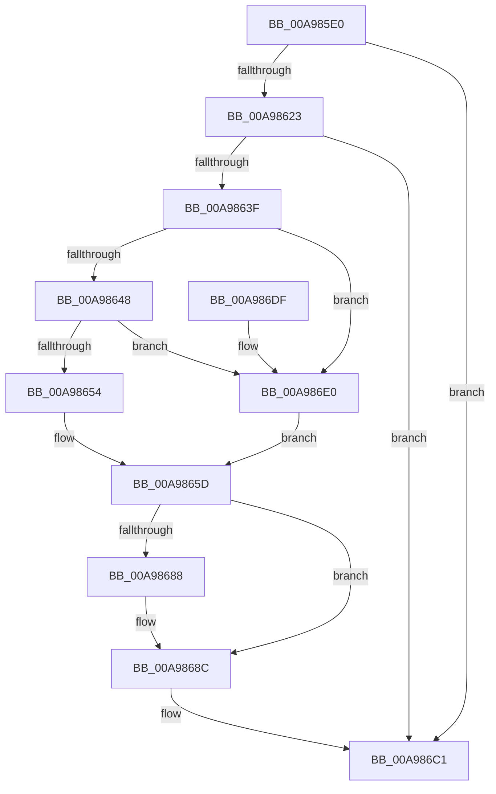

# EtwTiLogDriverObjectLoad

- RVA: `0x00A985E0`–`0x00A986F4` (길이 `276` bytes)
- VA: `0x0000000140A985E0`
- 실행 섹션: `PAGE`
- PDB 이름 있음: `예`; PDB Function 태그: `아니요`
- unwind 정보 RVA: `0x000BA038`
- 디코드: `66`개 명령, `276/276` bytes 표시
- 미해석 바이트: `0` (있으면 어셈블리에 `.byte`로 보존)

> 이 문서는 커널 이미지의 기계어와 PDB 기호를 분석해 생성했습니다. 4번과 5번은 함수 원형과 자료형을 바이너리 사용 방식에서 추정한 C 해석이며 원본 소스 복구 결과는 아닙니다.

## 1. Dependencies

- 직접 호출 지점: **5**; 고유 호출 대상: **5**
- 직접 호출자로 확인된 함수: **2**
- RIP 상대 이미지 참조: **4**

### Outgoing calls
- `0x00A98616` → [EtwEventEnabled](../../text/39/EtwEventEnabled_function_00392450.md) (function, `0x00392450`)
- `0x00A98632` → [EtwProviderEnabled](../../text/3B/EtwProviderEnabled_function_003BA250.md) (function, `0x003BA250`)
- `0x00A9867F` → [EtwpTiQueryCodeIntegrityOptions](EtwpTiQueryCodeIntegrityOptions_function_00A986FC.md) (function, `0x00A986FC`)
- `0x00A986BC` → [EtwWrite](../../text/41/EtwWrite_function_0041C720.md) (function, `0x0041C720`)
- `0x00A986C8` → [_security_check_cookie](../../text/6A/_security_check_cookie_function_006AC640.md) (function, `0x006AC640`)

### Direct callers
- [IopLoadDriver](../99/IopLoadDriver_function_00997B54.md) at `0x0099837B`
- [IoCreateDriver](../AC/IoCreateDriver_function_00AC9D70.md) at `0x00ACA06A`

### Static image references
- `0x00A985F2` → RVA `0x00E0A740` (`.data`; read)
- `0x00A98603` → RVA `0x0001C5F0` (`.rdata`; read)
- `0x00A9860A` → RVA `0x00EFFA30` (`.data`; read)
- `0x00A986E5` → RVA `0x00B076E0` (` ?? ::NNGAKEGL::`string'`; read)

## 2. Other-region calls and transfers

- 다른 실행 섹션으로 향하는 call: **4**
  - `0x00A98616` → [EtwEventEnabled](../../text/39/EtwEventEnabled_function_00392450.md) (`PAGE` → `.text`)
  - `0x00A98632` → [EtwProviderEnabled](../../text/3B/EtwProviderEnabled_function_003BA250.md) (`PAGE` → `.text`)
  - `0x00A986BC` → [EtwWrite](../../text/41/EtwWrite_function_0041C720.md) (`PAGE` → `.text`)
  - `0x00A986C8` → [_security_check_cookie](../../text/6A/_security_check_cookie_function_006AC640.md) (`PAGE` → `.text`)
- 별도 외부 분기/꼬리 이동을 확인하지 못했습니다.

## 3. Assembly (complete function range)

```asm
00A985E0  48 89 5C 24 08                  mov qword ptr [rsp + 8], rbx
00A985E5  48 89 7C 24 10                  mov qword ptr [rsp + 0x10], rdi
00A985EA  55                              push rbp
00A985EB  48 8B EC                        mov rbp, rsp
00A985EE  48 83 EC 70                     sub rsp, 0x70
00A985F2  48 8B 05 47 21 37 00            mov rax, qword ptr [rip + 0x372147]
00A985F9  48 33 C4                        xor rax, rsp
00A985FC  48 89 45 F8                     mov qword ptr [rbp - 8], rax
00A98600  48 8B D9                        mov rbx, rcx
00A98603  48 8D 15 E6 3F 58 FF            lea rdx, [rip - 0xa7c01a]
00A9860A  48 8B 0D 1F 74 46 00            mov rcx, qword ptr [rip + 0x46741f]
00A98611  33 FF                           xor edi, edi
00A98613  89 7D C4                        mov dword ptr [rbp - 0x3c], edi
00A98616  E8 35 9E 8F FF                  call 0x140392450
00A9861B  84 C0                           test al, al
00A9861D  0F 84 9E 00 00 00               je 0x140a986c1
00A98623  48 8B 0D 06 74 46 00            mov rcx, qword ptr [rip + 0x467406]
00A9862A  33 D2                           xor edx, edx
00A9862C  41 B8 00 00 00 40               mov r8d, 0x40000000
00A98632  E8 19 1C 92 FF                  call 0x1403ba250
00A98637  84 C0                           test al, al
00A98639  0F 84 82 00 00 00               je 0x140a986c1
00A9863F  48 85 DB                        test rbx, rbx
00A98642  0F 84 98 00 00 00               je 0x140a986e0
00A98648  0F B7 03                        movzx eax, word ptr [rbx]
00A9864B  66 85 C0                        test ax, ax
00A9864E  0F 84 8C 00 00 00               je 0x140a986e0
00A98654  48 8B 53 08                     mov rdx, qword ptr [rbx + 8]
00A98658  8B C8                           mov ecx, eax
00A9865A  66 D1 E8                        shr ax, 1
00A9865D  66 89 45 C0                     mov word ptr [rbp - 0x40], ax
00A98661  48 8D 45 C0                     lea rax, [rbp - 0x40]
00A98665  89 4D E0                        mov dword ptr [rbp - 0x20], ecx
00A98668  48 8D 4D C4                     lea rcx, [rbp - 0x3c]
00A9866C  48 89 45 C8                     mov qword ptr [rbp - 0x38], rax
00A98670  48 C7 45 D0 02 00 00 00         mov qword ptr [rbp - 0x30], 2
00A98678  48 89 55 D8                     mov qword ptr [rbp - 0x28], rdx
00A9867C  89 7D E4                        mov dword ptr [rbp - 0x1c], edi
00A9867F  E8 78 00 00 00                  call 0x140a986fc
00A98684  85 C0                           test eax, eax
00A98686  79 04                           jns 0x140a9868c
00A98688  83 4D C4 FF                     or dword ptr [rbp - 0x3c], 0xffffffff
00A9868C  48 8B 0D 9D 73 46 00            mov rcx, qword ptr [rip + 0x46739d]
00A98693  48 8D 45 C4                     lea rax, [rbp - 0x3c]
00A98697  48 89 45 E8                     mov qword ptr [rbp - 0x18], rax
00A9869B  48 8D 15 4E 3F 58 FF            lea rdx, [rip - 0xa7c0b2]
00A986A2  48 8D 45 C8                     lea rax, [rbp - 0x38]
00A986A6  48 C7 45 F0 04 00 00 00         mov qword ptr [rbp - 0x10], 4
00A986AE  41 B9 03 00 00 00               mov r9d, 3
00A986B4  48 89 44 24 20                  mov qword ptr [rsp + 0x20], rax
00A986B9  45 33 C0                        xor r8d, r8d
00A986BC  E8 5F 40 98 FF                  call 0x14041c720
00A986C1  48 8B 4D F8                     mov rcx, qword ptr [rbp - 8]
00A986C5  48 33 CC                        xor rcx, rsp
00A986C8  E8 73 3F C1 FF                  call 0x1406ac640
00A986CD  4C 8D 5C 24 70                  lea r11, [rsp + 0x70]
00A986D2  49 8B 5B 10                     mov rbx, qword ptr [r11 + 0x10]
00A986D6  49 8B 7B 18                     mov rdi, qword ptr [r11 + 0x18]
00A986DA  49 8B E3                        mov rsp, r11
00A986DD  5D                              pop rbp
00A986DE  C3                              ret
00A986DF  CC                              int3
00A986E0  B9 0C 00 00 00                  mov ecx, 0xc
00A986E5  48 8D 15 F4 EF 06 00            lea rdx, [rip + 0x6eff4]
00A986EC  8D 41 FA                        lea eax, [rcx - 6]
00A986EF  E9 69 FF FF FF                  jmp 0x140a9865d
```

## 4. C-style interpretation (structured pseudocode)

```c
__int64 __fastcall EtwTiLogDriverObjectLoad(__int64 a1)
{
    __int64 result;
    __int64 v_rdi;
    __int64 v_rsp;
    unsigned __int64 v_stack_m10;
    unsigned __int64 v_stack_m18;
    unsigned __int64 v_stack_m20;
    unsigned int v_stack_m24;
    unsigned int v_stack_m28;
    unsigned __int64 v_stack_m30;
    unsigned __int64 v_stack_m38;
    unsigned __int64 v_stack_m40;
    unsigned int v_stack_m44;
    unsigned __int16 v_stack_m48;
    unsigned __int64 v_stack_m58;
    unsigned __int64 v_stack_m8;
    unsigned __int64 v_stack_p10;
    unsigned __int64 v_stack_p8;

    v_stack_p8 = v_rbx;
    v_stack_p10 = v_rdi;
    v_rsp = (v_rsp) - (112);
    result = (*(unsigned __int64 *)(v_rip + 3612999)) ^ (v_rsp);
    v_stack_m10 = result;
    v_rdi = 0;
    v_stack_m44 = 0;
    result = EtwEventEnabled(*(unsigned __int64 *)(v_rip + 4617247), v_rip - 10993690, a3, a4);
    if ((unsigned __int8)(result) == 0) goto loc_00A986C1;
    a2 = 0;
    result = EtwProviderEnabled(*(unsigned __int64 *)(v_rip + 4617222), a2, (unsigned int)(0x40000000ULL), a4);
    if ((unsigned __int8)(result) == 0) goto loc_00A986C1;
    if (a1 == 0) goto loc_00A986E0;
    if ((unsigned __int16)(*(unsigned __int16 *)(a1)) == 0) goto loc_00A986E0;
    result = (unsigned __int16)((*(unsigned __int16 *)(a1)) >> (1));
loc_00A9865D:
    v_stack_m48 = (unsigned __int16)(result);
    v_stack_m28 = (unsigned int)((unsigned int)((unsigned int)(*(unsigned __int16 *)(a1))));
    v_stack_m40 = v_stack_m48;
    v_stack_m38 = 2;
    v_stack_m30 = *(unsigned __int64 *)(a1 + 8);
    v_stack_m24 = 0;
    result = EtwpTiQueryCodeIntegrityOptions(v_stack_m44, *(unsigned __int64 *)(a1 + 8), (unsigned int)(0x40000000ULL), a4);
    if (sign_flag) {
    }
    v_stack_m20 = v_stack_m44;
    v_stack_m18 = 4;
    v_stack_m58 = v_stack_m40;
    a3 = 0;
    result = EtwWrite(*(unsigned __int64 *)(v_rip + 4617117), v_rip - 10993842, a3, 3);
loc_00A986C1:
    a1 = (v_stack_m10) ^ (v_rsp);
    result = _security_check_cookie(a1, v_rip - 10993842, a3, 3);
    return result;
loc_00A986E0:
    goto loc_00A9865D;
}
```

## 5. (Beta) C Style

```c
int64_t EtwTiLogDriverObjectLoad(int64_t Arg1)
{
    int64_t result;
    int64_t local_rdi;
    int64_t local_rsp;
    uint64_t v_stack_m10;
    uint64_t v_stack_m18;
    uint64_t v_stack_m20;
    uint32_t v_stack_m24;
    uint32_t v_stack_m28;
    uint64_t v_stack_m30;
    uint64_t v_stack_m38;
    uint64_t v_stack_m40;
    uint32_t v_stack_m44;
    uint16_t v_stack_m48;
    uint64_t v_stack_m58;
    uint64_t v_stack_m8;
    uint64_t v_stack_p10;
    uint64_t v_stack_p8;

    v_stack_p8 = local_rbx;
    v_stack_p10 = local_rdi;
    local_rsp = (local_rsp) - (112);
    result = (*(uint64_t *)(v_rip + 0x372147)) ^ (local_rsp);
    v_stack_m10 = result;
    local_rdi = 0;
    v_stack_m44 = 0;
    result = EtwEventEnabled(*(uint64_t *)(v_rip + 0x46741F), v_rip - 10993690, a3, a4);
    if ((uint8_t)(result) == 0) goto loc_00A986C1;
    a2 = 0;
    result = EtwProviderEnabled(*(uint64_t *)(v_rip + 0x467406), a2, (uint32_t)(0x40000000ULL), a4);
    if ((uint8_t)(result) == 0) goto loc_00A986C1;
    if (Arg1 == 0) goto loc_00A986E0;
    if ((uint16_t)(*(uint16_t *)(Arg1)) == 0) goto loc_00A986E0;
    result = (uint16_t)((*(uint16_t *)(Arg1)) >> (1));
loc_00A9865D:
    v_stack_m48 = (uint16_t)(result);
    v_stack_m28 = (uint32_t)((uint32_t)((uint32_t)(*(uint16_t *)(Arg1))));
    v_stack_m40 = v_stack_m48;
    v_stack_m38 = 2;
    v_stack_m30 = *(uint64_t *)(Arg1 + 0x8);
    v_stack_m24 = 0;
    result = EtwpTiQueryCodeIntegrityOptions(v_stack_m44, *(uint64_t *)(Arg1 + 0x8), (uint32_t)(0x40000000ULL), a4);
    if (sign_flag) {
    }
    v_stack_m20 = v_stack_m44;
    v_stack_m18 = 4;
    v_stack_m58 = v_stack_m40;
    a3 = 0;
    result = EtwWrite(*(uint64_t *)(v_rip + 0x46739D), v_rip - 10993842, a3, 3);
loc_00A986C1:
    Arg1 = (v_stack_m10) ^ (local_rsp);
    result = _security_check_cookie(Arg1, v_rip - 10993842, a3, 3);
    return result;
loc_00A986E0:
    goto loc_00A9865D;
}
```

## 6. Execution-region graph

[열기: 2D/3D 그래프와 함수 탐색 컨트롤 패널](../../../control-panel.html?section=page&rva=0x00A985E0&view=graph)

- 2D 그래프는 위에서 아래로 흐르고, 3D 그래프는 빈 공간을 드래그해 회전합니다. Shift+드래그는 이동, 휠은 확대·축소, 함수 노드 선택은 대상 보고서 이동입니다.

### Static fallback


