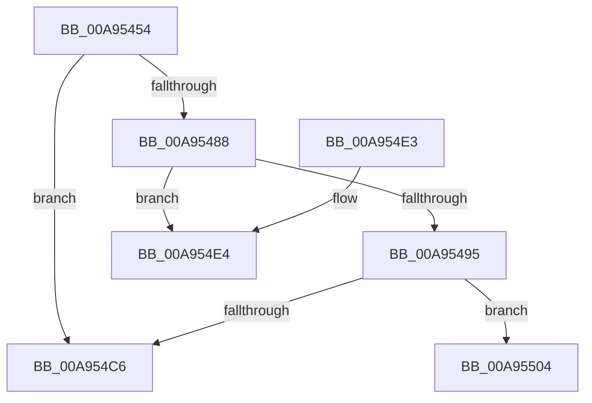

# EtwpApplyContainerFilter

- RVA: `0x00A95454`–`0x00A95540` (길이 `236` bytes)
- VA: `0x0000000140A95454`
- 실행 섹션: `PAGE`
- PDB 이름 있음: `예`; PDB Function 태그: `예`
- unwind 정보 RVA: `0x000B97D4`
- 디코드: `60`개 명령, `236/236` bytes 표시
- 미해석 바이트: `0` (있으면 어셈블리에 `.byte`로 보존)

> 이 문서는 커널 이미지의 기계어와 PDB 기호를 분석해 생성했습니다. 4번과 5번은 함수 원형과 자료형을 바이너리 사용 방식에서 추정한 C 해석이며 원본 소스 복구 결과는 아닙니다.

## 1. Dependencies

- 직접 호출 지점: **3**; 고유 호출 대상: **3**
- 직접 호출자로 확인된 함수: **2**
- RIP 상대 이미지 참조: **2**

### Outgoing calls
- `0x00A954B4` → [ExAllocatePool2](../../poolcode/B8/ExAllocatePool2_function_00B820F0.md) (function, `0x00B820F0`)
- `0x00A954F0` → [RtlInitUnicodeString](../../text/42/RtlInitUnicodeString_function_0042A780.md) (function, `0x0042A780`)
- `0x00A9552C` → [RtlUTF8ToUnicodeN](../90/RtlUTF8ToUnicodeN_function_0090E060.md) (function, `0x0090E060`)

### Direct callers
- [sub_008C350B](../8C/Unknown_function_008C350B.md) at `0x008C35E0`
- [EtwpApplyTransientFilters](../8C/EtwpApplyTransientFilters_function_008C8994.md) at `0x008C89D8`

### Static image references
- `0x00A95488` → RVA `0x00FC6AA8` (`ALMOSTRO`; read)
- `0x00A954E4` → RVA `0x00B07FF0` (` ?? ::NNGAKEGL::`string'`; read)

## 2. Other-region calls and transfers

- 다른 실행 섹션으로 향하는 call: **2**
  - `0x00A954B4` → [ExAllocatePool2](../../poolcode/B8/ExAllocatePool2_function_00B820F0.md) (`PAGE` → `POOLCODE`)
  - `0x00A954F0` → [RtlInitUnicodeString](../../text/42/RtlInitUnicodeString_function_0042A780.md) (`PAGE` → `.text`)
- call이 아닌 외부 분기/꼬리 이동: **2**
  - `0x00A954FF` → [sub_00B476B8](../B4/Unknown_function_00B476B8.md) (`tail-transfer`)
  - `0x00A9553B` → [sub_00B476B8](../B4/Unknown_function_00B476B8.md) (`tail-transfer`)

## 3. Assembly (complete function range)

```asm
00A95454  48 89 5C 24 10                  mov qword ptr [rsp + 0x10], rbx
00A95459  48 89 6C 24 18                  mov qword ptr [rsp + 0x18], rbp
00A9545E  56                              push rsi
00A9545F  57                              push rdi
00A95460  41 54                           push r12
00A95462  41 56                           push r14
00A95464  41 57                           push r15
00A95466  48 83 EC 40                     sub rsp, 0x40
00A9546A  48 8B 41 20                     mov rax, qword ptr [rcx + 0x20]
00A9546E  45 33 E4                        xor r12d, r12d
00A95471  0F 57 C0                        xorps xmm0, xmm0
00A95474  48 8B EA                        mov rbp, rdx
00A95477  0F 11 44 24 30                  movups xmmword ptr [rsp + 0x30], xmm0
00A9547C  48 8B B0 88 02 00 00            mov rsi, qword ptr [rax + 0x288]
00A95483  48 85 D2                        test rdx, rdx
00A95486  74 3E                           je 0x140a954c6
00A95488  48 3B 35 19 16 53 00            cmp rsi, qword ptr [rip + 0x531619]
00A9548F  66 BB 01 00                     mov bx, 1
00A95493  74 4F                           je 0x140a954e4
00A95495  0F B7 96 90 11 00 00            movzx edx, word ptr [rsi + 0x1190]
00A9549C  41 8D 4C 24 40                  lea ecx, [r12 + 0x40]
00A954A1  41 B8 45 74 77 46               mov r8d, 0x46777445
00A954A7  44 89 64 24 70                  mov dword ptr [rsp + 0x70], r12d
00A954AC  48 8D 14 55 02 00 00 00         lea rdx, [rdx*2 + 2]
00A954B4  E8 37 CC 0E 00                  call 0x140b820f0
00A954B9  48 89 44 24 38                  mov qword ptr [rsp + 0x38], rax
00A954BE  4C 8B F8                        mov r15, rax
00A954C1  48 85 C0                        test rax, rax
00A954C4  75 3E                           jne 0x140a95504
00A954C6  66 B8 01 00                     mov ax, 1
00A954CA  4C 8D 5C 24 40                  lea r11, [rsp + 0x40]
00A954CF  49 8B 5B 38                     mov rbx, qword ptr [r11 + 0x38]
00A954D3  49 8B 6B 40                     mov rbp, qword ptr [r11 + 0x40]
00A954D7  49 8B E3                        mov rsp, r11
00A954DA  41 5F                           pop r15
00A954DC  41 5E                           pop r14
00A954DE  41 5C                           pop r12
00A954E0  5F                              pop rdi
00A954E1  5E                              pop rsi
00A954E2  C3                              ret
00A954E3  CC                              int3
00A954E4  48 8D 15 05 2B 07 00            lea rdx, [rip + 0x72b05]
00A954EB  48 8D 4C 24 30                  lea rcx, [rsp + 0x30]
00A954F0  E8 8B 52 99 FF                  call 0x14042a780
00A954F5  0F B7 44 24 30                  movzx eax, word ptr [rsp + 0x30]
00A954FA  4C 8B 7C 24 38                  mov r15, qword ptr [rsp + 0x38]
00A954FF  E9 B4 21 0B 00                  jmp 0x140b476b8
00A95504  0F B7 8E 90 11 00 00            movzx ecx, word ptr [rsi + 0x1190]
00A9550B  4C 8D 44 24 70                  lea r8, [rsp + 0x70]
00A95510  4C 8B 8E 88 11 00 00            mov r9, qword ptr [rsi + 0x1188]
00A95517  89 4C 24 20                     mov dword ptr [rsp + 0x20], ecx
00A9551B  8D 04 0B                        lea eax, [rbx + rcx]
00A9551E  49 8B CF                        mov rcx, r15
00A95521  66 03 C0                        add ax, ax
00A95524  0F B7 D0                        movzx edx, ax
00A95527  66 89 54 24 32                  mov word ptr [rsp + 0x32], dx
00A9552C  E8 2F 8B E7 FF                  call 0x14090e060
00A95531  0F B7 44 24 70                  movzx eax, word ptr [rsp + 0x70]
00A95536  66 89 44 24 30                  mov word ptr [rsp + 0x30], ax
00A9553B  E9 78 21 0B 00                  jmp 0x140b476b8
```

## 4. C-style interpretation (structured pseudocode)

```c
__int64 __fastcall EtwpApplyContainerFilter(__int64 a1, __int64 a2)
{
    __int64 result;
    __int64 v_r12;
    __int64 v_rsp;
    unsigned __int64 v_stack_m10;
    unsigned int v_stack_m20;
    unsigned __int64 v_stack_m28;
    unsigned __int64 v_stack_m30;
    unsigned __int64 v_stack_m38;
    unsigned __int64 v_stack_m8;
    unsigned __int16 v_stack_mE;
    unsigned __int64 v_stack_p10;
    unsigned __int64 v_stack_p18;
    unsigned __int64 v_stack_p30;
    unsigned int v_stack_p8;

    v_stack_p10 = v_rbx;
    v_stack_p18 = v_rbp;
    v_rsp = (v_rsp) - (64);
    v_r12 = 0;
    v_stack_m38 = v_xmm0;
    if (a2 == 0) goto loc_00A954C6;
    if ((*(unsigned __int64 *)(*(unsigned __int64 *)(a1 + 32) + 648)) == (*(unsigned __int64 *)(v_rip + 5445145))) goto loc_00A954E4;
    v_stack_p8 = 0;
    result = ExAllocatePool2(v_r12 + 64, *(unsigned __int16 *)(*(unsigned __int64 *)(*(unsigned __int64 *)(a1 + 32) + 648) + 4496) * 2 + 2, (unsigned int)(0x46777445ULL), a4);
    v_stack_m30 = result;
    if (result != 0) goto loc_00A95504;
loc_00A954C6:
    return 1;
loc_00A954E4:
    result = RtlInitUnicodeString(v_stack_m10, v_rip + 469765, (unsigned int)(0x46777445ULL), a4);
loc_00A95504:
    v_stack_m20 = (unsigned int)(*(unsigned __int16 *)(*(unsigned __int64 *)(*(unsigned __int64 *)(a1 + 32) + 648) + 4496));
    result = (unsigned __int16)((*(unsigned __int64 *)(v_stack_m28 + 56) + *(unsigned __int16 *)(*(unsigned __int64 *)(*(unsigned __int64 *)(a1 + 32) + 648) + 4496) * 1) + ((unsigned __int16)(*(unsigned __int64 *)(v_stack_m28 + 56) + *(unsigned __int16 *)(*(unsigned __int64 *)(*(unsigned __int64 *)(a1 + 32) + 648) + 4496) * 1)));
    v_stack_mE = (unsigned __int16)((unsigned __int16)(result));
    result = RtlUTF8ToUnicodeN(v_stack_m8, (unsigned __int16)(result), v_stack_p30, *(unsigned __int64 *)(*(unsigned __int64 *)(*(unsigned __int64 *)(a1 + 32) + 648) + 4488));
    v_stack_m10 = (unsigned __int16)(v_stack_p30);
}
```

## 5. (Beta) C Style

```c
int64_t EtwpApplyContainerFilter(void *Arg1, int64_t Arg2)
{
    uint8_t *arg1 = (uint8_t *)Arg1;

    int64_t result;
    int64_t local_r12;
    int64_t local_rsp;
    uint64_t v_stack_m10;
    uint32_t v_stack_m20;
    uint64_t v_stack_m28;
    uint64_t v_stack_m30;
    uint64_t v_stack_m38;
    uint64_t v_stack_m8;
    uint16_t v_stack_mE;
    uint64_t v_stack_p10;
    uint64_t v_stack_p18;
    uint64_t v_stack_p30;
    uint32_t v_stack_p8;

    v_stack_p10 = local_rbx;
    v_stack_p18 = local_rbp;
    local_rsp = (local_rsp) - (64);
    local_r12 = 0;
    v_stack_m38 = v_xmm0;
    if (Arg2 == 0) goto loc_00A954C6;
    if ((*(uint64_t *)(*(uint64_t *)(arg1 + 0x20) + 0x288)) == (*(uint64_t *)(v_rip + 0x531619))) goto loc_00A954E4;
    v_stack_p8 = 0;
    result = ExAllocatePool2(local_r12 + 64, *(uint16_t *)(*(uint64_t *)(*(uint64_t *)(arg1 + 0x20) + 0x288) + 0x1190) * 2 + 2, (uint32_t)(0x46777445ULL), a4);
    v_stack_m30 = result;
    if (result != 0) goto loc_00A95504;
loc_00A954C6:
    return 1;
loc_00A954E4:
    result = RtlInitUnicodeString(v_stack_m10, v_rip + 469765, (uint32_t)(0x46777445ULL), a4);
loc_00A95504:
    v_stack_m20 = (uint32_t)(*(uint16_t *)(*(uint64_t *)(*(uint64_t *)(arg1 + 0x20) + 0x288) + 0x1190));
    result = (uint16_t)((*(uint64_t *)(v_stack_m28 + 0x38) + *(uint16_t *)(*(uint64_t *)(*(uint64_t *)(arg1 + 0x20) + 0x288) + 0x1190) * 1) + ((uint16_t)(*(uint64_t *)(v_stack_m28 + 0x38) + *(uint16_t *)(*(uint64_t *)(*(uint64_t *)(arg1 + 0x20) + 0x288) + 0x1190) * 1)));
    v_stack_mE = (uint16_t)((uint16_t)(result));
    result = RtlUTF8ToUnicodeN(v_stack_m8, (uint16_t)(result), v_stack_p30, *(uint64_t *)(*(uint64_t *)(*(uint64_t *)(arg1 + 0x20) + 0x288) + 0x1188));
    v_stack_m10 = (uint16_t)(v_stack_p30);
}
```

### 관측된 메모리 오프셋

구조체 형식이 확인되지 않은 접근은 인자 기준의 오프셋으로만 기록했습니다.

| 기준 인자 | 오프셋 표현 | 폭 (bit) | 접근 |
|---|---:|---:|---|
| `Arg1` | `+ 0x20` | `64` | `R` |

## 6. Execution-region graph

[열기: 2D/3D 그래프와 함수 탐색 컨트롤 패널](../../../control-panel.html?section=page&rva=0x00A95454&view=graph)

- 2D 그래프는 위에서 아래로 흐르고, 3D 그래프는 빈 공간을 드래그해 회전합니다. Shift+드래그는 이동, 휠은 확대·축소, 함수 노드 선택은 대상 보고서 이동입니다.

### Static fallback


