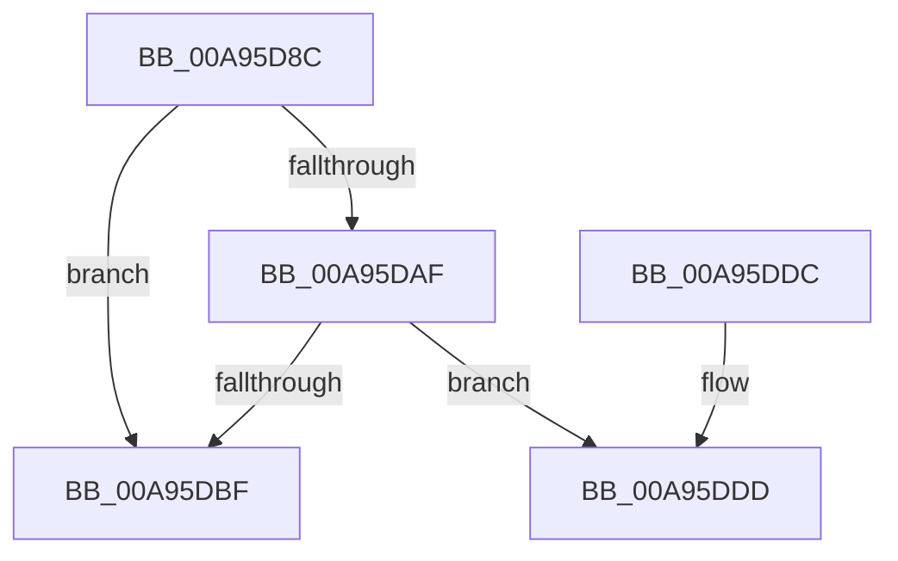

# EtwpApplyExeFilter

- RVA: `0x00A95D8C`–`0x00A95DEF` (길이 `99` bytes)
- VA: `0x0000000140A95D8C`
- 실행 섹션: `PAGE`
- PDB 이름 있음: `예`; PDB Function 태그: `예`
- unwind 정보 RVA: `0x000B9938`
- 디코드: `30`개 명령, `99/99` bytes 표시
- 미해석 바이트: `0` (있으면 어셈블리에 `.byte`로 보존)

> 이 문서는 커널 이미지의 기계어와 PDB 기호를 분석해 생성했습니다. 4번과 5번은 함수 원형과 자료형을 바이너리 사용 방식에서 추정한 C 해석이며 원본 소스 복구 결과는 아닙니다.

## 1. Dependencies

- 직접 호출 지점: **0**; 고유 호출 대상: **0**
- 직접 호출자로 확인된 함수: **2**
- RIP 상대 이미지 참조: **0**

### Outgoing calls
- 직접 디코드된 call 명령이 없습니다.

### Direct callers
- [sub_008C350B](../8C/Unknown_function_008C350B.md) at `0x008C3676`
- [EtwpApplyTransientFilters](../8C/EtwpApplyTransientFilters_function_008C8994.md) at `0x008C89C8`

### Static image references
- 디코드된 RIP-relative 메모리 참조가 없습니다.

## 2. Other-region calls and transfers

- 다른 실행 섹션으로 향하는 call: **0**
- call이 아닌 외부 분기/꼬리 이동: **1**
  - `0x00A95DEA` → [sub_00B4781A](../B4/Unknown_function_00B4781A.md) (`tail-transfer`)

## 3. Assembly (complete function range)

```asm
00A95D8C  48 89 5C 24 08                  mov qword ptr [rsp + 8], rbx
00A95D91  48 89 6C 24 10                  mov qword ptr [rsp + 0x10], rbp
00A95D96  48 89 74 24 18                  mov qword ptr [rsp + 0x18], rsi
00A95D9B  57                              push rdi
00A95D9C  41 56                           push r14
00A95D9E  41 57                           push r15
00A95DA0  48 83 EC 20                     sub rsp, 0x20
00A95DA4  45 33 FF                        xor r15d, r15d
00A95DA7  48 8B EA                        mov rbp, rdx
00A95DAA  48 85 D2                        test rdx, rdx
00A95DAD  74 10                           je 0x140a95dbf
00A95DAF  48 8B 41 50                     mov rax, qword ptr [rcx + 0x50]
00A95DB3  48 8B 88 50 03 00 00            mov rcx, qword ptr [rax + 0x350]
00A95DBA  48 85 C9                        test rcx, rcx
00A95DBD  75 1E                           jne 0x140a95ddd
00A95DBF  66 B8 01 00                     mov ax, 1
00A95DC3  48 8B 5C 24 40                  mov rbx, qword ptr [rsp + 0x40]
00A95DC8  48 8B 6C 24 48                  mov rbp, qword ptr [rsp + 0x48]
00A95DCD  48 8B 74 24 50                  mov rsi, qword ptr [rsp + 0x50]
00A95DD2  48 83 C4 20                     add rsp, 0x20
00A95DD6  41 5F                           pop r15
00A95DD8  41 5E                           pop r14
00A95DDA  5F                              pop rdi
00A95DDB  C3                              ret
00A95DDC  CC                              int3
00A95DDD  0F B7 39                        movzx edi, word ptr [rcx]
00A95DE0  48 8B 51 08                     mov rdx, qword ptr [rcx + 8]
00A95DE4  D1 EF                           shr edi, 1
00A95DE6  48 8D 0C 7A                     lea rcx, [rdx + rdi*2]
00A95DEA  E9 2B 1A 0B 00                  jmp 0x140b4781a
```

## 4. C-style interpretation (structured pseudocode)

```c
__int64 __fastcall EtwpApplyExeFilter(__int64 a1, __int64 a2)
{
    __int64 v_r15;
    __int64 v_rdi;
    __int64 v_rsp;
    unsigned __int64 v_stack_p10;
    unsigned __int64 v_stack_p18;
    unsigned __int64 v_stack_p8;

    v_stack_p8 = v_rbx;
    v_stack_p10 = v_rbp;
    v_stack_p18 = v_rsi;
    v_rsp = (v_rsp) - (32);
    v_r15 = 0;
    if (a2 == 0) goto loc_00A95DBF;
    if (*(unsigned __int64 *)(*(unsigned __int64 *)(a1 + 80) + 848) != 0) goto loc_00A95DDD;
loc_00A95DBF:
    v_rsp = (v_rsp) + (32);
    return 1;
loc_00A95DDD:
    v_rdi = (unsigned int)((*(unsigned __int16 *)(*(unsigned __int64 *)(*(unsigned __int64 *)(a1 + 80) + 848))) >> (1));
}
```

## 5. (Beta) C Style

```c
int64_t EtwpApplyExeFilter(void *Arg1, int64_t Arg2)
{
    uint8_t *arg1 = (uint8_t *)Arg1;

    int64_t local_r15;
    int64_t local_rdi;
    int64_t local_rsp;
    uint64_t v_stack_p10;
    uint64_t v_stack_p18;
    uint64_t v_stack_p8;

    v_stack_p8 = local_rbx;
    v_stack_p10 = local_rbp;
    v_stack_p18 = local_rsi;
    local_rsp = (local_rsp) - (32);
    local_r15 = 0;
    if (Arg2 == 0) goto loc_00A95DBF;
    if (*(uint64_t *)(*(uint64_t *)(arg1 + 0x50) + 0x350) != 0) goto loc_00A95DDD;
loc_00A95DBF:
    local_rsp = (local_rsp) + (32);
    return 1;
loc_00A95DDD:
    local_rdi = (uint32_t)((*(uint16_t *)(*(uint64_t *)(*(uint64_t *)(arg1 + 0x50) + 0x350))) >> (1));
}
```

### 관측된 메모리 오프셋

구조체 형식이 확인되지 않은 접근은 인자 기준의 오프셋으로만 기록했습니다.

| 기준 인자 | 오프셋 표현 | 폭 (bit) | 접근 |
|---|---:|---:|---|
| `Arg1` | `+ 0x50` | `64` | `R` |

## 6. Execution-region graph

[열기: 2D/3D 그래프와 함수 탐색 컨트롤 패널](../../../control-panel.html?section=page&rva=0x00A95D8C&view=graph)

- 2D 그래프는 위에서 아래로 흐르고, 3D 그래프는 빈 공간을 드래그해 회전합니다. Shift+드래그는 이동, 휠은 확대·축소, 함수 노드 선택은 대상 보고서 이동입니다.

### Static fallback


