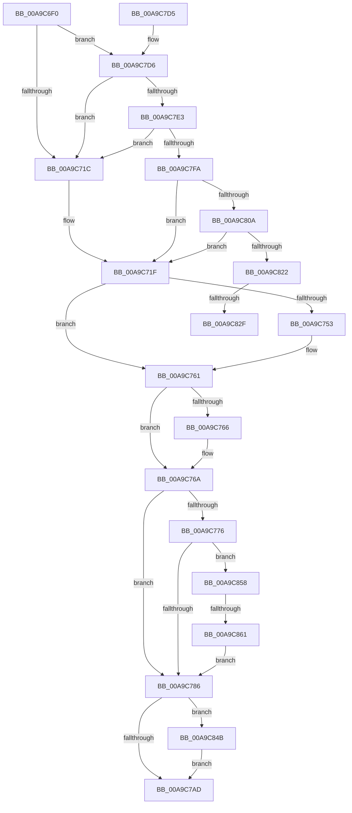

# EtwpCoverageProvEnableCallback

- RVA: `0x00A9C6F0`–`0x00A9C880` (길이 `400` bytes)
- VA: `0x0000000140A9C6F0`
- 실행 섹션: `PAGE`
- PDB 이름 있음: `예`; PDB Function 태그: `예`
- unwind 정보 RVA: `0x000BA61C`
- 디코드: `84`개 명령, `400/400` bytes 표시
- 미해석 바이트: `0` (있으면 어셈블리에 `.byte`로 보존)

> 이 문서는 커널 이미지의 기계어와 PDB 기호를 분석해 생성했습니다. 4번과 5번은 함수 원형과 자료형을 바이너리 사용 방식에서 추정한 C 해석이며 원본 소스 복구 결과는 아닙니다.

## 1. Dependencies

- 직접 호출 지점: **6**; 고유 호출 대상: **6**
- 직접 호출자로 확인된 함수: **0**
- RIP 상대 이미지 참조: **14**

### Outgoing calls
- `0x00A9C743` → [KeAbPreAcquire](../../text/21/KeAbPreAcquire_function_00210230.md) (function, `0x00210230`)
- `0x00A9C75C` → [ExfAcquirePushLockExclusiveEx](../../text/20/ExfAcquirePushLockExclusiveEx_function_0020FC90.md) (function, `0x0020FC90`)
- `0x00A9C7B0` → [KeAbPostRelease](../../text/2E/KeAbPostRelease_function_002E1600.md) (function, `0x002E1600`)
- `0x00A9C7B5` → [KeLeaveCriticalRegion](../../text/25/KeLeaveCriticalRegion_function_0025D8B0.md) (function, `0x0025D8B0`)
- `0x00A9C83B` → [TelemetryCoverageStringHashInternal](../../text/4D/TelemetryCoverageStringHashInternal_function_004D51A0.md) (function, `0x004D51A0`)
- `0x00A9C84E` → [ExfTryToWakePushLock](../../text/26/ExfTryToWakePushLock_function_00265DD0.md) (function, `0x00265DD0`)

### Direct callers
- 이 함수 시작 RVA로 연결되는 직접 call은 확인되지 않았습니다. 간접 호출은 완전히 역산할 수 없습니다.

### Static image references
- `0x00A9C709` → RVA `0x00E091D8` (`.data`; read)
- `0x00A9C728` → RVA `0x00EFF1B8` (`.data`; read)
- `0x00A9C76A` → RVA `0x00E684E8` (`.data`; read)
- `0x00A9C77A` → RVA `0x00E684F8` (`.data`; read)
- `0x00A9C786` → RVA `0x00E684E0` (`.data`; read/write)
- `0x00A9C792` → RVA `0x00E684F8` (`.data`; write)
- `0x00A9C798` → RVA `0x00EFF1B8` (`.data`; read/write)
- `0x00A9C7D6` → RVA `0x00E091E8` (`.data`; reference)
- `0x00A9C7E3` → RVA `0x00E091F0` (`.data`; read)
- `0x00A9C816` → RVA `0x00E09234` (`.data`; read)
- `0x00A9C822` → RVA `0x00E09230` (`.data`; read)
- `0x00A9C82F` → RVA `0x00E09228` (`.data`; read)
- `0x00A9C840` → RVA `0x00E09230` (`.data`; write)
- `0x00A9C861` → RVA `0x00FC5008` (`ALMOSTRO`; read)

## 2. Other-region calls and transfers

- 다른 실행 섹션으로 향하는 call: **6**
  - `0x00A9C743` → [KeAbPreAcquire](../../text/21/KeAbPreAcquire_function_00210230.md) (`PAGE` → `.text`)
  - `0x00A9C75C` → [ExfAcquirePushLockExclusiveEx](../../text/20/ExfAcquirePushLockExclusiveEx_function_0020FC90.md) (`PAGE` → `.text`)
  - `0x00A9C7B0` → [KeAbPostRelease](../../text/2E/KeAbPostRelease_function_002E1600.md) (`PAGE` → `.text`)
  - `0x00A9C7B5` → [KeLeaveCriticalRegion](../../text/25/KeLeaveCriticalRegion_function_0025D8B0.md) (`PAGE` → `.text`)
  - `0x00A9C83B` → [TelemetryCoverageStringHashInternal](../../text/4D/TelemetryCoverageStringHashInternal_function_004D51A0.md) (`PAGE` → `.text`)
  - `0x00A9C84E` → [ExfTryToWakePushLock](../../text/26/ExfTryToWakePushLock_function_00265DD0.md) (`PAGE` → `.text`)
- call이 아닌 외부 분기/꼬리 이동: **3**
  - `0x00A9C829` → [sub_00B488B8](../B4/Unknown_function_00B488B8.md) (`tail-transfer`)
  - `0x00A9C846` → [sub_00B488B8](../B4/Unknown_function_00B488B8.md) (`tail-transfer`)
  - `0x00A9C85B` → [sub_00B488B8 + 0x12](../B4/Unknown_function_00B488B8.md) (`tail-transfer`)

## 3. Assembly (complete function range)

```asm
00A9C6F0  48 8B C4                        mov rax, rsp
00A9C6F3  48 89 58 08                     mov qword ptr [rax + 8], rbx
00A9C6F7  48 89 70 10                     mov qword ptr [rax + 0x10], rsi
00A9C6FB  48 89 78 18                     mov qword ptr [rax + 0x18], rdi
00A9C6FF  4C 89 70 20                     mov qword ptr [rax + 0x20], r14
00A9C703  41 57                           push r15
00A9C705  48 83 EC 30                     sub rsp, 0x30
00A9C709  83 3D C8 CA 36 00 00            cmp dword ptr [rip + 0x36cac8], 0
00A9C710  41 BE 01 00 00 00               mov r14d, 1
00A9C716  0F 87 BA 00 00 00               ja 0x140a9c7d6
00A9C71C  40 32 FF                        xor dil, dil
00A9C71F  65 48 8B 04 25 88 01 00 00      mov rax, qword ptr gs:[0x188]
00A9C728  4C 8D 3D 89 2A 46 00            lea r15, [rip + 0x462a89]
00A9C72F  48 83 CB FF                     or rbx, 0xffffffffffffffff
00A9C733  45 33 C0                        xor r8d, r8d
00A9C736  33 D2                           xor edx, edx
00A9C738  49 8B CF                        mov rcx, r15
00A9C73B  66 01 98 E4 01 00 00            add word ptr [rax + 0x1e4], bx
00A9C742  90                              nop
00A9C743  E8 E8 3A 77 FF                  call 0x140210230
00A9C748  F0 49 0F BA 2F 00               lock bts qword ptr [r15], 0
00A9C74E  48 8B F0                        mov rsi, rax
00A9C751  73 0E                           jae 0x140a9c761
00A9C753  4D 8B C7                        mov r8, r15
00A9C756  48 8B D0                        mov rdx, rax
00A9C759  49 8B CF                        mov rcx, r15
00A9C75C  E8 2F 35 77 FF                  call 0x14020fc90
00A9C761  48 85 F6                        test rsi, rsi
00A9C764  74 04                           je 0x140a9c76a
00A9C766  44 88 76 0A                     mov byte ptr [rsi + 0xa], r14b
00A9C76A  48 8B 15 77 BD 3C 00            mov rdx, qword ptr [rip + 0x3cbd77]
00A9C771  48 85 D2                        test rdx, rdx
00A9C774  74 10                           je 0x140a9c786
00A9C776  40 0F B6 C7                     movzx eax, dil
00A9C77A  39 05 78 BD 3C 00               cmp dword ptr [rip + 0x3cbd78], eax
00A9C780  0F 85 D2 00 00 00               jne 0x140a9c858
00A9C786  48 83 25 52 BD 3C 00 00         and qword ptr [rip + 0x3cbd52], 0
00A9C78E  40 0F B6 C7                     movzx eax, dil
00A9C792  89 05 60 BD 3C 00               mov dword ptr [rip + 0x3cbd60], eax
00A9C798  F0 48 0F C1 1D 17 2A 46 00      lock xadd qword ptr [rip + 0x462a17], rbx
00A9C7A1  80 E3 06                        and bl, 6
00A9C7A4  80 FB 02                        cmp bl, 2
00A9C7A7  0F 84 9E 00 00 00               je 0x140a9c84b
00A9C7AD  49 8B CF                        mov rcx, r15
00A9C7B0  E8 4B 4E 84 FF                  call 0x1402e1600
00A9C7B5  E8 F6 10 7C FF                  call 0x14025d8b0
00A9C7BA  48 8B 5C 24 40                  mov rbx, qword ptr [rsp + 0x40]
00A9C7BF  48 8B 74 24 48                  mov rsi, qword ptr [rsp + 0x48]
00A9C7C4  48 8B 7C 24 50                  mov rdi, qword ptr [rsp + 0x50]
00A9C7C9  4C 8B 74 24 58                  mov r14, qword ptr [rsp + 0x58]
00A9C7CE  48 83 C4 30                     add rsp, 0x30
00A9C7D2  41 5F                           pop r15
00A9C7D4  C3                              ret
00A9C7D5  CC                              int3
00A9C7D6  44 84 35 0B CA 36 00            test byte ptr [rip + 0x36ca0b], r14b
00A9C7DD  0F 84 39 FF FF FF               je 0x140a9c71c
00A9C7E3  48 8B 05 06 CA 36 00            mov rax, qword ptr [rip + 0x36ca06]
00A9C7EA  49 23 C6                        and rax, r14
00A9C7ED  48 3B 05 FC C9 36 00            cmp rax, qword ptr [rip + 0x36c9fc]
00A9C7F4  0F 85 22 FF FF FF               jne 0x140a9c71c
00A9C7FA  83 3D F7 BC 3C 00 00            cmp dword ptr [rip + 0x3cbcf7], 0
00A9C801  41 8A FE                        mov dil, r14b
00A9C804  0F 85 15 FF FF FF               jne 0x140a9c71f
00A9C80A  48 B8 7C 03 00 00 80 F7 FF FF   movabs rax, 0xfffff7800000037c
00A9C814  8B 00                           mov eax, dword ptr [rax]
00A9C816  39 05 18 CA 36 00               cmp dword ptr [rip + 0x36ca18], eax
00A9C81C  0F 83 FD FE FF FF               jae 0x140a9c71f
00A9C822  83 3D 07 CA 36 00 00            cmp dword ptr [rip + 0x36ca07], 0
00A9C829  0F 85 89 C0 0A 00               jne 0x140b488b8
00A9C82F  48 8B 0D F2 C9 36 00            mov rcx, qword ptr [rip + 0x36c9f2]
00A9C836  48 8D 54 24 20                  lea rdx, [rsp + 0x20]
00A9C83B  E8 60 89 A3 FF                  call 0x1404d51a0
00A9C840  89 05 EA C9 36 00               mov dword ptr [rip + 0x36c9ea], eax
00A9C846  E9 6D C0 0A 00                  jmp 0x140b488b8
00A9C84B  49 8B CF                        mov rcx, r15
00A9C84E  E8 7D 95 7C FF                  call 0x140265dd0
00A9C853  E9 55 FF FF FF                  jmp 0x140a9c7ad
00A9C858  40 84 FF                        test dil, dil
00A9C85B  0F 84 69 C0 0A 00               je 0x140b488ca
00A9C861  48 8B 05 A0 87 52 00            mov rax, qword ptr [rip + 0x5287a0]
00A9C868  C7 80 7C 03 00 00 00 FF FF FF   mov dword ptr [rax + 0x37c], 0xffffff00
00A9C872  48 8B 42 10                     mov rax, qword ptr [rdx + 0x10]
00A9C876  66 44 09 70 02                  or word ptr [rax + 2], r14w
00A9C87B  E9 06 FF FF FF                  jmp 0x140a9c786
```

## 4. C-style interpretation (structured pseudocode)

```c
__int64 __fastcall EtwpCoverageProvEnableCallback(__int64 a1, int a2, int a3)
{
    __int64 result;
    __int64 v_rbx;
    __int64 v_rdi;
    __int64 v_rsp;
    unsigned __int64 v_stack_p10;
    unsigned __int64 v_stack_p18;
    unsigned __int64 v_stack_p20;
    unsigned __int64 v_stack_p8;

    *(unsigned __int64 *)(v_rsp + 8) = v_rbx;
    *(unsigned __int64 *)(v_rsp + 16) = v_rsi;
    *(unsigned __int64 *)(v_rsp + 24) = v_rdi;
    *(unsigned __int64 *)(v_rsp + 32) = v_r14;
    v_rsp = (v_rsp) - (48);
    if ((*(unsigned int *)(v_rip + 3590856)) > 0) goto loc_00A9C7D6;
loc_00A9C71C:
    v_rdi = 0;
loc_00A9C71F:
    v_rbx = (v_rbx) | (-1);
    a3 = 0;
    a2 = 0;
    result = KeAbPreAcquire(v_rip + 4598409, a2, a3, a4);
    if (!(condition_is_above_or_equal)) {
        a3 = v_rip + 4598409;
        a2 = result;
        a1 = v_rip + 4598409;
        result = ExfAcquirePushLockExclusiveEx(a1, a2, a3, a4);
    }
    if (result != 0) {
        *(unsigned __int8 *)(result + 10) = 1;
    }
    if (*(unsigned __int64 *)(v_rip + 3980663) == 0) goto loc_00A9C786;
    if ((*(unsigned int *)(v_rip + 3980664)) != 0) goto loc_00A9C858;
loc_00A9C786:
    *(unsigned int *)(v_rip + 3980640) = 0;
    v_rbx = (unsigned __int8)((v_rbx) & (6));
    if (((unsigned __int8)(v_rbx)) == 2) goto loc_00A9C84B;
loc_00A9C7AD:
    result = KeAbPostRelease(v_rip + 4598409, *(unsigned __int64 *)(v_rip + 3980663), a3, a4);
    result = KeLeaveCriticalRegion(v_rip + 4598409, *(unsigned __int64 *)(v_rip + 3980663), a3, a4);
    v_rsp = (v_rsp) + (48);
    return result;
loc_00A9C7D6:
    if (((*(unsigned __int8 *)(v_rip + 3590667)) & ((unsigned __int8)(v_stack_p20))) == 0) goto loc_00A9C71C;
    result = (*(unsigned __int64 *)(v_rip + 3590662)) & (v_stack_p20);
    if (result != (*(unsigned __int64 *)(v_rip + 3590652))) goto loc_00A9C71C;
    if ((*(unsigned int *)(v_rip + 3980535)) != 0) goto loc_00A9C71F;
    if ((*(unsigned int *)(v_rip + 3590680)) >= ((unsigned int)((unsigned int)(*(unsigned int *)(result))))) goto loc_00A9C71F;
    result = TelemetryCoverageStringHashInternal(*(unsigned __int64 *)(v_rip + 3590642), v_stack_p20, a3, a4);
    *(unsigned int *)(v_rip + 3590634) = (unsigned int)(result);
loc_00A9C84B:
    result = ExfTryToWakePushLock(v_rip + 4598409, v_stack_p20, a3, a4);
    goto loc_00A9C7AD;
loc_00A9C858:
    *(unsigned int *)(*(unsigned __int64 *)(v_rip + 5408672) + 892) = 0xFFFFFF00ULL;
    goto loc_00A9C786;
}
```

## 5. (Beta) C Style

```c
int64_t EtwpCoverageProvEnableCallback(int64_t Arg1, int32_t Arg2, int32_t Arg3)
{
    int64_t result;
    int64_t local_rbx;
    int64_t local_rdi;
    int64_t local_rsp;
    uint64_t v_stack_p10;
    uint64_t v_stack_p18;
    uint64_t v_stack_p20;
    uint64_t v_stack_p8;

    *(uint64_t *)(local_rsp + 0x8) = local_rbx;
    *(uint64_t *)(local_rsp + 0x10) = local_rsi;
    *(uint64_t *)(local_rsp + 0x18) = local_rdi;
    *(uint64_t *)(local_rsp + 0x20) = local_r14;
    local_rsp = (local_rsp) - (48);
    if ((*(uint32_t *)(v_rip + 0x36CAC8)) > 0) goto loc_00A9C7D6;
loc_00A9C71C:
    local_rdi = 0;
loc_00A9C71F:
    local_rbx = (local_rbx) | (-1);
    Arg3 = 0;
    Arg2 = 0;
    result = KeAbPreAcquire(v_rip + 4598409, Arg2, Arg3, a4);
    if (!(condition_is_above_or_equal)) {
        Arg3 = v_rip + 4598409;
        Arg2 = result;
        Arg1 = v_rip + 4598409;
        result = ExfAcquirePushLockExclusiveEx(Arg1, Arg2, Arg3, a4);
    }
    if (result != 0) {
        *(uint8_t *)(result + 0xA) = 1;
    }
    if (*(uint64_t *)(v_rip + 0x3CBD77) == 0) goto loc_00A9C786;
    if ((*(uint32_t *)(v_rip + 0x3CBD78)) != 0) goto loc_00A9C858;
loc_00A9C786:
    *(uint32_t *)(v_rip + 0x3CBD60) = 0;
    local_rbx = (uint8_t)((local_rbx) & (6));
    if (((uint8_t)(local_rbx)) == 2) goto loc_00A9C84B;
loc_00A9C7AD:
    result = KeAbPostRelease(v_rip + 4598409, *(uint64_t *)(v_rip + 0x3CBD77), Arg3, a4);
    result = KeLeaveCriticalRegion(v_rip + 4598409, *(uint64_t *)(v_rip + 0x3CBD77), Arg3, a4);
    local_rsp = (local_rsp) + (48);
    return result;
loc_00A9C7D6:
    if (((*(uint8_t *)(v_rip + 0x36CA0B)) & ((uint8_t)(v_stack_p20))) == 0) goto loc_00A9C71C;
    result = (*(uint64_t *)(v_rip + 0x36CA06)) & (v_stack_p20);
    if (result != (*(uint64_t *)(v_rip + 0x36C9FC))) goto loc_00A9C71C;
    if ((*(uint32_t *)(v_rip + 0x3CBCF7)) != 0) goto loc_00A9C71F;
    if ((*(uint32_t *)(v_rip + 0x36CA18)) >= ((uint32_t)((uint32_t)(*(uint32_t *)(result))))) goto loc_00A9C71F;
    result = TelemetryCoverageStringHashInternal(*(uint64_t *)(v_rip + 0x36C9F2), v_stack_p20, Arg3, a4);
    *(uint32_t *)(v_rip + 0x36C9EA) = (uint32_t)(result);
loc_00A9C84B:
    result = ExfTryToWakePushLock(v_rip + 4598409, v_stack_p20, Arg3, a4);
    goto loc_00A9C7AD;
loc_00A9C858:
    *(uint32_t *)(*(uint64_t *)(v_rip + 0x5287A0) + 0x37C) = 0xFFFFFF00ULL;
    goto loc_00A9C786;
}
```

## 6. Execution-region graph

[열기: 2D/3D 그래프와 함수 탐색 컨트롤 패널](../../../control-panel.html?section=page&rva=0x00A9C6F0&view=graph)

- 2D 그래프는 위에서 아래로 흐르고, 3D 그래프는 빈 공간을 드래그해 회전합니다. Shift+드래그는 이동, 휠은 확대·축소, 함수 노드 선택은 대상 보고서 이동입니다.

### Static fallback


