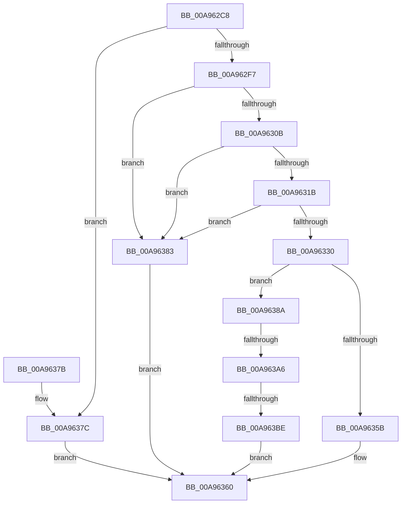

# EtwpGenerateFileName

- RVA: `0x00A962C8`–`0x00A963D5` (길이 `269` bytes)
- VA: `0x0000000140A962C8`
- 실행 섹션: `PAGE`
- PDB 이름 있음: `예`; PDB Function 태그: `예`
- unwind 정보 RVA: `0x000B0388`
- 디코드: `72`개 명령, `269/269` bytes 표시
- 미해석 바이트: `0` (있으면 어셈블리에 `.byte`로 보존)

> 이 문서는 커널 이미지의 기계어와 PDB 기호를 분석해 생성했습니다. 4번과 5번은 함수 원형과 자료형을 바이너리 사용 방식에서 추정한 C 해석이며 원본 소스 복구 결과는 아닙니다.

## 1. Dependencies

- 직접 호출 지점: **8**; 고유 호출 대상: **8**
- 직접 호출자로 확인된 함수: **3**
- RIP 상대 이미지 참조: **1**

### Outgoing calls
- `0x00A962FE` → [wcschr](../../text/50/wcschr_function_00501A60.md) (function, `0x00501A60`)
- `0x00A96311` → [wcsrchr](../../text/50/wcsrchr_function_00501E50.md) (function, `0x00501E50`)
- `0x00A96326` → [wcsstr](../../text/50/wcsstr_function_00501F80.md) (function, `0x00501F80`)
- `0x00A9634E` → [ExAllocatePool2](../../poolcode/B8/ExAllocatePool2_function_00B820F0.md) (function, `0x00B820F0`)
- `0x00A96399` → [RtlStringCbPrintfW](../../text/40/RtlStringCbPrintfW_function_0040FB40.md) (function, `0x0040FB40`)
- `0x00A963B1` → [memcmp](../../text/6C/memcmp_function_006C6B10.md) (function, `0x006C6B10`)
- `0x00A963C1` → [RtlFreeAnsiString](../9C/RtlFreeAnsiString_function_009C0800.md) (function, `0x009C0800`)
- `0x00A963CC` → [RtlInitUnicodeString](../../text/42/RtlInitUnicodeString_function_0042A780.md) (function, `0x0042A780`)

### Direct callers
- [EtwpIncrementTraceFile](../7B/EtwpIncrementTraceFile_function_007B9210.md) at `0x007B92A3`
- [EtwpFlushBufferToLogfile](../9B/EtwpFlushBufferToLogfile_function_009BFC08.md) at `0x009BFD2D`
- [EtwpStartLogger](EtwpStartLogger_function_00A99D80.md) at `0x00A9A96B`

### Static image references
- `0x00A9631F` → RVA `0x00AFCAE0` (` ?? ::NNGAKEGL::`string'`; read)

## 2. Other-region calls and transfers

- 다른 실행 섹션으로 향하는 call: **7**
  - `0x00A962FE` → [wcschr](../../text/50/wcschr_function_00501A60.md) (`PAGE` → `.text`)
  - `0x00A96311` → [wcsrchr](../../text/50/wcsrchr_function_00501E50.md) (`PAGE` → `.text`)
  - `0x00A96326` → [wcsstr](../../text/50/wcsstr_function_00501F80.md) (`PAGE` → `.text`)
  - `0x00A9634E` → [ExAllocatePool2](../../poolcode/B8/ExAllocatePool2_function_00B820F0.md) (`PAGE` → `POOLCODE`)
  - `0x00A96399` → [RtlStringCbPrintfW](../../text/40/RtlStringCbPrintfW_function_0040FB40.md) (`PAGE` → `.text`)
  - `0x00A963B1` → [memcmp](../../text/6C/memcmp_function_006C6B10.md) (`PAGE` → `.text`)
  - `0x00A963CC` → [RtlInitUnicodeString](../../text/42/RtlInitUnicodeString_function_0042A780.md) (`PAGE` → `.text`)
- call이 아닌 외부 분기/꼬리 이동: **2**
  - `0x00A963A0` → [sub_00B47A56](../B4/Unknown_function_00B47A56.md) (`tail-transfer`)
  - `0x00A963B8` → [sub_00B47A56](../B4/Unknown_function_00B47A56.md) (`tail-transfer`)

## 3. Assembly (complete function range)

```asm
00A962C8  48 8B C4                        mov rax, rsp
00A962CB  48 89 58 08                     mov qword ptr [rax + 8], rbx
00A962CF  48 89 68 10                     mov qword ptr [rax + 0x10], rbp
00A962D3  48 89 70 18                     mov qword ptr [rax + 0x18], rsi
00A962D7  48 89 78 20                     mov qword ptr [rax + 0x20], rdi
00A962DB  41 56                           push r14
00A962DD  48 83 EC 20                     sub rsp, 0x20
00A962E1  48 8B D9                        mov rbx, rcx
00A962E4  49 8B F0                        mov rsi, r8
00A962E7  48 8B 49 08                     mov rcx, qword ptr [rcx + 8]
00A962EB  4C 8B F2                        mov r14, rdx
00A962EE  48 85 C9                        test rcx, rcx
00A962F1  0F 84 85 00 00 00               je 0x140a9637c
00A962F7  BD 25 00 00 00                  mov ebp, 0x25
00A962FC  8B D5                           mov edx, ebp
00A962FE  E8 5D B7 A6 FF                  call 0x140501a60
00A96303  48 8B F8                        mov rdi, rax
00A96306  48 85 C0                        test rax, rax
00A96309  74 78                           je 0x140a96383
00A9630B  48 8B 4B 08                     mov rcx, qword ptr [rbx + 8]
00A9630F  8B D5                           mov edx, ebp
00A96311  E8 3A BB A6 FF                  call 0x140501e50
00A96316  48 3B F8                        cmp rdi, rax
00A96319  75 68                           jne 0x140a96383
00A9631B  48 8B 4B 08                     mov rcx, qword ptr [rbx + 8]
00A9631F  48 8D 15 BA 67 06 00            lea rdx, [rip + 0x667ba]
00A96326  E8 55 BC A6 FF                  call 0x140501f80
00A9632B  48 85 C0                        test rax, rax
00A9632E  74 53                           je 0x140a96383
00A96330  BD 01 00 00 00                  mov ebp, 1
00A96335  F0 41 0F C1 2E                  lock xadd dword ptr [r14], ebp
00A9633A  44 0F B7 73 02                  movzx r14d, word ptr [rbx + 2]
00A9633F  41 B8 45 74 77 50               mov r8d, 0x50777445
00A96345  B9 00 01 00 00                  mov ecx, 0x100
00A9634A  49 8D 56 40                     lea rdx, [r14 + 0x40]
00A9634E  E8 9D BD 0E 00                  call 0x140b820f0
00A96353  48 8B F8                        mov rdi, rax
00A96356  48 85 C0                        test rax, rax
00A96359  75 2F                           jne 0x140a9638a
00A9635B  B8 17 00 00 C0                  mov eax, 0xc0000017
00A96360  48 8B 5C 24 30                  mov rbx, qword ptr [rsp + 0x30]
00A96365  48 8B 6C 24 38                  mov rbp, qword ptr [rsp + 0x38]
00A9636A  48 8B 74 24 40                  mov rsi, qword ptr [rsp + 0x40]
00A9636F  48 8B 7C 24 48                  mov rdi, qword ptr [rsp + 0x48]
00A96374  48 83 C4 20                     add rsp, 0x20
00A96378  41 5E                           pop r14
00A9637A  C3                              ret
00A9637B  CC                              int3
00A9637C  B8 30 00 00 C0                  mov eax, 0xc0000030
00A96381  EB DD                           jmp 0x140a96360
00A96383  B8 33 00 00 C0                  mov eax, 0xc0000033
00A96388  EB D6                           jmp 0x140a96360
00A9638A  4C 8B 43 08                     mov r8, qword ptr [rbx + 8]
00A9638E  44 8D 4D 01                     lea r9d, [rbp + 1]
00A96392  49 8D 56 40                     lea rdx, [r14 + 0x40]
00A96396  48 8B CF                        mov rcx, rdi
00A96399  E8 A2 97 97 FF                  call 0x14040fb40
00A9639E  85 C0                           test eax, eax
00A963A0  0F 85 B0 16 0B 00               jne 0x140b47a56
00A963A6  44 0F B7 03                     movzx r8d, word ptr [rbx]
00A963AA  48 8B D7                        mov rdx, rdi
00A963AD  48 8B 4B 08                     mov rcx, qword ptr [rbx + 8]
00A963B1  E8 5A 07 C3 FF                  call 0x1406c6b10
00A963B6  85 C0                           test eax, eax
00A963B8  0F 84 98 16 0B 00               je 0x140b47a56
00A963BE  48 8B CE                        mov rcx, rsi
00A963C1  E8 3A A4 F2 FF                  call 0x1409c0800
00A963C6  48 8B D7                        mov rdx, rdi
00A963C9  48 8B CE                        mov rcx, rsi
00A963CC  E8 AF 43 99 FF                  call 0x14042a780
00A963D1  33 C0                           xor eax, eax
00A963D3  EB 8B                           jmp 0x140a96360
```

## 4. C-style interpretation (structured pseudocode)

```c
__int64 __fastcall EtwpGenerateFileName(__int64 a1, __int64 a2, __int64 a3)
{
    __int64 result;
    __int64 v_rsp;
    unsigned __int64 v_stack_p10;
    unsigned __int64 v_stack_p18;
    unsigned __int64 v_stack_p20;
    unsigned __int64 v_stack_p8;

    *(unsigned __int64 *)(v_rsp + 8) = v_rbx;
    *(unsigned __int64 *)(v_rsp + 16) = v_rbp;
    *(unsigned __int64 *)(v_rsp + 24) = v_rsi;
    *(unsigned __int64 *)(v_rsp + 32) = v_rdi;
    v_rsp = (v_rsp) - (32);
    if (*(unsigned __int64 *)(a1 + 8) == 0) goto loc_00A9637C;
    result = wcschr(*(unsigned __int64 *)(a1 + 8), 37, a3, a4);
    if (result == 0) goto loc_00A96383;
    result = wcsrchr(*(unsigned __int64 *)(a1 + 8), 37, a3, a4);
    if (result != result) goto loc_00A96383;
    result = wcsstr(*(unsigned __int64 *)(a1 + 8), v_rip + 419770, a3, a4);
    if (result == 0) goto loc_00A96383;
    result = ExAllocatePool2(256, *(unsigned __int16 *)(a1 + 2) + 64, (unsigned int)(0x50777445ULL), a4);
    if (result != 0) goto loc_00A9638A;
loc_00A96360:
    v_rsp = (v_rsp) + (32);
    return (unsigned int)(0xC0000017ULL);
loc_00A9637C:
    goto loc_00A96360;
loc_00A96383:
    goto loc_00A96360;
loc_00A9638A:
    result = RtlStringCbPrintfW(v_stack_p20, *(unsigned __int16 *)(a1 + 2) + 64, *(unsigned __int64 *)(v_stack_p8 + 8), v_stack_p10 + 1);
    result = memcmp(*(unsigned __int64 *)(v_stack_p8 + 8), v_stack_p20, *(unsigned __int16 *)(v_stack_p8), v_stack_p10 + 1);
    result = RtlFreeAnsiString(v_stack_p18, v_stack_p20, *(unsigned __int16 *)(v_stack_p8), v_stack_p10 + 1);
    result = RtlInitUnicodeString(v_stack_p18, v_stack_p20, *(unsigned __int16 *)(v_stack_p8), v_stack_p10 + 1);
    result = 0;
    goto loc_00A96360;
}
```

## 5. (Beta) C Style

```c
int64_t EtwpGenerateFileName(void *Arg1, void *Arg2, int64_t Arg3)
{
    uint8_t *arg1 = (uint8_t *)Arg1;
    uint8_t *arg2 = (uint8_t *)Arg2;

    int64_t result;
    int64_t local_rsp;
    uint64_t v_stack_p10;
    uint64_t v_stack_p18;
    uint64_t v_stack_p20;
    uint64_t v_stack_p8;

    *(uint64_t *)(local_rsp + 0x8) = local_rbx;
    *(uint64_t *)(local_rsp + 0x10) = local_rbp;
    *(uint64_t *)(local_rsp + 0x18) = local_rsi;
    *(uint64_t *)(local_rsp + 0x20) = local_rdi;
    local_rsp = (local_rsp) - (32);
    if (*(uint64_t *)(arg1 + 0x8) == 0) goto loc_00A9637C;
    result = wcschr(*(uint64_t *)(arg1 + 0x8), 37, Arg3, a4);
    if (result == 0) goto loc_00A96383;
    result = wcsrchr(*(uint64_t *)(arg1 + 0x8), 37, Arg3, a4);
    if (result != result) goto loc_00A96383;
    result = wcsstr(*(uint64_t *)(arg1 + 0x8), v_rip + 419770, Arg3, a4);
    if (result == 0) goto loc_00A96383;
    result = ExAllocatePool2(256, *(uint16_t *)(arg1 + 0x2) + 64, (uint32_t)(0x50777445ULL), a4);
    if (result != 0) goto loc_00A9638A;
loc_00A96360:
    local_rsp = (local_rsp) + (32);
    return (uint32_t)(0xC0000017ULL);
loc_00A9637C:
    goto loc_00A96360;
loc_00A96383:
    goto loc_00A96360;
loc_00A9638A:
    result = RtlStringCbPrintfW(v_stack_p20, *(uint16_t *)(arg1 + 0x2) + 64, *(uint64_t *)(v_stack_p8 + 0x8), v_stack_p10 + 1);
    result = memcmp(*(uint64_t *)(v_stack_p8 + 0x8), v_stack_p20, *(uint16_t *)(v_stack_p8), v_stack_p10 + 1);
    result = RtlFreeAnsiString(v_stack_p18, v_stack_p20, *(uint16_t *)(v_stack_p8), v_stack_p10 + 1);
    result = RtlInitUnicodeString(v_stack_p18, v_stack_p20, *(uint16_t *)(v_stack_p8), v_stack_p10 + 1);
    result = 0;
    goto loc_00A96360;
}
```

### 관측된 메모리 오프셋

구조체 형식이 확인되지 않은 접근은 인자 기준의 오프셋으로만 기록했습니다.

| 기준 인자 | 오프셋 표현 | 폭 (bit) | 접근 |
|---|---:|---:|---|
| `Arg1` | `+ 0x0` | `16` | `R` |
| `Arg1` | `+ 0x2` | `16` | `R` |
| `Arg1` | `+ 0x8` | `64` | `R` |
| `Arg2` | `+ 0x0` | `32` | `R/W` |

## 6. Execution-region graph

[열기: 2D/3D 그래프와 함수 탐색 컨트롤 패널](../../../control-panel.html?section=page&rva=0x00A962C8&view=graph)

- 2D 그래프는 위에서 아래로 흐르고, 3D 그래프는 빈 공간을 드래그해 회전합니다. Shift+드래그는 이동, 휠은 확대·축소, 함수 노드 선택은 대상 보고서 이동입니다.

### Static fallback


