# EtwpGetAutoLoggerEventNameFilter

- RVA: `0x00A93E78`–`0x00A943BA` (길이 `1,346` bytes)
- VA: `0x0000000140A93E78`
- 실행 섹션: `PAGE`
- PDB 이름 있음: `예`; PDB Function 태그: `아니요`
- unwind 정보 RVA: `0x000B94DC`
- 디코드: `318`개 명령, `1,346/1,346` bytes 표시
- 미해석 바이트: `0` (있으면 어셈블리에 `.byte`로 보존)

> 이 문서는 커널 이미지의 기계어와 PDB 기호를 분석해 생성했습니다. 4번과 5번은 함수 원형과 자료형을 바이너리 사용 방식에서 추정한 C 해석이며 원본 소스 복구 결과는 아닙니다.

## 1. Dependencies

- 직접 호출 지점: **20**; 고유 호출 대상: **11**
- 직접 호출자로 확인된 함수: **1**
- RIP 상대 이미지 참조: **9**

### Outgoing calls
- `0x00A93F32` → [ExAllocatePool2](../../poolcode/B8/ExAllocatePool2_function_00B820F0.md) (function, `0x00B820F0`)
- `0x00A93F5A` → [RtlStringCbPrintfW](../../text/40/RtlStringCbPrintfW_function_0040FB40.md) (function, `0x0040FB40`)
- `0x00A93F71` → [RtlInitUnicodeString](../../text/42/RtlInitUnicodeString_function_0042A780.md) (function, `0x0042A780`)
- `0x00A93FAB` → [ZwOpenKey](../../text/6A/ZwOpenKey_function_006AD310.md) (function, `0x006AD310`)
- `0x00A93FFA` → [ExAllocatePool2](../../poolcode/B8/ExAllocatePool2_function_00B820F0.md) (function, `0x00B820F0`)
- `0x00A9401F` → [RtlStringCbPrintfW](../../text/40/RtlStringCbPrintfW_function_0040FB40.md) (function, `0x0040FB40`)
- `0x00A94036` → [RtlInitUnicodeString](../../text/42/RtlInitUnicodeString_function_0042A780.md) (function, `0x0042A780`)
- `0x00A94070` → [ZwOpenKey](../../text/6A/ZwOpenKey_function_006AD310.md) (function, `0x006AD310`)
- `0x00A940A8` → [ExAllocatePool2](../../poolcode/B8/ExAllocatePool2_function_00B820F0.md) (function, `0x00B820F0`)
- `0x00A940CB` → [memset](../../text/6C/memset_function_006C6C40.md) (function, `0x006C6C40`)
- `0x00A94233` → [RtlpQueryRegistryValues](../8C/RtlpQueryRegistryValues_function_008C9050.md) (function, `0x008C9050`)
- `0x00A942B3` → [RtlpQueryRegistryValues](../8C/RtlpQueryRegistryValues_function_008C9050.md) (function, `0x008C9050`)
- `0x00A94315` → [RtlUnicodeToUTF8N](../90/RtlUnicodeToUTF8N_function_0090DBF0.md) (function, `0x0090DBF0`)
- `0x00A94343` → [ExFreePoolWithTag](../../poolcode/B8/ExFreePoolWithTag_function_00B82870.md) (function, `0x00B82870`)
- `0x00A94355` → [ZwClose](../../text/6A/ZwClose_function_006AD2B0.md) (function, `0x006AD2B0`)
- `0x00A94364` → [ExFreePoolWithTag](../../poolcode/B8/ExFreePoolWithTag_function_00B82870.md) (function, `0x00B82870`)
- `0x00A94373` → [ZwClose](../../text/6A/ZwClose_function_006AD2B0.md) (function, `0x006AD2B0`)
- `0x00A94382` → [ExFreePoolWithTag](../../poolcode/B8/ExFreePoolWithTag_function_00B82870.md) (function, `0x00B82870`)
- `0x00A94391` → [ExFreePool](../../poolcode/B8/ExFreePool_function_00B82850.md) (function, `0x00B82850`)
- `0x00A943A0` → [_security_check_cookie](../../text/6A/_security_check_cookie_function_006AC640.md) (function, `0x006AC640`)

### Direct callers
- [EtwpGetAutoLoggerProviderFilter](EtwpGetAutoLoggerProviderFilter_function_00A93248.md) at `0x00A93A40`
- [EtwpGetAutoLoggerProviderFilter](EtwpGetAutoLoggerProviderFilter_function_00A93248.md) at `0x00A93A60`

### Static image references
- `0x00A93E94` → RVA `0x00E0A740` (`.data`; read)
- `0x00A93F48` → RVA `0x00B07420` (` ?? ::NNGAKEGL::`string'`; read)
- `0x00A940D0` → RVA `0x007BEA40` (`EtwpQueryRegistryCallback`; read)
- `0x00A940FF` → RVA `0x00B07D40` (` ?? ::NNGAKEGL::`string'`; read)
- `0x00A94124` → RVA `0x00B07D20` (` ?? ::NNGAKEGL::`string'`; read)
- `0x00A94145` → RVA `0x00B06D40` (` ?? ::NNGAKEGL::`string'`; read)
- `0x00A94166` → RVA `0x00B07C80` (` ?? ::NNGAKEGL::`string'`; read)
- `0x00A94187` → RVA `0x00B07C60` (` ?? ::NNGAKEGL::`string'`; read)
- `0x00A941B5` → RVA `0x00B07CD0` (` ?? ::NNGAKEGL::`string'`; read)

## 2. Other-region calls and transfers

- 다른 실행 섹션으로 향하는 call: **17**
  - `0x00A93F32` → [ExAllocatePool2](../../poolcode/B8/ExAllocatePool2_function_00B820F0.md) (`PAGE` → `POOLCODE`)
  - `0x00A93F5A` → [RtlStringCbPrintfW](../../text/40/RtlStringCbPrintfW_function_0040FB40.md) (`PAGE` → `.text`)
  - `0x00A93F71` → [RtlInitUnicodeString](../../text/42/RtlInitUnicodeString_function_0042A780.md) (`PAGE` → `.text`)
  - `0x00A93FAB` → [ZwOpenKey](../../text/6A/ZwOpenKey_function_006AD310.md) (`PAGE` → `.text`)
  - `0x00A93FFA` → [ExAllocatePool2](../../poolcode/B8/ExAllocatePool2_function_00B820F0.md) (`PAGE` → `POOLCODE`)
  - `0x00A9401F` → [RtlStringCbPrintfW](../../text/40/RtlStringCbPrintfW_function_0040FB40.md) (`PAGE` → `.text`)
  - `0x00A94036` → [RtlInitUnicodeString](../../text/42/RtlInitUnicodeString_function_0042A780.md) (`PAGE` → `.text`)
  - `0x00A94070` → [ZwOpenKey](../../text/6A/ZwOpenKey_function_006AD310.md) (`PAGE` → `.text`)
  - `0x00A940A8` → [ExAllocatePool2](../../poolcode/B8/ExAllocatePool2_function_00B820F0.md) (`PAGE` → `POOLCODE`)
  - `0x00A940CB` → [memset](../../text/6C/memset_function_006C6C40.md) (`PAGE` → `.text`)
  - `0x00A94343` → [ExFreePoolWithTag](../../poolcode/B8/ExFreePoolWithTag_function_00B82870.md) (`PAGE` → `POOLCODE`)
  - `0x00A94355` → [ZwClose](../../text/6A/ZwClose_function_006AD2B0.md) (`PAGE` → `.text`)
  - `0x00A94364` → [ExFreePoolWithTag](../../poolcode/B8/ExFreePoolWithTag_function_00B82870.md) (`PAGE` → `POOLCODE`)
  - `0x00A94373` → [ZwClose](../../text/6A/ZwClose_function_006AD2B0.md) (`PAGE` → `.text`)
  - `0x00A94382` → [ExFreePoolWithTag](../../poolcode/B8/ExFreePoolWithTag_function_00B82870.md) (`PAGE` → `POOLCODE`)
  - `0x00A94391` → [ExFreePool](../../poolcode/B8/ExFreePool_function_00B82850.md) (`PAGE` → `POOLCODE`)
  - `0x00A943A0` → [_security_check_cookie](../../text/6A/_security_check_cookie_function_006AC640.md) (`PAGE` → `.text`)
- 별도 외부 분기/꼬리 이동을 확인하지 못했습니다.

## 3. Assembly (complete function range)

```asm
00A93E78  40 55                           push rbp
00A93E7A  53                              push rbx
00A93E7B  56                              push rsi
00A93E7C  57                              push rdi
00A93E7D  41 54                           push r12
00A93E7F  41 55                           push r13
00A93E81  41 56                           push r14
00A93E83  41 57                           push r15
00A93E85  48 8D AC 24 48 FA FF FF         lea rbp, [rsp - 0x5b8]
00A93E8D  48 81 EC B8 06 00 00            sub rsp, 0x6b8
00A93E94  48 8B 05 A5 68 37 00            mov rax, qword ptr [rip + 0x3768a5]
00A93E9B  48 33 C4                        xor rax, rsp
00A93E9E  48 89 85 A0 05 00 00            mov qword ptr [rbp + 0x5a0], rax
00A93EA5  4C 8B BD 20 06 00 00            mov r15, qword ptr [rbp + 0x620]
00A93EAC  33 C0                           xor eax, eax
00A93EAE  0F 57 C0                        xorps xmm0, xmm0
00A93EB1  48 89 55 A0                     mov qword ptr [rbp - 0x60], rdx
00A93EB5  4D 8B E0                        mov r12, r8
00A93EB8  48 89 45 80                     mov qword ptr [rbp - 0x80], rax
00A93EBC  45 33 C0                        xor r8d, r8d
00A93EBF  89 45 88                        mov dword ptr [rbp - 0x78], eax
00A93EC2  48 83 CB FF                     or rbx, 0xffffffffffffffff
00A93EC6  4D 89 01                        mov qword ptr [r9], r8
00A93EC9  45 89 07                        mov dword ptr [r15], r8d
00A93ECC  48 8B C3                        mov rax, rbx
00A93ECF  49 8B F1                        mov rsi, r9
00A93ED2  48 89 4C 24 48                  mov qword ptr [rsp + 0x48], rcx
00A93ED7  48 8B D1                        mov rdx, rcx
00A93EDA  4C 89 44 24 38                  mov qword ptr [rsp + 0x38], r8
00A93EDF  4C 89 44 24 40                  mov qword ptr [rsp + 0x40], r8
00A93EE4  41 8B F8                        mov edi, r8d
00A93EE7  0F 11 44 24 60                  movups xmmword ptr [rsp + 0x60], xmm0
00A93EEC  66 44 89 44 24 30               mov word ptr [rsp + 0x30], r8w
00A93EF2  0F 11 44 24 70                  movups xmmword ptr [rsp + 0x70], xmm0
00A93EF7  0F 11 45 90                     movups xmmword ptr [rbp - 0x70], xmm0
00A93EFB  0F 11 44 24 50                  movups xmmword ptr [rsp + 0x50], xmm0
00A93F00  48 FF C0                        inc rax
00A93F03  66 45 39 04 44                  cmp word ptr [r12 + rax*2], r8w
00A93F08  75 F6                           jne 0x140a93f00
00A93F0A  48 8B CB                        mov rcx, rbx
00A93F0D  48 FF C1                        inc rcx
00A93F10  66 44 39 04 4A                  cmp word ptr [rdx + rcx*2], r8w
00A93F15  75 F6                           jne 0x140a93f0d
00A93F17  48 03 C1                        add rax, rcx
00A93F1A  41 B8 45 74 77 50               mov r8d, 0x50777445
00A93F20  B9 00 01 00 00                  mov ecx, 0x100
00A93F25  48 8D 04 45 04 00 00 00         lea rax, [rax*2 + 4]
00A93F2D  8B D0                           mov edx, eax
00A93F2F  44 8B E8                        mov r13d, eax
00A93F32  E8 B9 E1 0E 00                  call 0x140b820f0
00A93F37  4C 8B F0                        mov r14, rax
00A93F3A  48 85 C0                        test rax, rax
00A93F3D  0F 84 F0 03 00 00               je 0x140a94333
00A93F43  4C 8B 4C 24 48                  mov r9, qword ptr [rsp + 0x48]
00A93F48  4C 8D 05 D1 34 07 00            lea r8, [rip + 0x734d1]
00A93F4F  41 8B D5                        mov edx, r13d
00A93F52  4C 89 64 24 20                  mov qword ptr [rsp + 0x20], r12
00A93F57  48 8B C8                        mov rcx, rax
00A93F5A  E8 E1 BB 97 FF                  call 0x14040fb40
00A93F5F  45 33 ED                        xor r13d, r13d
00A93F62  85 C0                           test eax, eax
00A93F64  0F 85 C0 03 00 00               jne 0x140a9432a
00A93F6A  49 8B D6                        mov rdx, r14
00A93F6D  48 8D 4D 90                     lea rcx, [rbp - 0x70]
00A93F71  E8 0A 68 99 FF                  call 0x14042a780
00A93F76  48 8D 45 90                     lea rax, [rbp - 0x70]
00A93F7A  C7 44 24 60 30 00 00 00         mov dword ptr [rsp + 0x60], 0x30
00A93F82  0F 57 C0                        xorps xmm0, xmm0
00A93F85  48 89 44 24 70                  mov qword ptr [rsp + 0x70], rax
00A93F8A  4C 8D 44 24 60                  lea r8, [rsp + 0x60]
00A93F8F  4C 89 6C 24 68                  mov qword ptr [rsp + 0x68], r13
00A93F94  BA 19 00 02 00                  mov edx, 0x20019
00A93F99  C7 44 24 78 40 02 00 00         mov dword ptr [rsp + 0x78], 0x240
00A93FA1  48 8D 4C 24 38                  lea rcx, [rsp + 0x38]
00A93FA6  F3 0F 7F 45 80                  movdqu xmmword ptr [rbp - 0x80], xmm0
00A93FAB  E8 60 93 C1 FF                  call 0x1406ad310
00A93FB0  33 C9                           xor ecx, ecx
00A93FB2  85 C0                           test eax, eax
00A93FB4  79 05                           jns 0x140a93fbb
00A93FB6  48 89 4C 24 38                  mov qword ptr [rsp + 0x38], rcx
00A93FBB  4C 8B 6D A0                     mov r13, qword ptr [rbp - 0x60]
00A93FBF  4D 85 ED                        test r13, r13
00A93FC2  0F 84 B8 00 00 00               je 0x140a94080
00A93FC8  48 8B C3                        mov rax, rbx
00A93FCB  48 FF C0                        inc rax
00A93FCE  66 41 39 0C 44                  cmp word ptr [r12 + rax*2], cx
00A93FD3  75 F6                           jne 0x140a93fcb
00A93FD5  48 FF C3                        inc rbx
00A93FD8  66 41 39 4C 5D 00               cmp word ptr [r13 + rbx*2], cx
00A93FDE  75 F5                           jne 0x140a93fd5
00A93FE0  48 03 C3                        add rax, rbx
00A93FE3  41 B8 45 74 77 50               mov r8d, 0x50777445
00A93FE9  B9 00 01 00 00                  mov ecx, 0x100
00A93FEE  48 8D 04 45 04 00 00 00         lea rax, [rax*2 + 4]
00A93FF6  8B D0                           mov edx, eax
00A93FF8  8B D8                           mov ebx, eax
00A93FFA  E8 F1 E0 0E 00                  call 0x140b820f0
00A93FFF  48 8B F8                        mov rdi, rax
00A94002  48 85 C0                        test rax, rax
00A94005  0F 84 28 03 00 00               je 0x140a94333
00A9400B  4D 8B CD                        mov r9, r13
00A9400E  4C 89 64 24 20                  mov qword ptr [rsp + 0x20], r12
00A94013  4C 8D 05 06 34 07 00            lea r8, [rip + 0x73406]
00A9401A  8B D3                           mov edx, ebx
00A9401C  48 8B C8                        mov rcx, rax
00A9401F  E8 1C BB 97 FF                  call 0x14040fb40
00A94024  45 33 E4                        xor r12d, r12d
00A94027  85 C0                           test eax, eax
00A94029  0F 85 00 03 00 00               jne 0x140a9432f
00A9402F  48 8B D7                        mov rdx, rdi
00A94032  48 8D 4D 90                     lea rcx, [rbp - 0x70]
00A94036  E8 45 67 99 FF                  call 0x14042a780
00A9403B  48 8D 45 90                     lea rax, [rbp - 0x70]
00A9403F  C7 44 24 60 30 00 00 00         mov dword ptr [rsp + 0x60], 0x30
00A94047  0F 57 C0                        xorps xmm0, xmm0
00A9404A  48 89 44 24 70                  mov qword ptr [rsp + 0x70], rax
00A9404F  4C 8D 44 24 60                  lea r8, [rsp + 0x60]
00A94054  4C 89 64 24 68                  mov qword ptr [rsp + 0x68], r12
00A94059  BA 19 00 02 00                  mov edx, 0x20019
00A9405E  C7 44 24 78 40 02 00 00         mov dword ptr [rsp + 0x78], 0x240
00A94066  48 8D 4C 24 40                  lea rcx, [rsp + 0x40]
00A9406B  F3 0F 7F 45 80                  movdqu xmmword ptr [rbp - 0x80], xmm0
00A94070  E8 9B 92 C1 FF                  call 0x1406ad310
00A94075  85 C0                           test eax, eax
00A94077  79 0A                           jns 0x140a94083
00A94079  4C 89 64 24 40                  mov qword ptr [rsp + 0x40], r12
00A9407E  EB 03                           jmp 0x140a94083
00A94080  45 33 E4                        xor r12d, r12d
00A94083  4C 39 64 24 38                  cmp qword ptr [rsp + 0x38], r12
00A94088  75 0B                           jne 0x140a94095
00A9408A  4C 39 64 24 40                  cmp qword ptr [rsp + 0x40], r12
00A9408F  0F 84 98 02 00 00               je 0x140a9432d
00A94095  BA 00 10 00 00                  mov edx, 0x1000
00A9409A  B9 00 01 00 00                  mov ecx, 0x100
00A9409F  41 B8 45 74 77 50               mov r8d, 0x50777445
00A940A5  41 89 17                        mov dword ptr [r15], edx
00A940A8  E8 43 E0 0E 00                  call 0x140b820f0
00A940AD  48 89 06                        mov qword ptr [rsi], rax
00A940B0  48 8B D8                        mov rbx, rax
00A940B3  48 85 C0                        test rax, rax
00A940B6  0F 84 7A 02 00 00               je 0x140a94336
00A940BC  33 D2                           xor edx, edx
00A940BE  48 8D 8D 00 01 00 00            lea rcx, [rbp + 0x100]
00A940C5  41 B8 98 04 00 00               mov r8d, 0x498
00A940CB  E8 70 2B C3 FF                  call 0x1406c6c40
00A940D0  48 8D 15 69 A9 D2 FF            lea rdx, [rip - 0x2d5697]
00A940D7  48 89 5D B8                     mov qword ptr [rbp - 0x48], rbx
00A940DB  B9 0B 00 00 00                  mov ecx, 0xb
00A940E0  48 89 95 00 01 00 00            mov qword ptr [rbp + 0x100], rdx
00A940E7  48 8D 45 B0                     lea rax, [rbp - 0x50]
00A940EB  89 8D 20 01 00 00               mov dword ptr [rbp + 0x120], ecx
00A940F1  48 89 85 18 01 00 00            mov qword ptr [rbp + 0x118], rax
00A940F8  4C 8D 85 00 01 00 00            lea r8, [rbp + 0x100]
00A940FF  48 8D 05 3A 3C 07 00            lea rax, [rip + 0x73c3a]
00A94106  89 4D B0                        mov dword ptr [rbp - 0x50], ecx
00A94109  48 89 85 10 01 00 00            mov qword ptr [rbp + 0x110], rax
00A94110  45 33 C9                        xor r9d, r9d
00A94113  48 8D 45 C0                     lea rax, [rbp - 0x40]
00A94117  89 8D 58 01 00 00               mov dword ptr [rbp + 0x158], ecx
00A9411D  48 89 85 50 01 00 00            mov qword ptr [rbp + 0x150], rax
00A94124  48 8D 05 F5 3B 07 00            lea rax, [rip + 0x73bf5]
00A9412B  48 89 85 48 01 00 00            mov qword ptr [rbp + 0x148], rax
00A94132  48 8D 43 08                     lea rax, [rbx + 8]
00A94136  48 89 45 C8                     mov qword ptr [rbp - 0x38], rax
00A9413A  48 8D 45 D0                     lea rax, [rbp - 0x30]
00A9413E  48 89 85 88 01 00 00            mov qword ptr [rbp + 0x188], rax
00A94145  48 8D 05 F4 2B 07 00            lea rax, [rip + 0x72bf4]
00A9414C  48 89 85 80 01 00 00            mov qword ptr [rbp + 0x180], rax
00A94153  48 8D 43 10                     lea rax, [rbx + 0x10]
00A94157  48 89 45 D8                     mov qword ptr [rbp - 0x28], rax
00A9415B  48 8D 45 E0                     lea rax, [rbp - 0x20]
00A9415F  48 89 85 C0 01 00 00            mov qword ptr [rbp + 0x1c0], rax
00A94166  48 8D 05 13 3B 07 00            lea rax, [rip + 0x73b13]
00A9416D  48 89 85 B8 01 00 00            mov qword ptr [rbp + 0x1b8], rax
00A94174  48 8D 43 11                     lea rax, [rbx + 0x11]
00A94178  48 89 45 E8                     mov qword ptr [rbp - 0x18], rax
00A9417C  48 8D 45 F0                     lea rax, [rbp - 0x10]
00A94180  48 89 85 F8 01 00 00            mov qword ptr [rbp + 0x1f8], rax
00A94187  48 8D 05 D2 3A 07 00            lea rax, [rip + 0x73ad2]
00A9418E  48 89 85 F0 01 00 00            mov qword ptr [rbp + 0x1f0], rax
00A94195  48 8D 43 12                     lea rax, [rbx + 0x12]
00A94199  48 89 45 F8                     mov qword ptr [rbp - 8], rax
00A9419D  BB 00 00 00 40                  mov ebx, 0x40000000
00A941A2  89 4D C0                        mov dword ptr [rbp - 0x40], ecx
00A941A5  48 8D 45 00                     lea rax, [rbp]
00A941A9  B9 04 00 00 00                  mov ecx, 4
00A941AE  48 89 85 30 02 00 00            mov qword ptr [rbp + 0x230], rax
00A941B5  48 8D 05 14 3B 07 00            lea rax, [rip + 0x73b14]
00A941BC  48 89 95 38 01 00 00            mov qword ptr [rbp + 0x138], rdx
00A941C3  48 89 85 28 02 00 00            mov qword ptr [rbp + 0x228], rax
00A941CA  48 8D 44 24 30                  lea rax, [rsp + 0x30]
00A941CF  48 89 85 40 02 00 00            mov qword ptr [rbp + 0x240], rax
00A941D6  48 8D 44 24 50                  lea rax, [rsp + 0x50]
00A941DB  48 89 95 70 01 00 00            mov qword ptr [rbp + 0x170], rdx
00A941E2  89 8D 90 01 00 00               mov dword ptr [rbp + 0x190], ecx
00A941E8  89 4D D0                        mov dword ptr [rbp - 0x30], ecx
00A941EB  48 89 95 A8 01 00 00            mov qword ptr [rbp + 0x1a8], rdx
00A941F2  89 8D C8 01 00 00               mov dword ptr [rbp + 0x1c8], ecx
00A941F8  89 4D E0                        mov dword ptr [rbp - 0x20], ecx
00A941FB  48 89 95 E0 01 00 00            mov qword ptr [rbp + 0x1e0], rdx
00A94202  89 8D 00 02 00 00               mov dword ptr [rbp + 0x200], ecx
00A94208  89 4D F0                        mov dword ptr [rbp - 0x10], ecx
00A9420B  8B CB                           mov ecx, ebx
00A9420D  48 89 95 18 02 00 00            mov qword ptr [rbp + 0x218], rdx
00A94214  48 8B 54 24 38                  mov rdx, qword ptr [rsp + 0x38]
00A94219  48 89 45 08                     mov qword ptr [rbp + 8], rax
00A9421D  C7 85 38 02 00 00 01 00 00 00   mov dword ptr [rbp + 0x238], 1
00A94227  C7 45 00 01 00 00 00            mov dword ptr [rbp], 1
00A9422E  C6 44 24 28 01                  mov byte ptr [rsp + 0x28], 1
00A94233  E8 18 4E E3 FF                  call 0x1408c9050
00A94238  85 C0                           test eax, eax
00A9423A  0F 88 F6 00 00 00               js 0x140a94336
00A94240  48 8B 54 24 40                  mov rdx, qword ptr [rsp + 0x40]
00A94245  48 85 D2                        test rdx, rdx
00A94248  74 6E                           je 0x140a942b8
00A9424A  48 8B 0E                        mov rcx, qword ptr [rsi]
00A9424D  41 B8 02 00 00 00               mov r8d, 2
00A94253  48 89 8D 28 01 00 00            mov qword ptr [rbp + 0x128], rcx
00A9425A  48 8D 41 08                     lea rax, [rcx + 8]
00A9425E  48 89 85 60 01 00 00            mov qword ptr [rbp + 0x160], rax
00A94265  48 8D 41 10                     lea rax, [rcx + 0x10]
00A94269  48 89 85 98 01 00 00            mov qword ptr [rbp + 0x198], rax
00A94270  48 83 C1 11                     add rcx, 0x11
00A94274  48 8D 85 D0 01 00 00            lea rax, [rbp + 0x1d0]
00A9427B  48 89 08                        mov qword ptr [rax], rcx
00A9427E  48 FF C1                        inc rcx
00A94281  48 8D 40 38                     lea rax, [rax + 0x38]
00A94285  49 83 E8 01                     sub r8, 1
00A94289  75 F0                           jne 0x140a9427b
00A9428B  48 8B 44 24 58                  mov rax, qword ptr [rsp + 0x58]
00A94290  4C 8D 85 00 01 00 00            lea r8, [rbp + 0x100]
00A94297  48 89 85 40 02 00 00            mov qword ptr [rbp + 0x240], rax
00A9429E  45 33 C9                        xor r9d, r9d
00A942A1  0F B7 44 24 50                  movzx eax, word ptr [rsp + 0x50]
00A942A6  8B CB                           mov ecx, ebx
00A942A8  89 85 48 02 00 00               mov dword ptr [rbp + 0x248], eax
00A942AE  C6 44 24 28 01                  mov byte ptr [rsp + 0x28], 1
00A942B3  E8 98 4D E3 FF                  call 0x1408c9050
00A942B8  44 0F B7 44 24 50               movzx r8d, word ptr [rsp + 0x50]
00A942BE  41 8B CC                        mov ecx, r12d
00A942C1  41 F7 C0 FE FF FF FF            test r8d, 0xfffffffe
00A942C8  76 25                           jbe 0x140a942ef
00A942CA  48 8B 54 24 58                  mov rdx, qword ptr [rsp + 0x58]
00A942CF  8B C1                           mov eax, ecx
00A942D1  66 83 3C 42 3B                  cmp word ptr [rdx + rax*2], 0x3b
00A942D6  75 0B                           jne 0x140a942e3
00A942D8  66 44 89 24 42                  mov word ptr [rdx + rax*2], r12w
00A942DD  44 0F B7 44 24 50               movzx r8d, word ptr [rsp + 0x50]
00A942E3  41 0F B7 C0                     movzx eax, r8w
00A942E7  FF C1                           inc ecx
00A942E9  D1 E8                           shr eax, 1
00A942EB  3B C8                           cmp ecx, eax
00A942ED  72 DB                           jb 0x140a942ca
00A942EF  41 8B 17                        mov edx, dword ptr [r15]
00A942F2  48 8B 0E                        mov rcx, qword ptr [rsi]
00A942F5  83 EA 14                        sub edx, 0x14
00A942F8  4C 8B 4C 24 58                  mov r9, qword ptr [rsp + 0x58]
00A942FD  48 83 C1 14                     add rcx, 0x14
00A94301  41 0F B7 C0                     movzx eax, r8w
00A94305  4C 8D 44 24 48                  lea r8, [rsp + 0x48]
00A9430A  83 C0 02                        add eax, 2
00A9430D  89 54 24 48                     mov dword ptr [rsp + 0x48], edx
00A94311  89 44 24 20                     mov dword ptr [rsp + 0x20], eax
00A94315  E8 D6 98 E7 FF                  call 0x14090dbf0
00A9431A  85 C0                           test eax, eax
00A9431C  75 11                           jne 0x140a9432f
00A9431E  8B 44 24 48                     mov eax, dword ptr [rsp + 0x48]
00A94322  83 C0 14                        add eax, 0x14
00A94325  41 89 07                        mov dword ptr [r15], eax
00A94328  EB 21                           jmp 0x140a9434b
00A9432A  45 33 E4                        xor r12d, r12d
00A9432D  85 C0                           test eax, eax
00A9432F  78 05                           js 0x140a94336
00A94331  EB 18                           jmp 0x140a9434b
00A94333  45 33 E4                        xor r12d, r12d
00A94336  45 89 27                        mov dword ptr [r15], r12d
00A94339  48 8B 0E                        mov rcx, qword ptr [rsi]
00A9433C  48 85 C9                        test rcx, rcx
00A9433F  74 0A                           je 0x140a9434b
00A94341  33 D2                           xor edx, edx
00A94343  E8 28 E5 0E 00                  call 0x140b82870
00A94348  4C 89 26                        mov qword ptr [rsi], r12
00A9434B  48 8B 4C 24 38                  mov rcx, qword ptr [rsp + 0x38]
00A94350  48 85 C9                        test rcx, rcx
00A94353  74 05                           je 0x140a9435a
00A94355  E8 56 8F C1 FF                  call 0x1406ad2b0
00A9435A  4D 85 F6                        test r14, r14
00A9435D  74 0A                           je 0x140a94369
00A9435F  33 D2                           xor edx, edx
00A94361  49 8B CE                        mov rcx, r14
00A94364  E8 07 E5 0E 00                  call 0x140b82870
00A94369  48 8B 4C 24 40                  mov rcx, qword ptr [rsp + 0x40]
00A9436E  48 85 C9                        test rcx, rcx
00A94371  74 05                           je 0x140a94378
00A94373  E8 38 8F C1 FF                  call 0x1406ad2b0
00A94378  48 85 FF                        test rdi, rdi
00A9437B  74 0A                           je 0x140a94387
00A9437D  33 D2                           xor edx, edx
00A9437F  48 8B CF                        mov rcx, rdi
00A94382  E8 E9 E4 0E 00                  call 0x140b82870
00A94387  48 8B 4C 24 58                  mov rcx, qword ptr [rsp + 0x58]
00A9438C  48 85 C9                        test rcx, rcx
00A9438F  74 05                           je 0x140a94396
00A94391  E8 BA E4 0E 00                  call 0x140b82850
00A94396  48 8B 8D A0 05 00 00            mov rcx, qword ptr [rbp + 0x5a0]
00A9439D  48 33 CC                        xor rcx, rsp
00A943A0  E8 9B 82 C1 FF                  call 0x1406ac640
00A943A5  48 81 C4 B8 06 00 00            add rsp, 0x6b8
00A943AC  41 5F                           pop r15
00A943AE  41 5E                           pop r14
00A943B0  41 5D                           pop r13
00A943B2  41 5C                           pop r12
00A943B4  5F                              pop rdi
00A943B5  5E                              pop rsi
00A943B6  5B                              pop rbx
00A943B7  5D                              pop rbp
00A943B8  C3                              ret
00A943B9  CC                              int3
```

## 4. C-style interpretation (structured pseudocode)

```c
__int64 __fastcall EtwpGetAutoLoggerEventNameFilter(__int64 a1, __int64 a2, __int64 a3, __int64 a4, __int64 a5)
{
    __int64 result;
    __int64 v_r12;
    __int64 v_r13;
    __int64 v_rbx;
    __int64 v_rsp;
    unsigned int v_stack_m3B0;
    unsigned __int64 v_stack_m3B8;
    unsigned int v_stack_m3C0;
    unsigned __int64 v_stack_m3C8;
    unsigned __int64 v_stack_m3D0;
    unsigned __int64 v_stack_m3E0;
    unsigned int v_stack_m3F8;
    unsigned __int64 v_stack_m400;
    unsigned __int64 v_stack_m408;
    unsigned __int64 v_stack_m418;
    unsigned __int64 v_stack_m428;
    unsigned int v_stack_m430;
    unsigned __int64 v_stack_m438;
    unsigned __int64 v_stack_m440;
    unsigned __int64 v_stack_m450;
    unsigned __int64 v_stack_m460;
    unsigned int v_stack_m468;
    unsigned __int64 v_stack_m470;
    unsigned __int64 v_stack_m478;
    unsigned __int64 v_stack_m488;
    unsigned __int64 v_stack_m498;
    unsigned int v_stack_m4A0;
    unsigned __int64 v_stack_m4A8;
    unsigned __int64 v_stack_m4B0;
    unsigned __int64 v_stack_m4C0;
    unsigned __int64 v_stack_m4D0;
    unsigned int v_stack_m4D8;
    unsigned __int64 v_stack_m4E0;
    unsigned __int64 v_stack_m4E8;
    unsigned __int64 v_stack_m4F8;
    unsigned __int64 v_stack_m58;
    unsigned __int64 v_stack_m5F0;
    unsigned __int64 v_stack_m5F8;
    unsigned __int64 v_stack_m600;
    unsigned __int64 v_stack_m608;
    unsigned __int64 v_stack_m610;
    unsigned __int64 v_stack_m618;
    unsigned __int64 v_stack_m620;
    unsigned __int64 v_stack_m628;
    unsigned __int64 v_stack_m630;
    unsigned __int64 v_stack_m638;
    unsigned __int64 v_stack_m640;
    unsigned __int64 v_stack_m648;
    unsigned __int64 v_stack_m658;
    unsigned __int64 v_stack_m668;
    unsigned int v_stack_m670;
    unsigned __int64 v_stack_m678;
    unsigned int v_stack_m680;
    unsigned __int64 v_stack_m688;
    unsigned __int64 v_stack_m690;
    unsigned __int64 v_stack_m698;
    unsigned __int64 v_stack_m6A0;
    unsigned __int64 v_stack_m6A8;
    unsigned __int64 v_stack_m6B0;
    unsigned __int64 v_stack_m6B8;
    unsigned __int64 v_stack_m6C0;
    unsigned __int16 v_stack_m6C8;
    unsigned __int8 v_stack_m6D0;
    unsigned __int64 v_stack_m6D8;

    v_rsp = (v_rsp) - (0x6B8ULL);
    result = (*(unsigned __int64 *)(v_rip + 3631269)) ^ (v_rsp);
    v_stack_m58 = result;
    result = 0;
    v_stack_m658 = a2;
    v_stack_m678 = 0;
    a3 = 0;
    v_stack_m670 = 0;
    v_rbx = (v_rbx) | (-1);
    *(unsigned __int64 *)(a4) = 0;
    *(unsigned int *)(a5) = 0;
    v_stack_m6B0 = a1;
    v_stack_m6C0 = 0;
    v_stack_m6B8 = 0;
    v_stack_m698 = v_xmm0;
    v_stack_m6C8 = 0;
    v_stack_m688 = v_xmm0;
    v_stack_m668 = v_xmm0;
    v_stack_m6A8 = v_xmm0;
loc_00A93F00:
    result = (v_rbx) + 1;
    if ((*(unsigned __int16 *)(a3 + result * 2)) != 0) goto loc_00A93F00;
loc_00A93F0D:
    a1 = (v_rbx) + 1;
    if ((*(unsigned __int16 *)(a1 + a1 * 2)) != 0) goto loc_00A93F0D;
    result = (result) + (a1);
    result = ExAllocatePool2(256, (unsigned int)((unsigned int)(result * 2 + 4)), (unsigned int)(0x50777445ULL), a4);
    if (result == 0) goto loc_00A94333;
    v_stack_m6D8 = 0;
    result = RtlStringCbPrintfW(result, (unsigned int)((unsigned int)((unsigned int)((unsigned int)(result * 2 + 4)))), v_rip + 472273, v_stack_m6B0);
    v_r13 = 0;
    if ((unsigned int)(result) != 0) goto loc_00A9432A;
    result = RtlInitUnicodeString(v_stack_m668, result, v_rip + 472273, v_stack_m6B0);
    v_stack_m698 = 48;
    v_stack_m688 = v_stack_m668;
    v_stack_m690 = 0;
    v_stack_m680 = 576;
    v_stack_m678 = v_xmm0;
    result = ZwOpenKey(v_stack_m6C0, (unsigned int)(0x20019ULL), v_stack_m698, v_stack_m6B0);
    a1 = 0;
    if (sign_flag) {
        v_stack_m6C0 = 0;
    }
    if (v_stack_m658 == 0) goto loc_00A94080;
loc_00A93FCB:
    result = (v_rbx) + 1;
    if ((*(unsigned __int16 *)(a3 + result * 2)) != 0) goto loc_00A93FCB;
loc_00A93FD5:
    v_rbx = (v_rbx) + 1;
    if ((*(unsigned __int16 *)(v_stack_m658 + v_rbx * 2)) != 0) goto loc_00A93FD5;
    result = (result) + (v_rbx);
    result = ExAllocatePool2(256, (unsigned int)((unsigned int)(result * 2 + 4)), (unsigned int)(0x50777445ULL), v_stack_m6B0);
    if (result == 0) goto loc_00A94333;
    v_stack_m6D8 = 0;
    result = RtlStringCbPrintfW(result, (unsigned int)((unsigned int)((unsigned int)((unsigned int)(result * 2 + 4)))), v_rip + 472070, v_stack_m658);
    v_r12 = 0;
    if ((unsigned int)(result) != 0) goto loc_00A9432F;
    result = RtlInitUnicodeString(v_stack_m668, result, v_rip + 472070, v_stack_m658);
    v_stack_m698 = 48;
    v_stack_m688 = v_stack_m668;
    v_stack_m690 = 0;
    v_stack_m680 = 576;
    v_stack_m678 = v_xmm0;
    result = ZwOpenKey(v_stack_m6B8, (unsigned int)(0x20019ULL), v_stack_m698, v_stack_m658);
    if (!sign_flag) goto loc_00A94083;
    v_stack_m6B8 = 0;
    goto loc_00A94083;
loc_00A94080:
    v_r12 = 0;
loc_00A94083:
    if (v_stack_m6C0 != 0) goto loc_00A94095;
    if (v_stack_m6B8 == 0) goto loc_00A9432D;
loc_00A94095:
    *(unsigned int *)(a5) = (unsigned int)((unsigned int)(0x1000ULL));
    result = ExAllocatePool2(256, (unsigned int)(0x1000ULL), (unsigned int)(0x50777445ULL), v_stack_m658);
    *(unsigned __int64 *)(a4) = result;
    if (result == 0) goto loc_00A94336;
    a2 = 0;
    result = memset(v_stack_m4F8, a2, (unsigned int)(0x498ULL), v_stack_m658);
    v_stack_m640 = result;
    v_stack_m4F8 = v_rip - 2971287;
    v_stack_m4D8 = 11;
    v_stack_m4E0 = v_stack_m648;
    v_stack_m648 = 11;
    v_stack_m4E8 = v_rip + 474170;
    a4 = 0;
    v_stack_m4A0 = 11;
    v_stack_m4A8 = v_stack_m638;
    v_stack_m4B0 = v_rip + 474101;
    v_stack_m630 = result + 8;
    v_stack_m470 = v_stack_m628;
    v_stack_m478 = v_rip + 470004;
    v_stack_m620 = result + 16;
    v_stack_m438 = v_stack_m618;
    v_stack_m440 = v_rip + 473875;
    v_stack_m610 = result + 17;
    v_stack_m400 = v_stack_m608;
    v_stack_m408 = v_rip + 473810;
    v_stack_m600 = result + 18;
    v_stack_m638 = 11;
    v_stack_m3C8 = v_stack_m5F8;
    v_stack_m4C0 = v_rip - 2971287;
    v_stack_m3D0 = v_rip + 473876;
    v_stack_m3B8 = v_stack_m6C8;
    v_stack_m488 = v_rip - 2971287;
    v_stack_m468 = 4;
    v_stack_m628 = 4;
    v_stack_m450 = v_rip - 2971287;
    v_stack_m430 = 4;
    v_stack_m618 = 4;
    v_stack_m418 = v_rip - 2971287;
    v_stack_m3F8 = 4;
    v_stack_m608 = 4;
    v_stack_m3E0 = v_rip - 2971287;
    v_stack_m5F0 = v_stack_m6A8;
    v_stack_m3C0 = 1;
    v_stack_m5F8 = 1;
    v_stack_m6D0 = 1;
    result = RtlpQueryRegistryValues((unsigned int)((unsigned int)((unsigned int)(0x40000000ULL))), v_stack_m6C0, v_stack_m4F8, a4);
    if (sign_flag) goto loc_00A94336;
    if (v_stack_m6B8 == 0) goto loc_00A942B8;
    v_stack_m4D0 = *(unsigned __int64 *)(a4);
    v_stack_m498 = *(unsigned __int64 *)(a4) + 8;
    v_stack_m460 = *(unsigned __int64 *)(a4) + 16;
    a1 = (*(unsigned __int64 *)(a4)) + (17);
loc_00A9427B:
    *(unsigned __int64 *)(v_stack_m428) = a1;
    a1 = (a1) + 1;
    a3 = (2) - (1);
    if (condition_is_not_equal) goto loc_00A9427B;
    v_stack_m3B8 = v_stack_m6A0;
    a4 = 0;
    v_stack_m3B0 = (unsigned int)(v_stack_m6A8);
    v_stack_m6D0 = 1;
    result = RtlpQueryRegistryValues((unsigned int)((unsigned int)((unsigned int)(0x40000000ULL))), v_stack_m6B8, v_stack_m4F8, a4);
loc_00A942B8:
    if (condition_is_below_or_equal) goto loc_00A942EF;
loc_00A942CA:
    if ((*(unsigned __int16 *)(v_stack_m6A0 + 0 * 2)) == 59) {
        *(unsigned __int16 *)(v_stack_m6A0 + 0 * 2) = 0;
        a3 = v_stack_m6A8;
    }
    a1 = (unsigned int)((0) + 1);
    result = (unsigned int)(((unsigned __int16)(a3)) >> (1));
    if (((unsigned int)(a1)) < ((unsigned int)(result))) goto loc_00A942CA;
loc_00A942EF:
    a2 = (unsigned int)(((unsigned int)(*(unsigned int *)(a5))) - (20));
    a1 = (*(unsigned __int64 *)(a4)) + (20);
    result = (unsigned int)(((unsigned __int16)(a3)) + (2));
    v_stack_m6B0 = (unsigned int)(a2);
    v_stack_m6D8 = (unsigned int)(result);
    result = RtlUnicodeToUTF8N(a1, a2, v_stack_m6B0, v_stack_m6A0);
    if ((unsigned int)(result) != 0) goto loc_00A9432F;
    result = (unsigned int)(((unsigned int)(v_stack_m6B0)) + (20));
    *(unsigned int *)(a5) = (unsigned int)(result);
    goto loc_00A9434B;
loc_00A9432A:
    v_r12 = 0;
loc_00A9432D:
loc_00A9432F:
    if (sign_flag) goto loc_00A94336;
    goto loc_00A9434B;
loc_00A94333:
    v_r12 = 0;
loc_00A94336:
    *(unsigned int *)(a5) = 0;
    if (*(unsigned __int64 *)(a4) != 0) {
        a2 = 0;
        result = ExFreePoolWithTag(*(unsigned __int64 *)(a4), a2, v_stack_m6B0, v_stack_m6A0);
        *(unsigned __int64 *)(a4) = 0;
    }
    if (v_stack_m6C0 != 0) {
        result = ZwClose(v_stack_m6C0, a2, v_stack_m6B0, v_stack_m6A0);
    }
    if (result != 0) {
        a2 = 0;
        a1 = result;
        result = ExFreePoolWithTag(a1, a2, v_stack_m6B0, v_stack_m6A0);
    }
    if (v_stack_m6B8 != 0) {
        result = ZwClose(v_stack_m6B8, a2, v_stack_m6B0, v_stack_m6A0);
    }
    if (result != 0) {
        a2 = 0;
        a1 = result;
        result = ExFreePoolWithTag(a1, a2, v_stack_m6B0, v_stack_m6A0);
    }
    if (v_stack_m6A0 != 0) {
        result = ExFreePool(v_stack_m6A0, a2, v_stack_m6B0, v_stack_m6A0);
    }
    a1 = (v_stack_m58) ^ (v_rsp);
    result = _security_check_cookie(a1, a2, v_stack_m6B0, v_stack_m6A0);
    v_rsp = (v_rsp) + (0x6B8ULL);
    return result;
}
```

## 5. (Beta) C Style

```c
int64_t EtwpGetAutoLoggerEventNameFilter(void *Arg1, int64_t Arg2, void *Arg3, void *Arg4, void *Arg5)
{
    uint8_t *arg1 = (uint8_t *)Arg1;
    uint8_t *arg3 = (uint8_t *)Arg3;
    uint8_t *arg4 = (uint8_t *)Arg4;
    uint8_t *arg5 = (uint8_t *)Arg5;

    int64_t result;
    int64_t local_r12;
    int64_t local_r13;
    int64_t local_rbx;
    int64_t local_rsp;
    uint32_t v_stack_m3B0;
    uint64_t v_stack_m3B8;
    uint32_t v_stack_m3C0;
    uint64_t v_stack_m3C8;
    uint64_t v_stack_m3D0;
    uint64_t v_stack_m3E0;
    uint32_t v_stack_m3F8;
    uint64_t v_stack_m400;
    uint64_t v_stack_m408;
    uint64_t v_stack_m418;
    uint64_t v_stack_m428;
    uint32_t v_stack_m430;
    uint64_t v_stack_m438;
    uint64_t v_stack_m440;
    uint64_t v_stack_m450;
    uint64_t v_stack_m460;
    uint32_t v_stack_m468;
    uint64_t v_stack_m470;
    uint64_t v_stack_m478;
    uint64_t v_stack_m488;
    uint64_t v_stack_m498;
    uint32_t v_stack_m4A0;
    uint64_t v_stack_m4A8;
    uint64_t v_stack_m4B0;
    uint64_t v_stack_m4C0;
    uint64_t v_stack_m4D0;
    uint32_t v_stack_m4D8;
    uint64_t v_stack_m4E0;
    uint64_t v_stack_m4E8;
    uint64_t v_stack_m4F8;
    uint64_t v_stack_m58;
    uint64_t v_stack_m5F0;
    uint64_t v_stack_m5F8;
    uint64_t v_stack_m600;
    uint64_t v_stack_m608;
    uint64_t v_stack_m610;
    uint64_t v_stack_m618;
    uint64_t v_stack_m620;
    uint64_t v_stack_m628;
    uint64_t v_stack_m630;
    uint64_t v_stack_m638;
    uint64_t v_stack_m640;
    uint64_t v_stack_m648;
    uint64_t v_stack_m658;
    uint64_t v_stack_m668;
    uint32_t v_stack_m670;
    uint64_t v_stack_m678;
    uint32_t v_stack_m680;
    uint64_t v_stack_m688;
    uint64_t v_stack_m690;
    uint64_t v_stack_m698;
    uint64_t v_stack_m6A0;
    uint64_t v_stack_m6A8;
    uint64_t v_stack_m6B0;
    uint64_t v_stack_m6B8;
    uint64_t v_stack_m6C0;
    uint16_t v_stack_m6C8;
    uint8_t v_stack_m6D0;
    uint64_t v_stack_m6D8;

    local_rsp = (local_rsp) - (0x6B8ULL);
    result = (*(uint64_t *)(v_rip + 0x3768A5)) ^ (local_rsp);
    v_stack_m58 = result;
    result = 0;
    v_stack_m658 = Arg2;
    v_stack_m678 = 0;
    Arg3 = 0;
    v_stack_m670 = 0;
    local_rbx = (local_rbx) | (-1);
    *(uint64_t *)(arg4) = 0;
    *(uint32_t *)(arg5) = 0;
    v_stack_m6B0 = Arg1;
    v_stack_m6C0 = 0;
    v_stack_m6B8 = 0;
    v_stack_m698 = v_xmm0;
    v_stack_m6C8 = 0;
    v_stack_m688 = v_xmm0;
    v_stack_m668 = v_xmm0;
    v_stack_m6A8 = v_xmm0;
loc_00A93F00:
    result = (local_rbx) + 1;
    if ((*(uint16_t *)(arg3 + result * 2)) != 0) goto loc_00A93F00;
loc_00A93F0D:
    Arg1 = (local_rbx) + 1;
    if ((*(uint16_t *)(arg1 + arg1 * 2)) != 0) goto loc_00A93F0D;
    result = (result) + (Arg1);
    result = ExAllocatePool2(256, (uint32_t)((uint32_t)(result * 2 + 4)), (uint32_t)(0x50777445ULL), Arg4);
    if (result == 0) goto loc_00A94333;
    v_stack_m6D8 = 0;
    result = RtlStringCbPrintfW(result, (uint32_t)((uint32_t)((uint32_t)((uint32_t)(result * 2 + 4)))), v_rip + 472273, v_stack_m6B0);
    local_r13 = 0;
    if ((uint32_t)(result) != 0) goto loc_00A9432A;
    result = RtlInitUnicodeString(v_stack_m668, result, v_rip + 472273, v_stack_m6B0);
    v_stack_m698 = 48;
    v_stack_m688 = v_stack_m668;
    v_stack_m690 = 0;
    v_stack_m680 = 576;
    v_stack_m678 = v_xmm0;
    result = ZwOpenKey(v_stack_m6C0, (uint32_t)(0x20019ULL), v_stack_m698, v_stack_m6B0);
    Arg1 = 0;
    if (sign_flag) {
        v_stack_m6C0 = 0;
    }
    if (v_stack_m658 == 0) goto loc_00A94080;
loc_00A93FCB:
    result = (local_rbx) + 1;
    if ((*(uint16_t *)(arg3 + result * 2)) != 0) goto loc_00A93FCB;
loc_00A93FD5:
    local_rbx = (local_rbx) + 1;
    if ((*(uint16_t *)(v_stack_m658 + local_rbx * 2)) != 0) goto loc_00A93FD5;
    result = (result) + (local_rbx);
    result = ExAllocatePool2(256, (uint32_t)((uint32_t)(result * 2 + 4)), (uint32_t)(0x50777445ULL), v_stack_m6B0);
    if (result == 0) goto loc_00A94333;
    v_stack_m6D8 = 0;
    result = RtlStringCbPrintfW(result, (uint32_t)((uint32_t)((uint32_t)((uint32_t)(result * 2 + 4)))), v_rip + 472070, v_stack_m658);
    local_r12 = 0;
    if ((uint32_t)(result) != 0) goto loc_00A9432F;
    result = RtlInitUnicodeString(v_stack_m668, result, v_rip + 472070, v_stack_m658);
    v_stack_m698 = 48;
    v_stack_m688 = v_stack_m668;
    v_stack_m690 = 0;
    v_stack_m680 = 576;
    v_stack_m678 = v_xmm0;
    result = ZwOpenKey(v_stack_m6B8, (uint32_t)(0x20019ULL), v_stack_m698, v_stack_m658);
    if (!sign_flag) goto loc_00A94083;
    v_stack_m6B8 = 0;
    goto loc_00A94083;
loc_00A94080:
    local_r12 = 0;
loc_00A94083:
    if (v_stack_m6C0 != 0) goto loc_00A94095;
    if (v_stack_m6B8 == 0) goto loc_00A9432D;
loc_00A94095:
    *(uint32_t *)(arg5) = (uint32_t)((uint32_t)(0x1000ULL));
    result = ExAllocatePool2(256, (uint32_t)(0x1000ULL), (uint32_t)(0x50777445ULL), v_stack_m658);
    *(uint64_t *)(arg4) = result;
    if (result == 0) goto loc_00A94336;
    Arg2 = 0;
    result = memset(v_stack_m4F8, Arg2, (uint32_t)(0x498ULL), v_stack_m658);
    v_stack_m640 = result;
    v_stack_m4F8 = v_rip - 2971287;
    v_stack_m4D8 = 11;
    v_stack_m4E0 = v_stack_m648;
    v_stack_m648 = 11;
    v_stack_m4E8 = v_rip + 474170;
    Arg4 = 0;
    v_stack_m4A0 = 11;
    v_stack_m4A8 = v_stack_m638;
    v_stack_m4B0 = v_rip + 474101;
    v_stack_m630 = result + 8;
    v_stack_m470 = v_stack_m628;
    v_stack_m478 = v_rip + 470004;
    v_stack_m620 = result + 16;
    v_stack_m438 = v_stack_m618;
    v_stack_m440 = v_rip + 473875;
    v_stack_m610 = result + 17;
    v_stack_m400 = v_stack_m608;
    v_stack_m408 = v_rip + 473810;
    v_stack_m600 = result + 18;
    v_stack_m638 = 11;
    v_stack_m3C8 = v_stack_m5F8;
    v_stack_m4C0 = v_rip - 2971287;
    v_stack_m3D0 = v_rip + 473876;
    v_stack_m3B8 = v_stack_m6C8;
    v_stack_m488 = v_rip - 2971287;
    v_stack_m468 = 4;
    v_stack_m628 = 4;
    v_stack_m450 = v_rip - 2971287;
    v_stack_m430 = 4;
    v_stack_m618 = 4;
    v_stack_m418 = v_rip - 2971287;
    v_stack_m3F8 = 4;
    v_stack_m608 = 4;
    v_stack_m3E0 = v_rip - 2971287;
    v_stack_m5F0 = v_stack_m6A8;
    v_stack_m3C0 = 1;
    v_stack_m5F8 = 1;
    v_stack_m6D0 = 1;
    result = RtlpQueryRegistryValues((uint32_t)((uint32_t)((uint32_t)(0x40000000ULL))), v_stack_m6C0, v_stack_m4F8, Arg4);
    if (sign_flag) goto loc_00A94336;
    if (v_stack_m6B8 == 0) goto loc_00A942B8;
    v_stack_m4D0 = *(uint64_t *)(arg4);
    v_stack_m498 = *(uint64_t *)(arg4) + 8;
    v_stack_m460 = *(uint64_t *)(arg4) + 16;
    Arg1 = (*(uint64_t *)(arg4)) + (17);
loc_00A9427B:
    *(void **)(v_stack_m428) = Arg1;
    Arg1 = (Arg1) + 1;
    Arg3 = (2) - (1);
    if (condition_is_not_equal) goto loc_00A9427B;
    v_stack_m3B8 = v_stack_m6A0;
    Arg4 = 0;
    v_stack_m3B0 = (uint32_t)(v_stack_m6A8);
    v_stack_m6D0 = 1;
    result = RtlpQueryRegistryValues((uint32_t)((uint32_t)((uint32_t)(0x40000000ULL))), v_stack_m6B8, v_stack_m4F8, Arg4);
loc_00A942B8:
    if (condition_is_below_or_equal) goto loc_00A942EF;
loc_00A942CA:
    if ((*(uint16_t *)(v_stack_m6A0 + 0x0 * 2)) == 59) {
        *(uint16_t *)(v_stack_m6A0 + 0x0 * 2) = 0;
        Arg3 = v_stack_m6A8;
    }
    Arg1 = (uint32_t)((0) + 1);
    result = (uint32_t)(((uint16_t)(Arg3)) >> (1));
    if (((uint32_t)(Arg1)) < ((uint32_t)(result))) goto loc_00A942CA;
loc_00A942EF:
    Arg2 = (uint32_t)(((uint32_t)(*(uint32_t *)(arg5))) - (20));
    Arg1 = (*(uint64_t *)(arg4)) + (20);
    result = (uint32_t)(((uint16_t)(Arg3)) + (2));
    v_stack_m6B0 = (uint32_t)(Arg2);
    v_stack_m6D8 = (uint32_t)(result);
    result = RtlUnicodeToUTF8N(Arg1, Arg2, v_stack_m6B0, v_stack_m6A0);
    if ((uint32_t)(result) != 0) goto loc_00A9432F;
    result = (uint32_t)(((uint32_t)(v_stack_m6B0)) + (20));
    *(uint32_t *)(arg5) = (uint32_t)(result);
    goto loc_00A9434B;
loc_00A9432A:
    local_r12 = 0;
loc_00A9432D:
loc_00A9432F:
    if (sign_flag) goto loc_00A94336;
    goto loc_00A9434B;
loc_00A94333:
    local_r12 = 0;
loc_00A94336:
    *(uint32_t *)(arg5) = 0;
    if (*(uint64_t *)(arg4) != 0) {
        Arg2 = 0;
        result = ExFreePoolWithTag(*(uint64_t *)(arg4), Arg2, v_stack_m6B0, v_stack_m6A0);
        *(uint64_t *)(arg4) = 0;
    }
    if (v_stack_m6C0 != 0) {
        result = ZwClose(v_stack_m6C0, Arg2, v_stack_m6B0, v_stack_m6A0);
    }
    if (result != 0) {
        Arg2 = 0;
        Arg1 = result;
        result = ExFreePoolWithTag(Arg1, Arg2, v_stack_m6B0, v_stack_m6A0);
    }
    if (v_stack_m6B8 != 0) {
        result = ZwClose(v_stack_m6B8, Arg2, v_stack_m6B0, v_stack_m6A0);
    }
    if (result != 0) {
        Arg2 = 0;
        Arg1 = result;
        result = ExFreePoolWithTag(Arg1, Arg2, v_stack_m6B0, v_stack_m6A0);
    }
    if (v_stack_m6A0 != 0) {
        result = ExFreePool(v_stack_m6A0, Arg2, v_stack_m6B0, v_stack_m6A0);
    }
    Arg1 = (v_stack_m58) ^ (local_rsp);
    result = _security_check_cookie(Arg1, Arg2, v_stack_m6B0, v_stack_m6A0);
    local_rsp = (local_rsp) + (0x6B8ULL);
    return result;
}
```

### 관측된 메모리 오프셋

구조체 형식이 확인되지 않은 접근은 인자 기준의 오프셋으로만 기록했습니다.

| 기준 인자 | 오프셋 표현 | 폭 (bit) | 접근 |
|---|---:|---:|---|
| `Arg1` | `+ 0x0 + rcx*2` | `16` | `R` |
| `Arg3` | `+ 0x0 + rax*2` | `16` | `R` |
| `Arg4` | `+ 0x0` | `64` | `R` |
| `Arg4` | `+ 0x0` | `64` | `W` |
| `Arg5` | `+ 0x0` | `32` | `R` |
| `Arg5` | `+ 0x0` | `32` | `W` |

## 6. Execution-region graph

[열기: 2D/3D 그래프와 함수 탐색 컨트롤 패널](../../../control-panel.html?section=page&rva=0x00A93E78&view=graph)

- 2D 그래프는 위에서 아래로 흐르고, 3D 그래프는 빈 공간을 드래그해 회전합니다. Shift+드래그는 이동, 휠은 확대·축소, 함수 노드 선택은 대상 보고서 이동입니다.

### Static fallback

```mermaid
flowchart TD
  bb_00A93E78[BB_00A93E78]
  bb_00A93F00[BB_00A93F00]
  bb_00A93F0A[BB_00A93F0A]
  bb_00A93F0D[BB_00A93F0D]
  bb_00A93F17[BB_00A93F17]
  bb_00A93F43[BB_00A93F43]
  bb_00A93F6A[BB_00A93F6A]
  bb_00A93FB6[BB_00A93FB6]
  bb_00A93FBB[BB_00A93FBB]
  bb_00A93FC8[BB_00A93FC8]
  bb_00A93FCB[BB_00A93FCB]
  bb_00A93FD5[BB_00A93FD5]
  bb_00A93FE0[BB_00A93FE0]
  bb_00A9400B[BB_00A9400B]
  bb_00A9402F[BB_00A9402F]
  bb_00A94079[BB_00A94079]
  bb_00A94080[BB_00A94080]
  bb_00A94083[BB_00A94083]
  bb_00A9408A[BB_00A9408A]
  bb_00A94095[BB_00A94095]
  bb_00A940BC[BB_00A940BC]
  bb_00A94240[BB_00A94240]
  bb_00A9424A[BB_00A9424A]
  bb_00A9427B[BB_00A9427B]
  bb_00A9428B[BB_00A9428B]
  bb_00A942B8[BB_00A942B8]
  bb_00A942CA[BB_00A942CA]
  bb_00A942D8[BB_00A942D8]
  bb_00A942E3[BB_00A942E3]
  bb_00A942EF[BB_00A942EF]
  bb_00A9431E[BB_00A9431E]
  bb_00A9432A[BB_00A9432A]
  bb_00A9432D[BB_00A9432D]
  bb_00A9432F[BB_00A9432F]
  bb_00A94331[BB_00A94331]
  bb_00A94333[BB_00A94333]
  bb_00A94336[BB_00A94336]
  bb_00A94341[BB_00A94341]
  bb_00A9434B[BB_00A9434B]
  bb_00A94355[BB_00A94355]
  bb_00A9435A[BB_00A9435A]
  bb_00A9435F[BB_00A9435F]
  bb_00A94369[BB_00A94369]
  bb_00A94373[BB_00A94373]
  bb_00A94378[BB_00A94378]
  bb_00A9437D[BB_00A9437D]
  bb_00A94387[BB_00A94387]
  bb_00A94391[BB_00A94391]
  bb_00A94396[BB_00A94396]
  bb_00A943B9[BB_00A943B9]
  bb_00A93E78 -->|flow| bb_00A93F00
  bb_00A93F00 -->|branch| bb_00A93F00
  bb_00A93F00 -->|fallthrough| bb_00A93F0A
  bb_00A93F0A -->|flow| bb_00A93F0D
  bb_00A93F0D -->|branch| bb_00A93F0D
  bb_00A93F0D -->|fallthrough| bb_00A93F17
  bb_00A93F17 -->|branch| bb_00A94333
  bb_00A93F17 -->|fallthrough| bb_00A93F43
  bb_00A93F43 -->|branch| bb_00A9432A
  bb_00A93F43 -->|fallthrough| bb_00A93F6A
  bb_00A93F6A -->|branch| bb_00A93FBB
  bb_00A93F6A -->|fallthrough| bb_00A93FB6
  bb_00A93FB6 -->|flow| bb_00A93FBB
  bb_00A93FBB -->|branch| bb_00A94080
  bb_00A93FBB -->|fallthrough| bb_00A93FC8
  bb_00A93FC8 -->|flow| bb_00A93FCB
  bb_00A93FCB -->|branch| bb_00A93FCB
  bb_00A93FCB -->|fallthrough| bb_00A93FD5
  bb_00A93FD5 -->|branch| bb_00A93FD5
  bb_00A93FD5 -->|fallthrough| bb_00A93FE0
  bb_00A93FE0 -->|branch| bb_00A94333
  bb_00A93FE0 -->|fallthrough| bb_00A9400B
  bb_00A9400B -->|branch| bb_00A9432F
  bb_00A9400B -->|fallthrough| bb_00A9402F
  bb_00A9402F -->|branch| bb_00A94083
  bb_00A9402F -->|fallthrough| bb_00A94079
  bb_00A94079 -->|branch| bb_00A94083
  bb_00A94080 -->|flow| bb_00A94083
  bb_00A94083 -->|branch| bb_00A94095
  bb_00A94083 -->|fallthrough| bb_00A9408A
  bb_00A9408A -->|branch| bb_00A9432D
  bb_00A9408A -->|fallthrough| bb_00A94095
  bb_00A94095 -->|branch| bb_00A94336
  bb_00A94095 -->|fallthrough| bb_00A940BC
  bb_00A940BC -->|branch| bb_00A94336
  bb_00A940BC -->|fallthrough| bb_00A94240
  bb_00A94240 -->|branch| bb_00A942B8
  bb_00A94240 -->|fallthrough| bb_00A9424A
  bb_00A9424A -->|flow| bb_00A9427B
  bb_00A9427B -->|branch| bb_00A9427B
  bb_00A9427B -->|fallthrough| bb_00A9428B
  bb_00A9428B -->|flow| bb_00A942B8
  bb_00A942B8 -->|branch| bb_00A942EF
  bb_00A942B8 -->|fallthrough| bb_00A942CA
  bb_00A942CA -->|branch| bb_00A942E3
  bb_00A942CA -->|fallthrough| bb_00A942D8
  bb_00A942D8 -->|flow| bb_00A942E3
  bb_00A942E3 -->|branch| bb_00A942CA
  bb_00A942E3 -->|fallthrough| bb_00A942EF
  bb_00A942EF -->|branch| bb_00A9432F
  bb_00A942EF -->|fallthrough| bb_00A9431E
  bb_00A9431E -->|branch| bb_00A9434B
  bb_00A9432A -->|flow| bb_00A9432D
  bb_00A9432D -->|flow| bb_00A9432F
  bb_00A9432F -->|branch| bb_00A94336
  bb_00A9432F -->|fallthrough| bb_00A94331
  bb_00A94331 -->|branch| bb_00A9434B
  bb_00A94333 -->|flow| bb_00A94336
  bb_00A94336 -->|branch| bb_00A9434B
  bb_00A94336 -->|fallthrough| bb_00A94341
  bb_00A94341 -->|flow| bb_00A9434B
  bb_00A9434B -->|branch| bb_00A9435A
  bb_00A9434B -->|fallthrough| bb_00A94355
  bb_00A94355 -->|flow| bb_00A9435A
  bb_00A9435A -->|branch| bb_00A94369
  bb_00A9435A -->|fallthrough| bb_00A9435F
  bb_00A9435F -->|flow| bb_00A94369
  bb_00A94369 -->|branch| bb_00A94378
  bb_00A94369 -->|fallthrough| bb_00A94373
  bb_00A94373 -->|flow| bb_00A94378
  bb_00A94378 -->|branch| bb_00A94387
  bb_00A94378 -->|fallthrough| bb_00A9437D
  bb_00A9437D -->|flow| bb_00A94387
  bb_00A94387 -->|branch| bb_00A94396
  bb_00A94387 -->|fallthrough| bb_00A94391
  bb_00A94391 -->|flow| bb_00A94396
```


