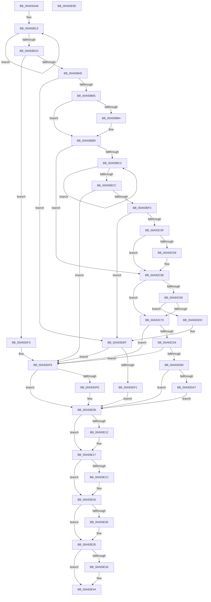

# EtwpGetAutoLoggerLevelKwFilter

- RVA: `0x00A93AA8`–`0x00A93E6F` (길이 `967` bytes)
- VA: `0x0000000140A93AA8`
- 실행 섹션: `PAGE`
- PDB 이름 있음: `예`; PDB Function 태그: `아니요`
- unwind 정보 RVA: `0x000B94B4`
- 디코드: `228`개 명령, `967/967` bytes 표시
- 미해석 바이트: `0` (있으면 어셈블리에 `.byte`로 보존)

> 이 문서는 커널 이미지의 기계어와 PDB 기호를 분석해 생성했습니다. 4번과 5번은 함수 원형과 자료형을 바이너리 사용 방식에서 추정한 C 해석이며 원본 소스 복구 결과는 아닙니다.

## 1. Dependencies

- 직접 호출 지점: **18**; 고유 호출 대상: **9**
- 직접 호출자로 확인된 함수: **1**
- RIP 상대 이미지 참조: **7**

### Outgoing calls
- `0x00A93B34` → [ExAllocatePool2](../../poolcode/B8/ExAllocatePool2_function_00B820F0.md) (function, `0x00B820F0`)
- `0x00A93B55` → [RtlStringCbPrintfW](../../text/40/RtlStringCbPrintfW_function_0040FB40.md) (function, `0x0040FB40`)
- `0x00A93B6D` → [RtlInitUnicodeString](../../text/42/RtlInitUnicodeString_function_0042A780.md) (function, `0x0042A780`)
- `0x00A93BAB` → [ZwOpenKey](../../text/6A/ZwOpenKey_function_006AD310.md) (function, `0x006AD310`)
- `0x00A93BE2` → [ExAllocatePool2](../../poolcode/B8/ExAllocatePool2_function_00B820F0.md) (function, `0x00B820F0`)
- `0x00A93C02` → [RtlStringCbPrintfW](../../text/40/RtlStringCbPrintfW_function_0040FB40.md) (function, `0x0040FB40`)
- `0x00A93C17` → [RtlInitUnicodeString](../../text/42/RtlInitUnicodeString_function_0042A780.md) (function, `0x0042A780`)
- `0x00A93C50` → [ZwOpenKey](../../text/6A/ZwOpenKey_function_006AD310.md) (function, `0x006AD310`)
- `0x00A93C80` → [ExAllocatePool2](../../poolcode/B8/ExAllocatePool2_function_00B820F0.md) (function, `0x00B820F0`)
- `0x00A93CA3` → [memset](../../text/6C/memset_function_006C6C40.md) (function, `0x006C6C40`)
- `0x00A93D94` → [RtlpQueryRegistryValues](../8C/RtlpQueryRegistryValues_function_008C9050.md) (function, `0x008C9050`)
- `0x00A93DE6` → [RtlpQueryRegistryValues](../8C/RtlpQueryRegistryValues_function_008C9050.md) (function, `0x008C9050`)
- `0x00A93E00` → [ExFreePoolWithTag](../../poolcode/B8/ExFreePoolWithTag_function_00B82870.md) (function, `0x00B82870`)
- `0x00A93E12` → [ZwClose](../../text/6A/ZwClose_function_006AD2B0.md) (function, `0x006AD2B0`)
- `0x00A93E21` → [ExFreePoolWithTag](../../poolcode/B8/ExFreePoolWithTag_function_00B82870.md) (function, `0x00B82870`)
- `0x00A93E30` → [ZwClose](../../text/6A/ZwClose_function_006AD2B0.md) (function, `0x006AD2B0`)
- `0x00A93E3F` → [ExFreePoolWithTag](../../poolcode/B8/ExFreePoolWithTag_function_00B82870.md) (function, `0x00B82870`)
- `0x00A93E4E` → [_security_check_cookie](../../text/6A/_security_check_cookie_function_006AC640.md) (function, `0x006AC640`)

### Direct callers
- [EtwpGetAutoLoggerProviderFilter](EtwpGetAutoLoggerProviderFilter_function_00A93248.md) at `0x00A93A6F`

### Static image references
- `0x00A93AC7` → RVA `0x00E0A740` (`.data`; read)
- `0x00A93B48` → RVA `0x00B07CA0` (` ?? ::NNGAKEGL::`string'`; read)
- `0x00A93CB1` → RVA `0x007BEA40` (`EtwpQueryRegistryCallback`; read)
- `0x00A93CD9` → RVA `0x00B07D40` (` ?? ::NNGAKEGL::`string'`; read)
- `0x00A93CFD` → RVA `0x00B07D20` (` ?? ::NNGAKEGL::`string'`; read)
- `0x00A93D25` → RVA `0x00B06D40` (` ?? ::NNGAKEGL::`string'`; read)
- `0x00A93D46` → RVA `0x00B07C80` (` ?? ::NNGAKEGL::`string'`; read)

## 2. Other-region calls and transfers

- 다른 실행 섹션으로 향하는 call: **16**
  - `0x00A93B34` → [ExAllocatePool2](../../poolcode/B8/ExAllocatePool2_function_00B820F0.md) (`PAGE` → `POOLCODE`)
  - `0x00A93B55` → [RtlStringCbPrintfW](../../text/40/RtlStringCbPrintfW_function_0040FB40.md) (`PAGE` → `.text`)
  - `0x00A93B6D` → [RtlInitUnicodeString](../../text/42/RtlInitUnicodeString_function_0042A780.md) (`PAGE` → `.text`)
  - `0x00A93BAB` → [ZwOpenKey](../../text/6A/ZwOpenKey_function_006AD310.md) (`PAGE` → `.text`)
  - `0x00A93BE2` → [ExAllocatePool2](../../poolcode/B8/ExAllocatePool2_function_00B820F0.md) (`PAGE` → `POOLCODE`)
  - `0x00A93C02` → [RtlStringCbPrintfW](../../text/40/RtlStringCbPrintfW_function_0040FB40.md) (`PAGE` → `.text`)
  - `0x00A93C17` → [RtlInitUnicodeString](../../text/42/RtlInitUnicodeString_function_0042A780.md) (`PAGE` → `.text`)
  - `0x00A93C50` → [ZwOpenKey](../../text/6A/ZwOpenKey_function_006AD310.md) (`PAGE` → `.text`)
  - `0x00A93C80` → [ExAllocatePool2](../../poolcode/B8/ExAllocatePool2_function_00B820F0.md) (`PAGE` → `POOLCODE`)
  - `0x00A93CA3` → [memset](../../text/6C/memset_function_006C6C40.md) (`PAGE` → `.text`)
  - `0x00A93E00` → [ExFreePoolWithTag](../../poolcode/B8/ExFreePoolWithTag_function_00B82870.md) (`PAGE` → `POOLCODE`)
  - `0x00A93E12` → [ZwClose](../../text/6A/ZwClose_function_006AD2B0.md) (`PAGE` → `.text`)
  - `0x00A93E21` → [ExFreePoolWithTag](../../poolcode/B8/ExFreePoolWithTag_function_00B82870.md) (`PAGE` → `POOLCODE`)
  - `0x00A93E30` → [ZwClose](../../text/6A/ZwClose_function_006AD2B0.md) (`PAGE` → `.text`)
  - `0x00A93E3F` → [ExFreePoolWithTag](../../poolcode/B8/ExFreePoolWithTag_function_00B82870.md) (`PAGE` → `POOLCODE`)
  - `0x00A93E4E` → [_security_check_cookie](../../text/6A/_security_check_cookie_function_006AC640.md) (`PAGE` → `.text`)
- 별도 외부 분기/꼬리 이동을 확인하지 못했습니다.

## 3. Assembly (complete function range)

```asm
00A93AA8  48 89 5C 24 20                  mov qword ptr [rsp + 0x20], rbx
00A93AAD  55                              push rbp
00A93AAE  56                              push rsi
00A93AAF  57                              push rdi
00A93AB0  41 54                           push r12
00A93AB2  41 55                           push r13
00A93AB4  41 56                           push r14
00A93AB6  41 57                           push r15
00A93AB8  48 8D AC 24 80 FA FF FF         lea rbp, [rsp - 0x580]
00A93AC0  48 81 EC 80 06 00 00            sub rsp, 0x680
00A93AC7  48 8B 05 72 6C 37 00            mov rax, qword ptr [rip + 0x376c72]
00A93ACE  48 33 C4                        xor rax, rsp
00A93AD1  48 89 85 70 05 00 00            mov qword ptr [rbp + 0x570], rax
00A93AD8  33 C0                           xor eax, eax
00A93ADA  0F 57 C0                        xorps xmm0, xmm0
00A93ADD  4C 8B E1                        mov r12, rcx
00A93AE0  48 89 44 24 60                  mov qword ptr [rsp + 0x60], rax
00A93AE5  33 C9                           xor ecx, ecx
00A93AE7  89 44 24 68                     mov dword ptr [rsp + 0x68], eax
00A93AEB  48 83 CE FF                     or rsi, 0xffffffffffffffff
00A93AEF  48 89 4C 24 30                  mov qword ptr [rsp + 0x30], rcx
00A93AF4  48 8B C6                        mov rax, rsi
00A93AF7  48 89 4C 24 38                  mov qword ptr [rsp + 0x38], rcx
00A93AFC  4D 8B F0                        mov r14, r8
00A93AFF  4C 8B FA                        mov r15, rdx
00A93B02  0F 11 44 24 40                  movups xmmword ptr [rsp + 0x40], xmm0
00A93B07  8B D9                           mov ebx, ecx
00A93B09  0F 11 44 24 50                  movups xmmword ptr [rsp + 0x50], xmm0
00A93B0E  0F 11 44 24 70                  movups xmmword ptr [rsp + 0x70], xmm0
00A93B13  48 FF C0                        inc rax
00A93B16  66 41 39 0C 44                  cmp word ptr [r12 + rax*2], cx
00A93B1B  75 F6                           jne 0x140a93b13
00A93B1D  8D 04 45 28 00 00 00            lea eax, [rax*2 + 0x28]
00A93B24  41 B8 45 74 77 50               mov r8d, 0x50777445
00A93B2A  8B D0                           mov edx, eax
00A93B2C  B9 00 01 00 00                  mov ecx, 0x100
00A93B31  44 8B E8                        mov r13d, eax
00A93B34  E8 B7 E5 0E 00                  call 0x140b820f0
00A93B39  48 8B F8                        mov rdi, rax
00A93B3C  48 85 C0                        test rax, rax
00A93B3F  0F 84 AE 02 00 00               je 0x140a93df3
00A93B45  4D 8B CC                        mov r9, r12
00A93B48  4C 8D 05 51 41 07 00            lea r8, [rip + 0x74151]
00A93B4F  41 8B D5                        mov edx, r13d
00A93B52  48 8B C8                        mov rcx, rax
00A93B55  E8 E6 BF 97 FF                  call 0x14040fb40
00A93B5A  45 33 E4                        xor r12d, r12d
00A93B5D  85 C0                           test eax, eax
00A93B5F  0F 85 8A 02 00 00               jne 0x140a93def
00A93B65  48 8B D7                        mov rdx, rdi
00A93B68  48 8D 4C 24 70                  lea rcx, [rsp + 0x70]
00A93B6D  E8 0E 6C 99 FF                  call 0x14042a780
00A93B72  48 8D 44 24 70                  lea rax, [rsp + 0x70]
00A93B77  4C 89 64 24 48                  mov qword ptr [rsp + 0x48], r12
00A93B7C  0F 57 C0                        xorps xmm0, xmm0
00A93B7F  48 89 44 24 50                  mov qword ptr [rsp + 0x50], rax
00A93B84  45 8D 6C 24 30                  lea r13d, [r12 + 0x30]
00A93B89  C7 44 24 58 40 02 00 00         mov dword ptr [rsp + 0x58], 0x240
00A93B91  4C 8D 44 24 40                  lea r8, [rsp + 0x40]
00A93B96  44 89 6C 24 40                  mov dword ptr [rsp + 0x40], r13d
00A93B9B  BA 19 00 02 00                  mov edx, 0x20019
00A93BA0  48 8D 4C 24 30                  lea rcx, [rsp + 0x30]
00A93BA5  F3 0F 7F 44 24 60               movdqu xmmword ptr [rsp + 0x60], xmm0
00A93BAB  E8 60 97 C1 FF                  call 0x1406ad310
00A93BB0  85 C0                           test eax, eax
00A93BB2  79 05                           jns 0x140a93bb9
00A93BB4  4C 89 64 24 30                  mov qword ptr [rsp + 0x30], r12
00A93BB9  4D 85 FF                        test r15, r15
00A93BBC  0F 84 9C 00 00 00               je 0x140a93c5e
00A93BC2  48 FF C6                        inc rsi
00A93BC5  66 45 39 24 77                  cmp word ptr [r15 + rsi*2], r12w
00A93BCA  75 F6                           jne 0x140a93bc2
00A93BCC  8D 04 75 28 00 00 00            lea eax, [rsi*2 + 0x28]
00A93BD3  41 B8 45 74 77 50               mov r8d, 0x50777445
00A93BD9  8B D0                           mov edx, eax
00A93BDB  B9 00 01 00 00                  mov ecx, 0x100
00A93BE0  8B F0                           mov esi, eax
00A93BE2  E8 09 E5 0E 00                  call 0x140b820f0
00A93BE7  48 8B D8                        mov rbx, rax
00A93BEA  48 85 C0                        test rax, rax
00A93BED  0F 84 03 02 00 00               je 0x140a93df6
00A93BF3  4D 8B CF                        mov r9, r15
00A93BF6  4C 8D 05 A3 40 07 00            lea r8, [rip + 0x740a3]
00A93BFD  8B D6                           mov edx, esi
00A93BFF  48 8B C8                        mov rcx, rax
00A93C02  E8 39 BF 97 FF                  call 0x14040fb40
00A93C07  85 C0                           test eax, eax
00A93C09  0F 85 E0 01 00 00               jne 0x140a93def
00A93C0F  48 8B D3                        mov rdx, rbx
00A93C12  48 8D 4C 24 70                  lea rcx, [rsp + 0x70]
00A93C17  E8 64 6B 99 FF                  call 0x14042a780
00A93C1C  48 8D 44 24 70                  lea rax, [rsp + 0x70]
00A93C21  44 89 6C 24 40                  mov dword ptr [rsp + 0x40], r13d
00A93C26  0F 57 C0                        xorps xmm0, xmm0
00A93C29  48 89 44 24 50                  mov qword ptr [rsp + 0x50], rax
00A93C2E  4C 8D 44 24 40                  lea r8, [rsp + 0x40]
00A93C33  4C 89 64 24 48                  mov qword ptr [rsp + 0x48], r12
00A93C38  BA 19 00 02 00                  mov edx, 0x20019
00A93C3D  C7 44 24 58 40 02 00 00         mov dword ptr [rsp + 0x58], 0x240
00A93C45  48 8D 4C 24 38                  lea rcx, [rsp + 0x38]
00A93C4A  F3 0F 7F 44 24 60               movdqu xmmword ptr [rsp + 0x60], xmm0
00A93C50  E8 BB 96 C1 FF                  call 0x1406ad310
00A93C55  85 C0                           test eax, eax
00A93C57  79 05                           jns 0x140a93c5e
00A93C59  4C 89 64 24 38                  mov qword ptr [rsp + 0x38], r12
00A93C5E  4C 39 64 24 30                  cmp qword ptr [rsp + 0x30], r12
00A93C63  75 0B                           jne 0x140a93c70
00A93C65  4C 39 64 24 38                  cmp qword ptr [rsp + 0x38], r12
00A93C6A  0F 84 7D 01 00 00               je 0x140a93ded
00A93C70  BA 18 00 00 00                  mov edx, 0x18
00A93C75  B9 00 01 00 00                  mov ecx, 0x100
00A93C7A  41 B8 45 74 77 50               mov r8d, 0x50777445
00A93C80  E8 6B E4 0E 00                  call 0x140b820f0
00A93C85  49 89 06                        mov qword ptr [r14], rax
00A93C88  48 8B F0                        mov rsi, rax
00A93C8B  48 85 C0                        test rax, rax
00A93C8E  0F 84 62 01 00 00               je 0x140a93df6
00A93C94  33 D2                           xor edx, edx
00A93C96  48 8D 8D D0 00 00 00            lea rcx, [rbp + 0xd0]
00A93C9D  41 B8 98 04 00 00               mov r8d, 0x498
00A93CA3  E8 98 2F C3 FF                  call 0x1406c6c40
00A93CA8  B9 0B 00 00 00                  mov ecx, 0xb
00A93CAD  48 89 75 88                     mov qword ptr [rbp - 0x78], rsi
00A93CB1  48 8D 15 88 AD D2 FF            lea rdx, [rip - 0x2d5278]
00A93CB8  89 8D F0 00 00 00               mov dword ptr [rbp + 0xf0], ecx
00A93CBE  89 4D 80                        mov dword ptr [rbp - 0x80], ecx
00A93CC1  48 8D 45 80                     lea rax, [rbp - 0x80]
00A93CC5  48 89 85 E8 00 00 00            mov qword ptr [rbp + 0xe8], rax
00A93CCC  4C 8D 85 D0 00 00 00            lea r8, [rbp + 0xd0]
00A93CD3  89 8D 28 01 00 00               mov dword ptr [rbp + 0x128], ecx
00A93CD9  48 8D 05 60 40 07 00            lea rax, [rip + 0x74060]
00A93CE0  48 89 85 E0 00 00 00            mov qword ptr [rbp + 0xe0], rax
00A93CE7  45 33 C9                        xor r9d, r9d
00A93CEA  89 4D 90                        mov dword ptr [rbp - 0x70], ecx
00A93CED  48 8D 45 90                     lea rax, [rbp - 0x70]
00A93CF1  48 89 85 20 01 00 00            mov qword ptr [rbp + 0x120], rax
00A93CF8  B9 04 00 00 00                  mov ecx, 4
00A93CFD  48 8D 05 1C 40 07 00            lea rax, [rip + 0x7401c]
00A93D04  48 89 95 D0 00 00 00            mov qword ptr [rbp + 0xd0], rdx
00A93D0B  48 89 85 18 01 00 00            mov qword ptr [rbp + 0x118], rax
00A93D12  48 8D 46 08                     lea rax, [rsi + 8]
00A93D16  48 89 45 98                     mov qword ptr [rbp - 0x68], rax
00A93D1A  48 8D 45 A0                     lea rax, [rbp - 0x60]
00A93D1E  48 89 85 58 01 00 00            mov qword ptr [rbp + 0x158], rax
00A93D25  48 8D 05 14 30 07 00            lea rax, [rip + 0x73014]
00A93D2C  48 89 85 50 01 00 00            mov qword ptr [rbp + 0x150], rax
00A93D33  48 8D 46 10                     lea rax, [rsi + 0x10]
00A93D37  48 89 45 A8                     mov qword ptr [rbp - 0x58], rax
00A93D3B  48 8D 45 B0                     lea rax, [rbp - 0x50]
00A93D3F  48 89 85 90 01 00 00            mov qword ptr [rbp + 0x190], rax
00A93D46  48 8D 05 33 3F 07 00            lea rax, [rip + 0x73f33]
00A93D4D  48 89 85 88 01 00 00            mov qword ptr [rbp + 0x188], rax
00A93D54  48 8D 46 11                     lea rax, [rsi + 0x11]
00A93D58  48 89 95 08 01 00 00            mov qword ptr [rbp + 0x108], rdx
00A93D5F  BE 00 00 00 40                  mov esi, 0x40000000
00A93D64  48 89 95 40 01 00 00            mov qword ptr [rbp + 0x140], rdx
00A93D6B  89 8D 60 01 00 00               mov dword ptr [rbp + 0x160], ecx
00A93D71  89 4D A0                        mov dword ptr [rbp - 0x60], ecx
00A93D74  48 89 95 78 01 00 00            mov qword ptr [rbp + 0x178], rdx
00A93D7B  48 8B 54 24 30                  mov rdx, qword ptr [rsp + 0x30]
00A93D80  89 8D 98 01 00 00               mov dword ptr [rbp + 0x198], ecx
00A93D86  89 4D B0                        mov dword ptr [rbp - 0x50], ecx
00A93D89  8B CE                           mov ecx, esi
00A93D8B  48 89 45 B8                     mov qword ptr [rbp - 0x48], rax
00A93D8F  C6 44 24 28 01                  mov byte ptr [rsp + 0x28], 1
00A93D94  E8 B7 52 E3 FF                  call 0x1408c9050
00A93D99  85 C0                           test eax, eax
00A93D9B  78 59                           js 0x140a93df6
00A93D9D  48 8B 4C 24 38                  mov rcx, qword ptr [rsp + 0x38]
00A93DA2  48 85 C9                        test rcx, rcx
00A93DA5  74 61                           je 0x140a93e08
00A93DA7  4D 8B 06                        mov r8, qword ptr [r14]
00A93DAA  48 8B D1                        mov rdx, rcx
00A93DAD  4C 89 85 F8 00 00 00            mov qword ptr [rbp + 0xf8], r8
00A93DB4  45 33 C9                        xor r9d, r9d
00A93DB7  8B CE                           mov ecx, esi
00A93DB9  C6 44 24 28 01                  mov byte ptr [rsp + 0x28], 1
00A93DBE  49 8D 40 08                     lea rax, [r8 + 8]
00A93DC2  48 89 85 30 01 00 00            mov qword ptr [rbp + 0x130], rax
00A93DC9  49 8D 40 10                     lea rax, [r8 + 0x10]
00A93DCD  48 89 85 68 01 00 00            mov qword ptr [rbp + 0x168], rax
00A93DD4  49 8D 40 11                     lea rax, [r8 + 0x11]
00A93DD8  4C 8D 85 D0 00 00 00            lea r8, [rbp + 0xd0]
00A93DDF  48 89 85 A0 01 00 00            mov qword ptr [rbp + 0x1a0], rax
00A93DE6  E8 65 52 E3 FF                  call 0x1408c9050
00A93DEB  EB 1B                           jmp 0x140a93e08
00A93DED  85 C0                           test eax, eax
00A93DEF  78 05                           js 0x140a93df6
00A93DF1  EB 15                           jmp 0x140a93e08
00A93DF3  45 33 E4                        xor r12d, r12d
00A93DF6  49 8B 0E                        mov rcx, qword ptr [r14]
00A93DF9  48 85 C9                        test rcx, rcx
00A93DFC  74 0A                           je 0x140a93e08
00A93DFE  33 D2                           xor edx, edx
00A93E00  E8 6B EA 0E 00                  call 0x140b82870
00A93E05  4D 89 26                        mov qword ptr [r14], r12
00A93E08  48 8B 4C 24 30                  mov rcx, qword ptr [rsp + 0x30]
00A93E0D  48 85 C9                        test rcx, rcx
00A93E10  74 05                           je 0x140a93e17
00A93E12  E8 99 94 C1 FF                  call 0x1406ad2b0
00A93E17  48 85 FF                        test rdi, rdi
00A93E1A  74 0A                           je 0x140a93e26
00A93E1C  33 D2                           xor edx, edx
00A93E1E  48 8B CF                        mov rcx, rdi
00A93E21  E8 4A EA 0E 00                  call 0x140b82870
00A93E26  48 8B 4C 24 38                  mov rcx, qword ptr [rsp + 0x38]
00A93E2B  48 85 C9                        test rcx, rcx
00A93E2E  74 05                           je 0x140a93e35
00A93E30  E8 7B 94 C1 FF                  call 0x1406ad2b0
00A93E35  48 85 DB                        test rbx, rbx
00A93E38  74 0A                           je 0x140a93e44
00A93E3A  33 D2                           xor edx, edx
00A93E3C  48 8B CB                        mov rcx, rbx
00A93E3F  E8 2C EA 0E 00                  call 0x140b82870
00A93E44  48 8B 8D 70 05 00 00            mov rcx, qword ptr [rbp + 0x570]
00A93E4B  48 33 CC                        xor rcx, rsp
00A93E4E  E8 ED 87 C1 FF                  call 0x1406ac640
00A93E53  48 8B 9C 24 D8 06 00 00         mov rbx, qword ptr [rsp + 0x6d8]
00A93E5B  48 81 C4 80 06 00 00            add rsp, 0x680
00A93E62  41 5F                           pop r15
00A93E64  41 5E                           pop r14
00A93E66  41 5D                           pop r13
00A93E68  41 5C                           pop r12
00A93E6A  5F                              pop rdi
00A93E6B  5E                              pop rsi
00A93E6C  5D                              pop rbp
00A93E6D  C3                              ret
00A93E6E  CC                              int3
```

## 4. C-style interpretation (structured pseudocode)

```c
__int64 __fastcall EtwpGetAutoLoggerLevelKwFilter(__int64 a1, __int64 a2, __int64 a3)
{
    __int64 result;
    __int64 v_r12;
    __int64 v_rsi;
    __int64 v_rsp;
    unsigned __int64 v_stack_m418;
    unsigned int v_stack_m420;
    unsigned __int64 v_stack_m428;
    unsigned __int64 v_stack_m430;
    unsigned __int64 v_stack_m440;
    unsigned __int64 v_stack_m450;
    unsigned int v_stack_m458;
    unsigned __int64 v_stack_m460;
    unsigned __int64 v_stack_m468;
    unsigned __int64 v_stack_m478;
    unsigned __int64 v_stack_m48;
    unsigned __int64 v_stack_m488;
    unsigned int v_stack_m490;
    unsigned __int64 v_stack_m498;
    unsigned __int64 v_stack_m4A0;
    unsigned __int64 v_stack_m4B0;
    unsigned __int64 v_stack_m4C0;
    unsigned int v_stack_m4C8;
    unsigned __int64 v_stack_m4D0;
    unsigned __int64 v_stack_m4D8;
    unsigned __int64 v_stack_m4E8;
    unsigned __int64 v_stack_m5B8;
    unsigned __int64 v_stack_m600;
    unsigned __int64 v_stack_m608;
    unsigned __int64 v_stack_m610;
    unsigned __int64 v_stack_m618;
    unsigned __int64 v_stack_m620;
    unsigned int v_stack_m628;
    unsigned __int64 v_stack_m630;
    unsigned int v_stack_m638;
    unsigned __int64 v_stack_m648;
    unsigned int v_stack_m650;
    unsigned __int64 v_stack_m658;
    unsigned int v_stack_m660;
    unsigned __int64 v_stack_m668;
    unsigned __int64 v_stack_m670;
    unsigned __int64 v_stack_m678;
    unsigned __int64 v_stack_m680;
    unsigned __int64 v_stack_m688;
    unsigned __int8 v_stack_m690;
    unsigned __int64 v_stack_p20;

    v_stack_p20 = v_rbx;
    v_rsp = (v_rsp) - (0x680ULL);
    result = (*(unsigned __int64 *)(v_rip + 3632242)) ^ (v_rsp);
    v_stack_m48 = result;
    result = 0;
    v_stack_m658 = 0;
    a1 = 0;
    v_stack_m650 = 0;
    v_rsi = (v_rsi) | (-1);
    v_stack_m688 = 0;
    v_stack_m680 = 0;
    v_stack_m678 = v_xmm0;
    v_stack_m668 = v_xmm0;
    v_stack_m648 = v_xmm0;
loc_00A93B13:
    result = (v_rsi) + 1;
    if ((*(unsigned __int16 *)(a1 + result * 2)) != 0) goto loc_00A93B13;
    result = ExAllocatePool2(256, (unsigned int)((unsigned int)(result * 2 + 40)), (unsigned int)(0x50777445ULL), a4);
    if (result == 0) goto loc_00A93DF3;
    result = RtlStringCbPrintfW(result, (unsigned int)((unsigned int)((unsigned int)((unsigned int)(result * 2 + 40)))), v_rip + 475473, 0);
    v_r12 = 0;
    if ((unsigned int)(result) != 0) goto loc_00A93DEF;
    result = RtlInitUnicodeString(v_stack_m648, result, v_rip + 475473, 0);
    v_stack_m670 = 0;
    v_stack_m668 = v_stack_m648;
    v_stack_m660 = 576;
    v_stack_m678 = (unsigned int)(v_r12 + 48);
    v_stack_m658 = v_xmm0;
    result = ZwOpenKey(v_stack_m688, (unsigned int)(0x20019ULL), v_stack_m678, 0);
    if (sign_flag) {
        v_stack_m688 = 0;
    }
    if (a2 == 0) goto loc_00A93C5E;
loc_00A93BC2:
    v_rsi = (v_rsi) + 1;
    if ((*(unsigned __int16 *)(a2 + v_rsi * 2)) != 0) goto loc_00A93BC2;
    result = ExAllocatePool2(256, (unsigned int)((unsigned int)(v_rsi * 2 + 40)), (unsigned int)(0x50777445ULL), 0);
    if (result == 0) goto loc_00A93DF6;
    result = RtlStringCbPrintfW(result, (unsigned int)((unsigned int)((unsigned int)((unsigned int)(v_rsi * 2 + 40)))), v_rip + 475299, a2);
    if ((unsigned int)(result) != 0) goto loc_00A93DEF;
    result = RtlInitUnicodeString(v_stack_m648, result, v_rip + 475299, a2);
    v_stack_m678 = (unsigned int)(v_r12 + 48);
    v_stack_m668 = v_stack_m648;
    v_stack_m670 = 0;
    v_stack_m660 = 576;
    v_stack_m658 = v_xmm0;
    result = ZwOpenKey(v_stack_m680, (unsigned int)(0x20019ULL), v_stack_m678, a2);
    if (sign_flag) {
        v_stack_m680 = 0;
    }
    if (v_stack_m688 != 0) goto loc_00A93C70;
    if (v_stack_m680 == 0) goto loc_00A93DED;
loc_00A93C70:
    result = ExAllocatePool2(256, 24, (unsigned int)(0x50777445ULL), a2);
    *(unsigned __int64 *)(a3) = result;
    if (result == 0) goto loc_00A93DF6;
    a2 = 0;
    result = memset(v_stack_m4E8, a2, (unsigned int)(0x498ULL), a2);
    v_stack_m630 = result;
    v_stack_m4C8 = 11;
    v_stack_m638 = 11;
    v_stack_m4D0 = v_stack_m638;
    v_stack_m490 = 11;
    v_stack_m4D8 = v_rip + 475232;
    a4 = 0;
    v_stack_m628 = 11;
    v_stack_m498 = v_stack_m628;
    v_stack_m4E8 = v_rip - 2970232;
    v_stack_m4A0 = v_rip + 475164;
    v_stack_m620 = result + 8;
    v_stack_m460 = v_stack_m618;
    v_stack_m468 = v_rip + 471060;
    v_stack_m610 = result + 16;
    v_stack_m428 = v_stack_m608;
    v_stack_m430 = v_rip + 474931;
    v_stack_m4B0 = v_rip - 2970232;
    v_stack_m478 = v_rip - 2970232;
    v_stack_m458 = 4;
    v_stack_m618 = 4;
    v_stack_m440 = v_rip - 2970232;
    v_stack_m420 = 4;
    v_stack_m608 = 4;
    v_stack_m600 = result + 17;
    v_stack_m690 = 1;
    result = RtlpQueryRegistryValues((unsigned int)((unsigned int)((unsigned int)(0x40000000ULL))), v_stack_m688, v_stack_m4E8, a4);
    if (sign_flag) goto loc_00A93DF6;
    if (v_stack_m680 == 0) goto loc_00A93E08;
    v_stack_m4C0 = *(unsigned __int64 *)(a3);
    a4 = 0;
    v_stack_m690 = 1;
    v_stack_m488 = *(unsigned __int64 *)(a3) + 8;
    v_stack_m450 = *(unsigned __int64 *)(a3) + 16;
    v_stack_m418 = *(unsigned __int64 *)(a3) + 17;
    result = RtlpQueryRegistryValues((unsigned int)((unsigned int)((unsigned int)(0x40000000ULL))), v_stack_m680, v_stack_m4E8, a4);
    goto loc_00A93E08;
loc_00A93DED:
loc_00A93DEF:
    if (sign_flag) goto loc_00A93DF6;
    goto loc_00A93E08;
loc_00A93DF3:
    v_r12 = 0;
loc_00A93DF6:
    if (*(unsigned __int64 *)(a3) != 0) {
        a2 = 0;
        result = ExFreePoolWithTag(*(unsigned __int64 *)(a3), a2, v_stack_m4E8, a4);
        *(unsigned __int64 *)(a3) = 0;
    }
    if (v_stack_m688 != 0) {
        result = ZwClose(v_stack_m688, a2, v_stack_m4E8, a4);
    }
    if (result != 0) {
        a2 = 0;
        a1 = result;
        result = ExFreePoolWithTag(a1, a2, v_stack_m4E8, a4);
    }
    if (v_stack_m680 != 0) {
        result = ZwClose(v_stack_m680, a2, v_stack_m4E8, a4);
    }
    if (result != 0) {
        a2 = 0;
        a1 = result;
        result = ExFreePoolWithTag(a1, a2, v_stack_m4E8, a4);
    }
    a1 = (v_stack_m48) ^ (v_rsp);
    result = _security_check_cookie(a1, a2, v_stack_m4E8, a4);
    v_rsp = (v_rsp) + (0x680ULL);
    return result;
}
```

## 5. (Beta) C Style

```c
int64_t EtwpGetAutoLoggerLevelKwFilter(void *Arg1, int64_t Arg2, void *Arg3)
{
    uint8_t *arg1 = (uint8_t *)Arg1;
    uint8_t *arg3 = (uint8_t *)Arg3;

    int64_t result;
    int64_t local_r12;
    int64_t local_rsi;
    int64_t local_rsp;
    uint64_t v_stack_m418;
    uint32_t v_stack_m420;
    uint64_t v_stack_m428;
    uint64_t v_stack_m430;
    uint64_t v_stack_m440;
    uint64_t v_stack_m450;
    uint32_t v_stack_m458;
    uint64_t v_stack_m460;
    uint64_t v_stack_m468;
    uint64_t v_stack_m478;
    uint64_t v_stack_m48;
    uint64_t v_stack_m488;
    uint32_t v_stack_m490;
    uint64_t v_stack_m498;
    uint64_t v_stack_m4A0;
    uint64_t v_stack_m4B0;
    uint64_t v_stack_m4C0;
    uint32_t v_stack_m4C8;
    uint64_t v_stack_m4D0;
    uint64_t v_stack_m4D8;
    uint64_t v_stack_m4E8;
    uint64_t v_stack_m5B8;
    uint64_t v_stack_m600;
    uint64_t v_stack_m608;
    uint64_t v_stack_m610;
    uint64_t v_stack_m618;
    uint64_t v_stack_m620;
    uint32_t v_stack_m628;
    uint64_t v_stack_m630;
    uint32_t v_stack_m638;
    uint64_t v_stack_m648;
    uint32_t v_stack_m650;
    uint64_t v_stack_m658;
    uint32_t v_stack_m660;
    uint64_t v_stack_m668;
    uint64_t v_stack_m670;
    uint64_t v_stack_m678;
    uint64_t v_stack_m680;
    uint64_t v_stack_m688;
    uint8_t v_stack_m690;
    uint64_t v_stack_p20;

    v_stack_p20 = local_rbx;
    local_rsp = (local_rsp) - (0x680ULL);
    result = (*(uint64_t *)(v_rip + 0x376C72)) ^ (local_rsp);
    v_stack_m48 = result;
    result = 0;
    v_stack_m658 = 0;
    Arg1 = 0;
    v_stack_m650 = 0;
    local_rsi = (local_rsi) | (-1);
    v_stack_m688 = 0;
    v_stack_m680 = 0;
    v_stack_m678 = v_xmm0;
    v_stack_m668 = v_xmm0;
    v_stack_m648 = v_xmm0;
loc_00A93B13:
    result = (local_rsi) + 1;
    if ((*(uint16_t *)(arg1 + result * 2)) != 0) goto loc_00A93B13;
    result = ExAllocatePool2(256, (uint32_t)((uint32_t)(result * 2 + 40)), (uint32_t)(0x50777445ULL), a4);
    if (result == 0) goto loc_00A93DF3;
    result = RtlStringCbPrintfW(result, (uint32_t)((uint32_t)((uint32_t)((uint32_t)(result * 2 + 40)))), v_rip + 475473, 0);
    local_r12 = 0;
    if ((uint32_t)(result) != 0) goto loc_00A93DEF;
    result = RtlInitUnicodeString(v_stack_m648, result, v_rip + 475473, 0);
    v_stack_m670 = 0;
    v_stack_m668 = v_stack_m648;
    v_stack_m660 = 576;
    v_stack_m678 = (uint32_t)(local_r12 + 48);
    v_stack_m658 = v_xmm0;
    result = ZwOpenKey(v_stack_m688, (uint32_t)(0x20019ULL), v_stack_m678, 0);
    if (sign_flag) {
        v_stack_m688 = 0;
    }
    if (Arg2 == 0) goto loc_00A93C5E;
loc_00A93BC2:
    local_rsi = (local_rsi) + 1;
    if ((*(uint16_t *)(Arg2 + local_rsi * 2)) != 0) goto loc_00A93BC2;
    result = ExAllocatePool2(256, (uint32_t)((uint32_t)(local_rsi * 2 + 40)), (uint32_t)(0x50777445ULL), 0);
    if (result == 0) goto loc_00A93DF6;
    result = RtlStringCbPrintfW(result, (uint32_t)((uint32_t)((uint32_t)((uint32_t)(local_rsi * 2 + 40)))), v_rip + 475299, Arg2);
    if ((uint32_t)(result) != 0) goto loc_00A93DEF;
    result = RtlInitUnicodeString(v_stack_m648, result, v_rip + 475299, Arg2);
    v_stack_m678 = (uint32_t)(local_r12 + 48);
    v_stack_m668 = v_stack_m648;
    v_stack_m670 = 0;
    v_stack_m660 = 576;
    v_stack_m658 = v_xmm0;
    result = ZwOpenKey(v_stack_m680, (uint32_t)(0x20019ULL), v_stack_m678, Arg2);
    if (sign_flag) {
        v_stack_m680 = 0;
    }
    if (v_stack_m688 != 0) goto loc_00A93C70;
    if (v_stack_m680 == 0) goto loc_00A93DED;
loc_00A93C70:
    result = ExAllocatePool2(256, 24, (uint32_t)(0x50777445ULL), Arg2);
    *(uint64_t *)(arg3) = result;
    if (result == 0) goto loc_00A93DF6;
    Arg2 = 0;
    result = memset(v_stack_m4E8, Arg2, (uint32_t)(0x498ULL), Arg2);
    v_stack_m630 = result;
    v_stack_m4C8 = 11;
    v_stack_m638 = 11;
    v_stack_m4D0 = v_stack_m638;
    v_stack_m490 = 11;
    v_stack_m4D8 = v_rip + 475232;
    a4 = 0;
    v_stack_m628 = 11;
    v_stack_m498 = v_stack_m628;
    v_stack_m4E8 = v_rip - 2970232;
    v_stack_m4A0 = v_rip + 475164;
    v_stack_m620 = result + 8;
    v_stack_m460 = v_stack_m618;
    v_stack_m468 = v_rip + 471060;
    v_stack_m610 = result + 16;
    v_stack_m428 = v_stack_m608;
    v_stack_m430 = v_rip + 474931;
    v_stack_m4B0 = v_rip - 2970232;
    v_stack_m478 = v_rip - 2970232;
    v_stack_m458 = 4;
    v_stack_m618 = 4;
    v_stack_m440 = v_rip - 2970232;
    v_stack_m420 = 4;
    v_stack_m608 = 4;
    v_stack_m600 = result + 17;
    v_stack_m690 = 1;
    result = RtlpQueryRegistryValues((uint32_t)((uint32_t)((uint32_t)(0x40000000ULL))), v_stack_m688, v_stack_m4E8, a4);
    if (sign_flag) goto loc_00A93DF6;
    if (v_stack_m680 == 0) goto loc_00A93E08;
    v_stack_m4C0 = *(uint64_t *)(arg3);
    a4 = 0;
    v_stack_m690 = 1;
    v_stack_m488 = *(uint64_t *)(arg3) + 8;
    v_stack_m450 = *(uint64_t *)(arg3) + 16;
    v_stack_m418 = *(uint64_t *)(arg3) + 17;
    result = RtlpQueryRegistryValues((uint32_t)((uint32_t)((uint32_t)(0x40000000ULL))), v_stack_m680, v_stack_m4E8, a4);
    goto loc_00A93E08;
loc_00A93DED:
loc_00A93DEF:
    if (sign_flag) goto loc_00A93DF6;
    goto loc_00A93E08;
loc_00A93DF3:
    local_r12 = 0;
loc_00A93DF6:
    if (*(uint64_t *)(arg3) != 0) {
        Arg2 = 0;
        result = ExFreePoolWithTag(*(uint64_t *)(arg3), Arg2, v_stack_m4E8, a4);
        *(uint64_t *)(arg3) = 0;
    }
    if (v_stack_m688 != 0) {
        result = ZwClose(v_stack_m688, Arg2, v_stack_m4E8, a4);
    }
    if (result != 0) {
        Arg2 = 0;
        Arg1 = result;
        result = ExFreePoolWithTag(Arg1, Arg2, v_stack_m4E8, a4);
    }
    if (v_stack_m680 != 0) {
        result = ZwClose(v_stack_m680, Arg2, v_stack_m4E8, a4);
    }
    if (result != 0) {
        Arg2 = 0;
        Arg1 = result;
        result = ExFreePoolWithTag(Arg1, Arg2, v_stack_m4E8, a4);
    }
    Arg1 = (v_stack_m48) ^ (local_rsp);
    result = _security_check_cookie(Arg1, Arg2, v_stack_m4E8, a4);
    local_rsp = (local_rsp) + (0x680ULL);
    return result;
}
```

### 관측된 메모리 오프셋

구조체 형식이 확인되지 않은 접근은 인자 기준의 오프셋으로만 기록했습니다.

| 기준 인자 | 오프셋 표현 | 폭 (bit) | 접근 |
|---|---:|---:|---|
| `Arg1` | `+ 0x0 + rax*2` | `16` | `R` |
| `Arg3` | `+ 0x0` | `64` | `R` |
| `Arg3` | `+ 0x0` | `64` | `W` |

## 6. Execution-region graph

[열기: 2D/3D 그래프와 함수 탐색 컨트롤 패널](../../../control-panel.html?section=page&rva=0x00A93AA8&view=graph)

- 2D 그래프는 위에서 아래로 흐르고, 3D 그래프는 빈 공간을 드래그해 회전합니다. Shift+드래그는 이동, 휠은 확대·축소, 함수 노드 선택은 대상 보고서 이동입니다.

### Static fallback


