# EtwpGetAutoLoggerProviderFilter

- RVA: `0x00A93248`–`0x00A93A9F` (길이 `2,135` bytes)
- VA: `0x0000000140A93248`
- 실행 섹션: `PAGE`
- PDB 이름 있음: `예`; PDB Function 태그: `아니요`
- unwind 정보 RVA: `0x000B9490`
- 디코드: `479`개 명령, `2,135/2,135` bytes 표시
- 미해석 바이트: `0` (있으면 어셈블리에 `.byte`로 보존)

> 이 문서는 커널 이미지의 기계어와 PDB 기호를 분석해 생성했습니다. 4번과 5번은 함수 원형과 자료형을 바이너리 사용 방식에서 추정한 C 해석이며 원본 소스 복구 결과는 아닙니다.

## 1. Dependencies

- 직접 호출 지점: **23**; 고유 호출 대상: **12**
- 직접 호출자로 확인된 함수: **1**
- RIP 상대 이미지 참조: **15**

### Outgoing calls
- `0x00A9334E` → [ExAllocatePool2](../../poolcode/B8/ExAllocatePool2_function_00B820F0.md) (function, `0x00B820F0`)
- `0x00A93381` → [RtlStringCbPrintfW](../../text/40/RtlStringCbPrintfW_function_0040FB40.md) (function, `0x0040FB40`)
- `0x00A9339A` → [RtlInitUnicodeString](../../text/42/RtlInitUnicodeString_function_0042A780.md) (function, `0x0042A780`)
- `0x00A933D2` → [ZwOpenKey](../../text/6A/ZwOpenKey_function_006AD310.md) (function, `0x006AD310`)
- `0x00A9340F` → [ExAllocatePool2](../../poolcode/B8/ExAllocatePool2_function_00B820F0.md) (function, `0x00B820F0`)
- `0x00A9344A` → [ExFreePoolWithTag](../../poolcode/B8/ExFreePoolWithTag_function_00B82870.md) (function, `0x00B82870`)
- `0x00A9347D` → [ZwClose](../../text/6A/ZwClose_function_006AD2B0.md) (function, `0x006AD2B0`)
- `0x00A9348C` → [ZwClose](../../text/6A/ZwClose_function_006AD2B0.md) (function, `0x006AD2B0`)
- `0x00A9349B` → [ExFreePoolWithTag](../../poolcode/B8/ExFreePoolWithTag_function_00B82870.md) (function, `0x00B82870`)
- `0x00A934AA` → [ExFreePoolWithTag](../../poolcode/B8/ExFreePoolWithTag_function_00B82870.md) (function, `0x00B82870`)
- `0x00A934B9` → [_security_check_cookie](../../text/6A/_security_check_cookie_function_006AC640.md) (function, `0x006AC640`)
- `0x00A934E3` → [RtlStringCbPrintfW](../../text/40/RtlStringCbPrintfW_function_0040FB40.md) (function, `0x0040FB40`)
- `0x00A934FC` → [RtlInitUnicodeString](../../text/42/RtlInitUnicodeString_function_0042A780.md) (function, `0x0042A780`)
- `0x00A93530` → [ZwOpenKey](../../text/6A/ZwOpenKey_function_006AD310.md) (function, `0x006AD310`)
- `0x00A9355B` → [memset](../../text/6C/memset_function_006C6C40.md) (function, `0x006C6C40`)
- `0x00A9358A` → [ExAllocatePool2](../../poolcode/B8/ExAllocatePool2_function_00B820F0.md) (function, `0x00B820F0`)
- `0x00A935B5` → [ExAllocatePool2](../../poolcode/B8/ExAllocatePool2_function_00B820F0.md) (function, `0x00B820F0`)
- `0x00A9389E` → [RtlpQueryRegistryValues](../8C/RtlpQueryRegistryValues_function_008C9050.md) (function, `0x008C9050`)
- `0x00A939A1` → [RtlpQueryRegistryValues](../8C/RtlpQueryRegistryValues_function_008C9050.md) (function, `0x008C9050`)
- `0x00A93A40` → [EtwpGetAutoLoggerEventNameFilter](EtwpGetAutoLoggerEventNameFilter_function_00A93E78.md) (function, `0x00A93E78`)
- `0x00A93A60` → [EtwpGetAutoLoggerEventNameFilter](EtwpGetAutoLoggerEventNameFilter_function_00A93E78.md) (function, `0x00A93E78`)
- `0x00A93A6F` → [EtwpGetAutoLoggerLevelKwFilter](EtwpGetAutoLoggerLevelKwFilter_function_00A93AA8.md) (function, `0x00A93AA8`)
- `0x00A93A84` → [RtlFreeAnsiString](../9C/RtlFreeAnsiString_function_009C0800.md) (function, `0x009C0800`)

### Direct callers
- [EtwpEnableAutoLoggerProvider](EtwpEnableAutoLoggerProvider_function_00A92B00.md) at `0x00A92FFF`

### Static image references
- `0x00A93264` → RVA `0x00E0A740` (`.data`; read)
- `0x00A93374` → RVA `0x00B07BE0` (` ?? ::NNGAKEGL::`string'`; read)
- `0x00A935E5` → RVA `0x007BEA40` (`EtwpQueryRegistryCallback`; read)
- `0x00A93605` → RVA `0x00B07BC0` (` ?? ::NNGAKEGL::`string'`; read)
- `0x00A9363D` → RVA `0x00B07C40` (` ?? ::NNGAKEGL::`string'`; read)
- `0x00A9366A` → RVA `0x00B07C00` (` ?? ::NNGAKEGL::`string'`; read)
- `0x00A93697` → RVA `0x00B07EF0` (` ?? ::NNGAKEGL::`string'`; read)
- `0x00A936B9` → RVA `0x00B07EC0` (` ?? ::NNGAKEGL::`string'`; read)
- `0x00A936DB` → RVA `0x00AFBEF0` (` ?? ::NNGAKEGL::`string'`; read)
- `0x00A93707` → RVA `0x00B07F30` (` ?? ::NNGAKEGL::`string'`; read)
- `0x00A9372E` → RVA `0x00B07F10` (` ?? ::NNGAKEGL::`string'`; read)
- `0x00A9380A` → RVA `0x00B07E60` (` ?? ::NNGAKEGL::`string'`; read)
- `0x00A9385D` → RVA `0x00B07E40` (` ?? ::NNGAKEGL::`string'`; read)
- `0x00A93A2A` → RVA `0x00B07EA0` (` ?? ::NNGAKEGL::`string'`; read)
- `0x00A93A4A` → RVA `0x00B07E80` (` ?? ::NNGAKEGL::`string'`; read)

## 2. Other-region calls and transfers

- 다른 실행 섹션으로 향하는 call: **17**
  - `0x00A9334E` → [ExAllocatePool2](../../poolcode/B8/ExAllocatePool2_function_00B820F0.md) (`PAGE` → `POOLCODE`)
  - `0x00A93381` → [RtlStringCbPrintfW](../../text/40/RtlStringCbPrintfW_function_0040FB40.md) (`PAGE` → `.text`)
  - `0x00A9339A` → [RtlInitUnicodeString](../../text/42/RtlInitUnicodeString_function_0042A780.md) (`PAGE` → `.text`)
  - `0x00A933D2` → [ZwOpenKey](../../text/6A/ZwOpenKey_function_006AD310.md) (`PAGE` → `.text`)
  - `0x00A9340F` → [ExAllocatePool2](../../poolcode/B8/ExAllocatePool2_function_00B820F0.md) (`PAGE` → `POOLCODE`)
  - `0x00A9344A` → [ExFreePoolWithTag](../../poolcode/B8/ExFreePoolWithTag_function_00B82870.md) (`PAGE` → `POOLCODE`)
  - `0x00A9347D` → [ZwClose](../../text/6A/ZwClose_function_006AD2B0.md) (`PAGE` → `.text`)
  - `0x00A9348C` → [ZwClose](../../text/6A/ZwClose_function_006AD2B0.md) (`PAGE` → `.text`)
  - `0x00A9349B` → [ExFreePoolWithTag](../../poolcode/B8/ExFreePoolWithTag_function_00B82870.md) (`PAGE` → `POOLCODE`)
  - `0x00A934AA` → [ExFreePoolWithTag](../../poolcode/B8/ExFreePoolWithTag_function_00B82870.md) (`PAGE` → `POOLCODE`)
  - `0x00A934B9` → [_security_check_cookie](../../text/6A/_security_check_cookie_function_006AC640.md) (`PAGE` → `.text`)
  - `0x00A934E3` → [RtlStringCbPrintfW](../../text/40/RtlStringCbPrintfW_function_0040FB40.md) (`PAGE` → `.text`)
  - `0x00A934FC` → [RtlInitUnicodeString](../../text/42/RtlInitUnicodeString_function_0042A780.md) (`PAGE` → `.text`)
  - `0x00A93530` → [ZwOpenKey](../../text/6A/ZwOpenKey_function_006AD310.md) (`PAGE` → `.text`)
  - `0x00A9355B` → [memset](../../text/6C/memset_function_006C6C40.md) (`PAGE` → `.text`)
  - `0x00A9358A` → [ExAllocatePool2](../../poolcode/B8/ExAllocatePool2_function_00B820F0.md) (`PAGE` → `POOLCODE`)
  - `0x00A935B5` → [ExAllocatePool2](../../poolcode/B8/ExAllocatePool2_function_00B820F0.md) (`PAGE` → `POOLCODE`)
- 별도 외부 분기/꼬리 이동을 확인하지 못했습니다.

## 3. Assembly (complete function range)

```asm
00A93248  40 55                           push rbp
00A9324A  53                              push rbx
00A9324B  56                              push rsi
00A9324C  57                              push rdi
00A9324D  41 54                           push r12
00A9324F  41 55                           push r13
00A93251  41 56                           push r14
00A93253  41 57                           push r15
00A93255  48 8D AC 24 D8 F9 FF FF         lea rbp, [rsp - 0x628]
00A9325D  48 81 EC 28 07 00 00            sub rsp, 0x728
00A93264  48 8B 05 D5 74 37 00            mov rax, qword ptr [rip + 0x3774d5]
00A9326B  48 33 C4                        xor rax, rsp
00A9326E  48 89 85 10 06 00 00            mov qword ptr [rbp + 0x610], rax
00A93275  48 8B 85 90 06 00 00            mov rax, qword ptr [rbp + 0x690]
00A9327C  0F 57 C0                        xorps xmm0, xmm0
00A9327F  48 89 45 08                     mov qword ptr [rbp + 8], rax
00A93283  4C 8B E1                        mov r12, rcx
00A93286  48 8B 85 98 06 00 00            mov rax, qword ptr [rbp + 0x698]
00A9328D  33 C9                           xor ecx, ecx
00A9328F  48 89 44 24 38                  mov qword ptr [rsp + 0x38], rax
00A93294  4D 8B F8                        mov r15, r8
00A93297  48 8B 85 A0 06 00 00            mov rax, qword ptr [rbp + 0x6a0]
00A9329E  4C 8B EA                        mov r13, rdx
00A932A1  48 89 45 10                     mov qword ptr [rbp + 0x10], rax
00A932A5  8B F1                           mov esi, ecx
00A932A7  48 8B 85 A8 06 00 00            mov rax, qword ptr [rbp + 0x6a8]
00A932AE  48 89 44 24 40                  mov qword ptr [rsp + 0x40], rax
00A932B3  48 8B 85 B0 06 00 00            mov rax, qword ptr [rbp + 0x6b0]
00A932BA  48 89 45 F8                     mov qword ptr [rbp - 8], rax
00A932BE  48 8B 85 B8 06 00 00            mov rax, qword ptr [rbp + 0x6b8]
00A932C5  48 89 44 24 48                  mov qword ptr [rsp + 0x48], rax
00A932CA  48 8B 85 C0 06 00 00            mov rax, qword ptr [rbp + 0x6c0]
00A932D1  48 89 45 18                     mov qword ptr [rbp + 0x18], rax
00A932D5  33 C0                           xor eax, eax
00A932D7  48 89 45 84                     mov qword ptr [rbp - 0x7c], rax
00A932DB  48 83 CF FF                     or rdi, 0xffffffffffffffff
00A932DF  48 89 44 24 74                  mov qword ptr [rsp + 0x74], rax
00A932E4  48 89 45 94                     mov qword ptr [rbp - 0x6c], rax
00A932E8  48 89 45 80                     mov qword ptr [rbp - 0x80], rax
00A932EC  48 89 44 24 70                  mov qword ptr [rsp + 0x70], rax
00A932F1  48 89 45 90                     mov qword ptr [rbp - 0x70], rax
00A932F5  48 89 45 D8                     mov qword ptr [rbp - 0x28], rax
00A932F9  89 45 E0                        mov dword ptr [rbp - 0x20], eax
00A932FC  48 8B C7                        mov rax, rdi
00A932FF  4C 89 4D 00                     mov qword ptr [rbp], r9
00A93303  0F 11 45 B8                     movups xmmword ptr [rbp - 0x48], xmm0
00A93307  66 89 4C 24 30                  mov word ptr [rsp + 0x30], cx
00A9330C  0F 11 45 C8                     movups xmmword ptr [rbp - 0x38], xmm0
00A93310  89 4C 24 58                     mov dword ptr [rsp + 0x58], ecx
00A93314  0F 11 45 E8                     movups xmmword ptr [rbp - 0x18], xmm0
00A93318  89 4C 24 50                     mov dword ptr [rsp + 0x50], ecx
00A9331C  89 4C 24 54                     mov dword ptr [rsp + 0x54], ecx
00A93320  0F 11 45 A0                     movups xmmword ptr [rbp - 0x60], xmm0
00A93324  48 89 4C 24 60                  mov qword ptr [rsp + 0x60], rcx
00A93329  48 89 4C 24 68                  mov qword ptr [rsp + 0x68], rcx
00A9332E  48 FF C0                        inc rax
00A93331  66 41 39 0C 44                  cmp word ptr [r12 + rax*2], cx
00A93336  75 F6                           jne 0x140a9332e
00A93338  8D 04 45 12 00 00 00            lea eax, [rax*2 + 0x12]
00A9333F  41 B8 45 74 77 50               mov r8d, 0x50777445
00A93345  8B D0                           mov edx, eax
00A93347  B9 00 01 00 00                  mov ecx, 0x100
00A9334C  8B D8                           mov ebx, eax
00A9334E  E8 9D ED 0E 00                  call 0x140b820f0
00A93353  4C 8B F0                        mov r14, rax
00A93356  45 33 C9                        xor r9d, r9d
00A93359  B8 02 00 00 00                  mov eax, 2
00A9335E  48 89 45 B0                     mov qword ptr [rbp - 0x50], rax
00A93362  4D 85 F6                        test r14, r14
00A93365  75 0A                           jne 0x140a93371
00A93367  BB 17 00 00 C0                  mov ebx, 0xc0000017
00A9336C  E9 BC 00 00 00                  jmp 0x140a9342d
00A93371  4D 8B CC                        mov r9, r12
00A93374  4C 8D 05 65 48 07 00            lea r8, [rip + 0x74865]
00A9337B  48 8B D3                        mov rdx, rbx
00A9337E  49 8B CE                        mov rcx, r14
00A93381  E8 BA C7 97 FF                  call 0x14040fb40
00A93386  45 33 C9                        xor r9d, r9d
00A93389  8B D8                           mov ebx, eax
00A9338B  85 C0                           test eax, eax
00A9338D  0F 85 95 00 00 00               jne 0x140a93428
00A93393  49 8B D6                        mov rdx, r14
00A93396  48 8D 4D E8                     lea rcx, [rbp - 0x18]
00A9339A  E8 E1 73 99 FF                  call 0x14042a780
00A9339F  33 C9                           xor ecx, ecx
00A933A1  C7 45 D0 40 02 00 00            mov dword ptr [rbp - 0x30], 0x240
00A933A8  48 89 4D C0                     mov qword ptr [rbp - 0x40], rcx
00A933AC  48 8D 45 E8                     lea rax, [rbp - 0x18]
00A933B0  0F 57 C0                        xorps xmm0, xmm0
00A933B3  48 89 45 C8                     mov qword ptr [rbp - 0x38], rax
00A933B7  44 8D 63 30                     lea r12d, [rbx + 0x30]
00A933BB  BA 1F 00 02 00                  mov edx, 0x2001f
00A933C0  48 8D 4C 24 60                  lea rcx, [rsp + 0x60]
00A933C5  44 89 65 B8                     mov dword ptr [rbp - 0x48], r12d
00A933C9  4C 8D 45 B8                     lea r8, [rbp - 0x48]
00A933CD  F3 0F 7F 45 D8                  movdqu xmmword ptr [rbp - 0x28], xmm0
00A933D2  E8 39 9F C1 FF                  call 0x1406ad310
00A933D7  45 33 C9                        xor r9d, r9d
00A933DA  8B D8                           mov ebx, eax
00A933DC  85 C0                           test eax, eax
00A933DE  79 05                           jns 0x140a933e5
00A933E0  4C 89 4C 24 60                  mov qword ptr [rsp + 0x60], r9
00A933E5  4D 85 ED                        test r13, r13
00A933E8  0F 84 4C 01 00 00               je 0x140a9353a
00A933EE  48 FF C7                        inc rdi
00A933F1  66 45 39 4C 7D 00               cmp word ptr [r13 + rdi*2], r9w
00A933F7  75 F5                           jne 0x140a933ee
00A933F9  8D 04 7D 12 00 00 00            lea eax, [rdi*2 + 0x12]
00A93400  41 B8 45 74 77 50               mov r8d, 0x50777445
00A93406  8B D0                           mov edx, eax
00A93408  B9 00 01 00 00                  mov ecx, 0x100
00A9340D  8B D8                           mov ebx, eax
00A9340F  E8 DC EC 0E 00                  call 0x140b820f0
00A93414  45 33 C9                        xor r9d, r9d
00A93417  48 8B F0                        mov rsi, rax
00A9341A  48 85 C0                        test rax, rax
00A9341D  0F 85 B0 00 00 00               jne 0x140a934d3
00A93423  BB 17 00 00 C0                  mov ebx, 0xc0000017
00A93428  B8 02 00 00 00                  mov eax, 2
00A9342D  4C 8B 64 24 48                  mov r12, qword ptr [rsp + 0x48]
00A93432  4C 8B 6C 24 40                  mov r13, qword ptr [rsp + 0x40]
00A93437  4C 8B 7C 24 38                  mov r15, qword ptr [rsp + 0x38]
00A9343C  48 8D 7D A0                     lea rdi, [rbp - 0x60]
00A93440  48 8B 0F                        mov rcx, qword ptr [rdi]
00A93443  48 85 C9                        test rcx, rcx
00A93446  74 0E                           je 0x140a93456
00A93448  33 D2                           xor edx, edx
00A9344A  E8 21 F4 0E 00                  call 0x140b82870
00A9344F  48 8B 45 B0                     mov rax, qword ptr [rbp - 0x50]
00A93453  45 33 C9                        xor r9d, r9d
00A93456  48 83 C7 08                     add rdi, 8
00A9345A  48 83 E8 01                     sub rax, 1
00A9345E  48 89 45 B0                     mov qword ptr [rbp - 0x50], rax
00A93462  75 DC                           jne 0x140a93440
00A93464  85 DB                           test ebx, ebx
00A93466  79 0B                           jns 0x140a93473
00A93468  45 89 0F                        mov dword ptr [r15], r9d
00A9346B  45 89 4D 00                     mov dword ptr [r13], r9d
00A9346F  45 89 0C 24                     mov dword ptr [r12], r9d
00A93473  48 8B 4C 24 60                  mov rcx, qword ptr [rsp + 0x60]
00A93478  48 85 C9                        test rcx, rcx
00A9347B  74 05                           je 0x140a93482
00A9347D  E8 2E 9E C1 FF                  call 0x1406ad2b0
00A93482  48 8B 4C 24 68                  mov rcx, qword ptr [rsp + 0x68]
00A93487  48 85 C9                        test rcx, rcx
00A9348A  74 05                           je 0x140a93491
00A9348C  E8 1F 9E C1 FF                  call 0x1406ad2b0
00A93491  4D 85 F6                        test r14, r14
00A93494  74 0A                           je 0x140a934a0
00A93496  33 D2                           xor edx, edx
00A93498  49 8B CE                        mov rcx, r14
00A9349B  E8 D0 F3 0E 00                  call 0x140b82870
00A934A0  48 85 F6                        test rsi, rsi
00A934A3  74 0A                           je 0x140a934af
00A934A5  33 D2                           xor edx, edx
00A934A7  48 8B CE                        mov rcx, rsi
00A934AA  E8 C1 F3 0E 00                  call 0x140b82870
00A934AF  48 8B 8D 10 06 00 00            mov rcx, qword ptr [rbp + 0x610]
00A934B6  48 33 CC                        xor rcx, rsp
00A934B9  E8 82 91 C1 FF                  call 0x1406ac640
00A934BE  48 81 C4 28 07 00 00            add rsp, 0x728
00A934C5  41 5F                           pop r15
00A934C7  41 5E                           pop r14
00A934C9  41 5D                           pop r13
00A934CB  41 5C                           pop r12
00A934CD  5F                              pop rdi
00A934CE  5E                              pop rsi
00A934CF  5B                              pop rbx
00A934D0  5D                              pop rbp
00A934D1  C3                              ret
00A934D2  CC                              int3
00A934D3  4D 8B CD                        mov r9, r13
00A934D6  4C 8D 05 03 47 07 00            lea r8, [rip + 0x74703]
00A934DD  48 8B D3                        mov rdx, rbx
00A934E0  48 8B CE                        mov rcx, rsi
00A934E3  E8 58 C6 97 FF                  call 0x14040fb40
00A934E8  45 33 C9                        xor r9d, r9d
00A934EB  8B D8                           mov ebx, eax
00A934ED  85 C0                           test eax, eax
00A934EF  0F 85 33 FF FF FF               jne 0x140a93428
00A934F5  48 8B D6                        mov rdx, rsi
00A934F8  48 8D 4D E8                     lea rcx, [rbp - 0x18]
00A934FC  E8 7F 72 99 FF                  call 0x14042a780
00A93501  33 C9                           xor ecx, ecx
00A93503  44 89 65 B8                     mov dword ptr [rbp - 0x48], r12d
00A93507  48 89 4D C0                     mov qword ptr [rbp - 0x40], rcx
00A9350B  48 8D 45 E8                     lea rax, [rbp - 0x18]
00A9350F  0F 57 C0                        xorps xmm0, xmm0
00A93512  C7 45 D0 40 02 00 00            mov dword ptr [rbp - 0x30], 0x240
00A93519  48 8D 4C 24 68                  lea rcx, [rsp + 0x68]
00A9351E  48 89 45 C8                     mov qword ptr [rbp - 0x38], rax
00A93522  4C 8D 45 B8                     lea r8, [rbp - 0x48]
00A93526  BA 1F 00 02 00                  mov edx, 0x2001f
00A9352B  F3 0F 7F 45 D8                  movdqu xmmword ptr [rbp - 0x28], xmm0
00A93530  E8 DB 9D C1 FF                  call 0x1406ad310
00A93535  8B D8                           mov ebx, eax
00A93537  45 33 C9                        xor r9d, r9d
00A9353A  4C 39 4C 24 60                  cmp qword ptr [rsp + 0x60], r9
00A9353F  75 0B                           jne 0x140a9354c
00A93541  4C 39 4C 24 68                  cmp qword ptr [rsp + 0x68], r9
00A93546  0F 84 DC FE FF FF               je 0x140a93428
00A9354C  33 D2                           xor edx, edx
00A9354E  48 8D 8D 70 01 00 00            lea rcx, [rbp + 0x170]
00A93555  41 B8 98 04 00 00               mov r8d, 0x498
00A9355B  E8 E0 36 C3 FF                  call 0x1406c6c40
00A93560  0F 57 C0                        xorps xmm0, xmm0
00A93563  48 8D 5D A0                     lea rbx, [rbp - 0x60]
00A93567  0F 57 C9                        xorps xmm1, xmm1
00A9356A  BF 02 00 00 00                  mov edi, 2
00A9356F  0F 11 45 80                     movups xmmword ptr [rbp - 0x80], xmm0
00A93573  0F 11 4C 24 70                  movups xmmword ptr [rsp + 0x70], xmm1
00A93578  0F 11 45 90                     movups xmmword ptr [rbp - 0x70], xmm0
00A9357C  BA 86 00 00 00                  mov edx, 0x86
00A93581  41 B8 45 74 77 46               mov r8d, 0x46777445
00A93587  8D 4A 7A                        lea ecx, [rdx + 0x7a]
00A9358A  E8 61 EB 0E 00                  call 0x140b820f0
00A9358F  48 89 03                        mov qword ptr [rbx], rax
00A93592  48 8D 5B 08                     lea rbx, [rbx + 8]
00A93596  48 83 EF 01                     sub rdi, 1
00A9359A  75 E0                           jne 0x140a9357c
00A9359C  4C 8B 64 24 48                  mov r12, qword ptr [rsp + 0x48]
00A935A1  BA 00 04 00 00                  mov edx, 0x400
00A935A6  B9 00 01 00 00                  mov ecx, 0x100
00A935AB  41 B8 45 74 77 50               mov r8d, 0x50777445
00A935B1  41 89 14 24                     mov dword ptr [r12], edx
00A935B5  E8 36 EB 0E 00                  call 0x140b820f0
00A935BA  48 8B C8                        mov rcx, rax
00A935BD  45 33 C9                        xor r9d, r9d
00A935C0  48 8B 45 F8                     mov rax, qword ptr [rbp - 8]
00A935C4  48 89 08                        mov qword ptr [rax], rcx
00A935C7  48 85 C9                        test rcx, rcx
00A935CA  75 0F                           jne 0x140a935db
00A935CC  BB 17 00 00 C0                  mov ebx, 0xc0000017
00A935D1  B8 02 00 00 00                  mov eax, 2
00A935D6  E9 57 FE FF FF                  jmp 0x140a93432
00A935DB  41 BA 01 00 00 00               mov r10d, 1
00A935E1  4C 89 7D 28                     mov qword ptr [rbp + 0x28], r15
00A935E5  4C 8D 05 54 B4 D2 FF            lea r8, [rip - 0x2d4bac]
00A935EC  44 89 95 90 01 00 00            mov dword ptr [rbp + 0x190], r10d
00A935F3  48 8D 45 20                     lea rax, [rbp + 0x20]
00A935F7  4C 89 85 70 01 00 00            mov qword ptr [rbp + 0x170], r8
00A935FE  48 89 85 88 01 00 00            mov qword ptr [rbp + 0x188], rax
00A93605  48 8D 05 B4 45 07 00            lea rax, [rip + 0x745b4]
00A9360C  48 89 85 80 01 00 00            mov qword ptr [rbp + 0x180], rax
00A93613  45 8D 6A 03                     lea r13d, [r10 + 3]
00A93617  48 8D 44 24 30                  lea rax, [rsp + 0x30]
00A9361C  44 89 55 20                     mov dword ptr [rbp + 0x20], r10d
00A93620  48 89 85 98 01 00 00            mov qword ptr [rbp + 0x198], rax
00A93627  45 8D 5A 02                     lea r11d, [r10 + 2]
00A9362B  48 8D 45 30                     lea rax, [rbp + 0x30]
00A9362F  4C 89 85 A8 01 00 00            mov qword ptr [rbp + 0x1a8], r8
00A93636  48 89 85 C0 01 00 00            mov qword ptr [rbp + 0x1c0], rax
00A9363D  48 8D 05 FC 45 07 00            lea rax, [rip + 0x745fc]
00A93644  48 89 85 B8 01 00 00            mov qword ptr [rbp + 0x1b8], rax
00A9364B  48 8D 44 24 30                  lea rax, [rsp + 0x30]
00A93650  48 89 85 D0 01 00 00            mov qword ptr [rbp + 0x1d0], rax
00A93657  49 8D 47 10                     lea rax, [r15 + 0x10]
00A9365B  48 89 45 38                     mov qword ptr [rbp + 0x38], rax
00A9365F  48 8D 45 40                     lea rax, [rbp + 0x40]
00A93663  48 89 85 F8 01 00 00            mov qword ptr [rbp + 0x1f8], rax
00A9366A  48 8D 05 8F 45 07 00            lea rax, [rip + 0x7458f]
00A93671  48 89 85 F0 01 00 00            mov qword ptr [rbp + 0x1f0], rax
00A93678  48 8D 44 24 30                  lea rax, [rsp + 0x30]
00A9367D  48 89 85 08 02 00 00            mov qword ptr [rbp + 0x208], rax
00A93684  49 8D 47 20                     lea rax, [r15 + 0x20]
00A93688  48 89 45 48                     mov qword ptr [rbp + 0x48], rax
00A9368C  48 8D 45 50                     lea rax, [rbp + 0x50]
00A93690  48 89 85 30 02 00 00            mov qword ptr [rbp + 0x230], rax
00A93697  48 8D 05 52 48 07 00            lea rax, [rip + 0x74852]
00A9369E  48 89 85 28 02 00 00            mov qword ptr [rbp + 0x228], rax
00A936A5  48 8D 44 24 50                  lea rax, [rsp + 0x50]
00A936AA  48 89 45 58                     mov qword ptr [rbp + 0x58], rax
00A936AE  48 8D 45 60                     lea rax, [rbp + 0x60]
00A936B2  48 89 85 68 02 00 00            mov qword ptr [rbp + 0x268], rax
00A936B9  48 8D 05 00 48 07 00            lea rax, [rip + 0x74800]
00A936C0  48 89 85 60 02 00 00            mov qword ptr [rbp + 0x260], rax
00A936C7  48 8D 44 24 54                  lea rax, [rsp + 0x54]
00A936CC  48 89 45 68                     mov qword ptr [rbp + 0x68], rax
00A936D0  48 8D 45 70                     lea rax, [rbp + 0x70]
00A936D4  48 89 85 A0 02 00 00            mov qword ptr [rbp + 0x2a0], rax
00A936DB  48 8D 05 0E 88 06 00            lea rax, [rip + 0x6880e]
00A936E2  48 89 85 98 02 00 00            mov qword ptr [rbp + 0x298], rax
00A936E9  48 8D 44 24 58                  lea rax, [rsp + 0x58]
00A936EE  48 89 45 78                     mov qword ptr [rbp + 0x78], rax
00A936F2  41 8B 04 24                     mov eax, dword ptr [r12]
00A936F6  89 45 90                        mov dword ptr [rbp - 0x70], eax
00A936F9  48 8D 85 80 00 00 00            lea rax, [rbp + 0x80]
00A93700  48 89 85 D8 02 00 00            mov qword ptr [rbp + 0x2d8], rax
00A93707  48 8D 05 22 48 07 00            lea rax, [rip + 0x74822]
00A9370E  48 89 85 D0 02 00 00            mov qword ptr [rbp + 0x2d0], rax
00A93715  48 8D 45 90                     lea rax, [rbp - 0x70]
00A93719  48 89 85 88 00 00 00            mov qword ptr [rbp + 0x88], rax
00A93720  48 8D 85 90 00 00 00            lea rax, [rbp + 0x90]
00A93727  48 89 85 10 03 00 00            mov qword ptr [rbp + 0x310], rax
00A9372E  48 8D 05 DB 47 07 00            lea rax, [rip + 0x747db]
00A93735  48 89 85 08 03 00 00            mov qword ptr [rbp + 0x308], rax
00A9373C  44 89 95 C8 01 00 00            mov dword ptr [rbp + 0x1c8], r10d
00A93743  44 89 55 30                     mov dword ptr [rbp + 0x30], r10d
00A93747  4C 89 85 E0 01 00 00            mov qword ptr [rbp + 0x1e0], r8
00A9374E  44 89 95 00 02 00 00            mov dword ptr [rbp + 0x200], r10d
00A93755  44 89 55 40                     mov dword ptr [rbp + 0x40], r10d
00A93759  4C 89 85 18 02 00 00            mov qword ptr [rbp + 0x218], r8
00A93760  44 89 AD 38 02 00 00            mov dword ptr [rbp + 0x238], r13d
00A93767  44 89 6D 50                     mov dword ptr [rbp + 0x50], r13d
00A9376B  4C 89 85 50 02 00 00            mov qword ptr [rbp + 0x250], r8
00A93772  44 89 AD 70 02 00 00            mov dword ptr [rbp + 0x270], r13d
00A93779  44 89 6D 60                     mov dword ptr [rbp + 0x60], r13d
00A9377D  4C 89 85 88 02 00 00            mov qword ptr [rbp + 0x288], r8
00A93784  44 89 AD A8 02 00 00            mov dword ptr [rbp + 0x2a8], r13d
00A9378B  44 89 6D 70                     mov dword ptr [rbp + 0x70], r13d
00A9378F  48 89 4D 98                     mov qword ptr [rbp - 0x68], rcx
00A93793  4C 89 85 C0 02 00 00            mov qword ptr [rbp + 0x2c0], r8
00A9379A  44 89 9D E0 02 00 00            mov dword ptr [rbp + 0x2e0], r11d
00A937A1  44 89 9D 80 00 00 00            mov dword ptr [rbp + 0x80], r11d
00A937A8  4C 89 85 F8 02 00 00            mov qword ptr [rbp + 0x2f8], r8
00A937AF  44 89 95 18 03 00 00            mov dword ptr [rbp + 0x318], r10d
00A937B6  4C 8B 65 A0                     mov r12, qword ptr [rbp - 0x60]
00A937BA  48 8D 44 24 30                  lea rax, [rsp + 0x30]
00A937BF  48 89 85 20 03 00 00            mov qword ptr [rbp + 0x320], rax
00A937C6  49 8D 47 30                     lea rax, [r15 + 0x30]
00A937CA  48 89 85 98 00 00 00            mov qword ptr [rbp + 0x98], rax
00A937D1  41 8D 52 07                     lea edx, [r10 + 7]
00A937D5  44 89 95 90 00 00 00            mov dword ptr [rbp + 0x90], r10d
00A937DC  8D 4A 78                        lea ecx, [rdx + 0x78]
00A937DF  4D 85 E4                        test r12, r12
00A937E2  74 4E                           je 0x140a93832
00A937E4  49 8D 44 24 04                  lea rax, [r12 + 4]
00A937E9  89 4C 24 70                     mov dword ptr [rsp + 0x70], ecx
00A937ED  48 89 44 24 78                  mov qword ptr [rsp + 0x78], rax
00A937F2  8D 51 89                        lea edx, [rcx - 0x77]
00A937F5  48 8D 85 A0 00 00 00            lea rax, [rbp + 0xa0]
00A937FC  4C 89 85 30 03 00 00            mov qword ptr [rbp + 0x330], r8
00A93803  48 89 85 48 03 00 00            mov qword ptr [rbp + 0x348], rax
00A9380A  48 8D 05 4F 46 07 00            lea rax, [rip + 0x7464f]
00A93811  48 89 85 40 03 00 00            mov qword ptr [rbp + 0x340], rax
00A93818  48 8D 44 24 70                  lea rax, [rsp + 0x70]
00A9381D  48 89 85 A8 00 00 00            mov qword ptr [rbp + 0xa8], rax
00A93824  44 89 9D 50 03 00 00            mov dword ptr [rbp + 0x350], r11d
00A9382B  44 89 9D A0 00 00 00            mov dword ptr [rbp + 0xa0], r11d
00A93832  48 8B 7D A8                     mov rdi, qword ptr [rbp - 0x58]
00A93836  48 85 FF                        test rdi, rdi
00A93839  74 4D                           je 0x140a93888
00A9383B  48 8D 47 04                     lea rax, [rdi + 4]
00A9383F  89 4D 80                        mov dword ptr [rbp - 0x80], ecx
00A93842  48 6B CA 38                     imul rcx, rdx, 0x38
00A93846  48 89 45 88                     mov qword ptr [rbp - 0x78], rax
00A9384A  48 8D 45 20                     lea rax, [rbp + 0x20]
00A9384E  48 C1 E2 04                     shl rdx, 4
00A93852  48 03 C2                        add rax, rdx
00A93855  4C 89 84 0D 70 01 00 00         mov qword ptr [rbp + rcx + 0x170], r8
00A9385D  4C 8D 05 DC 45 07 00            lea r8, [rip + 0x745dc]
00A93864  48 89 84 0D 88 01 00 00         mov qword ptr [rbp + rcx + 0x188], rax
00A9386C  44 89 18                        mov dword ptr [rax], r11d
00A9386F  48 8D 45 80                     lea rax, [rbp - 0x80]
00A93873  4C 89 84 0D 80 01 00 00         mov qword ptr [rbp + rcx + 0x180], r8
00A9387B  48 89 44 15 28                  mov qword ptr [rbp + rdx + 0x28], rax
00A93880  44 89 9C 0D 90 01 00 00         mov dword ptr [rbp + rcx + 0x190], r11d
00A93888  48 8B 54 24 60                  mov rdx, qword ptr [rsp + 0x60]
00A9388D  4C 8D 85 70 01 00 00            lea r8, [rbp + 0x170]
00A93894  B9 00 00 00 40                  mov ecx, 0x40000000
00A93899  44 88 54 24 28                  mov byte ptr [rsp + 0x28], r10b
00A9389E  E8 AD 57 E3 FF                  call 0x1408c9050
00A938A3  45 33 C9                        xor r9d, r9d
00A938A6  8B D8                           mov ebx, eax
00A938A8  85 C0                           test eax, eax
00A938AA  0F 88 78 FB FF FF               js 0x140a93428
00A938B0  48 8B 54 24 68                  mov rdx, qword ptr [rsp + 0x68]
00A938B5  48 85 D2                        test rdx, rdx
00A938B8  0F 84 F3 00 00 00               je 0x140a939b1
00A938BE  49 8B 47 08                     mov rax, qword ptr [r15 + 8]
00A938C2  48 89 85 98 01 00 00            mov qword ptr [rbp + 0x198], rax
00A938C9  41 0F B7 07                     movzx eax, word ptr [r15]
00A938CD  89 85 A0 01 00 00               mov dword ptr [rbp + 0x1a0], eax
00A938D3  49 8B 47 18                     mov rax, qword ptr [r15 + 0x18]
00A938D7  48 89 85 D0 01 00 00            mov qword ptr [rbp + 0x1d0], rax
00A938DE  41 0F B7 47 10                  movzx eax, word ptr [r15 + 0x10]
00A938E3  89 85 D8 01 00 00               mov dword ptr [rbp + 0x1d8], eax
00A938E9  49 8B 47 28                     mov rax, qword ptr [r15 + 0x28]
00A938ED  48 89 85 08 02 00 00            mov qword ptr [rbp + 0x208], rax
00A938F4  41 0F B7 47 20                  movzx eax, word ptr [r15 + 0x20]
00A938F9  89 85 10 02 00 00               mov dword ptr [rbp + 0x210], eax
00A938FF  48 8D 44 24 50                  lea rax, [rsp + 0x50]
00A93904  48 89 85 40 02 00 00            mov qword ptr [rbp + 0x240], rax
00A9390B  48 8D 44 24 54                  lea rax, [rsp + 0x54]
00A93910  48 89 85 78 02 00 00            mov qword ptr [rbp + 0x278], rax
00A93917  48 8D 44 24 58                  lea rax, [rsp + 0x58]
00A9391C  48 89 85 B0 02 00 00            mov qword ptr [rbp + 0x2b0], rax
00A93923  48 8B 45 98                     mov rax, qword ptr [rbp - 0x68]
00A93927  48 89 85 E8 02 00 00            mov qword ptr [rbp + 0x2e8], rax
00A9392E  8B 45 90                        mov eax, dword ptr [rbp - 0x70]
00A93931  89 85 F0 02 00 00               mov dword ptr [rbp + 0x2f0], eax
00A93937  49 8B 47 38                     mov rax, qword ptr [r15 + 0x38]
00A9393B  48 89 85 20 03 00 00            mov qword ptr [rbp + 0x320], rax
00A93942  41 0F B7 47 30                  movzx eax, word ptr [r15 + 0x30]
00A93947  89 85 28 03 00 00               mov dword ptr [rbp + 0x328], eax
00A9394D  41 8D 41 08                     lea eax, [r9 + 8]
00A93951  4D 85 E4                        test r12, r12
00A93954  74 1A                           je 0x140a93970
00A93956  48 8B 44 24 78                  mov rax, qword ptr [rsp + 0x78]
00A9395B  48 89 85 58 03 00 00            mov qword ptr [rbp + 0x358], rax
00A93962  8B 44 24 70                     mov eax, dword ptr [rsp + 0x70]
00A93966  89 85 60 03 00 00               mov dword ptr [rbp + 0x360], eax
00A9396C  41 8D 41 09                     lea eax, [r9 + 9]
00A93970  48 85 FF                        test rdi, rdi
00A93973  74 1B                           je 0x140a93990
00A93975  4C 6B C0 38                     imul r8, rax, 0x38
00A93979  48 8B 45 88                     mov rax, qword ptr [rbp - 0x78]
00A9397D  4A 89 84 05 98 01 00 00         mov qword ptr [rbp + r8 + 0x198], rax
00A93985  8B 45 80                        mov eax, dword ptr [rbp - 0x80]
00A93988  42 89 84 05 A0 01 00 00         mov dword ptr [rbp + r8 + 0x1a0], eax
00A93990  4C 8D 85 70 01 00 00            lea r8, [rbp + 0x170]
00A93997  C6 44 24 28 01                  mov byte ptr [rsp + 0x28], 1
00A9399C  B9 00 00 00 40                  mov ecx, 0x40000000
00A939A1  E8 AA 56 E3 FF                  call 0x1408c9050
00A939A6  45 33 C9                        xor r9d, r9d
00A939A9  8B D8                           mov ebx, eax
00A939AB  85 C0                           test eax, eax
00A939AD  41 0F 48 D9                     cmovs ebx, r9d
00A939B1  4D 85 E4                        test r12, r12
00A939B4  74 18                           je 0x140a939ce
00A939B6  44 39 4C 24 50                  cmp dword ptr [rsp + 0x50], r9d
00A939BB  0F 95 C0                        setne al
00A939BE  41 88 04 24                     mov byte ptr [r12], al
00A939C2  8B 44 24 70                     mov eax, dword ptr [rsp + 0x70]
00A939C6  D1 E8                           shr eax, 1
00A939C8  66 41 89 44 24 02               mov word ptr [r12 + 2], ax
00A939CE  48 85 FF                        test rdi, rdi
00A939D1  74 13                           je 0x140a939e6
00A939D3  44 39 4C 24 54                  cmp dword ptr [rsp + 0x54], r9d
00A939D8  0F 95 C0                        setne al
00A939DB  88 07                           mov byte ptr [rdi], al
00A939DD  8B 45 80                        mov eax, dword ptr [rbp - 0x80]
00A939E0  D1 E8                           shr eax, 1
00A939E2  66 89 47 02                     mov word ptr [rdi + 2], ax
00A939E6  4C 8B 64 24 48                  mov r12, qword ptr [rsp + 0x48]
00A939EB  8B 45 90                        mov eax, dword ptr [rbp - 0x70]
00A939EE  41 89 04 24                     mov dword ptr [r12], eax
00A939F2  44 39 4C 24 58                  cmp dword ptr [rsp + 0x58], r9d
00A939F7  0F 84 84 00 00 00               je 0x140a93a81
00A939FD  4C 8B 45 00                     mov r8, qword ptr [rbp]
00A93A01  48 8D 45 A0                     lea rax, [rbp - 0x60]
00A93A05  4C 2B C0                        sub r8, rax
00A93A08  48 8D 4D A0                     lea rcx, [rbp - 0x60]
00A93A0C  BA 02 00 00 00                  mov edx, 2
00A93A11  48 8B 01                        mov rax, qword ptr [rcx]
00A93A14  49 89 04 08                     mov qword ptr [r8 + rcx], rax
00A93A18  4C 89 09                        mov qword ptr [rcx], r9
00A93A1B  48 8D 49 08                     lea rcx, [rcx + 8]
00A93A1F  48 83 EA 01                     sub rdx, 1
00A93A23  75 EC                           jne 0x140a93a11
00A93A25  4C 8B 7C 24 38                  mov r15, qword ptr [rsp + 0x38]
00A93A2A  4C 8D 05 6F 44 07 00            lea r8, [rip + 0x7446f]
00A93A31  4C 8B 4D 08                     mov r9, qword ptr [rbp + 8]
00A93A35  48 8B D6                        mov rdx, rsi
00A93A38  49 8B CE                        mov rcx, r14
00A93A3B  4C 89 7C 24 20                  mov qword ptr [rsp + 0x20], r15
00A93A40  E8 33 04 00 00                  call 0x140a93e78
00A93A45  4C 8B 6C 24 40                  mov r13, qword ptr [rsp + 0x40]
00A93A4A  4C 8D 05 2F 44 07 00            lea r8, [rip + 0x7442f]
00A93A51  4C 8B 4D 10                     mov r9, qword ptr [rbp + 0x10]
00A93A55  48 8B D6                        mov rdx, rsi
00A93A58  49 8B CE                        mov rcx, r14
00A93A5B  4C 89 6C 24 20                  mov qword ptr [rsp + 0x20], r13
00A93A60  E8 13 04 00 00                  call 0x140a93e78
00A93A65  4C 8B 45 18                     mov r8, qword ptr [rbp + 0x18]
00A93A69  48 8B D6                        mov rdx, rsi
00A93A6C  49 8B CE                        mov rcx, r14
00A93A6F  E8 34 00 00 00                  call 0x140a93aa8
00A93A74  B8 02 00 00 00                  mov eax, 2
00A93A79  45 33 C9                        xor r9d, r9d
00A93A7C  E9 BB F9 FF FF                  jmp 0x140a9343c
00A93A81  49 8B CF                        mov rcx, r15
00A93A84  E8 77 CD F2 FF                  call 0x1409c0800
00A93A89  49 83 C7 10                     add r15, 0x10
00A93A8D  49 83 ED 01                     sub r13, 1
00A93A91  75 EE                           jne 0x140a93a81
00A93A93  45 33 C9                        xor r9d, r9d
00A93A96  45 89 0C 24                     mov dword ptr [r12], r9d
00A93A9A  E9 32 FB FF FF                  jmp 0x140a935d1
```

## 4. C-style interpretation (structured pseudocode)

```c
__int64 __fastcall EtwpGetAutoLoggerProviderFilter(__int64 a1, __int64 a2, __int64 a3, __int64 a4, __int64 a5, __int64 a6, __int64 a7, __int64 a8, __int64 a9, __int64 a10, __int64 a11)
{
    __int64 result;
    __int64 v_r13;
    __int64 v_r15;
    __int64 v_rbx;
    __int64 v_rdi;
    __int64 v_rsp;
    unsigned int v_stack_m308;
    unsigned __int64 v_stack_m310;
    unsigned int v_stack_m318;
    unsigned __int64 v_stack_m320;
    unsigned __int64 v_stack_m328;
    unsigned __int64 v_stack_m338;
    unsigned int v_stack_m340;
    unsigned __int64 v_stack_m348;
    unsigned int v_stack_m350;
    unsigned __int64 v_stack_m358;
    unsigned __int64 v_stack_m360;
    unsigned __int64 v_stack_m370;
    unsigned int v_stack_m378;
    unsigned __int64 v_stack_m380;
    unsigned int v_stack_m388;
    unsigned __int64 v_stack_m390;
    unsigned __int64 v_stack_m398;
    unsigned __int64 v_stack_m3A8;
    unsigned __int64 v_stack_m3B8;
    unsigned int v_stack_m3C0;
    unsigned __int64 v_stack_m3C8;
    unsigned __int64 v_stack_m3D0;
    unsigned __int64 v_stack_m3E0;
    unsigned __int64 v_stack_m3F0;
    unsigned int v_stack_m3F8;
    unsigned __int64 v_stack_m400;
    unsigned __int64 v_stack_m408;
    unsigned __int64 v_stack_m418;
    unsigned __int64 v_stack_m428;
    unsigned int v_stack_m430;
    unsigned __int64 v_stack_m438;
    unsigned __int64 v_stack_m440;
    unsigned __int64 v_stack_m450;
    unsigned int v_stack_m458;
    unsigned __int64 v_stack_m460;
    unsigned int v_stack_m468;
    unsigned __int64 v_stack_m470;
    unsigned __int64 v_stack_m478;
    unsigned __int64 v_stack_m488;
    unsigned int v_stack_m490;
    unsigned __int64 v_stack_m498;
    unsigned int v_stack_m4A0;
    unsigned __int64 v_stack_m4A8;
    unsigned __int64 v_stack_m4B0;
    unsigned __int64 v_stack_m4C0;
    unsigned int v_stack_m4C8;
    unsigned __int64 v_stack_m4D0;
    unsigned int v_stack_m4D8;
    unsigned __int64 v_stack_m4E0;
    unsigned __int64 v_stack_m4E8;
    unsigned __int64 v_stack_m4F8;
    unsigned __int64 v_stack_m58;
    unsigned __int64 v_stack_m5C0;
    unsigned __int64 v_stack_m5C8;
    unsigned __int64 v_stack_m5D0;
    unsigned __int64 v_stack_m5D8;
    unsigned __int64 v_stack_m5E0;
    unsigned __int64 v_stack_m5E8;
    unsigned __int64 v_stack_m5F0;
    unsigned __int64 v_stack_m5F8;
    unsigned __int64 v_stack_m600;
    unsigned __int64 v_stack_m608;
    unsigned __int64 v_stack_m610;
    unsigned __int64 v_stack_m618;
    unsigned __int64 v_stack_m620;
    unsigned __int64 v_stack_m628;
    unsigned __int64 v_stack_m630;
    unsigned __int64 v_stack_m638;
    unsigned __int64 v_stack_m640;
    unsigned __int64 v_stack_m648;
    unsigned __int64 v_stack_m650;
    unsigned __int64 v_stack_m658;
    unsigned __int64 v_stack_m660;
    unsigned __int64 v_stack_m668;
    unsigned __int64 v_stack_m670;
    unsigned __int64 v_stack_m680;
    unsigned int v_stack_m688;
    unsigned __int64 v_stack_m690;
    unsigned int v_stack_m698;
    unsigned __int64 v_stack_m6A0;
    unsigned __int64 v_stack_m6A8;
    unsigned __int64 v_stack_m6B0;
    unsigned __int64 v_stack_m6B8;
    unsigned __int64 v_stack_m6C0;
    unsigned __int64 v_stack_m6C8;
    unsigned __int64 v_stack_m6D0;
    unsigned __int64 v_stack_m6D4;
    unsigned __int64 v_stack_m6D8;
    unsigned __int64 v_stack_m6E0;
    unsigned __int64 v_stack_m6E4;
    unsigned __int64 v_stack_m6E8;
    unsigned __int64 v_stack_m6F4;
    unsigned __int64 v_stack_m6F8;
    unsigned __int64 v_stack_m700;
    unsigned __int64 v_stack_m708;
    unsigned int v_stack_m710;
    unsigned int v_stack_m714;
    unsigned int v_stack_m718;
    unsigned __int64 v_stack_m720;
    unsigned __int64 v_stack_m728;
    unsigned __int64 v_stack_m730;
    unsigned __int16 v_stack_m738;
    unsigned __int64 v_stack_p20;
    unsigned __int8 v_stack_p28;
    unsigned __int64 v_stack_p30;
    unsigned __int64 v_stack_p38;
    unsigned __int64 v_stack_p40;
    unsigned __int64 v_stack_p48;
    unsigned __int64 v_stack_p50;
    unsigned __int64 v_stack_p54;
    unsigned __int64 v_stack_p58;
    unsigned __int64 v_stack_p60;
    unsigned __int64 v_stack_p68;
    unsigned __int64 v_stack_p70;
    unsigned __int64 v_stack_p78;

    v_rsp = (v_rsp) - (0x728ULL);
    result = (*(unsigned __int64 *)(v_rip + 3634389)) ^ (v_rsp);
    v_stack_m58 = result;
    v_stack_m660 = a5;
    a1 = 0;
    v_stack_m730 = a6;
    v_stack_m658 = a7;
    v_stack_m728 = a8;
    v_stack_m670 = a9;
    v_stack_m720 = a10;
    v_stack_m650 = a11;
    result = 0;
    v_stack_m6E4 = 0;
    v_rdi = (v_rdi) | (-1);
    v_stack_m6F4 = 0;
    v_stack_m6D4 = 0;
    v_stack_m6E8 = 0;
    v_stack_m6F8 = 0;
    v_stack_m6D8 = 0;
    v_stack_m690 = 0;
    v_stack_m688 = 0;
    v_stack_m668 = a4;
    v_stack_m6B0 = v_xmm0;
    v_stack_m738 = 0;
    v_stack_m6A0 = v_xmm0;
    v_stack_m710 = 0;
    v_stack_m680 = v_xmm0;
    v_stack_m718 = 0;
    v_stack_m714 = 0;
    v_stack_m6C8 = v_xmm0;
    v_stack_m708 = 0;
    v_stack_m700 = 0;
loc_00A9332E:
    result = (v_rdi) + 1;
    if ((*(unsigned __int16 *)(a1 + result * 2)) != 0) goto loc_00A9332E;
    result = ExAllocatePool2(256, (unsigned int)((unsigned int)(result * 2 + 18)), (unsigned int)(0x50777445ULL), a4);
    a4 = 0;
    v_stack_m6B8 = 2;
    if (result != 0) goto loc_00A93371;
    goto loc_00A9342D;
loc_00A93371:
    result = RtlStringCbPrintfW(result, (unsigned int)(0xC0000017ULL), v_rip + 477285, 0);
    a4 = 0;
    if ((unsigned int)(result) != 0) goto loc_00A93428;
    result = RtlInitUnicodeString(v_stack_m680, result, v_rip + 477285, a4);
    a1 = 0;
    v_stack_m698 = 576;
    v_stack_m6A8 = 0;
    v_stack_m6A0 = v_stack_m680;
    v_stack_m6B0 = (unsigned int)((unsigned int)((unsigned int)(result)) + 48);
    v_stack_m690 = v_xmm0;
    result = ZwOpenKey(v_stack_m708, (unsigned int)(0x2001FULL), v_stack_m6B0, a4);
    a4 = 0;
    if (sign_flag) {
        v_stack_m708 = 0;
    }
    if (a2 == 0) goto loc_00A9353A;
loc_00A933EE:
    v_rdi = (v_rdi) + 1;
    if ((*(unsigned __int16 *)(a2 + v_rdi * 2)) != 0) goto loc_00A933EE;
    result = ExAllocatePool2(256, (unsigned int)((unsigned int)(v_rdi * 2 + 18)), (unsigned int)(0x50777445ULL), a4);
    a4 = 0;
    if (result != 0) goto loc_00A934D3;
loc_00A93428:
loc_00A9342D:
loc_00A93432:
loc_00A9343C:
loc_00A93440:
    result = 2;
    if (*(unsigned __int64 *)(v_stack_m6C8) != 0) {
        a2 = 0;
        result = ExFreePoolWithTag(*(unsigned __int64 *)(v_stack_m6C8), a2, (unsigned int)(0x50777445ULL), a4);
        result = v_stack_m6B8;
        a4 = 0;
    }
    v_rdi = (v_stack_m6C8) + (8);
    result = (result) - (1);
    v_stack_m6B8 = result;
    if (condition_is_not_equal) goto loc_00A93440;
    if (sign_flag) {
        *(unsigned int *)(v_stack_m730) = 0;
        *(unsigned int *)(v_stack_m728) = 0;
        *(unsigned int *)(v_stack_m720) = 0;
    }
    if (v_stack_m708 != 0) {
        result = ZwClose(v_stack_m708, a2, (unsigned int)(0x50777445ULL), a4);
    }
    if (v_stack_m700 != 0) {
        result = ZwClose(v_stack_m700, a2, (unsigned int)(0x50777445ULL), a4);
    }
    if (result != 0) {
        a2 = 0;
        a1 = result;
        result = ExFreePoolWithTag(a1, a2, (unsigned int)(0x50777445ULL), a4);
    }
    if (result != 0) {
        a2 = 0;
        a1 = result;
        result = ExFreePoolWithTag(a1, a2, (unsigned int)(0x50777445ULL), a4);
    }
    a1 = (v_stack_m58) ^ (v_rsp);
    result = _security_check_cookie(a1, a2, (unsigned int)(0x50777445ULL), a4);
    v_rsp = (v_rsp) + (0x728ULL);
    return result;
loc_00A934D3:
    result = RtlStringCbPrintfW(result, (unsigned int)(0xC0000017ULL), v_rip + 476931, v_stack_m728);
    a4 = 0;
    if ((unsigned int)(result) != 0) goto loc_00A93428;
    result = RtlInitUnicodeString(v_stack_m680, result, v_rip + 476931, a4);
    a1 = 0;
    v_stack_m6B0 = (unsigned int)(v_stack_m720);
    v_stack_m6A8 = 0;
    v_stack_m698 = 576;
    v_stack_m6A0 = v_stack_m680;
    v_stack_m690 = v_xmm0;
    result = ZwOpenKey(v_stack_p68, (unsigned int)(0x2001FULL), v_stack_m6B0, a4);
    a4 = 0;
loc_00A9353A:
    if (v_stack_p60 != 0) goto loc_00A9354C;
    if (v_stack_p68 == 0) goto loc_00A93428;
loc_00A9354C:
    a2 = 0;
    result = memset(v_stack_m4F8, a2, (unsigned int)(0x498ULL), a4);
    v_stack_m6E8 = v_xmm0;
    v_stack_p70 = v_xmm1;
    v_stack_m6D8 = v_xmm0;
loc_00A9357C:
    result = ExAllocatePool2(134 + 122, 134, (unsigned int)(0x46777445ULL), a4);
    *(unsigned __int64 *)(v_stack_m6C8) = result;
    v_rdi = (2) - (1);
    if (condition_is_not_equal) goto loc_00A9357C;
    *(unsigned int *)(v_stack_p48) = (unsigned int)((unsigned int)(0x400ULL));
    result = ExAllocatePool2(256, (unsigned int)(0x400ULL), (unsigned int)(0x50777445ULL), a4);
    a4 = 0;
    *(unsigned __int64 *)(v_stack_m670) = result;
    if (result != 0) goto loc_00A935DB;
loc_00A935D1:
    goto loc_00A93432;
loc_00A935DB:
    v_stack_m640 = v_stack_m730;
    v_stack_m4D8 = 1;
    v_stack_m4F8 = v_rip - 2968492;
    v_stack_m4E0 = v_stack_m648;
    v_stack_m4E8 = v_rip + 476596;
    v_stack_m648 = 1;
    v_stack_m4D0 = v_stack_p30;
    v_stack_m4C0 = v_rip - 2968492;
    v_stack_m4A8 = v_stack_m638;
    v_stack_m4B0 = v_rip + 476668;
    v_stack_m498 = v_stack_p30;
    v_stack_m630 = v_stack_m730 + 16;
    v_stack_m470 = v_stack_m628;
    v_stack_m478 = v_rip + 476559;
    v_stack_m460 = v_stack_p30;
    v_stack_m620 = v_stack_m730 + 32;
    v_stack_m438 = v_stack_m618;
    v_stack_m440 = v_rip + 477266;
    v_stack_m610 = v_stack_p50;
    v_stack_m400 = v_stack_m608;
    v_stack_m408 = v_rip + 477184;
    v_stack_m600 = v_stack_p54;
    v_stack_m3C8 = v_stack_m5F8;
    v_stack_m3D0 = v_rip + 428046;
    v_stack_m5F0 = v_stack_p58;
    v_stack_m6D8 = (unsigned int)((unsigned int)(*(unsigned int *)(v_stack_p48)));
    v_stack_m390 = v_stack_m5E8;
    v_stack_m398 = v_rip + 477218;
    v_stack_m5E0 = v_stack_m6D8;
    v_stack_m358 = v_stack_m5D8;
    v_stack_m360 = v_rip + 477147;
    v_stack_m4A0 = 1;
    v_stack_m638 = 1;
    v_stack_m488 = v_rip - 2968492;
    v_stack_m468 = 1;
    v_stack_m628 = 1;
    v_stack_m450 = v_rip - 2968492;
    v_stack_m430 = (unsigned int)(1 + 3);
    v_stack_m618 = (unsigned int)(1 + 3);
    v_stack_m418 = v_rip - 2968492;
    v_stack_m3F8 = (unsigned int)(1 + 3);
    v_stack_m608 = (unsigned int)(1 + 3);
    v_stack_m3E0 = v_rip - 2968492;
    v_stack_m3C0 = (unsigned int)(1 + 3);
    v_stack_m5F8 = (unsigned int)(1 + 3);
    v_stack_m6D0 = result;
    v_stack_m3A8 = v_rip - 2968492;
    v_stack_m388 = (unsigned int)(1 + 2);
    v_stack_m5E8 = (unsigned int)(1 + 2);
    v_stack_m370 = v_rip - 2968492;
    v_stack_m350 = 1;
    v_stack_m348 = v_stack_p30;
    v_stack_m5D0 = v_stack_m730 + 48;
    v_stack_m5D8 = 1;
    result = v_stack_m730 + 48;
    if (v_stack_m6C8 != 0) {
        result = v_stack_m6C8 + 4;
        v_stack_p70 = (unsigned int)(1 + 7 + 120);
        v_stack_p78 = result;
        a2 = 1 + 7 + 120 - 119;
        result = v_stack_m5C8;
        v_stack_m338 = v_rip - 2968492;
        v_stack_m320 = result;
        result = v_rip + 476751;
        v_stack_m328 = result;
        result = v_stack_p70;
        v_stack_m5C0 = result;
        v_stack_m318 = (unsigned int)(1 + 2);
        v_stack_m5C8 = (unsigned int)(1 + 2);
    }
    if (v_stack_m6C0 != 0) {
        result = v_stack_m6C0 + 4;
        v_stack_m6E8 = (unsigned int)(1 + 7 + 120);
        a1 = (1 + 7 + 120) * (a2);
        v_stack_m6E0 = result;
        result = v_stack_m648;
        a2 = (a2) << (4);
        result = (result) + (a2);
        *(unsigned __int64 *)(v_stack_m668 + a1 * 1 + 368) = v_rip - 2968492;
        a3 = v_rip + 476636;
        *(unsigned __int64 *)(v_stack_m668 + a1 * 1 + 392) = result;
        *(unsigned int *)(result) = (unsigned int)(1 + 2);
        result = v_stack_m6E8;
        *(unsigned __int64 *)(v_stack_m668 + a1 * 1 + 384) = a3;
        *(unsigned __int64 *)(v_stack_m668 + a2 * 1 + 40) = result;
        *(unsigned int *)(v_stack_m668 + a1 * 1 + 400) = (unsigned int)(1 + 2);
    }
    v_stack_p28 = 1;
    result = RtlpQueryRegistryValues((unsigned int)(0x40000000ULL), v_stack_p60, v_stack_m4F8, a4);
    a4 = 0;
    if (sign_flag) goto loc_00A93428;
    if (v_stack_p68 == 0) goto loc_00A939B1;
    v_stack_m4D0 = *(unsigned __int64 *)(v_stack_m730 + 8);
    v_stack_m4C8 = (unsigned int)(*(unsigned __int16 *)(v_stack_m730));
    v_stack_m498 = *(unsigned __int64 *)(v_stack_m730 + 24);
    v_stack_m490 = (unsigned int)(*(unsigned __int16 *)(v_stack_m730 + 16));
    v_stack_m460 = *(unsigned __int64 *)(v_stack_m730 + 40);
    v_stack_m458 = (unsigned int)(*(unsigned __int16 *)(v_stack_m730 + 32));
    v_stack_m428 = v_stack_p50;
    v_stack_m3F0 = v_stack_p54;
    v_stack_m3B8 = v_stack_p58;
    v_stack_m380 = v_stack_m6D0;
    v_stack_m378 = (unsigned int)((unsigned int)(v_stack_m6D8));
    v_stack_m348 = *(unsigned __int64 *)(v_stack_m730 + 56);
    v_stack_m340 = (unsigned int)(*(unsigned __int16 *)(v_stack_m730 + 48));
    result = a4 + 8;
    if (v_stack_m6C8 != 0) {
        result = v_stack_p78;
        v_stack_m310 = result;
        result = v_stack_p70;
        v_stack_m308 = (unsigned int)(result);
        result = a4 + 9;
    }
    if (v_stack_m6C0 != 0) {
        a3 = (v_stack_m4F8) * (result);
        result = v_stack_m6E0;
        *(unsigned __int64 *)(v_stack_m668 + a3 * 1 + 408) = result;
        result = v_stack_m6E8;
        *(unsigned int *)(v_stack_m668 + a3 * 1 + 416) = (unsigned int)(result);
    }
    v_stack_p28 = 1;
    result = RtlpQueryRegistryValues((unsigned int)(0x40000000ULL), v_stack_p68, v_stack_m4F8, a4);
    a4 = 0;
    v_rbx = (unsigned int)((unsigned int)(result));
    if (sign_flag) { v_rbx = 0; }
loc_00A939B1:
    if (v_stack_m6C8 != 0) {
        result = (v_stack_p50 != 0) ? 1 : 0;
        *(unsigned __int8 *)(v_stack_m6C8) = (unsigned __int8)(result);
        result = v_stack_p70;
        result = (unsigned int)((result) >> (1));
        *(unsigned __int16 *)(v_stack_m6C8 + 2) = (unsigned __int16)(result);
    }
    if (v_stack_m6C0 != 0) {
        result = (v_stack_p54 != 0) ? 1 : 0;
        *(unsigned __int8 *)(v_stack_m6C0) = (unsigned __int8)(result);
        result = v_stack_m6E8;
        result = (unsigned int)((result) >> (1));
        *(unsigned __int16 *)(v_stack_m6C0 + 2) = (unsigned __int16)(result);
    }
    *(unsigned int *)(v_stack_p48) = (unsigned int)((unsigned int)(v_stack_m6D8));
    if (v_stack_p58 == 0) goto loc_00A93A81;
    a3 = (v_stack_m668) - (v_stack_m6C8);
loc_00A93A11:
    *(unsigned __int64 *)(a3 + v_stack_m6C8 * 1) = *(unsigned __int64 *)(v_stack_m6C8);
    *(unsigned __int64 *)(v_stack_m6C8) = 0;
    a2 = (2) - (1);
    if (condition_is_not_equal) goto loc_00A93A11;
    v_stack_p20 = v_stack_p38;
    result = EtwpGetAutoLoggerEventNameFilter(result, result, v_rip + 476271, v_stack_m660);
    v_stack_p20 = v_stack_p40;
    result = EtwpGetAutoLoggerEventNameFilter(result, result, v_rip + 476207, v_stack_m658);
    result = EtwpGetAutoLoggerLevelKwFilter(result, result, v_stack_m650, v_stack_m658);
    a4 = 0;
    goto loc_00A9343C;
loc_00A93A81:
    result = RtlFreeAnsiString(v_stack_p38, result, v_stack_m650, a4);
    v_r15 = (v_stack_p38) + (16);
    v_r13 = (v_stack_p40) - (1);
    if (condition_is_not_equal) goto loc_00A93A81;
    a4 = 0;
    *(unsigned int *)(v_stack_p48) = 0;
    goto loc_00A935D1;
}
```

## 5. (Beta) C Style

```c
int64_t EtwpGetAutoLoggerProviderFilter(void *Arg1, int64_t Arg2, void *Arg3, int64_t Arg4, int64_t Arg5, int64_t Arg6, int64_t Arg7, int64_t Arg8, int64_t Arg9, int64_t Arg10, int64_t Arg11)
{
    uint8_t *arg1 = (uint8_t *)Arg1;
    uint8_t *arg3 = (uint8_t *)Arg3;

    int64_t result;
    int64_t local_r13;
    int64_t local_r15;
    int64_t local_rbx;
    int64_t local_rdi;
    int64_t local_rsp;
    uint32_t v_stack_m308;
    uint64_t v_stack_m310;
    uint32_t v_stack_m318;
    uint64_t v_stack_m320;
    uint64_t v_stack_m328;
    uint64_t v_stack_m338;
    uint32_t v_stack_m340;
    uint64_t v_stack_m348;
    uint32_t v_stack_m350;
    uint64_t v_stack_m358;
    uint64_t v_stack_m360;
    uint64_t v_stack_m370;
    uint32_t v_stack_m378;
    uint64_t v_stack_m380;
    uint32_t v_stack_m388;
    uint64_t v_stack_m390;
    uint64_t v_stack_m398;
    uint64_t v_stack_m3A8;
    uint64_t v_stack_m3B8;
    uint32_t v_stack_m3C0;
    uint64_t v_stack_m3C8;
    uint64_t v_stack_m3D0;
    uint64_t v_stack_m3E0;
    uint64_t v_stack_m3F0;
    uint32_t v_stack_m3F8;
    uint64_t v_stack_m400;
    uint64_t v_stack_m408;
    uint64_t v_stack_m418;
    uint64_t v_stack_m428;
    uint32_t v_stack_m430;
    uint64_t v_stack_m438;
    uint64_t v_stack_m440;
    uint64_t v_stack_m450;
    uint32_t v_stack_m458;
    uint64_t v_stack_m460;
    uint32_t v_stack_m468;
    uint64_t v_stack_m470;
    uint64_t v_stack_m478;
    uint64_t v_stack_m488;
    uint32_t v_stack_m490;
    uint64_t v_stack_m498;
    uint32_t v_stack_m4A0;
    uint64_t v_stack_m4A8;
    uint64_t v_stack_m4B0;
    uint64_t v_stack_m4C0;
    uint32_t v_stack_m4C8;
    uint64_t v_stack_m4D0;
    uint32_t v_stack_m4D8;
    uint64_t v_stack_m4E0;
    uint64_t v_stack_m4E8;
    uint64_t v_stack_m4F8;
    uint64_t v_stack_m58;
    uint64_t v_stack_m5C0;
    uint64_t v_stack_m5C8;
    uint64_t v_stack_m5D0;
    uint64_t v_stack_m5D8;
    uint64_t v_stack_m5E0;
    uint64_t v_stack_m5E8;
    uint64_t v_stack_m5F0;
    uint64_t v_stack_m5F8;
    uint64_t v_stack_m600;
    uint64_t v_stack_m608;
    uint64_t v_stack_m610;
    uint64_t v_stack_m618;
    uint64_t v_stack_m620;
    uint64_t v_stack_m628;
    uint64_t v_stack_m630;
    uint64_t v_stack_m638;
    uint64_t v_stack_m640;
    uint64_t v_stack_m648;
    uint64_t v_stack_m650;
    uint64_t v_stack_m658;
    uint64_t v_stack_m660;
    uint64_t v_stack_m668;
    uint64_t v_stack_m670;
    uint64_t v_stack_m680;
    uint32_t v_stack_m688;
    uint64_t v_stack_m690;
    uint32_t v_stack_m698;
    uint64_t v_stack_m6A0;
    uint64_t v_stack_m6A8;
    uint64_t v_stack_m6B0;
    uint64_t v_stack_m6B8;
    uint64_t v_stack_m6C0;
    uint64_t v_stack_m6C8;
    uint64_t v_stack_m6D0;
    uint64_t v_stack_m6D4;
    uint64_t v_stack_m6D8;
    uint64_t v_stack_m6E0;
    uint64_t v_stack_m6E4;
    uint64_t v_stack_m6E8;
    uint64_t v_stack_m6F4;
    uint64_t v_stack_m6F8;
    uint64_t v_stack_m700;
    uint64_t v_stack_m708;
    uint32_t v_stack_m710;
    uint32_t v_stack_m714;
    uint32_t v_stack_m718;
    uint64_t v_stack_m720;
    uint64_t v_stack_m728;
    uint64_t v_stack_m730;
    uint16_t v_stack_m738;
    uint64_t v_stack_p20;
    uint8_t v_stack_p28;
    uint64_t v_stack_p30;
    uint64_t v_stack_p38;
    uint64_t v_stack_p40;
    uint64_t v_stack_p48;
    uint64_t v_stack_p50;
    uint64_t v_stack_p54;
    uint64_t v_stack_p58;
    uint64_t v_stack_p60;
    uint64_t v_stack_p68;
    uint64_t v_stack_p70;
    uint64_t v_stack_p78;

    local_rsp = (local_rsp) - (0x728ULL);
    result = (*(uint64_t *)(v_rip + 0x3774D5)) ^ (local_rsp);
    v_stack_m58 = result;
    v_stack_m660 = Arg5;
    Arg1 = 0;
    v_stack_m730 = Arg6;
    v_stack_m658 = Arg7;
    v_stack_m728 = Arg8;
    v_stack_m670 = Arg9;
    v_stack_m720 = Arg10;
    v_stack_m650 = Arg11;
    result = 0;
    v_stack_m6E4 = 0;
    local_rdi = (local_rdi) | (-1);
    v_stack_m6F4 = 0;
    v_stack_m6D4 = 0;
    v_stack_m6E8 = 0;
    v_stack_m6F8 = 0;
    v_stack_m6D8 = 0;
    v_stack_m690 = 0;
    v_stack_m688 = 0;
    v_stack_m668 = Arg4;
    v_stack_m6B0 = v_xmm0;
    v_stack_m738 = 0;
    v_stack_m6A0 = v_xmm0;
    v_stack_m710 = 0;
    v_stack_m680 = v_xmm0;
    v_stack_m718 = 0;
    v_stack_m714 = 0;
    v_stack_m6C8 = v_xmm0;
    v_stack_m708 = 0;
    v_stack_m700 = 0;
loc_00A9332E:
    result = (local_rdi) + 1;
    if ((*(uint16_t *)(arg1 + result * 2)) != 0) goto loc_00A9332E;
    result = ExAllocatePool2(256, (uint32_t)((uint32_t)(result * 2 + 18)), (uint32_t)(0x50777445ULL), Arg4);
    Arg4 = 0;
    v_stack_m6B8 = 2;
    if (result != 0) goto loc_00A93371;
    goto loc_00A9342D;
loc_00A93371:
    result = RtlStringCbPrintfW(result, (uint32_t)(0xC0000017ULL), v_rip + 477285, 0);
    Arg4 = 0;
    if ((uint32_t)(result) != 0) goto loc_00A93428;
    result = RtlInitUnicodeString(v_stack_m680, result, v_rip + 477285, Arg4);
    Arg1 = 0;
    v_stack_m698 = 576;
    v_stack_m6A8 = 0;
    v_stack_m6A0 = v_stack_m680;
    v_stack_m6B0 = (uint32_t)((uint32_t)((uint32_t)(result)) + 48);
    v_stack_m690 = v_xmm0;
    result = ZwOpenKey(v_stack_m708, (uint32_t)(0x2001FULL), v_stack_m6B0, Arg4);
    Arg4 = 0;
    if (sign_flag) {
        v_stack_m708 = 0;
    }
    if (Arg2 == 0) goto loc_00A9353A;
loc_00A933EE:
    local_rdi = (local_rdi) + 1;
    if ((*(uint16_t *)(Arg2 + local_rdi * 2)) != 0) goto loc_00A933EE;
    result = ExAllocatePool2(256, (uint32_t)((uint32_t)(local_rdi * 2 + 18)), (uint32_t)(0x50777445ULL), Arg4);
    Arg4 = 0;
    if (result != 0) goto loc_00A934D3;
loc_00A93428:
loc_00A9342D:
loc_00A93432:
loc_00A9343C:
loc_00A93440:
    result = 2;
    if (*(uint64_t *)(v_stack_m6C8) != 0) {
        Arg2 = 0;
        result = ExFreePoolWithTag(*(uint64_t *)(v_stack_m6C8), Arg2, (uint32_t)(0x50777445ULL), Arg4);
        result = v_stack_m6B8;
        Arg4 = 0;
    }
    local_rdi = (v_stack_m6C8) + (8);
    result = (result) - (1);
    v_stack_m6B8 = result;
    if (condition_is_not_equal) goto loc_00A93440;
    if (sign_flag) {
        *(uint32_t *)(v_stack_m730) = 0;
        *(uint32_t *)(v_stack_m728) = 0;
        *(uint32_t *)(v_stack_m720) = 0;
    }
    if (v_stack_m708 != 0) {
        result = ZwClose(v_stack_m708, Arg2, (uint32_t)(0x50777445ULL), Arg4);
    }
    if (v_stack_m700 != 0) {
        result = ZwClose(v_stack_m700, Arg2, (uint32_t)(0x50777445ULL), Arg4);
    }
    if (result != 0) {
        Arg2 = 0;
        Arg1 = result;
        result = ExFreePoolWithTag(Arg1, Arg2, (uint32_t)(0x50777445ULL), Arg4);
    }
    if (result != 0) {
        Arg2 = 0;
        Arg1 = result;
        result = ExFreePoolWithTag(Arg1, Arg2, (uint32_t)(0x50777445ULL), Arg4);
    }
    Arg1 = (v_stack_m58) ^ (local_rsp);
    result = _security_check_cookie(Arg1, Arg2, (uint32_t)(0x50777445ULL), Arg4);
    local_rsp = (local_rsp) + (0x728ULL);
    return result;
loc_00A934D3:
    result = RtlStringCbPrintfW(result, (uint32_t)(0xC0000017ULL), v_rip + 476931, v_stack_m728);
    Arg4 = 0;
    if ((uint32_t)(result) != 0) goto loc_00A93428;
    result = RtlInitUnicodeString(v_stack_m680, result, v_rip + 476931, Arg4);
    Arg1 = 0;
    v_stack_m6B0 = (uint32_t)(v_stack_m720);
    v_stack_m6A8 = 0;
    v_stack_m698 = 576;
    v_stack_m6A0 = v_stack_m680;
    v_stack_m690 = v_xmm0;
    result = ZwOpenKey(v_stack_p68, (uint32_t)(0x2001FULL), v_stack_m6B0, Arg4);
    Arg4 = 0;
loc_00A9353A:
    if (v_stack_p60 != 0) goto loc_00A9354C;
    if (v_stack_p68 == 0) goto loc_00A93428;
loc_00A9354C:
    Arg2 = 0;
    result = memset(v_stack_m4F8, Arg2, (uint32_t)(0x498ULL), Arg4);
    v_stack_m6E8 = v_xmm0;
    v_stack_p70 = v_xmm1;
    v_stack_m6D8 = v_xmm0;
loc_00A9357C:
    result = ExAllocatePool2(134 + 122, 134, (uint32_t)(0x46777445ULL), Arg4);
    *(uint64_t *)(v_stack_m6C8) = result;
    local_rdi = (2) - (1);
    if (condition_is_not_equal) goto loc_00A9357C;
    *(uint32_t *)(v_stack_p48) = (uint32_t)((uint32_t)(0x400ULL));
    result = ExAllocatePool2(256, (uint32_t)(0x400ULL), (uint32_t)(0x50777445ULL), Arg4);
    Arg4 = 0;
    *(uint64_t *)(v_stack_m670) = result;
    if (result != 0) goto loc_00A935DB;
loc_00A935D1:
    goto loc_00A93432;
loc_00A935DB:
    v_stack_m640 = v_stack_m730;
    v_stack_m4D8 = 1;
    v_stack_m4F8 = v_rip - 2968492;
    v_stack_m4E0 = v_stack_m648;
    v_stack_m4E8 = v_rip + 476596;
    v_stack_m648 = 1;
    v_stack_m4D0 = v_stack_p30;
    v_stack_m4C0 = v_rip - 2968492;
    v_stack_m4A8 = v_stack_m638;
    v_stack_m4B0 = v_rip + 476668;
    v_stack_m498 = v_stack_p30;
    v_stack_m630 = v_stack_m730 + 16;
    v_stack_m470 = v_stack_m628;
    v_stack_m478 = v_rip + 476559;
    v_stack_m460 = v_stack_p30;
    v_stack_m620 = v_stack_m730 + 32;
    v_stack_m438 = v_stack_m618;
    v_stack_m440 = v_rip + 477266;
    v_stack_m610 = v_stack_p50;
    v_stack_m400 = v_stack_m608;
    v_stack_m408 = v_rip + 477184;
    v_stack_m600 = v_stack_p54;
    v_stack_m3C8 = v_stack_m5F8;
    v_stack_m3D0 = v_rip + 428046;
    v_stack_m5F0 = v_stack_p58;
    v_stack_m6D8 = (uint32_t)((uint32_t)(*(uint32_t *)(v_stack_p48)));
    v_stack_m390 = v_stack_m5E8;
    v_stack_m398 = v_rip + 477218;
    v_stack_m5E0 = v_stack_m6D8;
    v_stack_m358 = v_stack_m5D8;
    v_stack_m360 = v_rip + 477147;
    v_stack_m4A0 = 1;
    v_stack_m638 = 1;
    v_stack_m488 = v_rip - 2968492;
    v_stack_m468 = 1;
    v_stack_m628 = 1;
    v_stack_m450 = v_rip - 2968492;
    v_stack_m430 = (uint32_t)(1 + 3);
    v_stack_m618 = (uint32_t)(1 + 3);
    v_stack_m418 = v_rip - 2968492;
    v_stack_m3F8 = (uint32_t)(1 + 3);
    v_stack_m608 = (uint32_t)(1 + 3);
    v_stack_m3E0 = v_rip - 2968492;
    v_stack_m3C0 = (uint32_t)(1 + 3);
    v_stack_m5F8 = (uint32_t)(1 + 3);
    v_stack_m6D0 = result;
    v_stack_m3A8 = v_rip - 2968492;
    v_stack_m388 = (uint32_t)(1 + 2);
    v_stack_m5E8 = (uint32_t)(1 + 2);
    v_stack_m370 = v_rip - 2968492;
    v_stack_m350 = 1;
    v_stack_m348 = v_stack_p30;
    v_stack_m5D0 = v_stack_m730 + 48;
    v_stack_m5D8 = 1;
    result = v_stack_m730 + 48;
    if (v_stack_m6C8 != 0) {
        result = v_stack_m6C8 + 4;
        v_stack_p70 = (uint32_t)(1 + 7 + 120);
        v_stack_p78 = result;
        Arg2 = 1 + 7 + 120 - 119;
        result = v_stack_m5C8;
        v_stack_m338 = v_rip - 2968492;
        v_stack_m320 = result;
        result = v_rip + 476751;
        v_stack_m328 = result;
        result = v_stack_p70;
        v_stack_m5C0 = result;
        v_stack_m318 = (uint32_t)(1 + 2);
        v_stack_m5C8 = (uint32_t)(1 + 2);
    }
    if (v_stack_m6C0 != 0) {
        result = v_stack_m6C0 + 4;
        v_stack_m6E8 = (uint32_t)(1 + 7 + 120);
        Arg1 = (1 + 7 + 120) * (Arg2);
        v_stack_m6E0 = result;
        result = v_stack_m648;
        Arg2 = (Arg2) << (4);
        result = (result) + (Arg2);
        *(uint64_t *)(v_stack_m668 + arg1 * 1 + 0x170) = v_rip - 2968492;
        Arg3 = v_rip + 476636;
        *(uint64_t *)(v_stack_m668 + arg1 * 1 + 0x188) = result;
        *(uint32_t *)(result) = (uint32_t)(1 + 2);
        result = v_stack_m6E8;
        *(void **)(v_stack_m668 + arg1 * 1 + 0x180) = Arg3;
        *(uint64_t *)(v_stack_m668 + Arg2 * 1 + 0x28) = result;
        *(uint32_t *)(v_stack_m668 + arg1 * 1 + 0x190) = (uint32_t)(1 + 2);
    }
    v_stack_p28 = 1;
    result = RtlpQueryRegistryValues((uint32_t)(0x40000000ULL), v_stack_p60, v_stack_m4F8, Arg4);
    Arg4 = 0;
    if (sign_flag) goto loc_00A93428;
    if (v_stack_p68 == 0) goto loc_00A939B1;
    v_stack_m4D0 = *(uint64_t *)(v_stack_m730 + 0x8);
    v_stack_m4C8 = (uint32_t)(*(uint16_t *)(v_stack_m730));
    v_stack_m498 = *(uint64_t *)(v_stack_m730 + 0x18);
    v_stack_m490 = (uint32_t)(*(uint16_t *)(v_stack_m730 + 0x10));
    v_stack_m460 = *(uint64_t *)(v_stack_m730 + 0x28);
    v_stack_m458 = (uint32_t)(*(uint16_t *)(v_stack_m730 + 0x20));
    v_stack_m428 = v_stack_p50;
    v_stack_m3F0 = v_stack_p54;
    v_stack_m3B8 = v_stack_p58;
    v_stack_m380 = v_stack_m6D0;
    v_stack_m378 = (uint32_t)((uint32_t)(v_stack_m6D8));
    v_stack_m348 = *(uint64_t *)(v_stack_m730 + 0x38);
    v_stack_m340 = (uint32_t)(*(uint16_t *)(v_stack_m730 + 0x30));
    result = Arg4 + 8;
    if (v_stack_m6C8 != 0) {
        result = v_stack_p78;
        v_stack_m310 = result;
        result = v_stack_p70;
        v_stack_m308 = (uint32_t)(result);
        result = Arg4 + 9;
    }
    if (v_stack_m6C0 != 0) {
        Arg3 = (v_stack_m4F8) * (result);
        result = v_stack_m6E0;
        *(uint64_t *)(v_stack_m668 + arg3 * 1 + 0x198) = result;
        result = v_stack_m6E8;
        *(uint32_t *)(v_stack_m668 + arg3 * 1 + 0x1A0) = (uint32_t)(result);
    }
    v_stack_p28 = 1;
    result = RtlpQueryRegistryValues((uint32_t)(0x40000000ULL), v_stack_p68, v_stack_m4F8, Arg4);
    Arg4 = 0;
    local_rbx = (uint32_t)((uint32_t)(result));
    if (sign_flag) { local_rbx = 0; }
loc_00A939B1:
    if (v_stack_m6C8 != 0) {
        result = (v_stack_p50 != 0) ? 1 : 0;
        *(uint8_t *)(v_stack_m6C8) = (uint8_t)(result);
        result = v_stack_p70;
        result = (uint32_t)((result) >> (1));
        *(uint16_t *)(v_stack_m6C8 + 0x2) = (uint16_t)(result);
    }
    if (v_stack_m6C0 != 0) {
        result = (v_stack_p54 != 0) ? 1 : 0;
        *(uint8_t *)(v_stack_m6C0) = (uint8_t)(result);
        result = v_stack_m6E8;
        result = (uint32_t)((result) >> (1));
        *(uint16_t *)(v_stack_m6C0 + 0x2) = (uint16_t)(result);
    }
    *(uint32_t *)(v_stack_p48) = (uint32_t)((uint32_t)(v_stack_m6D8));
    if (v_stack_p58 == 0) goto loc_00A93A81;
    Arg3 = (v_stack_m668) - (v_stack_m6C8);
loc_00A93A11:
    *(uint64_t *)(arg3 + v_stack_m6C8 * 1) = *(uint64_t *)(v_stack_m6C8);
    *(uint64_t *)(v_stack_m6C8) = 0;
    Arg2 = (2) - (1);
    if (condition_is_not_equal) goto loc_00A93A11;
    v_stack_p20 = v_stack_p38;
    result = EtwpGetAutoLoggerEventNameFilter(result, result, v_rip + 476271, v_stack_m660);
    v_stack_p20 = v_stack_p40;
    result = EtwpGetAutoLoggerEventNameFilter(result, result, v_rip + 476207, v_stack_m658);
    result = EtwpGetAutoLoggerLevelKwFilter(result, result, v_stack_m650, v_stack_m658);
    Arg4 = 0;
    goto loc_00A9343C;
loc_00A93A81:
    result = RtlFreeAnsiString(v_stack_p38, result, v_stack_m650, Arg4);
    local_r15 = (v_stack_p38) + (16);
    local_r13 = (v_stack_p40) - (1);
    if (condition_is_not_equal) goto loc_00A93A81;
    Arg4 = 0;
    *(uint32_t *)(v_stack_p48) = 0;
    goto loc_00A935D1;
}
```

### 관측된 메모리 오프셋

구조체 형식이 확인되지 않은 접근은 인자 기준의 오프셋으로만 기록했습니다.

| 기준 인자 | 오프셋 표현 | 폭 (bit) | 접근 |
|---|---:|---:|---|
| `Arg1` | `+ 0x0 + rax*2` | `16` | `R` |
| `Arg3` | `+ 0x0` | `16` | `R` |
| `Arg3` | `+ 0x8` | `64` | `R` |
| `Arg3` | `+ 0x10` | `16` | `R` |
| `Arg3` | `+ 0x10` | `64` | `R` |
| `Arg3` | `+ 0x18` | `64` | `R` |
| `Arg3` | `+ 0x20` | `16` | `R` |
| `Arg3` | `+ 0x20` | `64` | `R` |
| `Arg3` | `+ 0x28` | `64` | `R` |
| `Arg3` | `+ 0x30` | `16` | `R` |
| `Arg3` | `+ 0x30` | `64` | `R` |
| `Arg3` | `+ 0x38` | `64` | `R` |

## 6. Execution-region graph

[열기: 2D/3D 그래프와 함수 탐색 컨트롤 패널](../../../control-panel.html?section=page&rva=0x00A93248&view=graph)

- 2D 그래프는 위에서 아래로 흐르고, 3D 그래프는 빈 공간을 드래그해 회전합니다. Shift+드래그는 이동, 휠은 확대·축소, 함수 노드 선택은 대상 보고서 이동입니다.

### Static fallback

```mermaid
flowchart TD
  bb_00A93248[BB_00A93248]
  bb_00A9332E[BB_00A9332E]
  bb_00A93338[BB_00A93338]
  bb_00A93367[BB_00A93367]
  bb_00A93371[BB_00A93371]
  bb_00A93393[BB_00A93393]
  bb_00A933E0[BB_00A933E0]
  bb_00A933E5[BB_00A933E5]
  bb_00A933EE[BB_00A933EE]
  bb_00A933F9[BB_00A933F9]
  bb_00A93423[BB_00A93423]
  bb_00A93428[BB_00A93428]
  bb_00A9342D[BB_00A9342D]
  bb_00A93432[BB_00A93432]
  bb_00A9343C[BB_00A9343C]
  bb_00A93440[BB_00A93440]
  bb_00A93448[BB_00A93448]
  bb_00A93456[BB_00A93456]
  bb_00A93464[BB_00A93464]
  bb_00A93468[BB_00A93468]
  bb_00A93473[BB_00A93473]
  bb_00A9347D[BB_00A9347D]
  bb_00A93482[BB_00A93482]
  bb_00A9348C[BB_00A9348C]
  bb_00A93491[BB_00A93491]
  bb_00A93496[BB_00A93496]
  bb_00A934A0[BB_00A934A0]
  bb_00A934A5[BB_00A934A5]
  bb_00A934AF[BB_00A934AF]
  bb_00A934D2[BB_00A934D2]
  bb_00A934D3[BB_00A934D3]
  bb_00A934F5[BB_00A934F5]
  bb_00A9353A[BB_00A9353A]
  bb_00A93541[BB_00A93541]
  bb_00A9354C[BB_00A9354C]
  bb_00A9357C[BB_00A9357C]
  bb_00A9359C[BB_00A9359C]
  bb_00A935CC[BB_00A935CC]
  bb_00A935D1[BB_00A935D1]
  bb_00A935DB[BB_00A935DB]
  bb_00A937E4[BB_00A937E4]
  bb_00A93832[BB_00A93832]
  bb_00A9383B[BB_00A9383B]
  bb_00A93888[BB_00A93888]
  bb_00A938B0[BB_00A938B0]
  bb_00A938BE[BB_00A938BE]
  bb_00A93956[BB_00A93956]
  bb_00A93970[BB_00A93970]
  bb_00A93975[BB_00A93975]
  bb_00A93990[BB_00A93990]
  bb_00A939B1[BB_00A939B1]
  bb_00A939B6[BB_00A939B6]
  bb_00A939CE[BB_00A939CE]
  bb_00A939D3[BB_00A939D3]
  bb_00A939E6[BB_00A939E6]
  bb_00A939FD[BB_00A939FD]
  bb_00A93A11[BB_00A93A11]
  bb_00A93A25[BB_00A93A25]
  bb_00A93A81[BB_00A93A81]
  bb_00A93A93[BB_00A93A93]
  bb_00A93248 -->|flow| bb_00A9332E
  bb_00A9332E -->|branch| bb_00A9332E
  bb_00A9332E -->|fallthrough| bb_00A93338
  bb_00A93338 -->|branch| bb_00A93371
  bb_00A93338 -->|fallthrough| bb_00A93367
  bb_00A93367 -->|branch| bb_00A9342D
  bb_00A93371 -->|branch| bb_00A93428
  bb_00A93371 -->|fallthrough| bb_00A93393
  bb_00A93393 -->|branch| bb_00A933E5
  bb_00A93393 -->|fallthrough| bb_00A933E0
  bb_00A933E0 -->|flow| bb_00A933E5
  bb_00A933E5 -->|branch| bb_00A9353A
  bb_00A933E5 -->|fallthrough| bb_00A933EE
  bb_00A933EE -->|branch| bb_00A933EE
  bb_00A933EE -->|fallthrough| bb_00A933F9
  bb_00A933F9 -->|branch| bb_00A934D3
  bb_00A933F9 -->|fallthrough| bb_00A93423
  bb_00A93423 -->|flow| bb_00A93428
  bb_00A93428 -->|flow| bb_00A9342D
  bb_00A9342D -->|flow| bb_00A93432
  bb_00A93432 -->|flow| bb_00A9343C
  bb_00A9343C -->|flow| bb_00A93440
  bb_00A93440 -->|branch| bb_00A93456
  bb_00A93440 -->|fallthrough| bb_00A93448
  bb_00A93448 -->|flow| bb_00A93456
  bb_00A93456 -->|branch| bb_00A93440
  bb_00A93456 -->|fallthrough| bb_00A93464
  bb_00A93464 -->|branch| bb_00A93473
  bb_00A93464 -->|fallthrough| bb_00A93468
  bb_00A93468 -->|flow| bb_00A93473
  bb_00A93473 -->|branch| bb_00A93482
  bb_00A93473 -->|fallthrough| bb_00A9347D
  bb_00A9347D -->|flow| bb_00A93482
  bb_00A93482 -->|branch| bb_00A93491
  bb_00A93482 -->|fallthrough| bb_00A9348C
  bb_00A9348C -->|flow| bb_00A93491
  bb_00A93491 -->|branch| bb_00A934A0
  bb_00A93491 -->|fallthrough| bb_00A93496
  bb_00A93496 -->|flow| bb_00A934A0
  bb_00A934A0 -->|branch| bb_00A934AF
  bb_00A934A0 -->|fallthrough| bb_00A934A5
  bb_00A934A5 -->|flow| bb_00A934AF
  bb_00A934D2 -->|flow| bb_00A934D3
  bb_00A934D3 -->|branch| bb_00A93428
  bb_00A934D3 -->|fallthrough| bb_00A934F5
  bb_00A934F5 -->|flow| bb_00A9353A
  bb_00A9353A -->|branch| bb_00A9354C
  bb_00A9353A -->|fallthrough| bb_00A93541
  bb_00A93541 -->|branch| bb_00A93428
  bb_00A93541 -->|fallthrough| bb_00A9354C
  bb_00A9354C -->|flow| bb_00A9357C
  bb_00A9357C -->|branch| bb_00A9357C
  bb_00A9357C -->|fallthrough| bb_00A9359C
  bb_00A9359C -->|branch| bb_00A935DB
  bb_00A9359C -->|fallthrough| bb_00A935CC
  bb_00A935CC -->|flow| bb_00A935D1
  bb_00A935D1 -->|branch| bb_00A93432
  bb_00A935DB -->|branch| bb_00A93832
  bb_00A935DB -->|fallthrough| bb_00A937E4
  bb_00A937E4 -->|flow| bb_00A93832
  bb_00A93832 -->|branch| bb_00A93888
  bb_00A93832 -->|fallthrough| bb_00A9383B
  bb_00A9383B -->|flow| bb_00A93888
  bb_00A93888 -->|branch| bb_00A93428
  bb_00A93888 -->|fallthrough| bb_00A938B0
  bb_00A938B0 -->|branch| bb_00A939B1
  bb_00A938B0 -->|fallthrough| bb_00A938BE
  bb_00A938BE -->|branch| bb_00A93970
  bb_00A938BE -->|fallthrough| bb_00A93956
  bb_00A93956 -->|flow| bb_00A93970
  bb_00A93970 -->|branch| bb_00A93990
  bb_00A93970 -->|fallthrough| bb_00A93975
  bb_00A93975 -->|flow| bb_00A93990
  bb_00A93990 -->|flow| bb_00A939B1
  bb_00A939B1 -->|branch| bb_00A939CE
  bb_00A939B1 -->|fallthrough| bb_00A939B6
  bb_00A939B6 -->|flow| bb_00A939CE
  bb_00A939CE -->|branch| bb_00A939E6
  bb_00A939CE -->|fallthrough| bb_00A939D3
  bb_00A939D3 -->|flow| bb_00A939E6
  bb_00A939E6 -->|branch| bb_00A93A81
  bb_00A939E6 -->|fallthrough| bb_00A939FD
  bb_00A939FD -->|flow| bb_00A93A11
  bb_00A93A11 -->|branch| bb_00A93A11
  bb_00A93A11 -->|fallthrough| bb_00A93A25
  bb_00A93A25 -->|branch| bb_00A9343C
  bb_00A93A81 -->|branch| bb_00A93A81
  bb_00A93A81 -->|fallthrough| bb_00A93A93
  bb_00A93A93 -->|branch| bb_00A935D1
```


