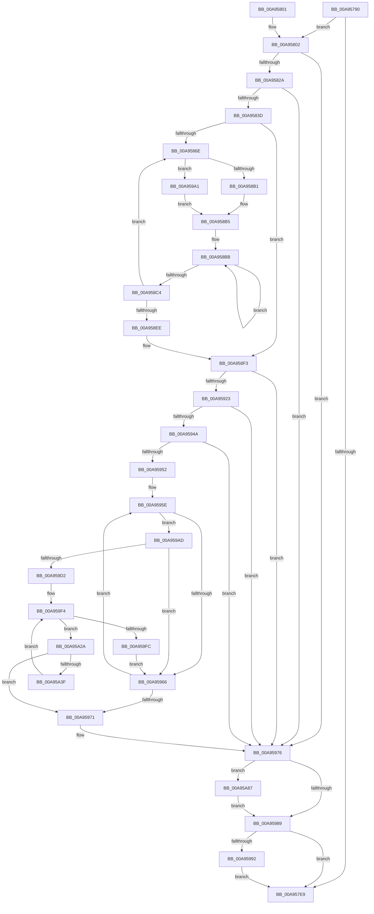

# EtwpLogPmcCounterRundown

- RVA: `0x00A95790`–`0x00A95A96` (길이 `774` bytes)
- VA: `0x0000000140A95790`
- 실행 섹션: `PAGE`
- PDB 이름 있음: `예`; PDB Function 태그: `아니요`
- unwind 정보 RVA: `0x000B98C8`
- 디코드: `193`개 명령, `774/774` bytes 표시
- 미해석 바이트: `0` (있으면 어셈블리에 `.byte`로 보존)

> 이 문서는 커널 이미지의 기계어와 PDB 기호를 분석해 생성했습니다. 4번과 5번은 함수 원형과 자료형을 바이너리 사용 방식에서 추정한 C 해석이며 원본 소스 복구 결과는 아닙니다.

## 1. Dependencies

- 직접 호출 지점: **10**; 고유 호출 대상: **4**
- 직접 호출자로 확인된 함수: **2**
- RIP 상대 이미지 참조: **5**

### Outgoing calls
- `0x00A957DC` → [ExAllocatePool2](../../poolcode/B8/ExAllocatePool2_function_00B820F0.md) (function, `0x00B820F0`)
- `0x00A95814` → [ExAllocatePool2](../../poolcode/B8/ExAllocatePool2_function_00B820F0.md) (function, `0x00B820F0`)
- `0x00A958A4` → [guard_dispatch_icall](../../text/6B/guard_dispatch_icall_function_006BAAD0.md) (function, `0x006BAAD0`)
- `0x00A95917` → [EtwpLogKernelEvent](../../text/25/EtwpLogKernelEvent_function_0025CC00.md) (function, `0x0025CC00`)
- `0x00A9593D` → [ExAllocatePool2](../../poolcode/B8/ExAllocatePool2_function_00B820F0.md) (function, `0x00B820F0`)
- `0x00A9597B` → [ExFreePoolWithTag](../../poolcode/B8/ExFreePoolWithTag_function_00B82870.md) (function, `0x00B82870`)
- `0x00A95997` → [ExFreePoolWithTag](../../poolcode/B8/ExFreePoolWithTag_function_00B82870.md) (function, `0x00B82870`)
- `0x00A959C9` → [guard_dispatch_icall](../../text/6B/guard_dispatch_icall_function_006BAAD0.md) (function, `0x006BAAD0`)
- `0x00A95A20` → [EtwpLogKernelEvent](../../text/25/EtwpLogKernelEvent_function_0025CC00.md) (function, `0x0025CC00`)
- `0x00A95A8C` → [ExFreePoolWithTag](../../poolcode/B8/ExFreePoolWithTag_function_00B82870.md) (function, `0x00B82870`)

### Direct callers
- [EtwpStopLoggerInstance](../9B/EtwpStopLoggerInstance_function_009BEB94.md) at `0x009BEE9C`
- [EtwpCheckLoggerAccessAndDoRundown](../9E/EtwpCheckLoggerAccessAndDoRundown_function_009E3EFC.md) at `0x009E3FFD`

### Static image references
- `0x00A957A9` → RVA `0x00FC6A80` (`ALMOSTRO`; read)
- `0x00A957B2` → RVA `0x00E0EB1C` (`.data`; read)
- `0x00A9589D` → RVA `0x00E00638` (`.data`; read)
- `0x00A958FE` → RVA `0x00FC6AA8` (`ALMOSTRO`; read)
- `0x00A959A1` → RVA `0x00AFE5E0` (` ?? ::NNGAKEGL::`string'`; read)

## 2. Other-region calls and transfers

- 다른 실행 섹션으로 향하는 call: **10**
  - `0x00A957DC` → [ExAllocatePool2](../../poolcode/B8/ExAllocatePool2_function_00B820F0.md) (`PAGE` → `POOLCODE`)
  - `0x00A95814` → [ExAllocatePool2](../../poolcode/B8/ExAllocatePool2_function_00B820F0.md) (`PAGE` → `POOLCODE`)
  - `0x00A958A4` → [guard_dispatch_icall](../../text/6B/guard_dispatch_icall_function_006BAAD0.md) (`PAGE` → `.text`)
  - `0x00A95917` → [EtwpLogKernelEvent](../../text/25/EtwpLogKernelEvent_function_0025CC00.md) (`PAGE` → `.text`)
  - `0x00A9593D` → [ExAllocatePool2](../../poolcode/B8/ExAllocatePool2_function_00B820F0.md) (`PAGE` → `POOLCODE`)
  - `0x00A9597B` → [ExFreePoolWithTag](../../poolcode/B8/ExFreePoolWithTag_function_00B82870.md) (`PAGE` → `POOLCODE`)
  - `0x00A95997` → [ExFreePoolWithTag](../../poolcode/B8/ExFreePoolWithTag_function_00B82870.md) (`PAGE` → `POOLCODE`)
  - `0x00A959C9` → [guard_dispatch_icall](../../text/6B/guard_dispatch_icall_function_006BAAD0.md) (`PAGE` → `.text`)
  - `0x00A95A20` → [EtwpLogKernelEvent](../../text/25/EtwpLogKernelEvent_function_0025CC00.md) (`PAGE` → `.text`)
  - `0x00A95A8C` → [ExFreePoolWithTag](../../poolcode/B8/ExFreePoolWithTag_function_00B82870.md) (`PAGE` → `POOLCODE`)
- 별도 외부 분기/꼬리 이동을 확인하지 못했습니다.

## 3. Assembly (complete function range)

```asm
00A95790  48 8B C4                        mov rax, rsp
00A95793  48 89 58 08                     mov qword ptr [rax + 8], rbx
00A95797  89 50 10                        mov dword ptr [rax + 0x10], edx
00A9579A  55                              push rbp
00A9579B  56                              push rsi
00A9579C  57                              push rdi
00A9579D  41 54                           push r12
00A9579F  41 55                           push r13
00A957A1  41 56                           push r14
00A957A3  41 57                           push r15
00A957A5  48 83 EC 40                     sub rsp, 0x40
00A957A9  44 8B 25 D0 12 53 00            mov r12d, dword ptr [rip + 0x5312d0]
00A957B0  33 ED                           xor ebp, ebp
00A957B2  8B 15 64 93 37 00               mov edx, dword ptr [rip + 0x379364]
00A957B8  4C 8B E9                        mov r13, rcx
00A957BB  FF C2                           inc edx
00A957BD  89 68 18                        mov dword ptr [rax + 0x18], ebp
00A957C0  BE 45 74 77 74                  mov esi, 0x74777445
00A957C5  C1 E2 05                        shl edx, 5
00A957C8  44 8D 75 40                     lea r14d, [rbp + 0x40]
00A957CC  44 89 64 24 30                  mov dword ptr [rsp + 0x30], r12d
00A957D1  41 8B CE                        mov ecx, r14d
00A957D4  89 68 20                        mov dword ptr [rax + 0x20], ebp
00A957D7  44 8B C6                        mov r8d, esi
00A957DA  8B FD                           mov edi, ebp
00A957DC  E8 0F C9 0E 00                  call 0x140b820f0
00A957E1  48 8B D8                        mov rbx, rax
00A957E4  48 85 C0                        test rax, rax
00A957E7  75 19                           jne 0x140a95802
00A957E9  48 8B 9C 24 80 00 00 00         mov rbx, qword ptr [rsp + 0x80]
00A957F1  48 83 C4 40                     add rsp, 0x40
00A957F5  41 5F                           pop r15
00A957F7  41 5E                           pop r14
00A957F9  41 5D                           pop r13
00A957FB  41 5C                           pop r12
00A957FD  5F                              pop rdi
00A957FE  5E                              pop rsi
00A957FF  5D                              pop rbp
00A95800  C3                              ret
00A95801  CC                              int3
00A95802  8B 05 14 93 37 00               mov eax, dword ptr [rip + 0x379314]
00A95808  44 8B C6                        mov r8d, esi
00A9580B  49 8B CE                        mov rcx, r14
00A9580E  8D 14 40                        lea edx, [rax + rax*2]
00A95811  C1 E2 03                        shl edx, 3
00A95814  E8 D7 C8 0E 00                  call 0x140b820f0
00A95819  48 89 44 24 38                  mov qword ptr [rsp + 0x38], rax
00A9581E  4C 8B F8                        mov r15, rax
00A95821  48 85 C0                        test rax, rax
00A95824  0F 84 4C 01 00 00               je 0x140a95976
00A9582A  4D 8B B5 28 04 00 00            mov r14, qword ptr [r13 + 0x428]
00A95831  41 8B 46 14                     mov eax, dword ptr [r14 + 0x14]
00A95835  85 C0                           test eax, eax
00A95837  0F 84 39 01 00 00               je 0x140a95976
00A9583D  41 8B 46 14                     mov eax, dword ptr [r14 + 0x14]
00A95841  8B F5                           mov esi, ebp
00A95843  89 84 24 90 00 00 00            mov dword ptr [rsp + 0x90], eax
00A9584A  48 8D 84 24 90 00 00 00         lea rax, [rsp + 0x90]
00A95852  48 89 03                        mov qword ptr [rbx], rax
00A95855  48 C7 43 08 04 00 00 00         mov qword ptr [rbx + 8], 4
00A9585D  44 8B 8C 24 90 00 00 00         mov r9d, dword ptr [rsp + 0x90]
00A95865  45 85 C9                        test r9d, r9d
00A95868  0F 84 85 00 00 00               je 0x140a958f3
00A9586E  89 AC 24 98 00 00 00            mov dword ptr [rsp + 0x98], ebp
00A95875  4C 8D 8C 24 98 00 00 00         lea r9, [rsp + 0x98]
00A9587D  44 8B E6                        mov r12d, esi
00A95880  BA 18 00 00 00                  mov edx, 0x18
00A95885  4B 8D 04 64                     lea rax, [r12 + r12*2]
00A95889  49 8D 2C C7                     lea rbp, [r15 + rax*8]
00A9588D  49 8B 06                        mov rax, qword ptr [r14]
00A95890  4C 8B C5                        mov r8, rbp
00A95893  42 8B 0C A0                     mov ecx, dword ptr [rax + r12*4]
00A95897  89 4D 00                        mov dword ptr [rbp], ecx
00A9589A  8D 4A E9                        lea ecx, [rdx - 0x17]
00A9589D  48 8B 05 94 AD 36 00            mov rax, qword ptr [rip + 0x36ad94]
00A958A4  E8 27 52 C2 FF                  call 0x1406baad0
00A958A9  85 C0                           test eax, eax
00A958AB  0F 88 F0 00 00 00               js 0x140a959a1
00A958B1  48 8B 55 10                     mov rdx, qword ptr [rbp + 0x10]
00A958B5  48 83 C8 FF                     or rax, 0xffffffffffffffff
00A958B9  33 ED                           xor ebp, ebp
00A958BB  48 FF C0                        inc rax
00A958BE  66 39 2C 42                     cmp word ptr [rdx + rax*2], bp
00A958C2  75 F7                           jne 0x140a958bb
00A958C4  49 8D 4C 24 01                  lea rcx, [r12 + 1]
00A958C9  FF C6                           inc esi
00A958CB  48 03 C9                        add rcx, rcx
00A958CE  8D 04 45 02 00 00 00            lea eax, [rax*2 + 2]
00A958D5  48 89 14 CB                     mov qword ptr [rbx + rcx*8], rdx
00A958D9  89 44 CB 08                     mov dword ptr [rbx + rcx*8 + 8], eax
00A958DD  89 6C CB 0C                     mov dword ptr [rbx + rcx*8 + 0xc], ebp
00A958E1  44 8B 8C 24 90 00 00 00         mov r9d, dword ptr [rsp + 0x90]
00A958E9  41 3B F1                        cmp esi, r9d
00A958EC  72 80                           jb 0x140a9586e
00A958EE  44 8B 64 24 30                  mov r12d, dword ptr [rsp + 0x30]
00A958F3  44 8B 84 24 88 00 00 00         mov r8d, dword ptr [rsp + 0x88]
00A958FB  41 FF C1                        inc r9d
00A958FE  48 8B 15 A3 11 53 00            mov rdx, qword ptr [rip + 0x5311a3]
00A95905  48 8B CB                        mov rcx, rbx
00A95908  C7 44 24 28 02 18 50 00         mov dword ptr [rsp + 0x28], 0x501802
00A95910  66 C7 44 24 20 30 0F            mov word ptr [rsp + 0x20], 0xf30
00A95917  E8 E4 72 7C FF                  call 0x14025cc00
00A9591C  49 83 7D 18 01                  cmp qword ptr [r13 + 0x18], 1
00A95921  75 53                           jne 0x140a95976
00A95923  8B B4 24 90 00 00 00            mov esi, dword ptr [rsp + 0x90]
00A9592A  B9 40 00 00 00                  mov ecx, 0x40
00A9592F  C1 E6 04                        shl esi, 4
00A95932  41 B8 45 74 77 74               mov r8d, 0x74777445
00A95938  83 C6 18                        add esi, 0x18
00A9593B  8B D6                           mov edx, esi
00A9593D  E8 AE C7 0E 00                  call 0x140b820f0
00A95942  48 8B F8                        mov rdi, rax
00A95945  48 85 C0                        test rax, rax
00A95948  74 2C                           je 0x140a95976
00A9594A  45 33 ED                        xor r13d, r13d
00A9594D  45 85 E4                        test r12d, r12d
00A95950  74 24                           je 0x140a95976
00A95952  44 8B BC 24 88 00 00 00         mov r15d, dword ptr [rsp + 0x88]
00A9595A  49 83 C6 18                     add r14, 0x18
00A9595E  49 8B 06                        mov rax, qword ptr [r14]
00A95961  48 85 C0                        test rax, rax
00A95964  75 47                           jne 0x140a959ad
00A95966  FF C5                           inc ebp
00A95968  49 83 C6 08                     add r14, 8
00A9596C  41 3B EC                        cmp ebp, r12d
00A9596F  72 ED                           jb 0x140a9595e
00A95971  4C 8B 7C 24 38                  mov r15, qword ptr [rsp + 0x38]
00A95976  33 D2                           xor edx, edx
00A95978  48 8B CB                        mov rcx, rbx
00A9597B  E8 F0 CE 0E 00                  call 0x140b82870
00A95980  4D 85 FF                        test r15, r15
00A95983  0F 85 FE 00 00 00               jne 0x140a95a87
00A95989  48 85 FF                        test rdi, rdi
00A9598C  0F 84 57 FE FF FF               je 0x140a957e9
00A95992  33 D2                           xor edx, edx
00A95994  48 8B CF                        mov rcx, rdi
00A95997  E8 D4 CE 0E 00                  call 0x140b82870
00A9599C  E9 48 FE FF FF                  jmp 0x140a957e9
00A959A1  48 8D 15 38 8C 06 00            lea rdx, [rip + 0x68c38]
00A959A8  E9 08 FF FF FF                  jmp 0x140a958b5
00A959AD  48 89 07                        mov qword ptr [rdi], rax
00A959B0  4C 8D 8C 24 98 00 00 00         lea r9, [rsp + 0x98]
00A959B8  48 8B 05 79 AC 36 00            mov rax, qword ptr [rip + 0x36ac79]
00A959BF  4C 8B C7                        mov r8, rdi
00A959C2  8B D6                           mov edx, esi
00A959C4  B9 34 00 00 00                  mov ecx, 0x34
00A959C9  E8 02 51 C2 FF                  call 0x1406baad0
00A959CE  85 C0                           test eax, eax
00A959D0  78 94                           js 0x140a95966
00A959D2  48 C7 43 08 04 00 00 00         mov qword ptr [rbx + 8], 4
00A959DA  48 8D 47 08                     lea rax, [rdi + 8]
00A959DE  48 89 03                        mov qword ptr [rbx], rax
00A959E1  4C 8D 57 10                     lea r10, [rdi + 0x10]
00A959E5  4C 89 53 10                     mov qword ptr [rbx + 0x10], r10
00A959E9  45 8B CD                        mov r9d, r13d
00A959EC  48 C7 43 18 04 00 00 00         mov qword ptr [rbx + 0x18], 4
00A959F4  41 8B 02                        mov eax, dword ptr [r10]
00A959F7  44 3B C8                        cmp r9d, eax
00A959FA  72 2E                           jb 0x140a95a2a
00A959FC  48 8B 15 A5 10 53 00            mov rdx, qword ptr [rip + 0x5310a5]
00A95A03  44 8D 0C 45 02 00 00 00         lea r9d, [rax*2 + 2]
00A95A0B  C7 44 24 28 02 18 50 00         mov dword ptr [rsp + 0x28], 0x501802
00A95A13  45 8B C7                        mov r8d, r15d
00A95A16  48 8B CB                        mov rcx, rbx
00A95A19  66 C7 44 24 20 31 0F            mov word ptr [rsp + 0x20], 0xf31
00A95A20  E8 DB 71 7C FF                  call 0x14025cc00
00A95A25  E9 3C FF FF FF                  jmp 0x140a95966
00A95A2A  45 8B C1                        mov r8d, r9d
00A95A2D  49 C1 E0 04                     shl r8, 4
00A95A31  45 8B D9                        mov r11d, r9d
00A95A34  45 38 6C 38 25                  cmp byte ptr [r8 + rdi + 0x25], r13b
00A95A39  0F 84 32 FF FF FF               je 0x140a95971
00A95A3F  43 8D 04 09                     lea eax, [r9 + r9]
00A95A43  8B D0                           mov edx, eax
00A95A45  48 8D 48 02                     lea rcx, [rax + 2]
00A95A49  48 03 C9                        add rcx, rcx
00A95A4C  49 8D 43 02                     lea rax, [r11 + 2]
00A95A50  48 C1 E0 04                     shl rax, 4
00A95A54  48 03 C7                        add rax, rdi
00A95A57  48 89 04 CB                     mov qword ptr [rbx + rcx*8], rax
00A95A5B  48 8D 47 18                     lea rax, [rdi + 0x18]
00A95A5F  48 C7 44 CB 08 04 00 00 00      mov qword ptr [rbx + rcx*8 + 8], 4
00A95A68  49 03 C0                        add rax, r8
00A95A6B  48 8D 4A 03                     lea rcx, [rdx + 3]
00A95A6F  48 03 C9                        add rcx, rcx
00A95A72  41 FF C1                        inc r9d
00A95A75  48 89 04 CB                     mov qword ptr [rbx + rcx*8], rax
00A95A79  48 C7 44 CB 08 08 00 00 00      mov qword ptr [rbx + rcx*8 + 8], 8
00A95A82  E9 6D FF FF FF                  jmp 0x140a959f4
00A95A87  33 D2                           xor edx, edx
00A95A89  49 8B CF                        mov rcx, r15
00A95A8C  E8 DF CD 0E 00                  call 0x140b82870
00A95A91  E9 F3 FE FF FF                  jmp 0x140a95989
```

## 4. C-style interpretation (structured pseudocode)

```c
__int64 __fastcall EtwpLogPmcCounterRundown(__int64 a1, int a2)
{
    __int64 result;
    __int64 v_r13;
    __int64 v_r14;
    __int64 v_rbp;
    __int64 v_rsi;
    __int64 v_rsp;
    unsigned int v_stack_m48;
    unsigned __int16 v_stack_p20;
    unsigned int v_stack_p28;
    unsigned int v_stack_p30;
    unsigned __int64 v_stack_p38;
    unsigned __int64 v_stack_p8;
    unsigned int v_stack_p88;
    unsigned int v_stack_p90;
    unsigned int v_stack_p98;

    *(unsigned __int64 *)(v_rsp + 8) = v_rbx;
    *(unsigned int *)(v_rsp + 16) = a2;
    v_rsp = (v_rsp) - (64);
    v_rbp = 0;
    a2 = (unsigned int)(((unsigned int)(*(unsigned int *)(v_rip + 3642212))) + 1);
    *(unsigned int *)(v_rsp + 24) = 0;
    a2 = (unsigned int)((a2) << (5));
    v_stack_m48 = (unsigned int)((unsigned int)(*(unsigned int *)(v_rip + 5444304)));
    *(unsigned int *)(v_rsp + 32) = 0;
    result = ExAllocatePool2((unsigned int)((unsigned int)(v_rbp + 64)), a2, (unsigned int)((unsigned int)((unsigned int)(0x74777445ULL))), a4);
    if (result != 0) goto loc_00A95802;
loc_00A957E9:
    v_rsp = (v_rsp) + (64);
    return result;
loc_00A95802:
    a2 = (unsigned int)(((unsigned int)(*(unsigned int *)(v_rip + 3642132)) + (unsigned int)(*(unsigned int *)(v_rip + 3642132)) * 2) << (3));
    result = ExAllocatePool2(v_rbp + 64, a2, (unsigned int)((unsigned int)((unsigned int)(0x74777445ULL))), a4);
    v_stack_p38 = result;
    if (result == 0) goto loc_00A95976;
    if ((unsigned int)((unsigned int)(*(unsigned int *)(*(unsigned __int64 *)(a1 + 1064) + 20))) == 0) goto loc_00A95976;
    v_stack_p90 = (unsigned int)((unsigned int)(*(unsigned int *)(*(unsigned __int64 *)(a1 + 1064) + 20)));
    *(unsigned __int64 *)(v_stack_p8) = v_stack_p90;
    *(unsigned __int64 *)(v_stack_p8 + 8) = 4;
    if ((unsigned int)((unsigned int)(v_stack_p90)) == 0) goto loc_00A958F3;
loc_00A9586E:
    v_stack_p98 = 0;
    *(unsigned int *)(result + 0 + 0 * 2 * 8) = (unsigned int)((unsigned int)(*(unsigned int *)(*(unsigned __int64 *)(*(unsigned __int64 *)(a1 + 1064)) + 0 * 4)));
    result = guard_dispatch_icall(24 - 23, 24, result + 0 + 0 * 2 * 8, v_stack_p98);
    if (sign_flag) goto loc_00A959A1;
loc_00A958B5:
    result = (result) | (-1);
    v_rbp = 0;
loc_00A958BB:
    result = (result) + 1;
    if ((*(unsigned __int16 *)(*(unsigned __int64 *)(result + 0 + 0 * 2 * 8 + 16) + result * 2)) != 0) goto loc_00A958BB;
    v_rsi = (unsigned int)((0) + 1);
    a1 = (0 + 1) + (0 + 1);
    *(unsigned __int64 *)(v_stack_p8 + a1 * 8) = *(unsigned __int64 *)(result + 0 + 0 * 2 * 8 + 16);
    *(unsigned int *)(v_stack_p8 + a1 * 8 + 8) = (unsigned int)(result * 2 + 2);
    *(unsigned int *)(v_stack_p8 + a1 * 8 + 12) = 0;
    if (((unsigned int)(v_rsi)) < ((unsigned int)((unsigned int)(v_stack_p90)))) goto loc_00A9586E;
loc_00A958F3:
    a4 = (unsigned int)(((unsigned int)(v_stack_p90)) + 1);
    v_stack_p28 = 0x501802ULL;
    v_stack_p20 = 0xF30ULL;
    result = EtwpLogKernelEvent(v_stack_p8, *(unsigned __int64 *)(v_rip + 5444003), (unsigned int)(v_stack_p88), a4);
    if ((*(unsigned __int64 *)(a1 + 24)) != 1) goto loc_00A95976;
    v_rsi = (unsigned int)(((unsigned int)(v_stack_p90)) << (4));
    v_rsi = (unsigned int)((v_rsi) + (24));
    result = ExAllocatePool2(64, (unsigned int)((unsigned int)(v_rsi)), (unsigned int)(0x74777445ULL), a4);
    if (result == 0) goto loc_00A95976;
    v_r13 = 0;
    if ((unsigned int)((unsigned int)(v_stack_p30)) == 0) goto loc_00A95976;
    v_r14 = (*(unsigned __int64 *)(a1 + 1064)) + (24);
loc_00A9595E:
    if (*(unsigned __int64 *)(v_r14) != 0) goto loc_00A959AD;
loc_00A95966:
    v_rbp = (unsigned int)((v_rbp) + 1);
    v_r14 = (v_r14) + (8);
    if (((unsigned int)(v_rbp)) < ((unsigned int)((unsigned int)(v_stack_p30)))) goto loc_00A9595E;
loc_00A95971:
loc_00A95976:
    a2 = 0;
    result = ExFreePoolWithTag(v_stack_p8, a2, (unsigned int)(0x74777445ULL), a4);
    if (v_stack_p38 != 0) goto loc_00A95A87;
loc_00A95989:
    if (result == 0) goto loc_00A957E9;
    a2 = 0;
    result = ExFreePoolWithTag(result, a2, (unsigned int)(0x74777445ULL), a4);
    goto loc_00A957E9;
loc_00A959A1:
    goto loc_00A958B5;
loc_00A959AD:
    *(unsigned __int64 *)(result) = result;
    result = guard_dispatch_icall(52, (unsigned int)((unsigned int)(v_rsi)), result, v_stack_p98);
    if (sign_flag) goto loc_00A95966;
    *(unsigned __int64 *)(v_stack_p8 + 8) = 4;
    *(unsigned __int64 *)(v_stack_p8) = result + 8;
    *(unsigned __int64 *)(v_stack_p8 + 16) = result + 16;
    *(unsigned __int64 *)(v_stack_p8 + 24) = 4;
loc_00A959F4:
    if (0 < ((unsigned int)((unsigned int)(*(unsigned int *)(result + 16))))) goto loc_00A95A2A;
    v_stack_p28 = 0x501802ULL;
    v_stack_p20 = 0xF31ULL;
    result = EtwpLogKernelEvent(v_stack_p8, *(unsigned __int64 *)(v_rip + 5443749), (unsigned int)((unsigned int)(v_stack_p38)), (unsigned int)(*(unsigned int *)(result + 16)) * 2 + 2);
    goto loc_00A95966;
loc_00A95A2A:
    a3 = ((unsigned int)((unsigned int)((unsigned int)(*(unsigned int *)(result + 16)) * 2 + 2))) << (4);
    if ((*(unsigned __int8 *)(a3 + result * 1 + 37)) == 0) goto loc_00A95971;
    a1 = ((unsigned int)(*(unsigned int *)(result + 16)) * 2 + 2 + (unsigned int)(*(unsigned int *)(result + 16)) * 2 + 2 * 1 + 2) + ((unsigned int)(*(unsigned int *)(result + 16)) * 2 + 2 + (unsigned int)(*(unsigned int *)(result + 16)) * 2 + 2 * 1 + 2);
    result = ((unsigned int)((unsigned int)((unsigned int)(*(unsigned int *)(result + 16)) * 2 + 2)) + 2) << (4);
    result = (result) + (result);
    *(unsigned __int64 *)(v_stack_p8 + a1 * 8) = result;
    *(unsigned __int64 *)(v_stack_p8 + a1 * 8 + 8) = 4;
    result = (result + 24) + (a3);
    a1 = ((unsigned int)((unsigned int)((unsigned int)(*(unsigned int *)(result + 16)) * 2 + 2 + (unsigned int)(*(unsigned int *)(result + 16)) * 2 + 2 * 1)) + 3) + ((unsigned int)((unsigned int)((unsigned int)(*(unsigned int *)(result + 16)) * 2 + 2 + (unsigned int)(*(unsigned int *)(result + 16)) * 2 + 2 * 1)) + 3);
    a4 = (unsigned int)(((unsigned int)(*(unsigned int *)(result + 16)) * 2 + 2) + 1);
    *(unsigned __int64 *)(v_stack_p8 + a1 * 8) = result;
    *(unsigned __int64 *)(v_stack_p8 + a1 * 8 + 8) = 8;
    goto loc_00A959F4;
loc_00A95A87:
    a2 = 0;
    result = ExFreePoolWithTag(v_stack_p38, a2, a3, a4);
    goto loc_00A95989;
}
```

## 5. (Beta) C Style

```c
int64_t EtwpLogPmcCounterRundown(void *Arg1, int32_t Arg2)
{
    uint8_t *arg1 = (uint8_t *)Arg1;

    int64_t result;
    int64_t local_r13;
    int64_t local_r14;
    int64_t local_rbp;
    int64_t local_rsi;
    int64_t local_rsp;
    uint32_t v_stack_m48;
    uint16_t v_stack_p20;
    uint32_t v_stack_p28;
    uint32_t v_stack_p30;
    uint64_t v_stack_p38;
    uint64_t v_stack_p8;
    uint32_t v_stack_p88;
    uint32_t v_stack_p90;
    uint32_t v_stack_p98;

    *(uint64_t *)(local_rsp + 0x8) = local_rbx;
    *(uint32_t *)(local_rsp + 0x10) = Arg2;
    local_rsp = (local_rsp) - (64);
    local_rbp = 0;
    Arg2 = (uint32_t)(((uint32_t)(*(uint32_t *)(v_rip + 0x379364))) + 1);
    *(uint32_t *)(local_rsp + 0x18) = 0;
    Arg2 = (uint32_t)((Arg2) << (5));
    v_stack_m48 = (uint32_t)((uint32_t)(*(uint32_t *)(v_rip + 0x5312D0)));
    *(uint32_t *)(local_rsp + 0x20) = 0;
    result = ExAllocatePool2((uint32_t)((uint32_t)(local_rbp + 64)), Arg2, (uint32_t)((uint32_t)((uint32_t)(0x74777445ULL))), a4);
    if (result != 0) goto loc_00A95802;
loc_00A957E9:
    local_rsp = (local_rsp) + (64);
    return result;
loc_00A95802:
    Arg2 = (uint32_t)(((uint32_t)(*(uint32_t *)(v_rip + 0x379314)) + (uint32_t)(*(uint32_t *)(v_rip + 0x379314)) * 2) << (3));
    result = ExAllocatePool2(local_rbp + 64, Arg2, (uint32_t)((uint32_t)((uint32_t)(0x74777445ULL))), a4);
    v_stack_p38 = result;
    if (result == 0) goto loc_00A95976;
    if ((uint32_t)((uint32_t)(*(uint32_t *)(*(uint64_t *)(arg1 + 0x428) + 0x14))) == 0) goto loc_00A95976;
    v_stack_p90 = (uint32_t)((uint32_t)(*(uint32_t *)(*(uint64_t *)(arg1 + 0x428) + 0x14)));
    *(uint64_t *)(v_stack_p8) = v_stack_p90;
    *(uint64_t *)(v_stack_p8 + 0x8) = 4;
    if ((uint32_t)((uint32_t)(v_stack_p90)) == 0) goto loc_00A958F3;
loc_00A9586E:
    v_stack_p98 = 0;
    *(uint32_t *)(result + 0x0 + 0x0 * 2 * 8) = (uint32_t)((uint32_t)(*(uint32_t *)(*(uint64_t *)(*(uint64_t *)(arg1 + 0x428)) + 0x0 * 4)));
    result = guard_dispatch_icall(24 - 23, 24, result + 0 + 0 * 2 * 8, v_stack_p98);
    if (sign_flag) goto loc_00A959A1;
loc_00A958B5:
    result = (result) | (-1);
    local_rbp = 0;
loc_00A958BB:
    result = (result) + 1;
    if ((*(uint16_t *)(*(uint64_t *)(result + 0x0 + 0x0 * 2 * 8 + 0x10) + result * 2)) != 0) goto loc_00A958BB;
    local_rsi = (uint32_t)((0) + 1);
    Arg1 = (0 + 1) + (0 + 1);
    *(uint64_t *)(v_stack_p8 + arg1 * 8) = *(uint64_t *)(result + 0x0 + 0x0 * 2 * 8 + 0x10);
    *(uint32_t *)(v_stack_p8 + arg1 * 8 + 0x8) = (uint32_t)(result * 2 + 2);
    *(uint32_t *)(v_stack_p8 + arg1 * 8 + 0xC) = 0;
    if (((uint32_t)(local_rsi)) < ((uint32_t)((uint32_t)(v_stack_p90)))) goto loc_00A9586E;
loc_00A958F3:
    a4 = (uint32_t)(((uint32_t)(v_stack_p90)) + 1);
    v_stack_p28 = 0x501802ULL;
    v_stack_p20 = 0xF30ULL;
    result = EtwpLogKernelEvent(v_stack_p8, *(uint64_t *)(v_rip + 0x5311A3), (uint32_t)(v_stack_p88), a4);
    if ((*(uint64_t *)(arg1 + 0x18)) != 1) goto loc_00A95976;
    local_rsi = (uint32_t)(((uint32_t)(v_stack_p90)) << (4));
    local_rsi = (uint32_t)((local_rsi) + (24));
    result = ExAllocatePool2(64, (uint32_t)((uint32_t)(local_rsi)), (uint32_t)(0x74777445ULL), a4);
    if (result == 0) goto loc_00A95976;
    local_r13 = 0;
    if ((uint32_t)((uint32_t)(v_stack_p30)) == 0) goto loc_00A95976;
    local_r14 = (*(uint64_t *)(arg1 + 0x428)) + (24);
loc_00A9595E:
    if (*(uint64_t *)(local_r14) != 0) goto loc_00A959AD;
loc_00A95966:
    local_rbp = (uint32_t)((local_rbp) + 1);
    local_r14 = (local_r14) + (8);
    if (((uint32_t)(local_rbp)) < ((uint32_t)((uint32_t)(v_stack_p30)))) goto loc_00A9595E;
loc_00A95971:
loc_00A95976:
    Arg2 = 0;
    result = ExFreePoolWithTag(v_stack_p8, Arg2, (uint32_t)(0x74777445ULL), a4);
    if (v_stack_p38 != 0) goto loc_00A95A87;
loc_00A95989:
    if (result == 0) goto loc_00A957E9;
    Arg2 = 0;
    result = ExFreePoolWithTag(result, Arg2, (uint32_t)(0x74777445ULL), a4);
    goto loc_00A957E9;
loc_00A959A1:
    goto loc_00A958B5;
loc_00A959AD:
    *(uint64_t *)(result) = result;
    result = guard_dispatch_icall(52, (uint32_t)((uint32_t)(local_rsi)), result, v_stack_p98);
    if (sign_flag) goto loc_00A95966;
    *(uint64_t *)(v_stack_p8 + 0x8) = 4;
    *(uint64_t *)(v_stack_p8) = result + 8;
    *(uint64_t *)(v_stack_p8 + 0x10) = result + 16;
    *(uint64_t *)(v_stack_p8 + 0x18) = 4;
loc_00A959F4:
    if (0 < ((uint32_t)((uint32_t)(*(uint32_t *)(result + 0x10))))) goto loc_00A95A2A;
    v_stack_p28 = 0x501802ULL;
    v_stack_p20 = 0xF31ULL;
    result = EtwpLogKernelEvent(v_stack_p8, *(uint64_t *)(v_rip + 0x5310A5), (uint32_t)((uint32_t)(v_stack_p38)), (uint32_t)(*(uint32_t *)(result + 0x10)) * 2 + 2);
    goto loc_00A95966;
loc_00A95A2A:
    a3 = ((uint32_t)((uint32_t)((uint32_t)(*(uint32_t *)(result + 0x10)) * 2 + 2))) << (4);
    if ((*(uint8_t *)(a3 + result * 1 + 0x25)) == 0) goto loc_00A95971;
    Arg1 = ((uint32_t)(*(uint32_t *)(result + 0x10)) * 2 + 2 + (uint32_t)(*(uint32_t *)(result + 0x10)) * 2 + 2 * 1 + 2) + ((uint32_t)(*(uint32_t *)(result + 0x10)) * 2 + 2 + (uint32_t)(*(uint32_t *)(result + 0x10)) * 2 + 2 * 1 + 2);
    result = ((uint32_t)((uint32_t)((uint32_t)(*(uint32_t *)(result + 0x10)) * 2 + 2)) + 2) << (4);
    result = (result) + (result);
    *(uint64_t *)(v_stack_p8 + arg1 * 8) = result;
    *(uint64_t *)(v_stack_p8 + arg1 * 8 + 0x8) = 4;
    result = (result + 24) + (a3);
    Arg1 = ((uint32_t)((uint32_t)((uint32_t)(*(uint32_t *)(result + 0x10)) * 2 + 2 + (uint32_t)(*(uint32_t *)(result + 0x10)) * 2 + 2 * 1)) + 3) + ((uint32_t)((uint32_t)((uint32_t)(*(uint32_t *)(result + 0x10)) * 2 + 2 + (uint32_t)(*(uint32_t *)(result + 0x10)) * 2 + 2 * 1)) + 3);
    a4 = (uint32_t)(((uint32_t)(*(uint32_t *)(result + 0x10)) * 2 + 2) + 1);
    *(uint64_t *)(v_stack_p8 + arg1 * 8) = result;
    *(uint64_t *)(v_stack_p8 + arg1 * 8 + 0x8) = 8;
    goto loc_00A959F4;
loc_00A95A87:
    Arg2 = 0;
    result = ExFreePoolWithTag(v_stack_p38, Arg2, a3, a4);
    goto loc_00A95989;
}
```

### 관측된 메모리 오프셋

구조체 형식이 확인되지 않은 접근은 인자 기준의 오프셋으로만 기록했습니다.

| 기준 인자 | 오프셋 표현 | 폭 (bit) | 접근 |
|---|---:|---:|---|
| `Arg1` | `+ 0x18` | `64` | `R` |
| `Arg1` | `+ 0x428` | `64` | `R` |

## 6. Execution-region graph

[열기: 2D/3D 그래프와 함수 탐색 컨트롤 패널](../../../control-panel.html?section=page&rva=0x00A95790&view=graph)

- 2D 그래프는 위에서 아래로 흐르고, 3D 그래프는 빈 공간을 드래그해 회전합니다. Shift+드래그는 이동, 휠은 확대·축소, 함수 노드 선택은 대상 보고서 이동입니다.

### Static fallback


