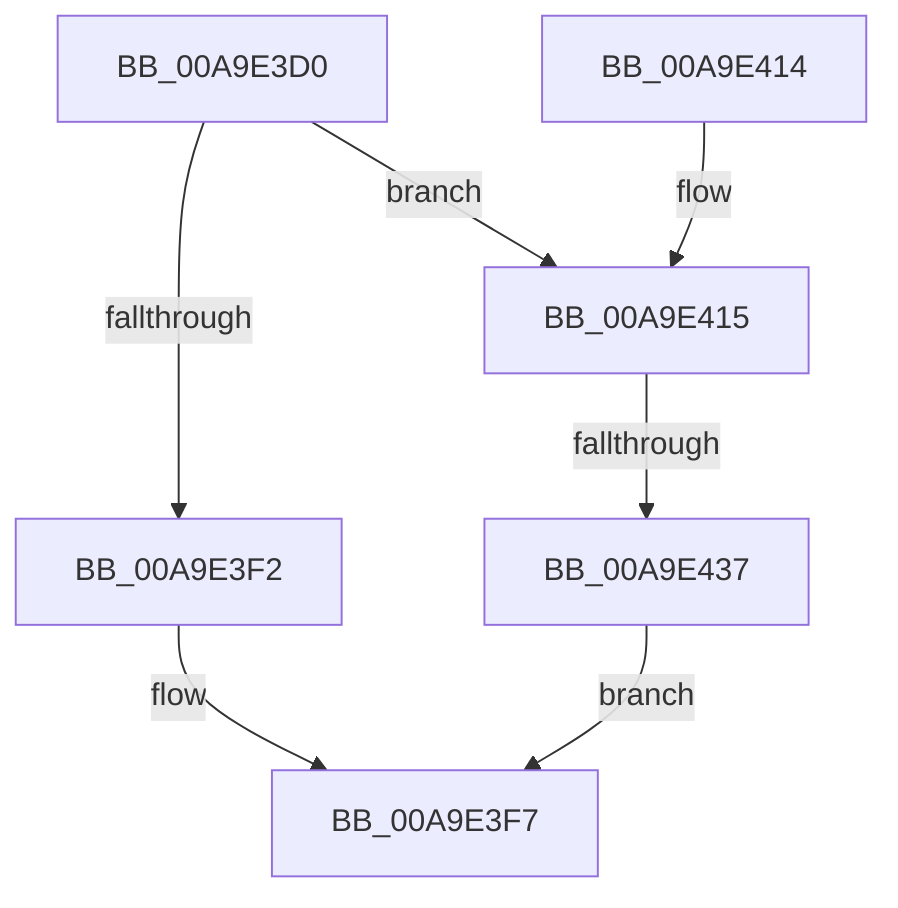

# EtwpRealtimeDisconnectConsumer

- RVA: `0x00A9E3D0`–`0x00A9E43E` (길이 `110` bytes)
- VA: `0x0000000140A9E3D0`
- 실행 섹션: `PAGE`
- PDB 이름 있음: `예`; PDB Function 태그: `예`
- unwind 정보 RVA: `0x00089928`
- 디코드: `30`개 명령, `110/110` bytes 표시
- 미해석 바이트: `0` (있으면 어셈블리에 `.byte`로 보존)

> 이 문서는 커널 이미지의 기계어와 PDB 기호를 분석해 생성했습니다. 4번과 5번은 함수 원형과 자료형을 바이너리 사용 방식에서 추정한 C 해석이며 원본 소스 복구 결과는 아닙니다.

## 1. Dependencies

- 직접 호출 지점: **1**; 고유 호출 대상: **1**
- 직접 호출자로 확인된 함수: **2**
- RIP 상대 이미지 참조: **0**

### Outgoing calls
- `0x00A9E423` → [EtwpAcquireLoggerContextByLoggerId](../93/EtwpAcquireLoggerContextByLoggerId_function_00932920.md) (function, `0x00932920`)

### Direct callers
- [EtwpCloseRealTimeConnectionObject](../7C/EtwpCloseRealTimeConnectionObject_function_007C0BF0.md) at `0x007C0BF7`
- [EtwpRealtimeDisconnectConsumerByHandle](EtwpRealtimeDisconnectConsumerByHandle_function_00A9E368.md) at `0x00A9E3B7`

### Static image references
- 디코드된 RIP-relative 메모리 참조가 없습니다.

## 2. Other-region calls and transfers

- 다른 실행 섹션으로 향하는 call: **0**
- call이 아닌 외부 분기/꼬리 이동: **1**
  - `0x00A9E431` → [sub_00B48F36](../B4/Unknown_function_00B48F36.md) (`tail-transfer`)

## 3. Assembly (complete function range)

```asm
00A9E3D0  48 8B C4                        mov rax, rsp
00A9E3D3  48 89 58 08                     mov qword ptr [rax + 8], rbx
00A9E3D7  48 89 68 10                     mov qword ptr [rax + 0x10], rbp
00A9E3DB  48 89 70 18                     mov qword ptr [rax + 0x18], rsi
00A9E3DF  48 89 78 20                     mov qword ptr [rax + 0x20], rdi
00A9E3E3  41 56                           push r14
00A9E3E5  48 83 EC 20                     sub rsp, 0x20
00A9E3E9  F6 41 5A 05                     test byte ptr [rcx + 0x5a], 5
00A9E3ED  48 8B F9                        mov rdi, rcx
00A9E3F0  74 23                           je 0x140a9e415
00A9E3F2  BB 25 00 00 80                  mov ebx, 0x80000025
00A9E3F7  48 8B 6C 24 38                  mov rbp, qword ptr [rsp + 0x38]
00A9E3FC  8B C3                           mov eax, ebx
00A9E3FE  48 8B 5C 24 30                  mov rbx, qword ptr [rsp + 0x30]
00A9E403  48 8B 74 24 40                  mov rsi, qword ptr [rsp + 0x40]
00A9E408  48 8B 7C 24 48                  mov rdi, qword ptr [rsp + 0x48]
00A9E40D  48 83 C4 20                     add rsp, 0x20
00A9E411  41 5E                           pop r14
00A9E413  C3                              ret
00A9E414  CC                              int3
00A9E415  0F B7 51 58                     movzx edx, word ptr [rcx + 0x58]
00A9E419  41 B0 01                        mov r8b, 1
00A9E41C  48 8B 89 98 00 00 00            mov rcx, qword ptr [rcx + 0x98]
00A9E423  E8 F8 44 E9 FF                  call 0x140932920
00A9E428  45 33 F6                        xor r14d, r14d
00A9E42B  48 8B F0                        mov rsi, rax
00A9E42E  48 85 C0                        test rax, rax
00A9E431  0F 85 FF AA 0A 00               jne 0x140b48f36
00A9E437  BB 0D 00 00 C0                  mov ebx, 0xc000000d
00A9E43C  EB B9                           jmp 0x140a9e3f7
```

## 4. C-style interpretation (structured pseudocode)

```c
__int64 __fastcall EtwpRealtimeDisconnectConsumer(__int64 a1)
{
    __int64 result;
    __int64 v_r14;
    __int64 v_rsp;
    unsigned __int64 v_stack_p10;
    unsigned __int64 v_stack_p18;
    unsigned __int64 v_stack_p20;
    unsigned __int64 v_stack_p8;

    *(unsigned __int64 *)(v_rsp + 8) = v_rbx;
    *(unsigned __int64 *)(v_rsp + 16) = v_rbp;
    *(unsigned __int64 *)(v_rsp + 24) = v_rsi;
    *(unsigned __int64 *)(v_rsp + 32) = v_rdi;
    v_rsp = (v_rsp) - (32);
    if (((*(unsigned __int8 *)(a1 + 90)) & (5)) == 0) goto loc_00A9E415;
loc_00A9E3F7:
    v_rsp = (v_rsp) + (32);
    return (unsigned int)((unsigned int)((unsigned int)(0x80000025ULL)));
loc_00A9E415:
    result = EtwpAcquireLoggerContextByLoggerId(*(unsigned __int64 *)(a1 + 152), *(unsigned __int16 *)(a1 + 88), 1, a4);
    v_r14 = 0;
    goto loc_00A9E3F7;
}
```

## 5. (Beta) C Style

```c
int64_t EtwpRealtimeDisconnectConsumer(void *Arg1)
{
    uint8_t *arg1 = (uint8_t *)Arg1;

    int64_t result;
    int64_t local_r14;
    int64_t local_rsp;
    uint64_t v_stack_p10;
    uint64_t v_stack_p18;
    uint64_t v_stack_p20;
    uint64_t v_stack_p8;

    *(uint64_t *)(local_rsp + 0x8) = local_rbx;
    *(uint64_t *)(local_rsp + 0x10) = local_rbp;
    *(uint64_t *)(local_rsp + 0x18) = local_rsi;
    *(uint64_t *)(local_rsp + 0x20) = local_rdi;
    local_rsp = (local_rsp) - (32);
    if (((*(uint8_t *)(arg1 + 0x5A)) & (5)) == 0) goto loc_00A9E415;
loc_00A9E3F7:
    local_rsp = (local_rsp) + (32);
    return (uint32_t)((uint32_t)((uint32_t)(0x80000025ULL)));
loc_00A9E415:
    result = EtwpAcquireLoggerContextByLoggerId(*(uint64_t *)(arg1 + 0x98), *(uint16_t *)(arg1 + 0x58), 1, a4);
    local_r14 = 0;
    goto loc_00A9E3F7;
}
```

### 관측된 메모리 오프셋

구조체 형식이 확인되지 않은 접근은 인자 기준의 오프셋으로만 기록했습니다.

| 기준 인자 | 오프셋 표현 | 폭 (bit) | 접근 |
|---|---:|---:|---|
| `Arg1` | `+ 0x58` | `16` | `R` |
| `Arg1` | `+ 0x5A` | `8` | `R` |
| `Arg1` | `+ 0x98` | `64` | `R` |

## 6. Execution-region graph

[열기: 2D/3D 그래프와 함수 탐색 컨트롤 패널](../../../control-panel.html?section=page&rva=0x00A9E3D0&view=graph)

- 2D 그래프는 위에서 아래로 흐르고, 3D 그래프는 빈 공간을 드래그해 회전합니다. Shift+드래그는 이동, 휠은 확대·축소, 함수 노드 선택은 대상 보고서 이동입니다.

### Static fallback


