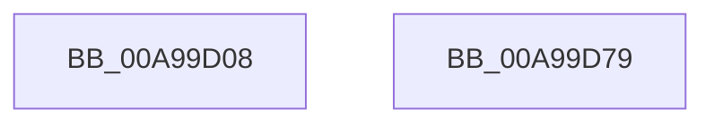

# EtwpStartTrace

- RVA: `0x00A99D08`–`0x00A99D7A` (길이 `114` bytes)
- VA: `0x0000000140A99D08`
- 실행 섹션: `PAGE`
- PDB 이름 있음: `예`; PDB Function 태그: `아니요`
- unwind 정보 RVA: `0x000794E0`
- 디코드: `31`개 명령, `114/114` bytes 표시
- 미해석 바이트: `0` (있으면 어셈블리에 `.byte`로 보존)

> 이 문서는 커널 이미지의 기계어와 PDB 기호를 분석해 생성했습니다. 4번과 5번은 함수 원형과 자료형을 바이너리 사용 방식에서 추정한 C 해석이며 원본 소스 복구 결과는 아닙니다.

## 1. Dependencies

- 직접 호출 지점: **4**; 고유 호출 대상: **4**
- 직접 호출자로 확인된 함수: **2**
- RIP 상대 이미지 참조: **0**

### Outgoing calls
- `0x00A99D46` → [KeWaitForSingleObject](../../text/20/KeWaitForSingleObject_function_0020E6B0.md) (function, `0x0020E6B0`)
- `0x00A99D51` → [EtwpStartLogger](EtwpStartLogger_function_00A99D80.md) (function, `0x00A99D80`)
- `0x00A99D5D` → [KeReleaseMutex](../../text/39/KeReleaseMutex_function_00396810.md) (function, `0x00396810`)
- `0x00A99D62` → [KeLeaveCriticalRegion](../../text/25/KeLeaveCriticalRegion_function_0025D8B0.md) (function, `0x0025D8B0`)

### Direct callers
- [EtwWmitraceWorker](../7B/EtwWmitraceWorker_function_007BBD3C.md) at `0x007BBFE4`
- [NtTraceControl](NtTraceControl_function_00A9ED40.md) at `0x00A9F0DA`

### Static image references
- 디코드된 RIP-relative 메모리 참조가 없습니다.

## 2. Other-region calls and transfers

- 다른 실행 섹션으로 향하는 call: **3**
  - `0x00A99D46` → [KeWaitForSingleObject](../../text/20/KeWaitForSingleObject_function_0020E6B0.md) (`PAGE` → `.text`)
  - `0x00A99D5D` → [KeReleaseMutex](../../text/39/KeReleaseMutex_function_00396810.md) (`PAGE` → `.text`)
  - `0x00A99D62` → [KeLeaveCriticalRegion](../../text/25/KeLeaveCriticalRegion_function_0025D8B0.md) (`PAGE` → `.text`)
- 별도 외부 분기/꼬리 이동을 확인하지 못했습니다.

## 3. Assembly (complete function range)

```asm
00A99D08  48 89 5C 24 08                  mov qword ptr [rsp + 8], rbx
00A99D0D  48 89 74 24 10                  mov qword ptr [rsp + 0x10], rsi
00A99D12  57                              push rdi
00A99D13  48 83 EC 30                     sub rsp, 0x30
00A99D17  65 48 8B 04 25 88 01 00 00      mov rax, qword ptr gs:[0x188]
00A99D20  48 8D B9 10 13 00 00            lea rdi, [rcx + 0x1310]
00A99D27  48 83 64 24 20 00               and qword ptr [rsp + 0x20], 0
00A99D2D  48 8B DA                        mov rbx, rdx
00A99D30  48 8B F1                        mov rsi, rcx
00A99D33  45 33 C9                        xor r9d, r9d
00A99D36  45 33 C0                        xor r8d, r8d
00A99D39  33 D2                           xor edx, edx
00A99D3B  66 FF 88 E4 01 00 00            dec word ptr [rax + 0x1e4]
00A99D42  48 8B CF                        mov rcx, rdi
00A99D45  90                              nop
00A99D46  E8 65 49 77 FF                  call 0x14020e6b0
00A99D4B  48 8B D3                        mov rdx, rbx
00A99D4E  48 8B CE                        mov rcx, rsi
00A99D51  E8 2A 00 00 00                  call 0x140a99d80
00A99D56  33 D2                           xor edx, edx
00A99D58  48 8B CF                        mov rcx, rdi
00A99D5B  8B D8                           mov ebx, eax
00A99D5D  E8 AE CA 8F FF                  call 0x140396810
00A99D62  E8 49 3B 7C FF                  call 0x14025d8b0
00A99D67  48 8B 74 24 48                  mov rsi, qword ptr [rsp + 0x48]
00A99D6C  8B C3                           mov eax, ebx
00A99D6E  48 8B 5C 24 40                  mov rbx, qword ptr [rsp + 0x40]
00A99D73  48 83 C4 30                     add rsp, 0x30
00A99D77  5F                              pop rdi
00A99D78  C3                              ret
00A99D79  CC                              int3
```

## 4. C-style interpretation (structured pseudocode)

```c
__int64 __fastcall EtwpStartTrace(__int64 a1, __int64 a2, int a3, int a4)
{
    __int64 result;
    __int64 v_rsp;
    unsigned __int64 v_stack_m18;
    unsigned __int64 v_stack_p10;
    unsigned __int64 v_stack_p8;

    v_stack_p8 = v_rbx;
    v_stack_p10 = v_rsi;
    v_rsp = (v_rsp) - (48);
    a4 = 0;
    a3 = 0;
    a2 = 0;
    result = KeWaitForSingleObject(a1 + 4880, a2, a3, a4);
    result = EtwpStartLogger(a1, 0, a3, a4);
    a2 = 0;
    result = KeReleaseMutex(a1 + 4880, a2, a3, a4);
    result = KeLeaveCriticalRegion(a1 + 4880, a2, a3, a4);
    v_rsp = (v_rsp) + (48);
    return (unsigned int)((unsigned int)((unsigned int)((unsigned int)(result))));
}
```

## 5. (Beta) C Style

```c
int64_t EtwpStartTrace(void *Arg1, int64_t Arg2, int32_t Arg3, int32_t Arg4)
{
    uint8_t *arg1 = (uint8_t *)Arg1;

    int64_t result;
    int64_t local_rsp;
    uint64_t v_stack_m18;
    uint64_t v_stack_p10;
    uint64_t v_stack_p8;

    v_stack_p8 = local_rbx;
    v_stack_p10 = local_rsi;
    local_rsp = (local_rsp) - (48);
    Arg4 = 0;
    Arg3 = 0;
    Arg2 = 0;
    result = KeWaitForSingleObject(Arg1 + 4880, Arg2, Arg3, Arg4);
    result = EtwpStartLogger(Arg1, 0, Arg3, Arg4);
    Arg2 = 0;
    result = KeReleaseMutex(Arg1 + 4880, Arg2, Arg3, Arg4);
    result = KeLeaveCriticalRegion(Arg1 + 4880, Arg2, Arg3, Arg4);
    local_rsp = (local_rsp) + (48);
    return (uint32_t)((uint32_t)((uint32_t)((uint32_t)(result))));
}
```

### 관측된 메모리 오프셋

구조체 형식이 확인되지 않은 접근은 인자 기준의 오프셋으로만 기록했습니다.

| 기준 인자 | 오프셋 표현 | 폭 (bit) | 접근 |
|---|---:|---:|---|
| `Arg1` | `+ 0x1310` | `64` | `R` |

## 6. Execution-region graph

[열기: 2D/3D 그래프와 함수 탐색 컨트롤 패널](../../../control-panel.html?section=page&rva=0x00A99D08&view=graph)

- 2D 그래프는 위에서 아래로 흐르고, 3D 그래프는 빈 공간을 드래그해 회전합니다. Shift+드래그는 이동, 휠은 확대·축소, 함수 노드 선택은 대상 보고서 이동입니다.

### Static fallback


