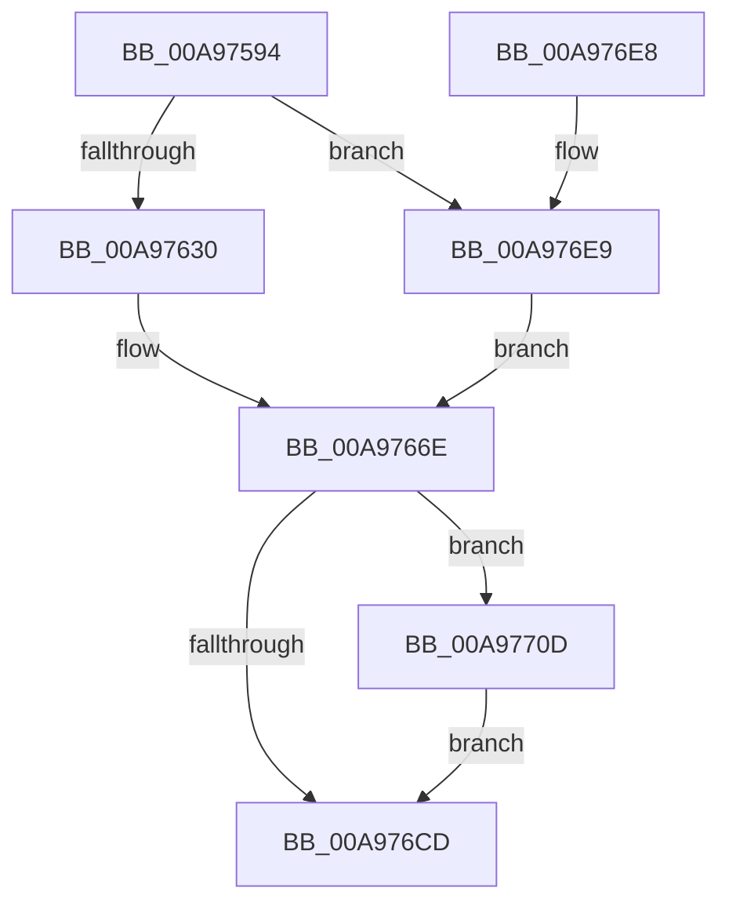

# EtwpTiFillTokenIdentity

- RVA: `0x00A97594`–`0x00A9772C` (길이 `408` bytes)
- VA: `0x0000000140A97594`
- 실행 섹션: `PAGE`
- PDB 이름 있음: `예`; PDB Function 태그: `아니요`
- unwind 정보 RVA: `0x000B9D80`
- 디코드: `105`개 명령, `408/408` bytes 표시
- 미해석 바이트: `0` (있으면 어셈블리에 `.byte`로 보존)

> 이 문서는 커널 이미지의 기계어와 PDB 기호를 분석해 생성했습니다. 4번과 5번은 함수 원형과 자료형을 바이너리 사용 방식에서 추정한 C 해석이며 원본 소스 복구 결과는 아닙니다.

## 1. Dependencies

- 직접 호출 지점: **2**; 고유 호출 대상: **1**
- 직접 호출자로 확인된 함수: **1**
- RIP 상대 이미지 참조: **2**

### Outgoing calls
- `0x00A9760B` → [RtlLengthSid](../../text/45/RtlLengthSid_function_0045D270.md) (function, `0x0045D270`)
- `0x00A97646` → [RtlLengthSid](../../text/45/RtlLengthSid_function_0045D270.md) (function, `0x0045D270`)

### Direct callers
- [EtwTiLogImpersonateClient](../8C/EtwTiLogImpersonateClient_function_008CC9D0.md) at `0x008CCB97`
- [EtwTiLogImpersonateClient](../8C/EtwTiLogImpersonateClient_function_008CC9D0.md) at `0x008CCBB0`

### Static image references
- `0x00A97630` → RVA `0x0001C4C8` (`.rdata`; read)
- `0x00A976EE` → RVA `0x0001C4D0` (`.rdata`; read)

## 2. Other-region calls and transfers

- 다른 실행 섹션으로 향하는 call: **2**
  - `0x00A9760B` → [RtlLengthSid](../../text/45/RtlLengthSid_function_0045D270.md) (`PAGE` → `.text`)
  - `0x00A97646` → [RtlLengthSid](../../text/45/RtlLengthSid_function_0045D270.md) (`PAGE` → `.text`)
- 별도 외부 분기/꼬리 이동을 확인하지 못했습니다.

## 3. Assembly (complete function range)

```asm
00A97594  48 89 5C 24 08                  mov qword ptr [rsp + 8], rbx
00A97599  48 89 6C 24 10                  mov qword ptr [rsp + 0x10], rbp
00A9759E  48 89 74 24 18                  mov qword ptr [rsp + 0x18], rsi
00A975A3  57                              push rdi
00A975A4  41 56                           push r14
00A975A6  41 57                           push r15
00A975A8  48 83 EC 20                     sub rsp, 0x20
00A975AC  48 89 11                        mov qword ptr [rcx], rdx
00A975AF  41 BF 04 00 00 00               mov r15d, 4
00A975B5  4C 89 79 08                     mov qword ptr [rcx + 8], r15
00A975B9  48 8B F9                        mov rdi, rcx
00A975BC  48 8B 42 08                     mov rax, qword ptr [rdx + 8]
00A975C0  48 8B F2                        mov rsi, rdx
00A975C3  48 89 41 10                     mov qword ptr [rcx + 0x10], rax
00A975C7  45 33 F6                        xor r14d, r14d
00A975CA  4C 89 79 18                     mov qword ptr [rcx + 0x18], r15
00A975CE  41 8D 6F 08                     lea ebp, [r15 + 8]
00A975D2  48 8B 42 08                     mov rax, qword ptr [rdx + 8]
00A975D6  4C 89 79 28                     mov qword ptr [rcx + 0x28], r15
00A975DA  49 03 C7                        add rax, r15
00A975DD  48 89 41 20                     mov qword ptr [rcx + 0x20], rax
00A975E1  48 8B 42 08                     mov rax, qword ptr [rdx + 8]
00A975E5  4C 89 79 38                     mov qword ptr [rcx + 0x38], r15
00A975E9  48 83 C0 08                     add rax, 8
00A975ED  48 89 41 30                     mov qword ptr [rcx + 0x30], rax
00A975F1  48 8B 42 08                     mov rax, qword ptr [rdx + 8]
00A975F5  4C 89 79 48                     mov qword ptr [rcx + 0x48], r15
00A975F9  48 03 C5                        add rax, rbp
00A975FC  48 89 41 40                     mov qword ptr [rcx + 0x40], rax
00A97600  48 8B 42 08                     mov rax, qword ptr [rdx + 8]
00A97604  48 8B 58 18                     mov rbx, qword ptr [rax + 0x18]
00A97608  48 8B CB                        mov rcx, rbx
00A9760B  E8 60 5C 9C FF                  call 0x14045d270
00A97610  89 47 58                        mov dword ptr [rdi + 0x58], eax
00A97613  48 89 5F 50                     mov qword ptr [rdi + 0x50], rbx
00A97617  44 89 77 5C                     mov dword ptr [rdi + 0x5c], r14d
00A9761B  48 8B 46 08                     mov rax, qword ptr [rsi + 8]
00A9761F  48 8B 48 28                     mov rcx, qword ptr [rax + 0x28]
00A97623  4C 89 7F 68                     mov qword ptr [rdi + 0x68], r15
00A97627  48 85 C9                        test rcx, rcx
00A9762A  0F 84 B9 00 00 00               je 0x140a976e9
00A97630  48 8D 05 91 4E 58 FF            lea rax, [rip - 0xa7b16f]
00A97637  48 89 47 60                     mov qword ptr [rdi + 0x60], rax
00A9763B  48 8B 46 08                     mov rax, qword ptr [rsi + 8]
00A9763F  48 8B 58 28                     mov rbx, qword ptr [rax + 0x28]
00A97643  48 8B CB                        mov rcx, rbx
00A97646  E8 25 5C 9C FF                  call 0x14045d270
00A9764B  BA 90 00 00 00                  mov edx, 0x90
00A97650  48 89 5F 70                     mov qword ptr [rdi + 0x70], rbx
00A97654  89 47 78                        mov dword ptr [rdi + 0x78], eax
00A97657  41 8D 6F 09                     lea ebp, [r15 + 9]
00A9765B  44 89 77 7C                     mov dword ptr [rdi + 0x7c], r14d
00A9765F  45 8D 57 7C                     lea r10d, [r15 + 0x7c]
00A97663  8D 4A 30                        lea ecx, [rdx + 0x30]
00A97666  44 8D 42 10                     lea r8d, [rdx + 0x10]
00A9766A  44 8D 4A 20                     lea r9d, [rdx + 0x20]
00A9766E  48 8B 46 08                     mov rax, qword ptr [rsi + 8]
00A97672  4D 89 7C 3A 08                  mov qword ptr [r10 + rdi + 8], r15
00A97677  48 83 C0 10                     add rax, 0x10
00A9767B  49 89 04 3A                     mov qword ptr [r10 + rdi], rax
00A9767F  48 8B 46 08                     mov rax, qword ptr [rsi + 8]
00A97683  4C 89 7C 3A 08                  mov qword ptr [rdx + rdi + 8], r15
00A97688  48 83 C0 30                     add rax, 0x30
00A9768C  48 89 04 3A                     mov qword ptr [rdx + rdi], rax
00A97690  48 8B 46 08                     mov rax, qword ptr [rsi + 8]
00A97694  4D 89 7C 38 08                  mov qword ptr [r8 + rdi + 8], r15
00A97699  48 83 C0 34                     add rax, 0x34
00A9769D  49 89 04 38                     mov qword ptr [r8 + rdi], rax
00A976A1  48 8D 46 10                     lea rax, [rsi + 0x10]
00A976A5  49 89 04 39                     mov qword ptr [r9 + rdi], rax
00A976A9  49 C7 44 39 08 08 00 00 00      mov qword ptr [r9 + rdi + 8], 8
00A976B2  48 8B 46 08                     mov rax, qword ptr [rsi + 8]
00A976B6  48 83 C0 40                     add rax, 0x40
00A976BA  4C 89 7C 39 08                  mov qword ptr [rcx + rdi + 8], r15
00A976BF  48 89 04 39                     mov qword ptr [rcx + rdi], rax
00A976C3  48 8B 4E 08                     mov rcx, qword ptr [rsi + 8]
00A976C7  44 39 71 40                     cmp dword ptr [rcx + 0x40], r14d
00A976CB  77 40                           ja 0x140a9770d
00A976CD  48 8B 5C 24 40                  mov rbx, qword ptr [rsp + 0x40]
00A976D2  8B C5                           mov eax, ebp
00A976D4  48 8B 6C 24 48                  mov rbp, qword ptr [rsp + 0x48]
00A976D9  48 8B 74 24 50                  mov rsi, qword ptr [rsp + 0x50]
00A976DE  48 83 C4 20                     add rsp, 0x20
00A976E2  41 5F                           pop r15
00A976E4  41 5E                           pop r14
00A976E6  5F                              pop rdi
00A976E7  C3                              ret
00A976E8  CC                              int3
00A976E9  BA 80 00 00 00                  mov edx, 0x80
00A976EE  48 8D 05 DB 4D 58 FF            lea rax, [rip - 0xa7b225]
00A976F5  48 89 47 60                     mov qword ptr [rdi + 0x60], rax
00A976F9  8D 4A 30                        lea ecx, [rdx + 0x30]
00A976FC  44 8D 52 F0                     lea r10d, [rdx - 0x10]
00A97700  44 8D 42 10                     lea r8d, [rdx + 0x10]
00A97704  44 8D 4A 20                     lea r9d, [rdx + 0x20]
00A97708  E9 61 FF FF FF                  jmp 0x140a9766e
00A9770D  48 8B 4E 18                     mov rcx, qword ptr [rsi + 0x18]
00A97711  8B 56 20                        mov edx, dword ptr [rsi + 0x20]
00A97714  44 8B C5                        mov r8d, ebp
00A97717  4D 03 C0                        add r8, r8
00A9771A  FF C5                           inc ebp
00A9771C  4A 89 0C C7                     mov qword ptr [rdi + r8*8], rcx
00A97720  42 89 54 C7 08                  mov dword ptr [rdi + r8*8 + 8], edx
00A97725  46 89 74 C7 0C                  mov dword ptr [rdi + r8*8 + 0xc], r14d
00A9772A  EB A1                           jmp 0x140a976cd
```

## 4. C-style interpretation (structured pseudocode)

```c
__int64 __fastcall EtwpTiFillTokenIdentity(__int64 a1, __int64 a2)
{
    __int64 result;
    __int64 v_r14;
    __int64 v_rbp;
    __int64 v_rsp;
    unsigned __int64 v_stack_p10;
    unsigned __int64 v_stack_p18;
    unsigned __int64 v_stack_p8;

    v_stack_p8 = v_rbx;
    v_stack_p10 = v_rbp;
    v_stack_p18 = v_rsi;
    v_rsp = (v_rsp) - (32);
    *(unsigned __int64 *)(a1) = a2;
    *(unsigned __int64 *)(a1 + 8) = 4;
    *(unsigned __int64 *)(a1 + 16) = *(unsigned __int64 *)(a2 + 8);
    v_r14 = 0;
    *(unsigned __int64 *)(a1 + 24) = 4;
    *(unsigned __int64 *)(a1 + 40) = 4;
    result = (*(unsigned __int64 *)(a2 + 8)) + (4);
    *(unsigned __int64 *)(a1 + 32) = result;
    *(unsigned __int64 *)(a1 + 56) = 4;
    result = (*(unsigned __int64 *)(a2 + 8)) + (8);
    *(unsigned __int64 *)(a1 + 48) = result;
    *(unsigned __int64 *)(a1 + 72) = 4;
    result = (*(unsigned __int64 *)(a2 + 8)) + (4 + 8);
    *(unsigned __int64 *)(a1 + 64) = result;
    result = RtlLengthSid(*(unsigned __int64 *)(*(unsigned __int64 *)(a2 + 8) + 24), a2, a3, a4);
    *(unsigned int *)(a1 + 88) = (unsigned int)(result);
    *(unsigned __int64 *)(a1 + 80) = *(unsigned __int64 *)(*(unsigned __int64 *)(a2 + 8) + 24);
    *(unsigned int *)(a1 + 92) = 0;
    *(unsigned __int64 *)(a1 + 104) = 4;
    if (*(unsigned __int64 *)(*(unsigned __int64 *)(a2 + 8) + 40) == 0) goto loc_00A976E9;
    *(unsigned __int64 *)(a1 + 96) = v_rip - 10989935;
    result = RtlLengthSid(*(unsigned __int64 *)(*(unsigned __int64 *)(a2 + 8) + 40), a2, a3, a4);
    *(unsigned __int64 *)(a1 + 112) = *(unsigned __int64 *)(*(unsigned __int64 *)(a2 + 8) + 40);
    *(unsigned int *)(a1 + 120) = (unsigned int)(result);
    *(unsigned int *)(a1 + 124) = 0;
loc_00A9766E:
    *(unsigned __int64 *)(4 + 124 + a1 * 1 + 8) = 4;
    result = (*(unsigned __int64 *)(a2 + 8)) + (16);
    *(unsigned __int64 *)(4 + 124 + a1 * 1) = result;
    *(unsigned __int64 *)(144 + a1 * 1 + 8) = 4;
    result = (*(unsigned __int64 *)(a2 + 8)) + (48);
    *(unsigned __int64 *)(144 + a1 * 1) = result;
    *(unsigned __int64 *)(144 + 16 + a1 * 1 + 8) = 4;
    result = (*(unsigned __int64 *)(a2 + 8)) + (52);
    *(unsigned __int64 *)(144 + 16 + a1 * 1) = result;
    *(unsigned __int64 *)(144 + 32 + a1 * 1) = a2 + 16;
    *(unsigned __int64 *)(144 + 32 + a1 * 1 + 8) = 8;
    result = (*(unsigned __int64 *)(a2 + 8)) + (64);
    *(unsigned __int64 *)(144 + 48 + a1 * 1 + 8) = 4;
    *(unsigned __int64 *)(144 + 48 + a1 * 1) = result;
    if ((*(unsigned int *)(*(unsigned __int64 *)(a2 + 8) + 64)) > 0) goto loc_00A9770D;
loc_00A976CD:
    v_rsp = (v_rsp) + (32);
    return (unsigned int)((unsigned int)(4 + 9));
loc_00A976E9:
    *(unsigned __int64 *)(a1 + 96) = v_rip - 10990117;
    goto loc_00A9766E;
loc_00A9770D:
    a3 = ((unsigned int)((unsigned int)(v_stack_p10))) + ((unsigned int)((unsigned int)(v_stack_p10)));
    v_rbp = (unsigned int)((v_stack_p10) + 1);
    *(unsigned __int64 *)(a1 + a3 * 8) = *(unsigned __int64 *)(v_stack_p18 + 24);
    *(unsigned int *)(a1 + a3 * 8 + 8) = (unsigned int)((unsigned int)(*(unsigned int *)(v_stack_p18 + 32)));
    *(unsigned int *)(a1 + a3 * 8 + 12) = 0;
    goto loc_00A976CD;
}
```

## 5. (Beta) C Style

```c
int64_t EtwpTiFillTokenIdentity(void *Arg1, void *Arg2)
{
    uint8_t *arg1 = (uint8_t *)Arg1;
    uint8_t *arg2 = (uint8_t *)Arg2;

    int64_t result;
    int64_t local_r14;
    int64_t local_rbp;
    int64_t local_rsp;
    uint64_t v_stack_p10;
    uint64_t v_stack_p18;
    uint64_t v_stack_p8;

    v_stack_p8 = local_rbx;
    v_stack_p10 = local_rbp;
    v_stack_p18 = local_rsi;
    local_rsp = (local_rsp) - (32);
    *(void **)(arg1) = Arg2;
    *(uint64_t *)(arg1 + 0x8) = 4;
    *(uint64_t *)(arg1 + 0x10) = *(uint64_t *)(arg2 + 0x8);
    local_r14 = 0;
    *(uint64_t *)(arg1 + 0x18) = 4;
    *(uint64_t *)(arg1 + 0x28) = 4;
    result = (*(uint64_t *)(arg2 + 0x8)) + (4);
    *(uint64_t *)(arg1 + 0x20) = result;
    *(uint64_t *)(arg1 + 0x38) = 4;
    result = (*(uint64_t *)(arg2 + 0x8)) + (8);
    *(uint64_t *)(arg1 + 0x30) = result;
    *(uint64_t *)(arg1 + 0x48) = 4;
    result = (*(uint64_t *)(arg2 + 0x8)) + (4 + 8);
    *(uint64_t *)(arg1 + 0x40) = result;
    result = RtlLengthSid(*(uint64_t *)(*(uint64_t *)(arg2 + 0x8) + 0x18), Arg2, a3, a4);
    *(uint32_t *)(arg1 + 0x58) = (uint32_t)(result);
    *(uint64_t *)(arg1 + 0x50) = *(uint64_t *)(*(uint64_t *)(arg2 + 0x8) + 0x18);
    *(uint32_t *)(arg1 + 0x5C) = 0;
    *(uint64_t *)(arg1 + 0x68) = 4;
    if (*(uint64_t *)(*(uint64_t *)(arg2 + 0x8) + 0x28) == 0) goto loc_00A976E9;
    *(uint64_t *)(arg1 + 0x60) = v_rip - 10989935;
    result = RtlLengthSid(*(uint64_t *)(*(uint64_t *)(arg2 + 0x8) + 0x28), Arg2, a3, a4);
    *(uint64_t *)(arg1 + 0x70) = *(uint64_t *)(*(uint64_t *)(arg2 + 0x8) + 0x28);
    *(uint32_t *)(arg1 + 0x78) = (uint32_t)(result);
    *(uint32_t *)(arg1 + 0x7C) = 0;
loc_00A9766E:
    *(uint64_t *)(4 + 0x7C + arg1 * 1 + 0x8) = 4;
    result = (*(uint64_t *)(arg2 + 0x8)) + (16);
    *(uint64_t *)(4 + 0x7C + arg1 * 1) = result;
    *(uint64_t *)(144 + arg1 * 1 + 0x8) = 4;
    result = (*(uint64_t *)(arg2 + 0x8)) + (48);
    *(uint64_t *)(144 + arg1 * 1) = result;
    *(uint64_t *)(144 + 0x10 + arg1 * 1 + 0x8) = 4;
    result = (*(uint64_t *)(arg2 + 0x8)) + (52);
    *(uint64_t *)(144 + 0x10 + arg1 * 1) = result;
    *(void **)(144 + 0x20 + arg1 * 1) = Arg2 + 16;
    *(uint64_t *)(144 + 0x20 + arg1 * 1 + 0x8) = 8;
    result = (*(uint64_t *)(arg2 + 0x8)) + (64);
    *(uint64_t *)(144 + 0x30 + arg1 * 1 + 0x8) = 4;
    *(uint64_t *)(144 + 0x30 + arg1 * 1) = result;
    if ((*(uint32_t *)(*(uint64_t *)(arg2 + 0x8) + 0x40)) > 0) goto loc_00A9770D;
loc_00A976CD:
    local_rsp = (local_rsp) + (32);
    return (uint32_t)((uint32_t)(4 + 9));
loc_00A976E9:
    *(uint64_t *)(arg1 + 0x60) = v_rip - 10990117;
    goto loc_00A9766E;
loc_00A9770D:
    a3 = ((uint32_t)((uint32_t)(v_stack_p10))) + ((uint32_t)((uint32_t)(v_stack_p10)));
    local_rbp = (uint32_t)((v_stack_p10) + 1);
    *(uint64_t *)(arg1 + a3 * 8) = *(uint64_t *)(v_stack_p18 + 0x18);
    *(uint32_t *)(arg1 + a3 * 8 + 0x8) = (uint32_t)((uint32_t)(*(uint32_t *)(v_stack_p18 + 0x20)));
    *(uint32_t *)(arg1 + a3 * 8 + 0xC) = 0;
    goto loc_00A976CD;
}
```

### 관측된 메모리 오프셋

구조체 형식이 확인되지 않은 접근은 인자 기준의 오프셋으로만 기록했습니다.

| 기준 인자 | 오프셋 표현 | 폭 (bit) | 접근 |
|---|---:|---:|---|
| `Arg1` | `+ 0x0` | `64` | `W` |
| `Arg1` | `+ 0x0 + r8*8` | `64` | `W` |
| `Arg1` | `+ 0x8` | `64` | `W` |
| `Arg1` | `+ 0x8 + r8*8` | `32` | `W` |
| `Arg1` | `+ 0xC + r8*8` | `32` | `W` |
| `Arg1` | `+ 0x10` | `64` | `W` |
| `Arg1` | `+ 0x18` | `64` | `W` |
| `Arg1` | `+ 0x20` | `64` | `W` |
| `Arg1` | `+ 0x28` | `64` | `W` |
| `Arg1` | `+ 0x30` | `64` | `W` |
| `Arg1` | `+ 0x38` | `64` | `W` |
| `Arg1` | `+ 0x40` | `64` | `W` |
| `Arg1` | `+ 0x48` | `64` | `W` |
| `Arg1` | `+ 0x50` | `64` | `W` |
| `Arg1` | `+ 0x58` | `32` | `W` |
| `Arg1` | `+ 0x5C` | `32` | `W` |
| `Arg1` | `+ 0x60` | `64` | `W` |
| `Arg1` | `+ 0x68` | `64` | `W` |
| `Arg1` | `+ 0x70` | `64` | `W` |
| `Arg1` | `+ 0x78` | `32` | `W` |
| `Arg1` | `+ 0x7C` | `32` | `W` |
| `Arg2` | `+ 0x8` | `64` | `R` |
| `Arg2` | `+ 0x10` | `64` | `R` |
| `Arg2` | `+ 0x18` | `64` | `R` |
| `Arg2` | `+ 0x20` | `32` | `R` |

## 6. Execution-region graph

[열기: 2D/3D 그래프와 함수 탐색 컨트롤 패널](../../../control-panel.html?section=page&rva=0x00A97594&view=graph)

- 2D 그래프는 위에서 아래로 흐르고, 3D 그래프는 빈 공간을 드래그해 회전합니다. Shift+드래그는 이동, 휠은 확대·축소, 함수 노드 선택은 대상 보고서 이동입니다.

### Static fallback


