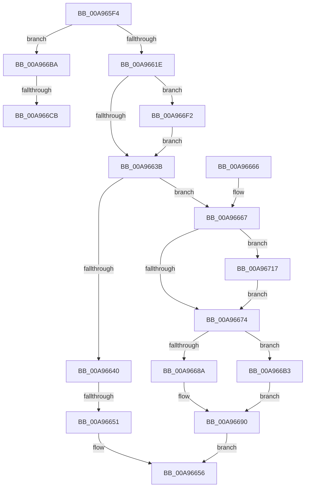

# ExpAllocateUuids

- RVA: `0x00A965F4`–`0x00A96723` (길이 `303` bytes)
- VA: `0x0000000140A965F4`
- 실행 섹션: `PAGE`
- PDB 이름 있음: `예`; PDB Function 태그: `예`
- unwind 정보 RVA: `0x000B9B70`
- 디코드: `74`개 명령, `303/303` bytes 표시
- 미해석 바이트: `0` (있으면 어셈블리에 `.byte`로 보존)

> 이 문서는 커널 이미지의 기계어와 PDB 기호를 분석해 생성했습니다. 4번과 5번은 함수 원형과 자료형을 바이너리 사용 방식에서 추정한 C 해석이며 원본 소스 복구 결과는 아닙니다.

## 1. Dependencies

- 직접 호출 지점: **2**; 고유 호출 대상: **2**
- 직접 호출자로 확인된 함수: **2**
- RIP 상대 이미지 참조: **8**

### Outgoing calls
- `0x00A966BA` → [ExpUuidLoadSequenceNumber](../7D/ExpUuidLoadSequenceNumber_function_007D0B18.md) (function, `0x007D0B18`)
- `0x00A966D0` → [KeQueryPerformanceCounter](../../text/37/KeQueryPerformanceCounter_function_0037E7E0.md) (function, `0x0037E7E0`)

### Direct callers
- [ExpUuidGetValues](../91/ExpUuidGetValues_function_009176AC.md) at `0x009176D0`
- [NtAllocateUuids](NtAllocateUuids_function_00A963E0.md) at `0x00A964FE`

### Static image references
- `0x00A9660B` → RVA `0x00FD803C` (`PAGEDATA`; read)
- `0x00A9662E` → RVA `0x00FD81D8` (`PAGEDATA`; read)
- `0x00A96640` → RVA `0x00FD80AC` (`PAGEDATA`; read)
- `0x00A966A0` → RVA `0x00FD81D8` (`PAGEDATA`; write)
- `0x00A966A7` → RVA `0x00FD8078` (`PAGEDATA`; read)
- `0x00A966F2` → RVA `0x00FD8078` (`PAGEDATA`; read/write)
- `0x00A9670B` → RVA `0x00FD8014` (`PAGEDATA`; write)
- `0x00A96717` → RVA `0x00FD80AC` (`PAGEDATA`; read/write)

## 2. Other-region calls and transfers

- 다른 실행 섹션으로 향하는 call: **1**
  - `0x00A966D0` → [KeQueryPerformanceCounter](../../text/37/KeQueryPerformanceCounter_function_0037E7E0.md) (`PAGE` → `.text`)
- call이 아닌 외부 분기/꼬리 이동: **3**
  - `0x00A9664B` → [sub_00B47A66 + 0x21](../B4/Unknown_function_00B47A66.md) (`tail-transfer`)
  - `0x00A966C5` → [sub_00B47A66](../B4/Unknown_function_00B47A66.md) (`tail-transfer`)
  - `0x00A966ED` → [sub_00B47A66 + 0x8](../B4/Unknown_function_00B47A66.md) (`tail-transfer`)

## 3. Assembly (complete function range)

```asm
00A965F4  48 89 5C 24 08                  mov qword ptr [rsp + 8], rbx
00A965F9  48 89 74 24 10                  mov qword ptr [rsp + 0x10], rsi
00A965FE  57                              push rdi
00A965FF  48 83 EC 30                     sub rsp, 0x30
00A96603  83 64 24 58 00                  and dword ptr [rsp + 0x58], 0
00A96608  49 8B F8                        mov rdi, r8
00A9660B  80 3D 2A 1A 54 00 00            cmp byte ptr [rip + 0x541a2a], 0
00A96612  48 8B DA                        mov rbx, rdx
00A96615  48 8B F1                        mov rsi, rcx
00A96618  0F 84 9C 00 00 00               je 0x140a966ba
00A9661E  48 B9 14 00 00 00 80 F7 FF FF   movabs rcx, 0xfffff78000000014
00A96628  48 8B 09                        mov rcx, qword ptr [rcx]
00A9662B  48 8B C1                        mov rax, rcx
00A9662E  48 2B 05 A3 1B 54 00            sub rax, qword ptr [rip + 0x541ba3]
00A96635  0F 88 B7 00 00 00               js 0x140a966f2
00A9663B  48 85 C0                        test rax, rax
00A9663E  75 27                           jne 0x140a96667
00A96640  44 8B 05 65 1A 54 00            mov r8d, dword ptr [rip + 0x541a65]
00A96647  41 83 F8 1F                     cmp r8d, 0x1f
00A9664B  0F 82 36 14 0B 00               jb 0x140b47a87
00A96651  B8 2D 02 00 C0                  mov eax, 0xc000022d
00A96656  48 8B 5C 24 40                  mov rbx, qword ptr [rsp + 0x40]
00A9665B  48 8B 74 24 48                  mov rsi, qword ptr [rsp + 0x48]
00A96660  48 83 C4 30                     add rsp, 0x30
00A96664  5F                              pop rdi
00A96665  C3                              ret
00A96666  CC                              int3
00A96667  83 3D 3E 1A 54 00 00            cmp dword ptr [rip + 0x541a3e], 0
00A9666E  0F 85 A3 00 00 00               jne 0x140a96717
00A96674  BA 80 96 98 00                  mov edx, 0x989680
00A96679  48 3B C2                        cmp rax, rdx
00A9667C  48 0F 4F C2                     cmovg rax, rdx
00A96680  BA 10 27 00 00                  mov edx, 0x2710
00A96685  48 3B C2                        cmp rax, rdx
00A96688  7F 29                           jg 0x140a966b3
00A9668A  89 03                           mov dword ptr [rbx], eax
00A9668C  8B D0                           mov edx, eax
00A9668E  33 C0                           xor eax, eax
00A96690  8B D2                           mov edx, edx
00A96692  48 2B CA                        sub rcx, rdx
00A96695  48 2B C8                        sub rcx, rax
00A96698  48 89 0E                        mov qword ptr [rsi], rcx
00A9669B  8B 03                           mov eax, dword ptr [rbx]
00A9669D  48 03 C1                        add rax, rcx
00A966A0  48 89 05 31 1B 54 00            mov qword ptr [rip + 0x541b31], rax
00A966A7  8B 05 CB 19 54 00               mov eax, dword ptr [rip + 0x5419cb]
00A966AD  89 07                           mov dword ptr [rdi], eax
00A966AF  33 C0                           xor eax, eax
00A966B1  EB A3                           jmp 0x140a96656
00A966B3  89 13                           mov dword ptr [rbx], edx
00A966B5  48 2B C2                        sub rax, rdx
00A966B8  EB D6                           jmp 0x140a96690
00A966BA  E8 59 A4 D3 FF                  call 0x1407d0b18
00A966BF  89 44 24 58                     mov dword ptr [rsp + 0x58], eax
00A966C3  85 C0                           test eax, eax
00A966C5  0F 89 9B 13 0B 00               jns 0x140b47a66
00A966CB  48 8D 4C 24 20                  lea rcx, [rsp + 0x20]
00A966D0  E8 0B 81 8E FF                  call 0x14037e7e0
00A966D5  48 8B C8                        mov rcx, rax
00A966D8  48 C1 E9 20                     shr rcx, 0x20
00A966DC  33 0D 96 19 54 00               xor ecx, dword ptr [rip + 0x541996]
00A966E2  33 CF                           xor ecx, edi
00A966E4  33 C8                           xor ecx, eax
00A966E6  48 8D 44 24 58                  lea rax, [rsp + 0x58]
00A966EB  33 C8                           xor ecx, eax
00A966ED  E9 7C 13 0B 00                  jmp 0x140b47a6e
00A966F2  FF 05 80 19 54 00               inc dword ptr [rip + 0x541980]
00A966F8  48 8D 81 E0 B1 FF FF            lea rax, [rcx - 0x4e20]
00A966FF  48 89 05 D2 1A 54 00            mov qword ptr [rip + 0x541ad2], rax
00A96706  B8 20 4E 00 00                  mov eax, 0x4e20
00A9670B  C6 05 02 19 54 00 01            mov byte ptr [rip + 0x541902], 1
00A96712  E9 24 FF FF FF                  jmp 0x140a9663b
00A96717  83 25 8E 19 54 00 00            and dword ptr [rip + 0x54198e], 0
00A9671E  E9 51 FF FF FF                  jmp 0x140a96674
```

## 4. C-style interpretation (structured pseudocode)

```c
__int64 __fastcall ExpAllocateUuids(__int64 a1, __int64 a2, __int64 a3)
{
    __int64 result;
    __int64 v_rsp;
    unsigned __int64 v_stack_p10;
    unsigned int v_stack_p20;
    unsigned int v_stack_p58;
    unsigned __int64 v_stack_p8;

    v_stack_p8 = v_rbx;
    v_stack_p10 = v_rsi;
    v_rsp = (v_rsp) - (48);
    if ((*(unsigned __int8 *)(v_rip + 5511722)) == 0) goto loc_00A966BA;
    result = (*(unsigned __int64 *)(a1)) - (*(unsigned __int64 *)(v_rip + 5512099));
    if (sign_flag) goto loc_00A966F2;
loc_00A9663B:
    if (result != 0) goto loc_00A96667;
loc_00A96656:
    v_rsp = (v_rsp) + (48);
    return (unsigned int)(0xC000022DULL);
loc_00A96667:
    if ((*(unsigned int *)(v_rip + 5511742)) != 0) goto loc_00A96717;
loc_00A96674:
    result = (unsigned int)(0xC000022DULL);
    if (((unsigned int)(0xC000022DULL)) > ((unsigned int)(0x989680ULL))) { result = (unsigned int)(0x989680ULL); }
    if (result > ((unsigned int)(0x2710ULL))) goto loc_00A966B3;
    *(unsigned int *)(v_stack_p8) = (unsigned int)(result);
    result = 0;
loc_00A96690:
    a1 = (*(unsigned __int64 *)(a1)) - ((unsigned int)((unsigned int)((unsigned int)((unsigned int)(result)))));
    a1 = (a1) - (0);
    *(unsigned __int64 *)(v_stack_p10) = a1;
    result = ((unsigned int)(*(unsigned int *)(v_stack_p8))) + (a1);
    *(unsigned __int64 *)(v_rip + 5511985) = result;
    *(unsigned int *)(a3) = (unsigned int)((unsigned int)(*(unsigned int *)(v_rip + 5511627)));
    result = 0;
    goto loc_00A96656;
loc_00A966B3:
    *(unsigned int *)(v_stack_p8) = (unsigned int)((unsigned int)((unsigned int)((unsigned int)((unsigned int)(result)))));
    result = (result) - ((unsigned int)((unsigned int)((unsigned int)((unsigned int)(result)))));
    goto loc_00A96690;
loc_00A966BA:
    result = ExpUuidLoadSequenceNumber(a1, (unsigned int)((unsigned int)((unsigned int)((unsigned int)(result)))), (unsigned int)(*(unsigned int *)(v_rip + 5511781)), a4);
    v_stack_p58 = (unsigned int)(result);
    result = KeQueryPerformanceCounter(v_stack_p20, (unsigned int)((unsigned int)((unsigned int)((unsigned int)(result)))), (unsigned int)(*(unsigned int *)(v_rip + 5511781)), a4);
    a1 = (result) >> (32);
    a1 = (unsigned int)((a1) ^ (*(unsigned int *)(v_rip + 5511574)));
    a1 = (unsigned int)((a1) ^ ((unsigned int)(a3)));
    a1 = (unsigned int)((a1) ^ ((unsigned int)(result)));
    a1 = (unsigned int)((a1) ^ ((unsigned int)(v_stack_p58)));
loc_00A966F2:
    *(unsigned __int64 *)(v_rip + 5511890) = a1 - 20000;
    *(unsigned __int8 *)(v_rip + 5511426) = 1;
    goto loc_00A9663B;
loc_00A96717:
    goto loc_00A96674;
}
```

## 5. (Beta) C Style

```c
int64_t ExpAllocateUuids(void *Arg1, void *Arg2, void *Arg3)
{
    uint8_t *arg1 = (uint8_t *)Arg1;
    uint8_t *arg2 = (uint8_t *)Arg2;
    uint8_t *arg3 = (uint8_t *)Arg3;

    int64_t result;
    int64_t local_rsp;
    uint64_t v_stack_p10;
    uint32_t v_stack_p20;
    uint32_t v_stack_p58;
    uint64_t v_stack_p8;

    v_stack_p8 = local_rbx;
    v_stack_p10 = local_rsi;
    local_rsp = (local_rsp) - (48);
    if ((*(uint8_t *)(v_rip + 0x541A2A)) == 0) goto loc_00A966BA;
    result = (*(uint64_t *)(arg1)) - (*(uint64_t *)(v_rip + 0x541BA3));
    if (sign_flag) goto loc_00A966F2;
loc_00A9663B:
    if (result != 0) goto loc_00A96667;
loc_00A96656:
    local_rsp = (local_rsp) + (48);
    return (uint32_t)(0xC000022DULL);
loc_00A96667:
    if ((*(uint32_t *)(v_rip + 0x541A3E)) != 0) goto loc_00A96717;
loc_00A96674:
    result = (uint32_t)(0xC000022DULL);
    if (((uint32_t)(0xC000022DULL)) > ((uint32_t)(0x989680ULL))) { result = (uint32_t)(0x989680ULL); }
    if (result > ((uint32_t)(0x2710ULL))) goto loc_00A966B3;
    *(uint32_t *)(v_stack_p8) = (uint32_t)(result);
    result = 0;
loc_00A96690:
    Arg1 = (*(uint64_t *)(arg1)) - ((uint32_t)((uint32_t)((uint32_t)((uint32_t)(result)))));
    Arg1 = (Arg1) - (0);
    *(void **)(v_stack_p10) = Arg1;
    result = ((uint32_t)(*(uint32_t *)(v_stack_p8))) + (Arg1);
    *(uint64_t *)(v_rip + 0x541B31) = result;
    *(uint32_t *)(arg3) = (uint32_t)((uint32_t)(*(uint32_t *)(v_rip + 0x5419CB)));
    result = 0;
    goto loc_00A96656;
loc_00A966B3:
    *(uint32_t *)(v_stack_p8) = (uint32_t)((uint32_t)((uint32_t)((uint32_t)((uint32_t)(result)))));
    result = (result) - ((uint32_t)((uint32_t)((uint32_t)((uint32_t)(result)))));
    goto loc_00A96690;
loc_00A966BA:
    result = ExpUuidLoadSequenceNumber(Arg1, (uint32_t)((uint32_t)((uint32_t)((uint32_t)(result)))), (uint32_t)(*(uint32_t *)(v_rip + 0x541A65)), a4);
    v_stack_p58 = (uint32_t)(result);
    result = KeQueryPerformanceCounter(v_stack_p20, (uint32_t)((uint32_t)((uint32_t)((uint32_t)(result)))), (uint32_t)(*(uint32_t *)(v_rip + 0x541A65)), a4);
    Arg1 = (result) >> (32);
    Arg1 = (uint32_t)((Arg1) ^ (*(uint32_t *)(v_rip + 0x541996)));
    Arg1 = (uint32_t)((Arg1) ^ ((uint32_t)(Arg3)));
    Arg1 = (uint32_t)((Arg1) ^ ((uint32_t)(result)));
    Arg1 = (uint32_t)((Arg1) ^ ((uint32_t)(v_stack_p58)));
loc_00A966F2:
    *(void **)(v_rip + 0x541AD2) = Arg1 - 20000;
    *(uint8_t *)(v_rip + 0x541902) = 1;
    goto loc_00A9663B;
loc_00A96717:
    goto loc_00A96674;
}
```

### 관측된 메모리 오프셋

구조체 형식이 확인되지 않은 접근은 인자 기준의 오프셋으로만 기록했습니다.

| 기준 인자 | 오프셋 표현 | 폭 (bit) | 접근 |
|---|---:|---:|---|
| `Arg1` | `+ 0x0` | `64` | `W` |
| `Arg2` | `+ 0x0` | `32` | `R` |
| `Arg2` | `+ 0x0` | `32` | `W` |
| `Arg3` | `+ 0x0` | `32` | `W` |

## 6. Execution-region graph

[열기: 2D/3D 그래프와 함수 탐색 컨트롤 패널](../../../control-panel.html?section=page&rva=0x00A965F4&view=graph)

- 2D 그래프는 위에서 아래로 흐르고, 3D 그래프는 빈 공간을 드래그해 회전합니다. Shift+드래그는 이동, 휠은 확대·축소, 함수 노드 선택은 대상 보고서 이동입니다.

### Static fallback


