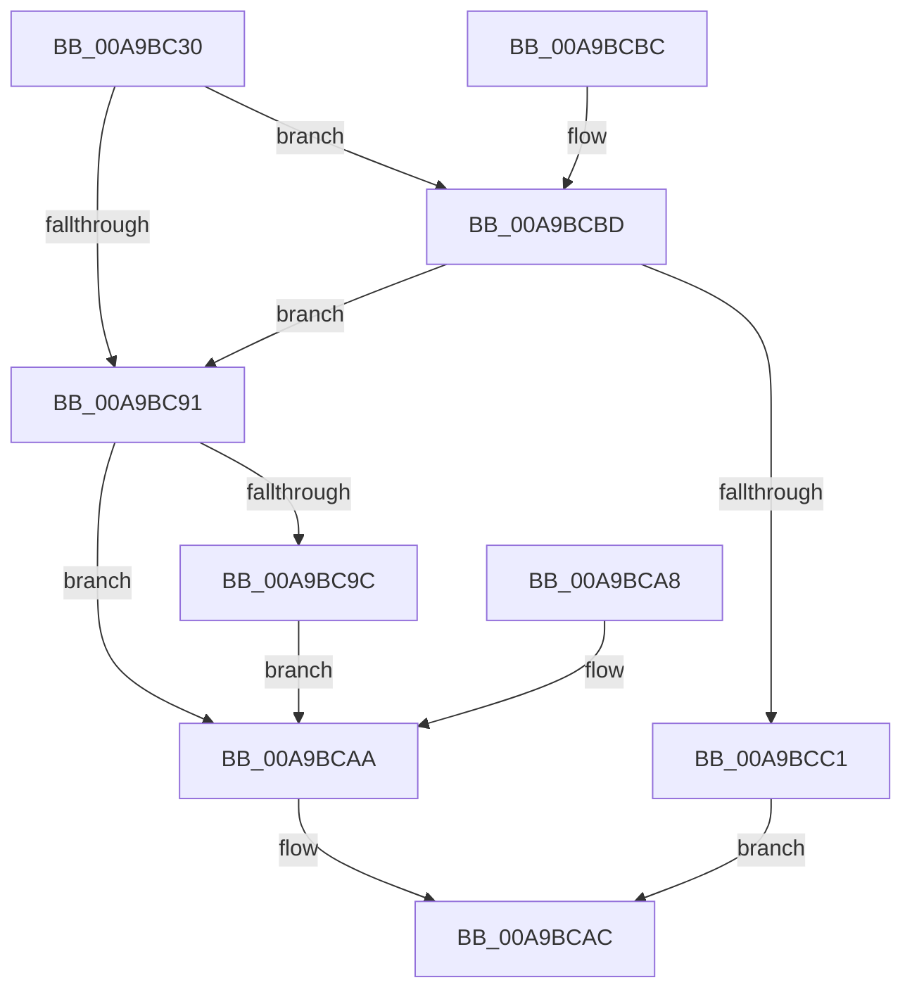

# ExpQueryModuleInformation

- RVA: `0x00A9BC30`–`0x00A9BCC3` (길이 `147` bytes)
- VA: `0x0000000140A9BC30`
- 실행 섹션: `PAGE`
- PDB 이름 있음: `예`; PDB Function 태그: `아니요`
- unwind 정보 RVA: `0x000BA524`
- 디코드: `44`개 명령, `147/147` bytes 표시
- 미해석 바이트: `0` (있으면 어셈블리에 `.byte`로 보존)

> 이 문서는 커널 이미지의 기계어와 PDB 기호를 분석해 생성했습니다. 4번과 5번은 함수 원형과 자료형을 바이너리 사용 방식에서 추정한 C 해석이며 원본 소스 복구 결과는 아닙니다.

## 1. Dependencies

- 직접 호출 지점: **1**; 고유 호출 대상: **1**
- 직접 호출자로 확인된 함수: **1**
- RIP 상대 이미지 참조: **1**

### Outgoing calls
- `0x00A9BC7B` → [MmEnumerateSystemImagesShared](../../text/4B/MmEnumerateSystemImagesShared_function_004BFFA0.md) (function, `0x004BFFA0`)

### Direct callers
- [ExpQuerySystemInformation](../A5/ExpQuerySystemInformation_function_00A57858.md) at `0x00A57F9C`

### Static image references
- `0x00A9BC74` → RVA `0x00A2EB60` (`ExpQueryModuleInformationImage`; read)

## 2. Other-region calls and transfers

- 다른 실행 섹션으로 향하는 call: **1**
  - `0x00A9BC7B` → [MmEnumerateSystemImagesShared](../../text/4B/MmEnumerateSystemImagesShared_function_004BFFA0.md) (`PAGE` → `.text`)
- 별도 외부 분기/꼬리 이동을 확인하지 못했습니다.

## 3. Assembly (complete function range)

```asm
00A9BC30  4C 8B DC                        mov r11, rsp
00A9BC33  49 89 5B 08                     mov qword ptr [r11 + 8], rbx
00A9BC37  49 89 73 10                     mov qword ptr [r11 + 0x10], rsi
00A9BC3B  57                              push rdi
00A9BC3C  48 83 EC 60                     sub rsp, 0x60
00A9BC40  49 8B F9                        mov rdi, r9
00A9BC43  41 8B F0                        mov esi, r8d
00A9BC46  48 8B DA                        mov rbx, rdx
00A9BC49  33 C0                           xor eax, eax
00A9BC4B  49 89 43 C8                     mov qword ptr [r11 - 0x38], rax
00A9BC4F  89 4C 24 50                     mov dword ptr [rsp + 0x50], ecx
00A9BC53  89 44 24 54                     mov dword ptr [rsp + 0x54], eax
00A9BC57  4D 89 4B E0                     mov qword ptr [r11 - 0x20], r9
00A9BC5B  C7 44 24 44 08 00 00 00         mov dword ptr [rsp + 0x44], 8
00A9BC63  48 8D 42 08                     lea rax, [rdx + 8]
00A9BC67  49 89 43 D0                     mov qword ptr [r11 - 0x30], rax
00A9BC6B  44 89 44 24 40                  mov dword ptr [rsp + 0x40], r8d
00A9BC70  49 8D 53 C8                     lea rdx, [r11 - 0x38]
00A9BC74  48 8D 0D E5 2E F9 FF            lea rcx, [rip - 0x6d11b]
00A9BC7B  E8 20 43 A2 FF                  call 0x1404bffa0
00A9BC80  BA 00 00 00 80                  mov edx, 0x80000000
00A9BC85  8D 0C 10                        lea ecx, [rax + rdx]
00A9BC88  85 CA                           test edx, ecx
00A9BC8A  B9 04 00 00 C0                  mov ecx, 0xc0000004
00A9BC8F  74 2C                           je 0x140a9bcbd
00A9BC91  8B 44 24 44                     mov eax, dword ptr [rsp + 0x44]
00A9BC95  89 07                           mov dword ptr [rdi], eax
00A9BC97  83 FE 08                        cmp esi, 8
00A9BC9A  72 0E                           jb 0x140a9bcaa
00A9BC9C  8B 44 24 54                     mov eax, dword ptr [rsp + 0x54]
00A9BCA0  89 03                           mov dword ptr [rbx], eax
00A9BCA2  8B 4C 24 30                     mov ecx, dword ptr [rsp + 0x30]
00A9BCA6  EB 02                           jmp 0x140a9bcaa
00A9BCA8  8B C8                           mov ecx, eax
00A9BCAA  8B C1                           mov eax, ecx
00A9BCAC  48 8B 5C 24 70                  mov rbx, qword ptr [rsp + 0x70]
00A9BCB1  48 8B 74 24 78                  mov rsi, qword ptr [rsp + 0x78]
00A9BCB6  48 83 C4 60                     add rsp, 0x60
00A9BCBA  5F                              pop rdi
00A9BCBB  C3                              ret
00A9BCBC  CC                              int3
00A9BCBD  3B C1                           cmp eax, ecx
00A9BCBF  74 D0                           je 0x140a9bc91
00A9BCC1  EB E9                           jmp 0x140a9bcac
```

## 4. C-style interpretation (structured pseudocode)

```c
__int64 __fastcall ExpQueryModuleInformation(int a1, __int64 a2, int a3, __int64 a4)
{
    __int64 result;
    __int64 v_rsp;
    unsigned int v_stack_m14;
    unsigned int v_stack_m18;
    unsigned int v_stack_m24;
    unsigned int v_stack_m28;
    unsigned int v_stack_m38;
    unsigned __int64 v_stack_p10;
    unsigned __int64 v_stack_p8;

    *(unsigned __int64 *)(v_rsp + 8) = v_rbx;
    *(unsigned __int64 *)(v_rsp + 16) = v_rsi;
    v_rsp = (v_rsp) - (96);
    result = 0;
    *(unsigned __int64 *)(v_rsp - 56) = 0;
    v_stack_m18 = a1;
    v_stack_m14 = 0;
    *(unsigned __int64 *)(v_rsp - 32) = a4;
    v_stack_m24 = 8;
    *(unsigned __int64 *)(v_rsp - 48) = a2 + 8;
    v_stack_m28 = a3;
    result = MmEnumerateSystemImagesShared(v_rip - 446747, v_rsp - 56, a3, a4);
    if ((((unsigned int)((unsigned int)(0x80000000ULL))) & ((unsigned int)(result + (unsigned int)(0x80000000ULL) * 1))) == 0) goto loc_00A9BCBD;
loc_00A9BC91:
    *(unsigned int *)(a4) = (unsigned int)((unsigned int)(v_stack_m24));
    if (((unsigned int)((unsigned int)(a3))) < 8) goto loc_00A9BCAA;
    *(unsigned int *)(a2) = (unsigned int)((unsigned int)(v_stack_m14));
    goto loc_00A9BCAA;
loc_00A9BCAA:
loc_00A9BCAC:
    v_rsp = (v_rsp) + (96);
    return (unsigned int)((unsigned int)((unsigned int)(v_stack_m38)));
loc_00A9BCBD:
    if (((unsigned int)((unsigned int)((unsigned int)((unsigned int)(v_stack_m38))))) == ((unsigned int)((unsigned int)(v_stack_m38)))) goto loc_00A9BC91;
    goto loc_00A9BCAC;
}
```

## 5. (Beta) C Style

```c
int64_t ExpQueryModuleInformation(int32_t Arg1, void *Arg2, int32_t Arg3, void *Arg4)
{
    uint8_t *arg2 = (uint8_t *)Arg2;
    uint8_t *arg4 = (uint8_t *)Arg4;

    int64_t result;
    int64_t local_rsp;
    uint32_t v_stack_m14;
    uint32_t v_stack_m18;
    uint32_t v_stack_m24;
    uint32_t v_stack_m28;
    uint32_t v_stack_m38;
    uint64_t v_stack_p10;
    uint64_t v_stack_p8;

    *(uint64_t *)(local_rsp + 0x8) = local_rbx;
    *(uint64_t *)(local_rsp + 0x10) = local_rsi;
    local_rsp = (local_rsp) - (96);
    result = 0;
    *(uint64_t *)(local_rsp - 0x38) = 0;
    v_stack_m18 = Arg1;
    v_stack_m14 = 0;
    *(void **)(local_rsp - 0x20) = Arg4;
    v_stack_m24 = 8;
    *(void **)(local_rsp - 0x30) = Arg2 + 8;
    v_stack_m28 = Arg3;
    result = MmEnumerateSystemImagesShared(v_rip - 446747, local_rsp - 56, Arg3, Arg4);
    if ((((uint32_t)((uint32_t)(0x80000000ULL))) & ((uint32_t)(result + (uint32_t)(0x80000000ULL) * 1))) == 0) goto loc_00A9BCBD;
loc_00A9BC91:
    *(uint32_t *)(arg4) = (uint32_t)((uint32_t)(v_stack_m24));
    if (((uint32_t)((uint32_t)(Arg3))) < 8) goto loc_00A9BCAA;
    *(uint32_t *)(arg2) = (uint32_t)((uint32_t)(v_stack_m14));
    goto loc_00A9BCAA;
loc_00A9BCAA:
loc_00A9BCAC:
    local_rsp = (local_rsp) + (96);
    return (uint32_t)((uint32_t)((uint32_t)(v_stack_m38)));
loc_00A9BCBD:
    if (((uint32_t)((uint32_t)((uint32_t)((uint32_t)(v_stack_m38))))) == ((uint32_t)((uint32_t)(v_stack_m38)))) goto loc_00A9BC91;
    goto loc_00A9BCAC;
}
```

### 관측된 메모리 오프셋

구조체 형식이 확인되지 않은 접근은 인자 기준의 오프셋으로만 기록했습니다.

| 기준 인자 | 오프셋 표현 | 폭 (bit) | 접근 |
|---|---:|---:|---|
| `Arg2` | `+ 0x0` | `32` | `W` |
| `Arg2` | `+ 0x8` | `64` | `R` |
| `Arg4` | `+ 0x0` | `32` | `W` |

## 6. Execution-region graph

[열기: 2D/3D 그래프와 함수 탐색 컨트롤 패널](../../../control-panel.html?section=page&rva=0x00A9BC30&view=graph)

- 2D 그래프는 위에서 아래로 흐르고, 3D 그래프는 빈 공간을 드래그해 회전합니다. Shift+드래그는 이동, 휠은 확대·축소, 함수 노드 선택은 대상 보고서 이동입니다.

### Static fallback


