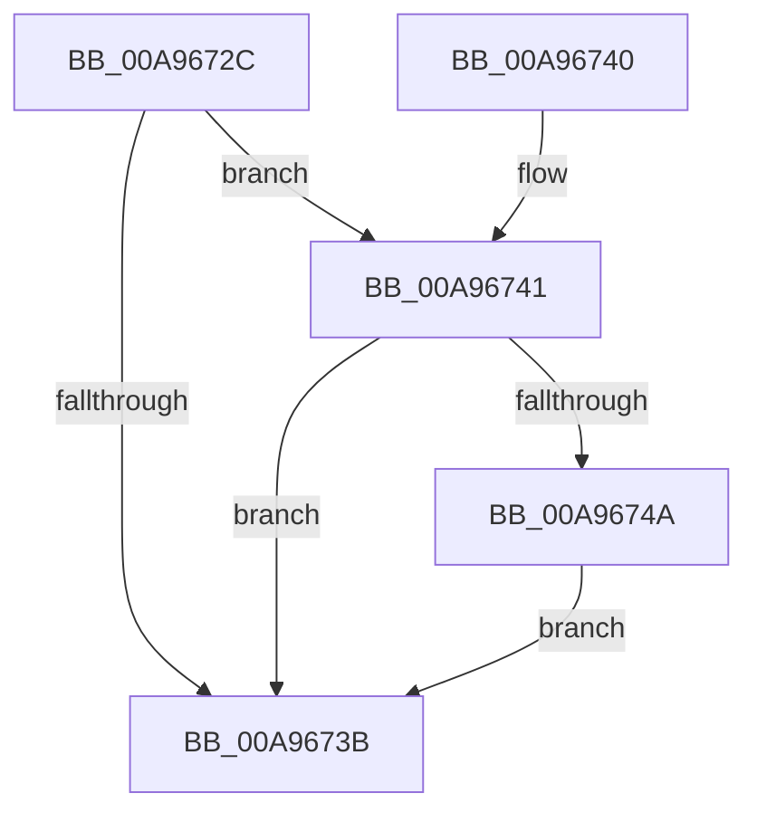

# ExpUuidSaveSequenceNumberIf

- RVA: `0x00A9672C`–`0x00A96753` (길이 `39` bytes)
- VA: `0x0000000140A9672C`
- 실행 섹션: `PAGE`
- PDB 이름 있음: `예`; PDB Function 태그: `아니요`
- unwind 정보 RVA: `0x0007A1AC`
- 디코드: `12`개 명령, `39/39` bytes 표시
- 미해석 바이트: `0` (있으면 어셈블리에 `.byte`로 보존)

> 이 문서는 커널 이미지의 기계어와 PDB 기호를 분석해 생성했습니다. 4번과 5번은 함수 원형과 자료형을 바이너리 사용 방식에서 추정한 C 해석이며 원본 소스 복구 결과는 아닙니다.

## 1. Dependencies

- 직접 호출 지점: **1**; 고유 호출 대상: **1**
- 직접 호출자로 확인된 함수: **2**
- RIP 상대 이미지 참조: **2**

### Outgoing calls
- `0x00A96741` → [ExpUuidSaveSequenceNumber](../7D/ExpUuidSaveSequenceNumber_function_007D0C84.md) (function, `0x007D0C84`)

### Direct callers
- [ExUuidCreate](../91/ExUuidCreate_function_00917500.md) at `0x00917678`
- [NtAllocateUuids](NtAllocateUuids_function_00A963E0.md) at `0x00A96554`

### Static image references
- `0x00A96732` → RVA `0x00FD8014` (`PAGEDATA`; read)
- `0x00A9674A` → RVA `0x00FD8014` (`PAGEDATA`; write)

## 2. Other-region calls and transfers

- 다른 실행 섹션으로 향하는 call: **0**
- 별도 외부 분기/꼬리 이동을 확인하지 못했습니다.

## 3. Assembly (complete function range)

```asm
00A9672C  48 83 EC 28                     sub rsp, 0x28
00A96730  33 C0                           xor eax, eax
00A96732  80 3D DB 18 54 00 01            cmp byte ptr [rip + 0x5418db], 1
00A96739  74 06                           je 0x140a96741
00A9673B  48 83 C4 28                     add rsp, 0x28
00A9673F  C3                              ret
00A96740  CC                              int3
00A96741  E8 3E A5 D3 FF                  call 0x1407d0c84
00A96746  85 C0                           test eax, eax
00A96748  78 F1                           js 0x140a9673b
00A9674A  C6 05 C3 18 54 00 00            mov byte ptr [rip + 0x5418c3], 0
00A96751  EB E8                           jmp 0x140a9673b
```

## 4. C-style interpretation (structured pseudocode)

```c
__int64 __fastcall ExpUuidSaveSequenceNumberIf(void)
{
    __int64 result;
    __int64 v_rsp;

    v_rsp = (v_rsp) - (40);
    result = 0;
    if ((*(unsigned __int8 *)(v_rip + 5511387)) == 1) goto loc_00A96741;
loc_00A9673B:
    v_rsp = (v_rsp) + (40);
    return result;
loc_00A96741:
    result = ExpUuidSaveSequenceNumber(a1, a2, a3, a4);
    if (sign_flag) goto loc_00A9673B;
    *(unsigned __int8 *)(v_rip + 5511363) = 0;
    goto loc_00A9673B;
}
```

## 5. (Beta) C Style

```c
void ExpUuidSaveSequenceNumberIf(void)
{
    int64_t result;
    int64_t local_rsp;

    local_rsp = (local_rsp) - (40);
    result = 0;
    if ((*(uint8_t *)(v_rip + 0x5418DB)) == 1) goto loc_00A96741;
loc_00A9673B:
    local_rsp = (local_rsp) + (40);
    return result;
loc_00A96741:
    result = ExpUuidSaveSequenceNumber(a1, a2, a3, a4);
    if (sign_flag) goto loc_00A9673B;
    *(uint8_t *)(v_rip + 0x5418C3) = 0;
    goto loc_00A9673B;
}
```

## 6. Execution-region graph

[열기: 2D/3D 그래프와 함수 탐색 컨트롤 패널](../../../control-panel.html?section=page&rva=0x00A9672C&view=graph)

- 2D 그래프는 위에서 아래로 흐르고, 3D 그래프는 빈 공간을 드래그해 회전합니다. Shift+드래그는 이동, 휠은 확대·축소, 함수 노드 선택은 대상 보고서 이동입니다.

### Static fallback


