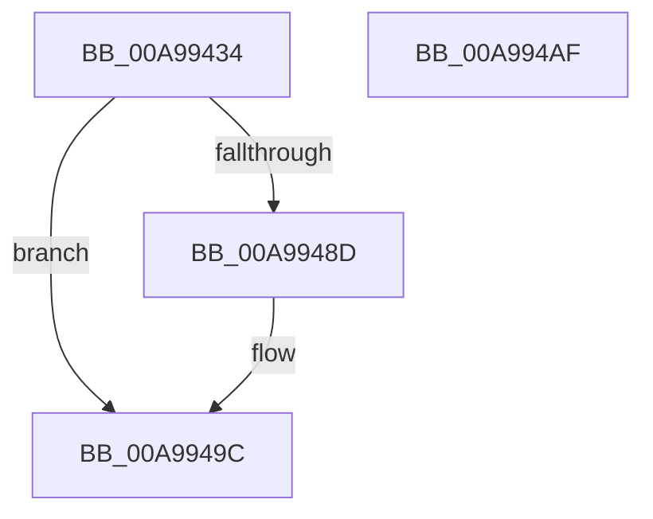

# ExpWnfDeletePermanentName

- RVA: `0x00A99434`–`0x00A994B0` (길이 `124` bytes)
- VA: `0x0000000140A99434`
- 실행 섹션: `PAGE`
- PDB 이름 있음: `예`; PDB Function 태그: `아니요`
- unwind 정보 RVA: `0x000BA18C`
- 디코드: `33`개 명령, `124/124` bytes 표시
- 미해석 바이트: `0` (있으면 어셈블리에 `.byte`로 보존)

> 이 문서는 커널 이미지의 기계어와 PDB 기호를 분석해 생성했습니다. 4번과 5번은 함수 원형과 자료형을 바이너리 사용 방식에서 추정한 C 해석이며 원본 소스 복구 결과는 아닙니다.

## 1. Dependencies

- 직접 호출 지점: **4**; 고유 호출 대상: **4**
- 직접 호출자로 확인된 함수: **1**
- RIP 상대 이미지 참조: **1**

### Outgoing calls
- `0x00A99471` → [ExpWnfComposeValueName](../8B/ExpWnfComposeValueName_function_008BDBCC.md) (function, `0x008BDBCC`)
- `0x00A99484` → [ExpWnfGetNameStoreRegistryRoot](../8B/ExpWnfGetNameStoreRegistryRoot_function_008BDB00.md) (function, `0x008BDB00`)
- `0x00A99497` → [ZwDeleteValueKey](../../text/6A/ZwDeleteValueKey_function_006AECB0.md) (function, `0x006AECB0`)
- `0x00A994A4` → [_security_check_cookie](../../text/6A/_security_check_cookie_function_006AC640.md) (function, `0x006AC640`)

### Direct callers
- [NtDeleteWnfStateName](../90/NtDeleteWnfStateName_function_00908E60.md) at `0x00909208`

### Static image references
- `0x00A9943C` → RVA `0x00E0A740` (`.data`; read)

## 2. Other-region calls and transfers

- 다른 실행 섹션으로 향하는 call: **2**
  - `0x00A99497` → [ZwDeleteValueKey](../../text/6A/ZwDeleteValueKey_function_006AECB0.md) (`PAGE` → `.text`)
  - `0x00A994A4` → [_security_check_cookie](../../text/6A/_security_check_cookie_function_006AC640.md) (`PAGE` → `.text`)
- 별도 외부 분기/꼬리 이동을 확인하지 못했습니다.

## 3. Assembly (complete function range)

```asm
00A99434  4C 8B DC                        mov r11, rsp
00A99437  53                              push rbx
00A99438  48 83 EC 70                     sub rsp, 0x70
00A9943C  48 8B 05 FD 12 37 00            mov rax, qword ptr [rip + 0x3712fd]
00A99443  48 33 C4                        xor rax, rsp
00A99446  48 89 44 24 60                  mov qword ptr [rsp + 0x60], rax
00A9944B  49 83 63 A8 00                  and qword ptr [r11 - 0x58], 0
00A99450  49 8D 53 B0                     lea rdx, [r11 - 0x50]
00A99454  0F 57 C0                        xorps xmm0, xmm0
00A99457  B8 22 00 00 00                  mov eax, 0x22
00A9945C  0F 11 44 24 28                  movups xmmword ptr [rsp + 0x28], xmm0
00A99461  66 89 44 24 2A                  mov word ptr [rsp + 0x2a], ax
00A99466  48 8B D9                        mov rbx, rcx
00A99469  49 8D 43 C0                     lea rax, [r11 - 0x40]
00A9946D  49 89 43 B8                     mov qword ptr [r11 - 0x48], rax
00A99471  E8 56 47 E2 FF                  call 0x1408bdbcc
00A99476  48 C1 EB 04                     shr rbx, 4
00A9947A  48 8D 54 24 20                  lea rdx, [rsp + 0x20]
00A9947F  83 E3 03                        and ebx, 3
00A99482  8B CB                           mov ecx, ebx
00A99484  E8 77 46 E2 FF                  call 0x1408bdb00
00A99489  85 C0                           test eax, eax
00A9948B  78 0F                           js 0x140a9949c
00A9948D  48 8B 4C 24 20                  mov rcx, qword ptr [rsp + 0x20]
00A99492  48 8D 54 24 28                  lea rdx, [rsp + 0x28]
00A99497  E8 14 58 C1 FF                  call 0x1406aecb0
00A9949C  48 8B 4C 24 60                  mov rcx, qword ptr [rsp + 0x60]
00A994A1  48 33 CC                        xor rcx, rsp
00A994A4  E8 97 31 C1 FF                  call 0x1406ac640
00A994A9  48 83 C4 70                     add rsp, 0x70
00A994AD  5B                              pop rbx
00A994AE  C3                              ret
00A994AF  CC                              int3
```

## 4. C-style interpretation (structured pseudocode)

```c
__int64 __fastcall ExpWnfDeletePermanentName(__int64 a1)
{
    __int64 result;
    __int64 v_rbx;
    __int64 v_rsp;
    unsigned __int64 v_stack_m18;
    unsigned __int16 v_stack_m4E;
    unsigned __int64 v_stack_m50;
    unsigned __int64 v_stack_m58;

    v_rsp = (v_rsp) - (112);
    result = (*(unsigned __int64 *)(v_rip + 3609341)) ^ (v_rsp);
    v_stack_m18 = result;
    v_stack_m50 = v_xmm0;
    v_stack_m4E = 34;
    *(unsigned __int64 *)(v_rsp - 72) = v_rsp - 64;
    result = ExpWnfComposeValueName(a1, v_rsp - 80, a3, a4);
    v_rbx = (a1) >> (4);
    v_rbx = (unsigned int)((v_rbx) & (3));
    result = ExpWnfGetNameStoreRegistryRoot((unsigned int)((unsigned int)(v_rbx)), v_stack_m58, a3, a4);
    if (!(sign_flag)) {
        a1 = v_stack_m58;
        a2 = v_stack_m50;
        result = ZwDeleteValueKey(a1, a2, a3, a4);
    }
    a1 = (v_stack_m18) ^ (v_rsp);
    result = _security_check_cookie(a1, a2, a3, a4);
    v_rsp = (v_rsp) + (112);
    return result;
}
```

## 5. (Beta) C Style

```c
int64_t ExpWnfDeletePermanentName(int64_t Arg1)
{
    int64_t result;
    int64_t local_rbx;
    int64_t local_rsp;
    uint64_t v_stack_m18;
    uint16_t v_stack_m4E;
    uint64_t v_stack_m50;
    uint64_t v_stack_m58;

    local_rsp = (local_rsp) - (112);
    result = (*(uint64_t *)(v_rip + 0x3712FD)) ^ (local_rsp);
    v_stack_m18 = result;
    v_stack_m50 = v_xmm0;
    v_stack_m4E = 34;
    *(uint64_t *)(local_rsp - 0x48) = local_rsp - 64;
    result = ExpWnfComposeValueName(Arg1, local_rsp - 80, a3, a4);
    local_rbx = (Arg1) >> (4);
    local_rbx = (uint32_t)((local_rbx) & (3));
    result = ExpWnfGetNameStoreRegistryRoot((uint32_t)((uint32_t)(local_rbx)), v_stack_m58, a3, a4);
    if (!(sign_flag)) {
        Arg1 = v_stack_m58;
        a2 = v_stack_m50;
        result = ZwDeleteValueKey(Arg1, a2, a3, a4);
    }
    Arg1 = (v_stack_m18) ^ (local_rsp);
    result = _security_check_cookie(Arg1, a2, a3, a4);
    local_rsp = (local_rsp) + (112);
    return result;
}
```

## 6. Execution-region graph

[열기: 2D/3D 그래프와 함수 탐색 컨트롤 패널](../../../control-panel.html?section=page&rva=0x00A99434&view=graph)

- 2D 그래프는 위에서 아래로 흐르고, 3D 그래프는 빈 공간을 드래그해 회전합니다. Shift+드래그는 이동, 휠은 확대·축소, 함수 노드 선택은 대상 보고서 이동입니다.

### Static fallback


