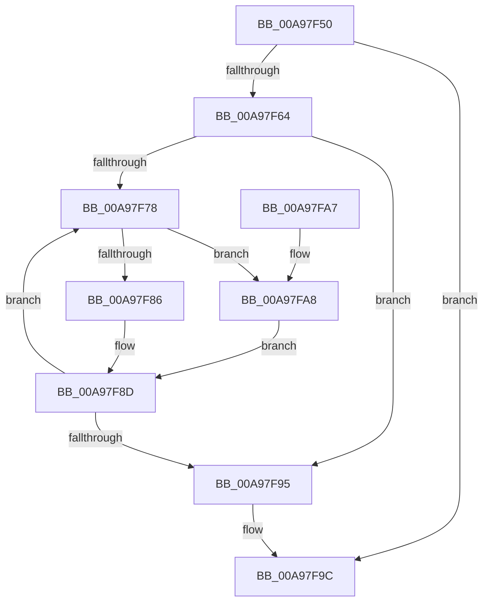

# FsRtlDeleteTunnelCache

- RVA: `0x00A97F50`–`0x00A97FB9` (길이 `105` bytes)
- VA: `0x0000000140A97F50`
- 실행 섹션: `PAGE`
- PDB 이름 있음: `예`; PDB Function 태그: `아니요`
- unwind 정보 RVA: `0x00070544`
- 디코드: `33`개 명령, `105/105` bytes 표시
- 미해석 바이트: `0` (있으면 어셈블리에 `.byte`로 보존)

> 이 문서는 커널 이미지의 기계어와 PDB 기호를 분석해 생성했습니다. 4번과 5번은 함수 원형과 자료형을 바이너리 사용 방식에서 추정한 C 해석이며 원본 소스 복구 결과는 아닙니다.

## 1. Dependencies

- 직접 호출 지점: **2**; 고유 호출 대상: **2**
- 직접 호출자로 확인된 함수: **0**
- RIP 상대 이미지 참조: **2**

### Outgoing calls
- `0x00A97F88` → [ExFreePoolWithTag](../../poolcode/B8/ExFreePoolWithTag_function_00B82870.md) (function, `0x00B82870`)
- `0x00A97FB2` → [ExFreeToPagedLookasideList](../../text/38/ExFreeToPagedLookasideList_function_00387D30.md) (function, `0x00387D30`)

### Direct callers
- 이 함수 시작 RVA로 연결되는 직접 call은 확인되지 않았습니다. 간접 호출은 완전히 역산할 수 없습니다.

### Static image references
- `0x00A97F5C` → RVA `0x00FD8034` (`PAGEDATA`; read)
- `0x00A97FAB` → RVA `0x00E11F00` (`.data`; read)

## 2. Other-region calls and transfers

- 다른 실행 섹션으로 향하는 call: **2**
  - `0x00A97F88` → [ExFreePoolWithTag](../../poolcode/B8/ExFreePoolWithTag_function_00B82870.md) (`PAGE` → `POOLCODE`)
  - `0x00A97FB2` → [ExFreeToPagedLookasideList](../../text/38/ExFreeToPagedLookasideList_function_00387D30.md) (`PAGE` → `.text`)
- 별도 외부 분기/꼬리 이동을 확인하지 못했습니다.

## 3. Assembly (complete function range)

```asm
00A97F50  48 89 5C 24 08                  mov qword ptr [rsp + 8], rbx
00A97F55  57                              push rdi
00A97F56  48 83 EC 20                     sub rsp, 0x20
00A97F5A  33 C0                           xor eax, eax
00A97F5C  39 05 D2 00 54 00               cmp dword ptr [rip + 0x5400d2], eax
00A97F62  74 38                           je 0x140a97f9c
00A97F64  48 8D 59 40                     lea rbx, [rcx + 0x40]
00A97F68  48 89 41 38                     mov qword ptr [rcx + 0x38], rax
00A97F6C  66 89 41 50                     mov word ptr [rcx + 0x50], ax
00A97F70  48 8B 03                        mov rax, qword ptr [rbx]
00A97F73  48 3B C3                        cmp rax, rbx
00A97F76  74 1D                           je 0x140a97f95
00A97F78  48 8B 38                        mov rdi, qword ptr [rax]
00A97F7B  48 8D 48 E8                     lea rcx, [rax - 0x18]
00A97F7F  8B 41 38                        mov eax, dword ptr [rcx + 0x38]
00A97F82  A8 01                           test al, 1
00A97F84  74 22                           je 0x140a97fa8
00A97F86  33 D2                           xor edx, edx
00A97F88  E8 E3 A8 0E 00                  call 0x140b82870
00A97F8D  48 8B C7                        mov rax, rdi
00A97F90  48 3B FB                        cmp rdi, rbx
00A97F93  75 E3                           jne 0x140a97f78
00A97F95  48 89 5B 08                     mov qword ptr [rbx + 8], rbx
00A97F99  48 89 1B                        mov qword ptr [rbx], rbx
00A97F9C  48 8B 5C 24 30                  mov rbx, qword ptr [rsp + 0x30]
00A97FA1  48 83 C4 20                     add rsp, 0x20
00A97FA5  5F                              pop rdi
00A97FA6  C3                              ret
00A97FA7  CC                              int3
00A97FA8  48 8B D1                        mov rdx, rcx
00A97FAB  48 8D 0D 4E 9F 37 00            lea rcx, [rip + 0x379f4e]
00A97FB2  E8 79 FD 8E FF                  call 0x140387d30
00A97FB7  EB D4                           jmp 0x140a97f8d
```

## 4. C-style interpretation (structured pseudocode)

```c
__int64 __fastcall FsRtlDeleteTunnelCache(__int64 a1, int a2)
{
    __int64 result;
    __int64 v_rsp;
    unsigned __int64 v_stack_p8;

    v_stack_p8 = v_rbx;
    v_rsp = (v_rsp) - (32);
    result = 0;
    if ((*(unsigned int *)(v_rip + 5505234)) == 0) goto loc_00A97F9C;
    *(unsigned __int64 *)(a1 + 56) = 0;
    *(unsigned __int16 *)(a1 + 80) = 0;
    if ((*(unsigned __int64 *)(a1 + 64)) == (a1 + 64)) goto loc_00A97F95;
loc_00A97F78:
    if ((((unsigned __int8)((unsigned int)(*(unsigned int *)(*(unsigned __int64 *)(a1 + 64) - 24 + 56)))) & (1)) == 0) goto loc_00A97FA8;
    a2 = 0;
    result = ExFreePoolWithTag(*(unsigned __int64 *)(a1 + 64) - 24, a2, a3, a4);
loc_00A97F8D:
    if ((*(unsigned __int64 *)(*(unsigned __int64 *)(a1 + 64))) != (a1 + 64)) goto loc_00A97F78;
loc_00A97F95:
    *(unsigned __int64 *)(a1 + 64 + 8) = a1 + 64;
    *(unsigned __int64 *)(a1 + 64) = a1 + 64;
loc_00A97F9C:
    v_rsp = (v_rsp) + (32);
    return *(unsigned __int64 *)(*(unsigned __int64 *)(a1 + 64));
loc_00A97FA8:
    result = ExFreeToPagedLookasideList(v_rip + 3645262, *(unsigned __int64 *)(a1 + 64) - 24, a3, a4);
    goto loc_00A97F8D;
}
```

## 5. (Beta) C Style

```c
int64_t FsRtlDeleteTunnelCache(void *Arg1, int32_t Arg2)
{
    uint8_t *arg1 = (uint8_t *)Arg1;

    int64_t result;
    int64_t local_rsp;
    uint64_t v_stack_p8;

    v_stack_p8 = local_rbx;
    local_rsp = (local_rsp) - (32);
    result = 0;
    if ((*(uint32_t *)(v_rip + 0x5400D2)) == 0) goto loc_00A97F9C;
    *(uint64_t *)(arg1 + 0x38) = 0;
    *(uint16_t *)(arg1 + 0x50) = 0;
    if ((*(uint64_t *)(arg1 + 0x40)) == (Arg1 + 64)) goto loc_00A97F95;
loc_00A97F78:
    if ((((uint8_t)((uint32_t)(*(uint32_t *)(*(uint64_t *)(arg1 + 0x40) - 0x18 + 0x38)))) & (1)) == 0) goto loc_00A97FA8;
    Arg2 = 0;
    result = ExFreePoolWithTag(*(uint64_t *)(arg1 + 0x40) - 24, Arg2, a3, a4);
loc_00A97F8D:
    if ((*(uint64_t *)(*(uint64_t *)(arg1 + 0x40))) != (Arg1 + 64)) goto loc_00A97F78;
loc_00A97F95:
    *(void **)(arg1 + 0x40 + 0x8) = Arg1 + 64;
    *(void **)(arg1 + 0x40) = Arg1 + 64;
loc_00A97F9C:
    local_rsp = (local_rsp) + (32);
    return *(uint64_t *)(*(uint64_t *)(arg1 + 0x40));
loc_00A97FA8:
    result = ExFreeToPagedLookasideList(v_rip + 3645262, *(uint64_t *)(arg1 + 0x40) - 24, a3, a4);
    goto loc_00A97F8D;
}
```

### 관측된 메모리 오프셋

구조체 형식이 확인되지 않은 접근은 인자 기준의 오프셋으로만 기록했습니다.

| 기준 인자 | 오프셋 표현 | 폭 (bit) | 접근 |
|---|---:|---:|---|
| `Arg1` | `+ 0x0` | `64` | `R` |
| `Arg1` | `+ 0x0` | `64` | `W` |
| `Arg1` | `+ 0x8` | `64` | `W` |
| `Arg1` | `+ 0x38` | `64` | `W` |
| `Arg1` | `+ 0x40` | `64` | `R` |
| `Arg1` | `+ 0x50` | `16` | `W` |

## 6. Execution-region graph

[열기: 2D/3D 그래프와 함수 탐색 컨트롤 패널](../../../control-panel.html?section=page&rva=0x00A97F50&view=graph)

- 2D 그래프는 위에서 아래로 흐르고, 3D 그래프는 빈 공간을 드래그해 회전합니다. Shift+드래그는 이동, 휠은 확대·축소, 함수 노드 선택은 대상 보고서 이동입니다.

### Static fallback


