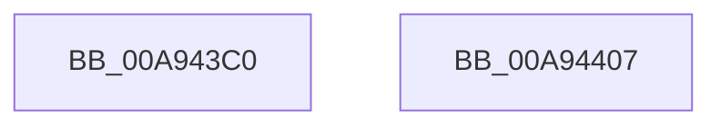

# FsRtlInitializeTunnelCache

- RVA: `0x00A943C0`–`0x00A94408` (길이 `72` bytes)
- VA: `0x0000000140A943C0`
- 실행 섹션: `PAGE`
- PDB 이름 있음: `예`; PDB Function 태그: `아니요`
- unwind 정보 RVA: `0x0005CAAC`
- 디코드: `22`개 명령, `72/72` bytes 표시
- 미해석 바이트: `0` (있으면 어셈블리에 `.byte`로 보존)

> 이 문서는 커널 이미지의 기계어와 PDB 기호를 분석해 생성했습니다. 4번과 5번은 함수 원형과 자료형을 바이너리 사용 방식에서 추정한 C 해석이며 원본 소스 복구 결과는 아닙니다.

## 1. Dependencies

- 직접 호출 지점: **1**; 고유 호출 대상: **1**
- 직접 호출자로 확인된 함수: **0**
- RIP 상대 이미지 참조: **0**

### Outgoing calls
- `0x00A943E4` → [KeInitializeEvent](../../text/40/KeInitializeEvent_function_0040DD10.md) (function, `0x0040DD10`)

### Direct callers
- 이 함수 시작 RVA로 연결되는 직접 call은 확인되지 않았습니다. 간접 호출은 완전히 역산할 수 없습니다.

### Static image references
- 디코드된 RIP-relative 메모리 참조가 없습니다.

## 2. Other-region calls and transfers

- 다른 실행 섹션으로 향하는 call: **1**
  - `0x00A943E4` → [KeInitializeEvent](../../text/40/KeInitializeEvent_function_0040DD10.md) (`PAGE` → `.text`)
- 별도 외부 분기/꼬리 이동을 확인하지 못했습니다.

## 3. Assembly (complete function range)

```asm
00A943C0  48 89 5C 24 08                  mov qword ptr [rsp + 8], rbx
00A943C5  57                              push rdi
00A943C6  48 83 EC 20                     sub rsp, 0x20
00A943CA  33 FF                           xor edi, edi
00A943CC  BA 01 00 00 00                  mov edx, 1
00A943D1  89 11                           mov dword ptr [rcx], edx
00A943D3  48 8B D9                        mov rbx, rcx
00A943D6  48 89 79 08                     mov qword ptr [rcx + 8], rdi
00A943DA  45 33 C0                        xor r8d, r8d
00A943DD  89 79 10                        mov dword ptr [rcx + 0x10], edi
00A943E0  48 83 C1 18                     add rcx, 0x18
00A943E4  E8 27 99 97 FF                  call 0x14040dd10
00A943E9  48 8D 43 40                     lea rax, [rbx + 0x40]
00A943ED  48 89 7B 38                     mov qword ptr [rbx + 0x38], rdi
00A943F1  48 89 40 08                     mov qword ptr [rax + 8], rax
00A943F5  48 89 00                        mov qword ptr [rax], rax
00A943F8  66 89 7B 50                     mov word ptr [rbx + 0x50], di
00A943FC  48 8B 5C 24 30                  mov rbx, qword ptr [rsp + 0x30]
00A94401  48 83 C4 20                     add rsp, 0x20
00A94405  5F                              pop rdi
00A94406  C3                              ret
00A94407  CC                              int3
```

## 4. C-style interpretation (structured pseudocode)

```c
__int64 __fastcall FsRtlInitializeTunnelCache(__int64 a1, __int64 a2, int a3)
{
    __int64 result;
    __int64 v_rdi;
    __int64 v_rsp;
    unsigned __int64 v_stack_p8;

    v_stack_p8 = v_rbx;
    v_rsp = (v_rsp) - (32);
    v_rdi = 0;
    *(unsigned int *)(a1) = 1;
    *(unsigned __int64 *)(a1 + 8) = 0;
    a3 = 0;
    *(unsigned int *)(a1 + 16) = 0;
    a1 = (a1) + (24);
    result = KeInitializeEvent(a1, 1, a3, a4);
    *(unsigned __int64 *)(a1 + 56) = 0;
    *(unsigned __int64 *)(a1 + 64 + 8) = a1 + 64;
    *(unsigned __int64 *)(a1 + 64) = a1 + 64;
    *(unsigned __int16 *)(a1 + 80) = 0;
    v_rsp = (v_rsp) + (32);
    return a1 + 64;
}
```

## 5. (Beta) C Style

```c
void *FsRtlInitializeTunnelCache(void *Arg1, int64_t Arg2, int32_t Arg3)
{
    uint8_t *arg1 = (uint8_t *)Arg1;

    int64_t result;
    int64_t local_rdi;
    int64_t local_rsp;
    uint64_t v_stack_p8;

    v_stack_p8 = local_rbx;
    local_rsp = (local_rsp) - (32);
    local_rdi = 0;
    *(uint32_t *)(arg1) = 1;
    *(uint64_t *)(arg1 + 0x8) = 0;
    Arg3 = 0;
    *(uint32_t *)(arg1 + 0x10) = 0;
    Arg1 = (Arg1) + (24);
    result = KeInitializeEvent(Arg1, 1, Arg3, a4);
    *(uint64_t *)(arg1 + 0x38) = 0;
    *(void **)(arg1 + 0x40 + 0x8) = Arg1 + 64;
    *(void **)(arg1 + 0x40) = Arg1 + 64;
    *(uint16_t *)(arg1 + 0x50) = 0;
    local_rsp = (local_rsp) + (32);
    return Arg1 + 64;
}
```

### 관측된 메모리 오프셋

구조체 형식이 확인되지 않은 접근은 인자 기준의 오프셋으로만 기록했습니다.

| 기준 인자 | 오프셋 표현 | 폭 (bit) | 접근 |
|---|---:|---:|---|
| `Arg1` | `+ 0x0` | `32` | `W` |
| `Arg1` | `+ 0x0` | `64` | `W` |
| `Arg1` | `+ 0x8` | `64` | `W` |
| `Arg1` | `+ 0x10` | `32` | `W` |
| `Arg1` | `+ 0x38` | `64` | `W` |
| `Arg1` | `+ 0x40` | `64` | `R` |
| `Arg1` | `+ 0x50` | `16` | `W` |

## 6. Execution-region graph

[열기: 2D/3D 그래프와 함수 탐색 컨트롤 패널](../../../control-panel.html?section=page&rva=0x00A943C0&view=graph)

- 2D 그래프는 위에서 아래로 흐르고, 3D 그래프는 빈 공간을 드래그해 회전합니다. Shift+드래그는 이동, 휠은 확대·축소, 함수 노드 선택은 대상 보고서 이동입니다.

### Static fallback


