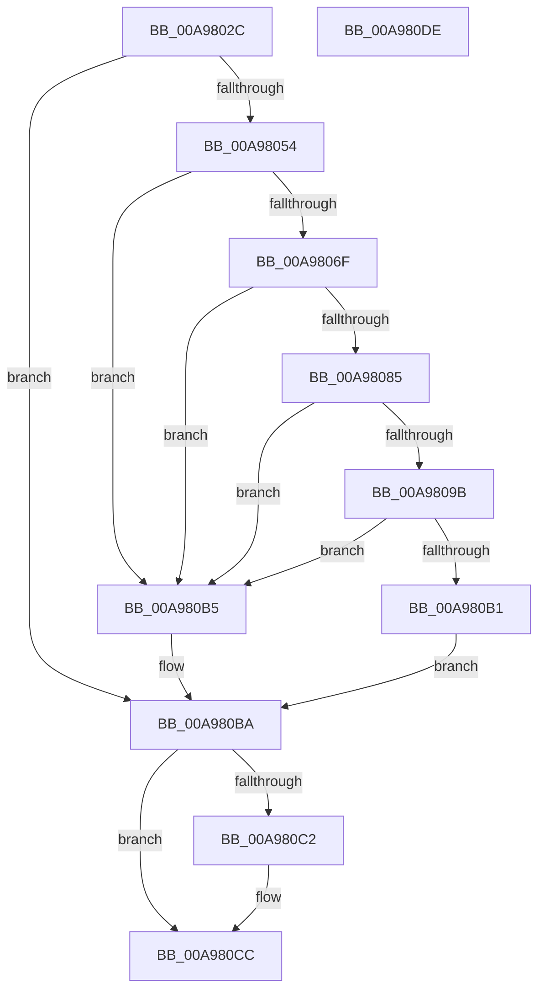

# HalpArmAcpiWakeAlarm

- RVA: `0x00A9802C`–`0x00A980DF` (길이 `179` bytes)
- VA: `0x0000000140A9802C`
- 실행 섹션: `PAGE`
- PDB 이름 있음: `예`; PDB Function 태그: `아니요`
- unwind 정보 RVA: `0x000B9FC4`
- 디코드: `56`개 명령, `179/179` bytes 표시
- 미해석 바이트: `0` (있으면 어셈블리에 `.byte`로 보존)

> 이 문서는 커널 이미지의 기계어와 PDB 기호를 분석해 생성했습니다. 4번과 5번은 함수 원형과 자료형을 바이너리 사용 방식에서 추정한 C 해석이며 원본 소스 복구 결과는 아닙니다.

## 1. Dependencies

- 직접 호출 지점: **6**; 고유 호출 대상: **3**
- 직접 호출자로 확인된 함수: **1**
- RIP 상대 이미지 참조: **0**

### Outgoing calls
- `0x00A98049` → [HalpGetDynamicDevicePointer](HalpGetDynamicDevicePointer_function_00A983AC.md) (function, `0x00A983AC`)
- `0x00A98066` → [HalpCallWakeAlarmDriver](../AA/HalpCallWakeAlarmDriver_function_00AAF5E0.md) (function, `0x00AAF5E0`)
- `0x00A9807C` → [HalpCallWakeAlarmDriver](../AA/HalpCallWakeAlarmDriver_function_00AAF5E0.md) (function, `0x00AAF5E0`)
- `0x00A98092` → [HalpCallWakeAlarmDriver](../AA/HalpCallWakeAlarmDriver_function_00AAF5E0.md) (function, `0x00AAF5E0`)
- `0x00A980A8` → [HalpCallWakeAlarmDriver](../AA/HalpCallWakeAlarmDriver_function_00AAF5E0.md) (function, `0x00AAF5E0`)
- `0x00A980C7` → [ObfDereferenceObject](../../text/2F/ObfDereferenceObject_function_002F9350.md) (function, `0x002F9350`)

### Direct callers
- [HaliSetWakeAlarm](../../pagelk/B7/HaliSetWakeAlarm_function_00B7D300.md) at `0x00B7D367`

### Static image references
- 디코드된 RIP-relative 메모리 참조가 없습니다.

## 2. Other-region calls and transfers

- 다른 실행 섹션으로 향하는 call: **1**
  - `0x00A980C7` → [ObfDereferenceObject](../../text/2F/ObfDereferenceObject_function_002F9350.md) (`PAGE` → `.text`)
- 별도 외부 분기/꼬리 이동을 확인하지 못했습니다.

## 3. Assembly (complete function range)

```asm
00A9802C  48 8B C4                        mov rax, rsp
00A9802F  48 89 58 08                     mov qword ptr [rax + 8], rbx
00A98033  48 89 68 10                     mov qword ptr [rax + 0x10], rbp
00A98037  56                              push rsi
00A98038  48 83 EC 20                     sub rsp, 0x20
00A9803C  48 83 60 18 00                  and qword ptr [rax + 0x18], 0
00A98041  8B EA                           mov ebp, edx
00A98043  48 8D 50 18                     lea rdx, [rax + 0x18]
00A98047  8B F1                           mov esi, ecx
00A98049  E8 5E 03 00 00                  call 0x140a983ac
00A9804E  8B D8                           mov ebx, eax
00A98050  85 C0                           test eax, eax
00A98052  78 66                           js 0x140a980ba
00A98054  48 8B 4C 24 40                  mov rcx, qword ptr [rsp + 0x40]
00A98059  BB 01 00 00 00                  mov ebx, 1
00A9805E  44 8A C3                        mov r8b, bl
00A98061  8A D3                           mov dl, bl
00A98063  44 8B CE                        mov r9d, esi
00A98066  E8 75 75 01 00                  call 0x140aaf5e0
00A9806B  85 C0                           test eax, eax
00A9806D  78 46                           js 0x140a980b5
00A9806F  48 8B 4C 24 40                  mov rcx, qword ptr [rsp + 0x40]
00A98074  44 8B CB                        mov r9d, ebx
00A98077  45 33 C0                        xor r8d, r8d
00A9807A  8A D3                           mov dl, bl
00A9807C  E8 5F 75 01 00                  call 0x140aaf5e0
00A98081  85 C0                           test eax, eax
00A98083  78 30                           js 0x140a980b5
00A98085  48 8B 4C 24 40                  mov rcx, qword ptr [rsp + 0x40]
00A9808A  44 8B CD                        mov r9d, ebp
00A9808D  44 8A C3                        mov r8b, bl
00A98090  33 D2                           xor edx, edx
00A98092  E8 49 75 01 00                  call 0x140aaf5e0
00A98097  85 C0                           test eax, eax
00A98099  78 1A                           js 0x140a980b5
00A9809B  48 8B 4C 24 40                  mov rcx, qword ptr [rsp + 0x40]
00A980A0  44 8B CB                        mov r9d, ebx
00A980A3  45 33 C0                        xor r8d, r8d
00A980A6  33 D2                           xor edx, edx
00A980A8  E8 33 75 01 00                  call 0x140aaf5e0
00A980AD  85 C0                           test eax, eax
00A980AF  78 04                           js 0x140a980b5
00A980B1  33 DB                           xor ebx, ebx
00A980B3  EB 05                           jmp 0x140a980ba
00A980B5  BB 01 00 00 C0                  mov ebx, 0xc0000001
00A980BA  48 83 7C 24 40 00               cmp qword ptr [rsp + 0x40], 0
00A980C0  74 0A                           je 0x140a980cc
00A980C2  48 8B 4C 24 40                  mov rcx, qword ptr [rsp + 0x40]
00A980C7  E8 84 12 86 FF                  call 0x1402f9350
00A980CC  48 8B 6C 24 38                  mov rbp, qword ptr [rsp + 0x38]
00A980D1  8B C3                           mov eax, ebx
00A980D3  48 8B 5C 24 30                  mov rbx, qword ptr [rsp + 0x30]
00A980D8  48 83 C4 20                     add rsp, 0x20
00A980DC  5E                              pop rsi
00A980DD  C3                              ret
00A980DE  CC                              int3
```

## 4. C-style interpretation (structured pseudocode)

```c
__int64 __fastcall HalpArmAcpiWakeAlarm(int a1, int a2)
{
    __int64 result;
    __int64 v_rbx;
    __int64 v_rsp;
    unsigned __int64 v_stack_p10;
    unsigned __int64 v_stack_p18;
    unsigned __int64 v_stack_p8;

    *(unsigned __int64 *)(v_rsp + 8) = v_rbx;
    *(unsigned __int64 *)(v_rsp + 16) = v_rbp;
    v_rsp = (v_rsp) - (32);
    result = HalpGetDynamicDevicePointer(a1, v_rsp + 24, a3, a4);
    if (sign_flag) goto loc_00A980BA;
    result = HalpCallWakeAlarmDriver(v_stack_p18, 1, 1, (unsigned int)((unsigned int)((unsigned int)(a1))));
    if (sign_flag) goto loc_00A980B5;
    a3 = 0;
    result = HalpCallWakeAlarmDriver(v_stack_p18, 1, a3, 1);
    if (sign_flag) goto loc_00A980B5;
    a2 = 0;
    result = HalpCallWakeAlarmDriver(v_stack_p18, a2, 1, (unsigned int)((unsigned int)((unsigned int)(a2))));
    if (sign_flag) goto loc_00A980B5;
    a3 = 0;
    a2 = 0;
    result = HalpCallWakeAlarmDriver(v_stack_p18, a2, a3, 1);
    if (sign_flag) goto loc_00A980B5;
    v_rbx = 0;
    goto loc_00A980BA;
loc_00A980B5:
loc_00A980BA:
    if (v_stack_p18 != 0) {
        a1 = v_stack_p18;
        result = ObfDereferenceObject(a1, a2, a3, 1);
    }
    v_rsp = (v_rsp) + (32);
    return (unsigned int)((unsigned int)((unsigned int)(0xC0000001ULL)));
}
```

## 5. (Beta) C Style

```c
int64_t HalpArmAcpiWakeAlarm(int32_t Arg1, int32_t Arg2)
{
    int64_t result;
    int64_t local_rbx;
    int64_t local_rsp;
    uint64_t v_stack_p10;
    uint64_t v_stack_p18;
    uint64_t v_stack_p8;

    *(uint64_t *)(local_rsp + 0x8) = local_rbx;
    *(uint64_t *)(local_rsp + 0x10) = local_rbp;
    local_rsp = (local_rsp) - (32);
    result = HalpGetDynamicDevicePointer(Arg1, local_rsp + 24, a3, a4);
    if (sign_flag) goto loc_00A980BA;
    result = HalpCallWakeAlarmDriver(v_stack_p18, 1, 1, (uint32_t)((uint32_t)((uint32_t)(Arg1))));
    if (sign_flag) goto loc_00A980B5;
    a3 = 0;
    result = HalpCallWakeAlarmDriver(v_stack_p18, 1, a3, 1);
    if (sign_flag) goto loc_00A980B5;
    Arg2 = 0;
    result = HalpCallWakeAlarmDriver(v_stack_p18, Arg2, 1, (uint32_t)((uint32_t)((uint32_t)(Arg2))));
    if (sign_flag) goto loc_00A980B5;
    a3 = 0;
    Arg2 = 0;
    result = HalpCallWakeAlarmDriver(v_stack_p18, Arg2, a3, 1);
    if (sign_flag) goto loc_00A980B5;
    local_rbx = 0;
    goto loc_00A980BA;
loc_00A980B5:
loc_00A980BA:
    if (v_stack_p18 != 0) {
        Arg1 = v_stack_p18;
        result = ObfDereferenceObject(Arg1, Arg2, a3, 1);
    }
    local_rsp = (local_rsp) + (32);
    return (uint32_t)((uint32_t)((uint32_t)(0xC0000001ULL)));
}
```

## 6. Execution-region graph

[열기: 2D/3D 그래프와 함수 탐색 컨트롤 패널](../../../control-panel.html?section=page&rva=0x00A9802C&view=graph)

- 2D 그래프는 위에서 아래로 흐르고, 3D 그래프는 빈 공간을 드래그해 회전합니다. Shift+드래그는 이동, 휠은 확대·축소, 함수 노드 선택은 대상 보고서 이동입니다.

### Static fallback


