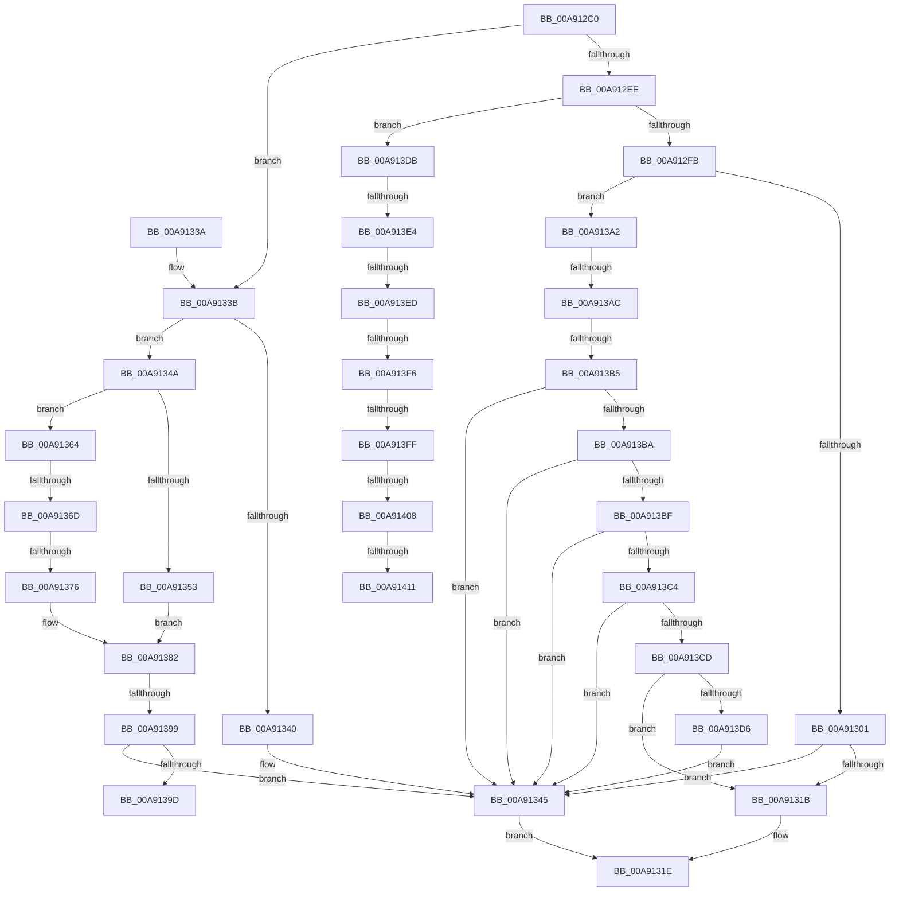

# HalpDispatchPnp

- RVA: `0x00A912C0`–`0x00A91419` (길이 `345` bytes)
- VA: `0x0000000140A912C0`
- 실행 섹션: `PAGE`
- PDB 이름 있음: `예`; PDB Function 태그: `예`
- unwind 정보 RVA: `0x000B90D0`
- 디코드: `94`개 명령, `345/345` bytes 표시
- 미해석 바이트: `0` (있으면 어셈블리에 `.byte`로 보존)

> 이 문서는 커널 이미지의 기계어와 PDB 기호를 분석해 생성했습니다. 4번과 5번은 함수 원형과 자료형을 바이너리 사용 방식에서 추정한 C 해석이며 원본 소스 복구 결과는 아닙니다.

## 1. Dependencies

- 직접 호출 지점: **4**; 고유 호출 대상: **3**
- 직접 호출자로 확인된 함수: **0**
- RIP 상대 이미지 참조: **0**

### Outgoing calls
- `0x00A9130B` → [HalpQueryDeviceRelations](HalpQueryDeviceRelations_function_00A91420.md) (function, `0x00A91420`)
- `0x00A91323` → [IofCompleteRequest](../../text/29/IofCompleteRequest_function_0029B5C0.md) (function, `0x0029B5C0`)
- `0x00A9135D` → [HalpQueryDeviceRelations](HalpQueryDeviceRelations_function_00A91420.md) (function, `0x00A91420`)
- `0x00A9137D` → [HalpQueryIdFdo](../70/HalpQueryIdFdo_function_00708514.md) (function, `0x00708514`)

### Direct callers
- 이 함수 시작 RVA로 연결되는 직접 call은 확인되지 않았습니다. 간접 호출은 완전히 역산할 수 없습니다.

### Static image references
- 디코드된 RIP-relative 메모리 참조가 없습니다.

## 2. Other-region calls and transfers

- 다른 실행 섹션으로 향하는 call: **1**
  - `0x00A91323` → [IofCompleteRequest](../../text/29/IofCompleteRequest_function_0029B5C0.md) (`PAGE` → `.text`)
- call이 아닌 외부 분기/꼬리 이동: **13**
  - `0x00A91367` → [sub_00B46B8A](../B4/Unknown_function_00B46B8A.md) (`tail-transfer`)
  - `0x00A91370` → [sub_00B46B8A + 0x3C](../B4/Unknown_function_00B46B8A.md) (`tail-transfer`)
  - `0x00A91393` → [sub_00B46B8A + 0x35](../B4/Unknown_function_00B46B8A.md) (`tail-transfer`)
  - `0x00A9139D` → [sub_00B46B8A + 0x35](../B4/Unknown_function_00B46B8A.md) (`tail-transfer`)
  - `0x00A913A6` → [sub_00B46B8A + 0x65](../B4/Unknown_function_00B46B8A.md) (`tail-transfer`)
  - `0x00A913AF` → [sub_00B46B8A + 0x4D](../B4/Unknown_function_00B46B8A.md) (`tail-transfer`)
  - `0x00A913DE` → [sub_00B46B8A + 0x12F](../B4/Unknown_function_00B46B8A.md) (`tail-transfer`)
  - `0x00A913E7` → [sub_00B46B8A + 0xEB](../B4/Unknown_function_00B46B8A.md) (`tail-transfer`)
  - `0x00A913F0` → [sub_00B46B8A + 0xD9](../B4/Unknown_function_00B46B8A.md) (`tail-transfer`)
  - `0x00A913F9` → [sub_00B46B8A + 0xB2](../B4/Unknown_function_00B46B8A.md) (`tail-transfer`)
  - `0x00A91402` → [sub_00B46B8A + 0x9D](../B4/Unknown_function_00B46B8A.md) (`tail-transfer`)
  - `0x00A9140B` → [sub_00B46B8A + 0x96](../B4/Unknown_function_00B46B8A.md) (`tail-transfer`)
  - `0x00A91414` → [sub_00B46B8A + 0x90](../B4/Unknown_function_00B46B8A.md) (`tail-transfer`)

## 3. Assembly (complete function range)

```asm
00A912C0  48 89 5C 24 08                  mov qword ptr [rsp + 8], rbx
00A912C5  48 89 74 24 10                  mov qword ptr [rsp + 0x10], rsi
00A912CA  57                              push rdi
00A912CB  48 83 EC 40                     sub rsp, 0x40
00A912CF  4C 8B 41 40                     mov r8, qword ptr [rcx + 0x40]
00A912D3  48 8B F1                        mov rsi, rcx
00A912D6  41 B9 C0 00 00 00               mov r9d, 0xc0
00A912DC  48 8B FA                        mov rdi, rdx
00A912DF  48 8B 92 B8 00 00 00            mov rdx, qword ptr [rdx + 0xb8]
00A912E6  41 8B 08                        mov ecx, dword ptr [r8]
00A912E9  41 2B C9                        sub ecx, r9d
00A912EC  75 4D                           jne 0x140a9133b
00A912EE  0F B6 4A 01                     movzx ecx, byte ptr [rdx + 1]
00A912F2  83 F9 07                        cmp ecx, 7
00A912F5  0F 87 E0 00 00 00               ja 0x140a913db
00A912FB  0F 85 A1 00 00 00               jne 0x140a913a2
00A91301  8B 52 08                        mov edx, dword ptr [rdx + 8]
00A91304  4C 8D 47 38                     lea r8, [rdi + 0x38]
00A91308  48 8B CE                        mov rcx, rsi
00A9130B  E8 10 01 00 00                  call 0x140a91420
00A91310  8B D8                           mov ebx, eax
00A91312  B9 BB 00 00 C0                  mov ecx, 0xc00000bb
00A91317  3B D9                           cmp ebx, ecx
00A91319  75 2A                           jne 0x140a91345
00A9131B  8B 5F 30                        mov ebx, dword ptr [rdi + 0x30]
00A9131E  33 D2                           xor edx, edx
00A91320  48 8B CF                        mov rcx, rdi
00A91323  E8 98 A2 80 FF                  call 0x14029b5c0
00A91328  8B C3                           mov eax, ebx
00A9132A  48 8B 5C 24 50                  mov rbx, qword ptr [rsp + 0x50]
00A9132F  48 8B 74 24 58                  mov rsi, qword ptr [rsp + 0x58]
00A91334  48 83 C4 40                     add rsp, 0x40
00A91338  5F                              pop rdi
00A91339  C3                              ret
00A9133A  CC                              int3
00A9133B  83 F9 01                        cmp ecx, 1
00A9133E  74 0A                           je 0x140a9134a
00A91340  BB 10 00 00 C0                  mov ebx, 0xc0000010
00A91345  89 5F 30                        mov dword ptr [rdi + 0x30], ebx
00A91348  EB D4                           jmp 0x140a9131e
00A9134A  0F B6 4A 01                     movzx ecx, byte ptr [rdx + 1]
00A9134E  83 E9 07                        sub ecx, 7
00A91351  75 11                           jne 0x140a91364
00A91353  8B 52 08                        mov edx, dword ptr [rdx + 8]
00A91356  4C 8D 47 38                     lea r8, [rdi + 0x38]
00A9135A  48 8B CE                        mov rcx, rsi
00A9135D  E8 BE 00 00 00                  call 0x140a91420
00A91362  EB 1E                           jmp 0x140a91382
00A91364  83 E9 01                        sub ecx, 1
00A91367  0F 84 1D 58 0B 00               je 0x140b46b8a
00A9136D  83 F9 0B                        cmp ecx, 0xb
00A91370  0F 85 50 58 0B 00               jne 0x140b46bc6
00A91376  8B 52 08                        mov edx, dword ptr [rdx + 8]
00A91379  4C 8D 47 38                     lea r8, [rdi + 0x38]
00A9137D  E8 92 71 C7 FF                  call 0x140708514
00A91382  BA 00 00 00 80                  mov edx, 0x80000000
00A91387  8B D8                           mov ebx, eax
00A91389  B9 BB 00 00 C0                  mov ecx, 0xc00000bb
00A9138E  8D 04 10                        lea eax, [rax + rdx]
00A91391  85 C2                           test edx, eax
00A91393  0F 85 26 58 0B 00               jne 0x140b46bbf
00A91399  3B D9                           cmp ebx, ecx
00A9139B  75 A8                           jne 0x140a91345
00A9139D  E9 1D 58 0B 00                  jmp 0x140b46bbf
00A913A2  33 DB                           xor ebx, ebx
00A913A4  85 C9                           test ecx, ecx
00A913A6  0F 84 43 58 0B 00               je 0x140b46bef
00A913AC  83 E9 01                        sub ecx, 1
00A913AF  0F 84 22 58 0B 00               je 0x140b46bd7
00A913B5  83 E9 01                        sub ecx, 1
00A913B8  74 8B                           je 0x140a91345
00A913BA  83 E9 01                        sub ecx, 1
00A913BD  74 86                           je 0x140a91345
00A913BF  83 E9 01                        sub ecx, 1
00A913C2  74 81                           je 0x140a91345
00A913C4  83 E9 01                        sub ecx, 1
00A913C7  0F 84 78 FF FF FF               je 0x140a91345
00A913CD  83 F9 01                        cmp ecx, 1
00A913D0  0F 85 45 FF FF FF               jne 0x140a9131b
00A913D6  E9 6A FF FF FF                  jmp 0x140a91345
00A913DB  83 E9 08                        sub ecx, 8
00A913DE  0F 84 D5 58 0B 00               je 0x140b46cb9
00A913E4  83 E9 01                        sub ecx, 1
00A913E7  0F 84 88 58 0B 00               je 0x140b46c75
00A913ED  83 E9 01                        sub ecx, 1
00A913F0  0F 84 6D 58 0B 00               je 0x140b46c63
00A913F6  83 E9 01                        sub ecx, 1
00A913F9  0F 84 3D 58 0B 00               je 0x140b46c3c
00A913FF  83 E9 08                        sub ecx, 8
00A91402  0F 84 1F 58 0B 00               je 0x140b46c27
00A91408  83 E9 01                        sub ecx, 1
00A9140B  0F 84 0F 58 0B 00               je 0x140b46c20
00A91411  83 F9 02                        cmp ecx, 2
00A91414  E9 01 58 0B 00                  jmp 0x140b46c1a
```

## 4. C-style interpretation (structured pseudocode)

```c
__int64 __fastcall HalpDispatchPnp(__int64 a1, __int64 a2)
{
    __int64 result;
    __int64 v_rbx;
    __int64 v_rsp;
    unsigned __int64 v_stack_p10;
    unsigned __int64 v_stack_p8;

    v_stack_p8 = v_rbx;
    v_stack_p10 = v_rsi;
    v_rsp = (v_rsp) - (64);
    a1 = (unsigned int)(((unsigned int)(*(unsigned int *)(*(unsigned __int64 *)(a1 + 64)))) - (192));
    if (condition_is_not_equal) goto loc_00A9133B;
    if (((unsigned int)(*(unsigned __int8 *)(*(unsigned __int64 *)(a2 + 184) + 1))) > 7) goto loc_00A913DB;
    if (((unsigned int)(*(unsigned __int8 *)(*(unsigned __int64 *)(a2 + 184) + 1))) != 7) goto loc_00A913A2;
    result = HalpQueryDeviceRelations(a1, (unsigned int)(*(unsigned int *)(*(unsigned __int64 *)(a2 + 184) + 8)), a2 + 56, 192);
    if (((unsigned int)((unsigned int)((unsigned int)(result)))) != ((unsigned int)((unsigned int)(0xC00000BBULL)))) goto loc_00A91345;
loc_00A9131B:
loc_00A9131E:
    a2 = 0;
    result = IofCompleteRequest(0, a2, a2 + 56, 192);
    v_rsp = (v_rsp) + (64);
    return (unsigned int)((unsigned int)((unsigned int)(*(unsigned int *)(a2 + 48))));
loc_00A9133B:
    if (0 == 1) goto loc_00A9134A;
loc_00A91345:
    *(unsigned int *)(a2 + 48) = (unsigned int)((unsigned int)(0xC0000010ULL));
    goto loc_00A9131E;
loc_00A9134A:
    a1 = (unsigned int)((*(unsigned __int8 *)(a2 + 1)) - (7));
    if (condition_is_not_equal) goto loc_00A91364;
    result = HalpQueryDeviceRelations(v_stack_p10, (unsigned int)(*(unsigned int *)(a2 + 8)), a2 + 56, 192);
    goto loc_00A91382;
loc_00A91364:
    a1 = (unsigned int)((v_stack_p10) - (1));
    result = HalpQueryIdFdo(a1, (unsigned int)(*(unsigned int *)((unsigned int)(*(unsigned int *)(a2 + 8)) + 8)), a2 + 56, 192);
loc_00A91382:
    if (((unsigned int)((unsigned int)((unsigned int)(result)))) != ((unsigned int)((unsigned int)(0xC00000BBULL)))) goto loc_00A91345;
loc_00A913A2:
    v_rbx = 0;
    a1 = (unsigned int)(((unsigned int)(0xC00000BBULL)) - (1));
    a1 = (unsigned int)((a1) - (1));
    if (condition_is_equal) goto loc_00A91345;
    a1 = (unsigned int)((a1) - (1));
    if (condition_is_equal) goto loc_00A91345;
    a1 = (unsigned int)((a1) - (1));
    if (condition_is_equal) goto loc_00A91345;
    a1 = (unsigned int)((a1) - (1));
    if (condition_is_equal) goto loc_00A91345;
    if (((unsigned int)(a1)) != 1) goto loc_00A9131B;
    goto loc_00A91345;
loc_00A913DB:
    a1 = (unsigned int)((a1) - (8));
    a1 = (unsigned int)((a1) - (1));
    a1 = (unsigned int)((a1) - (1));
    a1 = (unsigned int)((a1) - (1));
    a1 = (unsigned int)((a1) - (8));
    a1 = (unsigned int)((a1) - (1));
}
```

## 5. (Beta) C Style

```c
int64_t HalpDispatchPnp(void *Arg1, void *Arg2)
{
    uint8_t *arg1 = (uint8_t *)Arg1;
    uint8_t *arg2 = (uint8_t *)Arg2;

    int64_t result;
    int64_t local_rbx;
    int64_t local_rsp;
    uint64_t v_stack_p10;
    uint64_t v_stack_p8;

    v_stack_p8 = local_rbx;
    v_stack_p10 = local_rsi;
    local_rsp = (local_rsp) - (64);
    Arg1 = (uint32_t)(((uint32_t)(*(uint32_t *)(*(uint64_t *)(arg1 + 0x40)))) - (192));
    if (condition_is_not_equal) goto loc_00A9133B;
    if (((uint32_t)(*(uint8_t *)(*(uint64_t *)(arg2 + 0xB8) + 0x1))) > 7) goto loc_00A913DB;
    if (((uint32_t)(*(uint8_t *)(*(uint64_t *)(arg2 + 0xB8) + 0x1))) != 7) goto loc_00A913A2;
    result = HalpQueryDeviceRelations(Arg1, (uint32_t)(*(uint32_t *)(*(uint64_t *)(arg2 + 0xB8) + 0x8)), Arg2 + 56, 192);
    if (((uint32_t)((uint32_t)((uint32_t)(result)))) != ((uint32_t)((uint32_t)(0xC00000BBULL)))) goto loc_00A91345;
loc_00A9131B:
loc_00A9131E:
    Arg2 = 0;
    result = IofCompleteRequest(0, Arg2, Arg2 + 56, 192);
    local_rsp = (local_rsp) + (64);
    return (uint32_t)((uint32_t)((uint32_t)(*(uint32_t *)(arg2 + 0x30))));
loc_00A9133B:
    if (0 == 1) goto loc_00A9134A;
loc_00A91345:
    *(uint32_t *)(arg2 + 0x30) = (uint32_t)((uint32_t)(0xC0000010ULL));
    goto loc_00A9131E;
loc_00A9134A:
    Arg1 = (uint32_t)((*(uint8_t *)(arg2 + 0x1)) - (7));
    if (condition_is_not_equal) goto loc_00A91364;
    result = HalpQueryDeviceRelations(v_stack_p10, (uint32_t)(*(uint32_t *)(arg2 + 0x8)), Arg2 + 56, 192);
    goto loc_00A91382;
loc_00A91364:
    Arg1 = (uint32_t)((v_stack_p10) - (1));
    result = HalpQueryIdFdo(Arg1, (uint32_t)(*(uint32_t *)((uint32_t)(*(uint32_t *)(arg2 + 0x8)) + 0x8)), Arg2 + 56, 192);
loc_00A91382:
    if (((uint32_t)((uint32_t)((uint32_t)(result)))) != ((uint32_t)((uint32_t)(0xC00000BBULL)))) goto loc_00A91345;
loc_00A913A2:
    local_rbx = 0;
    Arg1 = (uint32_t)(((uint32_t)(0xC00000BBULL)) - (1));
    Arg1 = (uint32_t)((Arg1) - (1));
    if (condition_is_equal) goto loc_00A91345;
    Arg1 = (uint32_t)((Arg1) - (1));
    if (condition_is_equal) goto loc_00A91345;
    Arg1 = (uint32_t)((Arg1) - (1));
    if (condition_is_equal) goto loc_00A91345;
    Arg1 = (uint32_t)((Arg1) - (1));
    if (condition_is_equal) goto loc_00A91345;
    if (((uint32_t)(Arg1)) != 1) goto loc_00A9131B;
    goto loc_00A91345;
loc_00A913DB:
    Arg1 = (uint32_t)((Arg1) - (8));
    Arg1 = (uint32_t)((Arg1) - (1));
    Arg1 = (uint32_t)((Arg1) - (1));
    Arg1 = (uint32_t)((Arg1) - (1));
    Arg1 = (uint32_t)((Arg1) - (8));
    Arg1 = (uint32_t)((Arg1) - (1));
}
```

### 관측된 메모리 오프셋

구조체 형식이 확인되지 않은 접근은 인자 기준의 오프셋으로만 기록했습니다.

| 기준 인자 | 오프셋 표현 | 폭 (bit) | 접근 |
|---|---:|---:|---|
| `Arg1` | `+ 0x40` | `64` | `R` |
| `Arg2` | `+ 0x30` | `32` | `R` |
| `Arg2` | `+ 0x30` | `32` | `W` |
| `Arg2` | `+ 0x38` | `64` | `R` |
| `Arg2` | `+ 0xB8` | `64` | `R` |

## 6. Execution-region graph

[열기: 2D/3D 그래프와 함수 탐색 컨트롤 패널](../../../control-panel.html?section=page&rva=0x00A912C0&view=graph)

- 2D 그래프는 위에서 아래로 흐르고, 3D 그래프는 빈 공간을 드래그해 회전합니다. Shift+드래그는 이동, 휠은 확대·축소, 함수 노드 선택은 대상 보고서 이동입니다.

### Static fallback


