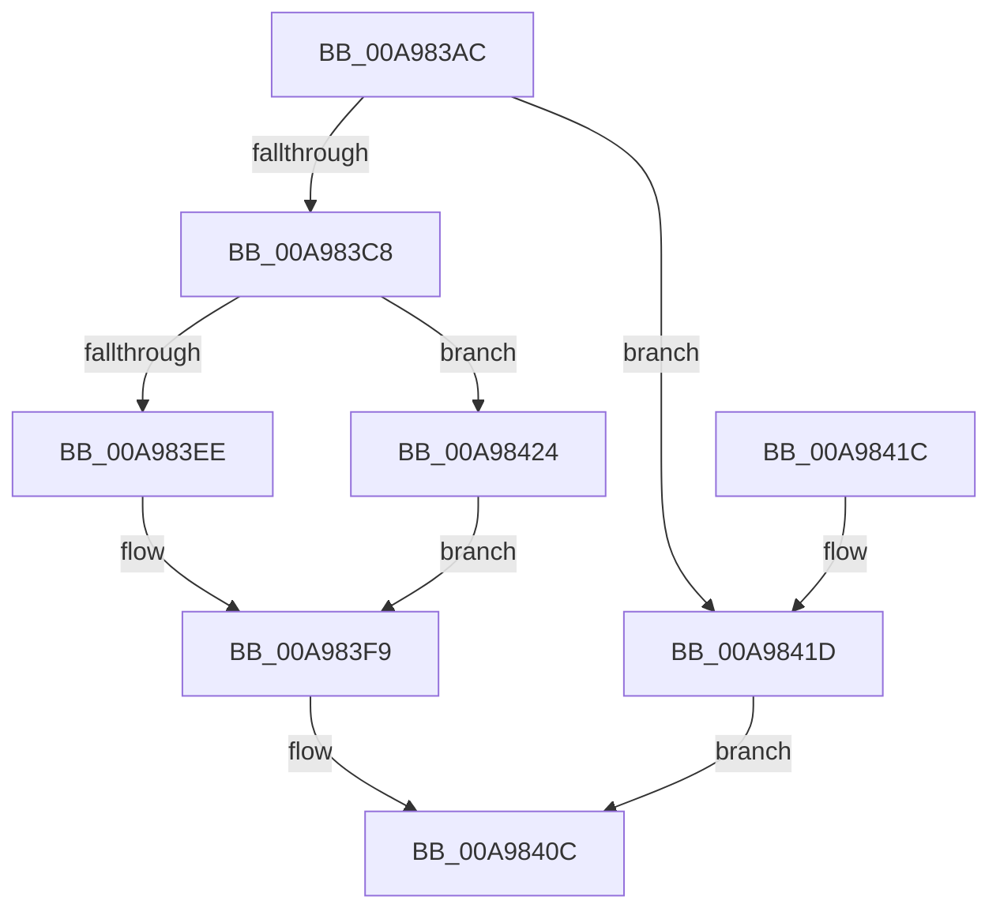

# HalpGetDynamicDevicePointer

- RVA: `0x00A983AC`–`0x00A9842B` (길이 `127` bytes)
- VA: `0x0000000140A983AC`
- 실행 섹션: `PAGE`
- PDB 이름 있음: `예`; PDB Function 태그: `아니요`
- unwind 정보 RVA: `0x000A756C`
- 디코드: `35`개 명령, `127/127` bytes 표시
- 미해석 바이트: `0` (있으면 어셈블리에 `.byte`로 보존)

> 이 문서는 커널 이미지의 기계어와 PDB 기호를 분석해 생성했습니다. 4번과 5번은 함수 원형과 자료형을 바이너리 사용 방식에서 추정한 C 해석이며 원본 소스 복구 결과는 아닙니다.

## 1. Dependencies

- 직접 호출 지점: **3**; 고유 호출 대상: **3**
- 직접 호출자로 확인된 함수: **4**
- RIP 상대 이미지 참조: **3**

### Outgoing calls
- `0x00A983DD` → [KeWaitForSingleObject](../../text/20/KeWaitForSingleObject_function_0020E6B0.md) (function, `0x0020E6B0`)
- `0x00A983F1` → [ObfReferenceObject](../../text/20/ObfReferenceObject_function_0020FA20.md) (function, `0x0020FA20`)
- `0x00A98405` → [KeSetEvent](../../text/33/KeSetEvent_function_0033F310.md) (function, `0x0033F310`)

### Direct callers
- [HalpSetAcpiRealTimeClock](../70/HalpSetAcpiRealTimeClock_function_00705BFC.md) at `0x00705C38`
- [HalpQueryAcpiWakeAlarmSystemPowerState](../70/HalpQueryAcpiWakeAlarmSystemPowerState_function_0070B634.md) at `0x0070B65D`
- [HalpArmAcpiWakeAlarm](HalpArmAcpiWakeAlarm_function_00A9802C.md) at `0x00A98049`
- [HalpQueryAcpiRealTimeClock](HalpQueryAcpiRealTimeClock_function_00A98230.md) at `0x00A9826C`

### Static image references
- `0x00A983C0` → RVA `0x00E10380` (`.data`; read)
- `0x00A983D6` → RVA `0x00FC1C00` (`.data`; read)
- `0x00A983E2` → RVA `0x00E10378` (`.data`; read)

## 2. Other-region calls and transfers

- 다른 실행 섹션으로 향하는 call: **3**
  - `0x00A983DD` → [KeWaitForSingleObject](../../text/20/KeWaitForSingleObject_function_0020E6B0.md) (`PAGE` → `.text`)
  - `0x00A983F1` → [ObfReferenceObject](../../text/20/ObfReferenceObject_function_0020FA20.md) (`PAGE` → `.text`)
  - `0x00A98405` → [KeSetEvent](../../text/33/KeSetEvent_function_0033F310.md) (`PAGE` → `.text`)
- 별도 외부 분기/꼬리 이동을 확인하지 못했습니다.

## 3. Assembly (complete function range)

```asm
00A983AC  48 89 5C 24 08                  mov qword ptr [rsp + 8], rbx
00A983B1  48 89 74 24 10                  mov qword ptr [rsp + 0x10], rsi
00A983B6  57                              push rdi
00A983B7  48 83 EC 30                     sub rsp, 0x30
00A983BB  33 DB                           xor ebx, ebx
00A983BD  48 8B F2                        mov rsi, rdx
00A983C0  38 1D BA 7F 37 00               cmp byte ptr [rip + 0x377fba], bl
00A983C6  74 55                           je 0x140a9841d
00A983C8  45 33 C9                        xor r9d, r9d
00A983CB  48 89 5C 24 20                  mov qword ptr [rsp + 0x20], rbx
00A983D0  45 33 C0                        xor r8d, r8d
00A983D3  8D 53 07                        lea edx, [rbx + 7]
00A983D6  48 8D 0D 23 98 52 00            lea rcx, [rip + 0x529823]
00A983DD  E8 CE 62 77 FF                  call 0x14020e6b0
00A983E2  48 8B 3D 8F 7F 37 00            mov rdi, qword ptr [rip + 0x377f8f]
00A983E9  48 85 FF                        test rdi, rdi
00A983EC  74 36                           je 0x140a98424
00A983EE  48 8B CF                        mov rcx, rdi
00A983F1  E8 2A 76 77 FF                  call 0x14020fa20
00A983F6  48 89 3E                        mov qword ptr [rsi], rdi
00A983F9  45 33 C0                        xor r8d, r8d
00A983FC  48 8D 0D FD 97 52 00            lea rcx, [rip + 0x5297fd]
00A98403  33 D2                           xor edx, edx
00A98405  E8 06 6F 8A FF                  call 0x14033f310
00A9840A  8B C3                           mov eax, ebx
00A9840C  48 8B 5C 24 40                  mov rbx, qword ptr [rsp + 0x40]
00A98411  48 8B 74 24 48                  mov rsi, qword ptr [rsp + 0x48]
00A98416  48 83 C4 30                     add rsp, 0x30
00A9841A  5F                              pop rdi
00A9841B  C3                              ret
00A9841C  CC                              int3
00A9841D  B8 95 04 00 C0                  mov eax, 0xc0000495
00A98422  EB E8                           jmp 0x140a9840c
00A98424  BB 25 02 00 C0                  mov ebx, 0xc0000225
00A98429  EB CE                           jmp 0x140a983f9
```

## 4. C-style interpretation (structured pseudocode)

```c
__int64 __fastcall HalpGetDynamicDevicePointer(__int64 a1, __int64 a2, int a3, int a4)
{
    __int64 result;
    __int64 v_rbx;
    __int64 v_rsp;
    unsigned __int64 v_stack_m18;
    unsigned __int64 v_stack_p10;
    unsigned __int64 v_stack_p8;

    v_stack_p8 = v_rbx;
    v_stack_p10 = v_rsi;
    v_rsp = (v_rsp) - (48);
    v_rbx = 0;
    if ((*(unsigned __int8 *)(v_rip + 3637178)) == 0) goto loc_00A9841D;
    a4 = 0;
    v_stack_m18 = 0;
    a3 = 0;
    result = KeWaitForSingleObject(v_rip + 5412899, v_rbx + 7, a3, a4);
    if (*(unsigned __int64 *)(v_rip + 3637135) == 0) goto loc_00A98424;
    result = ObfReferenceObject(*(unsigned __int64 *)(v_rip + 3637135), v_rbx + 7, a3, a4);
    *(unsigned __int64 *)(a2) = *(unsigned __int64 *)(v_rip + 3637135);
loc_00A983F9:
    a3 = 0;
    a2 = 0;
    result = KeSetEvent(v_rip + 5412861, a2, a3, a4);
loc_00A9840C:
    v_rsp = (v_rsp) + (48);
    return 0;
loc_00A9841D:
    goto loc_00A9840C;
loc_00A98424:
    goto loc_00A983F9;
}
```

## 5. (Beta) C Style

```c
int64_t HalpGetDynamicDevicePointer(int64_t Arg1, void *Arg2, int32_t Arg3, int32_t Arg4)
{
    uint8_t *arg2 = (uint8_t *)Arg2;

    int64_t result;
    int64_t local_rbx;
    int64_t local_rsp;
    uint64_t v_stack_m18;
    uint64_t v_stack_p10;
    uint64_t v_stack_p8;

    v_stack_p8 = local_rbx;
    v_stack_p10 = local_rsi;
    local_rsp = (local_rsp) - (48);
    local_rbx = 0;
    if ((*(uint8_t *)(v_rip + 0x377FBA)) == 0) goto loc_00A9841D;
    Arg4 = 0;
    v_stack_m18 = 0;
    Arg3 = 0;
    result = KeWaitForSingleObject(v_rip + 5412899, local_rbx + 7, Arg3, Arg4);
    if (*(uint64_t *)(v_rip + 0x377F8F) == 0) goto loc_00A98424;
    result = ObfReferenceObject(*(uint64_t *)(v_rip + 0x377F8F), local_rbx + 7, Arg3, Arg4);
    *(uint64_t *)(arg2) = *(uint64_t *)(v_rip + 0x377F8F);
loc_00A983F9:
    Arg3 = 0;
    Arg2 = 0;
    result = KeSetEvent(v_rip + 5412861, Arg2, Arg3, Arg4);
loc_00A9840C:
    local_rsp = (local_rsp) + (48);
    return 0;
loc_00A9841D:
    goto loc_00A9840C;
loc_00A98424:
    goto loc_00A983F9;
}
```

### 관측된 메모리 오프셋

구조체 형식이 확인되지 않은 접근은 인자 기준의 오프셋으로만 기록했습니다.

| 기준 인자 | 오프셋 표현 | 폭 (bit) | 접근 |
|---|---:|---:|---|
| `Arg2` | `+ 0x0` | `64` | `W` |

## 6. Execution-region graph

[열기: 2D/3D 그래프와 함수 탐색 컨트롤 패널](../../../control-panel.html?section=page&rva=0x00A983AC&view=graph)

- 2D 그래프는 위에서 아래로 흐르고, 3D 그래프는 빈 공간을 드래그해 회전합니다. Shift+드래그는 이동, 휠은 확대·축소, 함수 노드 선택은 대상 보고서 이동입니다.

### Static fallback


