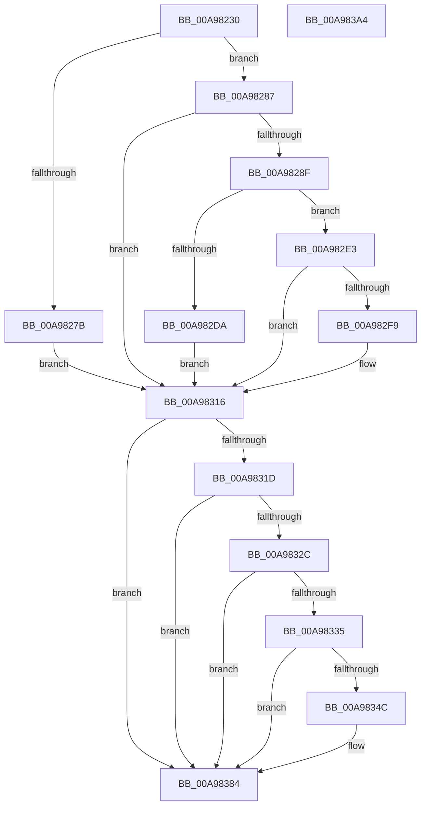

# HalpQueryAcpiRealTimeClock

- RVA: `0x00A98230`–`0x00A983A5` (길이 `373` bytes)
- VA: `0x0000000140A98230`
- 실행 섹션: `PAGE`
- PDB 이름 있음: `예`; PDB Function 태그: `아니요`
- unwind 정보 RVA: `0x000B9FF0`
- 디코드: `90`개 명령, `373/373` bytes 표시
- 미해석 바이트: `0` (있으면 어셈블리에 `.byte`로 보존)

> 이 문서는 커널 이미지의 기계어와 PDB 기호를 분석해 생성했습니다. 4번과 5번은 함수 원형과 자료형을 바이너리 사용 방식에서 추정한 C 해석이며 원본 소스 복구 결과는 아닙니다.

## 1. Dependencies

- 직접 호출 지점: **9**; 고유 호출 대상: **9**
- 직접 호출자로 확인된 함수: **2**
- RIP 상대 이미지 참조: **4**

### Outgoing calls
- `0x00A9826C` → [HalpGetDynamicDevicePointer](HalpGetDynamicDevicePointer_function_00A983AC.md) (function, `0x00A983AC`)
- `0x00A98298` → [KeInitializeEvent](../../text/40/KeInitializeEvent_function_0040DD10.md) (function, `0x0040DD10`)
- `0x00A982D0` → [IoBuildDeviceIoControlRequest](../../text/20/IoBuildDeviceIoControlRequest_function_00204FD0.md) (function, `0x00204FD0`)
- `0x00A982EA` → [IofCallDriver](../../text/29/IofCallDriver_function_0029B4B0.md) (function, `0x0029B4B0`)
- `0x00A9830B` → [KeWaitForSingleObject](../../text/20/KeWaitForSingleObject_function_0020E6B0.md) (function, `0x0020E6B0`)
- `0x00A98321` → [ObfDereferenceObject](../../text/2F/ObfDereferenceObject_function_002F9350.md) (function, `0x002F9350`)
- `0x00A98343` → [EtwEventEnabled](../../text/39/EtwEventEnabled_function_00392450.md) (function, `0x00392450`)
- `0x00A9837F` → [EtwWrite](../../text/41/EtwWrite_function_0041C720.md) (function, `0x0041C720`)
- `0x00A9838E` → [_security_check_cookie](../../text/6A/_security_check_cookie_function_006AC640.md) (function, `0x006AC640`)

### Direct callers
- [HalQueryRealTimeClock](../../text/42/HalQueryRealTimeClock_function_0042D810.md) at `0x0042D949`
- [HalpUtcTimeToAcpiRealTime](HalpUtcTimeToAcpiRealTime_function_00A980E8.md) at `0x00A9811B`

### Static image references
- `0x00A98242` → RVA `0x00E0A740` (`.data`; read)
- `0x00A9832C` → RVA `0x00FC22C0` (`.data`; read)
- `0x00A98335` → RVA `0x00FC22B8` (`.data`; read)
- `0x00A9833C` → RVA `0x00022380` (`.rdata`; read)

## 2. Other-region calls and transfers

- 다른 실행 섹션으로 향하는 call: **8**
  - `0x00A98298` → [KeInitializeEvent](../../text/40/KeInitializeEvent_function_0040DD10.md) (`PAGE` → `.text`)
  - `0x00A982D0` → [IoBuildDeviceIoControlRequest](../../text/20/IoBuildDeviceIoControlRequest_function_00204FD0.md) (`PAGE` → `.text`)
  - `0x00A982EA` → [IofCallDriver](../../text/29/IofCallDriver_function_0029B4B0.md) (`PAGE` → `.text`)
  - `0x00A9830B` → [KeWaitForSingleObject](../../text/20/KeWaitForSingleObject_function_0020E6B0.md) (`PAGE` → `.text`)
  - `0x00A98321` → [ObfDereferenceObject](../../text/2F/ObfDereferenceObject_function_002F9350.md) (`PAGE` → `.text`)
  - `0x00A98343` → [EtwEventEnabled](../../text/39/EtwEventEnabled_function_00392450.md) (`PAGE` → `.text`)
  - `0x00A9837F` → [EtwWrite](../../text/41/EtwWrite_function_0041C720.md) (`PAGE` → `.text`)
  - `0x00A9838E` → [_security_check_cookie](../../text/6A/_security_check_cookie_function_006AC640.md) (`PAGE` → `.text`)
- 별도 외부 분기/꼬리 이동을 확인하지 못했습니다.

## 3. Assembly (complete function range)

```asm
00A98230  48 89 7C 24 10                  mov qword ptr [rsp + 0x10], rdi
00A98235  55                              push rbp
00A98236  48 8D 6C 24 A9                  lea rbp, [rsp - 0x57]
00A9823B  48 81 EC A0 00 00 00            sub rsp, 0xa0
00A98242  48 8B 05 F7 24 37 00            mov rax, qword ptr [rip + 0x3724f7]
00A98249  48 33 C4                        xor rax, rsp
00A9824C  48 89 45 4F                     mov qword ptr [rbp + 0x4f], rax
00A98250  0F 57 C0                        xorps xmm0, xmm0
00A98253  48 8D 55 0F                     lea rdx, [rbp + 0xf]
00A98257  33 C0                           xor eax, eax
00A98259  48 8B F9                        mov rdi, rcx
00A9825C  48 21 45 0F                     and qword ptr [rbp + 0xf], rax
00A98260  0F 11 45 17                     movups xmmword ptr [rbp + 0x17], xmm0
00A98264  48 89 45 27                     mov qword ptr [rbp + 0x27], rax
00A98268  0F 11 45 2F                     movups xmmword ptr [rbp + 0x2f], xmm0
00A9826C  E8 3B 01 00 00                  call 0x140a983ac
00A98271  89 45 07                        mov dword ptr [rbp + 7], eax
00A98274  3D 25 02 00 C0                  cmp eax, 0xc0000225
00A98279  75 0C                           jne 0x140a98287
00A9827B  C7 45 07 02 00 00 C0            mov dword ptr [rbp + 7], 0xc0000002
00A98282  E9 8F 00 00 00                  jmp 0x140a98316
00A98287  85 C0                           test eax, eax
00A98289  0F 88 87 00 00 00               js 0x140a98316
00A9828F  45 33 C0                        xor r8d, r8d
00A98292  48 8D 4D 17                     lea rcx, [rbp + 0x17]
00A98296  33 D2                           xor edx, edx
00A98298  E8 73 5A 97 FF                  call 0x14040dd10
00A9829D  48 8B 55 0F                     mov rdx, qword ptr [rbp + 0xf]
00A982A1  48 8D 45 2F                     lea rax, [rbp + 0x2f]
00A982A5  48 89 44 24 40                  mov qword ptr [rsp + 0x40], rax
00A982AA  45 33 C9                        xor r9d, r9d
00A982AD  48 8D 45 17                     lea rax, [rbp + 0x17]
00A982B1  45 33 C0                        xor r8d, r8d
00A982B4  48 89 44 24 38                  mov qword ptr [rsp + 0x38], rax
00A982B9  B9 10 42 29 00                  mov ecx, 0x294210
00A982BE  C6 44 24 30 00                  mov byte ptr [rsp + 0x30], 0
00A982C3  C7 44 24 28 10 00 00 00         mov dword ptr [rsp + 0x28], 0x10
00A982CB  48 89 7C 24 20                  mov qword ptr [rsp + 0x20], rdi
00A982D0  E8 FB CC 76 FF                  call 0x140204fd0
00A982D5  48 85 C0                        test rax, rax
00A982D8  75 09                           jne 0x140a982e3
00A982DA  C7 45 07 9A 00 00 C0            mov dword ptr [rbp + 7], 0xc000009a
00A982E1  EB 33                           jmp 0x140a98316
00A982E3  48 8B 4D 0F                     mov rcx, qword ptr [rbp + 0xf]
00A982E7  48 8B D0                        mov rdx, rax
00A982EA  E8 C1 31 80 FF                  call 0x14029b4b0
00A982EF  89 45 07                        mov dword ptr [rbp + 7], eax
00A982F2  3D 03 01 00 00                  cmp eax, 0x103
00A982F7  75 1D                           jne 0x140a98316
00A982F9  48 83 64 24 20 00               and qword ptr [rsp + 0x20], 0
00A982FF  48 8D 4D 17                     lea rcx, [rbp + 0x17]
00A98303  45 33 C9                        xor r9d, r9d
00A98306  45 33 C0                        xor r8d, r8d
00A98309  33 D2                           xor edx, edx
00A9830B  E8 A0 63 77 FF                  call 0x14020e6b0
00A98310  8B 45 2F                        mov eax, dword ptr [rbp + 0x2f]
00A98313  89 45 07                        mov dword ptr [rbp + 7], eax
00A98316  48 83 7D 0F 00                  cmp qword ptr [rbp + 0xf], 0
00A9831B  74 67                           je 0x140a98384
00A9831D  48 8B 4D 0F                     mov rcx, qword ptr [rbp + 0xf]
00A98321  E8 2A 10 86 FF                  call 0x1402f9350
00A98326  83 7D 07 00                     cmp dword ptr [rbp + 7], 0
00A9832A  7D 58                           jge 0x140a98384
00A9832C  80 3D 8D 9F 52 00 00            cmp byte ptr [rip + 0x529f8d], 0
00A98333  74 4F                           je 0x140a98384
00A98335  48 8B 0D 7C 9F 52 00            mov rcx, qword ptr [rip + 0x529f7c]
00A9833C  48 8D 15 3D A0 58 FF            lea rdx, [rip - 0xa75fc3]
00A98343  E8 08 A1 8F FF                  call 0x140392450
00A98348  84 C0                           test al, al
00A9834A  74 38                           je 0x140a98384
00A9834C  83 65 4B 00                     and dword ptr [rbp + 0x4b], 0
00A98350  48 8D 45 07                     lea rax, [rbp + 7]
00A98354  48 8B 0D 5D 9F 52 00            mov rcx, qword ptr [rip + 0x529f5d]
00A9835B  48 8D 15 1E A0 58 FF            lea rdx, [rip - 0xa75fe2]
00A98362  48 89 45 3F                     mov qword ptr [rbp + 0x3f], rax
00A98366  41 B9 01 00 00 00               mov r9d, 1
00A9836C  48 8D 45 3F                     lea rax, [rbp + 0x3f]
00A98370  C7 45 47 04 00 00 00            mov dword ptr [rbp + 0x47], 4
00A98377  45 33 C0                        xor r8d, r8d
00A9837A  48 89 44 24 20                  mov qword ptr [rsp + 0x20], rax
00A9837F  E8 9C 43 98 FF                  call 0x14041c720
00A98384  8B 45 07                        mov eax, dword ptr [rbp + 7]
00A98387  48 8B 4D 4F                     mov rcx, qword ptr [rbp + 0x4f]
00A9838B  48 33 CC                        xor rcx, rsp
00A9838E  E8 AD 42 C1 FF                  call 0x1406ac640
00A98393  48 8B BC 24 B8 00 00 00         mov rdi, qword ptr [rsp + 0xb8]
00A9839B  48 81 C4 A0 00 00 00            add rsp, 0xa0
00A983A2  5D                              pop rbp
00A983A3  C3                              ret
00A983A4  CC                              int3
```

## 4. C-style interpretation (structured pseudocode)

```c
__int64 __fastcall HalpQueryAcpiRealTimeClock(__int64 a1, __int64 a2, int a3, int a4)
{
    __int64 result;
    __int64 v_rsp;
    unsigned __int64 v_stack_m10;
    unsigned int v_stack_m14;
    unsigned int v_stack_m18;
    unsigned __int64 v_stack_m20;
    unsigned __int64 v_stack_m30;
    unsigned __int64 v_stack_m38;
    unsigned __int64 v_stack_m48;
    unsigned __int64 v_stack_m50;
    unsigned int v_stack_m58;
    unsigned __int64 v_stack_m5F;
    unsigned __int64 v_stack_m68;
    unsigned __int64 v_stack_m70;
    unsigned __int8 v_stack_m78;
    unsigned int v_stack_m80;
    unsigned __int64 v_stack_m88;
    unsigned __int64 v_stack_p10;

    v_stack_p10 = v_rdi;
    v_rsp = (v_rsp) - (160);
    result = (*(unsigned __int64 *)(v_rip + 3613943)) ^ (v_rsp);
    v_stack_m10 = result;
    result = 0;
    v_stack_m48 = v_xmm0;
    v_stack_m38 = 0;
    v_stack_m30 = v_xmm0;
    result = HalpGetDynamicDevicePointer(a1, v_stack_m50, a3, a4);
    v_stack_m58 = (unsigned int)(result);
    if (((unsigned int)(result)) != 0xC0000225ULL) goto loc_00A98287;
    v_stack_m58 = 0xC0000002ULL;
    goto loc_00A98316;
loc_00A98287:
    if (sign_flag) goto loc_00A98316;
    a3 = 0;
    a2 = 0;
    result = KeInitializeEvent(v_stack_m48, a2, a3, a4);
    v_stack_m68 = v_stack_m30;
    a4 = 0;
    a3 = 0;
    v_stack_m70 = v_stack_m48;
    v_stack_m78 = 0;
    v_stack_m80 = 16;
    v_stack_m88 = a1;
    result = IoBuildDeviceIoControlRequest((unsigned int)(0x294210ULL), v_stack_m50, a3, a4);
    if (result != 0) goto loc_00A982E3;
    v_stack_m58 = 0xC000009AULL;
    goto loc_00A98316;
loc_00A982E3:
    result = IofCallDriver(v_stack_m50, result, a3, a4);
    v_stack_m58 = (unsigned int)(result);
    if (((unsigned int)(result)) == 259) {
        a1 = v_stack_m48;
        a4 = 0;
        a3 = 0;
        a2 = 0;
        result = KeWaitForSingleObject(a1, a2, a3, a4);
        result = v_stack_m30;
        v_stack_m58 = (unsigned int)(result);
    }
    if (v_stack_m50 == 0) goto loc_00A98384;
    result = ObfDereferenceObject(v_stack_m50, a2, a3, a4);
    if (v_stack_m58 >= 0) goto loc_00A98384;
    if ((*(unsigned __int8 *)(v_rip + 5414797)) == 0) goto loc_00A98384;
    result = EtwEventEnabled(*(unsigned __int64 *)(v_rip + 5414780), v_rip - 10969027, a3, a4);
    if ((unsigned __int8)(result) != 0) {
        result = v_stack_m58;
        a1 = *(unsigned __int64 *)(v_rip + 5414749);
        a2 = v_rip - 10969058;
        v_stack_m20 = result;
        a4 = 1;
        result = v_stack_m20;
        v_stack_m18 = 4;
        a3 = 0;
        v_stack_m88 = result;
        result = EtwWrite(a1, a2, a3, a4);
    }
    a1 = (v_stack_m10) ^ (v_rsp);
    result = _security_check_cookie(a1, a2, a3, a4);
    v_rsp = (v_rsp) + (160);
    return result;
}
```

## 5. (Beta) C Style

```c
int64_t HalpQueryAcpiRealTimeClock(int64_t Arg1, int64_t Arg2, int32_t Arg3, int32_t Arg4)
{
    int64_t result;
    int64_t local_rsp;
    uint64_t v_stack_m10;
    uint32_t v_stack_m14;
    uint32_t v_stack_m18;
    uint64_t v_stack_m20;
    uint64_t v_stack_m30;
    uint64_t v_stack_m38;
    uint64_t v_stack_m48;
    uint64_t v_stack_m50;
    uint32_t v_stack_m58;
    uint64_t v_stack_m5F;
    uint64_t v_stack_m68;
    uint64_t v_stack_m70;
    uint8_t v_stack_m78;
    uint32_t v_stack_m80;
    uint64_t v_stack_m88;
    uint64_t v_stack_p10;

    v_stack_p10 = local_rdi;
    local_rsp = (local_rsp) - (160);
    result = (*(uint64_t *)(v_rip + 0x3724F7)) ^ (local_rsp);
    v_stack_m10 = result;
    result = 0;
    v_stack_m48 = v_xmm0;
    v_stack_m38 = 0;
    v_stack_m30 = v_xmm0;
    result = HalpGetDynamicDevicePointer(Arg1, v_stack_m50, Arg3, Arg4);
    v_stack_m58 = (uint32_t)(result);
    if (((uint32_t)(result)) != 0xC0000225ULL) goto loc_00A98287;
    v_stack_m58 = 0xC0000002ULL;
    goto loc_00A98316;
loc_00A98287:
    if (sign_flag) goto loc_00A98316;
    Arg3 = 0;
    Arg2 = 0;
    result = KeInitializeEvent(v_stack_m48, Arg2, Arg3, Arg4);
    v_stack_m68 = v_stack_m30;
    Arg4 = 0;
    Arg3 = 0;
    v_stack_m70 = v_stack_m48;
    v_stack_m78 = 0;
    v_stack_m80 = 16;
    v_stack_m88 = Arg1;
    result = IoBuildDeviceIoControlRequest((uint32_t)(0x294210ULL), v_stack_m50, Arg3, Arg4);
    if (result != 0) goto loc_00A982E3;
    v_stack_m58 = 0xC000009AULL;
    goto loc_00A98316;
loc_00A982E3:
    result = IofCallDriver(v_stack_m50, result, Arg3, Arg4);
    v_stack_m58 = (uint32_t)(result);
    if (((uint32_t)(result)) == 259) {
        Arg1 = v_stack_m48;
        Arg4 = 0;
        Arg3 = 0;
        Arg2 = 0;
        result = KeWaitForSingleObject(Arg1, Arg2, Arg3, Arg4);
        result = v_stack_m30;
        v_stack_m58 = (uint32_t)(result);
    }
    if (v_stack_m50 == 0) goto loc_00A98384;
    result = ObfDereferenceObject(v_stack_m50, Arg2, Arg3, Arg4);
    if (v_stack_m58 >= 0) goto loc_00A98384;
    if ((*(uint8_t *)(v_rip + 0x529F8D)) == 0) goto loc_00A98384;
    result = EtwEventEnabled(*(uint64_t *)(v_rip + 0x529F7C), v_rip - 10969027, Arg3, Arg4);
    if ((uint8_t)(result) != 0) {
        result = v_stack_m58;
        Arg1 = *(uint64_t *)(v_rip + 0x529F5D);
        Arg2 = v_rip - 10969058;
        v_stack_m20 = result;
        Arg4 = 1;
        result = v_stack_m20;
        v_stack_m18 = 4;
        Arg3 = 0;
        v_stack_m88 = result;
        result = EtwWrite(Arg1, Arg2, Arg3, Arg4);
    }
    Arg1 = (v_stack_m10) ^ (local_rsp);
    result = _security_check_cookie(Arg1, Arg2, Arg3, Arg4);
    local_rsp = (local_rsp) + (160);
    return result;
}
```

## 6. Execution-region graph

[열기: 2D/3D 그래프와 함수 탐색 컨트롤 패널](../../../control-panel.html?section=page&rva=0x00A98230&view=graph)

- 2D 그래프는 위에서 아래로 흐르고, 3D 그래프는 빈 공간을 드래그해 회전합니다. Shift+드래그는 이동, 휠은 확대·축소, 함수 노드 선택은 대상 보고서 이동입니다.

### Static fallback


