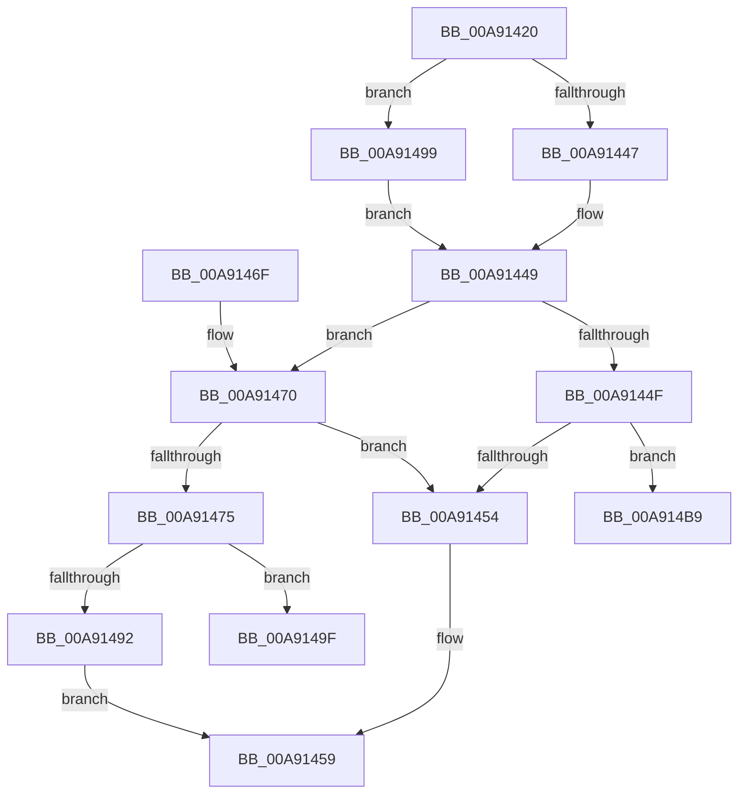

# HalpQueryDeviceRelations

- RVA: `0x00A91420`–`0x00A914C1` (길이 `161` bytes)
- VA: `0x0000000140A91420`
- 실행 섹션: `PAGE`
- PDB 이름 있음: `예`; PDB Function 태그: `예`
- unwind 정보 RVA: `0x000B90F4`
- 디코드: `45`개 명령, `161/161` bytes 표시
- 미해석 바이트: `0` (있으면 어셈블리에 `.byte`로 보존)

> 이 문서는 커널 이미지의 기계어와 PDB 기호를 분석해 생성했습니다. 4번과 5번은 함수 원형과 자료형을 바이너리 사용 방식에서 추정한 C 해석이며 원본 소스 복구 결과는 아닙니다.

## 1. Dependencies

- 직접 호출 지점: **2**; 고유 호출 대상: **2**
- 직접 호출자로 확인된 함수: **1**
- RIP 상대 이미지 참조: **0**

### Outgoing calls
- `0x00A91485` → [ExAllocatePool2](../../poolcode/B8/ExAllocatePool2_function_00B820F0.md) (function, `0x00B820F0`)
- `0x00A914AC` → [ObfReferenceObject](../../text/20/ObfReferenceObject_function_0020FA20.md) (function, `0x0020FA20`)

### Direct callers
- [HalpDispatchPnp](HalpDispatchPnp_function_00A912C0.md) at `0x00A9130B`
- [HalpDispatchPnp](HalpDispatchPnp_function_00A912C0.md) at `0x00A9135D`

### Static image references
- 디코드된 RIP-relative 메모리 참조가 없습니다.

## 2. Other-region calls and transfers

- 다른 실행 섹션으로 향하는 call: **2**
  - `0x00A91485` → [ExAllocatePool2](../../poolcode/B8/ExAllocatePool2_function_00B820F0.md) (`PAGE` → `POOLCODE`)
  - `0x00A914AC` → [ObfReferenceObject](../../text/20/ObfReferenceObject_function_0020FA20.md) (`PAGE` → `.text`)
- call이 아닌 외부 분기/꼬리 이동: **2**
  - `0x00A914B4` → [sub_00B46CEE + 0x4D](../B4/Unknown_function_00B46CEE.md) (`tail-transfer`)
  - `0x00A914BC` → [sub_00B46CEE](../B4/Unknown_function_00B46CEE.md) (`tail-transfer`)

## 3. Assembly (complete function range)

```asm
00A91420  48 89 5C 24 08                  mov qword ptr [rsp + 8], rbx
00A91425  48 89 74 24 10                  mov qword ptr [rsp + 0x10], rsi
00A9142A  48 89 7C 24 18                  mov qword ptr [rsp + 0x18], rdi
00A9142F  41 56                           push r14
00A91431  48 83 EC 20                     sub rsp, 0x20
00A91435  48 8B 59 40                     mov rbx, qword ptr [rcx + 0x40]
00A91439  4D 8B F0                        mov r14, r8
00A9143C  48 8B F1                        mov rsi, rcx
00A9143F  81 3B C1 00 00 00               cmp dword ptr [rbx], 0xc1
00A91445  74 52                           je 0x140a91499
00A91447  33 DB                           xor ebx, ebx
00A91449  33 FF                           xor edi, edi
00A9144B  85 D2                           test edx, edx
00A9144D  75 21                           jne 0x140a91470
00A9144F  48 85 DB                        test rbx, rbx
00A91452  75 65                           jne 0x140a914b9
00A91454  B8 BB 00 00 C0                  mov eax, 0xc00000bb
00A91459  48 8B 5C 24 30                  mov rbx, qword ptr [rsp + 0x30]
00A9145E  48 8B 74 24 38                  mov rsi, qword ptr [rsp + 0x38]
00A91463  48 8B 7C 24 40                  mov rdi, qword ptr [rsp + 0x40]
00A91468  48 83 C4 20                     add rsp, 0x20
00A9146C  41 5E                           pop r14
00A9146E  C3                              ret
00A9146F  CC                              int3
00A91470  83 FA 04                        cmp edx, 4
00A91473  75 DF                           jne 0x140a91454
00A91475  BA 10 00 00 00                  mov edx, 0x10
00A9147A  B9 00 01 00 00                  mov ecx, 0x100
00A9147F  41 B8 48 61 6C 70               mov r8d, 0x706c6148
00A91485  E8 66 0C 0F 00                  call 0x140b820f0
00A9148A  48 8B D8                        mov rbx, rax
00A9148D  48 85 C0                        test rax, rax
00A91490  75 0D                           jne 0x140a9149f
00A91492  B8 9A 00 00 C0                  mov eax, 0xc000009a
00A91497  EB C0                           jmp 0x140a91459
00A91499  48 8B 5B 08                     mov rbx, qword ptr [rbx + 8]
00A9149D  EB AA                           jmp 0x140a91449
00A9149F  48 8B CE                        mov rcx, rsi
00A914A2  C7 00 01 00 00 00               mov dword ptr [rax], 1
00A914A8  48 89 70 08                     mov qword ptr [rax + 8], rsi
00A914AC  E8 6F E5 77 FF                  call 0x14020fa20
00A914B1  49 89 1E                        mov qword ptr [r14], rbx
00A914B4  E9 82 58 0B 00                  jmp 0x140b46d3b
00A914B9  48 8B C3                        mov rax, rbx
00A914BC  E9 2D 58 0B 00                  jmp 0x140b46cee
```

## 4. C-style interpretation (structured pseudocode)

```c
__int64 __fastcall HalpQueryDeviceRelations(__int64 a1, int a2, __int64 a3)
{
    __int64 result;
    __int64 v_rbx;
    __int64 v_rdi;
    __int64 v_rsp;
    unsigned __int64 v_stack_p10;
    unsigned __int64 v_stack_p18;
    unsigned __int64 v_stack_p8;

    v_stack_p8 = v_rbx;
    v_stack_p10 = v_rsi;
    v_stack_p18 = v_rdi;
    v_rsp = (v_rsp) - (32);
    if ((*(unsigned int *)(*(unsigned __int64 *)(a1 + 64))) == 193) goto loc_00A91499;
    v_rbx = 0;
loc_00A91449:
    v_rdi = 0;
    if (a2 != 0) goto loc_00A91470;
    if (0 != 0) goto loc_00A914B9;
loc_00A91454:
loc_00A91459:
    v_rsp = (v_rsp) + (32);
    return (unsigned int)(0xC00000BBULL);
loc_00A91470:
    if (a2 != 4) goto loc_00A91454;
    result = ExAllocatePool2(256, 16, (unsigned int)(0x706C6148ULL), a4);
    if (result != 0) goto loc_00A9149F;
    goto loc_00A91459;
loc_00A91499:
    goto loc_00A91449;
loc_00A9149F:
    *(unsigned int *)((unsigned int)(0xC000009AULL)) = 1;
    *(unsigned __int64 *)((unsigned int)(0xC000009AULL) + 8) = v_stack_p10;
    result = ObfReferenceObject(v_stack_p10, 16, (unsigned int)(0x706C6148ULL), a4);
    *(unsigned __int64 *)(a3) = *(unsigned __int64 *)(result + 8);
loc_00A914B9:
}
```

## 5. (Beta) C Style

```c
int64_t HalpQueryDeviceRelations(void *Arg1, int32_t Arg2, void *Arg3)
{
    uint8_t *arg1 = (uint8_t *)Arg1;
    uint8_t *arg3 = (uint8_t *)Arg3;

    int64_t result;
    int64_t local_rbx;
    int64_t local_rdi;
    int64_t local_rsp;
    uint64_t v_stack_p10;
    uint64_t v_stack_p18;
    uint64_t v_stack_p8;

    v_stack_p8 = local_rbx;
    v_stack_p10 = local_rsi;
    v_stack_p18 = local_rdi;
    local_rsp = (local_rsp) - (32);
    if ((*(uint32_t *)(*(uint64_t *)(arg1 + 0x40))) == 193) goto loc_00A91499;
    local_rbx = 0;
loc_00A91449:
    local_rdi = 0;
    if (Arg2 != 0) goto loc_00A91470;
    if (0 != 0) goto loc_00A914B9;
loc_00A91454:
loc_00A91459:
    local_rsp = (local_rsp) + (32);
    return (uint32_t)(0xC00000BBULL);
loc_00A91470:
    if (Arg2 != 4) goto loc_00A91454;
    result = ExAllocatePool2(256, 16, (uint32_t)(0x706C6148ULL), a4);
    if (result != 0) goto loc_00A9149F;
    goto loc_00A91459;
loc_00A91499:
    goto loc_00A91449;
loc_00A9149F:
    *(uint32_t *)((uint32_t)(0xC000009AULL)) = 1;
    *(uint64_t *)((uint32_t)(0xC000009AULL) + 0x8) = v_stack_p10;
    result = ObfReferenceObject(v_stack_p10, 16, (uint32_t)(0x706C6148ULL), a4);
    *(uint64_t *)(arg3) = *(uint64_t *)(result + 0x8);
loc_00A914B9:
}
```

### 관측된 메모리 오프셋

구조체 형식이 확인되지 않은 접근은 인자 기준의 오프셋으로만 기록했습니다.

| 기준 인자 | 오프셋 표현 | 폭 (bit) | 접근 |
|---|---:|---:|---|
| `Arg1` | `+ 0x40` | `64` | `R` |
| `Arg3` | `+ 0x0` | `64` | `W` |

## 6. Execution-region graph

[열기: 2D/3D 그래프와 함수 탐색 컨트롤 패널](../../../control-panel.html?section=page&rva=0x00A91420&view=graph)

- 2D 그래프는 위에서 아래로 흐르고, 3D 그래프는 빈 공간을 드래그해 회전합니다. Shift+드래그는 이동, 휠은 확대·축소, 함수 노드 선택은 대상 보고서 이동입니다.

### Static fallback


