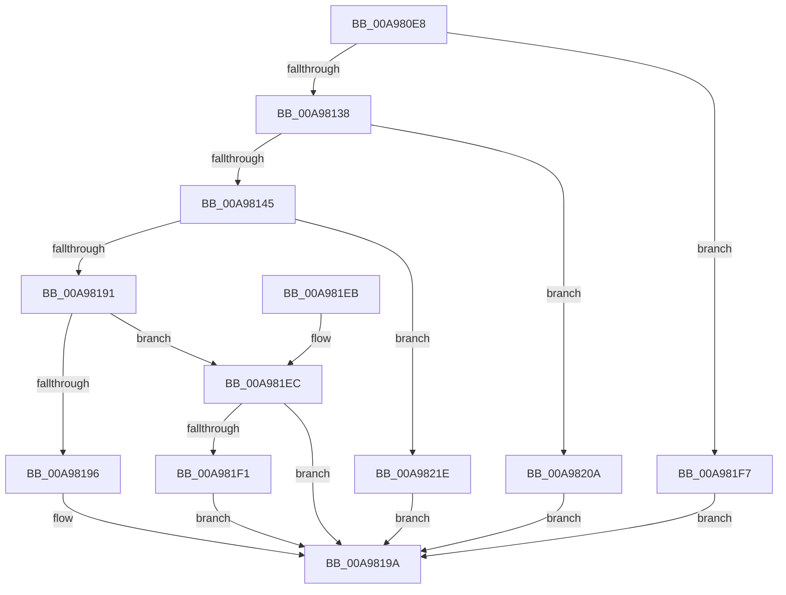

# HalpUtcTimeToAcpiRealTime

- RVA: `0x00A980E8`–`0x00A98227` (길이 `319` bytes)
- VA: `0x0000000140A980E8`
- 실행 섹션: `PAGE`
- PDB 이름 있음: `예`; PDB Function 태그: `아니요`
- unwind 정보 RVA: `0x000B9FD8`
- 디코드: `82`개 명령, `319/319` bytes 표시
- 미해석 바이트: `0` (있으면 어셈블리에 `.byte`로 보존)

> 이 문서는 커널 이미지의 기계어와 PDB 기호를 분석해 생성했습니다. 4번과 5번은 함수 원형과 자료형을 바이너리 사용 방식에서 추정한 C 해석이며 원본 소스 복구 결과는 아닙니다.

## 1. Dependencies

- 직접 호출 지점: **4**; 고유 호출 대상: **4**
- 직접 호출자로 확인된 함수: **1**
- RIP 상대 이미지 참조: **0**

### Outgoing calls
- `0x00A9811B` → [HalpQueryAcpiRealTimeClock](HalpQueryAcpiRealTimeClock_function_00A98230.md) (function, `0x00A98230`)
- `0x00A98138` → [ExRealTimeIsUniversal](../../text/4C/ExRealTimeIsUniversal_function_004C26E0.md) (function, `0x004C26E0`)
- `0x00A98178` → [ExSystemTimeToLocalTime](../../text/2F/ExSystemTimeToLocalTime_function_002FE1C0.md) (function, `0x002FE1C0`)
- `0x00A981A2` → [RtlTimeToTimeFields](../../text/42/RtlTimeToTimeFields_function_0042E0F0.md) (function, `0x0042E0F0`)

### Direct callers
- [HalSetRealTimeClock](../../text/42/HalSetRealTimeClock_function_0042D310.md) at `0x0042D3BC`

### Static image references
- 디코드된 RIP-relative 메모리 참조가 없습니다.

## 2. Other-region calls and transfers

- 다른 실행 섹션으로 향하는 call: **3**
  - `0x00A98138` → [ExRealTimeIsUniversal](../../text/4C/ExRealTimeIsUniversal_function_004C26E0.md) (`PAGE` → `.text`)
  - `0x00A98178` → [ExSystemTimeToLocalTime](../../text/2F/ExSystemTimeToLocalTime_function_002FE1C0.md) (`PAGE` → `.text`)
  - `0x00A981A2` → [RtlTimeToTimeFields](../../text/42/RtlTimeToTimeFields_function_0042E0F0.md) (`PAGE` → `.text`)
- 별도 외부 분기/꼬리 이동을 확인하지 못했습니다.

## 3. Assembly (complete function range)

```asm
00A980E8  48 89 5C 24 08                  mov qword ptr [rsp + 8], rbx
00A980ED  48 89 74 24 18                  mov qword ptr [rsp + 0x18], rsi
00A980F2  48 89 7C 24 20                  mov qword ptr [rsp + 0x20], rdi
00A980F7  55                              push rbp
00A980F8  48 8B EC                        mov rbp, rsp
00A980FB  48 83 EC 30                     sub rsp, 0x30
00A980FF  48 8B F9                        mov rdi, rcx
00A98102  66 C7 42 0A FF 07               mov word ptr [rdx + 0xa], 0x7ff
00A98108  0F 57 C0                        xorps xmm0, xmm0
00A9810B  33 F6                           xor esi, esi
00A9810D  48 8B CA                        mov rcx, rdx
00A98110  48 89 75 18                     mov qword ptr [rbp + 0x18], rsi
00A98114  0F 11 45 F0                     movups xmmword ptr [rbp - 0x10], xmm0
00A98118  48 8B DA                        mov rbx, rdx
00A9811B  E8 10 01 00 00                  call 0x140a98230
00A98120  48 0F BF 4B 0A                  movsx rcx, word ptr [rbx + 0xa]
00A98125  48 8D 81 A0 05 00 00            lea rax, [rcx + 0x5a0]
00A9812C  48 3D 40 0B 00 00               cmp rax, 0xb40
00A98132  0F 86 BF 00 00 00               jbe 0x140a981f7
00A98138  E8 A3 A5 A2 FF                  call 0x1404c26e0
00A9813D  84 C0                           test al, al
00A9813F  0F 85 C5 00 00 00               jne 0x140a9820a
00A98145  48 B9 20 00 00 00 80 F7 FF FF   movabs rcx, 0xfffff78000000020
00A9814F  48 B8 D5 F7 BA 40 D8 13 A2 1C   movabs rax, 0x1ca213d840baf7d5
00A98159  48 8B 09                        mov rcx, qword ptr [rcx]
00A9815C  48 F7 E9                        imul rcx
00A9815F  48 8B CF                        mov rcx, rdi
00A98162  48 C1 FA 1A                     sar rdx, 0x1a
00A98166  48 8B C2                        mov rax, rdx
00A98169  48 C1 E8 3F                     shr rax, 0x3f
00A9816D  48 03 D0                        add rdx, rax
00A98170  66 89 53 0A                     mov word ptr [rbx + 0xa], dx
00A98174  48 8D 55 18                     lea rdx, [rbp + 0x18]
00A98178  E8 43 60 86 FF                  call 0x1402fe1c0
00A9817D  48 B9 40 02 00 00 80 F7 FF FF   movabs rcx, 0xfffff78000000240
00A98187  8B 09                           mov ecx, dword ptr [rcx]
00A98189  85 C9                           test ecx, ecx
00A9818B  0F 84 8D 00 00 00               je 0x140a9821e
00A98191  83 E9 01                        sub ecx, 1
00A98194  75 56                           jne 0x140a981ec
00A98196  C6 43 0C 01                     mov byte ptr [rbx + 0xc], 1
00A9819A  48 8D 55 F0                     lea rdx, [rbp - 0x10]
00A9819E  48 8D 4D 18                     lea rcx, [rbp + 0x18]
00A981A2  E8 49 5F 99 FF                  call 0x14042e0f0
00A981A7  0F B7 45 F0                     movzx eax, word ptr [rbp - 0x10]
00A981AB  48 8B 74 24 50                  mov rsi, qword ptr [rsp + 0x50]
00A981B0  48 8B 7C 24 58                  mov rdi, qword ptr [rsp + 0x58]
00A981B5  66 89 03                        mov word ptr [rbx], ax
00A981B8  8A 45 F2                        mov al, byte ptr [rbp - 0xe]
00A981BB  88 43 02                        mov byte ptr [rbx + 2], al
00A981BE  8A 45 F4                        mov al, byte ptr [rbp - 0xc]
00A981C1  88 43 03                        mov byte ptr [rbx + 3], al
00A981C4  8A 45 F6                        mov al, byte ptr [rbp - 0xa]
00A981C7  88 43 04                        mov byte ptr [rbx + 4], al
00A981CA  8A 45 F8                        mov al, byte ptr [rbp - 8]
00A981CD  88 43 05                        mov byte ptr [rbx + 5], al
00A981D0  8A 45 FA                        mov al, byte ptr [rbp - 6]
00A981D3  88 43 06                        mov byte ptr [rbx + 6], al
00A981D6  0F B7 45 FC                     movzx eax, word ptr [rbp - 4]
00A981DA  66 89 43 08                     mov word ptr [rbx + 8], ax
00A981DE  33 C0                           xor eax, eax
00A981E0  48 8B 5C 24 40                  mov rbx, qword ptr [rsp + 0x40]
00A981E5  48 83 C4 30                     add rsp, 0x30
00A981E9  5D                              pop rbp
00A981EA  C3                              ret
00A981EB  CC                              int3
00A981EC  83 F9 01                        cmp ecx, 1
00A981EF  75 A9                           jne 0x140a9819a
00A981F1  C6 43 0C 03                     mov byte ptr [rbx + 0xc], 3
00A981F5  EB A3                           jmp 0x140a9819a
00A981F7  48 69 C1 00 46 C3 23            imul rax, rcx, 0x23c34600
00A981FE  48 8B 0F                        mov rcx, qword ptr [rdi]
00A98201  48 2B C8                        sub rcx, rax
00A98204  48 89 4D 18                     mov qword ptr [rbp + 0x18], rcx
00A98208  EB 90                           jmp 0x140a9819a
00A9820A  66 89 73 0A                     mov word ptr [rbx + 0xa], si
00A9820E  40 88 73 0C                     mov byte ptr [rbx + 0xc], sil
00A98212  48 8B 07                        mov rax, qword ptr [rdi]
00A98215  48 89 45 18                     mov qword ptr [rbp + 0x18], rax
00A98219  E9 7C FF FF FF                  jmp 0x140a9819a
00A9821E  40 88 73 0C                     mov byte ptr [rbx + 0xc], sil
00A98222  E9 73 FF FF FF                  jmp 0x140a9819a
```

## 4. C-style interpretation (structured pseudocode)

```c
__int64 __fastcall HalpUtcTimeToAcpiRealTime(__int64 a1, __int64 a2)
{
    __int64 result;
    __int64 v_rsi;
    __int64 v_rsp;
    unsigned __int8 v_stack_m10;
    unsigned __int8 v_stack_m12;
    unsigned __int8 v_stack_m14;
    unsigned __int8 v_stack_m16;
    unsigned __int64 v_stack_m18;
    unsigned __int16 v_stack_mC;
    unsigned __int8 v_stack_mE;
    unsigned __int64 v_stack_p10;
    unsigned __int64 v_stack_p18;
    unsigned __int64 v_stack_p20;
    unsigned __int64 v_stack_p8;

    v_stack_p8 = v_rbx;
    v_stack_p18 = v_rsi;
    v_stack_p20 = v_rdi;
    v_rsp = (v_rsp) - (48);
    *(unsigned __int16 *)(a2 + 10) = 0x7FFULL;
    v_rsi = 0;
    v_stack_p10 = 0;
    v_stack_m18 = v_xmm0;
    result = HalpQueryAcpiRealTimeClock(a2, a2, a3, a4);
    if (((__int16)(*(unsigned __int16 *)(a2 + 10)) + 1440) <= 0xB40ULL) goto loc_00A981F7;
    result = ExRealTimeIsUniversal((__int16)(*(unsigned __int16 *)(a2 + 10)), a2, a3, a4);
    if ((unsigned __int8)(result) != 0) goto loc_00A9820A;
    a2 = (a2) >> (26);
    result = (a2) >> (63);
    a2 = (a2) + (result);
    *(unsigned __int16 *)(a2 + 10) = (unsigned __int16)(a2);
    result = ExSystemTimeToLocalTime(a1, v_stack_p10, a3, a4);
    if ((unsigned int)((unsigned int)(*(unsigned int *)(a1))) == 0) goto loc_00A9821E;
    a1 = (unsigned int)(((unsigned int)(*(unsigned int *)(a1))) - (1));
    if (condition_is_not_equal) goto loc_00A981EC;
    *(unsigned __int8 *)(a2 + 12) = 1;
loc_00A9819A:
    result = RtlTimeToTimeFields(v_stack_p10, v_stack_m18, a3, a4);
    *(unsigned __int16 *)(a2) = (unsigned __int16)(v_stack_m18);
    *(unsigned __int8 *)(a2 + 2) = (unsigned __int8)(v_stack_m16);
    *(unsigned __int8 *)(a2 + 3) = (unsigned __int8)(v_stack_m14);
    *(unsigned __int8 *)(a2 + 4) = (unsigned __int8)(v_stack_m12);
    *(unsigned __int8 *)(a2 + 5) = (unsigned __int8)(v_stack_m10);
    *(unsigned __int8 *)(a2 + 6) = (unsigned __int8)(v_stack_mE);
    *(unsigned __int16 *)(a2 + 8) = (unsigned __int16)(v_stack_mC);
    result = 0;
    v_rsp = (v_rsp) + (48);
    return result;
loc_00A981EC:
    if (((unsigned int)(v_stack_p10)) != 1) goto loc_00A9819A;
    *(unsigned __int8 *)(v_stack_p8 + 12) = 3;
    goto loc_00A9819A;
loc_00A981F7:
    result = (result) * (v_stack_p10);
    a1 = (*(unsigned __int64 *)(v_stack_p20)) - (result);
    v_stack_p10 = a1;
    goto loc_00A9819A;
loc_00A9820A:
    *(unsigned __int16 *)(v_stack_p8 + 10) = (unsigned __int16)(v_stack_p18);
    *(unsigned __int8 *)(v_stack_p8 + 12) = (unsigned __int8)(v_stack_p18);
    v_stack_p10 = *(unsigned __int64 *)(v_stack_p20);
    goto loc_00A9819A;
loc_00A9821E:
    *(unsigned __int8 *)(v_stack_p8 + 12) = (unsigned __int8)(v_stack_p18);
    goto loc_00A9819A;
}
```

## 5. (Beta) C Style

```c
int64_t HalpUtcTimeToAcpiRealTime(void *Arg1, void *Arg2)
{
    uint8_t *arg1 = (uint8_t *)Arg1;
    uint8_t *arg2 = (uint8_t *)Arg2;

    int64_t result;
    int64_t local_rsi;
    int64_t local_rsp;
    uint8_t v_stack_m10;
    uint8_t v_stack_m12;
    uint8_t v_stack_m14;
    uint8_t v_stack_m16;
    uint64_t v_stack_m18;
    uint16_t v_stack_mC;
    uint8_t v_stack_mE;
    uint64_t v_stack_p10;
    uint64_t v_stack_p18;
    uint64_t v_stack_p20;
    uint64_t v_stack_p8;

    v_stack_p8 = local_rbx;
    v_stack_p18 = local_rsi;
    v_stack_p20 = local_rdi;
    local_rsp = (local_rsp) - (48);
    *(uint16_t *)(arg2 + 0xA) = 0x7FFULL;
    local_rsi = 0;
    v_stack_p10 = 0;
    v_stack_m18 = v_xmm0;
    result = HalpQueryAcpiRealTimeClock(Arg2, Arg2, a3, a4);
    if (((int16_t)(*(uint16_t *)(arg2 + 0xA)) + 1440) <= 0xB40ULL) goto loc_00A981F7;
    result = ExRealTimeIsUniversal((int16_t)(*(uint16_t *)(arg2 + 0xA)), Arg2, a3, a4);
    if ((uint8_t)(result) != 0) goto loc_00A9820A;
    Arg2 = (Arg2) >> (26);
    result = (Arg2) >> (63);
    Arg2 = (Arg2) + (result);
    *(uint16_t *)(arg2 + 0xA) = (uint16_t)(Arg2);
    result = ExSystemTimeToLocalTime(Arg1, v_stack_p10, a3, a4);
    if ((uint32_t)((uint32_t)(*(uint32_t *)(arg1))) == 0) goto loc_00A9821E;
    Arg1 = (uint32_t)(((uint32_t)(*(uint32_t *)(arg1))) - (1));
    if (condition_is_not_equal) goto loc_00A981EC;
    *(uint8_t *)(arg2 + 0xC) = 1;
loc_00A9819A:
    result = RtlTimeToTimeFields(v_stack_p10, v_stack_m18, a3, a4);
    *(uint16_t *)(arg2) = (uint16_t)(v_stack_m18);
    *(uint8_t *)(arg2 + 0x2) = (uint8_t)(v_stack_m16);
    *(uint8_t *)(arg2 + 0x3) = (uint8_t)(v_stack_m14);
    *(uint8_t *)(arg2 + 0x4) = (uint8_t)(v_stack_m12);
    *(uint8_t *)(arg2 + 0x5) = (uint8_t)(v_stack_m10);
    *(uint8_t *)(arg2 + 0x6) = (uint8_t)(v_stack_mE);
    *(uint16_t *)(arg2 + 0x8) = (uint16_t)(v_stack_mC);
    result = 0;
    local_rsp = (local_rsp) + (48);
    return result;
loc_00A981EC:
    if (((uint32_t)(v_stack_p10)) != 1) goto loc_00A9819A;
    *(uint8_t *)(v_stack_p8 + 0xC) = 3;
    goto loc_00A9819A;
loc_00A981F7:
    result = (result) * (v_stack_p10);
    Arg1 = (*(uint64_t *)(v_stack_p20)) - (result);
    v_stack_p10 = Arg1;
    goto loc_00A9819A;
loc_00A9820A:
    *(uint16_t *)(v_stack_p8 + 0xA) = (uint16_t)(v_stack_p18);
    *(uint8_t *)(v_stack_p8 + 0xC) = (uint8_t)(v_stack_p18);
    v_stack_p10 = *(uint64_t *)(v_stack_p20);
    goto loc_00A9819A;
loc_00A9821E:
    *(uint8_t *)(v_stack_p8 + 0xC) = (uint8_t)(v_stack_p18);
    goto loc_00A9819A;
}
```

### 관측된 메모리 오프셋

구조체 형식이 확인되지 않은 접근은 인자 기준의 오프셋으로만 기록했습니다.

| 기준 인자 | 오프셋 표현 | 폭 (bit) | 접근 |
|---|---:|---:|---|
| `Arg1` | `+ 0x0` | `64` | `R` |
| `Arg2` | `+ 0x0` | `16` | `W` |
| `Arg2` | `+ 0x2` | `8` | `W` |
| `Arg2` | `+ 0x3` | `8` | `W` |
| `Arg2` | `+ 0x4` | `8` | `W` |
| `Arg2` | `+ 0x5` | `8` | `W` |
| `Arg2` | `+ 0x6` | `8` | `W` |
| `Arg2` | `+ 0x8` | `16` | `W` |
| `Arg2` | `+ 0xA` | `16` | `R` |
| `Arg2` | `+ 0xA` | `16` | `W` |
| `Arg2` | `+ 0xC` | `8` | `W` |

## 6. Execution-region graph

[열기: 2D/3D 그래프와 함수 탐색 컨트롤 패널](../../../control-panel.html?section=page&rva=0x00A980E8&view=graph)

- 2D 그래프는 위에서 아래로 흐르고, 3D 그래프는 빈 공간을 드래그해 회전합니다. Shift+드래그는 이동, 휠은 확대·축소, 함수 노드 선택은 대상 보고서 이동입니다.

### Static fallback


