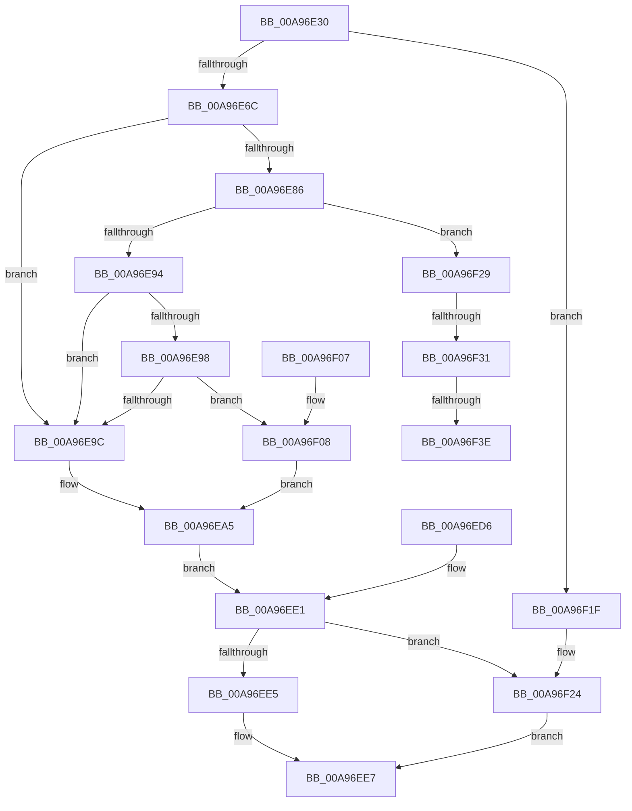

# HvlQueryVsmProtectionInfo

- RVA: `0x00A96E30`–`0x00A96F43` (길이 `275` bytes)
- VA: `0x0000000140A96E30`
- 실행 섹션: `PAGE`
- PDB 이름 있음: `예`; PDB Function 태그: `예`
- unwind 정보 RVA: `0x000B9CB8`
- 디코드: `79`개 명령, `275/275` bytes 표시
- 미해석 바이트: `0` (있으면 어셈블리에 `.byte`로 보존)

> 이 문서는 커널 이미지의 기계어와 PDB 기호를 분석해 생성했습니다. 4번과 5번은 함수 원형과 자료형을 바이너리 사용 방식에서 추정한 C 해석이며 원본 소스 복구 결과는 아닙니다.

## 1. Dependencies

- 직접 호출 지점: **5**; 고유 호출 대상: **4**
- 직접 호출자로 확인된 함수: **1**
- RIP 상대 이미지 참조: **4**

### Outgoing calls
- `0x00A96E9C` → [HvlpProcessIommu](../../text/4D/HvlpProcessIommu_function_004DE458.md) (function, `0x004DE458`)
- `0x00A96ECF` → [memcpy](../../text/6C/memcpy_function_006C6840.md) (function, `0x006C6840`)
- `0x00A96EF1` → [_security_check_cookie](../../text/6A/_security_check_cookie_function_006AC640.md) (function, `0x006AC640`)
- `0x00A96F0D` → [HviGetHardwareFeatures](../../text/4A/HviGetHardwareFeatures_function_004ADBC0.md) (function, `0x004ADBC0`)
- `0x00A96F31` → [HvlpProcessIommu](../../text/4D/HvlpProcessIommu_function_004DE458.md) (function, `0x004DE458`)

### Direct callers
- [ExpQuerySystemInformation](../A5/ExpQuerySystemInformation_function_00A57858.md) at `0x00A5A735`

### Static image references
- `0x00A96E3D` → RVA `0x00E0A740` (`.data`; read)
- `0x00A96E7C` → RVA `0x00FC6A97` (`ALMOSTRO`; read)
- `0x00A96E86` → RVA `0x00FC6A90` (`ALMOSTRO`; read)
- `0x00A96EB8` → RVA `0x00FC6A93` (`ALMOSTRO`; read)

## 2. Other-region calls and transfers

- 다른 실행 섹션으로 향하는 call: **5**
  - `0x00A96E9C` → [HvlpProcessIommu](../../text/4D/HvlpProcessIommu_function_004DE458.md) (`PAGE` → `.text`)
  - `0x00A96ECF` → [memcpy](../../text/6C/memcpy_function_006C6840.md) (`PAGE` → `.text`)
  - `0x00A96EF1` → [_security_check_cookie](../../text/6A/_security_check_cookie_function_006AC640.md) (`PAGE` → `.text`)
  - `0x00A96F0D` → [HviGetHardwareFeatures](../../text/4A/HviGetHardwareFeatures_function_004ADBC0.md) (`PAGE` → `.text`)
  - `0x00A96F31` → [HvlpProcessIommu](../../text/4D/HvlpProcessIommu_function_004DE458.md) (`PAGE` → `.text`)
- call이 아닌 외부 분기/꼬리 이동: **3**
  - `0x00A96F2B` → [sub_00B47C38](../B4/Unknown_function_00B47C38.md) (`tail-transfer`)
  - `0x00A96F38` → [sub_00B47C38](../B4/Unknown_function_00B47C38.md) (`tail-transfer`)
  - `0x00A96F3E` → [sub_00B47C38 + 0x5](../B4/Unknown_function_00B47C38.md) (`tail-transfer`)

## 3. Assembly (complete function range)

```asm
00A96E30  48 89 5C 24 20                  mov qword ptr [rsp + 0x20], rbx
00A96E35  56                              push rsi
00A96E36  57                              push rdi
00A96E37  41 56                           push r14
00A96E39  48 83 EC 50                     sub rsp, 0x50
00A96E3D  48 8B 05 FC 38 37 00            mov rax, qword ptr [rip + 0x3738fc]
00A96E44  48 33 C4                        xor rax, rsp
00A96E47  48 89 44 24 40                  mov qword ptr [rsp + 0x40], rax
00A96E4C  49 8B F0                        mov rsi, r8
00A96E4F  8B FA                           mov edi, edx
00A96E51  4C 8B F1                        mov r14, rcx
00A96E54  4C 89 44 24 28                  mov qword ptr [rsp + 0x28], r8
00A96E59  0F 57 C0                        xorps xmm0, xmm0
00A96E5C  0F 11 44 24 30                  movups xmmword ptr [rsp + 0x30], xmm0
00A96E61  33 DB                           xor ebx, ebx
00A96E63  83 FA 03                        cmp edx, 3
00A96E66  0F 82 B3 00 00 00               jb 0x140a96f1f
00A96E6C  8D 43 04                        lea eax, [rbx + 4]
00A96E6F  3B D0                           cmp edx, eax
00A96E71  0F 43 F8                        cmovae edi, eax
00A96E74  89 7C 24 24                     mov dword ptr [rsp + 0x24], edi
00A96E78  21 5C 24 20                     and dword ptr [rsp + 0x20], ebx
00A96E7C  8A 0D 15 FC 52 00               mov cl, byte ptr [rip + 0x52fc15]
00A96E82  84 C9                           test cl, cl
00A96E84  74 16                           je 0x140a96e9c
00A96E86  8B 05 04 FC 52 00               mov eax, dword ptr [rip + 0x52fc04]
00A96E8C  A8 02                           test al, 2
00A96E8E  0F 84 95 00 00 00               je 0x140a96f29
00A96E94  84 C9                           test cl, cl
00A96E96  74 04                           je 0x140a96e9c
00A96E98  A8 02                           test al, 2
00A96E9A  75 6C                           jne 0x140a96f08
00A96E9C  E8 B7 75 A4 FF                  call 0x1404de458
00A96EA1  88 5C 24 21                     mov byte ptr [rsp + 0x21], bl
00A96EA5  88 44 24 20                     mov byte ptr [rsp + 0x20], al
00A96EA9  8B 05 E1 FB 52 00               mov eax, dword ptr [rip + 0x52fbe1]
00A96EAF  C1 E8 11                        shr eax, 0x11
00A96EB2  24 01                           and al, 1
00A96EB4  88 44 24 22                     mov byte ptr [rsp + 0x22], al
00A96EB8  8A 05 D5 FB 52 00               mov al, byte ptr [rip + 0x52fbd5]
00A96EBE  24 01                           and al, 1
00A96EC0  88 44 24 23                     mov byte ptr [rsp + 0x23], al
00A96EC4  44 8B C7                        mov r8d, edi
00A96EC7  48 8D 54 24 20                  lea rdx, [rsp + 0x20]
00A96ECC  49 8B CE                        mov rcx, r14
00A96ECF  E8 6C F9 C2 FF                  call 0x1406c6840
00A96ED4  EB 0B                           jmp 0x140a96ee1
00A96ED6  8B D8                           mov ebx, eax
00A96ED8  48 8B 74 24 28                  mov rsi, qword ptr [rsp + 0x28]
00A96EDD  8B 7C 24 24                     mov edi, dword ptr [rsp + 0x24]
00A96EE1  85 DB                           test ebx, ebx
00A96EE3  78 3F                           js 0x140a96f24
00A96EE5  89 3E                           mov dword ptr [rsi], edi
00A96EE7  8B C3                           mov eax, ebx
00A96EE9  48 8B 4C 24 40                  mov rcx, qword ptr [rsp + 0x40]
00A96EEE  48 33 CC                        xor rcx, rsp
00A96EF1  E8 4A 57 C1 FF                  call 0x1406ac640
00A96EF6  48 8B 9C 24 88 00 00 00         mov rbx, qword ptr [rsp + 0x88]
00A96EFE  48 83 C4 50                     add rsp, 0x50
00A96F02  41 5E                           pop r14
00A96F04  5F                              pop rdi
00A96F05  5E                              pop rsi
00A96F06  C3                              ret
00A96F07  CC                              int3
00A96F08  48 8D 4C 24 30                  lea rcx, [rsp + 0x30]
00A96F0D  E8 AE 6C A1 FF                  call 0x1404adbc0
00A96F12  8B 44 24 30                     mov eax, dword ptr [rsp + 0x30]
00A96F16  C0 E8 07                        shr al, 7
00A96F19  88 44 24 21                     mov byte ptr [rsp + 0x21], al
00A96F1D  EB 86                           jmp 0x140a96ea5
00A96F1F  BB F0 00 00 C0                  mov ebx, 0xc00000f0
00A96F24  83 26 00                        and dword ptr [rsi], 0
00A96F27  EB BE                           jmp 0x140a96ee7
00A96F29  A8 40                           test al, 0x40
00A96F2B  0F 85 07 0D 0B 00               jne 0x140b47c38
00A96F31  E8 22 75 A4 FF                  call 0x1404de458
00A96F36  84 C0                           test al, al
00A96F38  0F 85 FA 0C 0B 00               jne 0x140b47c38
00A96F3E  E9 FA 0C 0B 00                  jmp 0x140b47c3d
```

## 4. C-style interpretation (structured pseudocode)

```c
__int64 __fastcall HvlQueryVsmProtectionInfo(__int64 a1, int a2, __int64 a3)
{
    __int64 result;
    __int64 v_rbx;
    __int64 v_rdi;
    __int64 v_rsp;
    unsigned __int64 v_stack_m28;
    unsigned __int64 v_stack_m38;
    unsigned __int64 v_stack_m40;
    unsigned int v_stack_m44;
    unsigned __int8 v_stack_m45;
    unsigned __int8 v_stack_m46;
    unsigned __int8 v_stack_m47;
    unsigned int v_stack_m48;
    unsigned __int64 v_stack_p20;
    unsigned __int8 v_stack_p21;
    unsigned __int64 v_stack_p30;

    v_stack_p20 = v_rbx;
    v_rsp = (v_rsp) - (80);
    result = (*(unsigned __int64 *)(v_rip + 3619068)) ^ (v_rsp);
    v_stack_m28 = result;
    v_stack_m40 = a3;
    v_stack_m38 = v_xmm0;
    v_rbx = 0;
    if (a2 < 3) goto loc_00A96F1F;
    v_rdi = (unsigned int)(a2);
    if (a2 >= ((unsigned int)(v_rbx + 4))) { v_rdi = (unsigned int)(v_rbx + 4); }
    v_stack_m44 = (unsigned int)(v_rdi);
    if ((unsigned __int8)(*(unsigned __int8 *)(v_rip + 5438485)) == 0) goto loc_00A96E9C;
    if ((((unsigned __int8)((unsigned int)(*(unsigned int *)(v_rip + 5438468)))) & (2)) == 0) goto loc_00A96F29;
    if ((unsigned __int8)(*(unsigned __int8 *)(v_rip + 5438485)) == 0) goto loc_00A96E9C;
    if ((((unsigned __int8)((unsigned int)(*(unsigned int *)(v_rip + 5438468)))) & (2)) != 0) goto loc_00A96F08;
loc_00A96E9C:
    result = HvlpProcessIommu(*(unsigned __int8 *)(v_rip + 5438485), a2, a3, a4);
    v_stack_m47 = 0;
loc_00A96EA5:
    v_stack_m48 = (unsigned __int8)(result);
    result = (unsigned int)(((unsigned int)(*(unsigned int *)(v_rip + 5438433))) >> (17));
    result = (unsigned __int8)((result) & (1));
    v_stack_m46 = (unsigned __int8)(result);
    result = (unsigned __int8)((*(unsigned __int8 *)(v_rip + 5438421)) & (1));
    v_stack_m45 = (unsigned __int8)(result);
    result = memcpy(a1, v_stack_m48, (unsigned int)((unsigned int)(v_rdi)), a4);
    goto loc_00A96EE1;
loc_00A96EE1:
    if (sign_flag) goto loc_00A96F24;
    *(unsigned int *)(a3) = (unsigned int)(v_rdi);
loc_00A96EE7:
    a1 = (v_stack_m28) ^ (v_rsp);
    result = _security_check_cookie(a1, v_stack_m48, (unsigned int)((unsigned int)(v_rdi)), a4);
    v_rsp = (v_rsp) + (80);
    return result;
loc_00A96F08:
    result = HviGetHardwareFeatures(v_stack_p30, v_stack_m48, (unsigned int)((unsigned int)(v_rdi)), a4);
    result = (unsigned __int8)(((unsigned int)(v_stack_p30)) >> (7));
    v_stack_p21 = (unsigned __int8)(result);
    goto loc_00A96EA5;
loc_00A96F1F:
loc_00A96F24:
    goto loc_00A96EE7;
loc_00A96F29:
    result = HvlpProcessIommu(v_stack_p30, v_stack_m48, (unsigned int)((unsigned int)(v_rdi)), a4);
}
```

## 5. (Beta) C Style

```c
int64_t HvlQueryVsmProtectionInfo(int64_t Arg1, int32_t Arg2, void *Arg3)
{
    uint8_t *arg3 = (uint8_t *)Arg3;

    int64_t result;
    int64_t local_rbx;
    int64_t local_rdi;
    int64_t local_rsp;
    uint64_t v_stack_m28;
    uint64_t v_stack_m38;
    uint64_t v_stack_m40;
    uint32_t v_stack_m44;
    uint8_t v_stack_m45;
    uint8_t v_stack_m46;
    uint8_t v_stack_m47;
    uint32_t v_stack_m48;
    uint64_t v_stack_p20;
    uint8_t v_stack_p21;
    uint64_t v_stack_p30;

    v_stack_p20 = local_rbx;
    local_rsp = (local_rsp) - (80);
    result = (*(uint64_t *)(v_rip + 0x3738FC)) ^ (local_rsp);
    v_stack_m28 = result;
    v_stack_m40 = Arg3;
    v_stack_m38 = v_xmm0;
    local_rbx = 0;
    if (Arg2 < 3) goto loc_00A96F1F;
    local_rdi = (uint32_t)(Arg2);
    if (Arg2 >= ((uint32_t)(local_rbx + 4))) { local_rdi = (uint32_t)(local_rbx + 4); }
    v_stack_m44 = (uint32_t)(local_rdi);
    if ((uint8_t)(*(uint8_t *)(v_rip + 0x52FC15)) == 0) goto loc_00A96E9C;
    if ((((uint8_t)((uint32_t)(*(uint32_t *)(v_rip + 0x52FC04)))) & (2)) == 0) goto loc_00A96F29;
    if ((uint8_t)(*(uint8_t *)(v_rip + 0x52FC15)) == 0) goto loc_00A96E9C;
    if ((((uint8_t)((uint32_t)(*(uint32_t *)(v_rip + 0x52FC04)))) & (2)) != 0) goto loc_00A96F08;
loc_00A96E9C:
    result = HvlpProcessIommu(*(uint8_t *)(v_rip + 0x52FC15), Arg2, Arg3, a4);
    v_stack_m47 = 0;
loc_00A96EA5:
    v_stack_m48 = (uint8_t)(result);
    result = (uint32_t)(((uint32_t)(*(uint32_t *)(v_rip + 0x52FBE1))) >> (17));
    result = (uint8_t)((result) & (1));
    v_stack_m46 = (uint8_t)(result);
    result = (uint8_t)((*(uint8_t *)(v_rip + 0x52FBD5)) & (1));
    v_stack_m45 = (uint8_t)(result);
    result = memcpy(Arg1, v_stack_m48, (uint32_t)((uint32_t)(local_rdi)), a4);
    goto loc_00A96EE1;
loc_00A96EE1:
    if (sign_flag) goto loc_00A96F24;
    *(uint32_t *)(arg3) = (uint32_t)(local_rdi);
loc_00A96EE7:
    Arg1 = (v_stack_m28) ^ (local_rsp);
    result = _security_check_cookie(Arg1, v_stack_m48, (uint32_t)((uint32_t)(local_rdi)), a4);
    local_rsp = (local_rsp) + (80);
    return result;
loc_00A96F08:
    result = HviGetHardwareFeatures(v_stack_p30, v_stack_m48, (uint32_t)((uint32_t)(local_rdi)), a4);
    result = (uint8_t)(((uint32_t)(v_stack_p30)) >> (7));
    v_stack_p21 = (uint8_t)(result);
    goto loc_00A96EA5;
loc_00A96F1F:
loc_00A96F24:
    goto loc_00A96EE7;
loc_00A96F29:
    result = HvlpProcessIommu(v_stack_p30, v_stack_m48, (uint32_t)((uint32_t)(local_rdi)), a4);
}
```

### 관측된 메모리 오프셋

구조체 형식이 확인되지 않은 접근은 인자 기준의 오프셋으로만 기록했습니다.

| 기준 인자 | 오프셋 표현 | 폭 (bit) | 접근 |
|---|---:|---:|---|
| `Arg3` | `+ 0x0` | `32` | `R/W` |
| `Arg3` | `+ 0x0` | `32` | `W` |

## 6. Execution-region graph

[열기: 2D/3D 그래프와 함수 탐색 컨트롤 패널](../../../control-panel.html?section=page&rva=0x00A96E30&view=graph)

- 2D 그래프는 위에서 아래로 흐르고, 3D 그래프는 빈 공간을 드래그해 회전합니다. Shift+드래그는 이동, 휠은 확대·축소, 함수 노드 선택은 대상 보고서 이동입니다.

### Static fallback


