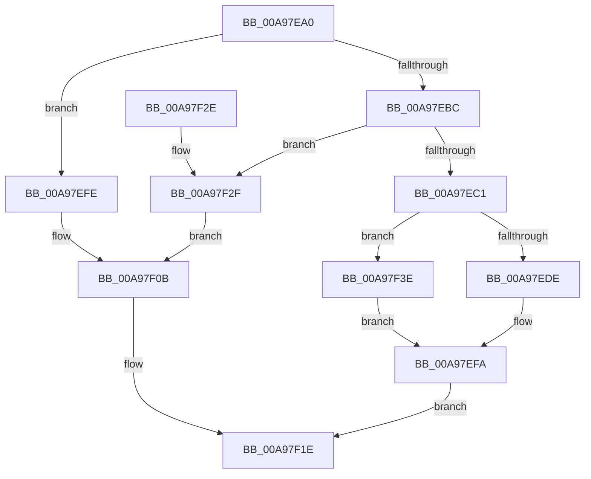

# InitOnceGetStringTableOffset

- RVA: `0x00A97EA0`–`0x00A97F48` (길이 `168` bytes)
- VA: `0x0000000140A97EA0`
- 실행 섹션: `PAGE`
- PDB 이름 있음: `예`; PDB Function 태그: `아니요`
- unwind 정보 RVA: `0x000A1AC0`
- 디코드: `44`개 명령, `168/168` bytes 표시
- 미해석 바이트: `0` (있으면 어셈블리에 `.byte`로 보존)

> 이 문서는 커널 이미지의 기계어와 PDB 기호를 분석해 생성했습니다. 4번과 5번은 함수 원형과 자료형을 바이너리 사용 방식에서 추정한 C 해석이며 원본 소스 복구 결과는 아닙니다.

## 1. Dependencies

- 직접 호출 지점: **3**; 고유 호출 대상: **2**
- 직접 호출자로 확인된 함수: **0**
- RIP 상대 이미지 참조: **4**

### Outgoing calls
- `0x00A97ECC` → [SdbFindFirstTag](../95/SdbFindFirstTag_function_0095E34C.md) (function, `0x0095E34C`)
- `0x00A97EF5` → [AslLogCallPrintf](../95/AslLogCallPrintf_function_0095E4EC.md) (function, `0x0095E4EC`)
- `0x00A97F17` → [AslLogCallPrintf](../95/AslLogCallPrintf_function_0095E4EC.md) (function, `0x0095E4EC`)

### Direct callers
- 이 함수 시작 RVA로 연결되는 직접 call은 확인되지 않았습니다. 간접 호출은 완전히 역산할 수 없습니다.

### Static image references
- `0x00A97EDE` → RVA `0x0001C570` (`.rdata`; read)
- `0x00A97EEB` → RVA `0x0001C588` (`.rdata`; read)
- `0x00A97EFE` → RVA `0x0001C538` (`.rdata`; read)
- `0x00A97F2F` → RVA `0x0001C5B0` (`.rdata`; read)

## 2. Other-region calls and transfers

- 다른 실행 섹션으로 향하는 call: **0**
- 별도 외부 분기/꼬리 이동을 확인하지 못했습니다.

## 3. Assembly (complete function range)

```asm
00A97EA0  48 89 5C 24 08                  mov qword ptr [rsp + 8], rbx
00A97EA5  48 89 74 24 10                  mov qword ptr [rsp + 0x10], rsi
00A97EAA  57                              push rdi
00A97EAB  48 83 EC 20                     sub rsp, 0x20
00A97EAF  33 DB                           xor ebx, ebx
00A97EB1  49 8B F8                        mov rdi, r8
00A97EB4  48 8B F2                        mov rsi, rdx
00A97EB7  48 85 D2                        test rdx, rdx
00A97EBA  74 42                           je 0x140a97efe
00A97EBC  4D 85 C0                        test r8, r8
00A97EBF  74 6E                           je 0x140a97f2f
00A97EC1  33 D2                           xor edx, edx
00A97EC3  41 B8 01 78 00 00               mov r8d, 0x7801
00A97EC9  48 8B CE                        mov rcx, rsi
00A97ECC  E8 7B 64 EC FF                  call 0x14095e34c
00A97ED1  48 81 C6 48 0A 00 00            add rsi, 0xa48
00A97ED8  89 06                           mov dword ptr [rsi], eax
00A97EDA  85 C0                           test eax, eax
00A97EDC  75 60                           jne 0x140a97f3e
00A97EDE  4C 8D 0D 8B 46 58 FF            lea r9, [rip - 0xa7b975]
00A97EE5  41 B8 19 03 00 00               mov r8d, 0x319
00A97EEB  48 8D 15 96 46 58 FF            lea rdx, [rip - 0xa7b96a]
00A97EF2  8D 4B 01                        lea ecx, [rbx + 1]
00A97EF5  E8 F2 65 EC FF                  call 0x14095e4ec
00A97EFA  8B C3                           mov eax, ebx
00A97EFC  EB 20                           jmp 0x140a97f1e
00A97EFE  4C 8D 0D 33 46 58 FF            lea r9, [rip - 0xa7b9cd]
00A97F05  41 B8 09 03 00 00               mov r8d, 0x309
00A97F0B  48 8D 15 76 46 58 FF            lea rdx, [rip - 0xa7b98a]
00A97F12  B9 01 00 00 00                  mov ecx, 1
00A97F17  E8 D0 65 EC FF                  call 0x14095e4ec
00A97F1C  33 C0                           xor eax, eax
00A97F1E  48 8B 5C 24 30                  mov rbx, qword ptr [rsp + 0x30]
00A97F23  48 8B 74 24 38                  mov rsi, qword ptr [rsp + 0x38]
00A97F28  48 83 C4 20                     add rsp, 0x20
00A97F2C  5F                              pop rdi
00A97F2D  C3                              ret
00A97F2E  CC                              int3
00A97F2F  4C 8D 0D 7A 46 58 FF            lea r9, [rip - 0xa7b986]
00A97F36  41 B8 0F 03 00 00               mov r8d, 0x30f
00A97F3C  EB CD                           jmp 0x140a97f0b
00A97F3E  48 89 37                        mov qword ptr [rdi], rsi
00A97F41  BB 01 00 00 00                  mov ebx, 1
00A97F46  EB B2                           jmp 0x140a97efa
```

## 4. C-style interpretation (structured pseudocode)

```c
__int64 __fastcall InitOnceGetStringTableOffset(__int64 a1, __int64 a2, __int64 a3)
{
    __int64 result;
    __int64 v_rbx;
    __int64 v_rsi;
    __int64 v_rsp;
    unsigned __int64 v_stack_p10;
    unsigned __int64 v_stack_p8;

    v_stack_p8 = v_rbx;
    v_stack_p10 = v_rsi;
    v_rsp = (v_rsp) - (32);
    v_rbx = 0;
    if (a2 == 0) goto loc_00A97EFE;
    if (a3 == 0) goto loc_00A97F2F;
    a2 = 0;
    result = SdbFindFirstTag(0, a2, (unsigned int)(0x7801ULL), a4);
    v_rsi = (a2) + (0xA48ULL);
    *(unsigned int *)(v_rsi) = (unsigned int)(result);
    if ((unsigned int)(result) != 0) goto loc_00A97F3E;
    result = AslLogCallPrintf(v_rbx + 1, v_rip - 10991978, 793, v_rip - 10991989);
loc_00A97EFA:
    goto loc_00A97F1E;
loc_00A97EFE:
loc_00A97F0B:
    result = AslLogCallPrintf(1, v_rip - 10992010, 777, v_rip - 10992077);
    result = 0;
loc_00A97F1E:
    v_rsp = (v_rsp) + (32);
    return result;
loc_00A97F2F:
    goto loc_00A97F0B;
loc_00A97F3E:
    *(unsigned __int64 *)(a3) = v_stack_p10;
    goto loc_00A97EFA;
}
```

## 5. (Beta) C Style

```c
int64_t InitOnceGetStringTableOffset(int64_t Arg1, void *Arg2, void *Arg3)
{
    uint8_t *arg2 = (uint8_t *)Arg2;
    uint8_t *arg3 = (uint8_t *)Arg3;

    int64_t result;
    int64_t local_rbx;
    int64_t local_rsi;
    int64_t local_rsp;
    uint64_t v_stack_p10;
    uint64_t v_stack_p8;

    v_stack_p8 = local_rbx;
    v_stack_p10 = local_rsi;
    local_rsp = (local_rsp) - (32);
    local_rbx = 0;
    if (Arg2 == NULL) goto loc_00A97EFE;
    if (Arg3 == NULL) goto loc_00A97F2F;
    Arg2 = 0;
    result = SdbFindFirstTag(0, Arg2, (uint32_t)(0x7801ULL), a4);
    local_rsi = (Arg2) + (0xA48ULL);
    *(uint32_t *)(local_rsi) = (uint32_t)(result);
    if ((uint32_t)(result) != 0) goto loc_00A97F3E;
    result = AslLogCallPrintf(local_rbx + 1, v_rip - 10991978, 793, v_rip - 10991989);
loc_00A97EFA:
    goto loc_00A97F1E;
loc_00A97EFE:
loc_00A97F0B:
    result = AslLogCallPrintf(1, v_rip - 10992010, 777, v_rip - 10992077);
    result = 0;
loc_00A97F1E:
    local_rsp = (local_rsp) + (32);
    return result;
loc_00A97F2F:
    goto loc_00A97F0B;
loc_00A97F3E:
    *(uint64_t *)(arg3) = v_stack_p10;
    goto loc_00A97EFA;
}
```

### 관측된 메모리 오프셋

구조체 형식이 확인되지 않은 접근은 인자 기준의 오프셋으로만 기록했습니다.

| 기준 인자 | 오프셋 표현 | 폭 (bit) | 접근 |
|---|---:|---:|---|
| `Arg2` | `+ 0x0` | `32` | `W` |
| `Arg3` | `+ 0x0` | `64` | `W` |

## 6. Execution-region graph

[열기: 2D/3D 그래프와 함수 탐색 컨트롤 패널](../../../control-panel.html?section=page&rva=0x00A97EA0&view=graph)

- 2D 그래프는 위에서 아래로 흐르고, 3D 그래프는 빈 공간을 드래그해 회전합니다. Shift+드래그는 이동, 휠은 확대·축소, 함수 노드 선택은 대상 보고서 이동입니다.

### Static fallback


