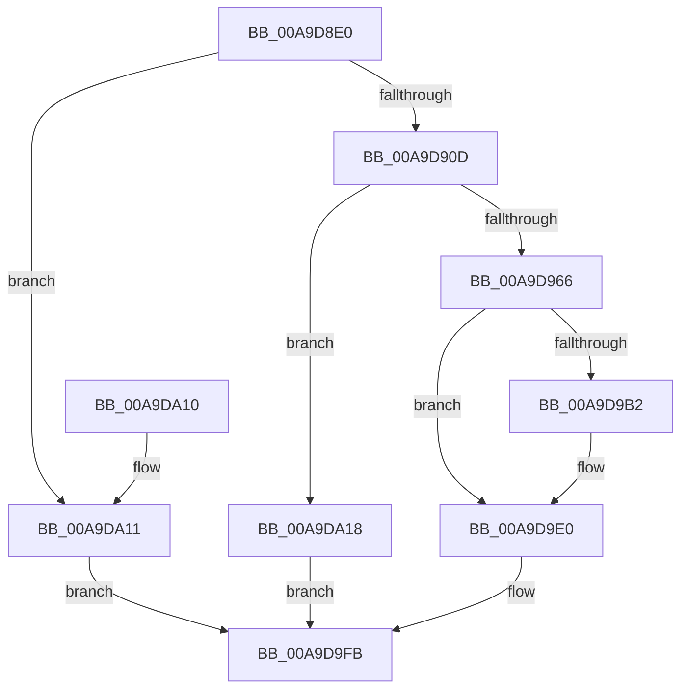

# IoQueryDeviceDescription

- RVA: `0x00A9D8E0`–`0x00A9DA1F` (길이 `319` bytes)
- VA: `0x0000000140A9D8E0`
- 실행 섹션: `PAGE`
- PDB 이름 있음: `예`; PDB Function 태그: `아니요`
- unwind 정보 RVA: `0x000BA7A0`
- 디코드: `77`개 명령, `319/319` bytes 표시
- 미해석 바이트: `0` (있으면 어셈블리에 `.byte`로 보존)

> 이 문서는 커널 이미지의 기계어와 PDB 기호를 분석해 생성했습니다. 4번과 5번은 함수 원형과 자료형을 바이너리 사용 방식에서 추정한 C 해석이며 원본 소스 복구 결과는 아닙니다.

## 1. Dependencies

- 직접 호출 지점: **6**; 고유 호출 대상: **6**
- 직접 호출자로 확인된 함수: **0**
- RIP 상대 이미지 참조: **1**

### Outgoing calls
- `0x00A9D954` → [ExAllocatePool2](../../poolcode/B8/ExAllocatePool2_function_00B820F0.md) (function, `0x00B820F0`)
- `0x00A9D971` → [RtlAppendUnicodeStringToString](../../text/40/RtlAppendUnicodeStringToString_function_0040FA50.md) (function, `0x0040FA50`)
- `0x00A9D9A7` → [ZwOpenKey](../../text/6A/ZwOpenKey_function_006AD310.md) (function, `0x006AD310`)
- `0x00A9D9D0` → [pIoQueryBusDescription](../99/pIoQueryBusDescription_function_00996F58.md) (function, `0x00996F58`)
- `0x00A9D9DB` → [ZwClose](../../text/6A/ZwClose_function_006AD2B0.md) (function, `0x006AD2B0`)
- `0x00A9D9E6` → [ExFreePoolWithTag](../../poolcode/B8/ExFreePoolWithTag_function_00B82870.md) (function, `0x00B82870`)

### Direct callers
- 이 함수 시작 RVA로 연결되는 직접 call은 확인되지 않았습니다. 간접 호출은 완전히 역산할 수 없습니다.

### Static image references
- `0x00A9D966` → RVA `0x00FD9DE8` (`PAGEDATA`; read)

## 2. Other-region calls and transfers

- 다른 실행 섹션으로 향하는 call: **5**
  - `0x00A9D954` → [ExAllocatePool2](../../poolcode/B8/ExAllocatePool2_function_00B820F0.md) (`PAGE` → `POOLCODE`)
  - `0x00A9D971` → [RtlAppendUnicodeStringToString](../../text/40/RtlAppendUnicodeStringToString_function_0040FA50.md) (`PAGE` → `.text`)
  - `0x00A9D9A7` → [ZwOpenKey](../../text/6A/ZwOpenKey_function_006AD310.md) (`PAGE` → `.text`)
  - `0x00A9D9DB` → [ZwClose](../../text/6A/ZwClose_function_006AD2B0.md) (`PAGE` → `.text`)
  - `0x00A9D9E6` → [ExFreePoolWithTag](../../poolcode/B8/ExFreePoolWithTag_function_00B82870.md) (`PAGE` → `POOLCODE`)
- 별도 외부 분기/꼬리 이동을 확인하지 못했습니다.

## 3. Assembly (complete function range)

```asm
00A9D8E0  48 89 5C 24 10                  mov qword ptr [rsp + 0x10], rbx
00A9D8E5  48 89 7C 24 18                  mov qword ptr [rsp + 0x18], rdi
00A9D8EA  55                              push rbp
00A9D8EB  48 8D 6C 24 C9                  lea rbp, [rsp - 0x37]
00A9D8F0  48 81 EC D0 00 00 00            sub rsp, 0xd0
00A9D8F7  83 4D 47 FF                     or dword ptr [rbp + 0x47], 0xffffffff
00A9D8FB  33 FF                           xor edi, edi
00A9D8FD  89 7D AB                        mov dword ptr [rbp - 0x55], edi
00A9D900  48 89 7D 97                     mov qword ptr [rbp - 0x69], rdi
00A9D904  48 85 C9                        test rcx, rcx
00A9D907  0F 84 04 01 00 00               je 0x140a9da11
00A9D90D  48 8B 45 67                     mov rax, qword ptr [rbp + 0x67]
00A9D911  48 89 45 07                     mov qword ptr [rbp + 7], rax
00A9D915  48 8B 45 6F                     mov rax, qword ptr [rbp + 0x6f]
00A9D919  48 89 45 0F                     mov qword ptr [rbp + 0xf], rax
00A9D91D  48 8B 45 77                     mov rax, qword ptr [rbp + 0x77]
00A9D921  48 89 45 17                     mov qword ptr [rbp + 0x17], rax
00A9D925  48 8B 45 7F                     mov rax, qword ptr [rbp + 0x7f]
00A9D929  48 89 4D E7                     mov qword ptr [rbp - 0x19], rcx
00A9D92D  B9 00 01 00 00                  mov ecx, 0x100
00A9D932  48 89 55 EF                     mov qword ptr [rbp - 0x11], rdx
00A9D936  BA 00 08 00 00                  mov edx, 0x800
00A9D93B  4C 89 45 F7                     mov qword ptr [rbp - 9], r8
00A9D93F  41 B8 49 6F 52 4E               mov r8d, 0x4e526f49
00A9D945  48 89 45 1F                     mov qword ptr [rbp + 0x1f], rax
00A9D949  4C 89 4D FF                     mov qword ptr [rbp - 1], r9
00A9D94D  C7 45 A7 00 00 00 08            mov dword ptr [rbp - 0x59], 0x8000000
00A9D954  E8 97 47 0E 00                  call 0x140b820f0
00A9D959  48 89 45 AF                     mov qword ptr [rbp - 0x51], rax
00A9D95D  48 85 C0                        test rax, rax
00A9D960  0F 84 B2 00 00 00               je 0x140a9da18
00A9D966  48 8D 15 7B C4 53 00            lea rdx, [rip + 0x53c47b]
00A9D96D  48 8D 4D A7                     lea rcx, [rbp - 0x59]
00A9D971  E8 DA 20 97 FF                  call 0x14040fa50
00A9D976  48 8D 45 A7                     lea rax, [rbp - 0x59]
00A9D97A  48 C7 45 B7 30 00 00 00         mov qword ptr [rbp - 0x49], 0x30
00A9D982  0F 57 C0                        xorps xmm0, xmm0
00A9D985  48 89 45 C7                     mov qword ptr [rbp - 0x39], rax
00A9D989  4C 8D 45 B7                     lea r8, [rbp - 0x49]
00A9D98D  48 C7 45 CF 40 02 00 00         mov qword ptr [rbp - 0x31], 0x240
00A9D995  BA 19 00 02 00                  mov edx, 0x20019
00A9D99A  48 89 7D BF                     mov qword ptr [rbp - 0x41], rdi
00A9D99E  48 8D 4D 97                     lea rcx, [rbp - 0x69]
00A9D9A2  F3 0F 7F 45 D7                  movdqu xmmword ptr [rbp - 0x29], xmm0
00A9D9A7  E8 64 F9 C0 FF                  call 0x1406ad310
00A9D9AC  8B D8                           mov ebx, eax
00A9D9AE  85 C0                           test eax, eax
00A9D9B0  78 2E                           js 0x140a9d9e0
00A9D9B2  0F 28 45 A7                     movaps xmm0, xmmword ptr [rbp - 0x59]
00A9D9B6  4C 8D 4D 47                     lea r9, [rbp + 0x47]
00A9D9BA  4C 8B 45 97                     mov r8, qword ptr [rbp - 0x69]
00A9D9BE  48 8D 55 27                     lea rdx, [rbp + 0x27]
00A9D9C2  48 8D 4D E7                     lea rcx, [rbp - 0x19]
00A9D9C6  66 0F 7F 45 27                  movdqa xmmword ptr [rbp + 0x27], xmm0
00A9D9CB  C6 44 24 20 01                  mov byte ptr [rsp + 0x20], 1
00A9D9D0  E8 83 95 EF FF                  call 0x140996f58
00A9D9D5  48 8B 4D 97                     mov rcx, qword ptr [rbp - 0x69]
00A9D9D9  8B D8                           mov ebx, eax
00A9D9DB  E8 D0 F8 C0 FF                  call 0x1406ad2b0
00A9D9E0  48 8B 4D AF                     mov rcx, qword ptr [rbp - 0x51]
00A9D9E4  33 D2                           xor edx, edx
00A9D9E6  E8 85 4E 0E 00                  call 0x140b82870
00A9D9EB  B8 34 00 00 C0                  mov eax, 0xc0000034
00A9D9F0  81 FB 1A 00 00 80               cmp ebx, 0x8000001a
00A9D9F6  0F 44 D8                        cmove ebx, eax
00A9D9F9  8B C3                           mov eax, ebx
00A9D9FB  4C 8D 9C 24 D0 00 00 00         lea r11, [rsp + 0xd0]
00A9DA03  49 8B 5B 18                     mov rbx, qword ptr [r11 + 0x18]
00A9DA07  49 8B 7B 20                     mov rdi, qword ptr [r11 + 0x20]
00A9DA0B  49 8B E3                        mov rsp, r11
00A9DA0E  5D                              pop rbp
00A9DA0F  C3                              ret
00A9DA10  CC                              int3
00A9DA11  B8 02 00 00 C0                  mov eax, 0xc0000002
00A9DA16  EB E3                           jmp 0x140a9d9fb
00A9DA18  B8 9A 00 00 C0                  mov eax, 0xc000009a
00A9DA1D  EB DC                           jmp 0x140a9d9fb
```

## 4. C-style interpretation (structured pseudocode)

```c
__int64 __fastcall IoQueryDeviceDescription(__int64 a1, __int64 a2, __int64 a3, __int64 a4, __int64 a5, __int64 a6, __int64 a7, __int64 a8)
{
    __int64 result;
    __int64 v_rbx;
    __int64 v_rdi;
    __int64 v_rsp;
    unsigned __int64 v_stack_m18;
    unsigned __int64 v_stack_m20;
    unsigned __int64 v_stack_m28;
    unsigned __int64 v_stack_m30;
    unsigned __int64 v_stack_m38;
    unsigned __int64 v_stack_m3F;
    unsigned __int64 v_stack_m40;
    unsigned __int64 v_stack_m48;
    unsigned __int64 v_stack_m50;
    unsigned __int64 v_stack_m58;
    unsigned __int64 v_stack_m68;
    unsigned __int64 v_stack_m70;
    unsigned __int64 v_stack_m78;
    unsigned __int64 v_stack_m8;
    unsigned __int64 v_stack_m80;
    unsigned __int64 v_stack_m88;
    unsigned __int64 v_stack_m90;
    unsigned int v_stack_m94;
    unsigned int v_stack_m98;
    unsigned __int64 v_stack_mA8;
    unsigned __int8 v_stack_mB8;
    unsigned __int64 v_stack_p10;
    unsigned __int64 v_stack_p18;
    unsigned int v_stack_p8;

    v_stack_p10 = v_rbx;
    v_stack_p18 = v_rdi;
    v_rsp = (v_rsp) - (208);
    v_rdi = 0;
    v_stack_m94 = 0;
    v_stack_mA8 = 0;
    if (a1 == 0) goto loc_00A9DA11;
    v_stack_m38 = a5;
    v_stack_m30 = a6;
    v_stack_m28 = a7;
    v_stack_m58 = a1;
    v_stack_m50 = a2;
    v_stack_m48 = a3;
    v_stack_m20 = a8;
    v_stack_m40 = a4;
    v_stack_m98 = 0x8000000ULL;
    result = ExAllocatePool2(256, (unsigned int)(0x800ULL), (unsigned int)(0x4E526F49ULL), a4);
    v_stack_m90 = result;
    if (result == 0) goto loc_00A9DA18;
    result = RtlAppendUnicodeStringToString(v_stack_m98, v_rip + 5489787, (unsigned int)(0x4E526F49ULL), a4);
    v_stack_m88 = 48;
    v_stack_m78 = v_stack_m98;
    v_stack_m70 = 576;
    v_stack_m80 = 0;
    v_stack_m68 = v_xmm0;
    result = ZwOpenKey(v_stack_mA8, (unsigned int)(0x20019ULL), v_stack_m88, a4);
    v_rbx = (unsigned int)((unsigned int)(result));
    if (!(sign_flag)) {
        a4 = v_stack_p8;
        a3 = v_stack_mA8;
        a2 = v_stack_m18;
        a1 = v_stack_m58;
        v_stack_m18 = v_xmm0;
        v_stack_mB8 = 1;
        result = pIoQueryBusDescription(a1, a2, a3, a4);
        a1 = v_stack_mA8;
        v_rbx = (unsigned int)(result);
        result = ZwClose(a1, a2, a3, a4);
    }
    a2 = 0;
    result = ExFreePoolWithTag(v_stack_m90, a2, a3, a4);
    if (((unsigned int)(v_rbx)) == 0x8000001AULL) { v_rbx = (unsigned int)((unsigned int)(0xC0000034ULL)); }
loc_00A9D9FB:
    return (unsigned int)((unsigned int)(v_rbx));
loc_00A9DA11:
    goto loc_00A9D9FB;
loc_00A9DA18:
    goto loc_00A9D9FB;
}
```

## 5. (Beta) C Style

```c
int64_t IoQueryDeviceDescription(int64_t Arg1, int64_t Arg2, int64_t Arg3, int64_t Arg4, int64_t Arg5, int64_t Arg6, int64_t Arg7, int64_t Arg8)
{
    int64_t result;
    int64_t local_rbx;
    int64_t local_rdi;
    int64_t local_rsp;
    uint64_t v_stack_m18;
    uint64_t v_stack_m20;
    uint64_t v_stack_m28;
    uint64_t v_stack_m30;
    uint64_t v_stack_m38;
    uint64_t v_stack_m3F;
    uint64_t v_stack_m40;
    uint64_t v_stack_m48;
    uint64_t v_stack_m50;
    uint64_t v_stack_m58;
    uint64_t v_stack_m68;
    uint64_t v_stack_m70;
    uint64_t v_stack_m78;
    uint64_t v_stack_m8;
    uint64_t v_stack_m80;
    uint64_t v_stack_m88;
    uint64_t v_stack_m90;
    uint32_t v_stack_m94;
    uint32_t v_stack_m98;
    uint64_t v_stack_mA8;
    uint8_t v_stack_mB8;
    uint64_t v_stack_p10;
    uint64_t v_stack_p18;
    uint32_t v_stack_p8;

    v_stack_p10 = local_rbx;
    v_stack_p18 = local_rdi;
    local_rsp = (local_rsp) - (208);
    local_rdi = 0;
    v_stack_m94 = 0;
    v_stack_mA8 = 0;
    if (Arg1 == 0) goto loc_00A9DA11;
    v_stack_m38 = Arg5;
    v_stack_m30 = Arg6;
    v_stack_m28 = Arg7;
    v_stack_m58 = Arg1;
    v_stack_m50 = Arg2;
    v_stack_m48 = Arg3;
    v_stack_m20 = Arg8;
    v_stack_m40 = Arg4;
    v_stack_m98 = 0x8000000ULL;
    result = ExAllocatePool2(256, (uint32_t)(0x800ULL), (uint32_t)(0x4E526F49ULL), Arg4);
    v_stack_m90 = result;
    if (result == 0) goto loc_00A9DA18;
    result = RtlAppendUnicodeStringToString(v_stack_m98, v_rip + 5489787, (uint32_t)(0x4E526F49ULL), Arg4);
    v_stack_m88 = 48;
    v_stack_m78 = v_stack_m98;
    v_stack_m70 = 576;
    v_stack_m80 = 0;
    v_stack_m68 = v_xmm0;
    result = ZwOpenKey(v_stack_mA8, (uint32_t)(0x20019ULL), v_stack_m88, Arg4);
    local_rbx = (uint32_t)((uint32_t)(result));
    if (!(sign_flag)) {
        Arg4 = v_stack_p8;
        Arg3 = v_stack_mA8;
        Arg2 = v_stack_m18;
        Arg1 = v_stack_m58;
        v_stack_m18 = v_xmm0;
        v_stack_mB8 = 1;
        result = pIoQueryBusDescription(Arg1, Arg2, Arg3, Arg4);
        Arg1 = v_stack_mA8;
        local_rbx = (uint32_t)(result);
        result = ZwClose(Arg1, Arg2, Arg3, Arg4);
    }
    Arg2 = 0;
    result = ExFreePoolWithTag(v_stack_m90, Arg2, Arg3, Arg4);
    if (((uint32_t)(local_rbx)) == 0x8000001AULL) { local_rbx = (uint32_t)((uint32_t)(0xC0000034ULL)); }
loc_00A9D9FB:
    return (uint32_t)((uint32_t)(local_rbx));
loc_00A9DA11:
    goto loc_00A9D9FB;
loc_00A9DA18:
    goto loc_00A9D9FB;
}
```

## 6. Execution-region graph

[열기: 2D/3D 그래프와 함수 탐색 컨트롤 패널](../../../control-panel.html?section=page&rva=0x00A9D8E0&view=graph)

- 2D 그래프는 위에서 아래로 흐르고, 3D 그래프는 빈 공간을 드래그해 회전합니다. Shift+드래그는 이동, 휠은 확대·축소, 함수 노드 선택은 대상 보고서 이동입니다.

### Static fallback


