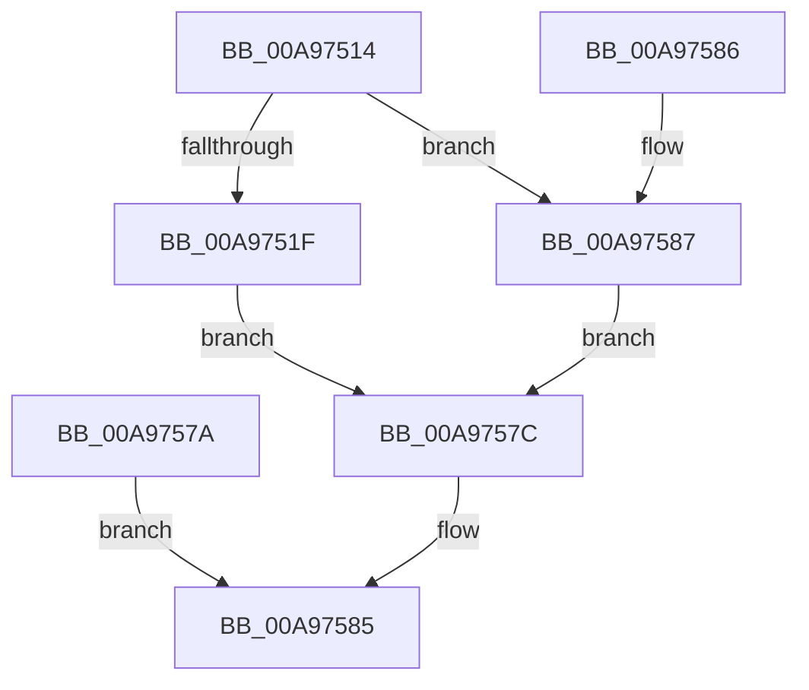

# IoQueryLowPriorityIoInformation

- RVA: `0x00A97514`–`0x00A9758E` (길이 `122` bytes)
- VA: `0x0000000140A97514`
- 실행 섹션: `PAGE`
- PDB 이름 있음: `예`; PDB Function 태그: `아니요`
- unwind 정보 RVA: `0x000B9D58`
- 디코드: `32`개 명령, `122/122` bytes 표시
- 미해석 바이트: `0` (있으면 어셈블리에 `.byte`로 보존)

> 이 문서는 커널 이미지의 기계어와 PDB 기호를 분석해 생성했습니다. 4번과 5번은 함수 원형과 자료형을 바이너리 사용 방식에서 추정한 C 해석이며 원본 소스 복구 결과는 아닙니다.

## 1. Dependencies

- 직접 호출 지점: **0**; 고유 호출 대상: **0**
- 직접 호출자로 확인된 함수: **1**
- RIP 상대 이미지 참조: **10**

### Outgoing calls
- 직접 디코드된 call 명령이 없습니다.

### Direct callers
- [ExpQuerySystemInformation](../A5/ExpQuerySystemInformation_function_00A57858.md) at `0x00A5980B`

### Static image references
- `0x00A9751F` → RVA `0x00F8D204` (`.data`; read)
- `0x00A97527` → RVA `0x00F8D208` (`.data`; read)
- `0x00A97530` → RVA `0x00F8D20C` (`.data`; read)
- `0x00A97539` → RVA `0x00F8D16C` (`.data`; read)
- `0x00A97542` → RVA `0x00F8D170` (`.data`; read)
- `0x00A9754B` → RVA `0x00F8D174` (`.data`; read)
- `0x00A97554` → RVA `0x00F8D178` (`.data`; read)
- `0x00A9755D` → RVA `0x00F8D17C` (`.data`; read)
- `0x00A97566` → RVA `0x00F8D180` (`.data`; read)
- `0x00A9756F` → RVA `0x00F8D1F0` (`.data`; read)

## 2. Other-region calls and transfers

- 다른 실행 섹션으로 향하는 call: **0**
- 별도 외부 분기/꼬리 이동을 확인하지 못했습니다.

## 3. Assembly (complete function range)

```asm
00A97514  33 C9                           xor ecx, ecx
00A97516  41 89 09                        mov dword ptr [r9], ecx
00A97519  41 83 F8 28                     cmp r8d, 0x28
00A9751D  72 68                           jb 0x140a97587
00A9751F  8B 05 DF 5C 4F 00               mov eax, dword ptr [rip + 0x4f5cdf]
00A97525  89 02                           mov dword ptr [rdx], eax
00A97527  8B 05 DB 5C 4F 00               mov eax, dword ptr [rip + 0x4f5cdb]
00A9752D  89 42 04                        mov dword ptr [rdx + 4], eax
00A97530  8B 05 D6 5C 4F 00               mov eax, dword ptr [rip + 0x4f5cd6]
00A97536  89 42 08                        mov dword ptr [rdx + 8], eax
00A97539  8B 05 2D 5C 4F 00               mov eax, dword ptr [rip + 0x4f5c2d]
00A9753F  89 42 0C                        mov dword ptr [rdx + 0xc], eax
00A97542  8B 05 28 5C 4F 00               mov eax, dword ptr [rip + 0x4f5c28]
00A97548  89 42 10                        mov dword ptr [rdx + 0x10], eax
00A9754B  8B 05 23 5C 4F 00               mov eax, dword ptr [rip + 0x4f5c23]
00A97551  89 42 14                        mov dword ptr [rdx + 0x14], eax
00A97554  8B 05 1E 5C 4F 00               mov eax, dword ptr [rip + 0x4f5c1e]
00A9755A  89 42 18                        mov dword ptr [rdx + 0x18], eax
00A9755D  8B 05 19 5C 4F 00               mov eax, dword ptr [rip + 0x4f5c19]
00A97563  89 42 1C                        mov dword ptr [rdx + 0x1c], eax
00A97566  8B 05 14 5C 4F 00               mov eax, dword ptr [rip + 0x4f5c14]
00A9756C  89 42 20                        mov dword ptr [rdx + 0x20], eax
00A9756F  8B 05 7B 5C 4F 00               mov eax, dword ptr [rip + 0x4f5c7b]
00A97575  89 42 24                        mov dword ptr [rdx + 0x24], eax
00A97578  EB 02                           jmp 0x140a9757c
00A9757A  EB 09                           jmp 0x140a97585
00A9757C  41 C7 01 28 00 00 00            mov dword ptr [r9], 0x28
00A97583  8B C1                           mov eax, ecx
00A97585  C3                              ret
00A97586  CC                              int3
00A97587  B9 23 00 00 C0                  mov ecx, 0xc0000023
00A9758C  EB EE                           jmp 0x140a9757c
```

## 4. C-style interpretation (structured pseudocode)

```c
__int64 __fastcall IoQueryLowPriorityIoInformation(int a1, __int64 a2, int a3, __int64 a4)
{
    a1 = 0;
    *(unsigned int *)(a4) = 0;
    if (a3 < 40) goto loc_00A97587;
    *(unsigned int *)(a2) = (unsigned int)((unsigned int)(*(unsigned int *)(v_rip + 5201119)));
    *(unsigned int *)(a2 + 4) = (unsigned int)((unsigned int)(*(unsigned int *)(v_rip + 5201115)));
    *(unsigned int *)(a2 + 8) = (unsigned int)((unsigned int)(*(unsigned int *)(v_rip + 5201110)));
    *(unsigned int *)(a2 + 12) = (unsigned int)((unsigned int)(*(unsigned int *)(v_rip + 5200941)));
    *(unsigned int *)(a2 + 16) = (unsigned int)((unsigned int)(*(unsigned int *)(v_rip + 5200936)));
    *(unsigned int *)(a2 + 20) = (unsigned int)((unsigned int)(*(unsigned int *)(v_rip + 5200931)));
    *(unsigned int *)(a2 + 24) = (unsigned int)((unsigned int)(*(unsigned int *)(v_rip + 5200926)));
    *(unsigned int *)(a2 + 28) = (unsigned int)((unsigned int)(*(unsigned int *)(v_rip + 5200921)));
    *(unsigned int *)(a2 + 32) = (unsigned int)((unsigned int)(*(unsigned int *)(v_rip + 5200916)));
    *(unsigned int *)(a2 + 36) = (unsigned int)((unsigned int)(*(unsigned int *)(v_rip + 5201019)));
    goto loc_00A9757C;
loc_00A9757C:
    *(unsigned int *)(a4) = 40;
loc_00A97585:
    return 0;
loc_00A97587:
    goto loc_00A9757C;
}
```

## 5. (Beta) C Style

```c
int64_t IoQueryLowPriorityIoInformation(int32_t Arg1, void *Arg2, int32_t Arg3, void *Arg4)
{
    uint8_t *arg2 = (uint8_t *)Arg2;
    uint8_t *arg4 = (uint8_t *)Arg4;

    Arg1 = 0;
    *(uint32_t *)(arg4) = 0;
    if (Arg3 < 40) goto loc_00A97587;
    *(uint32_t *)(arg2) = (uint32_t)((uint32_t)(*(uint32_t *)(v_rip + 0x4F5CDF)));
    *(uint32_t *)(arg2 + 0x4) = (uint32_t)((uint32_t)(*(uint32_t *)(v_rip + 0x4F5CDB)));
    *(uint32_t *)(arg2 + 0x8) = (uint32_t)((uint32_t)(*(uint32_t *)(v_rip + 0x4F5CD6)));
    *(uint32_t *)(arg2 + 0xC) = (uint32_t)((uint32_t)(*(uint32_t *)(v_rip + 0x4F5C2D)));
    *(uint32_t *)(arg2 + 0x10) = (uint32_t)((uint32_t)(*(uint32_t *)(v_rip + 0x4F5C28)));
    *(uint32_t *)(arg2 + 0x14) = (uint32_t)((uint32_t)(*(uint32_t *)(v_rip + 0x4F5C23)));
    *(uint32_t *)(arg2 + 0x18) = (uint32_t)((uint32_t)(*(uint32_t *)(v_rip + 0x4F5C1E)));
    *(uint32_t *)(arg2 + 0x1C) = (uint32_t)((uint32_t)(*(uint32_t *)(v_rip + 0x4F5C19)));
    *(uint32_t *)(arg2 + 0x20) = (uint32_t)((uint32_t)(*(uint32_t *)(v_rip + 0x4F5C14)));
    *(uint32_t *)(arg2 + 0x24) = (uint32_t)((uint32_t)(*(uint32_t *)(v_rip + 0x4F5C7B)));
    goto loc_00A9757C;
loc_00A9757C:
    *(uint32_t *)(arg4) = 40;
loc_00A97585:
    return 0;
loc_00A97587:
    goto loc_00A9757C;
}
```

### 관측된 메모리 오프셋

구조체 형식이 확인되지 않은 접근은 인자 기준의 오프셋으로만 기록했습니다.

| 기준 인자 | 오프셋 표현 | 폭 (bit) | 접근 |
|---|---:|---:|---|
| `Arg2` | `+ 0x0` | `32` | `W` |
| `Arg2` | `+ 0x4` | `32` | `W` |
| `Arg2` | `+ 0x8` | `32` | `W` |
| `Arg2` | `+ 0xC` | `32` | `W` |
| `Arg2` | `+ 0x10` | `32` | `W` |
| `Arg2` | `+ 0x14` | `32` | `W` |
| `Arg2` | `+ 0x18` | `32` | `W` |
| `Arg2` | `+ 0x1C` | `32` | `W` |
| `Arg2` | `+ 0x20` | `32` | `W` |
| `Arg2` | `+ 0x24` | `32` | `W` |
| `Arg4` | `+ 0x0` | `32` | `W` |

## 6. Execution-region graph

[열기: 2D/3D 그래프와 함수 탐색 컨트롤 패널](../../../control-panel.html?section=page&rva=0x00A97514&view=graph)

- 2D 그래프는 위에서 아래로 흐르고, 3D 그래프는 빈 공간을 드래그해 회전합니다. Shift+드래그는 이동, 휠은 확대·축소, 함수 노드 선택은 대상 보고서 이동입니다.

### Static fallback


