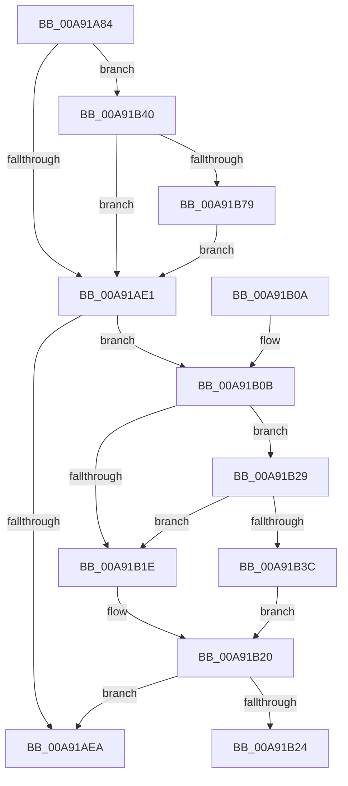

# IoSetEnvironmentVariableEx

- RVA: `0x00A91A84`–`0x00A91B86` (길이 `258` bytes)
- VA: `0x0000000140A91A84`
- 실행 섹션: `PAGE`
- PDB 이름 있음: `예`; PDB Function 태그: `예`
- unwind 정보 RVA: `0x000B9230`
- 디코드: `73`개 명령, `258/258` bytes 표시
- 미해석 바이트: `0` (있으면 어셈블리에 `.byte`로 보존)

> 이 문서는 커널 이미지의 기계어와 PDB 기호를 분석해 생성했습니다. 4번과 5번은 함수 원형과 자료형을 바이너리 사용 방식에서 추정한 C 해석이며 원본 소스 복구 결과는 아닙니다.

## 1. Dependencies

- 직접 호출 지점: **4**; 고유 호출 대상: **4**
- 직접 호출자로 확인된 함수: **10**
- RIP 상대 이미지 참조: **4**

### Outgoing calls
- `0x00A91AD2` → [IopOpenSystemVariableDevice](../95/IopOpenSystemVariableDevice_function_00952910.md) (function, `0x00952910`)
- `0x00A91AF3` → [_security_check_cookie](../../text/6A/_security_check_cookie_function_006AC640.md) (function, `0x006AC640`)
- `0x00A91B69` → [guard_dispatch_icall](../../text/6B/guard_dispatch_icall_function_006BAAD0.md) (function, `0x006BAAD0`)
- `0x00A91B7C` → [ObfDereferenceObject](../../text/2F/ObfDereferenceObject_function_002F9350.md) (function, `0x002F9350`)

### Direct callers
- [IopInitializeInMemoryDumpData](../../text/59/IopInitializeInMemoryDumpData_function_005957E0.md) at `0x005959C3`
- [IopInitializeOfflineCrashDump](../../text/59/IopInitializeOfflineCrashDump_function_00595A24.md) at `0x00595BA0`
- [ExpSetBootEntry](../7C/ExpSetBootEntry_function_007CBD2C.md) at `0x007CC360`
- [ExpSetDriverEntry](../7C/ExpSetDriverEntry_function_007CC424.md) at `0x007CC8F1`
- [ExpSetFirmwareEnvironmentVariable](../7C/ExpSetFirmwareEnvironmentVariable_function_007CC9A8.md) at `0x007CCA2C`
- [NtDeleteBootEntry](../7C/NtDeleteBootEntry_function_007CD2B0.md) at `0x007CD3FD`
- [NtDeleteDriverEntry](../7C/NtDeleteDriverEntry_function_007CD440.md) at `0x007CD58D`
- [NtSetBootOptions](../7C/NtSetBootOptions_function_007CE2B0.md) at `0x007CE41F`
- [NtSetBootOptions](../7C/NtSetBootOptions_function_007CE2B0.md) at `0x007CE44F`
- [NtSetDriverEntryOrder](../7C/NtSetDriverEntryOrder_function_007CE490.md) at `0x007CE5F7`
- [NtSetBootEntryOrder](NtSetBootEntryOrder_function_00A91930.md) at `0x00A919CB`

### Static image references
- `0x00A91A9B` → RVA `0x00E0A740` (`.data`; read)
- `0x00A91AE1` → RVA `0x00E06ED8` (`.data`; read)
- `0x00A91B15` → RVA `0x00E06EE8` (`.data`; read)
- `0x00A91B29` → RVA `0x00E06EF0` (`.data`; read)

## 2. Other-region calls and transfers

- 다른 실행 섹션으로 향하는 call: **3**
  - `0x00A91AF3` → [_security_check_cookie](../../text/6A/_security_check_cookie_function_006AC640.md) (`PAGE` → `.text`)
  - `0x00A91B69` → [guard_dispatch_icall](../../text/6B/guard_dispatch_icall_function_006BAAD0.md) (`PAGE` → `.text`)
  - `0x00A91B7C` → [ObfDereferenceObject](../../text/2F/ObfDereferenceObject_function_002F9350.md) (`PAGE` → `.text`)
- call이 아닌 외부 분기/꼬리 이동: **1**
  - `0x00A91B24` → [sub_00B46E44](../B4/Unknown_function_00B46E44.md) (`tail-transfer`)

## 3. Assembly (complete function range)

```asm
00A91A84  40 55                           push rbp
00A91A86  53                              push rbx
00A91A87  56                              push rsi
00A91A88  57                              push rdi
00A91A89  41 54                           push r12
00A91A8B  41 56                           push r14
00A91A8D  41 57                           push r15
00A91A8F  48 8D 6C 24 E1                  lea rbp, [rsp - 0x1f]
00A91A94  48 81 EC E0 00 00 00            sub rsp, 0xe0
00A91A9B  48 8B 05 9E 8C 37 00            mov rax, qword ptr [rip + 0x378c9e]
00A91AA2  48 33 C4                        xor rax, rsp
00A91AA5  48 89 45 0F                     mov qword ptr [rbp + 0xf], rax
00A91AA9  48 83 65 87 00                  and qword ptr [rbp - 0x79], 0
00A91AAE  49 8B F8                        mov rdi, r8
00A91AB1  48 83 64 24 40 00               and qword ptr [rsp + 0x40], 0
00A91AB7  4C 8D 45 8F                     lea r8, [rbp - 0x71]
00A91ABB  48 83 65 8F 00                  and qword ptr [rbp - 0x71], 0
00A91AC0  4C 8B F2                        mov r14, rdx
00A91AC3  48 8B F1                        mov rsi, rcx
00A91AC6  48 8D 55 87                     lea rdx, [rbp - 0x79]
00A91ACA  48 8D 4C 24 40                  lea rcx, [rsp + 0x40]
00A91ACF  45 8B F9                        mov r15d, r9d
00A91AD2  E8 39 0E EC FF                  call 0x140952910
00A91AD7  44 8B 65 7F                     mov r12d, dword ptr [rbp + 0x7f]
00A91ADB  8B D8                           mov ebx, eax
00A91ADD  85 C0                           test eax, eax
00A91ADF  79 5F                           jns 0x140a91b40
00A91AE1  83 3D F0 53 37 00 05            cmp dword ptr [rip + 0x3753f0], 5
00A91AE8  77 21                           ja 0x140a91b0b
00A91AEA  8B C3                           mov eax, ebx
00A91AEC  48 8B 4D 0F                     mov rcx, qword ptr [rbp + 0xf]
00A91AF0  48 33 CC                        xor rcx, rsp
00A91AF3  E8 48 AB C1 FF                  call 0x1406ac640
00A91AF8  48 81 C4 E0 00 00 00            add rsp, 0xe0
00A91AFF  41 5F                           pop r15
00A91B01  41 5E                           pop r14
00A91B03  41 5C                           pop r12
00A91B05  5F                              pop rdi
00A91B06  5E                              pop rsi
00A91B07  5B                              pop rbx
00A91B08  5D                              pop rbp
00A91B09  C3                              ret
00A91B0A  CC                              int3
00A91B0B  48 BA 00 00 00 00 00 20 00 00   movabs rdx, 0x200000000000
00A91B15  48 85 15 CC 53 37 00            test qword ptr [rip + 0x3753cc], rdx
00A91B1C  75 0B                           jne 0x140a91b29
00A91B1E  32 C0                           xor al, al
00A91B20  84 C0                           test al, al
00A91B22  74 C6                           je 0x140a91aea
00A91B24  E9 1B 53 0B 00                  jmp 0x140b46e44
00A91B29  48 8B 05 C0 53 37 00            mov rax, qword ptr [rip + 0x3753c0]
00A91B30  48 23 C2                        and rax, rdx
00A91B33  48 3B 05 B6 53 37 00            cmp rax, qword ptr [rip + 0x3753b6]
00A91B3A  75 E2                           jne 0x140a91b1e
00A91B3C  B0 01                           mov al, 1
00A91B3E  EB E0                           jmp 0x140a91b20
00A91B40  48 8B 45 8F                     mov rax, qword ptr [rbp - 0x71]
00A91B44  4D 8B CE                        mov r9, r14
00A91B47  48 8B 55 87                     mov rdx, qword ptr [rbp - 0x79]
00A91B4B  4C 8B C6                        mov r8, rsi
00A91B4E  44 89 64 24 30                  mov dword ptr [rsp + 0x30], r12d
00A91B53  44 89 7C 24 28                  mov dword ptr [rsp + 0x28], r15d
00A91B58  48 8B 40 08                     mov rax, qword ptr [rax + 8]
00A91B5C  48 89 7C 24 20                  mov qword ptr [rsp + 0x20], rdi
00A91B61  48 8B 7C 24 40                  mov rdi, qword ptr [rsp + 0x40]
00A91B66  48 8B CF                        mov rcx, rdi
00A91B69  E8 62 8F C2 FF                  call 0x1406baad0
00A91B6E  8B D8                           mov ebx, eax
00A91B70  48 85 FF                        test rdi, rdi
00A91B73  0F 84 68 FF FF FF               je 0x140a91ae1
00A91B79  48 8B CF                        mov rcx, rdi
00A91B7C  E8 CF 77 86 FF                  call 0x1402f9350
00A91B81  E9 5B FF FF FF                  jmp 0x140a91ae1
```

## 4. C-style interpretation (structured pseudocode)

```c
__int64 __fastcall IoSetEnvironmentVariableEx(__int64 a1, __int64 a2, __int64 a3, int a4, unsigned int a5)
{
    __int64 result;
    __int64 v_rsp;
    unsigned __int64 v_stack_m48;
    unsigned __int64 v_stack_m57;
    unsigned __int64 v_stack_mC8;
    unsigned __int64 v_stack_mD0;
    unsigned __int64 v_stack_mD8;
    unsigned __int64 v_stack_p20;
    unsigned int v_stack_p28;
    unsigned int v_stack_p30;
    unsigned __int64 v_stack_p40;

    v_rsp = (v_rsp) - (224);
    result = (*(unsigned __int64 *)(v_rip + 3640478)) ^ (v_rsp);
    v_stack_m48 = result;
    result = IopOpenSystemVariableDevice(v_stack_mD8, v_stack_mD0, v_stack_mC8, a4);
    if (!sign_flag) goto loc_00A91B40;
loc_00A91AE1:
    if ((*(unsigned int *)(v_rip + 3625968)) > 5) goto loc_00A91B0B;
loc_00A91AEA:
    a1 = (v_stack_m48) ^ (v_rsp);
    result = _security_check_cookie(a1, v_stack_mD0, v_stack_mC8, a4);
    v_rsp = (v_rsp) + (224);
    return result;
loc_00A91B0B:
    if (((*(unsigned __int64 *)(v_rip + 3625932)) & (v_stack_mD0)) != 0) goto loc_00A91B29;
loc_00A91B1E:
    result = 0;
loc_00A91B20:
    if (0 == 0) goto loc_00A91AEA;
loc_00A91B29:
    result = (*(unsigned __int64 *)(v_rip + 3625920)) & (v_stack_mD0);
    if (result != (*(unsigned __int64 *)(v_rip + 3625910))) goto loc_00A91B1E;
    goto loc_00A91B20;
loc_00A91B40:
    v_stack_p30 = (unsigned int)((unsigned int)(a5));
    v_stack_p28 = (unsigned int)((unsigned int)(a4));
    v_stack_p20 = a3;
    result = guard_dispatch_icall(v_stack_p40, v_stack_mD0, a1, a2);
    if (v_stack_p40 == 0) goto loc_00A91AE1;
    result = ObfDereferenceObject(v_stack_p40, v_stack_mD0, a1, a2);
    goto loc_00A91AE1;
}
```

## 5. (Beta) C Style

```c
int64_t IoSetEnvironmentVariableEx(int64_t Arg1, int64_t Arg2, int64_t Arg3, int32_t Arg4, uint32_t Arg5)
{
    int64_t result;
    int64_t local_rsp;
    uint64_t v_stack_m48;
    uint64_t v_stack_m57;
    uint64_t v_stack_mC8;
    uint64_t v_stack_mD0;
    uint64_t v_stack_mD8;
    uint64_t v_stack_p20;
    uint32_t v_stack_p28;
    uint32_t v_stack_p30;
    uint64_t v_stack_p40;

    local_rsp = (local_rsp) - (224);
    result = (*(uint64_t *)(v_rip + 0x378C9E)) ^ (local_rsp);
    v_stack_m48 = result;
    result = IopOpenSystemVariableDevice(v_stack_mD8, v_stack_mD0, v_stack_mC8, Arg4);
    if (!sign_flag) goto loc_00A91B40;
loc_00A91AE1:
    if ((*(uint32_t *)(v_rip + 0x3753F0)) > 5) goto loc_00A91B0B;
loc_00A91AEA:
    Arg1 = (v_stack_m48) ^ (local_rsp);
    result = _security_check_cookie(Arg1, v_stack_mD0, v_stack_mC8, Arg4);
    local_rsp = (local_rsp) + (224);
    return result;
loc_00A91B0B:
    if (((*(uint64_t *)(v_rip + 0x3753CC)) & (v_stack_mD0)) != 0) goto loc_00A91B29;
loc_00A91B1E:
    result = 0;
loc_00A91B20:
    if (0 == 0) goto loc_00A91AEA;
loc_00A91B29:
    result = (*(uint64_t *)(v_rip + 0x3753C0)) & (v_stack_mD0);
    if (result != (*(uint64_t *)(v_rip + 0x3753B6))) goto loc_00A91B1E;
    goto loc_00A91B20;
loc_00A91B40:
    v_stack_p30 = (uint32_t)((uint32_t)(Arg5));
    v_stack_p28 = (uint32_t)((uint32_t)(Arg4));
    v_stack_p20 = Arg3;
    result = guard_dispatch_icall(v_stack_p40, v_stack_mD0, Arg1, Arg2);
    if (v_stack_p40 == 0) goto loc_00A91AE1;
    result = ObfDereferenceObject(v_stack_p40, v_stack_mD0, Arg1, Arg2);
    goto loc_00A91AE1;
}
```

## 6. Execution-region graph

[열기: 2D/3D 그래프와 함수 탐색 컨트롤 패널](../../../control-panel.html?section=page&rva=0x00A91A84&view=graph)

- 2D 그래프는 위에서 아래로 흐르고, 3D 그래프는 빈 공간을 드래그해 회전합니다. Shift+드래그는 이동, 휠은 확대·축소, 함수 노드 선택은 대상 보고서 이동입니다.

### Static fallback


